**WING Remote Protocols**

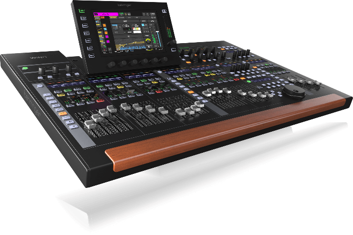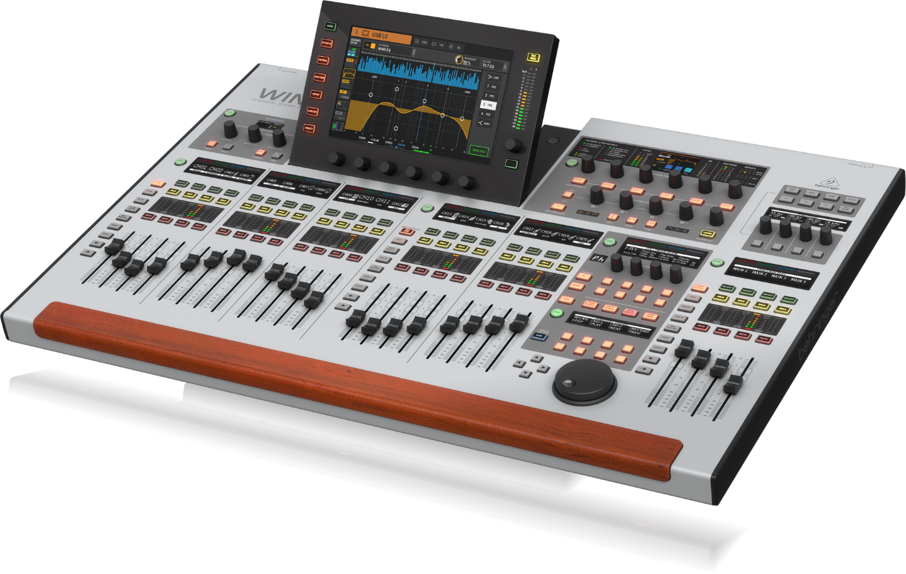
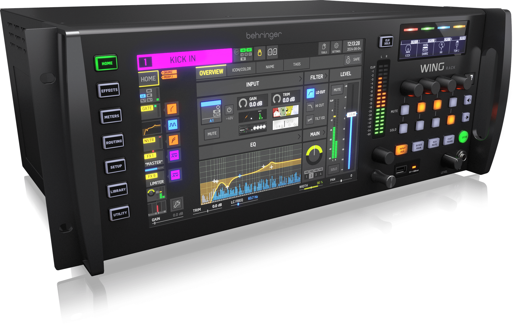
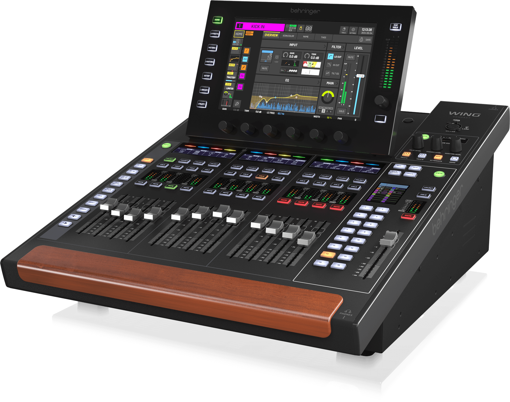

**OSC remote control, MIDI SYSEX, Binary Interfaces,**

**and wapi, an API for WING**

\[V3.1.2-a ‑ Wing FW 3.1.2 and above\]

# Table of Contents

[Introduction [9](#introduction-1)](#introduction-1)

[About this document [9](#about-this-document)](#about-this-document)

[General features of the WING console
[9](#general-features-of-the-wing-console)](#general-features-of-the-wing-console)

[Wing, a family [11](#wing-a-family)](#wing-a-family)

[WING: [11](#wing)](#wing)

[Rack: [11](#rack)](#rack)

[Compact: [12](#compact)](#compact)

[Sources vs. Inputs [13](#sources-vs.-inputs)](#sources-vs.-inputs)

[WING Internal Data [14](#wing-internal-data)](#wing-internal-data)

[WING File System [14](#wing-file-system)](#wing-file-system)

[OS partition [15](#os-partition)](#os-partition)

[Data Partition [15](#data-partition)](#data-partition)

[Console Shutdown [15](#_Toc242368908)](#_Toc242368908)

[Remote communications with WING
[16](#remote-communications-with-wing)](#remote-communications-with-wing)

[Keeping connections alive
[16](#keeping-connections-alive)](#keeping-connections-alive)

[Number of simultaneously connected applications
[16](#number-of-simultaneously-connected-applications)](#number-of-simultaneously-connected-applications)

[Accessing WING Internal Data and Functions from remote programs
[17](#accessing-wing-internal-data-and-functions-from-remote-programs)](#accessing-wing-internal-data-and-functions-from-remote-programs)

[OSC Remote Protocol [19](#osc-remote-protocol)](#osc-remote-protocol)

[OSC Data Types [19](#osc-data-types)](#osc-data-types)

[WING OSC Messages [20](#wing-osc-messages)](#wing-osc-messages)

[Reading (Get) Parameter and Node data
[20](#reading-get-parameter-and-node-data)](#reading-get-parameter-and-node-data)

[Receiving OSC data on a specific port
[21](#receiving-osc-data-on-a-specific-port)](#receiving-osc-data-on-a-specific-port)

[Writing (Set) Parameter and Node data
[22](#writing-set-parameter-and-node-data)](#writing-set-parameter-and-node-data)

[Single Parameters [22](#single-parameters)](#single-parameters)

[Special case: Toggle [22](#special-case-toggle)](#special-case-toggle)

[Strings with spaces or special characters
[22](#strings-with-spaces-or-special-characters)](#strings-with-spaces-or-special-characters)

[Enumerated strings [22](#enumerated-strings)](#enumerated-strings)

[Node Data [23](#node-data)](#node-data)

[Special Node Type/Arguments
[24](#special-node-typearguments)](#special-node-typearguments)

[OSC: Special Cases [27](#osc-special-cases)](#osc-special-cases)

[JSON Structure dynamic changes
[27](#json-structure-dynamic-changes)](#json-structure-dynamic-changes)

[OSC Tag Type ‘blob’ or ‘binary’ use
[28](#osc-tag-type-blob-or-binary-use)](#osc-tag-type-blob-or-binary-use)

[Subscribing to OSC Data
[31](#subscribing-to-osc-data)](#subscribing-to-osc-data)

[WING ae\_data OSC commands list
[32](#wing-ae_data-osc-commands-list)](#wing-ae_data-osc-commands-list)

[Status [32](#status)](#status)

[General Configuration
[34](#general-configuration)](#general-configuration)

[System Settings [39](#system-settings)](#system-settings)

[Input/Output Settings
[40](#inputoutput-settings)](#inputoutput-settings)

[Channel Settings [47](#channel-settings)](#channel-settings)

[Aux Settings [52](#aux-settings)](#aux-settings)

[Bus Settings [55](#bus-settings)](#bus-settings)

[Mains Settings [59](#mains-settings)](#mains-settings)

[Matrix Settings [62](#matrix-settings)](#matrix-settings)

[DCA Settings [65](#dca-settings)](#dca-settings)

[Mutegroup Settings [65](#mutegroup-settings)](#mutegroup-settings)

[Effects Settings [66](#effects-settings)](#effects-settings)

[Cards Settings [67](#cards-settings)](#cards-settings)

[USB Player Settings [69](#usb-player-settings)](#usb-player-settings)

[WING ce\_data OSC commands list
[70](#wing-ce_data-osc-commands-list)](#wing-ce_data-osc-commands-list)

[Control Settings [70](#control-settings)](#control-settings)

[Global Settings [90](#global-settings)](#global-settings)

[WING native / binary data interface
[92](#wing-native-binary-data-interface-1)](#wing-native-binary-data-interface-1)

[Communication Channels
[92](#communication-channels)](#communication-channels)

[Sample receive routine
[93](#sample-receive-routine)](#sample-receive-routine)

[Sample transmit routine
[93](#sample-transmit-routine)](#sample-transmit-routine)

[Channel 2: Audio Engine
[94](#channel-2-audio-engine)](#channel-2-audio-engine)

[Binary Stream Format
[94](#binary-stream-format)](#binary-stream-format)

[Channel 3: Metering [96](#channel-3-metering)](#channel-3-metering)

[Meter Request Tokens
[96](#meter-request-tokens)](#meter-request-tokens)

[Meter Data [97](#meter-data)](#meter-data)

[Introducing wapi \[wapi\]
[98](#introducing-wapi-wapi)](#introducing-wapi-wapi)

[wapi tokens [98](#wapi-tokens)](#wapi-tokens)

[Compiling a program using wapi
[99](#compiling-a-program-using-wapi)](#compiling-a-program-using-wapi)

[wapi Reference Guide
[101](#wapi-reference-guide-1)](#wapi-reference-guide-1)

[Open and Close [101](#open-and-close)](#open-and-close)

[Int wOpen(char\* wip) [101](#int-wopenchar-wip)](#int-wopenchar-wip)

[void wClose() [101](#void-wclose)](#void-wclose)

[unsigned int wVer() [101](#unsigned-int-wver)](#unsigned-int-wver)

[Setting Values [102](#setting-values)](#setting-values)

[int wSetTokenFloat(wtoken token, float fval)
[102](#int-wsettokenfloatwtoken-token-float-fval)](#int-wsettokenfloatwtoken-token-float-fval)

[int wSetTokenInt(wtoken token, int ival)
[102](#int-wsettokenintwtoken-token-int-ival)](#int-wsettokenintwtoken-token-int-ival)

[int wSetTokenString(wtoken token, char\* str)
[102](#int-wsettokenstringwtoken-token-char-str)](#int-wsettokenstringwtoken-token-char-str)

[int wToggleTokenInt(wtoken token)
[103](#int-wtoggletokenintwtoken-token)](#int-wtoggletokenintwtoken-token)

[int wClickTokenByte(wtoken token, char ival)
[103](#int-wclicktokenbytewtoken-token-char-ival)](#int-wclicktokenbytewtoken-token-char-ival)

[Getting Values [104](#getting-values)](#getting-values)

[wtype wGetType(wtoken token)
[104](#wtype-wgettypewtoken-token)](#wtype-wgettypewtoken-token)

[char\* wGetName(wtoken token)
[105](#char-wgetnamewtoken-token)](#char-wgetnamewtoken-token)

[whash wGetHash(wtoken token)
[105](#whash-wgethashwtoken-token)](#whash-wgethashwtoken-token)

[int wGetToken(wtoken token, wtype \*type, wvalue \*value)
[105](#int-wgettokenwtoken-token-wtype-type-wvalue-value)](#int-wgettokenwtoken-token-wtype-type-wvalue-value)

[int wGetTokenFloat(wtoken token, float\* fval)
[106](#int-wgettokenfloatwtoken-token-float-fval)](#int-wgettokenfloatwtoken-token-float-fval)

[int wGetTokenInt(wtoken token, int\* ival)
[107](#int-wgettokenintwtoken-token-int-ival)](#int-wgettokenintwtoken-token-int-ival)

[int wGetTokenString(wtoken token, char\* str)
[107](#int-wgettokenstringwtoken-token-char-str)](#int-wgettokenstringwtoken-token-char-str)

[int wGetTokenDef(wtoken token, int \*num, unsigned char\* str)
[107](#int-wgettokendefwtoken-token-int-num-unsigned-char-str)](#int-wgettokendefwtoken-token-int-num-unsigned-char-str)

[int wGetTokenTimed(wtoken token, wtype \*type, wvalue \*value, int
timeout)
[108](#int-wgettokentimedwtoken-token-wtype-type-wvalue-value-int-timeout)](#int-wgettokentimedwtoken-token-wtype-type-wvalue-value-int-timeout)

[int wGetTokenFloatTimed(wtoken token, float \*fval, int timeout)
[108](#int-wgettokenfloattimedwtoken-token-float-fval-int-timeout)](#int-wgettokenfloattimedwtoken-token-float-fval-int-timeout)

[int wGetTokenIntTimed(wtoken token, int \*ival, int timeout)
[109](#int-wgettokeninttimedwtoken-token-int-ival-int-timeout)](#int-wgettokeninttimedwtoken-token-int-ival-int-timeout)

[int wGetTokenStringTimed(wtoken token, char\* str, int timeout)
[109](#int-wgettokenstringtimedwtoken-token-char-str-int-timeout)](#int-wgettokenstringtimedwtoken-token-char-str-int-timeout)

[A Small Program Example
[110](#a-small-program-example)](#a-small-program-example)

[Event‑driven updates [111](#eventdriven-updates)](#eventdriven-updates)

[int wKeepAlive [111](#int-wkeepalive)](#int-wkeepalive)

[int wGetParsedEvents(wTV \*tv, int maxevents)
[111](#int-wgetparsedeventswtv-tv-int-maxevents)](#int-wgetparsedeventswtv-tv-int-maxevents)

[int wGetParsedEventsTimed(wTV \*tv, int maxevents, int timeout)
[112](#int-wgetparsedeventstimedwtv-tv-int-maxevents-int-timeout)](#int-wgetparsedeventstimedwtv-tv-int-maxevents-int-timeout)

[Nodes [114](#nodes)](#nodes)

[int wSetNode(char \*str)
[115](#int-wsetnodechar-str)](#int-wsetnodechar-str)

[int wSetNodeFtomTVArray(wTV \*array, int nTV)
[115](#int-wsetnodeftomtvarraywtv-array-int-ntv)](#int-wsetnodeftomtvarraywtv-array-int-ntv)

[int wSetBinaryNode (unsigned char \*array, int len)
[115](#int-wsetbinarynode-unsigned-char-array-int-len)](#int-wsetbinarynode-unsigned-char-array-int-len)

[int wGetNode(wtoken node, char \*str)
[116](#int-wgetnodewtoken-node-char-str)](#int-wgetnodewtoken-node-char-str)

[int wGetNodeToTVArray (wtoken node, wTV \*array)
[116](#int-wgetnodetotvarray-wtoken-node-wtv-array)](#int-wgetnodetotvarray-wtoken-node-wtv-array)

[int wGetBinaryNode (wtoken node, unsigned char \*array, int maxlen)
[119](#int-wgetbinarynode-wtoken-node-unsigned-char-array-int-maxlen)](#int-wgetbinarynode-wtoken-node-unsigned-char-array-int-maxlen)

[int wGetBinaryData (char \*str, unsigned char \*array, int maxlen)
[119](#int-wgetbinarydata-char-str-unsigned-char-array-int-maxlen)](#int-wgetbinarydata-char-str-unsigned-char-array-int-maxlen)

[Meters [120](#meters)](#meters)

[Meters API [121](#meters-api)](#meters-api)

[int wMeterUDPPort (int wport)
[121](#int-wmeterudpport-int-wport)](#int-wmeterudpport-int-wport)

[int wSetMetersRequest(int reqID, unsigned char \*wMid)
[121](#int-wsetmetersrequestint-reqid-unsigned-char-wmid)](#int-wsetmetersrequestint-reqid-unsigned-char-wmid)

[int wRenewMeters(int reqID)
[121](#int-wrenewmetersint-reqid)](#int-wrenewmetersint-reqid)

[int wGetMeters(unsigned char \*buf, int maxlen, int timeout)
[122](#int-wgetmetersunsigned-char-buf-int-maxlen-int-timeout)](#int-wgetmetersunsigned-char-buf-int-maxlen-int-timeout)

[RTA test program [124](#rta-test-program)](#rta-test-program)

[Channel strips layers
[128](#channel-strips-layers)](#channel-strips-layers)

[Effects and Plugins [129](#effects-and-plugins)](#effects-and-plugins)

[Plugins [129](#plugins)](#plugins)

[Effects [131](#effects)](#effects)

[Dynamic parameters anonymization in wapi
[133](#dynamic-parameters-anonymization-in-wapi)](#dynamic-parameters-anonymization-in-wapi)

[WING MIDI (Remote‑Control)
[136](#wing-midi-remotecontrol)](#wing-midi-remotecontrol)

[MIDI port names [136](#_Toc242369009)](#_Toc242369009)

[MIDI REMOTE CONTROL [136](#_Toc242369010)](#_Toc242369010)

[WING MIDI SYSEX [139](#wing-midi-sysex)](#wing-midi-sysex)

[SYSEX Messages format
[139](#sysex-messages-format)](#sysex-messages-format)

[SYSEX Messages, Explained
[139](#sysex-messages-explained)](#sysex-messages-explained)

[Examples [140](#examples)](#examples)

[cmd = 00 example: [140](#cmd-00-example)](#cmd-00-example)

[cmd = 02 examples: [140](#cmd-02-examples)](#cmd-02-examples)

[cmd = 03 examples: [141](#cmd-03-examples)](#cmd-03-examples)

[cmd = 05 examples: [141](#cmd-05-examples)](#cmd-05-examples)

[Appendix: Buttons (user/gpio, user/user, user/daw, user/)
[144](#appendix-buttons-usergpio-useruser-userdaw-user)](#appendix-buttons-usergpio-useruser-userdaw-user)

[user/gpio/1..4 [144](#_Toc242369020)](#_Toc242369020)

[user/user/1..4 [144](#_Toc242369021)](#_Toc242369021)

[user/daw1..4/1..4 [144](#userdaw1..41..4)](#userdaw1..41..4)

[user/1..16/1..4 [145](#_Toc242369023)](#_Toc242369023)

[Appendix: Effects and Plugins’ Parameters list
[150](#appendix-effects-and-plugins-parameters-list)](#appendix-effects-and-plugins-parameters-list)

[Effects [150](#effects-1)](#effects-1)

[Standard effects [150](#standard-effects)](#standard-effects)

[Premium effects [159](#premium-effects)](#premium-effects)

[Channel effects [166](#channel-effects)](#channel-effects)

[Plugins [171](#plugins-1)](#plugins-1)

[Filter plugins [171](#filter-plugins)](#filter-plugins)

[Gate/Compressor plugins
[172](#gatecompressor-plugins)](#gatecompressor-plugins)

[EQ plugins [178](#eq-plugins)](#eq-plugins)

[Appendix: WING Effects Description
[181](#appendix-wing-effects-description)](#appendix-wing-effects-description)

[Gate Section [182](#gate-section)](#gate-section)

[Wing Gate/Expander [182](#wing-gateexpander)](#wing-gateexpander)

[Soul 9000 Gate. Emulates the SSL 9000 Channel Gate
[183](#soul-9000-gate.-emulates-the-ssl-9000-channel-gate)](#soul-9000-gate.-emulates-the-ssl-9000-channel-gate)

[Even 88 Gate. Emulates the Neve 88RS Gate.
[184](#even-88-gate.-emulates-the-neve-88rs-gate.)](#even-88-gate.-emulates-the-neve-88rs-gate.)

[Draw More 241. Emulates the Drawmer DL241 Expander/Gate Section.
[185](#draw-more-241.-emulates-the-drawmer-dl241-expandergate-section.)](#draw-more-241.-emulates-the-drawmer-dl241-expandergate-section.)

[BDX 902 De-Esser. Emulates the DBX 902.
[185](#bdx-902-de-esser.-emulates-the-dbx-902.)](#bdx-902-de-esser.-emulates-the-dbx-902.)

[76 Limiter Amp. Emulates the UREI/Universal Audio 1176 FET Compressor.
[185](#limiter-amp.-emulates-the-ureiuniversal-audio-1176-fet-compressor.)](#limiter-amp.-emulates-the-ureiuniversal-audio-1176-fet-compressor.)

[LA Leveler. Emulates the Teletronix LA-2A.
[186](#la-leveler.-emulates-the-teletronix-la-2a.)](#la-leveler.-emulates-the-teletronix-la-2a.)

[Source Extractor. Emulates the Rupert Neve Primary Source Enhancer
PSE-545.
[186](#source-extractor.-emulates-the-rupert-neve-primary-source-enhancer-pse-545.)](#source-extractor.-emulates-the-rupert-neve-primary-source-enhancer-pse-545.)

[Wave Designer. Emulates the SPL Transient Designer.
[187](#wave-designer.-emulates-the-spl-transient-designer.)](#wave-designer.-emulates-the-spl-transient-designer.)

[Auto Rider. Emulates the Waves Vocal Rider
[188](#auto-rider.-emulates-the-waves-vocal-rider)](#auto-rider.-emulates-the-waves-vocal-rider)

[Soul Warmth Pre. Emulates the SSL Console Emulated Preamp.
[188](#soul-warmth-pre.-emulates-the-ssl-console-emulated-preamp.)](#soul-warmth-pre.-emulates-the-ssl-console-emulated-preamp.)

[Wing Gate Dynamic EQ
[188](#wing-gate-dynamic-eq)](#wing-gate-dynamic-eq)

[Equalizer Section [190](#equalizer-section)](#equalizer-section)

[Wing EQ [190](#wing-eq)](#wing-eq)

[Soul Analog. Emulates the SSL Channel EQ.
[190](#soul-analog.-emulates-the-ssl-channel-eq.)](#soul-analog.-emulates-the-ssl-channel-eq.)

[Even 88-Formant. Emulates the Neve 88 EQ.
[191](#even-88-formant.-emulates-the-neve-88-eq.)](#even-88-formant.-emulates-the-neve-88-eq.)

[Even 84. Emulates the AMS Neve 1084 EQ.
[191](#even-84.-emulates-the-ams-neve-1084-eq.)](#even-84.-emulates-the-ams-neve-1084-eq.)

[Fortissimo 110. Emulates the Focusrite ISA 110 EQ.
[192](#fortissimo-110.-emulates-the-focusrite-isa-110-eq.)](#fortissimo-110.-emulates-the-focusrite-isa-110-eq.)

[Pulsar. Emulates the Pultec EQP-1A combined with MEQ-5.
[192](#pulsar.-emulates-the-pultec-eqp-1a-combined-with-meq-5.)](#pulsar.-emulates-the-pultec-eqp-1a-combined-with-meq-5.)

[Mach EQ4. Emulates the Mäag EQ4.
[193](#mach-eq4.-emulates-the-mäag-eq4.)](#mach-eq4.-emulates-the-mäag-eq4.)

[PIA 560 GEQ. Emulates: API 560 EQ.
[193](#pia-560-geq.-emulates-api-560-eq.)](#pia-560-geq.-emulates-api-560-eq.)

[Compressor Section [194](#compressor-section)](#compressor-section)

[Wing Compressor. [194](#wing-compressor.)](#wing-compressor.)

[BDX 160. Emulates the DBX 160.
[195](#bdx-160.-emulates-the-dbx-160.)](#bdx-160.-emulates-the-dbx-160.)

[BDX 560 Easy. Emulates: DBX 560 VCA Overeasy Compressor.
[195](#bdx-560-easy.-emulates-dbx-560-vca-overeasy-compressor.)](#bdx-560-easy.-emulates-dbx-560-vca-overeasy-compressor.)

[Draw More D241. Emulates the Drawmer DL241.
[196](#draw-more-d241.-emulates-the-drawmer-dl241.)](#draw-more-d241.-emulates-the-drawmer-dl241.)

[Red3 Compressor. Emulates: Focusrite Red 3 Compressor.
[196](#red3-compressor.-emulates-focusrite-red-3-compressor.)](#red3-compressor.-emulates-focusrite-red-3-compressor.)

[Soul 9000. Emulates the SSL 9000 Channel Compressor.
[197](#soul-9000.-emulates-the-ssl-9000-channel-compressor.)](#soul-9000.-emulates-the-ssl-9000-channel-compressor.)

[Soul G Buss. Emulates the SSL 9000 G Bus Compressor.
[197](#soul-g-buss.-emulates-the-ssl-9000-g-bus-compressor.)](#soul-g-buss.-emulates-the-ssl-9000-g-bus-compressor.)

[Even Compressor/Lim. Emulates: Neve 33609.
[198](#even-compressorlim.-emulates-neve-33609.)](#even-compressorlim.-emulates-neve-33609.)

[Eternal Bliss. Emulates the Elysia Mpressor.
[198](#eternal-bliss.-emulates-the-elysia-mpressor.)](#eternal-bliss.-emulates-the-elysia-mpressor.)

[76 Limiter Amp. Emulates: UREI/Universal Audio 1176 FET Compressor.
[199](#limiter-amp.-emulates-ureiuniversal-audio-1176-fet-compressor.)](#limiter-amp.-emulates-ureiuniversal-audio-1176-fet-compressor.)

[LA Leveler. Emulates the Teletronix LA-2A.
[200](#la-leveler.-emulates-the-teletronix-la-2a.-1)](#la-leveler.-emulates-the-teletronix-la-2a.-1)

[Fairkid Model 670. Emulates: Fairchild 670.
[201](#fairkid-model-670.-emulates-fairchild-670.)](#fairkid-model-670.-emulates-fairchild-670.)

[No Stressor. Emulates the Emperical Labs EL8 Distressor.
[202](#no-stressor.-emulates-the-emperical-labs-el8-distressor.)](#no-stressor.-emulates-the-emperical-labs-el8-distressor.)

[PIA2250 Rack. Emulates: API 225L 200 series module.
[203](#pia2250-rack.-emulates-api-225l-200-series-module.)](#pia2250-rack.-emulates-api-225l-200-series-module.)

[LTA100 Leveler. Emulates the Summit Audio TLA-100.
[203](#lta100-leveler.-emulates-the-summit-audio-tla-100.)](#lta100-leveler.-emulates-the-summit-audio-tla-100.)

[Wave Designer. Emulates the SPL Transient Designer.
[204](#wave-designer.-emulates-the-spl-transient-designer.-1)](#wave-designer.-emulates-the-spl-transient-designer.-1)

[PSE LA Combo. Emulates the Vintage LA-style Compressors.
[205](#pse-la-combo.-emulates-the-vintage-la-style-compressors.)](#pse-la-combo.-emulates-the-vintage-la-style-compressors.)

[Auto Rider. Emulates the Waves Vocal Rider.
[206](#auto-rider.-emulates-the-waves-vocal-rider.)](#auto-rider.-emulates-the-waves-vocal-rider.)

[Pre FX Effects Section REVERBS
[207](#pre-fx-effects-section-reverbs)](#pre-fx-effects-section-reverbs)

[Hall Reverb [207](#hall-reverb)](#hall-reverb)

[Room Reverb [207](#room-reverb)](#room-reverb)

[Chamber Reverb [209](#chamber-reverb)](#chamber-reverb)

[Plate Reverb [209](#plate-reverb)](#plate-reverb)

[Concert Reverb [210](#concert-reverb)](#concert-reverb)

[Ambience Reverb [211](#ambience-reverb)](#ambience-reverb)

[VSS3 Reverb [211](#vss3-reverb)](#vss3-reverb)

[Vintage Room Reverb [212](#vintage-room-reverb)](#vintage-room-reverb)

[Vintage Reverb [213](#vintage-reverb)](#vintage-reverb)

[Vintage Plate [214](#vintage-plate)](#vintage-plate)

[Blue Plate [214](#blue-plate)](#blue-plate)

[Gated Reverb [215](#gated-reverb)](#gated-reverb)

[Reverse Reverb [216](#reverse-reverb)](#reverse-reverb)

[Delay Reverb [216](#delay-reverb)](#delay-reverb)

[Shimmer Reverb [217](#shimmer-reverb)](#shimmer-reverb)

[Spring Reverb [218](#spring-reverb)](#spring-reverb)

[Appendix: Routing [219](#appendix-routing)](#appendix-routing)

[Input Routing [220](#input-routing)](#input-routing)

[Output Routing [223](#output-routing)](#output-routing)

[Advanced Routing Options
[226](#advanced-routing-options)](#advanced-routing-options)

[USER SIGNAL [226](#user-signal)](#user-signal)

[USER PATCH [228](#user-patch)](#user-patch)

[Appendix: Shows, Scenes (Snaps, Snippets, Presets & Audio Clips)
[230](#appendix-shows-scenes-snaps-snippets-presets-audio-clips)](#appendix-shows-scenes-snaps-snippets-presets-audio-clips)

[Shows [230](#shows)](#shows)

[Scenes [230](#scenes)](#scenes)

[Snaps (& Scopes) [231](#snaps-scopes)](#snaps-scopes)

[Snippets [231](#snippets)](#snippets)

[Presets [231](#presets)](#presets)

[Audio Clips [232](#audio-clips)](#audio-clips)

[Controlling Scenes and Shows via CC buttons
[232](#controlling-scenes-and-shows-via-cc-buttons)](#controlling-scenes-and-shows-via-cc-buttons)

[Controlling Scenes and Shows via MIDI
[233](#controlling-scenes-and-shows-via-midi)](#controlling-scenes-and-shows-via-midi)

[Item Tags [233](#item-tags)](#item-tags)

[Arbitrary MIDI data [234](#arbitrary-midi-data)](#arbitrary-midi-data)

[Appendix: Scopes and Safes
[235](#appendix-scopes-and-safes)](#appendix-scopes-and-safes)

[Library Scopes [235](#library-scopes)](#library-scopes)

[CONTENTS Scopes (orange Icons)
[235](#contents-scopes-orange-icons)](#contents-scopes-orange-icons)

[CONFIGURATION Scopes (blue icons)
[236](#configuration-scopes-blue-icons)](#configuration-scopes-blue-icons)

[CONFIG [236](#config)](#config)

[SFC [236](#sfc)](#sfc)

[PREFS [236](#prefs)](#prefs)

[L, C, R, CC, CMPCT, RCK, EXT, VRT
[236](#l-c-r-cc-cmpct-rck-ext-vrt)](#l-c-r-cc-cmpct-rck-ext-vrt)

[Saved in Snapshots but only recalled through RESTORE:
[236](#saved-in-snapshots-but-only-recalled-through-restore)](#saved-in-snapshots-but-only-recalled-through-restore)

[Console Init Scopes [237](#console-init-scopes)](#console-init-scopes)

[Global Safes [238](#global-safes)](#global-safes)

[Appendix: WING Startup Control
[239](#appendix-wing-startup-control)](#appendix-wing-startup-control)

[Appendix: MIDI DAW mode for REAPER Control Surface Use
[240](#appendix-midi-daw-mode-for-reaper-control-surface-use)](#appendix-midi-daw-mode-for-reaper-control-surface-use)

[REAPER Audio Setup [241](#reaper-audio-setup)](#reaper-audio-setup)

[MIDI [241](#midi)](#midi)

[WING MIDI setup [241](#wing-midi-setup)](#wing-midi-setup)

[REAPER MIDI setup [243](#reaper-midi-setup)](#reaper-midi-setup)

[Appendix: WING Icons [247](#appendix-wing-icons)](#appendix-wing-icons)

[Appendix: WING Colors
[249](#appendix-wing-colors)](#appendix-wing-colors)

[Appendix: WING GPIOs:
[250](#appendix-wing-gpios)](#appendix-wing-gpios)

[Description [250](#description)](#description)

[Electrical connections [250](#_Toc242369130)](#_Toc242369130)

[Power‑on delay [251](#poweron-delay)](#poweron-delay)

[GPIO precedence on USER/LAYER CC GPIO function
[251](#gpio-precedence-on-userlayer-cc-gpio-function)](#gpio-precedence-on-userlayer-cc-gpio-function)

[Multiple, simultaneous actions, using GPIOs
[252](#multiple-simultaneous-actions-using-gpios)](#multiple-simultaneous-actions-using-gpios)

[Appendix: W-Live/SD card Sessions
[253](#appendix-w-livesd-card-sessions)](#appendix-w-livesd-card-sessions)

[Recording data format
[253](#recording-data-format)](#recording-data-format)

[Session name coding [253](#session-name-coding)](#session-name-coding)

[Naming & sorting your existing sessions
[254](#naming-sorting-your-existing-sessions)](#naming-sorting-your-existing-sessions)

[Working with Dante or WSG
[256](#working-with-dante-or-wsg)](#working-with-dante-or-wsg)

[Appendix: MCU \[DAW BUTTONS\] commands list
[257](#appendix-mcu-daw-buttons-commands-list)](#appendix-mcu-daw-buttons-commands-list)

[Appendix: MCU \[DAW V‑POTS\] commands list
[258](#appendix-mcu-daw-vpots-commands-list)](#appendix-mcu-daw-vpots-commands-list)

[Appendix: MCU \[DAW REMOTE MCU\] commands list
[259](#appendix-mcu-daw-remote-mcu-commands-list)](#appendix-mcu-daw-remote-mcu-commands-list)

[Appendix: WING RTA frequencies / semi-tones
[260](#appendix-wing-rta-frequencies-semi-tones)](#appendix-wing-rta-frequencies-semi-tones)

[Appendix: WING Snapshot and JSON Data Structure:
[261](#appendix-wing-snapshot-and-json-data-structure)](#appendix-wing-snapshot-and-json-data-structure)

[Wing Snapfile [261](#wing-snapfile)](#wing-snapfile)

[Description [261](#description-1)](#description-1)

[scopes [262](#scopes)](#scopes)

[ae\_data [263](#ae_data)](#ae_data)

# Introduction

# Introduction

## About this document

My name is Patrick‑Gilles Maillot and I am authorized by Behringer to
publish and maintain this “WING remote protocols” document; I am not a
MusicTribe employee.

Starting with release 2.0 of the WING firmware, OSC and native remote
protocols form a single (this) document under two separate sections, and
share the same series of appendix chapters.

Most users will probably find it easier to remote access their WING with
OSC commands while more advance programing and less restricted control
are possible using **native** commands and the Wing API (**wapi**)
library.

While the main purpose of this document is to offer developers with a
reference to programing their WING console using OSC or wapi, this
document also includes chapters which would qualify more as User Guide
oriented ones, helping novice and advanced users to better use the desk:
Dedicated chapters provide additional details on MIDI, Custom Controls,
Effects, Plugins, Shows and Scenes, Routing and more.

I want to thank the Behringer development team for their continuous
support in writing this document.

## General features of the WING console

In 2019, Behringer has been designing a whole new digital mixing desk
they would later call “Personal Mixing Console”. The WING was unveiled
to the public in November 2019 and first shipments took place in
December that year. As to why calling it a “Personal Mixing Console”,
here is a perfectly valid answer from one of the fathers of the console:
“A fundamental idea of WING was providing a high level of customization
options to the engineer, allowing to adapt the console surface to his
personal preferences and needs”.

The WING console was awaited by several X32 and M32 users as it carried
the promise of new features, long expected since the first release the
X32 and M32 family of digital mixing desks. It seems the WING receives a
warm welcome from the community.

The Behringer WING provides 48‑channel, 28‑bus mixing with 24 motorized
faders and a large 10” capacitive‑touch LED screen. The desk is designed
for live performance, live and studio recording, touring sound, A/V,
club installs, and more. Three separate fader sections and a custom
controls section can be easily and intuitively tailored to personal
requirements.

The 48‑channel inputs \[in/aux\] and 28‑channel mixes
\[bus/matrix/main\] can all be in mono/stereo or mid‑side mode, with
specific source mutes and metering, and provide dynamics, EQ and FX
processing. They too can be given a color, icon, name and up to 8
console or user defined tags for grouping and filtering purposes.

WING input channels provide low‑cut & high‑cut filters, tilt‑EQs,
all‑pass or Sound Maxer, in addition to a 6‑band parametric EQ. All
buses, matrices, and mains feature 8‑band parametric EQ. All channels
and buses can also load high‑end simulations modeled from hardware
devices such as Pultec EQ, SSL Bus Compressor and Gate/Expander, SPL
Transient Designer, Neve EQ, Compressor and Gate, Focusrite ISA and D3,
DBX160, LA‑2A, 1176, Elysia mPressor, Empirical Labs Distressor, and
more. The built in FX rack supports 8 true stereo processors including
TC VSS3 algorithms, Lexicon, Quantec, and EMT emulations. Other
processing includes modulation, equalization, dynamics, nonlinear
effects and four guitar amplifiers with cabinet simulations. A maximum
of 16 stereo inserts can be used for applying internal FX or outboard
processing to input channels or buses.

The channel editing section provides instant channel status overview and
flow of operation. It allows working on the selected channel processing,
even when the main display is used for something completely unrelated.
Touch‑sensitive rotary controls allow you to display the most relevant
information, all at your fingertips.

The central Custom Controls section[1] offers user‑assignable controls
including 4 rotary encoders and 20 buttons with 2 LCDs that can be set
as functions readily available.

A big rotary wheel offers fine‑adjustments for up to 8 user parameters
or can be used for DAW remote control via USB MIDI.

The control configuration also includes predefined functionality for USB
and SD‑card recorder transport, show control and mute groups.

WING includes 8 (full size console) or 24 (Rack and Compact consoles)
original MIDAS PRO microphone preamps and 8 XLR outputs with
professional quality specifications. 8 TRS line auxiliary ins and outs
help bring in signals from media players or computers.

A brand new StageCONNECT[2] interface allows connecting breakout boxes
and delivers up to 32 channels of low‑latency input or output over a
single standard XLR cable (DMX). StageConnect devices include ones from
KlarkTeknik “DN” series[3] and newer designs from Behringer with the “SC
IO” seris[4] and FLOW 4V & 4VIO[5].

WING can accommodate 376 inputs[6] and 374 outputs thanks to 3 AES50
SuperMAC audio networking ports, which connect to digital stageboxes. In
addition, 144 input and 144 output streams can be shared with other
mixing consoles.

There are 48 channels of USB audio and 64 channels of Audio over IP
(AoIP module optional), plus AES/EBU stereo I/O. The WING expansion card
slot features the LIVE SD recording card with 64x64 channels of audio or
can accommodate option cards for various standards such as ADAT, MADI,
DANTE, and WSG.

All digital processing takes place on 40‑bit floating point Digital
Signal Processors, at 48 or 44.1 kHz, with a 1.3ms round‑trip
latency[7].

WING provides MIDI In/Out and 2x2 GPIO (General Purpose Input Output,
1x2 on the compact console) that can be used as console event triggers
and external show controls, including power‑on delays for external gear
that needs sync powering with the console.

Automixing is also implemented, with 2 groups of gain sharing on any 16
input channels. The management of the respective input channel gains
depends on the levels received, reducing the sum gain in the group to
maintain intelligibility and low noise during meetings, ideal when
several speakers are collaborating to corporate events, panels,
broadcast applications or house of worship.

## Wing, a family

Starting with FW version 3.0 in fall 2024, WING firmware addresses more
devices than the ‘big’ WING which has been on the market for almost five
years. **Note these will be disjoint firmware packages.**

**Compact** and **Rack** are now available and offer the same overall
functionality than the initial WING, although the change in format
implies modifications, some more important than others. We list below
the main/obvious elements of WING, Rack and Compact.

### WING:

- Large control surface with a Left bank of 12 channel strips, a Center
  bank of 8 channel strips, a n area with CC encoders and buttons, and a
  Right Bank of 4 channel strips  
  Each bank comes with a specific group select set of buttons (IN, AUX,
  MATRIX, MAIN, BUS, DCA, USER1, USER2, …) on its left side

- Available in gray or black

- Each channel strip is stereo and composed of a motorized fader, a
  MUTE, SOLO and SELECT button, a stereo vu‑meter with clip, dynamics,
  and gate indicators, and a 2‑line B/W scribble with a color LED above
  it

- Big Wheel, 4 cursor Buttons, and a DAW control button for enabling
  some of the fader banks to control MIDI connected DAWs

- A secondary screen besides the main LCD to control/manage ‘in channel’
  settings such as EQ, COMP, etc.

- 8 local Inputs, 8 Aux inputs, 8 aux outputs, 8 local outputs

- 2 headphones jacks on the consoled rear surface sides (left and
  right), level control is on the top surface

- 4‑pin, 12V XLR lamp socket on the rear of the console

- Main board with Power, 2 Ethernet sockets, a USB port, 3 AES50 ports,
  1 StageCONNECT port, AES‑BU In and Out ports and an expansion slot
  fitted with 2 SD recording/playback expansion card.

- 4 GPIO (2 TRS)

- MIDI IN and OUT

- A dedicated section for USB, Monitoring

- A large CC section with 2 sets of 8 buttons for CC, transport
  controls, and other WING dedicated functions (such as Mute Groups),
  DAW control and two LCD for displaying active functions

- A dedicated section with 4 additional encoders and 4 buttons and LCD,
  and 8 buttons to select functions

### Rack: 

- 19”, 4U rack format

- No wheel, no DAW control button(s)

- DAW Mode on Rack is limited to CC buttons and one Mackie Control
  device.

- 24 Local Inputs (8 on the WING)

- No local Aux IO (8 IN, 8 OUT on the WING)

- 4 headphones outs mapped to the 8 local OUTs at the rear of the
  console with their own headphone amps for IEM applications

- 1 general headphone out with dedicated level knob on the front

- No faders, and a limited set of buttons on the surface.

- No encoders below the LCD touch screen (controls are only via the
  touch screen, and two encoders on the right side)

- 1 LCD + set of 4 encoders and 8 buttons CC section, with Layer level
  indicator, VIEW and &gt;4 &lt;4 buttons

- 4 GPIO (2 TRS)

- MIDI IN and OUT

- No Lamp socket

- A USB socket, and 4 buttons dedicated to selecting INPUT/AUX,
  BUSES/MAIN, DCA/Mute Groups, and CUST TRANSP (USB, SD1, SD2) on the CC
  section above

- Same Main board as on WING, no fan

### Compact:

- Smaller (19” rack compatible) surface with 3 sets of 4 faders and 1
  main fader, with bank layer selection available from a vertical set of
  buttons on the left side of the console.

- 4‑pin, 12V XLR lamp socket on the top surface of the console

- Similar channel strips as on WING

- No wheel, no DAW control button(s). Control is possible from the LCD
  screen.

- 24 Local Inputs (8 on the WING)

- No local Aux IO (8 IN, 8 OUT on the WING)

- Monitor/USB section on the right side of the screen

- 16 buttons in two vertical sets of 8 with a dedicated LCD acts as a CC
  section between the 12 faders left and the main fader

- 2 GPIO (1TRS) on the rear of the console (4 GPIO / 2 TRS on the WING)

- MIDI IN and OUT

- 1 headphone lack on the rear of the console (level control is on the
  top surface)

- Same Main board as on WING

## Sources vs. Inputs

Unlike many digital or analogue desks, WING makes a clear separation
between Sources and Input channels;

Historically, consoles focus on input numbers assigned to Channels and
Auxes. WING is offering a different perspective by focusing on the
Source as the reason for any mixing. Sources can be in mono, stereo, or
mid‑side mode, own headamp parameters like gain and phantom power, with
specific source mute and metering. They can be given a color, icon, name
and up to 8 console or user defined tags for grouping and filtering
purposes. All of this describes the actual Source first, before being
patched to Input channels which focus on processing or mixing.

This patching process (also called “Routing”) is described in a specific
“user‑guide” like Appendix later in this document to help new users
grasp the basic operations involved in assigning a physical source
(local or remote) to a channel for mixing, as well as assigning WING
processed audio data to a physical output (local or remote).

Sources can be labeled using the WING Co‑Pilot app or other means such
as **OSC** protocol described later in this document or the **wapi**
function calls also presenter in the upcoming chapters[8], and no matter
if the signal is patched to a channel, to SD recording or to any other
output, it can always be referred to as its assigned Source label.

Notes

The internal real‑time clock (RTC) is powered by a super‑capacitor. If
the WING is off mains for more about two weeks, it will most likely lose
its clock data.

## WING Internal Data

Like all digital or programmable devices, WING relies on an internal set
of parameters that are stored/saved in non‑volatile memory. This enables
you to find the console in the same state you left it when powering it
OFF.

WING data set is very large, and in line with the many features the
console offers. Each button, each attribute, color setting, effect,
parameter, etc. can be found as an internal variable, member of a
hierarchical tree structure.

The WING tree is more than 25000 elements! To organize this large set of
internal variables, WING uses a hierarchical tree of data, stating with
a root and dispatching parameters into logical groups (sub‑trees or
branches) until the last element (leaves) that represent the actual
parameter.

For example, the fader associated to channel 1 is part of the channels
sub‑tree, and is one of the many attributes of channel 1. The channel
sub‑tree is part of the audio‑engine, itself at the root level.

A quick representation would be as shown below:

Computers use specific data structures to represent trees. WING uses one
of them, based on JSON[9] notation. It is important to know/understand
the list of sub‑trees (nodes), and leaves (parameters) WING contains as
this is how you can access to data. More detail on the WING data set is
provided in appendix.

## WING File System

At the difference of the X32, WING can be directly connected to a
computer via USB; There are two ways WING can be visible to your
computer, depending on the setting of the SETUP→GENERAL screen (shown
below, with WING connected as an active data partition):

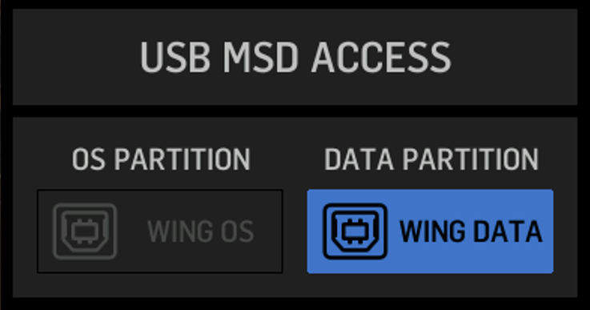

When actively connected to your PC either as an OS partition or a Data
partition, the status at the top of the WING screen will show a red OS
or DATA tag.

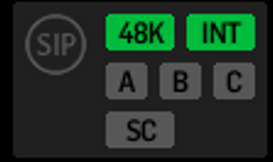
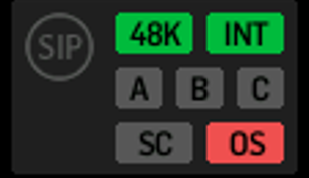
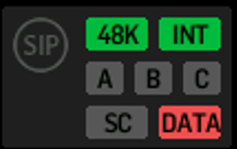

### OS partition

WING can be seen as an OS PARTITION, a directory where you can deposit
the FW release you will use to boot from at next power up or reboot. Use
with caution! One can directly mount and access the boot partition from
a PC with the WING connected over USB and by powering WING while
pressing the unmarked button at the bottom right of the screen.

### Data Partition

A USB connected WING presents itself as an external disk drive.
Therefore, the standard cautions apply when connecting and more
important, disconnecting from the computer; ***Ensure you unmount the
WING file system to avoid losing data.***

If the choice for USB MSD ACCESS in SETUP→GENERAL is set to DATA
PARTITION, the WING file system will show as a standard external USB
drive. There may be some folders already there, such as ‘global’ or
‘shows’, with subfolders, such as ‘global/ch\_presets’,
‘global/fx\_presets’, ‘global/routing\_presets’, ‘global/snapshots’.

Console Shutdown  
*How to ensure proper shutdown of the console? How to avoid data loss at
shutdown?*  
These are FAQs. The answer is simple: Follow the instructions on the
screen after going to SETUP and selecting the SHUTDOWN option. This will
ensure the last changes made to the console will be saved before
shutdown, and recalled when switching the console back on again.  
Make sure you disconnect the outputs of the console or switch off output
devices before switching off the console to avoid loud pop noise sent to
connected output devices.  
Nevertheless, the console FW saves its current state every 120s if
changes occurred. A command[10] enables instantaneous save of the
current state before powering off the console if using remote/network
commands.

# Remote communications with WING

WING communicates via ports 2223 \[UDP\], and 2222 \[UDP, TCP\];

Initiating a communication with WING starts with sending the 5 bytes
\[UDP\] datagram ‘WING?’ to the IP of your WING, port 2222.

WING will reply to the requesting IP and port with the following
datagram:

‘WING,’ \[c\_ip\] ‘,’ \[c\_name\] ‘,’ \[c\_model\] ‘,’ \[c\_serial\] ‘,’
\[firmware\]

Where:

\[c\_ip\] e.g., ‘192.168.1.62’

\[c\_name\] ascii characters

\[c\_model\] ‘ngc‑full’ (standard Wing console)

\[c\_serial\] serial number (ascii)

\[firmware\] version string (ascii)

For its native communication format, WING proposes 14 ‘communication
channels’ to enable separation between the different ‘engines’ or main
blocks of the console. The following communication channels are
currently in use:

Control‑engine (a TCP communication channel) is using channel \#1

Audio‑engine (main TCP communication channel) is using channel \#2

Meters (UDP communication) are using channel \#3

OSC uses a single UDP communication port: 2223

## Keeping connections alive

Open connections will time out after 10 seconds of inactivity (on the
receiving side). One way to keep a connection active is to request at
regular intervals of less than 10 seconds some data from the console.
There are many data that can be collected, as shown later in this
document.

## Number of simultaneously connected applications

WING can simultaneously communicate with up to 24 **connected**
‘clients’; Make sure your network bandwidth supports this, or limit your
number of simultaneously connected clients to a lower value; The console
will reject connection requests if the maximum number of simultaneous
connections (24) is reached.

What we call ‘clients’ above refer to actual TCP ports that communicate
with the console. Some applications may use several ports and this will
reduce the actual number of applications that can simultaneously connect
and communicate with WING.

UDP communications such as used for OSC do not have this limitation,
being “connection‑less”. On the other hand, WING’s OSC remote protocol
enables **only one** (1) subscription to data (for receiving event
messages) at any given time.

Subscriptions must be kept alive; they automatically die after 10
seconds.

## Accessing WING Internal Data and Functions from remote programs

As mention in the introduction, WING hosts an **OSC** compliant remote
protocol server that offers access to the full set of features of the
desk. This is described in the “**WING OSC protocol data interface**”
chapter below.

WING also offers a native, binary protocol with the capability to access
(read or write) parameters of its internal structures and take full
advantage of the entire set of features of the digital desk, including
remote control. The protocol is fully described in the “**WING
native/binary data interface**” chapter below.

To help users access the native protocol, a WING API written in C
\[**wapi**\] has been developed and is available as a free resource at
<https://x32ram.com/wapi> to write programs that directly call **wapi**
functions.

# WING OSC protocol data interface

# OSC Remote Protocol

WING includes an OSC Remote Protocol server. This enables easy access to
remote features for many professional, sound applications and extensions
offered by third parties.

**OSC remote control** enables reading and modifying (when possible) all
parameters included in the ae\_data and ce\_data JSON structures, all
part of the main parameter tree.

WING OSC server implementation complies with the **OSC standard**[11]
and proposes several ways to access data, parameters, and features. As
all OSC compliant servers, the WING OSC server runs in the console and
will reply to **UDP** on a specific port: **2223**.

When using standard UDP communication, clients will be replied onto
their calling port. If needed, a specific feature enables WING to reply
to a UDP port specified by the connected client, as explained later in
this document.

## OSC Data Types

In compliance with the OSC standard, WING supports the following types:

- int32 (32bits, bi‑endian),

- float32 (32bits, IEEE 754, big endian),

- string (non‑null ASCII characters followed by a null, followed by 0‑3
  additional null characters to make the total number of bytes a
  multiple of 4),

- blob (An int32 size count, followed by one or more bytes of arbitrary
  binary data, followed by 0‑3 additional zero bytes to make the total
  number of bytes a multiple of 4).

As specified in the OSC standard, the unit of transmission of OSC is an
OSC Packet. Any application that sends OSC Packets is an OSC Client;
WING embeds and runs an OSC Server.

An OSC Packet consists of its contents, a contiguous block of binary
data, and its size, the number of 8‑bit bytes that comprise the
contents. The size of an OSC packet is always a multiple of 4.

In the case of WING, the contents of an OSC packet is always an OSC
Message, i.e. OSC Bundles are not supported. Note that wildcards ‘?’ and
‘\*’ in Address Patterns are reserved for special cases.

An OSC Message consists of an OSC Address Pattern followed by an OSC
Type Tag String followed by zero or more OSC Arguments. Some older
implementations of OSC may omit the OSC Type Tag string and WING
supports this.

- OSC Address Patterns always start with the character ‘/’.

- OSC Type Tags can be i, f, s, b for int32, float32, string and blob,
  respectively

- OSC Arguments consist in a single or a contiguous sequence of the
  binary representations of each argument

The maximum UDP packet size is 32k bytes.

## WING OSC Messages

In the following paragraphs, we assume a communication link exists
between WING and a client program, and communications take place with a
WING console at a known IP address, using UDP on port 2223.

All along this document, the character ‘~’ will represent a NULL byte
(\0). Patterns ‑&gt;W and W‑&gt; represent data sent to WING and data
received from WING followed by the actual number of bytes transmitted or
received, respectively. To generate and test the OSC patterns listed in
these pages, we used wosc[12], a command‑line tool specifically designed
to operate with WING OSC.

Retrieving WING console information can be completed by sending the OSC
Address Pattern “/?”

‑&gt;W, 4 B: /?~~

W‑&gt;, 80 B:
/?~~,s~~WING,192.168.1.71,PGM,ngc‑full,NO\_SERIAL,1.07.2‑40‑g1b1b292b:develop~~~~

The actual bytes exchanged are displayed below (OSC is a binary
protocol)

‑&gt;W, 4 B: 2f3f0000

W‑&gt;, 80 B:
2f3f00002c73000057494e472c3139322e3136382e312e37312c50474d2c6e67632d66756c6c2c4e4f5f53455249414c2c312e30372e322d34302d6731623162323932623a646576656c6f7000000000

The line below is using a more compliant OSC format, and will result in
the same answer

‑&gt;W, 8 B: /?~~,~~~

### Reading (Get) Parameter and Node data

There are two main ways to gain access to WING data: using
one‑parameter‑at‑a‑time or using “**nodes**”.

WING “nodes” are a great way to access multiple parameters at a time,
and therefore maximize communication bandwidth with the console. Nodes
are represented as **string** OSC Data Type and are zero terminated (\0
byte ending the string).

Nodes are also a good way to discover WING parameters, as they offer
easy access to the full map of the JSON internal data structures.

We show below WING’s first layer of JSON structure, and starting at the
root, retrieved using OSC.

‑&gt;W, 4 B: /~~~

W‑&gt;, 116 B:
/~~~,ssssssssssssssss~~~$stat~~~cfg~$syscfg~io~~ch~~aux~bus~main~~~~mtx~dca~mgrp~~~~fx~~cards~~~play~~~~rec~$ctl~~~~

Retrieving a WING single parameter is quite easy: You must ensure your
OSC request points to a leaf of the JSON structure (i.e. there is no
more hierarchy data after the current one). This is for example the case
for the fader value of a channel strip, or its mute state. Channel Strip
1 fader is represented as follows:

> 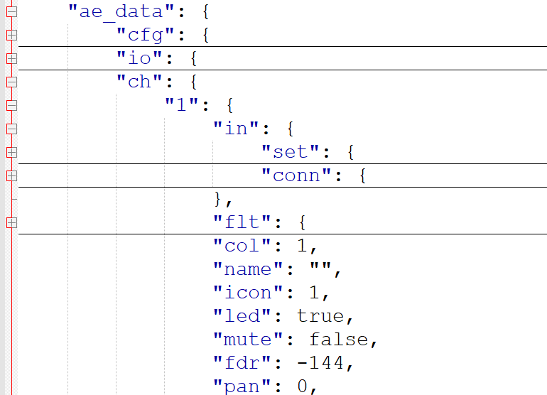 style="width:2.45382in;height:1.77188in" />

Or “ch”/”1”/”fdr”, which translates to OSC Address Pattern /ch/1/fdr:

‑&gt;W, 12 B: /ch/1/fdr~~~

W‑&gt;, 32 B:
/ch/1/fdr~~~,sff~~~~‑oo~\[0.0000\]\[‑144.0000\]

In the example above, the data \[0.0000\]\[‑144.0000\] are ascii
representation of two 32bits big‑endian float data values, each coded on
4 bytes as binary. The binary data actually received is as shown below,
and in order to ease the reading of numerical information in this
document, we use readable values in brackets rather than the actual
binary data. The color highlights are there to help distinguish data
elements.

W‑&gt;, 32 B:
2f63682f312f6664720000002c736666000000002d6f6f0000000000c3100000

Depending on the OSC Address Pattern, WING returns ',s' for strings or
enums, ',sff' (ascii, raw, float value) for floats, ',sfi' (ascii, raw,
int value) for ints. In the example above, fader position is a float and
WING returns the ascii representation, the raw \[0.0..1.0\] data and the
actual float value in dB.

Similarly, requesting the mute state of channel strip 1 would return:

‑&gt;W, 12 B: /ch/1/mute~~

W‑&gt;, 32 B: /ch/1/mute~~,sfi~~~~1~~~\[1.0000\]\[
1\]

W‑&gt;, 32 B:
2f63682f312f6d75746500002c73666900000000310000003f80000000000001

It should be noted that WING will accept both OSC path or the native
hash data for representing nodes or parameters; Indeed, all nodes and
parameters in the console are assigned a binary address (a hash) as
explained in the chapter on native interface to the console. For
example, the channel 1 mute command above can be sent as OSC Address
Patterns /ch/1/mute~~ as shown, or /#f50f69f8~~, and would return the
same data as shown above. 0xf50f69f8 is the hash for command “Channel 1
mute”. The full set of WING hash values can be discovered by recursively
traversing the JSON tree of WING nodes/commands, using the native binary
interface or OSC protocol, but it is generally more convenient to use
the more standard OSC node notation, rather than hexadecimal hash values
to address the console features.

### Receiving OSC data on a specific port

Some OSC programs will request that data is returned on a specific port
rather than being sent back to the port used by the requesting client
for sending data. To enable this capability, WING OSC includes an
optional, special notation for all OSC commands:

Any OSC command can be prefixed with the /%&lt;port&gt;, with
&lt;port&gt; in the form “12345” to enable receiving the expected answer
onto the specified port number. For example, the OSC request:

‑&gt;W, 20 B: /%10027/ch/1/mute~~~

Will receive the expected reply from WING on port 10027, as shown below,
using a sniffer program on said port. The IP does not change.

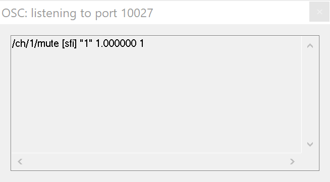

### Writing (Set) Parameter and Node data

#### Single Parameters

OSC can be used to set or modify WING data. Taking the fader and mute
examples above, we can modify their respective values using OSC
commands, sending string, big‑endian int32 or big‑endian float32 with
the corresponding OSC Type Tag following the OSC Address Pattern
respective of the parameter to change.

WING does not echo data sent over UDP by the client application. The
client application may nevertheless be notified with an OSC event in
case of an error.

Individual parameters can be strings, integer, or floats; WING OSC
server implementation enables to use several data types and will manage
the conversion to ensure proper value setting inside the console. For
example, fader position is a floating‑point internal value. It can be
set as a string or a float using the following OSC commands (in this
example setting channel 2 fader position to ‑2 or ‑3dB):

‑&gt;W, 20 B: /ch/2/fdr~~~,s~~‑2~~

‑&gt;W, 12 B: /ch/2/fdr~~~

W‑&gt;, 36 B: /ch/2/fdr~~~,sff~~~~‑2.0~~~~\[0.7000\]\[‑2.0000\]

‑&gt;W, 20 B: /ch/2/fdr~~~,f~~\[‑3.0000\]

‑&gt;W, 12 B: /ch/2/fdr~~~

W‑&gt;, 36 B: /ch/2/fdr~~~,sff~~~~‑3.0~~~~\[0.6750\]\[‑3.0000\]

#### Special case: Toggle

Wing OSC implements a specific option for toggling \[0..1\] OSC integer
values for int Type Tags;

This can be quite useful to change a value without first having to read
it and test its current value before sending back 0 or 1 accordingly. By
sending a -1 to an OSC Command with and integer OSC Type Tag that can
only accept values 0 or 1, the value of the parameter will toggle
between 0 and 1. For example:

-&gt;W, 20 B: /ch/1/mute~~,i~~\[ -1\]

Will mute channel 1 it is was unmuted, and unmute channel 1 if it was
muted

#### Strings with spaces or special characters

Sending strings with OSC can sometime require spaces, or ‘special’
characters (such as \#). It may be necessary to encapsulate the string
you are trying to pass on with single or double quotes \[ ‘ or “ \] so
the space character in a string or that \# header character for tags be
correctly parsed.

#### 

#### Enumerated strings

One of the data WING uses is “enumerated strings”, or the choice of one
string in a list of elements to represent a specific state or attribute
value. For example, /$ctl/user/1/1/enc/mode can be any of the following
strings: OFF, FDR, PAN, DCA, SSND, FSND, FX, DAWMCU, MON, MIDICC, SD A,
or SD B

This can be set via a string OSC tag, as shown below if one wants to set
the mode parameter to FX:

/$ctl/user/1/1/enc

‑&gt;W, 20 B: /$ctl/user/1/1/enc~~

W‑&gt;, 52 B: /$ctl/user/1/1/enc~~,sss~~~~mode~~~~name~~~~$fname~~

‑&gt;W, 24 B: /$ctl/user/1/1/enc/mode~

W‑&gt;, 32 B: /$ctl/user/1/1/enc/mode~,s~~OFF~

/$ctl/user/1/1/enc/mode ,s FX

‑&gt;W, 32 B: /$ctl/user/1/1/enc/mode~,s~~FX~~

/$ctl/user/1/1/enc/mode

‑&gt;W, 24 B: /$ctl/user/1/1/enc/mode~

W‑&gt;, 32 B: /$ctl/user/1/1/enc/mode~,s~~FX~~

But it can also be set as an int OSC tag, using the index of the list
corresponding to the targeted value; in the example above, FX sits at
index 6 in the list of 10 strings; This enables us to use the following
OSC command to set the encoder mode to FX:

/$ctl/user/1/1/enc

‑&gt;W, 20 B: /$ctl/user/1/1/enc~~

W‑&gt;, 52 B: /$ctl/user/1/1/enc~~,sss~~~~mode~~~~name~~~~$fname~~

‑&gt;W, 24 B: /$ctl/user/1/1/enc/mode~

W‑&gt;, 32 B: /$ctl/user/1/1/enc/mode~,s~~OFF~

/$ctl/user/1/1/enc/mode ,i 6

‑&gt;W, 32 B: /$ctl/user/1/1/enc/mode~,i~~\[ 6\]

/$ctl/user/1/1/enc/mode

‑&gt;W, 24 B: /$ctl/user/1/1/enc/mode~

W‑&gt;, 32 B: /$ctl/user/1/1/enc/mode~,s~~FX~~

One can also note the extendibility character of WING nodes; indeed,
after the previous command, the user 1/1 encoder has additional
parameters:

/$ctl/user/1/1/enc

‑&gt;W, 20 B: /$ctl/user/1/1/enc~~

W‑&gt;, 60 B:
/$ctl/user/1/1/enc~~,sssss~~mode~~~~name~~~~$fname~~fx~~par~

#### Node Data

WING nodes can also be used to set multiple values with using a single
OSC “/” command, and offer a simple yet effective way to navigate within
the hierarchical structure of JSON data. Say you want/need to set fader
and mute values to ‑1 dB, 0 dB, OFF and ON for channels 1 and 2; This
can be achieved in a single OSC request using the following syntax:

‑&gt;W, 44 B: /~~~,s~~/ch.1.fdr=‑1,mute=0,.2.fdr=0,mute=1~

Or setting channel 1 fader and mute values to 10 dB and ON, and setting
bus 1 fader to 5 dB:

‑&gt;W, 44 B: /~~~,s~~/ch.1.fdr=10,mute=1,/bus.1.fdr=5~~~~

As shown above, each parameter group is separated by a ‘,’ character,
the ‘/’ character represents the root of the JSON parameter tree, and
‘.’ characters are used to navigate up and down within the JSON
parameter tree.

The console will reply with /\*~~,s~~OK~~ if the command was accepted,
or one of the following:

/\*~~,s~~NODE NOT FOUND~~

/\*~~,s~~VALUE ERROR~~~~~

/\*~~,s~~BUFFER OVERFLOW~

/\*~~,s~~NODE IS NOT PAR~

/\*~~,s~~INCOMPLETE DATA~

/\*~~,s~~STACK EMPTY~~~~~

if an error occurred during the execution of the command.

**Note**: Nodes can return large amounts of data; as a result, some
nodes cannot be returned using OSC/UDP as they would overflow the 32kB
UDP buffer limitation; In such situation, WING will return an error OSC
message event.

Some nodes examples are provided below:

‑&gt;W, 12 B: /ch/1/fdr~~~

W‑&gt;, 32 B: /ch/1/fdr~~~,sff~~~~‑oo~\[0.0000\]\[‑144.0000\]

‑&gt;W, 12 B: /ch/1/mute~~

W‑&gt;, 32 B: /ch/1/mute~~,sfi~~~~1~~~\[1.0000\]\[ 1\]

‑&gt;W, 12 B: /ch/2/fdr~~~

W‑&gt;, 32 B: /ch/2/fdr~~~,sff~~~~‑oo~\[0.0000\]\[‑144.0000\]

‑&gt;W, 12 B: /ch/2/mute~~

W‑&gt;, 32 B: /ch/2/mute~~,sfi~~~~0~~~\[0.0000\]\[ 0\]

‑&gt;W, 44 B: /~~~,s~~/ch.1.fdr=‑1,mute=0,.2.fdr=0,mute=1~

W‑&gt;, 12 B: /\*~~,s~~OK~~

‑&gt;W, 12 B: /ch/1/fdr~~~

W‑&gt;, 36 B: /ch/1/fdr~~~,sff~~~~‑1.0~~~~\[0.7250\]\[‑1.0000\]

‑&gt;W, 12 B: /ch/1/mute~~

W‑&gt;, 32 B: /ch/1/mute~~,sfi~~~~0~~~\[0.0000\]\[ 0\]

‑&gt;W, 12 B: /ch/2/fdr~~~

W‑&gt;, 32 B: /ch/2/fdr~~~,sff~~~~0.0~\[0.7500\]\[0.0000\]

‑&gt;W, 12 B: /ch/2/mute~~

W‑&gt;, 32 B: /ch/2/mute~~,sfi~~~~1~~~\[1.0000\]\[ 1\]

Nodes can also be located deeper in the JSON structure tree. For
example, changing a single parameter in the node channel 1 \[”/ch/1”\]
can be done as shown below:

‑&gt;W, 20 B: /ch/1~~~,s~~fdr=3~~~

W‑&gt;, 16 B: /ch/1\*~~,s~~OK~~

‑&gt;W, 12 B: /ch/1/fdr~~~

W‑&gt;, 32 B: /ch/1/fdr~~~,sff~~~~3.0~\[0.8250\]\[3.0000\]

‑&gt;W, 12 B: /ch/1/mute~~

W‑&gt;, 32 B: /ch/1/mute~~,sfi~~~~0~~~\[0.0000\]\[ 0\]

The OSC command is replied to with an OK status if execution went well;
error messages can be returned too, as explained earlier.

The same type of command can be used to set/change several parameters at
once; For example, fader and mute values of channel 1 can be done as
follows:

‑&gt;W, 28 B: /ch/1~~~,s~~fdr=4,mute=1~~~~

W‑&gt;, 16 B: /ch/1\*~~,s~~OK~~

‑&gt;W, 12 B: /ch/1/fdr~~~

W‑&gt;, 32 B: /ch/1/fdr~~~,sff~~~~4.0~\[0.8500\]\[4.0000\]

‑&gt;W, 12 B: /ch/1/mute~~

W‑&gt;, 32 B: /ch/1/mute~~,sfi~~~~1~~~\[1.0000\]\[ 1\]

#### Special Node Type/Arguments

There are three special tag/argument that are specifically implemented
for nodes. They enable listing the complete set of data, parameter
description, and description including values for the node provided as
OSC address pattern. The arguments to use are ‘\*’, ‘?’, and ‘#’,
respectively. Examples of use are provided below, applied to OSC address
pattern /fx/1 when no effect is loaded to keep the description as short
as possible.

##### Node data dump:

When using this format, the data returned will strictly correspond to
what would be saved in a snap file; Read‑only and temporary data are not
returned.

/fx/1 ,s \*

‑&gt;W, 16 B: /fx/1~~~,s~~\*~~~

W‑&gt;, 32 B: /fx/1~~~,s~~mdl=NONE,fxmix=100,~

##### Node parameter description:

/fx/1 ,s ?

‑&gt;W, 16 B: /fx/1~~~,s~~?~~~

W‑&gt;, 696 B: /fx/1~~~,s~~ mdl list \[NONE, EXT, HALL, ROOM, CHAMBER,
PLATE, CONCERT, AMBI, V‑ROOM, V‑REV, V‑PLATE, GATED, REVERSE, DEL/REV,
SHIMMER, SPRING, DIMCRS, CHORUS, FLANGER, ST‑DL, TAP‑DL, TAPE‑DL,
OILCAN, BBD‑DL, PITCH, D‑PITCH, VSS3, BPLATE, GEQ, PIA, DOUBLE, PCORR,
LIMITER, DE‑S2, ENHANCE, EXCITER, P‑BASS, ROTARY, PHASER, PANNER, TAPE,
MOOD, SUB, RACKAMP, UKROCK, ANGEL, JAZZC, DELUXE, BODY, SOUL, E88, E84,
F110, PULSAR, MACH4, C5‑CMB, SUB‑M, V‑IMG, SPKMAN, DEQ3, \*EVEN\*,
\*SOUL\*, \*VINTAGE\*, \*BUS\*, \*MASTER\*\]~ fxmix lin \[0 .. 100 %\],
101 steps~ $esrc int \[0 .. 400\]~ $emode list \[M, ST, M/S\]~ $a\_chn
int \[0 .. 76\]~ $a\_pos int \[0 .. 1\]~~~~

##### Node description including values:

/fx/1 ,s \#

‑&gt;W, 16 B: /fx/1~~~,s~~#~~~

W‑&gt;, 816 B: /fx/1~~~,s~~ mdl NONE list \[NONE, EXT, HALL, ROOM,
CHAMBER, PLATE, CONCERT, AMBI, V‑ROOM, V‑REV, V‑PLATE, GATED, REVERSE,
DEL/REV, SHIMMER, SPRING, DIMCRS, CHORUS, FLANGER, ST‑DL, TAP‑DL,
TAPE‑DL, OILCAN, BBD‑DL, PITCH, D‑PITCH, VSS3, BPLATE, GEQ, PIA, DOUBLE,
PCORR, LIMITER, DE‑S2, ENHANCE, EXCITER, P‑BASS, ROTARY, PHASER, PANNER,
TAPE, MOOD, SUB, RACKAMP, UKROCK, ANGEL, JAZZC, DELUXE, BODY, SOUL, E88,
E84, F110, PULSAR, MACH4, C5‑CMB, SUB‑M, V‑IMG, SPKMAN, DEQ3, \*EVEN\*,
\*SOUL\*, \*VINTAGE\*, \*BUS\*, \*MASTER\*\]~ fxmix 100 lin \[0 .. 100
%\], 101 steps~ $esrc 0 r/o int \[0 .. 400\]~ $emode M r/o list \[M, ST,
M/S\]~ $a\_chn 0 r/o int \[0 .. 76\]~ $a\_pos 0 r/o int \[0 .. 1\]~~~~

As a second example, we give below the node data dump for OSC address
pattern /ch/1, when loaded with default values after init:

/ch/1 ,s \*

‑&gt;W, 16 B: /ch/1~~~,s~~\*~~~

W‑&gt;, 2156 B:
/ch/1~~~,s~~in.set.srcauto=0,altsrc=0,inv=0,trim=0.0,bal=0.0,dlymode=M,dly=0.1,dlyon=0,.conn.grp=LCL,in=1,altgrp=OFF,altin=1,..flt.lc=0,lcf=100.2,lcs=24,hc=0,hcf=10k02,hcs=12,tf=0,mdl=TILT,tilt=0.00,.clink=1,col=1,name=,icon=0,led=1,mute=0,fdr=‑oo,pan=0,wid=100,solosafe=0,mon=A,proc=GEDI,ptap=5,peq.on=0,1g=0.0,1f=100,1q=1.00,2g=0.0,2f=999,2q=1.00,3g=0.0,3f=10k0,3q=1.00,.gate.on=0,mdl=GATE,thr=‑40.0,range=40.0,att=10,hld=10,rel=199,acc=0,ratio='1:3',.gatesc.type=OFF,f=1k0,q=2.00,src=SELF,tap=IN,.eq.on=0,mdl=STD,mix=100,lg=0.0,lf=80.2,lq=1.00,leq=SHV,1g=0.0,1f=200.0,1q=1.00,2g=0.0,2f=601.4,2q=1.00,3g=0.0,3f=1k50,3q=1.00,4g=0.0,4f=3k99,4q=1.00,hg=0.0,hf=12k00,hq=1.00,heq=SHV,.dyn.on=0,mdl=COMP,mix=100,gain=0.0,thr=‑10.0,ratio=3.0,knee=3,det=RMS,att=50,hld=20,rel=153,env=LOG,auto=1,.dynxo.depth=6.0,type=OFF,f=1k0,.dynsc.type=OFF,f=1k0,q=2.00,src=SELF,tap=IN,.preins.on=0,ins=NONE,.main.1.on=1,lvl=0.0,pre=0,.2.on=0,lvl=0.0,pre=0,.3.on=0,lvl=0.0,pre=0,.4.on=0,lvl=0.0,pre=0,..send.1.on=0,lvl=‑oo,pon=0,mode=PRE,plink=0,pan=0,.2.on=0,lvl=‑oo,pon=0,mode=PRE,plink=0,pan=0,.3.on=0,lvl=‑oo,pon=0,mode=PRE,plink=0,pan=0,.4.on=0,lvl=‑oo,pon=0,mode=PRE,plink=0,pan=0,.5.on=0,lvl=‑oo,pon=0,mode=PRE,plink=0,pan=0,.6.on=0,lvl=‑oo,pon=0,mode=PRE,plink=0,pan=0,.7.on=0,lvl=‑oo,pon=0,mode=PRE,plink=0,pan=0,.8.on=0,lvl=‑oo,pon=0,mode=PRE,plink=0,pan=0,.9.on=0,lvl=‑oo,pon=0,mode=GRP,plink=1,pan=0,.10.on=0,lvl=‑oo,pon=0,mode=GRP,plink=1,pan=0,.11.on=0,lvl=‑oo,pon=0,mode=POST,plink=1,pan=0,.12.on=0,lvl=‑oo,pon=0,mode=POST,plink=1,pan=0,.13.on=0,lvl=‑oo,pon=0,mode=POST,plink=1,pan=0,.14.on=0,lvl=‑oo,pon=0,mode=POST,plink=1,pan=0,.15.on=0,lvl=‑oo,pon=0,mode=POST,plink=1,pan=0,.16.on=0,lvl=‑oo,pon=0,mode=POST,plink=1,pan=0,.MX1.on=0,lvl=‑oo,pon=0,mode=PRE,plink=0,pan=0,.MX2.on=0,lvl=‑oo,pon=0,mode=PRE,plink=0,pan=0,.MX3.on=0,lvl=‑oo,pon=0,mode=PRE,plink=0,pan=0,.MX4.on=0,lvl=‑oo,pon=0,mode=PRE,plink=0,pan=0,.MX5.on=0,lvl=‑oo,pon=0,mode=PRE,plink=0,pan=0,.MX6.on=0,lvl=‑oo,pon=0,mode=PRE,plink=0,pan=0,.MX7.on=0,lvl=‑oo,pon=0,mode=PRE,plink=0,pan=0,.MX8.on=0,lvl=‑oo,pon=0,mode=PRE,plink=0,pan=0,..tapwid=100,postins.on=0,mode=FX,ins=NONE,w=0.0,.tags=,~~~~

## OSC: Special Cases

### JSON Structure dynamic changes

As parameters get changed on the WING console, its JSON structure tree
evolves to reflect the changes; This can be a specific parameter that
when changing to an ON state, offers new capabilities in the audio
chain, or in the way the console will react.

It is also typical of **effects** and **plugins**: WING consoles support
dynamic allocation of effect or plugins that can generate large changes
within the default JSON tree. As already mentioned, WING nodes are a
great way to list the parameters available for a given effect and
therefore a way to get and possibly set effect parameter values.

The WING effects and plugins, and their respective parameters are listed
later in this document[13].

The OSC commands below show how you can access effects slots, allocate
an effect, and list parameters and later modify effect parameter values.

Accessing effects with currently no effect loaded in effect slot 1,
listing the effect node:

‑&gt;W, 4 B: /fx~

W‑&gt;, 88 B:
/fx~,ssssssssssssssss~~~1~~~2~~~3~~~4~~~5~~~6~~~7~~~8~~~9~~~10~~11~~12~~13~~14~~15~~16~~

‑&gt;W, 8 B: /fx/1~~~

W‑&gt;, 60 B:
/fx/1~~~,ssssss~mdl~fxmix~~~$esrc~~~$emode~~$a\_chn~~$a\_pos~~

‑&gt;W, 12 B: /fx/1/mdl~~~

W‑&gt;, 24 B: /fx/1/mdl~~~,s~~NONE~~~~

Loading a PIA effect in effect slot 1:

‑&gt;W, 20 B: /fx/1/mdl~~~,s~~pia~

‑&gt;W, 12 B: /fx/1/mdl~~~

W‑&gt;, 20 B: /fx/1/mdl~~~,s~~PIA~

PIA effect is now loaded, listing the effect Node gives a different set
of parameters:

‑&gt;W, 8 B: /fx/1~~~

W‑&gt;, 120 B:
/fx/1~~~,ssssssssssssssssss~mdl~fxmix~~~$esrc~~~$emode~~$a\_chn~~$a\_pos~~mix~g~~~31~~63~~125~250~500~1k~~2k~~4k~~8k~~16k~

We can now get/set effect 1 PIA parameters, for example the 125Hz band:

‑&gt;W, 12 B: /fx/1/125~~~

W‑&gt;, 32 B: /fx/1/125~~~,sff~~~~0.0~\[0.5000\]\[0.0000\]

The 125Hz band is at 0dB, change it to 10dB and verify the change:

‑&gt;W, 20 B: /fx/1/125~~~,f~~\[10.000\]

‑&gt;W, 12 B: /fx/1/125~~~

W‑&gt;, 36 B: /fx/1/125~~~,sff~~~~10.0~~~~\[0.9233\]\[10.000\]

### OSC Tag Type ‘blob’ or ‘binary’ use

WING OSC server implementation supports the ‘blob’/’binary’ OSC Tag
type, enabling the use of ‘native’ commands[14] within OSC, making it is
possible with the proper information at hand to send and receive binary
data.

An alternative to standard node requests (such as the request on root
below) is to use binary.

‑&gt;W, 4 B: /~~~

W‑&gt;, 116 B:
/~~~,ssssssssssssssss~~~$stat~~~cfg~$syscfg~io~~ch~~aux~bus~main~~~~mtx~dca~mgrp~~~~fx~~cards~~~play~~~~rec~$ctl~~~~

Binary types typically apply on WING nodes to retrieve the internal
binary equivalent of the JSON tree level respective of a WING node.

Shown below is a request at root level using the native commands part of
the binary data \[all bytes sent shown as hex data\]

/ ,b
dd

Data actually sent (in hex): ‑&gt;W, 16 B:
2f0000002c62000000000001dd000000

WING’s reply is:

W‑&gt;, 440 B: /~~~,b~~425 bytes:
df00180000000097a0043900000524737461740553544154450000df001100000000edca7af9000003636667000000df001500000000f89818a600000724737973636667000000df001300000000294f7794000002696f03492f4f0000df00170000000070b101390000026368074348414e4e454c0000df001c000000008fa3078d0000036175780b415558204348414e4e454c0000df001400000000f46c185e000003627573034255530000df00160000000004d3a3a80000046d61696e044d41494e0000df001700000000f82a5af20000036d7478064d41545249580000df001400000000e313aeff000003646361034443410000df001c00000000d252398b0000046d6772700a4d5554452047524f55500000df001700000000473c9134000002667807454646454354530000df002200000000b4296fc900000563617264730f455850414e53494f4e2043415244530000df00180000000057297a28000004706c617906504c415945520000df001900000000fab1762c000003726563085245434f524445520000df001900000000cbb951430000042463746c07434f4e54524f4c0000de

Lots of information are returned either as string, or more often as
blob/binary. In the reply above, after each
‘df’ byte is a data length on two bytes,
immediately followed by the binary address (the hash) where a node,
parameter, or subtree data can be found. For example, the subtree entry
for channel (/ch) can be found at address/hash
70b10139

An example on retrieving the DAW node (hash is df17c242, part of the
$ctl subtree) is shown below. Sending the OSC blob:

/$ctl/daw ,b dd

or

/ ,b d7df17c242dd

Respectively translate in the following binary data being sent to the
console:

‑&gt;W, 24 B: 2f2463746c2f6461770000002c62000000000001dd000000

or

‑&gt;W, 20 B: 2f0000002c62000000000006d7df17c242dd0000

To which the console replies with (it can also reply with one of the
errors listed earlier in the OSC chapters):

W‑&gt;, 876 B: /$ctl/daw~~~,b~~856 bytes:
df0022df17c2423cb129d50000026f6e0a44415720454e41424c4500400000000000000001df0028df17c2424e5c7f34000004636f6e6e0a434f4e4e454354494f4e005000020344494e000355534200df0027df17c242e5681680000004656d756c09454d554c4154494f4e00500002034d4355000348554900df0071df17c24242701ca9000006636f6e666967000050000402434314435553544f4d20434f4e54524f4c53204f4e4c59044d5354520a53494e474c45204d4355084d535452314558540e4d4355202b20455854454e444552084d53545232455854114d4355202b20327820455854454e444552df002edf17c242ae1538a4000004636375701455534520555050455220434320464f522044415700400000000000000001df0035df17c2429fa4e7320000066469736a6f671944495341424c4520574845454c20445552494e4720504c415900400000000000000001df0097df17c242892e512d000006707265736574124c415354204c4f414445442050524553455400500008012d012d0663756261736506435542415345046c697665044c495645066c6f67696378074c4f4749432058066e75656e646f064e55454e444f0870726f746f6f6c730950524f20544f4f4c5306726561706572065245415045520973747564696f6f6e650a53545544494f204f4e45df001fdf17c242beefaeab000003246f6e06444157204f4e02400000000000000001df0027df17c2429631559f0000062462706167650b425554544f4e205041474500400000000000000004df0031df17c242012dc5460000092462746e746f7563681242544e53454c20464144455220544f55434800400000000000000001df002adf17c242775c19c20000082462746e76706f740c42544e53454c20562d504f5400400000000000000001df002ddf17c24242aeb92800000a2462746e7265637264790d42544e53454c2052454352445900400000000000000001df0029df17c242fccfbe070000082462746e6175746f0b42544e53454c204155544f00400000000000000001df002adf17c24285cdce3f0000082462746e7673656c0c42544e53454c20562d53454c00400000000000000001df002ddf17c24215abd96800000a2462746e696e736572740d42544e53454c20494e5345525400400000000000000001de

The above is more difficult to read than the more standard way of
retrieving the node, but contains more information:

‑&gt;W, 12 B: /$ctl/daw~~~

W‑&gt;, 156 B:
/$ctl/daw~~~,ssssssssssssss~on~~conn~~~~emul~~~~config~~ccup~~~~preset~~$on~$bpage~~$btntouch~~~$btnvpot~~~~$btnrecrdy~~$btnauto~~~~$btnvsel~~~~$btninsert~~

Matching the two representations tell us that:

daw/on is at binary address 3cb129d5,

daw/conn at 4e5c7f34,

daw/emul at e5681680,

daw/config at 42701ca9,

daw/ccup at ae1538a4,

daw/preset at 892e512d,

daw/$on at beefaeab,

and so on (highlighted values above).

The blob /binary Type Tag can also be used to execute native/binary
commands. Using for example the daw/$on hash/binary address value of
beefaeab, we can set the console in and out of DAW mode, as if one would
have pressed the DAW button.

For example, sending any of the following commands will set DAW mode ON:

/ ,b d7beefaeab01

‑&gt;W, 20 B: /~~~,b~~6 bytes: d7beefaeab01

W‑&gt;, 12 B: /\*~~,s~~OK~~

/$ctl/daw/$on ,b 01

‑&gt;W, 28 B: /$ctl/daw/$on~~~,b~~1 bytes:
01~~~

W‑&gt;, 12 B: /\*~~,s~~OK~~

In the binary data sent with the line above, the segment
01 is equivalent to asking the value of the
parameter to be set using a 32bit integer with value 1.

The following lines are requesting to turn OFF DAW mode:

/ ,b d7beefaeab00

‑&gt;W, 20 B: /~~~,b~~6 bytes: d7beefaeab00

W‑&gt;, 12 B: /\*~~,s~~OK~~

/$ctl/daw/$on ,b 00

‑&gt;W, 28 B: /$ctl/daw/$on~~~,b~~1 bytes:
00~~~

W‑&gt;, 12 B: /\*~~,s~~OK~~

In both blob Type Tag commands above, the console replies with a blob.
Depending on the cases, it can also return strings.

As seen above, the Tag Type blob can be used to retrieve the description
of WING parameters when using the native command ‘data description’
a.k.a. ‘dd’; In an example below, still using
the DAW ON state, we can get the data using the following command:

/$ctl/daw/$on ,b dd

‑&gt;W, 28 B: /$ctl/daw/$on~~~,b~~1 bytes:
dd~~~

WING returns the following which includes the
hash value for /$ctl/daw/$on and its full
description:

W‑&gt;, 60 B: /$ctl/daw/$on~~~,b~~35 bytes:
df001fdf17c242beefaeab000003246f6e06444157204f4e00400000000000000001de

parse 35 bytes node

len: 31, parent: df17c242, hash:
beefaeab, index: 0,
flags: 0040

name: $on longname: DAW
ON, type: &lt;int&gt;
\[0..1\]

End node

The blob Tag Type can be used to retrieve the value of WING parameters
when using the native command ‘data request’, a.k.a.
‘dc’; In an example below, still using the DAW
ON state, we can get the data using the following command:

‑&gt;W, 20 B: /~~~,b~~6 bytes: d7beefaeabdc

W‑&gt;, 20 B: /~~~,b~~7 bytes: d7beefaeab01de

With 01 indicating the DAW \[Remote control\]
button is in an ON state.

Detailed information on the native/binary interface to WING and data
value coding is provided later in this document.

### Subscribing to OSC Data

There are three main types of subscription for receiving binary or OSC
messages.

A single OSC subscription is active at any time, provided to the last
requestor. Subscriptions must be renewed every 10 seconds to keep the
subscription alive by sending one of the 3 messages shown below.

/\*b~ (or /\*b~,~~~) will enable receiving event driven binary messages

Binary messages are formatted exactly as the binary/native interface and
therefore can be sent back to the console with no change.

> Example using mutes and faders
>
> ‑&gt;W, 4 B: /\*b~

W‑&gt;, 32 B: /~~~,b~~20 bytes: d738ae75c2d5c3100000d77e463474d5c3100000

W‑&gt;, 24 B: /~~~,b~~12 bytes: d7f50f69f801d726855cd301

/\*s~ (or /\*s~,~~~) will enable receiving event OSC messages

OSC messages are received as triplets of data, as previously
presented[15], and shown below; Sending back data to WING will require
to select one of the (up to) 3 parameters received, depending on the
chosen format. The ‘string’ argument will always work for all messages.

> Example using mutes and faders
>
> ‑&gt;W, 4 B: /\*s~
>
> W‑&gt;, 32 B: /ch/1/fdr~~~,sff~~~~‑oo~\[0.0000\]\[‑144.0000\]
>
> W‑&gt;, 32 B: /ch/1/$fdr~~,sff~~~~‑oo~\[0.0000\]\[‑144.0000\]
>
> W‑&gt;, 32 B: /ch/1/mute~~,sfi~~~~1~~~\[1.0000\]\[ 1\]
>
> W‑&gt;, 32 B: /ch/1/$mute~,sfi~~~~1~~~\[0.5000\]\[ 1\]

/\*S~ (or /\*S~,~~~) will enable receiving event OSC messages

OSC messages are received as single tag data, as shown below; WING
reports the native format of the OSC pattern (ex: ‘f’ for floats, ‘i’
for integers, etc.). Data received with events resulting of a /\*S~
subscription can be sent back to the console with no change.

> Example using mutes and faders
>
> ‑&gt;W, 4 B: /\*S~
>
> W‑&gt;, 20 B: /ch/1/fdr~~~,f~~\[‑144.0000\]
>
> W‑&gt;, 20 B: /ch/1/$fdr~~,f~~\[‑144.0000\]
>
> W‑&gt;, 20 B: /ch/1/mute~~,i~~\[ 1\]
>
> W‑&gt;, 20 B: /ch/1/$mute~,i~~\[ 1\]

Using the simple forms of subscription requests will provide data from
the console to the requesting IP/port. It is possible to redirect the
data received from WING by prefixing the commands with a port specifier
element as shown below:

> /%23456/\*b~ will subscribe to binary messages, being sent by WING to
> port 23456.
>
> /%23456/\*s~ will subscribe to OSC messages, being sent by WING to
> port 23456.
>
> /%23456/\*S~ will subscribe to OSC messages, being sent by WING to
> port 23456.

## WING ae\_data OSC commands list

The next chapters provide an abridged[16] list of all OSC commands
available for WING.

All commands and parameters below are part of the ***ae\_data*** section
in JSON snapshot files. Other console control commands part of the
***ce\_data*** section in JSON snapshot files are described later in
this document.

### Status

<table style="width:96%;">
<colgroup>
<col style="width: 18%" />
<col style="width: 4%" />
<col style="width: 13%" />
<col style="width: 27%" />
<col style="width: 31%" />
</colgroup>
<thead>
<tr>
<th><strong>Command</strong></th>
<th style="text-align: center;"><strong>Type</strong></th>
<th style="text-align: center;"><strong>Range</strong></th>
<th><strong>Text</strong></th>
<th><strong>Description</strong></th>
</tr>
</thead>
<tbody>
<tr>
<td></td>
<td style="text-align: center;"></td>
<td style="text-align: center;"></td>
<td></td>
<td></td>
</tr>
<tr>
<td>/$stat</td>
<td style="text-align: center;">N</td>
<td style="text-align: center;"></td>
<td></td>
<td>Status node</td>
</tr>
<tr>
<td>/$stat/A</td>
<td style="text-align: center;">N</td>
<td style="text-align: center;"></td>
<td></td>
<td>AES50 A node</td>
</tr>
<tr>
<td>/$stat/A/stat</td>
<td style="text-align: center;">S</td>
<td style="text-align: center;"></td>
<td>‑, OK, ERR, UPD</td>
<td>AES50 A state [RO]</td>
</tr>
<tr>
<td>/$stat/A/dev</td>
<td style="text-align: center;">S</td>
<td style="text-align: center;"></td>
<td>128 chars max</td>
<td>AES50 A Device [RO]</td>
</tr>
<tr>
<td>/$stat/A/errorsc</td>
<td style="text-align: center;">I</td>
<td style="text-align: center;"></td>
<td>0..9999</td>
<td>Corrected error count [RO]</td>
</tr>
<tr>
<td>/$stat/A/errorsu</td>
<td style="text-align: center;">I</td>
<td style="text-align: center;"></td>
<td>0..9999</td>
<td>Uncorrected error count [RO]</td>
</tr>
<tr>
<td>/$stat/A/clrerr</td>
<td style="text-align: center;">I</td>
<td style="text-align: center;"></td>
<td>0..1</td>
<td>Reset error counters</td>
</tr>
<tr>
<td></td>
<td style="text-align: center;"></td>
<td style="text-align: center;"></td>
<td></td>
<td></td>
</tr>
<tr>
<td>/$stat/B</td>
<td style="text-align: center;">N</td>
<td style="text-align: center;"></td>
<td></td>
<td>AES50 B node</td>
</tr>
<tr>
<td>/$stat/B/stat</td>
<td style="text-align: center;">S</td>
<td style="text-align: center;"></td>
<td>‑, OK, ERR, UPD</td>
<td>AES50 B state [RO]</td>
</tr>
<tr>
<td>/$stat/B/dev</td>
<td style="text-align: center;">S</td>
<td style="text-align: center;"></td>
<td>128 chars max</td>
<td>AES50 B Device [RO]</td>
</tr>
<tr>
<td>/$stat/B/errorsc</td>
<td style="text-align: center;">I</td>
<td style="text-align: center;"></td>
<td>0..9999</td>
<td>Corrected error count [RO]</td>
</tr>
<tr>
<td>/$stat/B/errorsu</td>
<td style="text-align: center;">I</td>
<td style="text-align: center;"></td>
<td>0..9999</td>
<td>Uncorrected error count [RO]</td>
</tr>
<tr>
<td>/$stat/B/clrerr</td>
<td style="text-align: center;">I</td>
<td style="text-align: center;"></td>
<td>0..1</td>
<td>Reset error counters</td>
</tr>
<tr>
<td></td>
<td style="text-align: center;"></td>
<td style="text-align: center;"></td>
<td></td>
<td></td>
</tr>
<tr>
<td>/$stat/C</td>
<td style="text-align: center;">N</td>
<td style="text-align: center;"></td>
<td></td>
<td>AES50 C node</td>
</tr>
<tr>
<td>/$stat/C/stat</td>
<td style="text-align: center;">S</td>
<td style="text-align: center;"></td>
<td>‑, OK, ERR, UPD</td>
<td>AES50 C state [RO]</td>
</tr>
<tr>
<td>/$stat/C/dev</td>
<td style="text-align: center;">S</td>
<td style="text-align: center;"></td>
<td>128 chars max</td>
<td>AES50 C Device [RO]</td>
</tr>
<tr>
<td>/$stat/C/errorsc</td>
<td style="text-align: center;">I</td>
<td style="text-align: center;"></td>
<td>0..9999</td>
<td>Corrected error count RO]</td>
</tr>
<tr>
<td>/$stat/C/errorsu</td>
<td style="text-align: center;">I</td>
<td style="text-align: center;"></td>
<td>0..9999</td>
<td>Uncorrected error count [RO]</td>
</tr>
<tr>
<td>/$stat/C/clrerr</td>
<td style="text-align: center;">I</td>
<td style="text-align: center;"></td>
<td>0..1</td>
<td>Reset error counters</td>
</tr>
<tr>
<td></td>
<td style="text-align: center;"></td>
<td style="text-align: center;"></td>
<td></td>
<td></td>
</tr>
<tr>
<td>/$stat/lock</td>
<td style="text-align: center;">I</td>
<td style="text-align: center;">0..1</td>
<td></td>
<td>Clock lock [RO]</td>
</tr>
<tr>
<td>/$stat/ppm</td>
<td style="text-align: center;">I</td>
<td style="text-align: center;">‑200..200</td>
<td></td>
<td>Clock ppm [RO]</td>
</tr>
<tr>
<td>/$stat/solo</td>
<td style="text-align: center;">I</td>
<td style="text-align: center;">0..1</td>
<td></td>
<td>Solo [RO]</td>
</tr>
<tr>
<td>/$stat/sip</td>
<td style="text-align: center;">I</td>
<td style="text-align: center;">0..1</td>
<td></td>
<td>Solo In Place [RO]</td>
</tr>
<tr>
<td>/$stat/rtcerr</td>
<td style="text-align: center;">I</td>
<td style="text-align: center;">0..1</td>
<td></td>
<td>Real Time Clock Error [RO]</td>
</tr>
<tr>
<td>/$stat/time</td>
<td style="text-align: center;">S</td>
<td style="text-align: center;"></td>
<td>12 chars max</td>
<td>Clock time (depending on time format) [RO]</td>
</tr>
<tr>
<td>/$stat/date</td>
<td style="text-align: center;">S</td>
<td style="text-align: center;"></td>
<td>12 chars max</td>
<td>Clock date (depending on date format) [RO]</td>
</tr>
<tr>
<td>/$stat/usbstate</td>
<td style="text-align: center;">S</td>
<td style="text-align: center;"></td>
<td>‑, ERR, IDLE, BUSY</td>
<td>USB Player state [RO]</td>
</tr>
<tr>
<td>/$stat/usbvolname</td>
<td style="text-align: center;">S</td>
<td style="text-align: center;"></td>
<td>20 chars max</td>
<td>USB Player volume name [RO]</td>
</tr>
<tr>
<td>/$stat/sc_stat</td>
<td style="text-align: center;">S</td>
<td style="text-align: center;"></td>
<td>OK, ERR</td>
<td>StageConnect status [RO]</td>
</tr>
<tr>
<td>/$stat/sc_devices</td>
<td style="text-align: center;">S</td>
<td style="text-align: center;"></td>
<td>128 chars max</td>
<td>StageConnect devices [RO]</td>
</tr>
<tr>
<td>/$stat/sc_upcnt</td>
<td style="text-align: center;">I</td>
<td style="text-align: center;">0..32</td>
<td></td>
<td>StageConnect upstreams [RO]</td>
</tr>
<tr>
<td>/$stat/sc_dncnt</td>
<td style="text-align: center;">I</td>
<td style="text-align: center;">0..32</td>
<td></td>
<td>StageConnect downstreams [RO]</td>
</tr>
<tr>
<td>/$stat/sc_uprout</td>
<td style="text-align: center;">S</td>
<td style="text-align: center;"></td>
<td>32 char max</td>
<td>StageConnect upstream routing [RO]</td>
</tr>
<tr>
<td>/$stat/rmt_a</td>
<td style="text-align: center;">S</td>
<td style="text-align: center;"></td>
<td>16 chars max</td>
<td>Name of the console connected on AES50 port A [RO]</td>
</tr>
<tr>
<td>/$stat/rmt_b</td>
<td style="text-align: center;">S</td>
<td style="text-align: center;"></td>
<td>16 chars max</td>
<td>Name of the console connected on AES50 port A [RO]</td>
</tr>
<tr>
<td>/$stat/rmt_c</td>
<td style="text-align: center;">S</td>
<td style="text-align: center;"></td>
<td>16 chars max</td>
<td>Name of the console connected on AES50 port A [RO]</td>
</tr>
</tbody>
</table>

### General Configuration

<table style="width:94%;">
<colgroup>
<col style="width: 20%" />
<col style="width: 4%" />
<col style="width: 11%" />
<col style="width: 27%" />
<col style="width: 30%" />
</colgroup>
<thead>
<tr>
<th><strong>Command</strong></th>
<th style="text-align: center;"><strong>Type</strong></th>
<th style="text-align: center;"><strong>Range</strong></th>
<th><strong>Text</strong></th>
<th><strong>Description</strong></th>
</tr>
</thead>
<tbody>
<tr>
<td>/cfg</td>
<td style="text-align: center;">N</td>
<td style="text-align: center;"></td>
<td></td>
<td>General Configuration node</td>
</tr>
<tr>
<td>/cfg/mainlink</td>
<td style="text-align: center;">S</td>
<td></td>
<td>OFF, 2, 2‑3, 2‑4</td>
<td>Main Link</td>
</tr>
<tr>
<td>/cfg/dcamgrp</td>
<td style="text-align: center;">I</td>
<td style="text-align: center;">0..1</td>
<td></td>
<td>DCA mutegroups (DCA mute mutes all channels assigned to DCA)</td>
</tr>
<tr>
<td></td>
<td style="text-align: center;"></td>
<td style="text-align: center;"></td>
<td></td>
<td></td>
</tr>
<tr>
<td>/cfg/mon</td>
<td style="text-align: center;">N</td>
<td style="text-align: center;"></td>
<td></td>
<td>Monitor buses config node</td>
</tr>
<tr>
<td>/cfg/mon/1</td>
<td style="text-align: center;">N</td>
<td style="text-align: center;">1..2</td>
<td></td>
<td>Monitor bus 1 node</td>
</tr>
<tr>
<td>/cfg/mon/1/lvl</td>
<td style="text-align: center;">F</td>
<td style="text-align: center;">‑144..10</td>
<td>‑oo..10 in 1024 steps</td>
<td>Monitor bus 1 level (dB)<a href="#fn1" class="footnote-ref"
id="fnref1" role="doc-noteref">1</a></td>
</tr>
<tr>
<td>/cfg/mon/1/$lvl</td>
<td style="text-align: center;">F</td>
<td style="text-align: center;">‑144..10</td>
<td>‑oo..10 in 1024 steps</td>
<td>Monitor bus 1 level (dB)<a href="#fn2" class="footnote-ref"
id="fnref2" role="doc-noteref">2</a></td>
</tr>
<tr>
<td>/cfg/mon/1/inv</td>
<td style="text-align: center;">I</td>
<td style="text-align: center;">0..1</td>
<td></td>
<td>Monitor bus 1 invert (polarity)</td>
</tr>
<tr>
<td>/cfg/mon/1/pan</td>
<td style="text-align: center;">F</td>
<td style="text-align: center;">‑100..100</td>
<td>201 steps</td>
<td>Monitor bus 1 pan</td>
</tr>
<tr>
<td>/cfg/mon/1/wid</td>
<td style="text-align: center;">F</td>
<td style="text-align: center;">‑150..150</td>
<td>61 steps</td>
<td>Monitor bus 1 width (%)</td>
</tr>
<tr>
<td></td>
<td style="text-align: center;"></td>
<td style="text-align: center;"></td>
<td></td>
<td></td>
</tr>
<tr>
<td>/cfg/mon/1/eq</td>
<td style="text-align: center;">N</td>
<td style="text-align: center;"></td>
<td></td>
<td>Monitor bus 1 EQ node</td>
</tr>
<tr>
<td>/cfg/mon/1/eq/on</td>
<td style="text-align: center;">I</td>
<td style="text-align: center;">0..1</td>
<td></td>
<td>Monitor bus 1 EQ off/on</td>
</tr>
<tr>
<td>/cfg/mon/1/eq/lsg</td>
<td style="text-align: center;">F</td>
<td style="text-align: center;">‑15..15</td>
<td>301 steps</td>
<td>Monitor bus 1 EQ low shelf gain (dB)</td>
</tr>
<tr>
<td>/cfg/mon/1/eq/lsf</td>
<td style="text-align: center;">F</td>
<td style="text-align: center;">20..2000</td>
<td>641 steps</td>
<td>Monitor bus 1 EQ low shelf frequency (Hz)</td>
</tr>
<tr>
<td>/cfg/mon/1/eq/1g</td>
<td style="text-align: center;">F</td>
<td style="text-align: center;">‑15..15</td>
<td>301 steps</td>
<td>Monitor bus 1 EQ band 1 gain (dB)</td>
</tr>
<tr>
<td>/cfg/mon/1/eq/1f</td>
<td style="text-align: center;">F</td>
<td style="text-align: center;">20..20000</td>
<td>961 steps</td>
<td>Monitor bus 1 EQ band 1 frequency (Hz)</td>
</tr>
<tr>
<td>/cfg/mon/1/eq/1q</td>
<td style="text-align: center;">F</td>
<td style="text-align: center;">0.44..10</td>
<td>181 steps</td>
<td>Monitor bus 1 EQ band 1 Q</td>
</tr>
<tr>
<td>/cfg/mon/1/eq/2g</td>
<td style="text-align: center;">F</td>
<td style="text-align: center;">‑15..15</td>
<td>301 steps</td>
<td>Monitor bus 1 EQ band 2 gain (dB)</td>
</tr>
<tr>
<td>/cfg/mon/1/eq/2f</td>
<td style="text-align: center;">F</td>
<td style="text-align: center;">20..20000</td>
<td>961 steps</td>
<td>Monitor bus 1 EQ band 2 frequency (Hz)</td>
</tr>
<tr>
<td>/cfg/mon/1/eq/2q</td>
<td style="text-align: center;">F</td>
<td style="text-align: center;">0.44..10</td>
<td>181 steps</td>
<td>Monitor bus 1 EQ band 2 Q</td>
</tr>
<tr>
<td>/cfg/mon/1/eq/3g</td>
<td style="text-align: center;">F</td>
<td style="text-align: center;">‑15..15</td>
<td>301 steps</td>
<td>Monitor bus 1 EQ band 3 gain (dB)</td>
</tr>
<tr>
<td>/cfg/mon/1/eq/3f</td>
<td style="text-align: center;">F</td>
<td style="text-align: center;">20..20000</td>
<td>961 steps</td>
<td>Monitor bus 1 EQ band 3 frequency (Hz)</td>
</tr>
<tr>
<td>/cfg/mon/1/eq/3q</td>
<td style="text-align: center;">F</td>
<td style="text-align: center;">0.44..10</td>
<td>181 steps</td>
<td>Monitor bus 1 EQ band 3 Q</td>
</tr>
<tr>
<td>/cfg/mon/1/eq/4g</td>
<td style="text-align: center;">F</td>
<td style="text-align: center;">‑15..15</td>
<td>301 steps</td>
<td>Monitor bus 1 EQ band 4 gain (dB)</td>
</tr>
<tr>
<td>/cfg/mon/1/eq/4f</td>
<td style="text-align: center;">F</td>
<td style="text-align: center;">20..20000</td>
<td>961 steps</td>
<td>Monitor bus 1 EQ band 4 frequency (Hz)</td>
</tr>
<tr>
<td>/cfg/mon/1/eq/4q</td>
<td style="text-align: center;">F</td>
<td style="text-align: center;">0.44..10</td>
<td>181 steps</td>
<td>Monitor bus 1 EQ band 4 Q</td>
</tr>
<tr>
<td>/cfg/mon/1/eq/5g</td>
<td style="text-align: center;">F</td>
<td style="text-align: center;">‑15..15</td>
<td>301 steps</td>
<td>Monitor bus 1 EQ band 5 gain (dB)</td>
</tr>
<tr>
<td>/cfg/mon/1/eq/5f</td>
<td style="text-align: center;">F</td>
<td style="text-align: center;">20..20000</td>
<td>961 steps</td>
<td>Monitor bus 1 EQ band 5 frequency (Hz)</td>
</tr>
<tr>
<td>/cfg/mon/1/eq/5q</td>
<td style="text-align: center;">F</td>
<td style="text-align: center;">0.44..10</td>
<td>181 steps</td>
<td>Monitor bus 1 EQ band 5 Q</td>
</tr>
<tr>
<td>/cfg/mon/1/eq/6g</td>
<td style="text-align: center;">F</td>
<td style="text-align: center;">‑15..15</td>
<td>301 steps</td>
<td>Monitor bus 1 EQ band 6 gain (dB)</td>
</tr>
<tr>
<td>/cfg/mon/1/eq/6f</td>
<td style="text-align: center;">F</td>
<td style="text-align: center;">20..20000</td>
<td>961 steps</td>
<td>Monitor bus 1 EQ band 6 frequency (Hz)</td>
</tr>
<tr>
<td>/cfg/mon/1/eq/6q</td>
<td style="text-align: center;">F</td>
<td style="text-align: center;">0.44..10</td>
<td>181 steps</td>
<td>Monitor bus 1 EQ band 6 Q</td>
</tr>
<tr>
<td>/cfg/mon/1/eq/hsg</td>
<td style="text-align: center;">F</td>
<td style="text-align: center;">‑15..15</td>
<td>301 steps</td>
<td>Monitor bus 1 EQ high shelf gain (dB)</td>
</tr>
<tr>
<td>/cfg/mon/1/eq/hsf</td>
<td style="text-align: center;">F</td>
<td style="text-align: center;">50..20000</td>
<td>833 steps</td>
<td>Monitor bus 1 EQ high shelf frequency (Hz)</td>
</tr>
<tr>
<td>/cfg/mon/1/lim</td>
<td style="text-align: center;">F</td>
<td style="text-align: center;">‑40..0</td>
<td>41 steps</td>
<td>Monitor bus 1 limiter level(dB)</td>
</tr>
<tr>
<td></td>
<td style="text-align: center;"></td>
<td style="text-align: center;"></td>
<td></td>
<td></td>
</tr>
<tr>
<td>/cfg/mon/1/dly</td>
<td style="text-align: center;">N</td>
<td style="text-align: center;"></td>
<td></td>
<td>Monitor bus 1 delay node</td>
</tr>
<tr>
<td>/cfg/mon/1/dly/on</td>
<td style="text-align: center;">I</td>
<td style="text-align: center;">0..1</td>
<td></td>
<td>Monitor bus 1 delay off/on</td>
</tr>
<tr>
<td>/cfg/mon/1/dly/m</td>
<td style="text-align: center;">F</td>
<td style="text-align: center;">0.1..100</td>
<td>1000 steps</td>
<td>Monitor bus 1 delay (meters)</td>
</tr>
<tr>
<td>/cfg/mon/1/dim</td>
<td style="text-align: center;">F</td>
<td style="text-align: center;">40..0</td>
<td>41 steps</td>
<td>Monitor bus 1 delay dim level (dB)</td>
</tr>
<tr>
<td>/cfg/mon/1/pfldim</td>
<td style="text-align: center;">F</td>
<td style="text-align: center;">40..0</td>
<td>41 steps</td>
<td>Monitor bus 1 PFL Dim (dB)</td>
</tr>
<tr>
<td>/cfg/mon/1/eqbdtrim</td>
<td style="text-align: center;">F</td>
<td style="text-align: center;">0..24</td>
<td>25 steps</td>
<td>Monitor bus 1 band solo trim {dB)</td>
</tr>
<tr>
<td>/cfg/mon/1/srclvl</td>
<td style="text-align: center;">F</td>
<td style="text-align: center;">‑144..10</td>
<td>‑oo..10 in 1024 steps</td>
<td>Monitor bus 1 source level</td>
</tr>
<tr>
<td>/cfg/mon/1/srcmix</td>
<td style="text-align: center;">F</td>
<td style="text-align: center;">‑144..10</td>
<td>‑oo..10 in 1024 steps</td>
<td>Monitor bus 1 source mix (dB)</td>
</tr>
<tr>
<td>/cfg/mon/1/src</td>
<td style="text-align: center;">S</td>
<td style="text-align: center;"></td>
<td>OFF, MAIN.1..MAIN.4, MTX.1..MTX.8, BUS.1..BUS.16, AUX.1..AUX.8</td>
<td>Monitor bus 1 source</td>
</tr>
<tr>
<td>/cfg/mon/1/dirin</td>
<td style="text-align: center;">S</td>
<td style="text-align: center;"></td>
<td>OFF, CH.1.. CH.40, AUX.1.. AUX.8, BUS.1..BUS.16, MAIN.1..MAIN.4,
MTX.1.. MTX.8</td>
<td>Monitor bus 1 direct in</td>
</tr>
<tr>
<td>/cfg/mon/1/$lvlact</td>
<td style="text-align: center;">F</td>
<td style="text-align: center;">‑144..10</td>
<td>‑oo..10 in 1024 steps</td>
<td>Monitor bus 1 fader level [RO]</td>
</tr>
<tr>
<td>/cfg/mon/1/tags</td>
<td style="text-align: center;">S</td>
<td style="text-align: center;"></td>
<td>Up to 80 chars</td>
<td>Monitor bus 1 tags</td>
</tr>
<tr>
<td></td>
<td style="text-align: center;"></td>
<td style="text-align: center;"></td>
<td></td>
<td></td>
</tr>
<tr>
<td>/cfg/solo</td>
<td style="text-align: center;">N</td>
<td style="text-align: center;"></td>
<td></td>
<td>Solo config node</td>
</tr>
<tr>
<td>/cfg/solo/mode</td>
<td style="text-align: center;">S</td>
<td style="text-align: center;"></td>
<td>LIVE, STUDIO, SIP</td>
<td>Solo mode</td>
</tr>
<tr>
<td>/cfg/solo/mon</td>
<td style="text-align: center;">S</td>
<td style="text-align: center;"></td>
<td>PH, SPK, PH+SPK</td>
<td>Solo monitor</td>
</tr>
<tr>
<td>/cfg/solo/mute</td>
<td style="text-align: center;">I</td>
<td style="text-align: center;">0..1</td>
<td></td>
<td>Solo mute</td>
</tr>
<tr>
<td>/cfg/solo/$dim</td>
<td style="text-align: center;">I</td>
<td style="text-align: center;">0..1</td>
<td></td>
<td>Solo dim off/on</td>
</tr>
<tr>
<td>/cfg/solo/$mono</td>
<td style="text-align: center;">I</td>
<td style="text-align: center;">0..1</td>
<td></td>
<td>Solo mono off/on</td>
</tr>
<tr>
<td>/cfg/solo/$flip</td>
<td style="text-align: center;">I</td>
<td style="text-align: center;">0..1</td>
<td></td>
<td>Solo left and right channels flipped</td>
</tr>
<tr>
<td>/cfg/solo/chtap</td>
<td style="text-align: center;">S</td>
<td style="text-align: center;"></td>
<td>PFL, AFL</td>
<td>Solo channel tap</td>
</tr>
<tr>
<td>/cfg/solo/bustap</td>
<td style="text-align: center;">S</td>
<td style="text-align: center;"></td>
<td>PFL, AFL</td>
<td>Solo bus tap</td>
</tr>
<tr>
<td>/cfg/solo/maintap</td>
<td style="text-align: center;">S</td>
<td style="text-align: center;"></td>
<td>PFL, AFL</td>
<td>Solo main tap</td>
</tr>
<tr>
<td>/cfg/solo/mtxtap</td>
<td style="text-align: center;">S</td>
<td style="text-align: center;"></td>
<td>PFL, AFL</td>
<td>Solo matrix tap</td>
</tr>
<tr>
<td>/cfg/solo/srcsolo</td>
<td style="text-align: center;">S</td>
<td style="text-align: center;"></td>
<td>OFF, CH39, AUX7</td>
<td>Source Solo Enable</td>
</tr>
<tr>
<td>/cfg/solo/$srcsolo</td>
<td style="text-align: center;">I</td>
<td style="text-align: center;">0..1</td>
<td></td>
<td>Source Solo</td>
</tr>
<tr>
<td>/cfg/solo/$srcsgrp</td>
<td style="text-align: center;">I</td>
<td style="text-align: center;">1..13</td>
<td></td>
<td>Source Solo Group</td>
</tr>
<tr>
<td>/cfg/solo/$srcsin</td>
<td style="text-align: center;">I</td>
<td style="text-align: center;">1..64</td>
<td></td>
<td>Source Solo In</td>
</tr>
<tr>
<td></td>
<td style="text-align: center;"></td>
<td style="text-align: center;"></td>
<td></td>
<td></td>
</tr>
<tr>
<td>/cfg/rta<a href="#fn3" class="footnote-ref" id="fnref3"
role="doc-noteref">3</a> <a href="#fn4" class="footnote-ref"
id="fnref4" role="doc-noteref">4</a></td>
<td style="text-align: center;">N</td>
<td style="text-align: center;"></td>
<td></td>
<td>RTA config node (dsp)</td>
</tr>
<tr>
<td>/cfg/rta/$src</td>
<td style="text-align: center;">I</td>
<td style="text-align: center;">1..76</td>
<td></td>
<td>RTA source [RO]</td>
</tr>
<tr>
<td>/cfg/rta/$tap</td>
<td style="text-align: center;">S</td>
<td style="text-align: center;"></td>
<td>IN, POST, FILT, PREEQ, POSTEQ, PREFDR, GATEK, DYNK, DYNXO, PRETAP,
SOLO, MON.PH, MON.SPK, FXIN, FXOUT</td>
<td>RTA source tap [RO]</td>
</tr>
<tr>
<td>/cfg/rta/$dec</td>
<td style="text-align: center;">S</td>
<td style="text-align: center;"></td>
<td>SLOW, MED, FAST</td>
<td>RTA Decay [RO]</td>
</tr>
<tr>
<td>/cfg/rta/$det</td>
<td style="text-align: center;">S</td>
<td style="text-align: center;"></td>
<td>PEAK, RMS</td>
<td>RTA Detector [RO]</td>
</tr>
<tr>
<td>/cfg/rta/rtasrc</td>
<td style="text-align: center;">I</td>
<td style="text-align: center;">0..76</td>
<td></td>
<td>*RTA source (indexed)</td>
</tr>
<tr>
<td>/cfg/rta/rtatap</td>
<td style="text-align: center;">S</td>
<td style="text-align: center;"></td>
<td>IN, POST, FILT, PREEQ, POSTEQ, PREFDR, GATEK, DYNK, DYNXO, PRETAP,
SOLO, MON.PH, MON.SPK, FXIN, FXOUT</td>
<td>*RTA source tap</td>
</tr>
<tr>
<td>/cfg/rta/rtadecay</td>
<td style="text-align: center;">S</td>
<td style="text-align: center;"></td>
<td>SLOW, MED, FAST</td>
<td>*RTA decay</td>
</tr>
<tr>
<td>/cfg/rta/rtadet</td>
<td style="text-align: center;">S</td>
<td style="text-align: center;"></td>
<td>PEAK, RMS, AVG</td>
<td>*RTA detector</td>
</tr>
<tr>
<td>/cfg/rta/rtarange</td>
<td style="text-align: center;">F</td>
<td style="text-align: center;">30, 60</td>
<td></td>
<td>*RTA range (dB)</td>
</tr>
<tr>
<td>/cfg/rta/rtagain</td>
<td style="text-align: center;">F</td>
<td style="text-align: center;">‑5..50</td>
<td>56 steps</td>
<td>*RTA gain (dB)</td>
</tr>
<tr>
<td>/cfg/rta/rtaauto</td>
<td style="text-align: center;">I</td>
<td style="text-align: center;">0..1</td>
<td></td>
<td>*RTA autogain</td>
</tr>
<tr>
<td>/cfg/rta/eqdecay</td>
<td style="text-align: center;">S</td>
<td style="text-align: center;"></td>
<td>SLOW, MED, FAST</td>
<td>RTA eq decay</td>
</tr>
<tr>
<td>/cfg/rta/eqdet</td>
<td style="text-align: center;">S</td>
<td style="text-align: center;"></td>
<td>PEAK, RMS, AVG</td>
<td>RTA eq detector</td>
</tr>
<tr>
<td>/cfg/rta/eqrange</td>
<td style="text-align: center;">F</td>
<td style="text-align: center;">30, 60</td>
<td></td>
<td>RTA eq range (dB)</td>
</tr>
<tr>
<td>/cfg/rta/eqgain</td>
<td style="text-align: center;">F</td>
<td style="text-align: center;">‑5..50</td>
<td>56 steps</td>
<td>RTA eq gain (dB)</td>
</tr>
<tr>
<td>/cfg/rta/eqauto</td>
<td style="text-align: center;">I</td>
<td style="text-align: center;">0..1</td>
<td></td>
<td>RTA eq autogain</td>
</tr>
<tr>
<td></td>
<td style="text-align: center;"></td>
<td style="text-align: center;"></td>
<td></td>
<td></td>
</tr>
<tr>
<td>/cfg/mtr</td>
<td style="text-align: center;">N</td>
<td style="text-align: center;"></td>
<td></td>
<td>Meter config node</td>
</tr>
<tr>
<td>/cfg/mtr/$scopesrc</td>
<td style="text-align: center;">I</td>
<td style="text-align: center;">1..76</td>
<td></td>
<td>Meter scope source [RO]</td>
</tr>
<tr>
<td>/cfg/mtr/$scopetap</td>
<td style="text-align: center;">S</td>
<td style="text-align: center;"></td>
<td>IN, POST, FILT, PREEQ, POSTEQ, PREFDR, GATEK, DYNK, DYNXO, PRETAP,
SOLO, MON.PH, MON.SPK, FXIN, FXOUT</td>
<td>Meter scope source tap point [RO]</td>
</tr>
<tr>
<td>/cfg/mtr/scopesrc</td>
<td style="text-align: center;">I</td>
<td style="text-align: center;">0..76</td>
<td></td>
<td>Meter scope source</td>
</tr>
<tr>
<td>/cfg/mtr/scopetap</td>
<td style="text-align: center;">S</td>
<td style="text-align: center;"></td>
<td>IN, POST, FILT, PREEQ, POSTEQ, PREFDR, GATEK, DYNK, DYNXO, PRETAP,
SOLO, MON.PH, MON.SPK</td>
<td>Meter scope source tap point</td>
</tr>
<tr>
<td></td>
<td style="text-align: center;"></td>
<td style="text-align: center;"></td>
<td></td>
<td></td>
</tr>
<tr>
<td>/cfg/mtr/mtrsfc</td>
<td style="text-align: center;">N</td>
<td style="text-align: center;"></td>
<td></td>
<td>Meters fader node [Setup→Surface]</td>
</tr>
<tr>
<td>/cfg/mtr/mtrsfc/in</td>
<td style="text-align: center;">S</td>
<td style="text-align: center;"></td>
<td>PRE, POST</td>
<td>Meters fader section channel tap</td>
</tr>
<tr>
<td>/cfg/mtr/mtrsfc/bus</td>
<td style="text-align: center;">S</td>
<td style="text-align: center;"></td>
<td>PRE, POST</td>
<td>Meters fader section bus tap</td>
</tr>
<tr>
<td>/cfg/mtr/mtrsfc/main</td>
<td style="text-align: center;">S</td>
<td style="text-align: center;"></td>
<td>PRE, POST</td>
<td>Meters fader section main tap</td>
</tr>
<tr>
<td>/cfg/mtr/mtrsfc/mtx</td>
<td style="text-align: center;">S</td>
<td style="text-align: center;"></td>
<td>PRE, POST</td>
<td>Meters fader section matrix tap</td>
</tr>
<tr>
<td>/cfg/mtr/mtrsfc/dca</td>
<td style="text-align: center;">S</td>
<td style="text-align: center;"></td>
<td>PRE, POST</td>
<td>Meters fader section DCA tap</td>
</tr>
<tr>
<td></td>
<td style="text-align: center;"></td>
<td style="text-align: center;"></td>
<td></td>
<td></td>
</tr>
<tr>
<td>/cfg/mtr/mtrpage</td>
<td style="text-align: center;">N</td>
<td style="text-align: center;"></td>
<td></td>
<td>Meters page node (Meters screen)</td>
</tr>
<tr>
<td>/cfg/mtr/mtrpage/in</td>
<td style="text-align: center;">S</td>
<td style="text-align: center;"></td>
<td>PRE, POST</td>
<td>Meters page channels tap</td>
</tr>
<tr>
<td>/cfg/mtr/mtrpage/bus</td>
<td style="text-align: center;">S</td>
<td style="text-align: center;"></td>
<td>PRE, POST</td>
<td>Meters page bus tap</td>
</tr>
<tr>
<td>/cfg/mtr/mtrpage/main</td>
<td style="text-align: center;">S</td>
<td style="text-align: center;"></td>
<td>PRE, POST</td>
<td>Meters page mains tap</td>
</tr>
<tr>
<td>/cfg/mtr/mtrpage/mtx</td>
<td style="text-align: center;">S</td>
<td style="text-align: center;"></td>
<td>PRE, POST</td>
<td>Meters page matrix tap</td>
</tr>
<tr>
<td>/cfg/mtr/mtrpage/dca</td>
<td style="text-align: center;">S</td>
<td style="text-align: center;"></td>
<td>PRE, POST</td>
<td>Meters page DCA tap</td>
</tr>
<tr>
<td></td>
<td style="text-align: center;"></td>
<td style="text-align: center;"></td>
<td></td>
<td></td>
</tr>
<tr>
<td>/cfg/mtr/mainmtr</td>
<td style="text-align: center;">S</td>
<td style="text-align: center;"></td>
<td>[MAIN.1...4, MTX.1…8, MON.PH, MON.SPK, SEL_CH</td>
<td>Main meter</td>
</tr>
<tr>
<td>/cfg/mtr/mainpos</td>
<td style="text-align: center;">S</td>
<td style="text-align: center;"></td>
<td>AUTO, PRE, POST</td>
<td>Main position</td>
</tr>
<tr>
<td></td>
<td style="text-align: center;"></td>
<td style="text-align: center;"></td>
<td></td>
<td></td>
</tr>
<tr>
<td>/cfg/talk</td>
<td style="text-align: center;">N</td>
<td style="text-align: center;"></td>
<td></td>
<td>Talkback config node</td>
</tr>
<tr>
<td>/cfg/talk/assign</td>
<td style="text-align: center;">S</td>
<td style="text-align: center;"></td>
<td>OFF, CH40, AUX8</td>
<td>Talkback assignments</td>
</tr>
<tr>
<td>/cfg/talk/lvl</td>
<td style="text-align: center;">F</td>
<td style="text-align: center;">‑144..10</td>
<td>‑oo..10 in 1024 steps</td>
<td>Talkback level (dB) <a href="#fn5" class="footnote-ref" id="fnref5"
role="doc-noteref">5</a></td>
</tr>
<tr>
<td>/cfg/talk/$lvl</td>
<td style="text-align: center;">F</td>
<td style="text-align: center;">‑144..10</td>
<td>‑oo..10 in 1024 steps</td>
<td>Talkback level (dB) [RO]</td>
</tr>
<tr>
<td></td>
<td style="text-align: center;"></td>
<td style="text-align: center;"></td>
<td></td>
<td></td>
</tr>
<tr>
<td>/cfg/talk/A</td>
<td style="text-align: center;">N</td>
<td style="text-align: center;"></td>
<td></td>
<td>Talkback A node</td>
</tr>
<tr>
<td>/cfg/talk/A/$on</td>
<td style="text-align: center;">I</td>
<td style="text-align: center;">0..1</td>
<td></td>
<td>Talkback A off/on</td>
</tr>
<tr>
<td>/cfg/talk/A/mode</td>
<td style="text-align: center;">S</td>
<td style="text-align: center;"></td>
<td>AUTO, PUSH, LATCH</td>
<td>Talkback A mode</td>
</tr>
<tr>
<td>/cfg/talk/A/mondim</td>
<td style="text-align: center;">I</td>
<td style="text-align: center;">40..0</td>
<td>41 steps</td>
<td>Talkback A monitor dim</td>
</tr>
<tr>
<td>/cfg/talk/A/busdim</td>
<td style="text-align: center;">F</td>
<td style="text-align: center;">40..0</td>
<td>41 steps</td>
<td>Talkback A bus dim</td>
</tr>
<tr>
<td>/cfg/talk/A/indiv</td>
<td style="text-align: center;">I</td>
<td style="text-align: center;">0..1</td>
<td></td>
<td>Use individual Bus/Main TB send levels</td>
</tr>
<tr>
<td>/cfg/talk/A/B1</td>
<td style="text-align: center;">I</td>
<td style="text-align: center;">0..1</td>
<td></td>
<td>Talkback A bus 1 assign</td>
</tr>
<tr>
<td>/cfg/talk/A/B2</td>
<td style="text-align: center;">I</td>
<td style="text-align: center;">0..1</td>
<td></td>
<td>Talkback A bus 2 assign</td>
</tr>
<tr>
<td>/cfg/talk/A/B3</td>
<td style="text-align: center;">I</td>
<td style="text-align: center;">0..1</td>
<td></td>
<td>Talkback A bus 3 assign</td>
</tr>
<tr>
<td>/cfg/talk/A/B4</td>
<td style="text-align: center;">I</td>
<td style="text-align: center;">0..1</td>
<td></td>
<td>Talkback A bus 4 assign</td>
</tr>
<tr>
<td>/cfg/talk/A/B5</td>
<td style="text-align: center;">I</td>
<td style="text-align: center;">0..1</td>
<td></td>
<td>Talkback A bus 5 assign</td>
</tr>
<tr>
<td>/cfg/talk/A/B6</td>
<td style="text-align: center;">I</td>
<td style="text-align: center;">0..1</td>
<td></td>
<td>Talkback A bus 6 assign</td>
</tr>
<tr>
<td>/cfg/talk/A/B7</td>
<td style="text-align: center;">I</td>
<td style="text-align: center;">0..1</td>
<td></td>
<td>Talkback A bus 7 assign</td>
</tr>
<tr>
<td>/cfg/talk/A/B8</td>
<td style="text-align: center;">I</td>
<td style="text-align: center;">0..1</td>
<td></td>
<td>Talkback A bus 8 assign</td>
</tr>
<tr>
<td>/cfg/talk/A/B9</td>
<td style="text-align: center;">I</td>
<td style="text-align: center;">0..1</td>
<td></td>
<td>Talkback A bus 9 assign</td>
</tr>
<tr>
<td>/cfg/talk/A/B10</td>
<td style="text-align: center;">I</td>
<td style="text-align: center;">0..1</td>
<td></td>
<td>Talkback A bus 10 assign</td>
</tr>
<tr>
<td>/cfg/talk/A/B11</td>
<td style="text-align: center;">I</td>
<td style="text-align: center;">0..1</td>
<td></td>
<td>Talkback A bus 11 assign</td>
</tr>
<tr>
<td>/cfg/talk/A/B12</td>
<td style="text-align: center;">I</td>
<td style="text-align: center;">0..1</td>
<td></td>
<td>Talkback A bus 12 assign</td>
</tr>
<tr>
<td>/cfg/talk/A/B13</td>
<td style="text-align: center;">I</td>
<td style="text-align: center;">0..1</td>
<td></td>
<td>Talkback A bus 13 assign</td>
</tr>
<tr>
<td>/cfg/talk/A/B14</td>
<td style="text-align: center;">I</td>
<td style="text-align: center;">0..1</td>
<td></td>
<td>Talkback A bus 14 assign</td>
</tr>
<tr>
<td>/cfg/talk/A/B15</td>
<td style="text-align: center;">I</td>
<td style="text-align: center;">0..1</td>
<td></td>
<td>Talkback A bus 15 assign</td>
</tr>
<tr>
<td>/cfg/talk/A/B16</td>
<td style="text-align: center;">I</td>
<td style="text-align: center;">0..1</td>
<td></td>
<td>Talkback A bus 16 assign</td>
</tr>
<tr>
<td>/cfg/talk/A/MX1</td>
<td style="text-align: center;">I</td>
<td style="text-align: center;">0..1</td>
<td></td>
<td>Talkback A matrix 1 assign</td>
</tr>
<tr>
<td>/cfg/talk/A/MX2</td>
<td style="text-align: center;">I</td>
<td style="text-align: center;">0..1</td>
<td></td>
<td>Talkback A matrix 2 assign</td>
</tr>
<tr>
<td>/cfg/talk/A/MX3</td>
<td style="text-align: center;">I</td>
<td style="text-align: center;">0..1</td>
<td></td>
<td>Talkback A matrix 3 assign</td>
</tr>
<tr>
<td>/cfg/talk/A/MX4</td>
<td style="text-align: center;">I</td>
<td style="text-align: center;">0..1</td>
<td></td>
<td>Talkback A matrix 4 assign</td>
</tr>
<tr>
<td>/cfg/talk/A/MX5</td>
<td style="text-align: center;">I</td>
<td style="text-align: center;">0..1</td>
<td></td>
<td>Talkback A matrix 5 assign</td>
</tr>
<tr>
<td>/cfg/talk/A/MX6</td>
<td style="text-align: center;">I</td>
<td style="text-align: center;">0..1</td>
<td></td>
<td>Talkback A matrix 6 assign</td>
</tr>
<tr>
<td>/cfg/talk/A/MX7</td>
<td style="text-align: center;">I</td>
<td style="text-align: center;">0..1</td>
<td></td>
<td>Talkback A matrix 7 assign</td>
</tr>
<tr>
<td>/cfg/talk/A/MX8</td>
<td style="text-align: center;">I</td>
<td style="text-align: center;">0..1</td>
<td></td>
<td>Talkback A matrix 8 assign</td>
</tr>
<tr>
<td>/cfg/talk/A/M1</td>
<td style="text-align: center;">I</td>
<td style="text-align: center;">0..1</td>
<td></td>
<td>Talkback A main 1 assign</td>
</tr>
<tr>
<td>/cfg/talk/A/M2</td>
<td style="text-align: center;">I</td>
<td style="text-align: center;">0..1</td>
<td></td>
<td>Talkback A main 2 assign</td>
</tr>
<tr>
<td>/cfg/talk/A/M3</td>
<td style="text-align: center;">I</td>
<td style="text-align: center;">0..1</td>
<td></td>
<td>Talkback A main 3 assign</td>
</tr>
<tr>
<td>/cfg/talk/A/M4</td>
<td style="text-align: center;">I</td>
<td style="text-align: center;">0..1</td>
<td></td>
<td>Talkback A main 4 assign</td>
</tr>
<tr>
<td></td>
<td style="text-align: center;"></td>
<td style="text-align: center;"></td>
<td></td>
<td></td>
</tr>
<tr>
<td>/cfg/talk/B</td>
<td style="text-align: center;">N</td>
<td style="text-align: center;"></td>
<td></td>
<td>Talkback B node</td>
</tr>
<tr>
<td>/cfg/talk/B/$on</td>
<td style="text-align: center;">I</td>
<td style="text-align: center;">0..1</td>
<td></td>
<td>Talkback B off/on</td>
</tr>
<tr>
<td>/cfg/talk/B/mode</td>
<td style="text-align: center;">S</td>
<td style="text-align: center;"></td>
<td>AUTO, PUSH, LATCH</td>
<td>Talkback B mode</td>
</tr>
<tr>
<td>/cfg/talk/B/mondim</td>
<td style="text-align: center;">F</td>
<td style="text-align: center;">40..0</td>
<td>41 steps</td>
<td>Talkback B monitor dim</td>
</tr>
<tr>
<td>/cfg/talk/B/busdim</td>
<td style="text-align: center;">F</td>
<td style="text-align: center;">40..0</td>
<td>41 steps</td>
<td>Talkback B bus dim</td>
</tr>
<tr>
<td>/cfg/talk/B/indiv</td>
<td style="text-align: center;">I</td>
<td style="text-align: center;">0..1</td>
<td></td>
<td>Use individual Bus/Main TB send levels</td>
</tr>
<tr>
<td>/cfg/talk/B/B1</td>
<td style="text-align: center;">I</td>
<td style="text-align: center;">0..1</td>
<td></td>
<td>Talkback B bus 1 assign</td>
</tr>
<tr>
<td>/cfg/talk/B/B2</td>
<td style="text-align: center;">I</td>
<td style="text-align: center;">0..1</td>
<td></td>
<td>Talkback B bus 2 assign</td>
</tr>
<tr>
<td>/cfg/talk/B/B3</td>
<td style="text-align: center;">I</td>
<td style="text-align: center;">0..1</td>
<td></td>
<td>Talkback B bus 3 assign</td>
</tr>
<tr>
<td>/cfg/talk/B/B4</td>
<td style="text-align: center;">I</td>
<td style="text-align: center;">0..1</td>
<td></td>
<td>Talkback B bus 4 assign</td>
</tr>
<tr>
<td>/cfg/talk/B/B5</td>
<td style="text-align: center;">I</td>
<td style="text-align: center;">0..1</td>
<td></td>
<td>Talkback B bus 5 assign</td>
</tr>
<tr>
<td>/cfg/talk/B/B6</td>
<td style="text-align: center;">I</td>
<td style="text-align: center;">0..1</td>
<td></td>
<td>Talkback B bus 6 assign</td>
</tr>
<tr>
<td>/cfg/talk/B/B7</td>
<td style="text-align: center;">I</td>
<td style="text-align: center;">0..1</td>
<td></td>
<td>Talkback B bus 7 assign</td>
</tr>
<tr>
<td>/cfg/talk/B/B8</td>
<td style="text-align: center;">I</td>
<td style="text-align: center;">0..1</td>
<td></td>
<td>Talkback B bus 8 assign</td>
</tr>
<tr>
<td>/cfg/talk/B/B9</td>
<td style="text-align: center;">I</td>
<td style="text-align: center;">0..1</td>
<td></td>
<td>Talkback B bus 9 assign</td>
</tr>
<tr>
<td>/cfg/talk/B/B10</td>
<td style="text-align: center;">I</td>
<td style="text-align: center;">0..1</td>
<td></td>
<td>Talkback B bus 10 assign</td>
</tr>
<tr>
<td>/cfg/talk/B/B11</td>
<td style="text-align: center;">I</td>
<td style="text-align: center;">0..1</td>
<td></td>
<td>Talkback B bus 11 assign</td>
</tr>
<tr>
<td>/cfg/talk/B/B12</td>
<td style="text-align: center;">I</td>
<td style="text-align: center;">0..1</td>
<td></td>
<td>Talkback B bus 12 assign</td>
</tr>
<tr>
<td>/cfg/talk/B/B13</td>
<td style="text-align: center;">I</td>
<td style="text-align: center;">0..1</td>
<td></td>
<td>Talkback B bus 13 assign</td>
</tr>
<tr>
<td>/cfg/talk/B/B14</td>
<td style="text-align: center;">I</td>
<td style="text-align: center;">0..1</td>
<td></td>
<td>Talkback B bus 14 assign</td>
</tr>
<tr>
<td>/cfg/talk/B/B15</td>
<td style="text-align: center;">I</td>
<td style="text-align: center;">0..1</td>
<td></td>
<td>Talkback B bus 15 assign</td>
</tr>
<tr>
<td>/cfg/talk/B/B16</td>
<td style="text-align: center;">I</td>
<td style="text-align: center;">0..1</td>
<td></td>
<td>Talkback B bus 16 assign</td>
</tr>
<tr>
<td>/cfg/talk/B/MX1</td>
<td style="text-align: center;">I</td>
<td style="text-align: center;">0..1</td>
<td></td>
<td>Talkback B matrix 1 assign</td>
</tr>
<tr>
<td>/cfg/talk/B/MX2</td>
<td style="text-align: center;">I</td>
<td style="text-align: center;">0..1</td>
<td></td>
<td>Talkback B matrix 2 assign</td>
</tr>
<tr>
<td>/cfg/talk/B/MX3</td>
<td style="text-align: center;">I</td>
<td style="text-align: center;">0..1</td>
<td></td>
<td>Talkback B matrix 3 assign</td>
</tr>
<tr>
<td>/cfg/talk/B/MX4</td>
<td style="text-align: center;">I</td>
<td style="text-align: center;">0..1</td>
<td></td>
<td>Talkback B matrix 4 assign</td>
</tr>
<tr>
<td>/cfg/talk/B/MX5</td>
<td style="text-align: center;">I</td>
<td style="text-align: center;">0..1</td>
<td></td>
<td>Talkback B matrix 5 assign</td>
</tr>
<tr>
<td>/cfg/talk/B/MX6</td>
<td style="text-align: center;">I</td>
<td style="text-align: center;">0..1</td>
<td></td>
<td>Talkback B matrix 6 assign</td>
</tr>
<tr>
<td>/cfg/talk/B/MX7</td>
<td style="text-align: center;">I</td>
<td style="text-align: center;">0..1</td>
<td></td>
<td>Talkback B matrix 7 assign</td>
</tr>
<tr>
<td>/cfg/talk/B/MX8</td>
<td style="text-align: center;">I</td>
<td style="text-align: center;">0..1</td>
<td></td>
<td>Talkback B matrix 8 assign</td>
</tr>
<tr>
<td>/cfg/talk/B/M1</td>
<td style="text-align: center;">I</td>
<td style="text-align: center;">0..1</td>
<td></td>
<td>Talkback B main 1 assign</td>
</tr>
<tr>
<td>/cfg/talk/B/M2</td>
<td style="text-align: center;">I</td>
<td style="text-align: center;">0..1</td>
<td></td>
<td>Talkback B main 2 assign</td>
</tr>
<tr>
<td>/cfg/talk/B/M3</td>
<td style="text-align: center;">I</td>
<td style="text-align: center;">0..1</td>
<td></td>
<td>Talkback B main 3 assign</td>
</tr>
<tr>
<td>/cfg/talk/B/M4</td>
<td style="text-align: center;">I</td>
<td style="text-align: center;">0..1</td>
<td></td>
<td>Talkback B main 4 assign</td>
</tr>
<tr>
<td></td>
<td style="text-align: center;"></td>
<td style="text-align: center;"></td>
<td></td>
<td></td>
</tr>
<tr>
<td>/cfg/amix</td>
<td style="text-align: center;">N</td>
<td style="text-align: center;"></td>
<td></td>
<td>Automixing node</td>
</tr>
<tr>
<td>/cfg/amix/x</td>
<td style="text-align: center;">I</td>
<td style="text-align: center;">0..1</td>
<td></td>
<td>Automix X group enable</td>
</tr>
<tr>
<td>/cfg/amix/y</td>
<td style="text-align: center;">I</td>
<td style="text-align: center;">0..1</td>
<td></td>
<td>Automix Y group enable</td>
</tr>
</tbody>
</table>
<section id="footnotes" class="footnotes footnotes-end-of-document"
role="doc-endnotes">

<ol>
<li id="fn1">
This command doesn’t show for devices where the actual
surface control is using a potentiometer.<a href="#fnref1"
class="footnote-back" role="doc-backlink">↩︎</a>
</li>
<li id="fn2">
This command is considered RO on the full‑size WING, and
can be set for other devices where the actual surface control
potentiometer is not present.<a href="#fnref2" class="footnote-back"
role="doc-backlink">↩︎</a>
</li>
<li id="fn3">
Tags (marqued with *) are only used with metering RTA
and future RTA screen, as opposed to EQ (on‑screen) RTA<a href="#fnref3"
class="footnote-back" role="doc-backlink">↩︎</a>
</li>
<li id="fn4">
See also /$ctl/cfg/rta commands<a href="#fnref4"
class="footnote-back" role="doc-backlink">↩︎</a>
</li>
<li id="fn5">
This command doesn’t show for devices that use a
potentiometer for controlling talk level.<a href="#fnref5"
class="footnote-back" role="doc-backlink">↩︎</a>
</li>
</ol>
</section>

### System Settings

<table style="width:94%;">
<colgroup>
<col style="width: 18%" />
<col style="width: 4%" />
<col style="width: 13%" />
<col style="width: 27%" />
<col style="width: 30%" />
</colgroup>
<thead>
<tr>
<th><strong>Command</strong></th>
<th style="text-align: center;"><strong>Type</strong></th>
<th style="text-align: center;"><strong>Range</strong></th>
<th><strong>Text</strong></th>
<th><strong>Description</strong></th>
</tr>
</thead>
<tbody>
<tr>
<td>/$syscfg</td>
<td style="text-align: center;">N</td>
<td style="text-align: center;"></td>
<td></td>
<td>System configuration node</td>
</tr>
<tr>
<td>/$syscfg/consolename</td>
<td style="text-align: center;">S</td>
<td style="text-align: center;"></td>
<td>16 chars max</td>
<td>Console name</td>
</tr>
<tr>
<td>/$syscfg/logflags</td>
<td style="text-align: center;">S</td>
<td style="text-align: center;"></td>
<td>256 char max</td>
<td>Log flags</td>
</tr>
<tr>
<td>/$syscfg/ipmode</td>
<td style="text-align: center;">S</td>
<td style="text-align: center;"></td>
<td>DHCP, STATIC</td>
<td>IP Mode</td>
</tr>
<tr>
<td>/$syscfg/ip0</td>
<td style="text-align: center;">I</td>
<td style="text-align: center;">0..255</td>
<td></td>
<td>IP first number</td>
</tr>
<tr>
<td>/$syscfg/ip1</td>
<td style="text-align: center;">I</td>
<td style="text-align: center;">0..255</td>
<td></td>
<td>IP second number</td>
</tr>
<tr>
<td>/$syscfg/ip2</td>
<td style="text-align: center;">I</td>
<td style="text-align: center;">0..255</td>
<td></td>
<td>IP third number</td>
</tr>
<tr>
<td>/$syscfg/ip3</td>
<td style="text-align: center;">I</td>
<td style="text-align: center;">0..255</td>
<td></td>
<td>IP fourth number</td>
</tr>
<tr>
<td>/$syscfg/msk0</td>
<td style="text-align: center;">I</td>
<td style="text-align: center;">0..255</td>
<td></td>
<td>IP mask first number</td>
</tr>
<tr>
<td>/$syscfg/msk1</td>
<td style="text-align: center;">I</td>
<td style="text-align: center;">0..255</td>
<td></td>
<td>IP mask second number</td>
</tr>
<tr>
<td>/$syscfg/msk2</td>
<td style="text-align: center;">I</td>
<td style="text-align: center;">0..255</td>
<td></td>
<td>IP mask third number</td>
</tr>
<tr>
<td>/$syscfg/msk3</td>
<td style="text-align: center;">I</td>
<td style="text-align: center;">0..255</td>
<td></td>
<td>IP mask fourth numbe</td>
</tr>
<tr>
<td>/$syscfg/gw0</td>
<td style="text-align: center;">I</td>
<td style="text-align: center;">0..255</td>
<td></td>
<td>IP gateway first number</td>
</tr>
<tr>
<td>/$syscfg/gw1</td>
<td style="text-align: center;">I</td>
<td style="text-align: center;">0..255</td>
<td></td>
<td>IP gateway second number</td>
</tr>
<tr>
<td>/$syscfg/gw2</td>
<td style="text-align: center;">I</td>
<td style="text-align: center;">0..255</td>
<td></td>
<td>IP gateway third number</td>
</tr>
<tr>
<td>/$syscfg/gw3</td>
<td style="text-align: center;">I</td>
<td style="text-align: center;">0..255</td>
<td></td>
<td>IP gateway fourth number</td>
</tr>
<tr>
<td>/$syscfg/$ipapply</td>
<td style="text-align: center;">I</td>
<td style="text-align: center;">0..1</td>
<td></td>
<td>IP applied</td>
</tr>
<tr>
<td>/$syscfg/$firmware</td>
<td style="text-align: center;">S</td>
<td style="text-align: center;"></td>
<td>64 chars max</td>
<td>Firmware version number [RO]</td>
</tr>
<tr>
<td>/$syscfg/$serial</td>
<td style="text-align: center;">S</td>
<td style="text-align: center;"></td>
<td>32 chars max</td>
<td>Serial number [RO]</td>
</tr>
<tr>
<td>/$syscfg/$cnscfg</td>
<td style="text-align: center;">S</td>
<td style="text-align: center;"></td>
<td>64 chars max</td>
<td>Console configuration/build type string [RO], typically start with
“wing”, “wing‑rack”, “wing‑compact”</td>
</tr>
<tr>
<td>/$syscfg/$cnsmdl</td>
<td style="text-align: center;">S</td>
<td style="text-align: center;"></td>
<td>32 chars max</td>
<td>Console Model right to Console Name in Setup screen [RO], typically
“ngc‑full” for the full sized desk, can also be “wing‑bk”, ”wing‑rack”,
“wing‑compact”</td>
</tr>
<tr>
<td>/$syscfg/$hwversion</td>
<td style="text-align: center;">S</td>
<td style="text-align: center;"></td>
<td>32 chars max</td>
<td>Main board HW version [RO]</td>
</tr>
<tr>
<td>/$syscfg /tcplock</td>
<td style="text-align: center;">I</td>
<td style="text-align: center;">0..1</td>
<td></td>
<td>Prevent modifications from TCP input</td>
</tr>
<tr>
<td>/$syscfg/usbh_spd</td>
<td style="text-align: center;">S</td>
<td style="text-align: center;"></td>
<td>FS, HS</td>
<td>USB driver speed setting Full Speed, High Speed<a href="#fn1"
class="footnote-ref" id="fnref1"
role="doc-noteref">1</a></td>
</tr>
<tr>
<td>/$syscfg/$usbspd_act</td>
<td style="text-align: center;">S</td>
<td style="text-align: center;"></td>
<td>FS, HS</td>
<td>USB driver speed setting Full Speed, High Speed [RO]</td>
</tr>
<tr>
<td>/$syscfg/eth_cfg</td>
<td style="text-align: center;">S</td>
<td style="text-align: center;"></td>
<td>SEPARATE, SWITCHED</td>
<td>Optional module Ethernet mode</td>
</tr>
<tr>
<td>/$syscfg/opt_mod</td>
<td style="text-align: center;">S</td>
<td style="text-align: center;"></td>
<td>NONE, DANTE, WSG, ACOM</td>
<td>Installed optional module [RO]</td>
</tr>
</tbody>
</table>
<section id="footnotes" class="footnotes footnotes-end-of-document"
role="doc-endnotes">

<ol>
<li id="fn1">
When in FS, record is limited to 2 tracks/16bits. 4
tracks/24bits playing at once from USB stick may be affected; USB 3.1
capable memory sticks are recommended.<a href="#fnref1"
class="footnote-back" role="doc-backlink">↩︎</a>
</li>
</ol>
</section>

###  Input/Output Settings

<table style="width:96%;">
<colgroup>
<col style="width: 20%" />
<col style="width: 4%" />
<col style="width: 13%" />
<col style="width: 27%" />
<col style="width: 30%" />
</colgroup>
<thead>
<tr>
<th>
<strong>Command</strong>
</th>
<th style="text-align: center;">
<strong>Type</strong>
</th>
<th style="text-align: center;">
<strong>Range</strong>
</th>
<th>
<strong>Text</strong>
</th>
<th>
<strong>Description</strong>
</th>
</tr>
</thead>
<tbody>
<tr>
<td>
/io
</td>
<td style="text-align: center;">
N
</td>
<td style="text-align: center;"></td>
<td></td>
<td>
Input/Output node
</td>
</tr>
<tr>
<td>
/io/altsw
</td>
<td style="text-align: center;">
I
</td>
<td style="text-align: center;">
0..1
</td>
<td></td>
<td>
Main/Alt switch
</td>
</tr>
<tr>
<td>
/io/autoaltovr
</td>
<td style="text-align: center;">
I
</td>
<td style="text-align: center;">
0..1
</td>
<td></td>
<td>
Global Input Select Override
</td>
</tr>
<tr>
<td></td>
<td style="text-align: center;"></td>
<td style="text-align: center;"></td>
<td></td>
<td></td>
</tr>
<tr>
<td>
/io/in
</td>
<td style="text-align: center;">
N
</td>
<td style="text-align: center;"></td>
<td></td>
<td>
Input node
</td>
</tr>
<tr>
<td>
/io/in/LCL
</td>
<td style="text-align: center;">
N
</td>
<td style="text-align: center;"></td>
<td></td>
<td>
Local Input node
</td>
</tr>
<tr>
<td>
/io/in/LCL/1
</td>
<td style="text-align: center;">
N
</td>
<td style="text-align: center;">
1..24<a href="#fn1"
class="footnote-ref" id="fnref1"
role="doc-noteref">1</a>
</td>
<td></td>
<td>
Local Input 1 node
</td>
</tr>
<tr>
<td>
/io/in/LCL/1/mode
</td>
<td style="text-align: center;">
S
</td>
<td style="text-align: center;"></td>
<td>
M, ST, M/S
</td>
<td>
Local Input 1 mode
</td>
</tr>
<tr>
<td>
/io/in/LCL/1/g
</td>
<td style="text-align: center;">
F
</td>
<td style="text-align: center;">
‑3..45.5
</td>
<td>
98 steps
</td>
<td>
Local Input 1 gain (dB)
</td>
</tr>
<tr>
<td>
/io/in/LCL/1/vph
</td>
<td style="text-align: center;">
I
</td>
<td style="text-align: center;">
0..1
</td>
<td></td>
<td>
Local Input 1 phantom
</td>
</tr>
<tr>
<td>
/io/in/LCL/1/mute
</td>
<td style="text-align: center;">
I
</td>
<td style="text-align: center;">
0..1
</td>
<td></td>
<td>
Local Input 1 mute
</td>
</tr>
<tr>
<td>
/io/in/LCL/1/pol
</td>
<td style="text-align: center;">
I
</td>
<td style="text-align: center;">
0..1
</td>
<td></td>
<td>
Local Input 1 polarity
</td>
</tr>
<tr>
<td>
/io/in/LCL/1/col
</td>
<td style="text-align: center;">
I
</td>
<td style="text-align: center;">
1..18
</td>
<td></td>
<td>
Local Input 1 color
</td>
</tr>
<tr>
<td>
/io/in/LCL/1/name
</td>
<td style="text-align: center;">
S
</td>
<td style="text-align: center;"></td>
<td>
16 chars max
</td>
<td>
Local Input 1 name
</td>
</tr>
<tr>
<td>
/io/in/LCL/1/icon
</td>
<td style="text-align: center;">
I
</td>
<td style="text-align: center;">
0..999
</td>
<td></td>
<td>
Local Input 1 icon (indexed)
</td>
</tr>
<tr>
<td>
/io/in/LCL/1/tags
</td>
<td style="text-align: center;">
S
</td>
<td style="text-align: center;"></td>
<td>
80 chars max
</td>
<td>
Local Input 1 tags
</td>
</tr>
<tr>
<td>
/io/in/LCL/1/$ha
</td>
<td style="text-align: center;">
I
</td>
<td style="text-align: center;">
0..5
</td>
<td></td>
<td>
Local input 1 ha type [RO]
</td>
</tr>
<tr>
<td>
/io/in/LCL/1/rmt
</td>
<td style="text-align: center;">
S
</td>
<td style="text-align: center;"></td>
<td>
OFF, AES A, AES B, AES C
</td>
<td>
Local input 1 remote control
</td>
</tr>
<tr>
<td>
/io/in/LCL/1/$ract
</td>
<td style="text-align: center;">
I
</td>
<td style="text-align: center;">
0..1
</td>
<td></td>
<td>
Local input 1 remote active [RO]
</td>
</tr>
<tr>
<td>
/io/in/LCL/1/$rdest
</td>
<td style="text-align: center;">
S
</td>
<td style="text-align: center;"></td>
<td>
7 chars max
</td>
<td>
Local input 1 remote dest [RO]
</td>
</tr>
<tr>
<td>
/io/in/LCL/1/rcvc
</td>
<td style="text-align: center;">
I
</td>
<td style="text-align: center;">
0..1
</td>
<td></td>
<td>
Local input 1 remote customizations sync
</td>
</tr>
<tr>
<td>
/io/in/LCL/1/$mute
</td>
<td style="text-align: center;">
I
</td>
<td style="text-align: center;">
0..2
</td>
<td></td>
<td>
Local input 1 mute [RO]
</td>
</tr>
<tr>
<td></td>
<td style="text-align: center;"></td>
<td style="text-align: center;"></td>
<td></td>
<td></td>
</tr>
<tr>
<td>
/io/in/AUX
</td>
<td style="text-align: center;">
N
</td>
<td style="text-align: center;"></td>
<td></td>
<td>
Aux Input node
</td>
</tr>
<tr>
<td>
/io/in/AUX/1
</td>
<td style="text-align: center;">
N
</td>
<td style="text-align: center;">
1..8
</td>
<td></td>
<td>
Aux Input 1 node
</td>
</tr>
<tr>
<td>
/io/in/AUX/1/mode
</td>
<td style="text-align: center;">
S
</td>
<td style="text-align: center;"></td>
<td>
M, ST, M/S
</td>
<td>
Aux Input 1 mode
</td>
</tr>
<tr>
<td>
/io/in/AUX/1/mute
</td>
<td style="text-align: center;">
I
</td>
<td style="text-align: center;">
0..1
</td>
<td></td>
<td>
Aux Input 1 mute
</td>
</tr>
<tr>
<td>
/io/in/AUX/1/pol
</td>
<td style="text-align: center;">
I
</td>
<td style="text-align: center;">
0..1
</td>
<td></td>
<td>
Aux Input 1 polarity
</td>
</tr>
<tr>
<td>
/io/in/AUX/1/col
</td>
<td style="text-align: center;">
I
</td>
<td style="text-align: center;">
1..18
</td>
<td></td>
<td>
Aux Input 1 color
</td>
</tr>
<tr>
<td>
/io/in/AUX/1/name
</td>
<td style="text-align: center;">
S
</td>
<td style="text-align: center;"></td>
<td>
16 chars max
</td>
<td>
Aux Input 1 name
</td>
</tr>
<tr>
<td>
/io/in/AUX/1/icon
</td>
<td style="text-align: center;">
I
</td>
<td style="text-align: center;">
0..999
</td>
<td></td>
<td>
Aux Input 1 icon (indexed)
</td>
</tr>
<tr>
<td>
/io/in/AUX/1/tags
</td>
<td style="text-align: center;">
S
</td>
<td style="text-align: center;"></td>
<td>
80 chars max
</td>
<td>
Aux Input 1 tags
</td>
</tr>
<tr>
<td>
/io/in/AUX/1/$mute
</td>
<td style="text-align: center;">
I
</td>
<td style="text-align: center;">
0..2
</td>
<td></td>
<td>
Aux input 1 mute [RO]
</td>
</tr>
<tr>
<td></td>
<td style="text-align: center;"></td>
<td style="text-align: center;"></td>
<td></td>
<td></td>
</tr>
<tr>
<td>
/io/in/A
</td>
<td style="text-align: center;">
N
</td>
<td style="text-align: center;"></td>
<td></td>
<td>
AES50 A Input node
</td>
</tr>
<tr>
<td>
/io/in/A/1
</td>
<td style="text-align: center;">
N
</td>
<td style="text-align: center;">
1..48
</td>
<td></td>
<td>
AES50 A Input 1 node
</td>
</tr>
<tr>
<td>
/io/in/A/1/mode
</td>
<td style="text-align: center;">
S
</td>
<td style="text-align: center;"></td>
<td>
M, ST, M/S
</td>
<td>
AES50 A Input 1 mode
</td>
</tr>
<tr>
<td>
/io/in/A/1/g
</td>
<td style="text-align: center;">
F
</td>
<td style="text-align: center;">
‑3..45.5
</td>
<td>
98 steps
</td>
<td>
AES50 A Input 1 gain (dB)
</td>
</tr>
<tr>
<td>
/io/in/A/1/vph
</td>
<td style="text-align: center;">
I
</td>
<td style="text-align: center;">
0..1
</td>
<td></td>
<td>
AES50 A Input 1 phantom power
</td>
</tr>
<tr>
<td>
/io/in/A/1/mute
</td>
<td style="text-align: center;">
I
</td>
<td style="text-align: center;">
0..1
</td>
<td></td>
<td>
AES50 A Input 1 mute
</td>
</tr>
<tr>
<td>
/io/in/A/1/pol
</td>
<td style="text-align: center;">
I
</td>
<td style="text-align: center;">
0..1
</td>
<td></td>
<td>
AES50 A Input 1 polarity
</td>
</tr>
<tr>
<td>
/io/in/A/1/col
</td>
<td style="text-align: center;">
I
</td>
<td style="text-align: center;">
1..18
</td>
<td></td>
<td>
AES50 A Input 1 color
</td>
</tr>
<tr>
<td>
/io/in/A/1/name
</td>
<td style="text-align: center;">
S
</td>
<td style="text-align: center;"></td>
<td>
16 chars max
</td>
<td>
AES50 A Input 1 name
</td>
</tr>
<tr>
<td>
/io/in/A/1/icon
</td>
<td style="text-align: center;">
I
</td>
<td style="text-align: center;">
0..999
</td>
<td></td>
<td>
AES50 A Input 1 icon (indexed)
</td>
</tr>
<tr>
<td>
/io/in/A/1/tags
</td>
<td style="text-align: center;">
S
</td>
<td style="text-align: center;"></td>
<td>
80 chars max
</td>
<td>
AES50 A Input 1 tags
</td>
</tr>
<tr>
<td>
/io/in/A/1/$ha
</td>
<td style="text-align: center;">
I
</td>
<td style="text-align: center;">
0..5
</td>
<td></td>
<td>
AES50 A input 1 ha type [RO]
</td>
</tr>
<tr>
<td>
/io/in/A/1/rmt
</td>
<td style="text-align: center;">
S
</td>
<td style="text-align: center;"></td>
<td>
OFF, AES A, AES B, AES C
</td>
<td>
AES50 A input 1 remote control
</td>
</tr>
<tr>
<td>
/io/in/A/1/$ract
</td>
<td style="text-align: center;">
I
</td>
<td style="text-align: center;">
0..1
</td>
<td></td>
<td>
AES50 A input 1 remote active [RO]
</td>
</tr>
<tr>
<td>
/io/in/A/1/$rdest
</td>
<td style="text-align: center;">
S
</td>
<td style="text-align: center;"></td>
<td>
7 chars max
</td>
<td>
AES50 A input 1 remote dest [RO]
</td>
</tr>
<tr>
<td>
/io/in/A/1/rcvc
</td>
<td style="text-align: center;">
I
</td>
<td style="text-align: center;">
0..1
</td>
<td></td>
<td>
AES50 A input 1 remote customizations sync
</td>
</tr>
<tr>
<td>
/io/in/A/1/$mute
</td>
<td style="text-align: center;">
I
</td>
<td style="text-align: center;">
0..2
</td>
<td></td>
<td>
AES50 A input 1 mute [RO]
</td>
</tr>
<tr>
<td></td>
<td style="text-align: center;"></td>
<td style="text-align: center;"></td>
<td></td>
<td></td>
</tr>
<tr>
<td>
/io/in/B
</td>
<td style="text-align: center;">
N
</td>
<td style="text-align: center;"></td>
<td></td>
<td>
AES50 B Input node
</td>
</tr>
<tr>
<td>
/io/in/B/1
</td>
<td style="text-align: center;">
N
</td>
<td style="text-align: center;">
1..48
</td>
<td></td>
<td>
AES50 B Input 1 node
</td>
</tr>
<tr>
<td>
/io/in/B/1/mode
</td>
<td style="text-align: center;">
S
</td>
<td style="text-align: center;"></td>
<td>
M, ST, M/S
</td>
<td>
AES50 B Input 1 mode
</td>
</tr>
<tr>
<td>
/io/in/B/1/g
</td>
<td style="text-align: center;">
F
</td>
<td style="text-align: center;">
‑3..45.5
</td>
<td>
98 steps
</td>
<td>
AES50 B Input 1 gain (dB)
</td>
</tr>
<tr>
<td>
/io/in/B/1/vph
</td>
<td style="text-align: center;">
I
</td>
<td style="text-align: center;">
0..1
</td>
<td></td>
<td>
AES50 B Input 1 phantom power
</td>
</tr>
<tr>
<td>
/io/in/B/1/mute
</td>
<td style="text-align: center;">
I
</td>
<td style="text-align: center;">
0..1
</td>
<td></td>
<td>
AES50 B Input 1 mute
</td>
</tr>
<tr>
<td>
/io/in/B/1/pol
</td>
<td style="text-align: center;">
I
</td>
<td style="text-align: center;">
0..1
</td>
<td></td>
<td>
AES50 B Input 1 polarity
</td>
</tr>
<tr>
<td>
/io/in/B/1/col
</td>
<td style="text-align: center;">
I
</td>
<td style="text-align: center;">
1..18
</td>
<td></td>
<td>
AES50 B Input 1 color
</td>
</tr>
<tr>
<td>
/io/in/B/1/name
</td>
<td style="text-align: center;">
S
</td>
<td style="text-align: center;"></td>
<td>
16 chars max
</td>
<td>
AES50 B Input 1 name
</td>
</tr>
<tr>
<td>
/io/in/B/1/icon
</td>
<td style="text-align: center;">
I
</td>
<td style="text-align: center;">
0..999
</td>
<td></td>
<td>
AES50 B Input 1 icon (indexed)
</td>
</tr>
<tr>
<td>
/io/in/B/1/tags
</td>
<td style="text-align: center;">
S
</td>
<td style="text-align: center;"></td>
<td>
80 chars max
</td>
<td>
AES50 B Input 1 tags
</td>
</tr>
<tr>
<td>
/io/in/B/1/$ha
</td>
<td style="text-align: center;">
I
</td>
<td style="text-align: center;">
0..5
</td>
<td></td>
<td>
AES50 B input 1 ha type [RO]
</td>
</tr>
<tr>
<td>
/io/in/B/1/rmt
</td>
<td style="text-align: center;">
S
</td>
<td style="text-align: center;"></td>
<td>
OFF, AES A, AES B, AES C
</td>
<td>
AES50 B input 1 remote control
</td>
</tr>
<tr>
<td>
/io/in/B/1/$ract
</td>
<td style="text-align: center;">
I
</td>
<td style="text-align: center;">
0..1
</td>
<td></td>
<td>
AES50 B input 1 remote active [RO]
</td>
</tr>
<tr>
<td>
/io/in/B/1/$rdest
</td>
<td style="text-align: center;">
S
</td>
<td style="text-align: center;"></td>
<td>
7 chars max
</td>
<td>
AES50 B input 1 remote dest [RO]
</td>
</tr>
<tr>
<td>
/io/in/B/1/rcvc
</td>
<td style="text-align: center;">
I
</td>
<td style="text-align: center;">
0..1
</td>
<td></td>
<td>
AES50 B input 1 remote customizations sync
</td>
</tr>
<tr>
<td>
/io/in/B/1/$mute
</td>
<td style="text-align: center;">
I
</td>
<td style="text-align: center;">
0..2
</td>
<td></td>
<td>
AES50 B input 1 mute [RO]
</td>
</tr>
<tr>
<td></td>
<td style="text-align: center;"></td>
<td style="text-align: center;"></td>
<td></td>
<td></td>
</tr>
<tr>
<td>
/io/in/C
</td>
<td style="text-align: center;">
N
</td>
<td style="text-align: center;"></td>
<td></td>
<td>
AES50 C Input node
</td>
</tr>
<tr>
<td>
/io/in/C/1
</td>
<td style="text-align: center;">
N
</td>
<td style="text-align: center;">
1..48
</td>
<td></td>
<td>
AES50 C Input 1 node
</td>
</tr>
<tr>
<td>
/io/in/C/1/mode
</td>
<td style="text-align: center;">
S
</td>
<td style="text-align: center;"></td>
<td>
M, ST, M/S
</td>
<td>
AES50 C Input 1 mode
</td>
</tr>
<tr>
<td>
/io/in/C/1/g
</td>
<td style="text-align: center;">
F
</td>
<td style="text-align: center;">
‑3..45.5
</td>
<td>
98 steps
</td>
<td>
AES50 C Input 1 gain (dB)
</td>
</tr>
<tr>
<td>
/io/in/C/1/vph
</td>
<td style="text-align: center;">
I
</td>
<td style="text-align: center;">
0..1
</td>
<td></td>
<td>
AES50 C Input 1 phantom power
</td>
</tr>
<tr>
<td>
/io/in/C/1/mute
</td>
<td style="text-align: center;">
I
</td>
<td style="text-align: center;">
0..1
</td>
<td></td>
<td>
AES50 C Input 1 mute
</td>
</tr>
<tr>
<td>
/io/in/C/1/pol
</td>
<td style="text-align: center;">
I
</td>
<td style="text-align: center;">
0..1
</td>
<td></td>
<td>
AES50 C Input 1 polarity
</td>
</tr>
<tr>
<td>
/io/in/C/1/col
</td>
<td style="text-align: center;">
I
</td>
<td style="text-align: center;">
1..18
</td>
<td></td>
<td>
AES50 C Input 1 color
</td>
</tr>
<tr>
<td>
/io/in/C/1/name
</td>
<td style="text-align: center;">
S
</td>
<td style="text-align: center;"></td>
<td>
16 chars max
</td>
<td>
AES50 C Input 1 name
</td>
</tr>
<tr>
<td>
/io/in/C/1/icon
</td>
<td style="text-align: center;">
I
</td>
<td style="text-align: center;">
0..999
</td>
<td></td>
<td>
AES50 C Input 1 icon (indexed)
</td>
</tr>
<tr>
<td>
/io/in/C/1/tags
</td>
<td style="text-align: center;">
S
</td>
<td style="text-align: center;"></td>
<td>
80 chars max
</td>
<td>
AES50 C Input 1 tags
</td>
</tr>
<tr>
<td>
/io/in/C/1/$ha
</td>
<td style="text-align: center;">
I
</td>
<td style="text-align: center;">
0..4
</td>
<td></td>
<td>
AES50 C input 1 ha type [RO]
</td>
</tr>
<tr>
<td>
/io/in/C/1/rmt
</td>
<td style="text-align: center;">
S
</td>
<td style="text-align: center;"></td>
<td>
OFF, AES A, AES B, AES C
</td>
<td>
AES50 C input 1 remote control
</td>
</tr>
<tr>
<td>
/io/in/C/1/$ract
</td>
<td style="text-align: center;">
I
</td>
<td style="text-align: center;">
0..1
</td>
<td></td>
<td>
AES50 C input 1 remote active [RO]
</td>
</tr>
<tr>
<td>
/io/in/C/1/$rdest
</td>
<td style="text-align: center;">
S
</td>
<td style="text-align: center;"></td>
<td>
7 chars max
</td>
<td>
AES50 C input 1 remote dest [RO]
</td>
</tr>
<tr>
<td>
/io/in/C/1/rcvc
</td>
<td style="text-align: center;">
I
</td>
<td style="text-align: center;">
0..1
</td>
<td></td>
<td>
AES50 C input 1 remote customizations sync
</td>
</tr>
<tr>
<td>
/io/in/C/1/$mute
</td>
<td style="text-align: center;">
I
</td>
<td style="text-align: center;">
0..2
</td>
<td></td>
<td>
AES50 C input 1 mute [RO]
</td>
</tr>
<tr>
<td></td>
<td style="text-align: center;"></td>
<td style="text-align: center;"></td>
<td></td>
<td></td>
</tr>
<tr>
<td>
/io/in/SC
</td>
<td style="text-align: center;">
N
</td>
<td style="text-align: center;"></td>
<td></td>
<td>
SC Input node
</td>
</tr>
<tr>
<td>
/io/in/SC/1
</td>
<td style="text-align: center;">
N
</td>
<td style="text-align: center;">
1..32
</td>
<td></td>
<td>
SC Input 1 node
</td>
</tr>
<tr>
<td>
/io/in/SC/1/mode
</td>
<td style="text-align: center;">
S
</td>
<td style="text-align: center;"></td>
<td>
M, ST, M/S
</td>
<td>
SC Input 1 mode
</td>
</tr>
<tr>
<td>
/io/in/SC/1/g
</td>
<td style="text-align: center;">
F
</td>
<td style="text-align: center;">
‑3..45.5
</td>
<td>
98 steps
</td>
<td>
SC Input 1 gain (dB)
</td>
</tr>
<tr>
<td>
/io/in/SC/1/vph
</td>
<td style="text-align: center;">
I
</td>
<td style="text-align: center;">
0..1
</td>
<td></td>
<td>
SC Input 1 phantom power
</td>
</tr>
<tr>
<td>
/io/in/SC/1/mute
</td>
<td style="text-align: center;">
I
</td>
<td style="text-align: center;">
0..1
</td>
<td></td>
<td>
SC Input 1 mute
</td>
</tr>
<tr>
<td>
/io/in/SC/1/pol
</td>
<td style="text-align: center;">
I
</td>
<td style="text-align: center;">
0..1
</td>
<td></td>
<td>
SC Input 1 polarity
</td>
</tr>
<tr>
<td>
/io/in/SC/1/col
</td>
<td style="text-align: center;">
I
</td>
<td style="text-align: center;">
1..18
</td>
<td></td>
<td>
SC Input 1 color
</td>
</tr>
<tr>
<td>
/io/in/SC/1/name
</td>
<td style="text-align: center;">
S
</td>
<td style="text-align: center;"></td>
<td>
16 chars max
</td>
<td>
SC Input 1 name
</td>
</tr>
<tr>
<td>
/io/in/SC/1/icon
</td>
<td style="text-align: center;">
I
</td>
<td style="text-align: center;">
0..999
</td>
<td></td>
<td>
SC Input 1 icon (indexed)
</td>
</tr>
<tr>
<td>
/io/in/SC/1/tags
</td>
<td style="text-align: center;">
S
</td>
<td style="text-align: center;"></td>
<td>
80 chars max
</td>
<td>
SC Input 1 tags
</td>
</tr>
<tr>
<td>
/io/in/SC/1/$ha
</td>
<td style="text-align: center;">
I
</td>
<td style="text-align: center;">
0..6
</td>
<td></td>
<td>
SC input 1 ha type [RO]
</td>
</tr>
<tr>
<td>
/io/in/SC/1/rmt
</td>
<td style="text-align: center;">
S
</td>
<td style="text-align: center;"></td>
<td>
OFF, AES A, AES B, AES C
</td>
<td>
SC input 1 remote control
</td>
</tr>
<tr>
<td>
/io/in/SC/1/$ract
</td>
<td style="text-align: center;">
I
</td>
<td style="text-align: center;">
0..1
</td>
<td></td>
<td>
SC input 1 remote active [RO]
</td>
</tr>
<tr>
<td>
/io/in/SC/1/$rdest
</td>
<td style="text-align: center;">
S
</td>
<td style="text-align: center;"></td>
<td>
7 chars max
</td>
<td>
SC input 1 remote dest [RO]
</td>
</tr>
<tr>
<td>
/io/in/SC/1/rcvc
</td>
<td style="text-align: center;">
I
</td>
<td style="text-align: center;">
0..1
</td>
<td></td>
<td>
SC input 1 remote customizations sync
</td>
</tr>
<tr>
<td>
/io/in/SC/1/$mute
</td>
<td style="text-align: center;">
I
</td>
<td style="text-align: center;">
0..2
</td>
<td></td>
<td>
SC 1 mute [RO]
</td>
</tr>
<tr>
<td></td>
<td style="text-align: center;"></td>
<td style="text-align: center;"></td>
<td></td>
<td></td>
</tr>
<tr>
<td>
/io/in/USB
</td>
<td style="text-align: center;">
N
</td>
<td style="text-align: center;"></td>
<td></td>
<td>
USB Input node
</td>
</tr>
<tr>
<td>
/io/in/USB/1
</td>
<td style="text-align: center;">
N
</td>
<td style="text-align: center;">
1..48
</td>
<td></td>
<td>
USB Input 1 node
</td>
</tr>
<tr>
<td>
/io/in/USB/1/mode
</td>
<td style="text-align: center;">
S
</td>
<td style="text-align: center;"></td>
<td>
M, ST, M/S
</td>
<td>
USB Input 1 mode
</td>
</tr>
<tr>
<td>
/io/in/USB/1/mute
</td>
<td style="text-align: center;">
I
</td>
<td style="text-align: center;">
0..1
</td>
<td></td>
<td>
USB Input 1 mute
</td>
</tr>
<tr>
<td>
/io/in/USB/1/pol
</td>
<td style="text-align: center;">
I
</td>
<td style="text-align: center;">
0..1
</td>
<td></td>
<td>
USB Input 1 polarity
</td>
</tr>
<tr>
<td>
/io/in/USB/1/col
</td>
<td style="text-align: center;">
I
</td>
<td style="text-align: center;">
1..18
</td>
<td></td>
<td>
USB Input 1 color
</td>
</tr>
<tr>
<td>
/io/in/USB/1/name
</td>
<td style="text-align: center;">
S
</td>
<td style="text-align: center;"></td>
<td>
16 chars max
</td>
<td>
USB Input 1 name
</td>
</tr>
<tr>
<td>
/io/in/USB/1/icon
</td>
<td style="text-align: center;">
I
</td>
<td style="text-align: center;">
0..999
</td>
<td></td>
<td>
USB Input 1 icon (indexed)
</td>
</tr>
<tr>
<td>
/io/in/USB/1/tags
</td>
<td style="text-align: center;">
S
</td>
<td style="text-align: center;"></td>
<td>
80 chars max
</td>
<td>
USB Input 1 tags
</td>
</tr>
<tr>
<td>
/io/in/USB/1/$mute
</td>
<td style="text-align: center;">
I
</td>
<td style="text-align: center;">
0..2
</td>
<td></td>
<td>
USB Input 1 mute [RO]
</td>
</tr>
<tr>
<td></td>
<td style="text-align: center;"></td>
<td style="text-align: center;"></td>
<td></td>
<td></td>
</tr>
<tr>
<td>
/io/in/CRD
</td>
<td style="text-align: center;">
N
</td>
<td style="text-align: center;"></td>
<td></td>
<td>
Card Input node
</td>
</tr>
<tr>
<td>
/io/in/CRD/1
</td>
<td style="text-align: center;">
N
</td>
<td style="text-align: center;">
1..64
</td>
<td></td>
<td>
Card Input 1 node
</td>
</tr>
<tr>
<td>
/io/in/CRD/1/mode
</td>
<td style="text-align: center;">
S
</td>
<td style="text-align: center;"></td>
<td>
M, ST, M/S
</td>
<td>
Card Input 1 mode
</td>
</tr>
<tr>
<td>
/io/in/CRD/1/mute
</td>
<td style="text-align: center;">
I
</td>
<td style="text-align: center;">
0..1
</td>
<td></td>
<td>
Card Input 1 mute
</td>
</tr>
<tr>
<td>
/io/in/CRD/1/pol
</td>
<td style="text-align: center;">
I
</td>
<td style="text-align: center;">
0..1
</td>
<td></td>
<td>
Card Input 1 polarity
</td>
</tr>
<tr>
<td>
/io/in/CRD/1/col
</td>
<td style="text-align: center;">
I
</td>
<td style="text-align: center;">
1..18
</td>
<td></td>
<td>
Card Input 1 color
</td>
</tr>
<tr>
<td>
/io/in/CRD/1/name
</td>
<td style="text-align: center;">
S
</td>
<td style="text-align: center;"></td>
<td>
16 chars max
</td>
<td>
Card Input 1 name
</td>
</tr>
<tr>
<td>
/io/in/CRD/1/icon
</td>
<td style="text-align: center;">
I
</td>
<td style="text-align: center;">
0..999
</td>
<td></td>
<td>
Card Input 1 icon (indexed)
</td>
</tr>
<tr>
<td>
/io/in/CRD/1/tags
</td>
<td style="text-align: center;">
S
</td>
<td style="text-align: center;"></td>
<td>
80 chars max
</td>
<td>
Card Input 1 tags
</td>
</tr>
<tr>
<td>
/io/in/CRD/1/$mute
</td>
<td style="text-align: center;">
I
</td>
<td style="text-align: center;">
0..2
</td>
<td></td>
<td>
Card Input 1 mute [RO]
</td>
</tr>
<tr>
<td></td>
<td style="text-align: center;"></td>
<td style="text-align: center;"></td>
<td></td>
<td></td>
</tr>
<tr>
<td>
/io/in/MOD
</td>
<td style="text-align: center;">
N
</td>
<td style="text-align: center;"></td>
<td></td>
<td>
Module Input node
</td>
</tr>
<tr>
<td>
/io/in/MOD/1
</td>
<td style="text-align: center;">
N
</td>
<td style="text-align: center;">
1..64
</td>
<td></td>
<td>
Module Input 1 node
</td>
</tr>
<tr>
<td>
/io/in/MOD/1/mode
</td>
<td style="text-align: center;">
S
</td>
<td style="text-align: center;"></td>
<td>
M, ST, M/S
</td>
<td>
Module Input 1 node
</td>
</tr>
<tr>
<td>
/io/in/MOD/1/mute
</td>
<td style="text-align: center;">
I
</td>
<td style="text-align: center;">
0..1
</td>
<td></td>
<td>
Module Input 1 mute
</td>
</tr>
<tr>
<td>
/io/in/MOD/1/pol
</td>
<td style="text-align: center;">
I
</td>
<td style="text-align: center;">
0..1
</td>
<td></td>
<td>
Module Input 1 polarity
</td>
</tr>
<tr>
<td>
/io/in/MOD/1/col
</td>
<td style="text-align: center;">
I
</td>
<td style="text-align: center;">
1..18
</td>
<td></td>
<td>
Module Input 1 color
</td>
</tr>
<tr>
<td>
/io/in/MOD/1/name
</td>
<td style="text-align: center;">
S
</td>
<td style="text-align: center;"></td>
<td>
16 chars max
</td>
<td>
Module Input 1 name
</td>
</tr>
<tr>
<td>
/io/in/MOD/1/icon
</td>
<td style="text-align: center;">
I
</td>
<td style="text-align: center;">
0..999
</td>
<td></td>
<td>
Module Input 1 icon (indexed)
</td>
</tr>
<tr>
<td>
/io/in/MOD/1/tags
</td>
<td style="text-align: center;">
S
</td>
<td style="text-align: center;"></td>
<td>
80 chars max
</td>
<td>
Module Input 1 tags
</td>
</tr>
<tr>
<td>
/io/in/MOD/1/$mute
</td>
<td style="text-align: center;">
I
</td>
<td style="text-align: center;">
0..2
</td>
<td></td>
<td>
Module Input 1 mute [RO]
</td>
</tr>
<tr>
<td></td>
<td style="text-align: center;"></td>
<td style="text-align: center;"></td>
<td></td>
<td></td>
</tr>
<tr>
<td>
/io/in/PLAY
</td>
<td style="text-align: center;">
N
</td>
<td style="text-align: center;"></td>
<td></td>
<td>
USB Player Input node
</td>
</tr>
<tr>
<td>
/io/in/PLAY/1
</td>
<td style="text-align: center;">
N
</td>
<td style="text-align: center;">
1..4
</td>
<td></td>
<td>
USB Player Input 1 node
</td>
</tr>
<tr>
<td>
/io/in/PLAY/1/mode
</td>
<td style="text-align: center;">
S
</td>
<td style="text-align: center;"></td>
<td>
M, ST, M/S
</td>
<td>
USB Player Input 1 mode
</td>
</tr>
<tr>
<td>
/io/in/PLAY/1/mute
</td>
<td style="text-align: center;">
I
</td>
<td style="text-align: center;">
0..1
</td>
<td></td>
<td>
USB Player Input 1 mute
</td>
</tr>
<tr>
<td>
/io/in/PLAY/1/pol
</td>
<td style="text-align: center;">
I
</td>
<td style="text-align: center;">
0..1
</td>
<td></td>
<td>
USB Player Input 1 polarity
</td>
</tr>
<tr>
<td>
/io/in/PLAY/1/col
</td>
<td style="text-align: center;">
I
</td>
<td style="text-align: center;">
1..18
</td>
<td></td>
<td>
USB Player Input 1 color
</td>
</tr>
<tr>
<td>
/io/in/PLAY/1/name
</td>
<td style="text-align: center;">
S
</td>
<td style="text-align: center;"></td>
<td>
16 chars max
</td>
<td>
USB Player Input 1 name
</td>
</tr>
<tr>
<td>
/io/in/PLAY/1/icon
</td>
<td style="text-align: center;">
I
</td>
<td style="text-align: center;">
0..999
</td>
<td></td>
<td>
USB Player Input 1 icon (indexed)
</td>
</tr>
<tr>
<td>
/io/in/PLAY/1/tags
</td>
<td style="text-align: center;">
S
</td>
<td style="text-align: center;"></td>
<td>
80 chars max
</td>
<td>
USB Player Input 1 tags
</td>
</tr>
<tr>
<td>
/io/in/PLAY/1/$mute
</td>
<td style="text-align: center;">
I
</td>
<td style="text-align: center;">
0..2
</td>
<td></td>
<td>
USB Player Input 1 mute [RO]
</td>
</tr>
<tr>
<td></td>
<td style="text-align: center;"></td>
<td style="text-align: center;"></td>
<td></td>
<td></td>
</tr>
<tr>
<td>
/io/in/AES
</td>
<td style="text-align: center;">
N
</td>
<td style="text-align: center;"></td>
<td></td>
<td>
AES/EBU Input node
</td>
</tr>
<tr>
<td>
/io/in/AES/1
</td>
<td style="text-align: center;">
N
</td>
<td style="text-align: center;">
1..2
</td>
<td></td>
<td>
AES/EBU Input 1 node
</td>
</tr>
<tr>
<td>
/io/in/AES/1/mode
</td>
<td style="text-align: center;">
S
</td>
<td style="text-align: center;"></td>
<td>
M, ST, M/S
</td>
<td>
AES/EBU Input 1 mode
</td>
</tr>
<tr>
<td>
/io/in/AES/1/mute
</td>
<td style="text-align: center;">
I
</td>
<td style="text-align: center;">
0..1
</td>
<td></td>
<td>
AES/EBU Input 1 mute
</td>
</tr>
<tr>
<td>
/io/in/AES/1/pol
</td>
<td style="text-align: center;">
I
</td>
<td style="text-align: center;">
0..1
</td>
<td></td>
<td>
AES/EBU Input 1 polarity
</td>
</tr>
<tr>
<td>
/io/in/AES/1/col
</td>
<td style="text-align: center;">
I
</td>
<td style="text-align: center;">
1..18
</td>
<td></td>
<td>
AES/EBU Input 1 color
</td>
</tr>
<tr>
<td>
/io/in/AES/1/name
</td>
<td style="text-align: center;">
S
</td>
<td style="text-align: center;"></td>
<td>
16 chars max
</td>
<td>
AES/EBU Input 1 name
</td>
</tr>
<tr>
<td>
/io/in/AES/1/icon
</td>
<td style="text-align: center;">
I
</td>
<td style="text-align: center;">
0..999
</td>
<td></td>
<td>
AES/EBU Input 1 icon (indexed)
</td>
</tr>
<tr>
<td>
/io/in/AES/1/tags
</td>
<td style="text-align: center;">
S
</td>
<td style="text-align: center;"></td>
<td>
80 chars max
</td>
<td>
AES/EBU Input 1 tags
</td>
</tr>
<tr>
<td>
/io/in/AES/1/$mute
</td>
<td style="text-align: center;">
I
</td>
<td style="text-align: center;">
0..2
</td>
<td></td>
<td>
AES/EBU Input 1 mute [RO]
</td>
</tr>
<tr>
<td></td>
<td style="text-align: center;"></td>
<td style="text-align: center;"></td>
<td></td>
<td></td>
</tr>
<tr>
<td>
/io/in/USR
</td>
<td style="text-align: center;">
N
</td>
<td style="text-align: center;"></td>
<td></td>
<td>
User Signal Input node
</td>
</tr>
<tr>
<td>
/io/in/USR/1
</td>
<td style="text-align: center;">
N
</td>
<td style="text-align: center;">
1..56
</td>
<td></td>
<td>
User Signal Input 1 node:

1‑24 are User Signals, 25‑56 are User Patches
</td>
</tr>
<tr>
<td>
/io/in/USR/1/mode
</td>
<td style="text-align: center;">
S
</td>
<td style="text-align: center;"></td>
<td>
M, ST, M/S
</td>
<td>
User Signal Input 1 mode
</td>
</tr>
<tr>
<td>
/io/in/USR/1/mute
</td>
<td style="text-align: center;">
I
</td>
<td style="text-align: center;">
0..1
</td>
<td></td>
<td>
User Signal Input 1 mute
</td>
</tr>
<tr>
<td>
/io/in/USR/1/pol
</td>
<td style="text-align: center;">
I
</td>
<td style="text-align: center;">
0..1
</td>
<td></td>
<td>
User Signal Input 1 polarity
</td>
</tr>
<tr>
<td>
/io/in/USR/1/col
</td>
<td style="text-align: center;">
I
</td>
<td style="text-align: center;">
1..18
</td>
<td></td>
<td>
User Signal Input 1 color
</td>
</tr>
<tr>
<td>
/io/in/USR/1/name
</td>
<td style="text-align: center;">
S
</td>
<td style="text-align: center;"></td>
<td>
16 chars max
</td>
<td>
User Signal Input 1 name
</td>
</tr>
<tr>
<td>
/io/in/USR/1/icon
</td>
<td style="text-align: center;">
I
</td>
<td style="text-align: center;">
0..999
</td>
<td></td>
<td>
User Signal Input 1 icon (indexed)
</td>
</tr>
<tr>
<td>
/io/in/USR/1/tags
</td>
<td style="text-align: center;">
S
</td>
<td style="text-align: center;"></td>
<td>
80 chars max
</td>
<td>
User Signal Input 1 tags
</td>
</tr>
<tr>
<td>
/io/in/USR/1/$mute
</td>
<td style="text-align: center;">
I
</td>
<td style="text-align: center;">
0..2
</td>
<td></td>
<td>
User Signal Input 1 mute [RO]
</td>
</tr>
<tr>
<td></td>
<td style="text-align: center;"></td>
<td style="text-align: center;"></td>
<td></td>
<td></td>
</tr>
<tr>
<td>
/io/in/USR/1/user
</td>
<td style="text-align: center;">
N
</td>
<td style="text-align: center;">
1..56
</td>
<td></td>
<td>
User Signal 1..24 source node

User Patch 25..56 source node
</td>
</tr>
<tr>
<td>
/io/in/USR/1/user/grp
</td>
<td style="text-align: center;">
S

S
</td>
<td style="text-align: center;"></td>
<td>
OFF, CH, AUX, BUS, MAIN, MTX

OFF, LCL, AUX, A, B, C, SC, USB, CRD, MOD, PLAY, AES
</td>
<td>
User Signal source group

User Patch source group
</td>
</tr>
<tr>
<td>
/io/in/USR/1/user/in<a href="#fn2" class="footnote-ref"
id="fnref2" role="doc-noteref">2</a>
</td>
<td style="text-align: center;">
I

I
</td>
<td style="text-align: center;">
1..40

1..64
</td>
<td></td>
<td>
User Signal source number

User Patch source number
</td>
</tr>
<tr>
<td>
/io/in/USR/1/user/tap<a href="#fn3" class="footnote-ref"
id="fnref3" role="doc-noteref">3</a>
</td>
<td style="text-align: center;">
S
</td>
<td style="text-align: center;"></td>
<td>
PRE, POST
</td>
<td>
User Signal source tap point
</td>
</tr>
<tr>
<td>
/io/in/USR/1/user/lr<a href="#fn4" class="footnote-ref"
id="fnref4" role="doc-noteref">4</a>
</td>
<td style="text-align: center;">
S
</td>
<td style="text-align: center;"></td>
<td>
L+R, L, R
</td>
<td>
User Signal source take
</td>
</tr>
<tr>
<td></td>
<td style="text-align: center;"></td>
<td style="text-align: center;"></td>
<td></td>
<td></td>
</tr>
<tr>
<td>
/io/in/OSC
</td>
<td style="text-align: center;">
N
</td>
<td style="text-align: center;"></td>
<td></td>
<td>
Oscillator Input node
</td>
</tr>
<tr>
<td>
/io/in/OSC/1
</td>
<td style="text-align: center;">
N
</td>
<td style="text-align: center;">
1..2
</td>
<td></td>
<td>
Oscillator Input 1 node
</td>
</tr>
<tr>
<td>
/io/in/OSC/1/mode
</td>
<td style="text-align: center;">
S
</td>
<td style="text-align: center;"></td>
<td>
M, ST, M/S
</td>
<td>
Oscillator Input 1 mode [RO]
</td>
</tr>
<tr>
<td>
/io/in/OSC/1/mute
</td>
<td style="text-align: center;">
I
</td>
<td style="text-align: center;">
0..1
</td>
<td></td>
<td>
Oscillator Input 1 mute
</td>
</tr>
<tr>
<td>
/io/in/OSC/1/col
</td>
<td style="text-align: center;">
I
</td>
<td style="text-align: center;">
1..18
</td>
<td></td>
<td>
Oscillator Input 1 color
</td>
</tr>
<tr>
<td>
/io/in/OSC/1/name
</td>
<td style="text-align: center;">
S
</td>
<td style="text-align: center;"></td>
<td>
16 chars max
</td>
<td>
Oscillator Input 1 name
</td>
</tr>
<tr>
<td>
/io/in/OSC/1/icon
</td>
<td style="text-align: center;">
I
</td>
<td style="text-align: center;">
0..999
</td>
<td></td>
<td>
Oscillator Input 1 icon (indexed)
</td>
</tr>
<tr>
<td>
/io/in/OSC/1/tags
</td>
<td style="text-align: center;">
S
</td>
<td style="text-align: center;"></td>
<td>
80 chars max
</td>
<td>
Oscillator Input 1 tags
</td>
</tr>
<tr>
<td>
/io/in/OSC/1/$mute
</td>
<td style="text-align: center;">
I
</td>
<td style="text-align: center;">
0..2
</td>
<td></td>
<td>
Oscillator Input 1 mute [RO]
</td>
</tr>
<tr>
<td></td>
<td style="text-align: center;"></td>
<td style="text-align: center;"></td>
<td></td>
<td></td>
</tr>
<tr>
<td>
/io/in/OSC/1/osc
</td>
<td style="text-align: center;">
N
</td>
<td style="text-align: center;"></td>
<td></td>
<td>
Oscillator 1 source node
</td>
</tr>
<tr>
<td>
/io/in/OSC/1/osc/lvl
</td>
<td style="text-align: center;">
F
</td>
<td style="text-align: center;">
‑40..6
</td>
<td>
69 steps
</td>
<td>
Oscillator 1 source level
</td>
</tr>
<tr>
<td>
/io/in/OSC/1/osc/mode
</td>
<td style="text-align: center;">
S
</td>
<td style="text-align: center;"></td>
<td>
SINE, PINK, WHITE
</td>
<td>
Oscillator 1 source mode
</td>
</tr>
<tr>
<td>
/io/in/OSC/1/osc/f
</td>
<td style="text-align: center;">
F
</td>
<td style="text-align: center;">
20…20000
</td>
<td>
2323 steps
</td>
<td>
Oscillator 1 source frequency
</td>
</tr>
<tr>
<td></td>
<td style="text-align: center;"></td>
<td style="text-align: center;"></td>
<td></td>
<td></td>
</tr>
<tr>
<td>
/io/in/$BUS
</td>
<td style="text-align: center;">
N
</td>
<td style="text-align: center;"></td>
<td></td>
<td>
Bus Input node
</td>
</tr>
<tr>
<td>
/io/in/$BUS/1
</td>
<td style="text-align: center;">
N
</td>
<td style="text-align: center;">
1..32
</td>
<td></td>
<td>
Bus Input 1 node
</td>
</tr>
<tr>
<td>
/io/in/$BUS/1/mode
</td>
<td style="text-align: center;">
S
</td>
<td style="text-align: center;"></td>
<td>
M, ST, M/S
</td>
<td>
Bus Input 1 mode [RO]
</td>
</tr>
<tr>
<td>
/io/in/$BUS/1/col
</td>
<td style="text-align: center;">
I
</td>
<td style="text-align: center;">
1..18
</td>
<td></td>
<td>
Bus Input 1 color [RO]
</td>
</tr>
<tr>
<td>
/io/in/$BUS/1/name
</td>
<td style="text-align: center;">
S
</td>
<td style="text-align: center;"></td>
<td>
16 chars max
</td>
<td>
Bus Input 1 name [RO]
</td>
</tr>
<tr>
<td>
/io/in/$BUS/1/icon
</td>
<td style="text-align: center;">
I
</td>
<td style="text-align: center;">
0..999
</td>
<td></td>
<td>
Bus Input 1 icon [RO]
</td>
</tr>
<tr>
<td>
/io/in/$BUS/1/tags
</td>
<td style="text-align: center;">
S
</td>
<td style="text-align: center;"></td>
<td>
80 chars max
</td>
<td>
Bus Input 1 tags [RO]
</td>
</tr>
<tr>
<td></td>
<td style="text-align: center;"></td>
<td style="text-align: center;"></td>
<td></td>
<td></td>
</tr>
<tr>
<td>
/io/in/$MAIN
</td>
<td style="text-align: center;">
N
</td>
<td style="text-align: center;"></td>
<td></td>
<td>
Main Input node
</td>
</tr>
<tr>
<td>
/io/in/$MAIN/1
</td>
<td style="text-align: center;">
N
</td>
<td style="text-align: center;">
1..8
</td>
<td></td>
<td>
Main Input 1 node
</td>
</tr>
<tr>
<td>
/io/in/$MAIN/1/mode
</td>
<td style="text-align: center;">
S
</td>
<td style="text-align: center;"></td>
<td>
M, ST, M/S
</td>
<td>
Main Input 1 mode [RO]
</td>
</tr>
<tr>
<td>
/io/in/$MAIN/1/col
</td>
<td style="text-align: center;">
I
</td>
<td style="text-align: center;">
1..18
</td>
<td></td>
<td>
Main Input 1 color [RO]
</td>
</tr>
<tr>
<td>
/io/in/$MAIN/1/name
</td>
<td style="text-align: center;">
S
</td>
<td style="text-align: center;"></td>
<td>
16 chars max
</td>
<td>
Main Input 1 name [RO]
</td>
</tr>
<tr>
<td>
/io/in/$MAIN/1/icon
</td>
<td style="text-align: center;">
I
</td>
<td style="text-align: center;">
0..999
</td>
<td></td>
<td>
Main Input 1 icon [RO]
</td>
</tr>
<tr>
<td>
/io/in/$MAIN/1/tags
</td>
<td style="text-align: center;">
S
</td>
<td style="text-align: center;"></td>
<td>
80 chars max
</td>
<td>
Main Input 1 tags [RO]
</td>
</tr>
<tr>
<td></td>
<td style="text-align: center;"></td>
<td style="text-align: center;"></td>
<td></td>
<td></td>
</tr>
<tr>
<td>
/io/in/$MTX
</td>
<td style="text-align: center;">
N
</td>
<td style="text-align: center;"></td>
<td></td>
<td>
Matrix Input node
</td>
</tr>
<tr>
<td>
/io/in/$MTX/1
</td>
<td style="text-align: center;">
N
</td>
<td style="text-align: center;">
1..16
</td>
<td></td>
<td>
Matrix Input 1 node
</td>
</tr>
<tr>
<td>
/io/in/$MTX/1/mode
</td>
<td style="text-align: center;">
S
</td>
<td style="text-align: center;"></td>
<td>
M, ST, M/S
</td>
<td>
Matrix Input 1 mode [RO]
</td>
</tr>
<tr>
<td>
/io/in/$MTX/1/col
</td>
<td style="text-align: center;">
I
</td>
<td style="text-align: center;">
1..18
</td>
<td></td>
<td>
Matrix Input 1 color [RO]
</td>
</tr>
<tr>
<td>
/io/in/$MTX/1/name
</td>
<td style="text-align: center;">
S
</td>
<td style="text-align: center;"></td>
<td>
16 chars max
</td>
<td>
Matrix Input 1 name [RO]
</td>
</tr>
<tr>
<td>
/io/in/$MTX/1/icon
</td>
<td style="text-align: center;">
I
</td>
<td style="text-align: center;">
0..999
</td>
<td></td>
<td>
Matrix Input 1 icon [RO]
</td>
</tr>
<tr>
<td>
/io/in/$MTX/1/tags
</td>
<td style="text-align: center;">
S
</td>
<td style="text-align: center;"></td>
<td>
80 chars max
</td>
<td>
Matrix Input 1 tags [RO]
</td>
</tr>
<tr>
<td></td>
<td style="text-align: center;"></td>
<td style="text-align: center;"></td>
<td></td>
<td></td>
</tr>
<tr>
<td>
/io/in/$SEND
</td>
<td style="text-align: center;">
N
</td>
<td style="text-align: center;"></td>
<td></td>
<td>
FX Send Input node
</td>
</tr>
<tr>
<td>
/io/in/$SEND/1
</td>
<td style="text-align: center;">
N
</td>
<td style="text-align: center;">
1..32
</td>
<td></td>
<td>
FX Send Input 1 node
</td>
</tr>
<tr>
<td>
/io/in/$SEND/1/mode
</td>
<td style="text-align: center;">
S
</td>
<td style="text-align: center;"></td>
<td>
M, ST, M/S
</td>
<td>
FX Send Input 1 mode [RO]
</td>
</tr>
<tr>
<td>
/io/in/$SEND/1/col
</td>
<td style="text-align: center;">
I
</td>
<td style="text-align: center;">
1..18
</td>
<td></td>
<td>
FX Send Input 1 color [RO]
</td>
</tr>
<tr>
<td>
/io/in/$SEND/1/name
</td>
<td style="text-align: center;">
S
</td>
<td style="text-align: center;"></td>
<td>
16 chars max
</td>
<td>
FX Send Input 1 name [RO]
</td>
</tr>
<tr>
<td>
/io/in/$SEND/1/icon
</td>
<td style="text-align: center;">
I
</td>
<td style="text-align: center;">
0..999
</td>
<td></td>
<td>
FX Send Input 1 icon [RO]
</td>
</tr>
<tr>
<td>
/io/in/$SEND/1/tags
</td>
<td style="text-align: center;">
S
</td>
<td style="text-align: center;"></td>
<td>
80 chars max
</td>
<td>
FX Send Input 1 tags [RO]
</td>
</tr>
<tr>
<td></td>
<td style="text-align: center;"></td>
<td style="text-align: center;"></td>
<td></td>
<td></td>
</tr>
<tr>
<td>
/io/in/$MON
</td>
<td style="text-align: center;">
N
</td>
<td style="text-align: center;"></td>
<td></td>
<td>
Monitor Input node
</td>
</tr>
<tr>
<td>
/io/in/$MON/1
</td>
<td style="text-align: center;">
N
</td>
<td style="text-align: center;">
1..4
</td>
<td></td>
<td>
Monitor Input 1 node
</td>
</tr>
<tr>
<td>
/io/in/$MON/1/mode
</td>
<td style="text-align: center;">
S
</td>
<td style="text-align: center;"></td>
<td>
M, ST, M/S
</td>
<td>
Monitor Input 1 mode [RO]
</td>
</tr>
<tr>
<td>
/io/in/$MON/1/col
</td>
<td style="text-align: center;">
I
</td>
<td style="text-align: center;">
1..18
</td>
<td></td>
<td>
Monitor Input 1 color [RO]
</td>
</tr>
<tr>
<td>
/io/in/$MON/1/name
</td>
<td style="text-align: center;">
S
</td>
<td style="text-align: center;"></td>
<td>
16 chars max
</td>
<td>
Monitor Input 1 name [RO]
</td>
</tr>
<tr>
<td>
/io/in/$MON/1/icon
</td>
<td style="text-align: center;">
I
</td>
<td style="text-align: center;">
0..999
</td>
<td></td>
<td>
Monitor Input 1 icon [RO]
</td>
</tr>
<tr>
<td>
/io/in/$MON/1/tags
</td>
<td style="text-align: center;">
S
</td>
<td style="text-align: center;"></td>
<td>
80 chars max
</td>
<td>
Monitor Input 1 tags [RO]
</td>
</tr>
<tr>
<td></td>
<td style="text-align: center;"></td>
<td style="text-align: center;"></td>
<td></td>
<td></td>
</tr>
<tr>
<td>
/io/out
</td>
<td style="text-align: center;">
N
</td>
<td style="text-align: center;"></td>
<td></td>
<td>
Output node
</td>
</tr>
<tr>
<td>
/io/out/LCL
</td>
<td style="text-align: center;">
N
</td>
<td style="text-align: center;"></td>
<td></td>
<td>
Local Output node
</td>
</tr>
<tr>
<td>
/io/out/LCL/1
</td>
<td style="text-align: center;">
N
</td>
<td style="text-align: center;">
1..8
</td>
<td></td>
<td>
Local Output 1 node
</td>
</tr>
<tr>
<td>
/io/out/LCL/1/grp
</td>
<td style="text-align: center;">
S
</td>
<td style="text-align: center;"></td>
<td>
OFF, LCL, AUX, A, B, C, SC, USB, CRD, MOD, PLAY, AES, USR, OSC,
BUS, MAIN, MTX, SEND, MON
</td>
<td>
Local Output 1 group
</td>
</tr>
<tr>
<td>
/io/out/LCL/1/in
</td>
<td style="text-align: center;">
I
</td>
<td style="text-align: center;">
1..64
</td>
<td></td>
<td>
Local Output 1 input
</td>
</tr>
<tr>
<td></td>
<td style="text-align: center;"></td>
<td style="text-align: center;"></td>
<td></td>
<td></td>
</tr>
<tr>
<td>
/io/out/AUX
</td>
<td style="text-align: center;">
N
</td>
<td style="text-align: center;"></td>
<td></td>
<td>
Aux Output node
</td>
</tr>
<tr>
<td>
/io/out/AUX/1
</td>
<td style="text-align: center;">
N
</td>
<td style="text-align: center;">
1..8<a href="#fn5"
class="footnote-ref" id="fnref5"
role="doc-noteref">5</a>
</td>
<td></td>
<td>
Aux Output 1 node
</td>
</tr>
<tr>
<td>
/io/out/AUX/1/grp
</td>
<td style="text-align: center;">
S
</td>
<td style="text-align: center;"></td>
<td>
OFF, LCL, AUX, A, B, C, SC, USB, CRD, MOD, PLAY, AES, USR, OSC,
BUS, MAIN, MTX, SEND, MON
</td>
<td>
Aux Output 1 group
</td>
</tr>
<tr>
<td>
/io/out/AUX/1/in
</td>
<td style="text-align: center;">
I
</td>
<td style="text-align: center;">
1..64
</td>
<td></td>
<td>
Aux Output 1 input
</td>
</tr>
<tr>
<td></td>
<td style="text-align: center;"></td>
<td style="text-align: center;"></td>
<td></td>
<td></td>
</tr>
<tr>
<td>
/io/out/A
</td>
<td style="text-align: center;">
N
</td>
<td style="text-align: center;"></td>
<td></td>
<td>
AES50 A Output node
</td>
</tr>
<tr>
<td>
/io/out/A/1
</td>
<td style="text-align: center;">
N
</td>
<td style="text-align: center;">
1..48
</td>
<td></td>
<td>
AES50 A Output 1 node
</td>
</tr>
<tr>
<td>
/io/out/A/1/grp
</td>
<td style="text-align: center;">
S
</td>
<td style="text-align: center;"></td>
<td>
OFF, LCL, AUX, A, B, C, SC, USB, CRD, MOD, PLAY, AES, USR, OSC,
BUS, MAIN, MTX, SEND, MON
</td>
<td>
AES50 A Output 1 group
</td>
</tr>
<tr>
<td>
/io/out/A/1/in
</td>
<td style="text-align: center;">
I
</td>
<td style="text-align: center;">
1..64
</td>
<td></td>
<td>
AES50 A Output 1 input
</td>
</tr>
<tr>
<td></td>
<td style="text-align: center;"></td>
<td style="text-align: center;"></td>
<td></td>
<td></td>
</tr>
<tr>
<td>
/io/out/B
</td>
<td style="text-align: center;">
N
</td>
<td style="text-align: center;"></td>
<td></td>
<td>
AES50 B Output node
</td>
</tr>
<tr>
<td>
/io/out/B/1
</td>
<td style="text-align: center;">
N
</td>
<td style="text-align: center;">
1..48
</td>
<td></td>
<td>
AES50 B Output 1 node
</td>
</tr>
<tr>
<td>
/io/out/B/1/grp
</td>
<td style="text-align: center;">
S
</td>
<td style="text-align: center;"></td>
<td>
OFF, LCL, AUX, A, B, C, SC, USB, CRD, MOD, PLAY, AES, USR, OSC,
BUS, MAIN, MTX, SEND, MON
</td>
<td>
AES50 B Output 1 group
</td>
</tr>
<tr>
<td>
/io/out/B/1/in
</td>
<td style="text-align: center;">
I
</td>
<td style="text-align: center;">
1..64
</td>
<td></td>
<td>
AES50 B Output 1 input
</td>
</tr>
<tr>
<td></td>
<td style="text-align: center;"></td>
<td style="text-align: center;"></td>
<td></td>
<td></td>
</tr>
<tr>
<td>
/io/out/C
</td>
<td style="text-align: center;">
N
</td>
<td style="text-align: center;"></td>
<td></td>
<td>
AES50 C Output node
</td>
</tr>
<tr>
<td>
/io/out/C/1
</td>
<td style="text-align: center;">
N
</td>
<td style="text-align: center;">
1..48
</td>
<td></td>
<td>
AES50 C Output 1 node
</td>
</tr>
<tr>
<td>
/io/out/C/1/grp
</td>
<td style="text-align: center;">
S
</td>
<td style="text-align: center;"></td>
<td>
OFF, LCL, AUX, A, B, C, SC, USB, CRD, MOD, PLAY, AES, USR, OSC,
BUS, MAIN, MTX, SEND, MON
</td>
<td>
AES50 C Output 1 group
</td>
</tr>
<tr>
<td>
/io/out/C/1/in
</td>
<td style="text-align: center;">
I
</td>
<td style="text-align: center;">
1..64
</td>
<td></td>
<td>
AES50 C Output 1 input
</td>
</tr>
<tr>
<td></td>
<td style="text-align: center;"></td>
<td style="text-align: center;"></td>
<td></td>
<td></td>
</tr>
<tr>
<td>
/io/out/SC
</td>
<td style="text-align: center;">
N
</td>
<td style="text-align: center;"></td>
<td></td>
<td>
StageConnect Output node
</td>
</tr>
<tr>
<td>
/io/out/SC/1
</td>
<td style="text-align: center;">
N
</td>
<td style="text-align: center;">
1..32
</td>
<td></td>
<td>
StageConnect Output 1 node
</td>
</tr>
<tr>
<td>
/io/out/SC/1/grp
</td>
<td style="text-align: center;">
S
</td>
<td style="text-align: center;"></td>
<td>
OFF, LCL, AUX, A, B, C, SC, USB, CRD, MOD, PLAY, AES, USR, OSC,
BUS, MAIN, MTX, SEND, MON
</td>
<td>
StageConnect Output 1 group
</td>
</tr>
<tr>
<td>
/io/out/SC/1/in
</td>
<td style="text-align: center;">
I
</td>
<td style="text-align: center;">
1..64
</td>
<td></td>
<td>
StageConnect Output 1 input
</td>
</tr>
<tr>
<td></td>
<td style="text-align: center;"></td>
<td style="text-align: center;"></td>
<td></td>
<td></td>
</tr>
<tr>
<td>
/io/out/USB
</td>
<td style="text-align: center;">
N
</td>
<td style="text-align: center;"></td>
<td></td>
<td>
USB Output Audio node
</td>
</tr>
<tr>
<td>
/io/out/USB/1
</td>
<td style="text-align: center;">
N
</td>
<td style="text-align: center;">
1..48
</td>
<td></td>
<td>
USB Output Audio 1 node
</td>
</tr>
<tr>
<td>
/io/out/USB/1/grp
</td>
<td style="text-align: center;">
S
</td>
<td style="text-align: center;"></td>
<td>
OFF, LCL, AUX, A, B, C, SC, USB, CRD, MOD, PLAY, AES, USR, OSC,
BUS, MAIN, MTX, SEND, MON
</td>
<td>
USB Output Audio 1 group
</td>
</tr>
<tr>
<td>
/io/out/USB/1/in
</td>
<td style="text-align: center;">
I
</td>
<td style="text-align: center;">
1..64
</td>
<td></td>
<td>
USB Output Audio 1 input
</td>
</tr>
<tr>
<td></td>
<td style="text-align: center;"></td>
<td style="text-align: center;"></td>
<td></td>
<td></td>
</tr>
<tr>
<td>
/io/out/CRD
</td>
<td style="text-align: center;">
N
</td>
<td style="text-align: center;"></td>
<td></td>
<td>
Card Output node
</td>
</tr>
<tr>
<td>
/io/out/CRD/1
</td>
<td style="text-align: center;">
N
</td>
<td style="text-align: center;">
1..64
</td>
<td></td>
<td>
Card Output 1 node
</td>
</tr>
<tr>
<td>
/io/out/CRD/1/grp
</td>
<td style="text-align: center;">
S
</td>
<td style="text-align: center;"></td>
<td>
OFF, LCL, AUX, A, B, C, SC, USB, CRD, MOD, PLAY, AES, USR, OSC,
BUS, MAIN, MTX, SEND, MON
</td>
<td>
Card Output 1 group
</td>
</tr>
<tr>
<td>
/io/out/CRD/1/in
</td>
<td style="text-align: center;">
I
</td>
<td style="text-align: center;">
1..64
</td>
<td></td>
<td>
Card Output 1 input
</td>
</tr>
<tr>
<td></td>
<td style="text-align: center;"></td>
<td style="text-align: center;"></td>
<td></td>
<td></td>
</tr>
<tr>
<td>
/io/out/MOD
</td>
<td style="text-align: center;">
N
</td>
<td style="text-align: center;"></td>
<td></td>
<td>
Module Output node
</td>
</tr>
<tr>
<td>
/io/out/MOD/1
</td>
<td style="text-align: center;">
N
</td>
<td style="text-align: center;">
1..64
</td>
<td></td>
<td>
Module Output 1 node
</td>
</tr>
<tr>
<td>
/io/out/MOD/1/grp
</td>
<td style="text-align: center;">
S
</td>
<td style="text-align: center;"></td>
<td>
OFF, LCL, AUX, A, B, C, SC, USB, CRD, MOD, PLAY, AES, USR, OSC,
BUS, MAIN, MTX, SEND, MON
</td>
<td>
Module Output 1 group
</td>
</tr>
<tr>
<td>
/io/out/MOD/1/in
</td>
<td style="text-align: center;">
I
</td>
<td style="text-align: center;">
1..64
</td>
<td></td>
<td>
Module Output 1 input
</td>
</tr>
<tr>
<td></td>
<td style="text-align: center;"></td>
<td style="text-align: center;"></td>
<td></td>
<td></td>
</tr>
<tr>
<td>
/io/out/REC
</td>
<td style="text-align: center;">
N
</td>
<td style="text-align: center;"></td>
<td></td>
<td>
USB Record Output node
</td>
</tr>
<tr>
<td>
/io/out/REC/1
</td>
<td style="text-align: center;">
N
</td>
<td style="text-align: center;">
1..4
</td>
<td></td>
<td>
USB Record Output 1 node
</td>
</tr>
<tr>
<td>
/io/out/REC/1/grp
</td>
<td style="text-align: center;">
S
</td>
<td style="text-align: center;"></td>
<td>
OFF, LCL, AUX, A, B, C, SC, USB, CRD, MOD, PLAY, AES, USR, OSC,
BUS, MAIN, MTX, SEND, MON
</td>
<td>
USB Record Output 1 group
</td>
</tr>
<tr>
<td>
/io/out/REC/1/in
</td>
<td style="text-align: center;">
I
</td>
<td style="text-align: center;">
1..64
</td>
<td></td>
<td>
USB Record Output 1 input
</td>
</tr>
<tr>
<td></td>
<td style="text-align: center;"></td>
<td style="text-align: center;"></td>
<td></td>
<td></td>
</tr>
<tr>
<td>
/io/out/AES
</td>
<td style="text-align: center;">
N
</td>
<td style="text-align: center;"></td>
<td></td>
<td>
AES/EBU Output node
</td>
</tr>
<tr>
<td>
/io/out/AES/1
</td>
<td style="text-align: center;">
N
</td>
<td style="text-align: center;">
1..2
</td>
<td></td>
<td>
AES/EBU Output 1 node
</td>
</tr>
<tr>
<td>
/io/out/AES/1/grp
</td>
<td style="text-align: center;">
S
</td>
<td style="text-align: center;"></td>
<td>
OFF, LCL, AUX, A, B, C, SC, USB, CRD, MOD, PLAY, AES, USR, OSC,
BUS, MAIN, MTX, SEND, MON
</td>
<td>
AES/EBU Output 1 group
</td>
</tr>
<tr>
<td>
/io/out/AES/1/in
</td>
<td style="text-align: center;">
I
</td>
<td style="text-align: center;">
1..64
</td>
<td></td>
<td>
AES/EBU Output 1 input
</td>
</tr>
<tr>
<td></td>
<td style="text-align: center;"></td>
<td style="text-align: center;"></td>
<td></td>
<td></td>
</tr>
</tbody>
</table>
<section id="footnotes" class="footnotes footnotes-end-of-document"
role="doc-endnotes">

<ol>
<li id="fn1">
All 24 local inputs may not be available depending on
the console model<a href="#fnref1" class="footnote-back"
role="doc-backlink">↩︎</a>
</li>
<li id="fn2">
Parameter values 1..40 apply to nodes 1..24 (I.e. user
signals), whereas values 1..64 apply to nodes 25..56 (i.e. user
patches)<a href="#fnref2" class="footnote-back"
role="doc-backlink">↩︎</a>
</li>
<li id="fn3">
Only for nodes 1..24 [User Signals]<a href="#fnref3"
class="footnote-back" role="doc-backlink">↩︎</a>
</li>
<li id="fn4">
Only for nodes 1..24 [User Signals]<a href="#fnref4"
class="footnote-back" role="doc-backlink">↩︎</a>
</li>
<li id="fn5">
Aux 1..6 may be ‘not available’ on some models<a
href="#fnref5" class="footnote-back" role="doc-backlink">↩︎</a>
</li>
</ol>
</section>

### Channel Settings

<table style="width:94%;">
<colgroup>
<col style="width: 22%" />
<col style="width: 4%" />
<col style="width: 10%" />
<col style="width: 24%" />
<col style="width: 33%" />
</colgroup>
<thead>
<tr>
<th>
<strong>Command</strong>
</th>
<th style="text-align: center;">
<strong>Type</strong>
</th>
<th style="text-align: center;">
<strong>Range</strong>
</th>
<th>
<strong>Text</strong>
</th>
<th>
<strong>Description</strong>
</th>
</tr>
</thead>
<tbody>
<tr>
<td>
/ch
</td>
<td style="text-align: center;">
N
</td>
<td style="text-align: center;"></td>
<td></td>
<td>
Channel node
</td>
</tr>
<tr>
<td>
/ch/1
</td>
<td style="text-align: center;">
N
</td>
<td style="text-align: center;">
1..40
</td>
<td></td>
<td>
Channel 1 node
</td>
</tr>
<tr>
<td>
/ch/1/in
</td>
<td style="text-align: center;">
N
</td>
<td style="text-align: center;"></td>
<td></td>
<td>
Channel 1 input node
</td>
</tr>
<tr>
<td>
/ch/1/in/set
</td>
<td style="text-align: center;">
N
</td>
<td style="text-align: center;"></td>
<td></td>
<td>
Channel 1 input set node
</td>
</tr>
<tr>
<td>
/ch/1/in/set/$mode
</td>
<td style="text-align: center;">
S
</td>
<td style="text-align: center;"></td>
<td>
M, ST, M/S
</td>
<td>
Channel 1 input mode [RO]
</td>
</tr>
<tr>
<td>
/ch/1/in/set/srcauto
</td>
<td style="text-align: center;">
I
</td>
<td style="text-align: center;">
0..1
</td>
<td></td>
<td>
Channel 1 input auto source switch
</td>
</tr>
<tr>
<td>
/ch/1/in/set/altsrc
</td>
<td style="text-align: center;">
I
</td>
<td style="text-align: center;">
0..1
</td>
<td></td>
<td>
Channel 1 input main/alt switch
</td>
</tr>
<tr>
<td>
/ch/1/in/set/inv
</td>
<td style="text-align: center;">
I
</td>
<td style="text-align: center;">
0..1
</td>
<td></td>
<td>
Channel 1 input phase invert switch
</td>
</tr>
<tr>
<td>
/ch/1/in/set/trim
</td>
<td style="text-align: center;">
F
</td>
<td style="text-align: center;">
‑18..18
</td>
<td>
361 steps
</td>
<td>
Channel 1 input trim (dB)
</td>
</tr>
<tr>
<td>
/ch/1/in/set/bal
</td>
<td style="text-align: center;">
F
</td>
<td style="text-align: center;">
‑9..9
</td>
<td>
181 steps
</td>
<td>
Channel 1 input balance (dB)
</td>
</tr>
<tr>
<td></td>
<td style="text-align: center;"></td>
<td style="text-align: center;"></td>
<td></td>
<td></td>
</tr>
<tr>
<td>
/ch/1/in/set/$g
</td>
<td style="text-align: center;">
F
</td>
<td style="text-align: center;">
‑2.5..45

‑3.0..45.5
</td>
<td>
20 steps (LCL)

98 steps (AES)
</td>
<td>
Channel 1 input gain (dB) – depends on source type
</td>
</tr>
<tr>
<td>
/ch/1/in/set/$vph
</td>
<td style="text-align: center;">
I
</td>
<td style="text-align: center;">
0..1
</td>
<td></td>
<td>
Channel 1 input phantom power – depends on source type
</td>
</tr>
<tr>
<td>
/ch/1/in/set/dlymode
</td>
<td style="text-align: center;">
S
</td>
<td style="text-align: center;"></td>
<td>
M, FT, MS, SMP
</td>
<td>
Meters, feet, milliseconds, samples
</td>
</tr>
<tr>
<td>
/ch/1/in/set/dly
</td>
<td style="text-align: center;">
F
</td>
<td style="text-align: center;">
0..150 m / 0.5..500 ft / 0.5..500 ms
/ 16..500 smp
</td>
<td>
1501 steps /

1000 steps /

4996 steps /

485 steps
</td>
<td>
Channel 1 input delay (meters, feet, ms, samples)
</td>
</tr>
<tr>
<td>
/ch/1/in/set/dlyon
</td>
<td style="text-align: center;">
I
</td>
<td style="text-align: center;">
0..1
</td>
<td></td>
<td>
Channel 1 input delay
</td>
</tr>
<tr>
<td></td>
<td style="text-align: center;"></td>
<td style="text-align: center;"></td>
<td></td>
<td></td>
</tr>
<tr>
<td>
/ch/1/in/conn
</td>
<td style="text-align: center;">
N
</td>
<td style="text-align: center;"></td>
<td></td>
<td>
Channel 1 input connection node
</td>
</tr>
<tr>
<td>
/ch/1/in/conn/grp
</td>
<td style="text-align: center;">
S
</td>
<td style="text-align: center;"></td>
<td>
OFF, LCL, AUX, A, B, C, SC, USB, CRD, MOD, PLAY, AES, USR, OSC,
BUS, MAIN, MTX
</td>
<td>
Channel 1 main input connection group
</td>
</tr>
<tr>
<td>
/ch/1/in/conn/in
</td>
<td style="text-align: center;">
I
</td>
<td style="text-align: center;">
1..64
</td>
<td></td>
<td>
Channel 1 main input connection group index
</td>
</tr>
<tr>
<td>
/ch/1/in/conn/altgrp
</td>
<td style="text-align: center;">
S
</td>
<td style="text-align: center;"></td>
<td>
OFF, LCL, AUX, A, B, C, SC, USB, CRD, MOD, PLAY, AES, USR, OSC,
BUS, MAIN, MTX
</td>
<td>
Channel 1 alt input connection group
</td>
</tr>
<tr>
<td>
/ch/1/in/conn/altin
</td>
<td style="text-align: center;">
I
</td>
<td style="text-align: center;">
1..64
</td>
<td></td>
<td>
Channel 1 alt input connection group index
</td>
</tr>
<tr>
<td></td>
<td style="text-align: center;"></td>
<td style="text-align: center;"></td>
<td></td>
<td></td>
</tr>
<tr>
<td>
/ch/1/flt
</td>
<td style="text-align: center;">
N
</td>
<td style="text-align: center;"></td>
<td></td>
<td>
Channel 1 filter node
</td>
</tr>
<tr>
<td>
/ch/1/flt/lc
</td>
<td style="text-align: center;">
I
</td>
<td style="text-align: center;">
0..1
</td>
<td></td>
<td>
Channel 1 low cut switch
</td>
</tr>
<tr>
<td>
/ch/1/flt/lcf
</td>
<td style="text-align: center;">
F
</td>
<td style="text-align: center;">
20..2000
</td>
<td>
641 steps
</td>
<td>
Channel 1 low cut frequency (Hz)
</td>
</tr>
<tr>
<td>
/ch/1/flt/lcs
</td>
<td style="text-align: center;">
S
</td>
<td style="text-align: center;"></td>
<td>
6, 12, 18, 24
</td>
<td>
Channel 1 low cut slope
</td>
</tr>
<tr>
<td>
/ch/1/flt/hc
</td>
<td style="text-align: center;">
I
</td>
<td style="text-align: center;">
0..1
</td>
<td></td>
<td>
Channel 1 high cut switch
</td>
</tr>
<tr>
<td>
/ch/1/flt/hcf
</td>
<td style="text-align: center;">
F
</td>
<td style="text-align: center;">
50..20000
</td>
<td>
833 steps
</td>
<td>
Channel 1 high cut frequency (Hz)
</td>
</tr>
<tr>
<td>
/ch/1/flt/hcs
</td>
<td style="text-align: center;">
S
</td>
<td style="text-align: center;"></td>
<td>
6, 12
</td>
<td>
Channel 1 high cut slope
</td>
</tr>
<tr>
<td>
/ch/1/flt/tf
</td>
<td style="text-align: center;">
I
</td>
<td style="text-align: center;">
0..1
</td>
<td></td>
<td>
Channel 1 tool filter switch
</td>
</tr>
<tr>
<td>
/ch/1/flt/mdl
</td>
<td style="text-align: center;">
S
</td>
<td style="text-align: center;"></td>
<td>
TILT, MAX, AP1, AP2
</td>
<td>
Channel 1 filter model (see Appendix on Filter plugins for
parameters details, OSC patterns in italic below correspond to
TILT)
</td>
</tr>
<tr>
<td>
<em>/ch/1/flt/tilt</em><a href="#fn1" class="footnote-ref"
id="fnref1" role="doc-noteref">1</a>
</td>
<td style="text-align: center;">
F
</td>
<td style="text-align: center;">
‑6..6
</td>
<td>
49 steps
</td>
<td>
Channel 1 tilt level (dB)
</td>
</tr>
<tr>
<td></td>
<td style="text-align: center;"></td>
<td style="text-align: center;"></td>
<td></td>
<td></td>
</tr>
<tr>
<td>
/ch/1/clink
</td>
<td style="text-align: center;">
I
</td>
<td style="text-align: center;">
0..1
</td>
<td></td>
<td>
Channel 1 custom link
</td>
</tr>
<tr>
<td>
/ch/1/col
</td>
<td style="text-align: center;">
I
</td>
<td style="text-align: center;">
1..18
</td>
<td></td>
<td>
Channel 1 color
</td>
</tr>
<tr>
<td>
/ch/1/name
</td>
<td style="text-align: center;">
S
</td>
<td style="text-align: center;"></td>
<td>
16 chars max
</td>
<td>
Channel 1 name
</td>
</tr>
<tr>
<td>
/ch/1/icon
</td>
<td style="text-align: center;">
I
</td>
<td style="text-align: center;">
0..999
</td>
<td></td>
<td>
Channel 1 icon
</td>
</tr>
<tr>
<td>
/ch/1/led
</td>
<td style="text-align: center;">
I
</td>
<td style="text-align: center;">
0..1
</td>
<td></td>
<td>
Channel 1 scribble light
</td>
</tr>
<tr>
<td>
/ch/1/$col
</td>
<td style="text-align: center;">
I
</td>
<td style="text-align: center;">
1..18
</td>
<td></td>
<td>
Channel 1 color [RO] reflects linked source or current strip
value
</td>
</tr>
<tr>
<td>
/ch/1/$name
</td>
<td style="text-align: center;">
S
</td>
<td style="text-align: center;"></td>
<td>
16 chars max
</td>
<td>
Channel 1 name [RO] reflects linked source or current strip
value
</td>
</tr>
<tr>
<td>
/ch/1/$icon
</td>
<td style="text-align: center;">
I
</td>
<td style="text-align: center;">
0..999
</td>
<td></td>
<td>
Channel 1 icon [RO] reflects linked source or current strip
value
</td>
</tr>
<tr>
<td>
/ch/1/mute
</td>
<td style="text-align: center;">
I
</td>
<td style="text-align: center;">
0..1
</td>
<td></td>
<td>
Channel 1 mute
</td>
</tr>
<tr>
<td>
/ch/1/fdr
</td>
<td style="text-align: center;">
F
</td>
<td style="text-align: center;">
‑144..10
</td>
<td>
‑oo..10 in 1024 steps
</td>
<td>
Channel 1 fader
</td>
</tr>
<tr>
<td>
/ch/1/pan
</td>
<td style="text-align: center;">
F
</td>
<td style="text-align: center;">
‑100..100
</td>
<td>
201 steps
</td>
<td>
Channel 1 pan
</td>
</tr>
<tr>
<td>
/ch/1/wid
</td>
<td style="text-align: center;">
F
</td>
<td style="text-align: center;">
‑150..150
</td>
<td>
61 steps
</td>
<td>
Channel 1 width (%)
</td>
</tr>
<tr>
<td>
/ch/1/$solo
</td>
<td style="text-align: center;">
I
</td>
<td style="text-align: center;">
0..1
</td>
<td></td>
<td>
Channel 1 solo switch
</td>
</tr>
<tr>
<td>
/ch/1/$sololed
</td>
<td style="text-align: center;">
I
</td>
<td style="text-align: center;">
0..2
</td>
<td></td>
<td>
Channel 1 solo LED [RO]
</td>
</tr>
<tr>
<td>
/ch/1/solosafe
</td>
<td style="text-align: center;">
I
</td>
<td style="text-align: center;">
0..1
</td>
<td></td>
<td>
Channel 1 solo safe
</td>
</tr>
<tr>
<td>
/ch/1/mon
</td>
<td style="text-align: center;">
S
</td>
<td style="text-align: center;"></td>
<td>
A, B, A+B
</td>
<td>
Channel 1 monitor mode
</td>
</tr>
<tr>
<td>
/ch/1/proc
</td>
<td style="text-align: center;">
S
</td>
<td style="text-align: center;"></td>
<td>
GEDI, GEID, GIED, IGED, GDEI, GDIE, GIDE, IGDE, EGDI, EGID, EIGD,
IEGD, EDGI, EDIG, EIDG, IEDG, DEGI, DEIG, DIEG, IDEG, DGEI, DGIE, DIGE,
IDGE
</td>
<td>
Channel 1 process order (G: Gate, E: EQ, D: Dynamics, I:
Insert
</td>
</tr>
<tr>
<td>
/ch/1/ptap
</td>
<td style="text-align: center;">
S
</td>
<td style="text-align: center;"></td>
<td>
IN, FILT, 3, 4, 5, PFL, AFL, POST
</td>
<td>
Channel 1 pretap (to sends)
</td>
</tr>
<tr>
<td>
/ch/1/$presolo
</td>
<td style="text-align: center;">
I
</td>
<td style="text-align: center;">
0..1
</td>
<td></td>
<td>
Channel 1 presolo
</td>
</tr>
<tr>
<td></td>
<td style="text-align: center;"></td>
<td style="text-align: center;"></td>
<td></td>
<td></td>
</tr>
<tr>
<td>
/ch/1/peq
</td>
<td style="text-align: center;">
N
</td>
<td style="text-align: center;"></td>
<td></td>
<td>
Channel 1 PreSend EQ node
</td>
</tr>
<tr>
<td>
/ch/1/peq/on
</td>
<td style="text-align: center;">
I
</td>
<td style="text-align: center;">
0..1
</td>
<td></td>
<td>
Channel 1 PEQ switch
</td>
</tr>
<tr>
<td>
/ch/1/peq/1g
</td>
<td style="text-align: center;">
F
</td>
<td style="text-align: center;">
‑15..15
</td>
<td>
301 steps
</td>
<td>
Channel 1 PEQ band 1 gain (dB)
</td>
</tr>
<tr>
<td>
/ch/1/peq/1f
</td>
<td style="text-align: center;">
F
</td>
<td style="text-align: center;">
20..20000
</td>
<td>
960 steps
</td>
<td>
Channel 1 PEQ band 1 frequency (Hz)
</td>
</tr>
<tr>
<td>
/ch/1/peq/1q
</td>
<td style="text-align: center;">
F
</td>
<td style="text-align: center;">
0.44..10
</td>
<td>
181 steps
</td>
<td>
Channel 1 PEQ band 1 Q
</td>
</tr>
<tr>
<td>
/ch/1/peq/2g
</td>
<td style="text-align: center;">
F
</td>
<td style="text-align: center;">
‑15..15
</td>
<td>
301 steps
</td>
<td>
Channel 1 PEQ band 2 gain 9dB)
</td>
</tr>
<tr>
<td>
/ch/1/peq/2f
</td>
<td style="text-align: center;">
F
</td>
<td style="text-align: center;">
20..20000
</td>
<td>
960 steps
</td>
<td>
Channel 1 PEQ band 2 frequency (Hz)
</td>
</tr>
<tr>
<td>
/ch/1/peq/2q
</td>
<td style="text-align: center;">
F
</td>
<td style="text-align: center;">
0.44..10
</td>
<td>
181 steps
</td>
<td>
Channel 1 PEQ band 2 Q
</td>
</tr>
<tr>
<td>
/ch/1/peq/3g
</td>
<td style="text-align: center;">
F
</td>
<td style="text-align: center;">
‑15..15
</td>
<td>
301 steps
</td>
<td>
Channel 1 PEQ band 3 gain 9dB)
</td>
</tr>
<tr>
<td>
/ch/1/peq/3f
</td>
<td style="text-align: center;">
F
</td>
<td style="text-align: center;">
20..20000
</td>
<td>
960 steps
</td>
<td>
Channel 1 PEQ band 3 frequency (Hz)
</td>
</tr>
<tr>
<td>
/ch/1/peq/3q
</td>
<td style="text-align: center;">
F
</td>
<td style="text-align: center;">
0.44..10
</td>
<td>
181 steps
</td>
<td>
Channel 1 PEQ band 3 Q
</td>
</tr>
<tr>
<td></td>
<td style="text-align: center;"></td>
<td style="text-align: center;"></td>
<td></td>
<td></td>
</tr>
<tr>
<td>
/ch/1/gate
</td>
<td style="text-align: center;">
N
</td>
<td style="text-align: center;"></td>
<td></td>
<td>
Channel 1 gate node
</td>
</tr>
<tr>
<td>
/ch/1/gate/on
</td>
<td style="text-align: center;">
I
</td>
<td style="text-align: center;">
0..1
</td>
<td></td>
<td>
Channel 1 gate switch
</td>
</tr>
<tr>
<td>
/ch/1/gate/mdl
</td>
<td style="text-align: center;">
S
</td>
<td style="text-align: center;"></td>
<td>
GATE, DUCK, E88, 9000G, D241G, DS902, DEQ, DEQ2, WAVE, PSE, CMB,
RIDE, WARM, COMP, EXP, B160, B560, D241C, ECL33, 9000C, SBUS, RED3,
76LA, LA, F670, BLISS, NSTR, 2250, L100, E88C, LMT, ONEC<a href="#fn2"
class="footnote-ref" id="fnref2"
role="doc-noteref">2</a>
</td>
<td>
Channel 1 gate model (see Appendix on Gate plugins for parameters
details, OSC patterns in italic below correspond to GATE)
</td>
</tr>
<tr>
<td>
/ch/1/gate/mix
</td>
<td style="text-align: center;">
F
</td>
<td style="text-align: center;">
0..100
</td>
<td>
101 steps
</td>
<td>
Channel 1 gate mix (%)
</td>
</tr>
<tr>
<td>
/ch/1/gate/gain
</td>
<td style="text-align: center;">
F
</td>
<td style="text-align: center;">
-6..12
</td>
<td>
37 steps
</td>
<td>
Channel 1 gate gain (dB)
</td>
</tr>
<tr>
<td>
<em>/ch/1/gate/thr</em><a href="#fn3" class="footnote-ref"
id="fnref3" role="doc-noteref">3</a>
</td>
<td style="text-align: center;">
F
</td>
<td style="text-align: center;">
‑80..0
</td>
<td>
161 steps
</td>
<td>
Channel 1 gate threshold (dB)
</td>
</tr>
<tr>
<td>
<em>/ch/1/gate/range</em>
</td>
<td style="text-align: center;">
F
</td>
<td style="text-align: center;">
3..60
</td>
<td>
115 steps
</td>
<td>
Channel 1 gate range (dB)
</td>
</tr>
<tr>
<td>
<em>/ch/1/gate/att</em>
</td>
<td style="text-align: center;">
F
</td>
<td style="text-align: center;">
0..120
</td>
<td>
121 steps
</td>
<td>
Channel 1 gate attack (ms)
</td>
</tr>
<tr>
<td>
<em>/ch/1/gate/hld</em>
</td>
<td style="text-align: center;">
F
</td>
<td style="text-align: center;">
0..200
</td>
<td>
200 steps
</td>
<td>
Channel 1 gate hold (ms)
</td>
</tr>
<tr>
<td>
<em>/ch/1/gate/rel</em>
</td>
<td style="text-align: center;">
F
</td>
<td style="text-align: center;">
4..4000
</td>
<td>
130 steps
</td>
<td>
Channel 1 gate release(ms)
</td>
</tr>
<tr>
<td>
<em>/ch/1/gate/acc</em>
</td>
<td style="text-align: center;">
F
</td>
<td style="text-align: center;">
0..100
</td>
<td>
21 steps
</td>
<td>
Channel 1 gate accent (5)
</td>
</tr>
<tr>
<td>
<em>/ch/1/gate/ratio</em>
</td>
<td style="text-align: center;">
S
</td>
<td style="text-align: center;"></td>
<td>
1:1.5, 1:2, 1:3, 1:4, gate
</td>
<td>
Channel 1 gate ratio
</td>
</tr>
<tr>
<td></td>
<td style="text-align: center;"></td>
<td style="text-align: center;"></td>
<td></td>
<td></td>
</tr>
<tr>
<td>
/ch/1/gatesc
</td>
<td style="text-align: center;">
N
</td>
<td style="text-align: center;"></td>
<td></td>
<td>
Channel 1 gate sidechain node
</td>
</tr>
<tr>
<td>
/ch/1/gatesc/type
</td>
<td style="text-align: center;">
S
</td>
<td style="text-align: center;"></td>
<td>
Off, LP12, HP12, BP, NOTCH
</td>
<td>
Channel 1 gate sidechain type
</td>
</tr>
<tr>
<td>
/ch/1/gatesc/f
</td>
<td style="text-align: center;">
F
</td>
<td style="text-align: center;">
20..20000
</td>
<td>
961 steps
</td>
<td>
Channel 1 gate sidechain frequency (Hz)
</td>
</tr>
<tr>
<td>
/ch/1/gatesc/q
</td>
<td style="text-align: center;">
F
</td>
<td style="text-align: center;">
0.44..10
</td>
<td>
181 steps
</td>
<td>
Channel 1 gate sidechain Q
</td>
</tr>
<tr>
<td>
/ch/1/gatesc/src
</td>
<td style="text-align: center;">
S
</td>
<td style="text-align: center;"></td>
<td>
SHELF, CH.1..CH.40
</td>
<td>
Channel 1 gate sidechain source
</td>
</tr>
<tr>
<td>
/ch/1/gatesc/tap
</td>
<td style="text-align: center;">
S
</td>
<td style="text-align: center;"></td>
<td>
IN, FILT, 3, 4, 5, PFL, AFL, POST
</td>
<td>
Channel 1 gate sidechain tap
</td>
</tr>
<tr>
<td>
/ch/1/gatesc/$solo
</td>
<td style="text-align: center;">
I
</td>
<td style="text-align: center;">
0..1
</td>
<td></td>
<td>
Channel 1 gate sidechain solo
</td>
</tr>
<tr>
<td></td>
<td style="text-align: center;"></td>
<td style="text-align: center;"></td>
<td></td>
<td></td>
</tr>
<tr>
<td>
/ch/1/eq
</td>
<td style="text-align: center;">
N
</td>
<td style="text-align: center;"></td>
<td></td>
<td>
Channel 1 EQ node
</td>
</tr>
<tr>
<td>
/ch/1/eq/on
</td>
<td style="text-align: center;">
I
</td>
<td style="text-align: center;">
0..1
</td>
<td></td>
<td>
Channel 1 EQ switch
</td>
</tr>
<tr>
<td>
/ch/1/eq/mdl
</td>
<td style="text-align: center;">
S
</td>
<td style="text-align: center;"></td>
<td>
STD, SOUL, E88, E84, F110, PULSAR, MACH4
</td>
<td>
Channel 1 EQ model (see Appendix on EQ plugins for parameters
details, OSC patterns in italic below correspond to STD)
</td>
</tr>
<tr>
<td>
/ch/1/eq/mix
</td>
<td style="text-align: center;">
F
</td>
<td style="text-align: center;">
0..125
</td>
<td>
126 steps
</td>
<td>
Channel 1 EQ mix (%)
</td>
</tr>
<tr>
<td>
/ch/1/eq/$solo
</td>
<td style="text-align: center;">
I
</td>
<td style="text-align: center;">
0..1
</td>
<td></td>
<td>
Channel 1 EQ solo
</td>
</tr>
<tr>
<td>
/ch/1/eq/$solobd
</td>
<td style="text-align: center;">
I
</td>
<td style="text-align: center;">
0..6
</td>
<td></td>
<td>
Channel 1 EQ solo band
</td>
</tr>
<tr>
<td>
<em>/ch/1/eq/lg</em><a href="#fn4" class="footnote-ref"
id="fnref4" role="doc-noteref">4</a>
</td>
<td style="text-align: center;">
F
</td>
<td style="text-align: center;">
‑15..15
</td>
<td>
301 steps
</td>
<td>
Channel 1 EQ low gain (dB)
</td>
</tr>
<tr>
<td>
<em>/ch/1/eq/lf</em>
</td>
<td style="text-align: center;">
F
</td>
<td style="text-align: center;">
20..2000
</td>
<td>
641 steps
</td>
<td>
Channel 1 EQ low frequency (Hz)
</td>
</tr>
<tr>
<td>
<em>/ch/1/eq/lq</em>
</td>
<td style="text-align: center;">
F
</td>
<td style="text-align: center;">
0.44..10
</td>
<td>
181 steps
</td>
<td>
Channel 1 EQ low Q
</td>
</tr>
<tr>
<td>
<em>/ch/1/eq/leq</em>
</td>
<td style="text-align: center;">
S
</td>
<td style="text-align: center;"></td>
<td>
PEQ, SHV
</td>
<td>
Channel 1 EQ low type
</td>
</tr>
<tr>
<td>
<em>/ch/1/eq/1g</em>
</td>
<td style="text-align: center;">
F
</td>
<td style="text-align: center;">
‑15..15
</td>
<td>
301 steps
</td>
<td>
Channel 1 EQ band 1 gain (dB)
</td>
</tr>
<tr>
<td>
<em>/ch/1/eq/1f</em>
</td>
<td style="text-align: center;">
F
</td>
<td style="text-align: center;">
20..20000
</td>
<td>
961 steps
</td>
<td>
Channel 1 EQ band 1 frequency (Hz)
</td>
</tr>
<tr>
<td>
<em>/ch/1/eq/1q</em>
</td>
<td style="text-align: center;">
F
</td>
<td style="text-align: center;">
0.44..10
</td>
<td>
181 steps
</td>
<td>
Channel 1 EQ band 1 Q
</td>
</tr>
<tr>
<td>
<em>/ch/1/eq/2g</em>
</td>
<td style="text-align: center;">
F
</td>
<td style="text-align: center;">
‑15..15
</td>
<td>
301 steps
</td>
<td>
Channel 1 EQ band 2 gain (dB)
</td>
</tr>
<tr>
<td>
<em>/ch/1/eq/2f</em>
</td>
<td style="text-align: center;">
F
</td>
<td style="text-align: center;">
20..20000
</td>
<td>
961 steps
</td>
<td>
Channel 1 EQ band 2 frequency (Hz)
</td>
</tr>
<tr>
<td>
<em>/ch/1/eq/2q</em>
</td>
<td style="text-align: center;">
F
</td>
<td style="text-align: center;">
0.44..10
</td>
<td>
181 steps
</td>
<td>
Channel 1 EQ band 2 Q
</td>
</tr>
<tr>
<td>
<em>/ch/1/eq/3g</em>
</td>
<td style="text-align: center;">
F
</td>
<td style="text-align: center;">
‑15..15
</td>
<td>
301 steps
</td>
<td>
Channel 1 EQ band 3 gain (dB)
</td>
</tr>
<tr>
<td>
<em>/ch/1/eq/3f</em>
</td>
<td style="text-align: center;">
F
</td>
<td style="text-align: center;">
20..20000
</td>
<td>
961 steps
</td>
<td>
Channel 1 EQ band 3 frequency (Hz)
</td>
</tr>
<tr>
<td>
<em>/ch/1/eq/3q</em>
</td>
<td style="text-align: center;">
F
</td>
<td style="text-align: center;">
0.44..10
</td>
<td>
181 steps
</td>
<td>
Channel 1 EQ band 3 Q
</td>
</tr>
<tr>
<td>
<em>/ch/1/eq/4g</em>
</td>
<td style="text-align: center;">
F
</td>
<td style="text-align: center;">
‑15..15
</td>
<td>
301 steps
</td>
<td>
Channel 1 EQ band 4 gain (dB)
</td>
</tr>
<tr>
<td>
<em>/ch/1/eq/4f</em>
</td>
<td style="text-align: center;">
F
</td>
<td style="text-align: center;">
20..20000
</td>
<td>
961 steps
</td>
<td>
Channel 1 EQ band 4 frequency (Hz)
</td>
</tr>
<tr>
<td>
<em>/ch/1/eq/4q</em>
</td>
<td style="text-align: center;">
F
</td>
<td style="text-align: center;">
0.44..10
</td>
<td>
181 steps
</td>
<td>
Channel 1 EQ band 4 Q
</td>
</tr>
<tr>
<td>
<em>/ch/1/eq/hg</em>
</td>
<td style="text-align: center;">
F
</td>
<td style="text-align: center;">
‑15..15
</td>
<td>
301 steps
</td>
<td>
Channel 1 EQ high gain (dB)
</td>
</tr>
<tr>
<td>
<em>/ch/1/eq/hf</em>
</td>
<td style="text-align: center;">
F
</td>
<td style="text-align: center;">
50..20000
</td>
<td>
833 steps
</td>
<td>
Channel 1 EQ high frequency (Hz)
</td>
</tr>
<tr>
<td>
<em>/ch/1/eq/hq</em>
</td>
<td style="text-align: center;">
F
</td>
<td style="text-align: center;">
0.44..10
</td>
<td>
181 steps
</td>
<td>
Channel 1 EQ high Q
</td>
</tr>
<tr>
<td>
<em>/ch/1/eq/heq</em>
</td>
<td style="text-align: center;">
S
</td>
<td style="text-align: center;"></td>
<td>
PEQ, SHV
</td>
<td>
Channel 1 EQ high type
</td>
</tr>
<tr>
<td></td>
<td style="text-align: center;"></td>
<td style="text-align: center;"></td>
<td></td>
<td></td>
</tr>
<tr>
<td>
/ch/1/dyn
</td>
<td style="text-align: center;">
N
</td>
<td style="text-align: center;"></td>
<td></td>
<td>
Channel 1 dynamic (compressor) node
</td>
</tr>
<tr>
<td>
/ch/1/dyn/on
</td>
<td style="text-align: center;">
I
</td>
<td style="text-align: center;">
0..1
</td>
<td></td>
<td>
Channel 1 compressor switch
</td>
</tr>
<tr>
<td>
/ch/1/dyn/mdl
</td>
<td style="text-align: center;">
S
</td>
<td style="text-align: center;"></td>
<td>
GATE, DUCK, E88, 9000G, D241G, DS902, DEQ, DEQ2, WAVE, PSE, CMB,
RIDE, WARM, COMP, EXP, B160, B560, D241C, ECL33, 9000C, SBUS, RED3,
76LA, LA, F670, BLISS, NSTR, 2250, L100, E88C, LMT, ONEC <a href="#fn5"
class="footnote-ref" id="fnref5"
role="doc-noteref">5</a>
</td>
<td>
Channel 1 compressor model (see Appendix on Compressor plugins
for parameters details, OSC patterns in italic below correspond to
COMP)
</td>
</tr>
<tr>
<td>
/ch/1/dyn/mix
</td>
<td style="text-align: center;">
F
</td>
<td style="text-align: center;">
0..100
</td>
<td>
101 steps
</td>
<td>
Channel 1 compressor mix (%)
</td>
</tr>
<tr>
<td>
/ch/1/dyn/gain
</td>
<td style="text-align: center;">
F
</td>
<td style="text-align: center;">
‑6..12
</td>
<td>
37 steps
</td>
<td>
Channel 1 compressor gain (dB)
</td>
</tr>
<tr>
<td>
<em>/ch/1/dyn/thr</em><a href="#fn6" class="footnote-ref"
id="fnref6" role="doc-noteref">6</a>
</td>
<td style="text-align: center;">
F
</td>
<td style="text-align: center;">
‑60..0
</td>
<td>
121 steps
</td>
<td>
Channel 1 compressor threshold (dB)
</td>
</tr>
<tr>
<td>
<em>/ch/1/dyn/ratio</em>
</td>
<td style="text-align: center;">
S
</td>
<td style="text-align: center;"></td>
<td>
1.1, 1.2, 1.3, 1.5, 1.7, 2.0, 2.5, 3.0, 3.5, 4.0, 5.0, 6.0, 8.0,
10, 20, 50, 100
</td>
<td>
Channel 1 compressor ratio
</td>
</tr>
<tr>
<td>
<em>/ch/1/dyn/knee</em>
</td>
<td style="text-align: center;">
I
</td>
<td style="text-align: center;">
0..5
</td>
<td></td>
<td>
Channel 1 compressor knee
</td>
</tr>
<tr>
<td>
<em>/ch/1/dyn/det</em>
</td>
<td style="text-align: center;">
S
</td>
<td style="text-align: center;"></td>
<td>
PEAK, RMS
</td>
<td>
Channel 1 compressor detect
</td>
</tr>
<tr>
<td>
<em>/ch/1/dyn/att</em>
</td>
<td style="text-align: center;">
F
</td>
<td style="text-align: center;">
0..120
</td>
<td>
121 steps
</td>
<td>
Channel 1 compressor attack (ms)
</td>
</tr>
<tr>
<td>
<em>/ch/1/dyn/hld</em>
</td>
<td style="text-align: center;">
F
</td>
<td style="text-align: center;">
1..200
</td>
<td>
200 steps
</td>
<td>
Channel 1 compressor hold (ms)
</td>
</tr>
<tr>
<td>
<em>/ch/1/dyn/rel</em>
</td>
<td style="text-align: center;">
F
</td>
<td style="text-align: center;">
4..4000
</td>
<td>
130 steps
</td>
<td>
Channel 1 compressor release (ms)
</td>
</tr>
<tr>
<td>
<em>/ch/1/dyn/env</em>
</td>
<td style="text-align: center;">
S
</td>
<td style="text-align: center;"></td>
<td>
LIN, LOG
</td>
<td>
Channel 1 compressor envelope
</td>
</tr>
<tr>
<td>
<em>/ch/1/dyn/auto</em>
</td>
<td style="text-align: center;">
I
</td>
<td style="text-align: center;">
0..1
</td>
<td></td>
<td>
Channel 1 compressor auto switch
</td>
</tr>
<tr>
<td></td>
<td style="text-align: center;"></td>
<td style="text-align: center;"></td>
<td></td>
<td></td>
</tr>
<tr>
<td>
/ch/1/dynxo
</td>
<td style="text-align: center;">
N
</td>
<td style="text-align: center;"></td>
<td></td>
<td>
Channel 1 compressor crossover node
</td>
</tr>
<tr>
<td>
/ch/1/dynxo/depth
</td>
<td style="text-align: center;">
F
</td>
<td style="text-align: center;">
0..20
</td>
<td>
41 steps
</td>
<td>
Channel 1 compressor crossover depth (dB)
</td>
</tr>
<tr>
<td>
/ch/1/dynxo/type
</td>
<td style="text-align: center;">
S
</td>
<td style="text-align: center;"></td>
<td>
OFF, LO, HI, S6, S12, PEAK
</td>
<td>
Channel 1 compressor crossover type
</td>
</tr>
<tr>
<td>
/ch/1/dynxo /f
</td>
<td style="text-align: center;">
F
</td>
<td style="text-align: center;">
20..20000
</td>
<td>
901 steps
</td>
<td>
Channel 1 compressor crossover frequency (Hz)
</td>
</tr>
<tr>
<td>
/ch/1/dynxo/q
</td>
<td style="text-align: center;">
F
</td>
<td style="text-align: center;">
0.40..4.00
</td>
<td>
121 steps
</td>
<td>
Channel 1 compressor crossover quality factor
</td>
</tr>
<tr>
<td>
/ch/1/dynxo/$solo
</td>
<td style="text-align: center;">
I
</td>
<td style="text-align: center;">
0..1
</td>
<td></td>
<td>
Channel 1 compressor crossover solo
</td>
</tr>
<tr>
<td></td>
<td style="text-align: center;"></td>
<td style="text-align: center;"></td>
<td></td>
<td></td>
</tr>
<tr>
<td>
/ch/1/dynsc
</td>
<td style="text-align: center;">
N
</td>
<td style="text-align: center;"></td>
<td></td>
<td>
Channel 1 compressor sidechain node
</td>
</tr>
<tr>
<td>
/ch/1/dynsc/type
</td>
<td style="text-align: center;">
S
</td>
<td style="text-align: center;"></td>
<td>
OFF, LP12, HP12, BP, NOTCH
</td>
<td>
Channel 1 compressor sidechain type
</td>
</tr>
<tr>
<td>
/ch/1/dynsc/f
</td>
<td style="text-align: center;">
F
</td>
<td style="text-align: center;">
20..20000
</td>
<td>
901 steps
</td>
<td>
Channel 1 compressor sidechain frequency (Hz)
</td>
</tr>
<tr>
<td>
/ch/1/dynsc/q
</td>
<td style="text-align: center;">
F
</td>
<td style="text-align: center;">
0.44..10
</td>
<td>
181 steps
</td>
<td>
Channel 1 compressor sidechain Q
</td>
</tr>
<tr>
<td>
/ch/1/dynsc/src
</td>
<td style="text-align: center;">
S
</td>
<td style="text-align: center;"></td>
<td>
SELF, CH.1..CH.40
</td>
<td>
Channel 1 compressor sidechain source
</td>
</tr>
<tr>
<td>
/ch/1/dynsc/tap
</td>
<td style="text-align: center;">
S
</td>
<td style="text-align: center;"></td>
<td>
IN, FILT, 3, 4, 5, PFL, AFL, POST
</td>
<td>
Channel 1 compressor sidechain tap
</td>
</tr>
<tr>
<td>
/ch/1/dynsc/$solo
</td>
<td style="text-align: center;">
I
</td>
<td style="text-align: center;">
0..1
</td>
<td></td>
<td>
Channel 1 compressor sidechain solo
</td>
</tr>
<tr>
<td></td>
<td style="text-align: center;"></td>
<td style="text-align: center;"></td>
<td></td>
<td></td>
</tr>
<tr>
<td>
/ch/1/preins
</td>
<td style="text-align: center;">
N
</td>
<td style="text-align: center;"></td>
<td></td>
<td>
Channel 1 pre‑insert node
</td>
</tr>
<tr>
<td>
/ch/1/preins/on
</td>
<td style="text-align: center;">
I
</td>
<td style="text-align: center;">
0..1
</td>
<td></td>
<td>
Channel 1 pre‑insert switch
</td>
</tr>
<tr>
<td>
/ch/1/preins/ins
</td>
<td style="text-align: center;">
S
</td>
<td style="text-align: center;"></td>
<td>
NONE, FX1..FX16
</td>
<td>
Channel 1 pre‑insert FX slot
</td>
</tr>
<tr>
<td>
/ch/1/preins/$stat
</td>
<td style="text-align: center;">
S
</td>
<td style="text-align: center;"></td>
<td>
‑, OK, N/A
</td>
<td>
Channel 1 pre‑insert status [RO]
</td>
</tr>
<tr>
<td></td>
<td style="text-align: center;"></td>
<td style="text-align: center;"></td>
<td></td>
<td></td>
</tr>
<tr>
<td>
/ch/1/main
</td>
<td style="text-align: center;">
N
</td>
<td style="text-align: center;"></td>
<td></td>
<td>
Channel 1 Main node
</td>
</tr>
<tr>
<td>
/ch/1/main/1
</td>
<td style="text-align: center;">
N
</td>
<td style="text-align: center;">
1..4<a href="#fn7"
class="footnote-ref" id="fnref7"
role="doc-noteref">7</a>
</td>
<td></td>
<td>
Channel 1 Main 1 node
</td>
</tr>
<tr>
<td>
/ch/1/main/1/on
</td>
<td style="text-align: center;">
I
</td>
<td style="text-align: center;">
0..1
</td>
<td></td>
<td>
Channel 1 Main 1 on switch
</td>
</tr>
<tr>
<td>
/ch/1/main/1/lvl
</td>
<td style="text-align: center;">
F
</td>
<td style="text-align: center;">
‑144..10
</td>
<td>
‑oo..10 in 1024 steps
</td>
<td>
Channel 1 Main 1 fader level (dB)
</td>
</tr>
<tr>
<td>
/ch/1/main/1/pre
</td>
<td style="text-align: center;">
I
</td>
<td style="text-align: center;">
0..1
</td>
<td></td>
<td>
Channel 1 sent pre fader to Main 1
</td>
</tr>
<tr>
<td></td>
<td style="text-align: center;"></td>
<td style="text-align: center;"></td>
<td></td>
<td></td>
</tr>
<tr>
<td>
/ch/1/send
</td>
<td style="text-align: center;">
N
</td>
<td style="text-align: center;"></td>
<td></td>
<td>
Channel 1 sends node
</td>
</tr>
<tr>
<td>
/ch/1/send/1
</td>
<td style="text-align: center;">
N
</td>
<td style="text-align: center;">
1..16
</td>
<td></td>
<td>
Channel 1 sends 1 node
</td>
</tr>
<tr>
<td>
/ch/1/send/1/on
</td>
<td style="text-align: center;">
I
</td>
<td style="text-align: center;">
0..1
</td>
<td></td>
<td>
Channel 1 sends 1 on switch
</td>
</tr>
<tr>
<td>
/ch/1/send/1/lvl
</td>
<td style="text-align: center;">
F
</td>
<td style="text-align: center;">
‑144..10
</td>
<td>
‑oo..10 in 1024 steps
</td>
<td>
Channel 1 sends 1 fader level (dB)
</td>
</tr>
<tr>
<td>
/ch/1/send/1/pon
</td>
<td style="text-align: center;">
I
</td>
<td style="text-align: center;">
0..1
</td>
<td></td>
<td>
Channel 1 sends 1 pre always on switch
</td>
</tr>
<tr>
<td>
/ch/1/send/1/mode
</td>
<td style="text-align: center;">
S
</td>
<td style="text-align: center;"></td>
<td>
PRE, POST, GRP
</td>
<td>
Channel 1 sends 1 mode
</td>
</tr>
<tr>
<td>
/ch/1/send/1/plink
</td>
<td style="text-align: center;">
I
</td>
<td style="text-align: center;">
0..2
</td>
<td></td>
<td>
Channel 1 sends 1 pan link (0=individual)
</td>
</tr>
<tr>
<td>
/ch/1/send/1/pan
</td>
<td style="text-align: center;">
F
</td>
<td style="text-align: center;">
‑100..100
</td>
<td>
201 steps
</td>
<td>
Channel 1 sends 1 pan
</td>
</tr>
<tr>
<td></td>
<td style="text-align: center;"></td>
<td style="text-align: center;"></td>
<td></td>
<td></td>
</tr>
<tr>
<td>
/ch/1/send/MX&lt;x&gt;
</td>
<td style="text-align: center;">
N
</td>
<td style="text-align: center;">
&lt;x&gt;:1..8
</td>
<td></td>
<td>
Channel 1 sends matrix &lt;x&gt; node
</td>
</tr>
<tr>
<td>
/ch/1/send/MX&lt;x&gt;/on
</td>
<td style="text-align: center;">
I
</td>
<td style="text-align: center;">
0..1
</td>
<td></td>
<td>
Channel 1 sends mtx on switch
</td>
</tr>
<tr>
<td>
/ch/1/send/MX&lt;x&gt;/lvl
</td>
<td style="text-align: center;">
F
</td>
<td style="text-align: center;">
‑144..10
</td>
<td>
‑oo..10 in 1024 steps
</td>
<td>
Channel 1 sends mtx fader level (dB)
</td>
</tr>
<tr>
<td>
/ch/1/send/MX&lt;x&gt;/pon
</td>
<td style="text-align: center;">
I
</td>
<td style="text-align: center;">
0..1
</td>
<td></td>
<td>
Channel 1 sends mtx pre always on switch (ignore channel
mute)
</td>
</tr>
<tr>
<td>
/ch/1/send/MX&lt;x&gt;/mode
</td>
<td style="text-align: center;">
S
</td>
<td style="text-align: center;"></td>
<td>
PRE, POST, GRP
</td>
<td>
Channel 1 sends mtx mode
</td>
</tr>
<tr>
<td>
/ch/1/send/MX&lt;x&gt;/plink
</td>
<td style="text-align: center;">
I
</td>
<td style="text-align: center;">
0..2
</td>
<td></td>
<td>
Channel 1 sends mtx pan link (0=individual)
</td>
</tr>
<tr>
<td>
/ch/1/send/MX&lt;x&gt;/pan<a href="#fn8" class="footnote-ref"
id="fnref8" role="doc-noteref">8</a>
</td>
<td style="text-align: center;">
F
</td>
<td style="text-align: center;">
‑100..100
</td>
<td>
201 steps
</td>
<td>
Channel 1 sends mtx pan
</td>
</tr>
<tr>
<td></td>
<td style="text-align: center;"></td>
<td style="text-align: center;"></td>
<td></td>
<td></td>
</tr>
<tr>
<td>
/ch/1/tapwid
</td>
<td style="text-align: center;">
F
</td>
<td style="text-align: center;">
‑150..150
</td>
<td></td>
<td>
Channel 1 width
</td>
</tr>
<tr>
<td></td>
<td style="text-align: center;"></td>
<td style="text-align: center;"></td>
<td></td>
<td></td>
</tr>
<tr>
<td>
/ch/1/postins
</td>
<td style="text-align: center;">
N
</td>
<td style="text-align: center;"></td>
<td></td>
<td>
Channel 1 post insert node
</td>
</tr>
<tr>
<td>
/ch/1/postins/on
</td>
<td style="text-align: center;">
I
</td>
<td style="text-align: center;">
0..1
</td>
<td></td>
<td>
Channel 1 post insert on switch
</td>
</tr>
<tr>
<td>
/ch/1/postins/mode
</td>
<td style="text-align: center;">
S
</td>
<td style="text-align: center;"></td>
<td>
FX, AUTO_X, AUTO_Y
</td>
<td>
Channel 1 post insert mode
</td>
</tr>
<tr>
<td>
/ch/1/postins/ins
</td>
<td style="text-align: center;">
S
</td>
<td style="text-align: center;"></td>
<td>
NONE, FX1..FX16
</td>
<td>
Channel 1 post insert FX slot
</td>
</tr>
<tr>
<td>
/ch/1/postins/w
</td>
<td style="text-align: center;">
F
</td>
<td style="text-align: center;">
‑12..12
</td>
<td>
241 steps
</td>
<td>
Channel 1 post insert autogain weight
</td>
</tr>
<tr>
<td>
/ch/1/postins/$stat
</td>
<td style="text-align: center;">
S
</td>
<td style="text-align: center;"></td>
<td>
‑, OK, N/A
</td>
<td>
Channel 1 post insert status [RO]
</td>
</tr>
<tr>
<td></td>
<td style="text-align: center;"></td>
<td style="text-align: center;"></td>
<td></td>
<td></td>
</tr>
<tr>
<td>
/ch/1/tags
</td>
<td style="text-align: center;">
S
</td>
<td style="text-align: center;"></td>
<td>
80 chars max
</td>
<td>
Channel 1 tags<a href="#fn9" class="footnote-ref" id="fnref9"
role="doc-noteref">9</a>
</td>
</tr>
<tr>
<td>
/ch/1/$fdr
</td>
<td style="text-align: center;">
F
</td>
<td style="text-align: center;">
‑144..10
</td>
<td>
‑oo..10 in 1024 steps
</td>
<td>
Channel 1 fader level as affected by dca (dB) [RO]
</td>
</tr>
<tr>
<td>
/ch/1/$mute
</td>
<td style="text-align: center;">
I
</td>
<td style="text-align: center;">
0..2
</td>
<td></td>
<td>
Channel 1 mute [RO]
</td>
</tr>
<tr>
<td>
/ch/1/$muteovr
</td>
<td style="text-align: center;">
I
</td>
<td style="text-align: center;">
0..1
</td>
<td></td>
<td>
Channel 1 mute override
</td>
</tr>
</tbody>
</table>
<section id="footnotes" class="footnotes footnotes-end-of-document"
role="doc-endnotes">

<ol>
<li id="fn1">
This is for the TILT filter model. Can use more
parameters depending on model type<a href="#fnref1"
class="footnote-back" role="doc-backlink">↩︎</a>
</li>
<li id="fn2">
Side chain EQ is not available when auxcombo [CMB] is
used in dyn slot<a href="#fnref2" class="footnote-back"
role="doc-backlink">↩︎</a>
</li>
<li id="fn3">
This is for the GATE gate model. Can use more parameters
depending on model type<a href="#fnref3" class="footnote-back"
role="doc-backlink">↩︎</a>
</li>
<li id="fn4">
This is for the STD eq model. Can use more parameters
depending on model type<a href="#fnref4" class="footnote-back"
role="doc-backlink">↩︎</a>
</li>
<li id="fn5">
Side chain EQ is not available when auxcombo [CMB] is
used in dyn slot<a href="#fnref5" class="footnote-back"
role="doc-backlink">↩︎</a>
</li>
<li id="fn6">
This is for the COMP dyn model. Can use more parameters
depending on model type<a href="#fnref6" class="footnote-back"
role="doc-backlink">↩︎</a>
</li>
<li id="fn7">
1..8 on WING Rack model, used for the 4 headphones
stereo outputs on the back on the rack.<a href="#fnref7"
class="footnote-back" role="doc-backlink">↩︎</a>
</li>
<li id="fn8">
plink must be 0 for this parameter to be settable<a
href="#fnref8" class="footnote-back" role="doc-backlink">↩︎</a>
</li>
<li id="fn9">
Tags #D1..#D16 are ‘reserved’ for DCA1..16 assignment<a
href="#fnref9" class="footnote-back" role="doc-backlink">↩︎</a>
</li>
</ol>
</section>

### Aux Settings

<table style="width:94%;">
<colgroup>
<col style="width: 23%" />
<col style="width: 4%" />
<col style="width: 11%" />
<col style="width: 25%" />
<col style="width: 30%" />
</colgroup>
<thead>
<tr>
<th>
<strong>Command</strong>
</th>
<th style="text-align: center;">
<strong>Type</strong>
</th>
<th style="text-align: center;">
<strong>Range</strong>
</th>
<th>
<strong>Text</strong>
</th>
<th>
<strong>Description</strong>
</th>
</tr>
</thead>
<tbody>
<tr>
<td>
/aux
</td>
<td style="text-align: center;">
N
</td>
<td style="text-align: center;"></td>
<td></td>
<td>
Aux node
</td>
</tr>
<tr>
<td>
/aux/1
</td>
<td style="text-align: center;">
N
</td>
<td style="text-align: center;">
1..8
</td>
<td></td>
<td>
Aux 1 node
</td>
</tr>
<tr>
<td>
/aux/1/in
</td>
<td style="text-align: center;">
N
</td>
<td style="text-align: center;"></td>
<td></td>
<td>
Aux 1 input node
</td>
</tr>
<tr>
<td>
/aux/1/in/set
</td>
<td style="text-align: center;">
N
</td>
<td style="text-align: center;"></td>
<td></td>
<td>
Aux 1 input set node
</td>
</tr>
<tr>
<td>
/aux/1/in/set/$mode
</td>
<td style="text-align: center;">
S
</td>
<td style="text-align: center;"></td>
<td>
M, ST, M/S
</td>
<td>
Aux 1 input mode [RO]
</td>
</tr>
<tr>
<td>
/aux/1/in/set/srcauto
</td>
<td style="text-align: center;">
I
</td>
<td style="text-align: center;">
0..1
</td>
<td></td>
<td>
Aux 1 input auto source switch
</td>
</tr>
<tr>
<td>
/aux/1/in/set/altsrc
</td>
<td style="text-align: center;">
I
</td>
<td style="text-align: center;">
0..1
</td>
<td></td>
<td>
Aux 1 input main/alt switch
</td>
</tr>
<tr>
<td>
/aux/1/in/set/inv
</td>
<td style="text-align: center;">
I
</td>
<td style="text-align: center;">
0..1
</td>
<td></td>
<td>
Aux 1 input phase invert switch
</td>
</tr>
<tr>
<td>
/aux/1/in/set/trim
</td>
<td style="text-align: center;">
F
</td>
<td style="text-align: center;">
‑18..18
</td>
<td>
361 steps
</td>
<td>
Aux 1 input trim (dB)
</td>
</tr>
<tr>
<td>
/aux/1/in/set/bal
</td>
<td style="text-align: center;">
F
</td>
<td style="text-align: center;">
‑9..9
</td>
<td>
181 steps
</td>
<td>
Aux 1 input balance (dB)
</td>
</tr>
<tr>
<td>
/aux/1/in/set/$g
</td>
<td style="text-align: center;">
F
</td>
<td style="text-align: center;">
‑3..45
</td>
<td>
98 steps
</td>
<td>
Aux 1 input gain (dB)
</td>
</tr>
<tr>
<td>
/aux/1/in/set/$vph
</td>
<td style="text-align: center;">
I
</td>
<td style="text-align: center;">
0..1
</td>
<td></td>
<td>
Aux 1 input phantom power
</td>
</tr>
<tr>
<td>
/aux/1/in/set/dlymode
</td>
<td style="text-align: center;">
S
</td>
<td style="text-align: center;"></td>
<td>
M, FT, MS, SMP
</td>
<td>
Meters, feet, milliseconds, samples
</td>
</tr>
<tr>
<td>
/aux/1/in/set/dly
</td>
<td style="text-align: center;">
F
</td>
<td style="text-align: center;">
0..150 m / 0.5..500 ft / 0.5..500 ms
/ 16..500 smp
</td>
<td>
1501 steps /

1000 steps /

4996 steps /

485 steps
</td>
<td>
Aux 1 input delay (meters, feet, ms, samples)
</td>
</tr>
<tr>
<td>
/aux/1/in/set/dlyon
</td>
<td style="text-align: center;">
I
</td>
<td style="text-align: center;">
0..1
</td>
<td></td>
<td>
Aux 1 input delay
</td>
</tr>
<tr>
<td></td>
<td style="text-align: center;"></td>
<td style="text-align: center;"></td>
<td></td>
<td></td>
</tr>
<tr>
<td>
/aux/1/in/conn
</td>
<td style="text-align: center;">
N
</td>
<td style="text-align: center;"></td>
<td></td>
<td>
Aux 1 input connection node
</td>
</tr>
<tr>
<td>
/aux/1/in/conn/grp
</td>
<td style="text-align: center;">
S
</td>
<td style="text-align: center;"></td>
<td>
OFF, LCL, AUX, A, B, C, SC, USB, CRD, MOD, PLAY, AES, USR, OSC,
BUS, MAIN, MTX
</td>
<td>
Aux 1 input connection group
</td>
</tr>
<tr>
<td>
/aux/1/in/conn/in
</td>
<td style="text-align: center;">
I
</td>
<td style="text-align: center;">
1..64
</td>
<td></td>
<td>
Aux 1 input connection group index
</td>
</tr>
<tr>
<td>
/aux/1/in/conn/altgrp
</td>
<td style="text-align: center;">
S
</td>
<td style="text-align: center;"></td>
<td>
OFF, LCL, AUX, A, B, C, SC, USB, CRD, MOD, PLAY, AES, USR, OSC,
BUS, MAIN, MTX
</td>
<td>
Aux 1 alt input connection group
</td>
</tr>
<tr>
<td>
/aux/1/in/conn/altin
</td>
<td style="text-align: center;">
I
</td>
<td style="text-align: center;">
1..64
</td>
<td></td>
<td>
Aux 1 alt input connection group index
</td>
</tr>
<tr>
<td></td>
<td style="text-align: center;"></td>
<td style="text-align: center;"></td>
<td></td>
<td></td>
</tr>
<tr>
<td>
/aux/1/clink
</td>
<td style="text-align: center;">
I
</td>
<td style="text-align: center;">
0..1
</td>
<td></td>
<td>
Aux 1 custom link
</td>
</tr>
<tr>
<td>
/aux/1/col
</td>
<td style="text-align: center;">
I
</td>
<td style="text-align: center;">
1..18
</td>
<td></td>
<td>
Aux 1 color
</td>
</tr>
<tr>
<td>
/aux/1/name
</td>
<td style="text-align: center;">
S
</td>
<td style="text-align: center;"></td>
<td>
16 chars max
</td>
<td>
Aux 1 name
</td>
</tr>
<tr>
<td>
/aux/1/icon
</td>
<td style="text-align: center;">
I
</td>
<td style="text-align: center;">
0..999
</td>
<td></td>
<td>
Aux 1 icon
</td>
</tr>
<tr>
<td>
/aux/1/led
</td>
<td style="text-align: center;">
I
</td>
<td style="text-align: center;">
0..1
</td>
<td></td>
<td>
Aux 1 scribble light
</td>
</tr>
<tr>
<td>
/aux/1/$col
</td>
<td style="text-align: center;">
I
</td>
<td style="text-align: center;">
1..18
</td>
<td></td>
<td>
Aux 1 color [RO] reflects linked source or current strip
value
</td>
</tr>
<tr>
<td>
/aux/1/$name
</td>
<td style="text-align: center;">
S
</td>
<td style="text-align: center;"></td>
<td>
16 chars max
</td>
<td>
Aux 1 name [RO] reflects linked source or current strip
value
</td>
</tr>
<tr>
<td>
/aux/1/$icon
</td>
<td style="text-align: center;">
I
</td>
<td style="text-align: center;">
0..999
</td>
<td></td>
<td>
Aux 1 icon [RO] reflects linked source or current strip
value
</td>
</tr>
<tr>
<td>
/aux/1/mute
</td>
<td style="text-align: center;">
I
</td>
<td style="text-align: center;">
0..1
</td>
<td></td>
<td>
Aux 1 mute
</td>
</tr>
<tr>
<td>
/aux/1/fdr
</td>
<td style="text-align: center;">
F
</td>
<td style="text-align: center;">
‑144..10
</td>
<td>
‑oo..10 in 1024 steps
</td>
<td>
Aux 1 fader level (dB)
</td>
</tr>
<tr>
<td>
/aux/1/pan
</td>
<td style="text-align: center;">
F
</td>
<td style="text-align: center;">
‑100..100
</td>
<td>
201 steps
</td>
<td>
Aux 1 pan
</td>
</tr>
<tr>
<td>
/aux/1/wid
</td>
<td style="text-align: center;">
F
</td>
<td style="text-align: center;">
‑150..150
</td>
<td>
61 steps
</td>
<td>
Aux 1 width (%)
</td>
</tr>
<tr>
<td>
/aux/1/$solo
</td>
<td style="text-align: center;">
I
</td>
<td style="text-align: center;">
0..1
</td>
<td></td>
<td>
Aux 1 solo
</td>
</tr>
<tr>
<td>
/aux/1/$sololed
</td>
<td style="text-align: center;">
I
</td>
<td style="text-align: center;">
0..2
</td>
<td></td>
<td>
Aux 1 solo LED [RO]
</td>
</tr>
<tr>
<td>
/aux/1/solosafe
</td>
<td style="text-align: center;">
I
</td>
<td style="text-align: center;">
0..1
</td>
<td></td>
<td>
Aux 1 solo safe
</td>
</tr>
<tr>
<td>
/aux/1/mon
</td>
<td style="text-align: center;">
S
</td>
<td style="text-align: center;"></td>
<td>
A, B, A+B
</td>
<td>
Aux 1 monitor mode
</td>
</tr>
<tr>
<td></td>
<td style="text-align: center;"></td>
<td style="text-align: center;"></td>
<td></td>
<td></td>
</tr>
<tr>
<td>
/aux/1/eq
</td>
<td style="text-align: center;">
N
</td>
<td style="text-align: center;"></td>
<td></td>
<td>
Aux 1 EQ node
</td>
</tr>
<tr>
<td>
/aux/1/eq/on
</td>
<td style="text-align: center;">
I
</td>
<td style="text-align: center;">
0..1
</td>
<td></td>
<td>
Aux 1 EQ switch
</td>
</tr>
<tr>
<td>
/aux/1/eq/mdl
</td>
<td style="text-align: center;">
S
</td>
<td style="text-align: center;"></td>
<td>
STD, SOUL, E88, E84, F110, PULSAR
</td>
<td>
Aux 1 EQ model (see Appendix on EQ plugins for parameters
details, OSC patterns in italic below correspond to STD)
</td>
</tr>
<tr>
<td>
/aux /1/eq/mix
</td>
<td style="text-align: center;">
F
</td>
<td style="text-align: center;">
0..125
</td>
<td>
126 steps
</td>
<td>
Aux 1 EQ mix (%)
</td>
</tr>
<tr>
<td>
/aux /1/eq/$solo
</td>
<td style="text-align: center;">
I
</td>
<td style="text-align: center;">
0..1
</td>
<td></td>
<td>
Aux 1 EQ solo
</td>
</tr>
<tr>
<td>
/aux /1/eq/$solobd
</td>
<td style="text-align: center;">
I
</td>
<td style="text-align: center;">
0..6
</td>
<td></td>
<td>
Aux 1 EQ solo band
</td>
</tr>
<tr>
<td>
<em>/</em>aux <em>/1/eq/lg</em><a href="#fn1"
class="footnote-ref" id="fnref1"
role="doc-noteref">1</a>
</td>
<td style="text-align: center;">
F
</td>
<td style="text-align: center;">
‑15..15
</td>
<td>
301 steps
</td>
<td>
Aux 1 EQ low gain (dB)
</td>
</tr>
<tr>
<td>
<em>/</em>aux <em>/1/eq/lf</em>
</td>
<td style="text-align: center;">
F
</td>
<td style="text-align: center;">
20..2000
</td>
<td>
641 steps
</td>
<td>
Aux 1 EQ low frequency (Hz)
</td>
</tr>
<tr>
<td>
<em>/</em>aux <em>/1/eq/lq</em>
</td>
<td style="text-align: center;">
F
</td>
<td style="text-align: center;">
0.44..10
</td>
<td>
181 steps
</td>
<td>
Aux 1 EQ low Q
</td>
</tr>
<tr>
<td>
<em>/</em>aux <em>/1/eq/leq</em>
</td>
<td style="text-align: center;">
S
</td>
<td style="text-align: center;"></td>
<td>
PEQ, SHV, CUT
</td>
<td>
Aux 1 EQ low type
</td>
</tr>
<tr>
<td>
<em>/</em>aux <em>/1/eq/1g</em>
</td>
<td style="text-align: center;">
F
</td>
<td style="text-align: center;">
‑15..15
</td>
<td>
301 steps
</td>
<td>
Aux 1 EQ band 1 gain (dB)
</td>
</tr>
<tr>
<td>
<em>/</em>aux <em>/1/eq/1f</em>
</td>
<td style="text-align: center;">
F
</td>
<td style="text-align: center;">
20..20000
</td>
<td>
961 steps
</td>
<td>
Aux 1 EQ band 1 frequency (Hz)
</td>
</tr>
<tr>
<td>
<em>/</em>aux <em>/1/eq/1q</em>
</td>
<td style="text-align: center;">
F
</td>
<td style="text-align: center;">
0.44..10
</td>
<td>
181 steps
</td>
<td>
Aux 1 EQ band 1 Q
</td>
</tr>
<tr>
<td>
<em>/</em>aux <em>/1/eq/2g</em>
</td>
<td style="text-align: center;">
F
</td>
<td style="text-align: center;">
‑15..15
</td>
<td>
301 steps
</td>
<td>
Aux 1 EQ band 2 gain (dB)
</td>
</tr>
<tr>
<td>
<em>/</em>aux <em>/1/eq/2f</em>
</td>
<td style="text-align: center;">
F
</td>
<td style="text-align: center;">
20..20000
</td>
<td>
961 steps
</td>
<td>
Aux 1 EQ band 2 frequency (Hz)
</td>
</tr>
<tr>
<td>
<em>/</em>aux <em>/1/eq/2q</em>
</td>
<td style="text-align: center;">
F
</td>
<td style="text-align: center;">
0.44..10
</td>
<td>
181 steps
</td>
<td>
Aux 1 EQ band 2 Q
</td>
</tr>
<tr>
<td>
<em>/</em>aux <em>/1/eq/3g</em>
</td>
<td style="text-align: center;">
F
</td>
<td style="text-align: center;">
‑15..15
</td>
<td>
301 steps
</td>
<td>
Aux 1 EQ band 3 gain (dB)
</td>
</tr>
<tr>
<td>
<em>/</em>aux <em>/1/eq/3f</em>
</td>
<td style="text-align: center;">
F
</td>
<td style="text-align: center;">
20..20000
</td>
<td>
961 steps
</td>
<td>
Aux 1 EQ band 3 frequency (Hz)
</td>
</tr>
<tr>
<td>
<em>/</em>aux <em>/1/eq/3q</em>
</td>
<td style="text-align: center;">
F
</td>
<td style="text-align: center;">
0.44..10
</td>
<td>
181 steps
</td>
<td>
Aux 1 EQ band 3 Q
</td>
</tr>
<tr>
<td>
<em>/</em>aux <em>/1/eq/4g</em>
</td>
<td style="text-align: center;">
F
</td>
<td style="text-align: center;">
‑15..15
</td>
<td>
301 steps
</td>
<td>
Aux 1 EQ band 4 gain (dB)
</td>
</tr>
<tr>
<td>
<em>/</em>aux <em>/1/eq/4f</em>
</td>
<td style="text-align: center;">
F
</td>
<td style="text-align: center;">
20..20000
</td>
<td>
961 steps
</td>
<td>
Aux 1 EQ band 4 frequency (Hz)
</td>
</tr>
<tr>
<td>
<em>/</em>aux <em>/1/eq/4q</em>
</td>
<td style="text-align: center;">
F
</td>
<td style="text-align: center;">
0.44..10
</td>
<td>
181 steps
</td>
<td>
Aux 1 EQ band 4 Q
</td>
</tr>
<tr>
<td>
<em>/</em>aux <em>/1/eq/hg</em>
</td>
<td style="text-align: center;">
F
</td>
<td style="text-align: center;">
‑15..15
</td>
<td>
301 steps
</td>
<td>
Aux 1 EQ high gain (dB)
</td>
</tr>
<tr>
<td>
<em>/</em>aux <em>/1/eq/hf</em>
</td>
<td style="text-align: center;">
F
</td>
<td style="text-align: center;">
50..20000
</td>
<td>
833 steps
</td>
<td>
Aux 1 EQ high frequency (Hz)
</td>
</tr>
<tr>
<td>
<em>/</em>aux <em>/1/eq/hq</em>
</td>
<td style="text-align: center;">
F
</td>
<td style="text-align: center;">
0.44..10
</td>
<td>
181 steps
</td>
<td>
Aux 1 EQ high Q
</td>
</tr>
<tr>
<td>
<em>/</em>aux <em>/1/eq/heq</em>
</td>
<td style="text-align: center;">
S
</td>
<td style="text-align: center;"></td>
<td>
PEQ, SHV, CUT
</td>
<td>
Aux 1 EQ high type
</td>
</tr>
<tr>
<td></td>
<td style="text-align: center;"></td>
<td style="text-align: center;"></td>
<td></td>
<td></td>
</tr>
<tr>
<td>
/aux/1/dyn
</td>
<td style="text-align: center;">
N
</td>
<td style="text-align: center;"></td>
<td></td>
<td>
Aux 1 dynamic (PSE/LA combo) node
</td>
</tr>
<tr>
<td>
/aux/1/dyn/on
</td>
<td style="text-align: center;">
I
</td>
<td style="text-align: center;">
0..1
</td>
<td></td>
<td>
Aux 1 compressor switch
</td>
</tr>
<tr>
<td>
/aux/1/dyn/mdl
</td>
<td style="text-align: center;">
S
</td>
<td style="text-align: center;"></td>
<td>
GATE, DUCK, E88, 9000G, D241G, WAVE, PSE, CMB, RIDE, COMP, EXP,
B160, B560, D241C, ECL33, 9000C, SBUS, RED3, 76LA, LA, F670, BLISS,
NSTR, 2250, L100, E88C, LMT, ONEC<a href="#fn2" class="footnote-ref"
id="fnref2" role="doc-noteref">2</a>
</td>
<td>
Aux 1 compressor model (see Appendix on Compressor plugins for
parameters details, OSC patterns in italic below correspond to
COMP)
</td>
</tr>
<tr>
<td>
/aux/1/dyn/mix
</td>
<td style="text-align: center;">
F
</td>
<td style="text-align: center;">
0..100
</td>
<td>
101 steps
</td>
<td>
Aux 1 compressor mix (%)
</td>
</tr>
<tr>
<td>
/aux/1/dyn/gain
</td>
<td style="text-align: center;">
F
</td>
<td style="text-align: center;">
‑6..12
</td>
<td>
37 steps
</td>
<td>
Aux 1 compressor gain (dB)
</td>
</tr>
<tr>
<td></td>
<td style="text-align: center;"></td>
<td style="text-align: center;"></td>
<td></td>
<td></td>
</tr>
<tr>
<td></td>
<td style="text-align: center;"></td>
<td style="text-align: center;"></td>
<td></td>
<td></td>
</tr>
<tr>
<td>
<em>/aux/1/gate/thr</em><a href="#fn3" class="footnote-ref"
id="fnref3" role="doc-noteref">3</a>
</td>
<td style="text-align: center;">
F
</td>
<td style="text-align: center;">
‑80..0
</td>
<td>
161 steps
</td>
<td>
Aux 1 gate threshold (dB)
</td>
</tr>
<tr>
<td>
<em>/aux/1/gate/range</em>
</td>
<td style="text-align: center;">
F
</td>
<td style="text-align: center;">
3..60
</td>
<td>
115 steps
</td>
<td>
Aux 1 gate range (dB)
</td>
</tr>
<tr>
<td>
<em>/aux/1/gate/att</em>
</td>
<td style="text-align: center;">
F
</td>
<td style="text-align: center;">
0..120
</td>
<td>
121 steps
</td>
<td>
Aux 1 gate attack (ms)
</td>
</tr>
<tr>
<td>
<em>/aux/1/gate/hld</em>
</td>
<td style="text-align: center;">
F
</td>
<td style="text-align: center;">
0..200
</td>
<td>
200 steps
</td>
<td>
Aux 1 gate hold (ms)
</td>
</tr>
<tr>
<td>
<em>/aux/1/gate/rel</em>
</td>
<td style="text-align: center;">
F
</td>
<td style="text-align: center;">
4..4000
</td>
<td>
130 steps
</td>
<td>
Aux 1 gate release(ms)
</td>
</tr>
<tr>
<td>
<em>/aux/1/gate/acc</em>
</td>
<td style="text-align: center;">
F
</td>
<td style="text-align: center;">
0..100
</td>
<td>
21 steps
</td>
<td>
Aux 1 gate accent (5)
</td>
</tr>
<tr>
<td>
<em>/aux/1/gate/ratio</em>
</td>
<td style="text-align: center;">
S
</td>
<td style="text-align: center;"></td>
<td>
1:1.5, 1:2, 1:3, 1:4, gate
</td>
<td>
Aux 1 gate ratio
</td>
</tr>
<tr>
<td></td>
<td style="text-align: center;"></td>
<td style="text-align: center;"></td>
<td></td>
<td></td>
</tr>
<tr>
<td>
/aux/1/dynsc
</td>
<td style="text-align: center;"></td>
<td style="text-align: center;"></td>
<td></td>
<td>
Aux 1 dyn sidechain node
</td>
</tr>
<tr>
<td>
/aux/1/dynsc/type
</td>
<td style="text-align: center;">
S
</td>
<td style="text-align: center;"></td>
<td>
OFF, LP12, HP12, BP, NOTCH
</td>
<td>
Aux 1 dyn sidechain type
</td>
</tr>
<tr>
<td>
/aux/1/dynsc/f
</td>
<td style="text-align: center;">
F
</td>
<td style="text-align: center;">
20..20000
</td>
<td>
901 steps
</td>
<td>
Aux 1 dyn sidechain frequency [Hz]
</td>
</tr>
<tr>
<td>
/aux/1/dynsc/q
</td>
<td style="text-align: center;">
F
</td>
<td style="text-align: center;">
0.44..10.0
</td>
<td>
181 steps
</td>
<td>
Aux 1 dyn sidechain quality
</td>
</tr>
<tr>
<td>
/aux/1/dynsc/src
</td>
<td style="text-align: center;">
S
</td>
<td style="text-align: center;"></td>
<td>
SELF, BUS.1..BUS.16, MAIN.1..MAIN.4, MTX.1.. MTX.8, AUX.1..
AUX.8
</td>
<td>
Aux 1 dyn sidechain source
</td>
</tr>
<tr>
<td>
/aux/1/dynsc/tap
</td>
<td style="text-align: center;">
S
</td>
<td style="text-align: center;"></td>
<td>
BUS, DYN, PFL, AFL, EQ, INS2
</td>
<td>
Aux 1 dyn sidechain tap point
</td>
</tr>
<tr>
<td>
/aux/1/dynsc/$solo
</td>
<td style="text-align: center;">
I
</td>
<td style="text-align: center;">
0..1
</td>
<td></td>
<td>
Aux 1 dyn sidechain solo
</td>
</tr>
<tr>
<td></td>
<td style="text-align: center;"></td>
<td style="text-align: center;"></td>
<td></td>
<td></td>
</tr>
<tr>
<td>
/aux/1/preins
</td>
<td style="text-align: center;">
N
</td>
<td style="text-align: center;"></td>
<td></td>
<td>
Aux 1 pre‑insert node
</td>
</tr>
<tr>
<td>
/aux/1/preins/on
</td>
<td style="text-align: center;">
I
</td>
<td style="text-align: center;">
0..1
</td>
<td></td>
<td>
Aux 1 pre‑insert switch
</td>
</tr>
<tr>
<td>
/aux/1/preins/ins
</td>
<td style="text-align: center;">
S
</td>
<td style="text-align: center;"></td>
<td>
NONE, FX1..FX16
</td>
<td>
Aux 1 pre‑insert FX slot
</td>
</tr>
<tr>
<td>
/aux/1/preins/$stat
</td>
<td style="text-align: center;">
S
</td>
<td style="text-align: center;"></td>
<td>
‑, OK, N/A
</td>
<td>
Aux 1 pre‑insert status [RO]
</td>
</tr>
<tr>
<td></td>
<td style="text-align: center;"></td>
<td style="text-align: center;"></td>
<td></td>
<td></td>
</tr>
<tr>
<td>
/aux/1/main
</td>
<td style="text-align: center;">
N
</td>
<td style="text-align: center;"></td>
<td></td>
<td>
Aux 1 Main node
</td>
</tr>
<tr>
<td>
/aux/1/main/1
</td>
<td style="text-align: center;">
N
</td>
<td style="text-align: center;">
1..4
</td>
<td></td>
<td>
Aux 1 Main 1 node
</td>
</tr>
<tr>
<td>
/aux/1/main/1/on
</td>
<td style="text-align: center;">
I
</td>
<td style="text-align: center;">
0..1
</td>
<td></td>
<td>
Aux 1 Main 1 on switch
</td>
</tr>
<tr>
<td>
/aux/1/main/1/lvl
</td>
<td style="text-align: center;">
F
</td>
<td style="text-align: center;">
‑144..10
</td>
<td>
‑oo..10 in 1024 steps
</td>
<td>
Aux 1 Main 1 fader level (dB)
</td>
</tr>
<tr>
<td>
/aux/1/main/1/pre
</td>
<td style="text-align: center;">
I
</td>
<td style="text-align: center;">
0..1
</td>
<td></td>
<td>
Aux 1 sent pre fader to Main 1
</td>
</tr>
<tr>
<td></td>
<td style="text-align: center;"></td>
<td style="text-align: center;"></td>
<td></td>
<td></td>
</tr>
<tr>
<td>
/aux/1/send
</td>
<td style="text-align: center;">
N
</td>
<td style="text-align: center;"></td>
<td></td>
<td>
Aux 1 sends node
</td>
</tr>
<tr>
<td>
/aux/1/send/1
</td>
<td style="text-align: center;">
N
</td>
<td style="text-align: center;">
1..16
</td>
<td></td>
<td>
Aux 1 sends 1 node
</td>
</tr>
<tr>
<td>
/aux/1/send/1/on
</td>
<td style="text-align: center;">
I
</td>
<td style="text-align: center;">
0..1
</td>
<td></td>
<td>
Aux 1 sends 1 on switch
</td>
</tr>
<tr>
<td>
/aux/1/send/1/lvl
</td>
<td style="text-align: center;">
F
</td>
<td style="text-align: center;">
‑144..10
</td>
<td>
‑oo..10 in 1024 steps
</td>
<td>
Aux 1 sends 1 fader level (dB)
</td>
</tr>
<tr>
<td>
/aux/1/send/1/pon
</td>
<td style="text-align: center;">
I
</td>
<td style="text-align: center;">
0..1
</td>
<td></td>
<td>
Aux 1 sends 1 pre always on switch
</td>
</tr>
<tr>
<td>
/aux/1/send/1/mode
</td>
<td style="text-align: center;">
S
</td>
<td style="text-align: center;"></td>
<td>
PRE, POST, GRP
</td>
<td>
Aux 1 sends 1 mode
</td>
</tr>
<tr>
<td>
/aux/1/send/1/plink
</td>
<td style="text-align: center;">
I
</td>
<td style="text-align: center;">
0..2
</td>
<td></td>
<td>
Aux 1 sends 1 pan link (0=individual)
</td>
</tr>
<tr>
<td>
/aux/1/send/1/pan
</td>
<td style="text-align: center;">
F
</td>
<td style="text-align: center;">
‑100..100
</td>
<td>
201 steps
</td>
<td>
Aux 1 sends 1 pan
</td>
</tr>
<tr>
<td></td>
<td style="text-align: center;"></td>
<td style="text-align: center;"></td>
<td></td>
<td></td>
</tr>
<tr>
<td>
/aux/1/send/MX&lt;x&gt;
</td>
<td style="text-align: center;">
N
</td>
<td style="text-align: center;">
&lt;x&gt;:1..8
</td>
<td></td>
<td>
Aux 1 sends matrix &lt;x&gt; node
</td>
</tr>
<tr>
<td>
/aux/1/send/MX&lt;x&gt;/on
</td>
<td style="text-align: center;">
I
</td>
<td style="text-align: center;">
0..1
</td>
<td></td>
<td>
Aux 1 sends mtx on switch
</td>
</tr>
<tr>
<td>
/aux/1/send/MX&lt;x&gt;/lvl
</td>
<td style="text-align: center;">
F
</td>
<td style="text-align: center;">
‑144..10
</td>
<td>
‑oo..10 in 1024 steps
</td>
<td>
Aux 1 sends mtx fader level (dB)
</td>
</tr>
<tr>
<td>
/aux/1/send/MX&lt;x&gt;/pon
</td>
<td style="text-align: center;">
I
</td>
<td style="text-align: center;">
0..1
</td>
<td></td>
<td>
Aux 1 sends mtx pre always on switch (ignore channel
mute)
</td>
</tr>
<tr>
<td>
/aux/1/send/MX&lt;x&gt;/mode
</td>
<td style="text-align: center;">
S
</td>
<td style="text-align: center;"></td>
<td>
PRE, POST, GRP
</td>
<td>
Aux 1 sends mtx mode
</td>
</tr>
<tr>
<td>
/aux/1/send/MX&lt;x&gt;/plink
</td>
<td style="text-align: center;">
I
</td>
<td style="text-align: center;">
0..2
</td>
<td></td>
<td>
Aux 1 sends mtx pan link (0=individual)
</td>
</tr>
<tr>
<td>
/aux/1/send/MX&lt;x&gt;/pan<a href="#fn4" class="footnote-ref"
id="fnref4" role="doc-noteref">4</a>
</td>
<td style="text-align: center;">
F
</td>
<td style="text-align: center;">
‑100..100
</td>
<td>
201 steps
</td>
<td>
Aux 1 sends mtx pan
</td>
</tr>
<tr>
<td></td>
<td style="text-align: center;"></td>
<td style="text-align: center;"></td>
<td></td>
<td></td>
</tr>
<tr>
<td>
/aux/1/tags
</td>
<td style="text-align: center;">
S
</td>
<td style="text-align: center;">
80 chars max
</td>
<td></td>
<td>
Aux 1 tags<a href="#fn5" class="footnote-ref" id="fnref5"
role="doc-noteref">5</a>
</td>
</tr>
<tr>
<td>
/aux/1/$fdr
</td>
<td style="text-align: center;">
F
</td>
<td style="text-align: center;">
‑144..10
</td>
<td>
‑oo..10 in 1024 steps
</td>
<td>
Aux 1 fader level as affected by dca (dB)[RO]
</td>
</tr>
<tr>
<td>
/aux/1/$mute
</td>
<td style="text-align: center;">
I
</td>
<td style="text-align: center;">
0..2
</td>
<td></td>
<td>
Aux 1 mute {RO]
</td>
</tr>
<tr>
<td>
/aux/1/$muteovr
</td>
<td style="text-align: center;">
I
</td>
<td style="text-align: center;">
0..1
</td>
<td></td>
<td>
Aux 1 mute override
</td>
</tr>
</tbody>
</table>
<section id="footnotes" class="footnotes footnotes-end-of-document"
role="doc-endnotes">

<ol>
<li id="fn1">
This is for the STD eq model. Can use more parameters
depending on model type<a href="#fnref1" class="footnote-back"
role="doc-backlink">↩︎</a>
</li>
<li id="fn2">
Side chain EQ is not available when auxcombo [CMB] is
used in dyn slot<a href="#fnref2" class="footnote-back"
role="doc-backlink">↩︎</a>
</li>
<li id="fn3">
This is for the GATE gate model. Can use more parameters
depending on model type<a href="#fnref3" class="footnote-back"
role="doc-backlink">↩︎</a>
</li>
<li id="fn4">
plink must be 0 for this parameter to be settable<a
href="#fnref4" class="footnote-back" role="doc-backlink">↩︎</a>
</li>
<li id="fn5">
Tags #D1..#D16 are ‘reserved’ for DCA1..16 assignment<a
href="#fnref5" class="footnote-back" role="doc-backlink">↩︎</a>
</li>
</ol>
</section>

### Bus Settings

<table style="width:94%;">
<colgroup>
<col style="width: 20%" />
<col style="width: 4%" />
<col style="width: 11%" />
<col style="width: 27%" />
<col style="width: 30%" />
</colgroup>
<thead>
<tr>
<th>
<strong>Command</strong>
</th>
<th style="text-align: center;">
<strong>Type</strong>
</th>
<th style="text-align: center;">
<strong>Range</strong>
</th>
<th>
<strong>Text</strong>
</th>
<th>
<strong>Description</strong>
</th>
</tr>
</thead>
<tbody>
<tr>
<td>
/bus
</td>
<td style="text-align: center;">
N
</td>
<td style="text-align: center;"></td>
<td></td>
<td>
Bus node
</td>
</tr>
<tr>
<td>
/bus/1
</td>
<td style="text-align: center;">
N
</td>
<td style="text-align: center;">
1..16
</td>
<td></td>
<td>
Bus 1 node
</td>
</tr>
<tr>
<td>
/bus/1/in
</td>
<td style="text-align: center;">
N
</td>
<td style="text-align: center;"></td>
<td></td>
<td>
Bus 1 input node
</td>
</tr>
<tr>
<td>
/bus/1/in/set
</td>
<td style="text-align: center;">
N
</td>
<td style="text-align: center;"></td>
<td></td>
<td>
Bus 1 input set node
</td>
</tr>
<tr>
<td>
/bus/1/in/set/inv
</td>
<td style="text-align: center;">
I
</td>
<td style="text-align: center;">
0..1
</td>
<td></td>
<td>
Bus 1 input phase invert
</td>
</tr>
<tr>
<td>
/bus/1/in/set/trim
</td>
<td style="text-align: center;">
F
</td>
<td style="text-align: center;">
‑18..18
</td>
<td>
361 steps
</td>
<td>
Bus 1 input trim (dB)
</td>
</tr>
<tr>
<td>
/bus/1/in/set/bal
</td>
<td style="text-align: center;">
F
</td>
<td style="text-align: center;">
‑9..9
</td>
<td>
181 steps
</td>
<td>
Bus 1 input balance (dB)
</td>
</tr>
<tr>
<td>
/bus/1/col
</td>
<td style="text-align: center;">
I
</td>
<td style="text-align: center;">
1..18
</td>
<td></td>
<td>
Bus 1 color
</td>
</tr>
<tr>
<td>
/bus/1/name
</td>
<td style="text-align: center;">
S
</td>
<td style="text-align: center;"></td>
<td>
16 chars max
</td>
<td>
Bus 1 name
</td>
</tr>
<tr>
<td>
/bus/1/icon
</td>
<td style="text-align: center;">
I
</td>
<td style="text-align: center;">
0..999
</td>
<td></td>
<td>
Bus 1 icon
</td>
</tr>
<tr>
<td>
/bus/1/led
</td>
<td style="text-align: center;">
I
</td>
<td style="text-align: center;">
0..1
</td>
<td></td>
<td>
Bus 1 scribble light
</td>
</tr>
<tr>
<td>
/bus/1/$col
</td>
<td style="text-align: center;">
I
</td>
<td style="text-align: center;">
1..18
</td>
<td></td>
<td>
Bus 1 color [RO] reflects linked source or current strip
value
</td>
</tr>
<tr>
<td>
/bus/1/$name
</td>
<td style="text-align: center;">
S
</td>
<td style="text-align: center;"></td>
<td>
16 chars max
</td>
<td>
Bus 1 name [RO] reflects linked source or current strip
value
</td>
</tr>
<tr>
<td>
/bus/1/$icon
</td>
<td style="text-align: center;">
I
</td>
<td style="text-align: center;">
0..999
</td>
<td></td>
<td>
Bus 1 icon [RO] reflects linked source or current strip
value
</td>
</tr>
<tr>
<td>
/bus/1/busmono
</td>
<td style="text-align: center;">
I
</td>
<td style="text-align: center;">
0..1
</td>
<td></td>
<td>
Bus 1 mono switch
</td>
</tr>
<tr>
<td>
/bus/1/mute
</td>
<td style="text-align: center;">
I
</td>
<td style="text-align: center;">
0..1
</td>
<td></td>
<td>
Bus 1 mute
</td>
</tr>
<tr>
<td>
/bus/1/fdr
</td>
<td style="text-align: center;">
F
</td>
<td style="text-align: center;">
‑144..10
</td>
<td>
‑oo..10 in 1024 steps
</td>
<td>
Bus 1 fader level (dB)
</td>
</tr>
<tr>
<td>
/bus/1/pan
</td>
<td style="text-align: center;">
F
</td>
<td style="text-align: center;">
‑100..100
</td>
<td>
201 steps
</td>
<td>
Bus 1 pan
</td>
</tr>
<tr>
<td>
/bus/1/wid
</td>
<td style="text-align: center;">
F
</td>
<td style="text-align: center;">
‑150..150
</td>
<td>
61 steps
</td>
<td>
Bus 1 width (%)
</td>
</tr>
<tr>
<td>
/bus/1/$solo
</td>
<td style="text-align: center;">
I
</td>
<td style="text-align: center;">
0..1
</td>
<td></td>
<td>
Bus 1 solo
</td>
</tr>
<tr>
<td>
/bus/1/$sololed
</td>
<td style="text-align: center;">
I
</td>
<td style="text-align: center;">
0..2
</td>
<td></td>
<td>
Bus 1 solo LED {RO]
</td>
</tr>
<tr>
<td>
/bus/1/mon
</td>
<td style="text-align: center;">
S
</td>
<td style="text-align: center;"></td>
<td>
A, B, A+B
</td>
<td>
Bus 1 monitor mode
</td>
</tr>
<tr>
<td></td>
<td style="text-align: center;"></td>
<td style="text-align: center;"></td>
<td></td>
<td></td>
</tr>
<tr>
<td>
/bus/1/eq
</td>
<td style="text-align: center;">
N
</td>
<td style="text-align: center;"></td>
<td></td>
<td>
Bus 1 EQ node
</td>
</tr>
<tr>
<td>
/bus/1/eq/on
</td>
<td style="text-align: center;">
I
</td>
<td style="text-align: center;">
0..1
</td>
<td></td>
<td>
Bus 1 EQ on switch
</td>
</tr>
<tr>
<td>
/bus/1/eq/mdl
</td>
<td style="text-align: center;">
S
</td>
<td style="text-align: center;"></td>
<td>
STD, SOUL, E88, E84, F110, PULSAR, PIA
</td>
<td>
Bus 1 EQ model (see Appendix on EQ plugins for parameters
details, OSC patterns in italic below correspond to STD)
</td>
</tr>
<tr>
<td>
/bus/1/eq/mix
</td>
<td style="text-align: center;">
F
</td>
<td style="text-align: center;">
0..100
</td>
<td>
126 steps
</td>
<td>
Bus 1 EQ mix
</td>
</tr>
<tr>
<td>
/bus/1/eq/$solo
</td>
<td style="text-align: center;">
I
</td>
<td style="text-align: center;">
0..1
</td>
<td></td>
<td>
Bus 1 EQ solo
</td>
</tr>
<tr>
<td>
/bus/1/eq/$solobd
</td>
<td style="text-align: center;">
I
</td>
<td style="text-align: center;">
0..1
</td>
<td></td>
<td>
Bus 1 EQ band solo
</td>
</tr>
<tr>
<td>
<em>/bus/1/eq/lg</em><a href="#fn1" class="footnote-ref"
id="fnref1" role="doc-noteref">1</a>
</td>
<td style="text-align: center;">
F
</td>
<td style="text-align: center;">
‑15..15
</td>
<td>
301 steps
</td>
<td>
Bus 1 EQ low gain (dB)
</td>
</tr>
<tr>
<td>
<em>/bus/1/eq/lf</em>
</td>
<td style="text-align: center;">
F
</td>
<td style="text-align: center;">
20..2000
</td>
<td>
641 steps
</td>
<td>
Bus 1 EQ low frequency (Hz)
</td>
</tr>
<tr>
<td>
<em>/bus/1/eq/lq</em>
</td>
<td style="text-align: center;">
F
</td>
<td style="text-align: center;">
0.44..10
</td>
<td>
181 steps
</td>
<td>
Bus 1 EQ low Q
</td>
</tr>
<tr>
<td>
<em>/bus/1/eq/leq</em>
</td>
<td style="text-align: center;">
S
</td>
<td style="text-align: center;"></td>
<td>
PEQ, SHV, CUT, BW6, BW12, BS12, LR12, BW18, BW24, BS24, LR24,
BW48, LR48
</td>
<td>
Bus 1 EQ low type
</td>
</tr>
<tr>
<td>
<em>/bus/1/eq/1g</em>
</td>
<td style="text-align: center;">
F
</td>
<td style="text-align: center;">
‑15..15
</td>
<td>
301 steps
</td>
<td>
Bus 1 EQ band 1 gain (dB)
</td>
</tr>
<tr>
<td>
<em>/bus/1/eq/1f</em>
</td>
<td style="text-align: center;">
F
</td>
<td style="text-align: center;">
20..20000
</td>
<td>
961 steps
</td>
<td>
Bus 1 EQ band 1 frequency (Hz)
</td>
</tr>
<tr>
<td>
<em>/bus/1/eq/1q</em>
</td>
<td style="text-align: center;">
F
</td>
<td style="text-align: center;">
0.44..10
</td>
<td>
181 steps
</td>
<td>
Bus 1 EQ band 1 Q
</td>
</tr>
<tr>
<td>
<em>/bus/1/eq/2g</em>
</td>
<td style="text-align: center;">
F
</td>
<td style="text-align: center;">
‑15..15
</td>
<td>
301 steps
</td>
<td>
Bus 1 EQ band 2 gain (dB)
</td>
</tr>
<tr>
<td>
<em>/bus/1/eq/2f</em>
</td>
<td style="text-align: center;">
F
</td>
<td style="text-align: center;">
20..20000
</td>
<td>
961 steps
</td>
<td>
Bus 1 EQ band 2 frequency (Hz)
</td>
</tr>
<tr>
<td>
<em>/bus/1/eq/2q</em>
</td>
<td style="text-align: center;">
F
</td>
<td style="text-align: center;">
0.44..10
</td>
<td>
181 steps
</td>
<td>
Bus 1 EQ band 2 Q
</td>
</tr>
<tr>
<td>
<em>/bus/1/eq/3g</em>
</td>
<td style="text-align: center;">
F
</td>
<td style="text-align: center;">
‑15..15
</td>
<td>
301 steps
</td>
<td>
Bus 1 EQ band 3 gain (dB)
</td>
</tr>
<tr>
<td>
<em>/bus/1/eq/3f</em>
</td>
<td style="text-align: center;">
F
</td>
<td style="text-align: center;">
20..20000
</td>
<td>
961 steps
</td>
<td>
Bus 1 EQ band 3 frequency (Hz)
</td>
</tr>
<tr>
<td>
<em>/bus/1/eq/3q</em>
</td>
<td style="text-align: center;">
F
</td>
<td style="text-align: center;">
0.44..10
</td>
<td>
181 steps
</td>
<td>
Bus 1 EQ band 3 Q
</td>
</tr>
<tr>
<td>
<em>/bus/1/eq/4g</em>
</td>
<td style="text-align: center;">
F
</td>
<td style="text-align: center;">
‑15..15
</td>
<td>
301 steps
</td>
<td>
Bus 1 EQ band 4 gain (dB)
</td>
</tr>
<tr>
<td>
<em>/bus/1/eq/4f</em>
</td>
<td style="text-align: center;">
F
</td>
<td style="text-align: center;">
20..20000
</td>
<td>
961 steps
</td>
<td>
Bus 1 EQ band 4 frequency (Hz)
</td>
</tr>
<tr>
<td>
<em>/bus/1/eq/4q</em>
</td>
<td style="text-align: center;">
F
</td>
<td style="text-align: center;">
0.44..10
</td>
<td>
181 steps
</td>
<td>
Bus 1 EQ band 4 Q
</td>
</tr>
<tr>
<td>
<em>/bus/1/eq/5g</em>
</td>
<td style="text-align: center;">
F
</td>
<td style="text-align: center;">
‑15..15
</td>
<td>
301 steps
</td>
<td>
Bus 1 EQ band 5 gain (dB)
</td>
</tr>
<tr>
<td>
<em>/bus/1/eq/5f</em>
</td>
<td style="text-align: center;">
F
</td>
<td style="text-align: center;">
20..20000
</td>
<td>
961 steps
</td>
<td>
Bus 1 EQ band 5 frequency (Hz)
</td>
</tr>
<tr>
<td>
<em>/bus/1/eq/5q</em>
</td>
<td style="text-align: center;">
F
</td>
<td style="text-align: center;">
0.44..10
</td>
<td>
181 steps
</td>
<td>
Bus 1 EQ band 5 Q
</td>
</tr>
<tr>
<td>
<em>/bus/1/eq/6g</em>
</td>
<td style="text-align: center;">
F
</td>
<td style="text-align: center;">
‑15..15
</td>
<td>
301 steps
</td>
<td>
Bus 1 EQ band 6 gain (dB)
</td>
</tr>
<tr>
<td>
<em>/bus/1/eq/6f</em>
</td>
<td style="text-align: center;">
F
</td>
<td style="text-align: center;">
20..20000
</td>
<td>
961 steps
</td>
<td>
Bus 1 EQ band 6 frequency (Hz)
</td>
</tr>
<tr>
<td>
<em>/bus/1/eq/6q</em>
</td>
<td style="text-align: center;">
F
</td>
<td style="text-align: center;">
0.44..10
</td>
<td>
181 steps
</td>
<td>
Bus 1 EQ band 6 Q
</td>
</tr>
<tr>
<td>
<em>/bus/1/eq/hg</em>
</td>
<td style="text-align: center;">
F
</td>
<td style="text-align: center;">
‑15..15
</td>
<td>
301 steps
</td>
<td>
Bus 1 EQ high gain (dB)
</td>
</tr>
<tr>
<td>
<em>/bus/1/eq/hf</em>
</td>
<td style="text-align: center;">
F
</td>
<td style="text-align: center;">
50..20000
</td>
<td>
833 steps
</td>
<td>
Bus 1 EQ high frequency (Hz)
</td>
</tr>
<tr>
<td>
<em>/bus/1/eq/hq</em>
</td>
<td style="text-align: center;">
F
</td>
<td style="text-align: center;">
0.44..10
</td>
<td>
181 steps
</td>
<td>
Bus 1 EQ high Q
</td>
</tr>
<tr>
<td>
<em>/bus/1/eq/heq</em>
</td>
<td style="text-align: center;">
S
</td>
<td style="text-align: center;"></td>
<td>
PEQ, SHV, CUT, BW6, BW12, BS12, LR12, BW18, BW24, BS24, LR24,
BW48, LR48
</td>
<td>
Bus 1 EQ high type
</td>
</tr>
<tr>
<td>
<em>/bus/1/eq/tilt</em>
</td>
<td style="text-align: center;">
F
</td>
<td style="text-align: center;">
‑6..6
</td>
<td>
49 steps
</td>
<td>
Bus 1 EQ tilt level
</td>
</tr>
<tr>
<td></td>
<td style="text-align: center;"></td>
<td style="text-align: center;"></td>
<td></td>
<td></td>
</tr>
<tr>
<td>
/bus/1/dyn
</td>
<td style="text-align: center;">
N
</td>
<td style="text-align: center;"></td>
<td></td>
<td>
Bus 1 dynamic (compressor) node
</td>
</tr>
<tr>
<td>
/bus/1/dyn/on
</td>
<td style="text-align: center;">
I
</td>
<td style="text-align: center;">
0..1
</td>
<td></td>
<td>
Bus 1 compressor switch
</td>
</tr>
<tr>
<td>
/bus/1/dyn/mdl
</td>
<td style="text-align: center;">
S
</td>
<td style="text-align: center;"></td>
<td>
GATE, DUCK, E88, 9000G, D241G, DS902, DEQ, DEQ2, WAVE, PSE, CMB,
RIDE, WARM, COMP, EXP, B160, B560, D241C, ECL33, 9000C, SBUS, RED3,
76LA, LA, F670, BLISS, NSTR, 2250, L100, E88C, LMT, ONEC <a href="#fn2"
class="footnote-ref" id="fnref2"
role="doc-noteref">2</a>
</td>
<td>
Bus 1 compressor model, (see Appendix on Compressor plugins for
parameters details, OSC patterns in italic below correspond to
COMP)
</td>
</tr>
<tr>
<td>
/bus/1/dyn/mix
</td>
<td style="text-align: center;">
F
</td>
<td style="text-align: center;">
0..100
</td>
<td>
101 steps
</td>
<td>
Bus 1 compressor mix (%)
</td>
</tr>
<tr>
<td>
/bus/1/dyn/gain
</td>
<td style="text-align: center;">
F
</td>
<td style="text-align: center;">
‑6..12
</td>
<td>
37 steps
</td>
<td>
Bus 1 compressor gain (dB)
</td>
</tr>
<tr>
<td>
<em>/bus/1/dyn/thr</em><a href="#fn3" class="footnote-ref"
id="fnref3" role="doc-noteref">3</a>
</td>
<td style="text-align: center;">
F
</td>
<td style="text-align: center;">
‑60..0
</td>
<td>
121 steps
</td>
<td>
Bus 1 compressor threshold (dB)
</td>
</tr>
<tr>
<td>
<em>/bus/1/dyn/ratio</em>
</td>
<td style="text-align: center;">
F
</td>
<td style="text-align: center;">
1.1..100
</td>
<td></td>
<td>
Bus 1 compressor ratio
</td>
</tr>
<tr>
<td>
<em>/bus/1/dyn/knee</em>
</td>
<td style="text-align: center;">
I
</td>
<td style="text-align: center;">
0..5
</td>
<td></td>
<td>
Bus 1 compressor knee
</td>
</tr>
<tr>
<td>
<em>/bus/1/dyn/det</em>
</td>
<td style="text-align: center;">
S
</td>
<td style="text-align: center;"></td>
<td>
PEAK, RMS
</td>
<td>
Bus 1 compressor detect
</td>
</tr>
<tr>
<td>
<em>/bus/1/dyn/att</em>
</td>
<td style="text-align: center;">
F
</td>
<td style="text-align: center;">
0..120
</td>
<td>
121 steps
</td>
<td>
Bus 1 compressor attack (ms)
</td>
</tr>
<tr>
<td>
<em>/bus/1/dyn/hld</em>
</td>
<td style="text-align: center;">
F
</td>
<td style="text-align: center;">
1..200
</td>
<td>
200 steps
</td>
<td>
Bus 1 compressor hold (ms)
</td>
</tr>
<tr>
<td>
<em>/bus/1/dyn/rel</em>
</td>
<td style="text-align: center;">
F
</td>
<td style="text-align: center;">
4..4000
</td>
<td>
130 steps
</td>
<td>
Bus 1 compressor release (ms)
</td>
</tr>
<tr>
<td>
<em>/bus/1/dyn/env</em>
</td>
<td style="text-align: center;">
S
</td>
<td style="text-align: center;"></td>
<td>
LIN, LOG
</td>
<td>
Bus 1 compressor envelope
</td>
</tr>
<tr>
<td>
<em>/bus/1/dyn/auto</em>
</td>
<td style="text-align: center;">
I
</td>
<td style="text-align: center;">
0..1
</td>
<td></td>
<td>
Bus 1 compressor auto switch
</td>
</tr>
<tr>
<td></td>
<td style="text-align: center;"></td>
<td style="text-align: center;"></td>
<td></td>
<td></td>
</tr>
<tr>
<td>
/bus/1/dynxo
</td>
<td style="text-align: center;">
N
</td>
<td style="text-align: center;"></td>
<td></td>
<td>
Bus 1 compressor crossover node
</td>
</tr>
<tr>
<td>
/bus/1/dynxo/depth
</td>
<td style="text-align: center;">
F
</td>
<td style="text-align: center;">
0..20
</td>
<td>
41 steps
</td>
<td>
Bus 1 compressor crossover depth (dB)
</td>
</tr>
<tr>
<td>
/bus/1/dynxo/type
</td>
<td style="text-align: center;">
S
</td>
<td style="text-align: center;"></td>
<td>
OFF, LO, HI, S6, S12, PEAK
</td>
<td>
Bus 1 compressor crossover type
</td>
</tr>
<tr>
<td>
/bus/1/dynxo/f
</td>
<td style="text-align: center;">
F
</td>
<td style="text-align: center;">
20..20000
</td>
<td>
901 steps
</td>
<td>
Bus 1 compressor crossover frequency (Hz)
</td>
</tr>
<tr>
<td>
/bus/1/dynxo/q
</td>
<td style="text-align: center;">
F
</td>
<td style="text-align: center;">
0.40..4.0
</td>
<td>
121 steps
</td>
<td>
Bus 1 compressor crossover quality
</td>
</tr>
<tr>
<td>
/bus/1/dynxo/$solo
</td>
<td style="text-align: center;">
I
</td>
<td style="text-align: center;">
0..1
</td>
<td></td>
<td>
Bus 1 compressor crossover solo
</td>
</tr>
<tr>
<td></td>
<td style="text-align: center;"></td>
<td style="text-align: center;"></td>
<td></td>
<td></td>
</tr>
<tr>
<td>
/bus/1/dynsc
</td>
<td style="text-align: center;">
N
</td>
<td style="text-align: center;"></td>
<td></td>
<td>
Bus 1 compressor sidechain node
</td>
</tr>
<tr>
<td>
/bus/1/dynsc/type
</td>
<td style="text-align: center;">
S
</td>
<td style="text-align: center;"></td>
<td>
OFF, LP12, HP12, BP, NOTCH
</td>
<td>
Bus 1 compressor sidechain type
</td>
</tr>
<tr>
<td>
/bus/1/dynsc/f
</td>
<td style="text-align: center;">
F
</td>
<td style="text-align: center;">
20..20000
</td>
<td>
901 steps
</td>
<td>
Bus 1 compressor sidechain frequency (Hz)
</td>
</tr>
<tr>
<td>
/bus/1/dynsc/q
</td>
<td style="text-align: center;">
F
</td>
<td style="text-align: center;">
0.44..10
</td>
<td>
181 steps
</td>
<td>
Bus 1 compressor sidechain Q
</td>
</tr>
<tr>
<td>
/bus/1/dynsc/src
</td>
<td style="text-align: center;">
S
</td>
<td style="text-align: center;"></td>
<td>
SELF, BUS.1..BUS.16, MAIN.1..MAIN.4, MTX.1..MTX.8,
AUX.1..AUX.8
</td>
<td>
Bus 1 compressor sidechain source
</td>
</tr>
<tr>
<td>
/bus/1/dynsc/tap
</td>
<td style="text-align: center;">
S
</td>
<td style="text-align: center;"></td>
<td>
BUS, DYN, PFL, AFL, EQ, INS2
</td>
<td>
Bus 1 compressor sidechain tap
</td>
</tr>
<tr>
<td>
/bus/1/dynsc/$solo
</td>
<td style="text-align: center;">
I
</td>
<td style="text-align: center;">
0..1
</td>
<td></td>
<td>
Bus 1 compressor sidechain solo
</td>
</tr>
<tr>
<td></td>
<td style="text-align: center;"></td>
<td style="text-align: center;"></td>
<td></td>
<td></td>
</tr>
<tr>
<td>
/bus/1/preins
</td>
<td style="text-align: center;">
N
</td>
<td style="text-align: center;"></td>
<td></td>
<td>
Bus 1 pre‑insert node
</td>
</tr>
<tr>
<td>
/bus/1/preins/on
</td>
<td style="text-align: center;">
I
</td>
<td style="text-align: center;">
0..1
</td>
<td></td>
<td>
Bus 1 pre‑insert switch
</td>
</tr>
<tr>
<td>
/bus/1/preins/ins
</td>
<td style="text-align: center;">
S
</td>
<td style="text-align: center;"></td>
<td>
NONE, FX1..FX16
</td>
<td>
Bus 1 pre‑insert FX slot
</td>
</tr>
<tr>
<td>
/bus/1/preins/$stat
</td>
<td style="text-align: center;">
S
</td>
<td style="text-align: center;"></td>
<td>
‑, OK, N/A
</td>
<td>
Bus 1 pre‑insert status [RO]
</td>
</tr>
<tr>
<td></td>
<td style="text-align: center;"></td>
<td style="text-align: center;"></td>
<td></td>
<td></td>
</tr>
<tr>
<td>
/bus/1/main
</td>
<td style="text-align: center;">
N
</td>
<td style="text-align: center;"></td>
<td></td>
<td>
Bus 1 Main node
</td>
</tr>
<tr>
<td>
/bus/1/main/1
</td>
<td style="text-align: center;">
N
</td>
<td style="text-align: center;">
1..4
</td>
<td></td>
<td>
Bus 1 Main 1 node
</td>
</tr>
<tr>
<td>
/bus/1/main/1/on
</td>
<td style="text-align: center;">
I
</td>
<td style="text-align: center;">
0..1
</td>
<td></td>
<td>
Bus 1 Main 1 on switch
</td>
</tr>
<tr>
<td>
/bus/1/main/1/lvl
</td>
<td style="text-align: center;">
F
</td>
<td style="text-align: center;">
‑144..10
</td>
<td>
‑oo..10 in 1024 steps
</td>
<td>
Bus 1 Main 1 fader level (dB)
</td>
</tr>
<tr>
<td>
/bus/1/main/1/pre
</td>
<td style="text-align: center;">
I
</td>
<td style="text-align: center;">
0..1
</td>
<td></td>
<td>
Bus 1 sent pre fader to Main 1
</td>
</tr>
<tr>
<td></td>
<td style="text-align: center;"></td>
<td style="text-align: center;"></td>
<td></td>
<td></td>
</tr>
<tr>
<td>
/bus/1/send
</td>
<td style="text-align: center;">
N
</td>
<td style="text-align: center;"></td>
<td></td>
<td>
Bus 1 sends node
</td>
</tr>
<tr>
<td>
/bus/1/send/1
</td>
<td style="text-align: center;">
N
</td>
<td style="text-align: center;">
1..16
</td>
<td></td>
<td>
Bus 1 sends 1 node
</td>
</tr>
<tr>
<td>
/bus/1/send/1/on
</td>
<td style="text-align: center;">
I
</td>
<td style="text-align: center;">
0..1
</td>
<td></td>
<td>
Bus 1 sends 1 on switch<a href="#fn4" class="footnote-ref"
id="fnref4" role="doc-noteref">4</a>
</td>
</tr>
<tr>
<td>
/bus/1/send/1/lvl
</td>
<td style="text-align: center;">
F
</td>
<td style="text-align: center;">
‑144..10
</td>
<td>
‑oo..10 in 1024 steps
</td>
<td>
Bus 1 sends 1 fader level (dB)
</td>
</tr>
<tr>
<td>
/bus/1/send/1/pre
</td>
<td style="text-align: center;">
I
</td>
<td style="text-align: center;">
0..1
</td>
<td></td>
<td>
Bus 1 sends 1 pre/post switch
</td>
</tr>
<tr>
<td></td>
<td style="text-align: center;"></td>
<td style="text-align: center;"></td>
<td></td>
<td></td>
</tr>
<tr>
<td>
/bus/1/send/MX&lt;x&gt;
</td>
<td style="text-align: center;">
N
</td>
<td style="text-align: center;">
&lt;x&gt;:1..8
</td>
<td></td>
<td>
Bus 1 matrix &lt;x&gt; sends node
</td>
</tr>
<tr>
<td>
/bus/1/send/MX&lt;x&gt;/on
</td>
<td style="text-align: center;">
I
</td>
<td style="text-align: center;">
0..1
</td>
<td></td>
<td>
Bus 1 mtx on switch
</td>
</tr>
<tr>
<td>
/bus/1/send/MX&lt;x.&gt;/lvl
</td>
<td style="text-align: center;">
F
</td>
<td style="text-align: center;">
‑144..10
</td>
<td>
‑oo..10 in 1024 steps
</td>
<td>
Bus 1 mtx fader level (dB)
</td>
</tr>
<tr>
<td>
/bus/1/send/MX&lt;x&gt;/pre
</td>
<td style="text-align: center;">
I
</td>
<td style="text-align: center;">
0..1
</td>
<td></td>
<td>
Bus 1 mtx pre/post switch
</td>
</tr>
<tr>
<td></td>
<td style="text-align: center;"></td>
<td style="text-align: center;"></td>
<td></td>
<td></td>
</tr>
<tr>
<td>
/bus/1/postins
</td>
<td style="text-align: center;">
N
</td>
<td style="text-align: center;"></td>
<td></td>
<td>
Bus 1 post insert node
</td>
</tr>
<tr>
<td>
/bus/1/postins/on
</td>
<td style="text-align: center;">
I
</td>
<td style="text-align: center;">
0..1
</td>
<td></td>
<td>
Bus 1 post insert on switch
</td>
</tr>
<tr>
<td>
/bus/1/postins/ins
</td>
<td style="text-align: center;">
S
</td>
<td style="text-align: center;"></td>
<td>
NONE, FX1..FX16
</td>
<td>
Bus 1 post insert mode
</td>
</tr>
<tr>
<td>
/bus/1/postins/$stat
</td>
<td style="text-align: center;">
S
</td>
<td style="text-align: center;"></td>
<td>
‑, OK, N/A
</td>
<td>
Bus 1 post insert status [RO]
</td>
</tr>
<tr>
<td></td>
<td style="text-align: center;"></td>
<td style="text-align: center;"></td>
<td></td>
<td></td>
</tr>
<tr>
<td>
/bus/1/dly
</td>
<td style="text-align: center;">
N
</td>
<td style="text-align: center;"></td>
<td></td>
<td>
Bus 1 delay node
</td>
</tr>
<tr>
<td>
/bus/1/dly/on
</td>
<td style="text-align: center;">
I
</td>
<td style="text-align: center;">
0..1
</td>
<td></td>
<td>
Bus 1 delay on
</td>
</tr>
<tr>
<td>
/bus/1/dly/mode
</td>
<td style="text-align: center;">
S
</td>
<td style="text-align: center;"></td>
<td>
M, FT, MS, SMP
</td>
<td>
Meters, feet, milliseconds, samples
</td>
</tr>
<tr>
<td>
/bus/1/dly/dly
</td>
<td style="text-align: center;">
F
</td>
<td style="text-align: center;">
0..150 m / 0.5..500 ft/ 0.5..500 ms/
16..500 smp
</td>
<td>
1501 steps /

1000 steps /

4996 steps /

485 steps
</td>
<td>
Bus 1 delay (meters, feet, ms, samples)
</td>
</tr>
<tr>
<td></td>
<td style="text-align: center;"></td>
<td style="text-align: center;"></td>
<td></td>
<td></td>
</tr>
<tr>
<td>
/bus/1/tags
</td>
<td style="text-align: center;">
S
</td>
<td style="text-align: center;"></td>
<td>
80 chars max
</td>
<td>
Bus 1 tags<a href="#fn5" class="footnote-ref" id="fnref5"
role="doc-noteref">5</a>
</td>
</tr>
<tr>
<td>
/bus/1/$fdr
</td>
<td style="text-align: center;">
F
</td>
<td style="text-align: center;">
‑144..10
</td>
<td>
‑oo..10 in 1024 steps
</td>
<td>
Bus 1 fader level as affected by dca (dB)[RO]
</td>
</tr>
<tr>
<td>
/bus/1/$mute
</td>
<td style="text-align: center;">
I
</td>
<td style="text-align: center;">
0..2
</td>
<td></td>
<td>
Bus 1 mute [RO]
</td>
</tr>
<tr>
<td>
/bus/1/$muteovr
</td>
<td style="text-align: center;">
I
</td>
<td style="text-align: center;">
0..1
</td>
<td></td>
<td>
Bus 1 mute override
</td>
</tr>
</tbody>
</table>
<section id="footnotes" class="footnotes footnotes-end-of-document"
role="doc-endnotes">

<ol>
<li id="fn1">
This is for the STD eq model. Can use more parameters
depending on model type<a href="#fnref1" class="footnote-back"
role="doc-backlink">↩︎</a>
</li>
<li id="fn2">
Side chain EQ is not available when auxcombo [CMB] is
used in dyn slot<a href="#fnref2" class="footnote-back"
role="doc-backlink">↩︎</a>
</li>
<li id="fn3">
This is for the COMP dyn model. Can use more parameters
depending on model type<a href="#fnref3" class="footnote-back"
role="doc-backlink">↩︎</a>
</li>
<li id="fn4">
Sending bus ‘n’ to bus ‘n’ is not possible. For ex.
trying to enable /bus/1/send/1/on will be ignored.<a href="#fnref4"
class="footnote-back" role="doc-backlink">↩︎</a>
</li>
<li id="fn5">
Tags #D1..#D16 are ‘reserved’ for DCA1..16 assignment<a
href="#fnref5" class="footnote-back" role="doc-backlink">↩︎</a>
</li>
</ol>
</section>

### Mains Settings

<table style="width:94%;">
<colgroup>
<col style="width: 22%" />
<col style="width: 4%" />
<col style="width: 11%" />
<col style="width: 26%" />
<col style="width: 30%" />
</colgroup>
<thead>
<tr>
<th>
<strong>Command</strong>
</th>
<th style="text-align: center;">
<strong>Type</strong>
</th>
<th style="text-align: center;">
<strong>Range</strong>
</th>
<th>
<strong>Text</strong>
</th>
<th>
<strong>Description</strong>
</th>
</tr>
</thead>
<tbody>
<tr>
<td>
/main
</td>
<td style="text-align: center;">
N
</td>
<td style="text-align: center;"></td>
<td></td>
<td>
Main node
</td>
</tr>
<tr>
<td>
/main/1
</td>
<td style="text-align: center;">
N
</td>
<td style="text-align: center;">
1..4
</td>
<td></td>
<td>
Main 1 node
</td>
</tr>
<tr>
<td>
/main/1/in
</td>
<td style="text-align: center;">
N
</td>
<td style="text-align: center;"></td>
<td></td>
<td>
Main 1 input node
</td>
</tr>
<tr>
<td>
/main/1/in/set
</td>
<td style="text-align: center;">
N
</td>
<td style="text-align: center;"></td>
<td></td>
<td>
Main 1 input set node
</td>
</tr>
<tr>
<td>
/main/1/in/set/inv
</td>
<td style="text-align: center;">
I
</td>
<td style="text-align: center;">
0..1
</td>
<td></td>
<td>
Main 1 input phase invert switch
</td>
</tr>
<tr>
<td>
/main/1/in/set/trim
</td>
<td style="text-align: center;">
F
</td>
<td style="text-align: center;">
‑18..18
</td>
<td>
361 steps
</td>
<td>
Main 1 input trim
</td>
</tr>
<tr>
<td>
/main/1/in/set/bal
</td>
<td style="text-align: center;">
F
</td>
<td style="text-align: center;">
‑9..9
</td>
<td>
181 steps
</td>
<td>
Main 1 input balance
</td>
</tr>
<tr>
<td>
/main/1/col
</td>
<td style="text-align: center;">
I
</td>
<td style="text-align: center;">
1..18
</td>
<td></td>
<td>
Main 1 color
</td>
</tr>
<tr>
<td>
/main/1/name
</td>
<td style="text-align: center;">
S
</td>
<td style="text-align: center;"></td>
<td>
16 chars max
</td>
<td>
Main 1 name
</td>
</tr>
<tr>
<td>
/main/1/icon
</td>
<td style="text-align: center;">
I
</td>
<td style="text-align: center;">
0..999
</td>
<td></td>
<td>
Main 1 icon
</td>
</tr>
<tr>
<td>
/main/1/led
</td>
<td style="text-align: center;">
I
</td>
<td style="text-align: center;">
0..1
</td>
<td></td>
<td>
Main 1 scribble light
</td>
</tr>
<tr>
<td>
/main/1/$col
</td>
<td style="text-align: center;">
I
</td>
<td style="text-align: center;">
1..18
</td>
<td></td>
<td>
Main 1 color [RO] reflects linked source or current strip
value
</td>
</tr>
<tr>
<td>
/main/1/$name
</td>
<td style="text-align: center;">
S
</td>
<td style="text-align: center;"></td>
<td>
16 chars max
</td>
<td>
Main 1 name [RO] reflects linked source or current strip
value
</td>
</tr>
<tr>
<td>
/main/1/$icon
</td>
<td style="text-align: center;">
I
</td>
<td style="text-align: center;">
0..999
</td>
<td></td>
<td>
Main 1 icon [RO] reflects linked source or current strip
value
</td>
</tr>
<tr>
<td>
/main/1/busmono
</td>
<td style="text-align: center;">
I
</td>
<td style="text-align: center;">
0..1
</td>
<td></td>
<td>
Main 1 mono switch
</td>
</tr>
<tr>
<td>
/main/1/mute
</td>
<td style="text-align: center;">
I
</td>
<td style="text-align: center;">
0..1
</td>
<td></td>
<td>
Main 1 mute
</td>
</tr>
<tr>
<td>
/main/1/fdr
</td>
<td style="text-align: center;">
F
</td>
<td style="text-align: center;">
‑144..10
</td>
<td>
‑oo..10 in 1024 steps
</td>
<td>
Main 1 fader level (dB)
</td>
</tr>
<tr>
<td>
/main/1/pan
</td>
<td style="text-align: center;">
F
</td>
<td style="text-align: center;">
‑100..100
</td>
<td>
201 steps
</td>
<td>
Main 1 pan
</td>
</tr>
<tr>
<td>
/main/1/wid
</td>
<td style="text-align: center;">
F
</td>
<td style="text-align: center;">
‑150..150
</td>
<td>
61 steps
</td>
<td>
Main 1 width (%)
</td>
</tr>
<tr>
<td>
/main/1/$solo
</td>
<td style="text-align: center;">
I
</td>
<td style="text-align: center;">
0..1
</td>
<td></td>
<td>
Main 1 solo switch
</td>
</tr>
<tr>
<td>
/main/1/$sololed
</td>
<td style="text-align: center;">
I
</td>
<td style="text-align: center;">
0..2
</td>
<td></td>
<td>
Main 1 solo LED [RO]
</td>
</tr>
<tr>
<td>
/main/1/mon
</td>
<td style="text-align: center;">
S
</td>
<td style="text-align: center;"></td>
<td>
A, B, A+B
</td>
<td>
Main 1 monitor mode
</td>
</tr>
<tr>
<td></td>
<td style="text-align: center;"></td>
<td style="text-align: center;"></td>
<td></td>
<td></td>
</tr>
<tr>
<td>
/main/1/eq
</td>
<td style="text-align: center;">
N
</td>
<td style="text-align: center;"></td>
<td></td>
<td>
Main 1 EQ node
</td>
</tr>
<tr>
<td>
/main/1/eq/on
</td>
<td style="text-align: center;">
I
</td>
<td style="text-align: center;">
0..1
</td>
<td></td>
<td>
Main 1 EQ on switch
</td>
</tr>
<tr>
<td>
/main/1/eq/mdl
</td>
<td style="text-align: center;">
S
</td>
<td style="text-align: center;"></td>
<td>
STD, SOUL, E88, E84, F110, PULSAR, PIA
</td>
<td>
Main 1 EQ model, (see Appendix on EQ plugins for parameters
details, OSC patterns in italic below correspond to STD)
</td>
</tr>
<tr>
<td>
/main/1/eq/mix
</td>
<td style="text-align: center;">
F
</td>
<td style="text-align: center;">
0..100
</td>
<td>
126 steps
</td>
<td>
Main 1 EQ mix
</td>
</tr>
<tr>
<td>
/main/1/eq/$solo
</td>
<td style="text-align: center;">
I
</td>
<td style="text-align: center;">
0..1
</td>
<td></td>
<td>
Main 1 EQ solo
</td>
</tr>
<tr>
<td>
/main/1/eq/$solobd
</td>
<td style="text-align: center;">
I
</td>
<td style="text-align: center;">
0..1
</td>
<td></td>
<td>
Main 1 EQ band solo
</td>
</tr>
<tr>
<td>
<em>/main/1/eq/lg</em><a href="#fn1" class="footnote-ref"
id="fnref1" role="doc-noteref">1</a>
</td>
<td style="text-align: center;">
F
</td>
<td style="text-align: center;">
‑15..15
</td>
<td>
301 steps
</td>
<td>
Main 1 EQ low gain (dB)
</td>
</tr>
<tr>
<td>
<em>/main/1/eq/lf</em>
</td>
<td style="text-align: center;">
F
</td>
<td style="text-align: center;">
20..2000
</td>
<td>
641 steps
</td>
<td>
Main 1 EQ low frequency (Hz)
</td>
</tr>
<tr>
<td>
<em>/main/1/eq/lq</em>
</td>
<td style="text-align: center;">
F
</td>
<td style="text-align: center;">
0.44..10
</td>
<td>
181 steps
</td>
<td>
Main 1 EQ low Q
</td>
</tr>
<tr>
<td>
<em>/main/1/eq/leq</em>
</td>
<td style="text-align: center;">
S
</td>
<td style="text-align: center;"></td>
<td>
PEQ, SHV, CUT, BW6, BW12, BS12, LR12, BW18, BW24, BS24, LR24,
BW48, LR48
</td>
<td>
Main 1 EQ low type
</td>
</tr>
<tr>
<td>
<em>/main/1/eq/1g</em>
</td>
<td style="text-align: center;">
F
</td>
<td style="text-align: center;">
‑15..15
</td>
<td>
301 steps
</td>
<td>
Main 1 EQ band 1 gain (dB)
</td>
</tr>
<tr>
<td>
<em>/main/1/eq/1f</em>
</td>
<td style="text-align: center;">
F
</td>
<td style="text-align: center;">
20..20000
</td>
<td>
961 steps
</td>
<td>
Main 1 EQ band 1 frequency (Hz)
</td>
</tr>
<tr>
<td>
<em>/main/1/eq/1q</em>
</td>
<td style="text-align: center;">
F
</td>
<td style="text-align: center;">
0.44..10
</td>
<td>
181 steps
</td>
<td>
Main 1 EQ band 1 Q
</td>
</tr>
<tr>
<td>
<em>/main/1/eq/2g</em>
</td>
<td style="text-align: center;">
F
</td>
<td style="text-align: center;">
‑15..15
</td>
<td>
301 steps
</td>
<td>
Main 1 EQ band 2 gain (dB)
</td>
</tr>
<tr>
<td>
<em>/main/1/eq/2f</em>
</td>
<td style="text-align: center;">
F
</td>
<td style="text-align: center;">
20..20000
</td>
<td>
961 steps
</td>
<td>
Main 1 EQ band 2 frequency (Hz)
</td>
</tr>
<tr>
<td>
<em>/main/1/eq/2q</em>
</td>
<td style="text-align: center;">
F
</td>
<td style="text-align: center;">
0.44..10
</td>
<td>
181 steps
</td>
<td>
Main 1 EQ band 2 Q
</td>
</tr>
<tr>
<td>
<em>/main/1/eq/3g</em>
</td>
<td style="text-align: center;">
F
</td>
<td style="text-align: center;">
‑15..15
</td>
<td>
301 steps
</td>
<td>
Main 1 EQ band 3 gain (dB)
</td>
</tr>
<tr>
<td>
<em>/main/1/eq/3f</em>
</td>
<td style="text-align: center;">
F
</td>
<td style="text-align: center;">
20..20000
</td>
<td>
961 steps
</td>
<td>
Main 1 EQ band 3 frequency (Hz)
</td>
</tr>
<tr>
<td>
<em>/main/1/eq/3q</em>
</td>
<td style="text-align: center;">
F
</td>
<td style="text-align: center;">
0.44..10
</td>
<td>
181 steps
</td>
<td>
Main 1 EQ band 3 Q
</td>
</tr>
<tr>
<td>
<em>/main/1/eq/4g</em>
</td>
<td style="text-align: center;">
F
</td>
<td style="text-align: center;">
‑15..15
</td>
<td>
301 steps
</td>
<td>
Main 1 EQ band 4 gain (dB)
</td>
</tr>
<tr>
<td>
<em>/main/1/eq/4f</em>
</td>
<td style="text-align: center;">
F
</td>
<td style="text-align: center;">
20..20000
</td>
<td>
961 steps
</td>
<td>
Main 1 EQ band 4 frequency (Hz)
</td>
</tr>
<tr>
<td>
<em>/main/1/eq/4q</em>
</td>
<td style="text-align: center;">
F
</td>
<td style="text-align: center;">
0.44..10
</td>
<td>
181 steps
</td>
<td>
Main 1 EQ band 4 Q
</td>
</tr>
<tr>
<td>
<em>/main/1/eq/5g</em>
</td>
<td style="text-align: center;">
F
</td>
<td style="text-align: center;">
‑15..15
</td>
<td>
301 steps
</td>
<td>
Main 1 EQ band 5 gain (dB)
</td>
</tr>
<tr>
<td>
<em>/main/1/eq/5f</em>
</td>
<td style="text-align: center;">
F
</td>
<td style="text-align: center;">
20..20000
</td>
<td>
961 steps
</td>
<td>
Main 1 EQ band 5 frequency (Hz)
</td>
</tr>
<tr>
<td>
<em>/main/1/eq/5q</em>
</td>
<td style="text-align: center;">
F
</td>
<td style="text-align: center;">
0.44..10
</td>
<td>
181 steps
</td>
<td>
Main 1 EQ band 5 Q
</td>
</tr>
<tr>
<td>
<em>/main/1/eq/6g</em>
</td>
<td style="text-align: center;">
F
</td>
<td style="text-align: center;">
‑15..15
</td>
<td>
301 steps
</td>
<td>
Main 1 EQ band 6 gain (dB)
</td>
</tr>
<tr>
<td>
<em>/main/1/eq/6f</em>
</td>
<td style="text-align: center;">
F
</td>
<td style="text-align: center;">
20..20000
</td>
<td>
961 steps
</td>
<td>
Main 1 EQ band 6 frequency (Hz)
</td>
</tr>
<tr>
<td>
<em>/main/1/eq/6q</em>
</td>
<td style="text-align: center;">
F
</td>
<td style="text-align: center;">
0.44..10
</td>
<td>
181 steps
</td>
<td>
Main 1 EQ band 6 Q
</td>
</tr>
<tr>
<td>
<em>/main/1/eq/hg</em>
</td>
<td style="text-align: center;">
F
</td>
<td style="text-align: center;">
‑15..15
</td>
<td>
301 steps
</td>
<td>
Main 1 EQ high gain (dB)
</td>
</tr>
<tr>
<td>
<em>/main/1/eq/hf</em>
</td>
<td style="text-align: center;">
F
</td>
<td style="text-align: center;">
50..20000
</td>
<td>
833 steps
</td>
<td>
Main 1 EQ high frequency (Hz)
</td>
</tr>
<tr>
<td>
<em>/main/1/eq/hq</em>
</td>
<td style="text-align: center;">
F
</td>
<td style="text-align: center;">
0.44..10
</td>
<td>
181 steps
</td>
<td>
Main 1 EQ high Q
</td>
</tr>
<tr>
<td>
<em>/main/1/eq/heq</em>
</td>
<td style="text-align: center;">
S
</td>
<td style="text-align: center;"></td>
<td>
PEQ, SHV, CUT, BW6, BW12, BS12, LR12, BW18, BW24, BS24, LR24,
BW48, LR48
</td>
<td>
Main 1 EQ high type
</td>
</tr>
<tr>
<td>
<em>/main/1/eq/tilt</em>
</td>
<td style="text-align: center;">
F
</td>
<td style="text-align: center;">
‑6..6
</td>
<td>
49 steps
</td>
<td>
Main 1 EQ tilt level
</td>
</tr>
<tr>
<td></td>
<td style="text-align: center;"></td>
<td style="text-align: center;"></td>
<td></td>
<td></td>
</tr>
<tr>
<td>
/main/1/dyn
</td>
<td style="text-align: center;">
N
</td>
<td style="text-align: center;"></td>
<td></td>
<td>
Main 1 dynamic (compressor) node
</td>
</tr>
<tr>
<td>
/main/1/dyn/on
</td>
<td style="text-align: center;">
I
</td>
<td style="text-align: center;">
0..1
</td>
<td></td>
<td>
Main 1 compressor switch
</td>
</tr>
<tr>
<td>
/main/1/dyn/mdl
</td>
<td style="text-align: center;">
S
</td>
<td style="text-align: center;"></td>
<td>
GATE, DUCK, E88, 9000G, D241G, DS902, DEQ, DEQ2, WAVE, PSE, CMB,
RIDE, WARM, COMP, EXP, B160, B560, D241C, ECL33, 9000C, SBUS, RED3,
76LA, LA, F670, BLISS, NSTR, 2250, L100, E88C, LMT, ONEC <a href="#fn2"
class="footnote-ref" id="fnref2"
role="doc-noteref">2</a>
</td>
<td>
Main 1 compressor switch, (see Appendix on Compressor plugins for
parameters details, OSC patterns in italic below correspond to
COMP)
</td>
</tr>
<tr>
<td>
/main/1/dyn/mix
</td>
<td style="text-align: center;">
F
</td>
<td style="text-align: center;">
0..100
</td>
<td>
101 steps
</td>
<td>
Main 1 compressor mix (%)
</td>
</tr>
<tr>
<td>
/main/1/dyn/gain
</td>
<td style="text-align: center;">
F
</td>
<td style="text-align: center;">
‑6..12
</td>
<td>
37 steps
</td>
<td>
Main 1 compressor gain (dB)
</td>
</tr>
<tr>
<td>
<em>/main/1/dyn/thr</em><a href="#fn3" class="footnote-ref"
id="fnref3" role="doc-noteref">3</a>
</td>
<td style="text-align: center;">
F
</td>
<td style="text-align: center;">
‑60..0
</td>
<td>
121 steps
</td>
<td>
Main 1 compressor threshold (dB)
</td>
</tr>
<tr>
<td>
<em>/main/1/dyn/ratio</em>
</td>
<td style="text-align: center;">
F
</td>
<td style="text-align: center;">
1.1..100
</td>
<td></td>
<td>
Main 1 compressor ratio
</td>
</tr>
<tr>
<td>
<em>/main/1/dyn/knee</em>
</td>
<td style="text-align: center;">
I
</td>
<td style="text-align: center;">
0..5
</td>
<td></td>
<td>
Main 1 compressor knee
</td>
</tr>
<tr>
<td>
<em>/main/1/dyn/det</em>
</td>
<td style="text-align: center;">
S
</td>
<td style="text-align: center;"></td>
<td>
PEAK, RMS
</td>
<td>
Main 1 compressor detect
</td>
</tr>
<tr>
<td>
<em>/main/1/dyn/att</em>
</td>
<td style="text-align: center;">
F
</td>
<td style="text-align: center;">
0..120
</td>
<td>
121 steps
</td>
<td>
Main 1 compressor attack (ms)
</td>
</tr>
<tr>
<td>
<em>/main/1/dyn/hld</em>
</td>
<td style="text-align: center;">
F
</td>
<td style="text-align: center;">
1..200
</td>
<td>
200 steps
</td>
<td>
Main 1 compressor hold (ms)
</td>
</tr>
<tr>
<td>
<em>/main/1/dyn/rel</em>
</td>
<td style="text-align: center;">
F
</td>
<td style="text-align: center;">
4..4000
</td>
<td>
130 steps
</td>
<td>
Main 1 compressor release (ms)
</td>
</tr>
<tr>
<td>
<em>/main/1/dyn/env</em>
</td>
<td style="text-align: center;">
S
</td>
<td style="text-align: center;"></td>
<td>
LIN, LOG
</td>
<td>
Main 1 compressor envelope
</td>
</tr>
<tr>
<td>
<em>/main/1/dyn/auto</em>
</td>
<td style="text-align: center;">
I
</td>
<td style="text-align: center;">
0..1
</td>
<td></td>
<td>
Main 1 compressor auto switch
</td>
</tr>
<tr>
<td></td>
<td style="text-align: center;"></td>
<td style="text-align: center;"></td>
<td></td>
<td></td>
</tr>
<tr>
<td>
/main/1/dynxo
</td>
<td style="text-align: center;">
N
</td>
<td style="text-align: center;"></td>
<td></td>
<td>
Main 1 compressor crossover node
</td>
</tr>
<tr>
<td>
/main/1/dynxo/depth
</td>
<td style="text-align: center;">
F
</td>
<td style="text-align: center;">
0..20
</td>
<td>
41 steps
</td>
<td>
Main 1 compressor crossover depth (dB)
</td>
</tr>
<tr>
<td>
/main/1/dynxo/type
</td>
<td style="text-align: center;">
S
</td>
<td style="text-align: center;"></td>
<td>
OFF, LO, HI, S6, S12, PEAK
</td>
<td>
Main 1 compressor crossover type
</td>
</tr>
<tr>
<td>
/main/1/dynxo/f
</td>
<td style="text-align: center;">
F
</td>
<td style="text-align: center;">
20..20000
</td>
<td>
901 steps
</td>
<td>
Main 1 compressor crossover frequency (Hz)
</td>
</tr>
<tr>
<td>
/main/1/dynxo/q
</td>
<td style="text-align: center;">
F
</td>
<td style="text-align: center;">
0.40..4.0
</td>
<td>
121 steps
</td>
<td>
Main 1 compressor crossover quality
</td>
</tr>
<tr>
<td>
/main/1/dynxo/$solo
</td>
<td style="text-align: center;">
I
</td>
<td style="text-align: center;">
0..1
</td>
<td></td>
<td>
Main 1 compressor crossover solo
</td>
</tr>
<tr>
<td></td>
<td style="text-align: center;"></td>
<td style="text-align: center;"></td>
<td></td>
<td></td>
</tr>
<tr>
<td>
/main/1/dynsc
</td>
<td style="text-align: center;">
N
</td>
<td style="text-align: center;"></td>
<td></td>
<td>
Main 1 compressor sidechain node
</td>
</tr>
<tr>
<td>
/main/1/dynsc/type
</td>
<td style="text-align: center;">
S
</td>
<td style="text-align: center;"></td>
<td>
OFF, LP12, HP12, BP, NOTCH
</td>
<td>
Main 1 compressor sidechain type
</td>
</tr>
<tr>
<td>
/main/1/dynsc/f
</td>
<td style="text-align: center;">
F
</td>
<td style="text-align: center;">
20..20000
</td>
<td>
901 steps
</td>
<td>
Main 1 compressor sidechain frequency (Hz)
</td>
</tr>
<tr>
<td>
/main/1/dynsc/q
</td>
<td style="text-align: center;">
F
</td>
<td style="text-align: center;">
0.44..10
</td>
<td>
181 steps
</td>
<td>
Main 1 compressor sidechain Q
</td>
</tr>
<tr>
<td>
/main/1/dynsc/src
</td>
<td style="text-align: center;">
S
</td>
<td style="text-align: center;"></td>
<td>
SELF, BUS.1..BUS.16, MAIN.1..MAIN.4, MTX.1..MTX.8,
AUX.1..AUX.8
</td>
<td>
Main 1 compressor sidechain source
</td>
</tr>
<tr>
<td>
/main/1/dynsc/tap
</td>
<td style="text-align: center;">
S
</td>
<td style="text-align: center;"></td>
<td>
BUS, DYN, PFL, AFL, EQ, INS2
</td>
<td>
Main 1 compressor sidechain tap
</td>
</tr>
<tr>
<td>
/main/1/dynsc/$solo
</td>
<td style="text-align: center;">
I
</td>
<td style="text-align: center;">
0..1
</td>
<td></td>
<td>
Main 1 compressor sidechain solo
</td>
</tr>
<tr>
<td></td>
<td style="text-align: center;"></td>
<td style="text-align: center;"></td>
<td></td>
<td></td>
</tr>
<tr>
<td>
/main/1/preins
</td>
<td style="text-align: center;">
N
</td>
<td style="text-align: center;"></td>
<td></td>
<td>
Main 1 pre‑insert node
</td>
</tr>
<tr>
<td>
/main/1/preins/on
</td>
<td style="text-align: center;">
I
</td>
<td style="text-align: center;">
0..1
</td>
<td></td>
<td>
Main 1 pre‑insert switch
</td>
</tr>
<tr>
<td>
/main/1/preins/ins
</td>
<td style="text-align: center;">
S
</td>
<td style="text-align: center;"></td>
<td>
NONE, FX1..FX16
</td>
<td>
Main 1 pre‑insert FX slot
</td>
</tr>
<tr>
<td>
/main/1/preins/$stat
</td>
<td style="text-align: center;">
S
</td>
<td style="text-align: center;"></td>
<td>
‑, OK, N/A
</td>
<td>
Main 1 pre‑insert status [RO]
</td>
</tr>
<tr>
<td></td>
<td style="text-align: center;"></td>
<td style="text-align: center;"></td>
<td></td>
<td></td>
</tr>
<tr>
<td>
/main/1/send
</td>
<td style="text-align: center;">
N
</td>
<td style="text-align: center;"></td>
<td></td>
<td>
Main 1 sends node
</td>
</tr>
<tr>
<td>
/main/1/send/MX&lt;x&gt;
</td>
<td style="text-align: center;">
N
</td>
<td style="text-align: center;">
&lt;x&gt;: 1..8
</td>
<td></td>
<td>
Main 1 matrix &lt;x&gt; sends node
</td>
</tr>
<tr>
<td>
/main/1/send/MX&lt;x&gt;/on
</td>
<td style="text-align: center;">
I
</td>
<td style="text-align: center;">
0..1
</td>
<td></td>
<td>
Main 1 mtx on switch
</td>
</tr>
<tr>
<td>
/main/1/send/MX&lt;x&gt;/lvl
</td>
<td style="text-align: center;">
F
</td>
<td style="text-align: center;">
‑144..10
</td>
<td>
‑oo..10 in 1024 steps
</td>
<td>
Main 1 mtx fader level (dB)
</td>
</tr>
<tr>
<td>
/main/1/send/MX&lt;x&gt;/pre
</td>
<td style="text-align: center;">
I
</td>
<td style="text-align: center;">
0..1
</td>
<td></td>
<td>
Main 1 mtx pre/post switch
</td>
</tr>
<tr>
<td></td>
<td style="text-align: center;"></td>
<td style="text-align: center;"></td>
<td></td>
<td></td>
</tr>
<tr>
<td>
/main/1/postins
</td>
<td style="text-align: center;">
N
</td>
<td style="text-align: center;"></td>
<td></td>
<td>
Main 1 post insert node
</td>
</tr>
<tr>
<td>
/main/1/postins/on
</td>
<td style="text-align: center;">
I
</td>
<td style="text-align: center;">
0..1
</td>
<td></td>
<td>
Main 1 post insert on switch
</td>
</tr>
<tr>
<td>
/main/1/postins/ins
</td>
<td style="text-align: center;">
S
</td>
<td style="text-align: center;"></td>
<td>
NONE, FX1..FX16
</td>
<td>
Main 1 post insert mode
</td>
</tr>
<tr>
<td>
/main/1/postins/$stat
</td>
<td style="text-align: center;">
S
</td>
<td style="text-align: center;"></td>
<td>
‑, OK, N/A
</td>
<td>
Main 1 post insert status [RO]
</td>
</tr>
<tr>
<td></td>
<td style="text-align: center;"></td>
<td style="text-align: center;"></td>
<td></td>
<td></td>
</tr>
<tr>
<td>
/main/1/dly
</td>
<td style="text-align: center;">
N
</td>
<td style="text-align: center;"></td>
<td></td>
<td>
Main 1 delay node
</td>
</tr>
<tr>
<td>
/main/1/dly/on
</td>
<td style="text-align: center;">
I
</td>
<td style="text-align: center;">
0..1
</td>
<td></td>
<td>
Main 1 delay on switch
</td>
</tr>
<tr>
<td>
/main/1/dly/mode
</td>
<td style="text-align: center;">
S
</td>
<td style="text-align: center;"></td>
<td>
M, FT, MS, SMP
</td>
<td>
Meters, feet, milliseconds, samples
</td>
</tr>
<tr>
<td>
/main/1/dly/dly
</td>
<td style="text-align: center;">
F
</td>
<td style="text-align: center;">
0..150 m / 0.5..500 ft/ 0.5..500 ms/
16..500 smp
</td>
<td>
1501 steps /

1000 steps /

4996 steps /

485 steps
</td>
<td>
Main 1 delay (meters, feet, ms, samples)
</td>
</tr>
<tr>
<td></td>
<td style="text-align: center;"></td>
<td style="text-align: center;"></td>
<td></td>
<td></td>
</tr>
<tr>
<td>
/main/1/tags
</td>
<td style="text-align: center;"></td>
<td style="text-align: center;"></td>
<td></td>
<td></td>
</tr>
<tr>
<td>
/main/1/$fdr
</td>
<td style="text-align: center;">
S
</td>
<td style="text-align: center;"></td>
<td>
80 chars max
</td>
<td>
Main 1 tags<a href="#fn4" class="footnote-ref" id="fnref4"
role="doc-noteref">4</a>
</td>
</tr>
<tr>
<td>
/main/1/$mute
</td>
<td style="text-align: center;">
F
</td>
<td style="text-align: center;">
‑144..10
</td>
<td>
‑oo..10 in 1024 steps
</td>
<td>
Main 1 fader level as affected by dca (dB)[RO]
</td>
</tr>
<tr>
<td>
/main/1/$muteovr
</td>
<td style="text-align: center;">
I
</td>
<td style="text-align: center;">
0..2
</td>
<td></td>
<td>
Main 1 mute [RO]
</td>
</tr>
<tr>
<td></td>
<td style="text-align: center;">
I
</td>
<td style="text-align: center;">
0..1
</td>
<td></td>
<td>
Main 1 mute override
</td>
</tr>
</tbody>
</table>
<section id="footnotes" class="footnotes footnotes-end-of-document"
role="doc-endnotes">

<ol>
<li id="fn1">
This is for the STD eq model. Can use more parameters
depending on model type<a href="#fnref1" class="footnote-back"
role="doc-backlink">↩︎</a>
</li>
<li id="fn2">
Side chain EQ is not available when auxcombo [CMB] is
used in dyn slot<a href="#fnref2" class="footnote-back"
role="doc-backlink">↩︎</a>
</li>
<li id="fn3">
This is for the COMP dyn model. Can use more parameters
depending on model type<a href="#fnref3" class="footnote-back"
role="doc-backlink">↩︎</a>
</li>
<li id="fn4">
Tags #D1..#D16 are ‘reserved’ for DCA1..16 assignment<a
href="#fnref4" class="footnote-back" role="doc-backlink">↩︎</a>
</li>
</ol>
</section>

### Matrix Settings

<table style="width:94%;">
<colgroup>
<col style="width: 18%" />
<col style="width: 4%" />
<col style="width: 13%" />
<col style="width: 27%" />
<col style="width: 30%" />
</colgroup>
<thead>
<tr>
<th>
<strong>Command</strong>
</th>
<th style="text-align: center;">
<strong>Type</strong>
</th>
<th style="text-align: center;">
<strong>Range</strong>
</th>
<th>
<strong>Text</strong>
</th>
<th>
<strong>Description</strong>
</th>
</tr>
</thead>
<tbody>
<tr>
<td>
/mtx
</td>
<td style="text-align: center;">
N
</td>
<td style="text-align: center;"></td>
<td></td>
<td>
Matrix node
</td>
</tr>
<tr>
<td>
/mtx/1
</td>
<td style="text-align: center;">
N
</td>
<td style="text-align: center;">
1..8
</td>
<td></td>
<td>
Matrix 1 node
</td>
</tr>
<tr>
<td>
/mtx/1/in
</td>
<td style="text-align: center;">
N
</td>
<td style="text-align: center;"></td>
<td></td>
<td>
Matrix 1 input node
</td>
</tr>
<tr>
<td>
/mtx/1/in/set
</td>
<td style="text-align: center;">
N
</td>
<td style="text-align: center;"></td>
<td></td>
<td>
Matrix 1 input set node
</td>
</tr>
<tr>
<td>
/mtx/1/in/set/inv
</td>
<td style="text-align: center;">
I
</td>
<td style="text-align: center;">
0..1
</td>
<td></td>
<td>
Matrix 1 input phase invert
</td>
</tr>
<tr>
<td>
/mtx/1/in/set/trim
</td>
<td style="text-align: center;">
F
</td>
<td style="text-align: center;">
‑18..18
</td>
<td>
361 steps
</td>
<td>
Matrix 1 input trim
</td>
</tr>
<tr>
<td>
/mtx/1/in/set/bal
</td>
<td style="text-align: center;">
F
</td>
<td style="text-align: center;">
‑9..9
</td>
<td>
181 steps
</td>
<td>
Matrix 1 input balance
</td>
</tr>
<tr>
<td></td>
<td style="text-align: center;"></td>
<td style="text-align: center;"></td>
<td></td>
<td></td>
</tr>
<tr>
<td>
/mtx/1/dir
</td>
<td style="text-align: center;">
N
</td>
<td style="text-align: center;"></td>
<td></td>
<td>
Matrix 1 direct input signal
</td>
</tr>
<tr>
<td>
/mtx/1/dir/on
</td>
<td style="text-align: center;">
I
</td>
<td style="text-align: center;">
0..1
</td>
<td></td>
<td>
Matrix 1 direct in on switch
</td>
</tr>
<tr>
<td>
/mtx/1/dir/lvl
</td>
<td style="text-align: center;">
F
</td>
<td style="text-align: center;">
‑144..10
</td>
<td>
‑oo..10 in 1024 steps
</td>
<td>
Matrix 1 direct in fader level (dB)
</td>
</tr>
<tr>
<td>
/mtx/1/dir/inv
</td>
<td style="text-align: center;">
I
</td>
<td style="text-align: center;">
0..1
</td>
<td></td>
<td>
Matrix 1 direct in invert
</td>
</tr>
<tr>
<td>
/mtx/1/dir/in
</td>
<td style="text-align: center;">
S
</td>
<td style="text-align: center;"></td>
<td>
OFF, AES, MON.PH, MON.SPK, MON.BUS
</td>
<td>
Matrix 1 direct in input source
</td>
</tr>
<tr>
<td>
/mtx/1/col
</td>
<td style="text-align: center;">
I
</td>
<td style="text-align: center;">
1..18
</td>
<td></td>
<td>
Matrix 1 color
</td>
</tr>
<tr>
<td>
/mtx/1/name
</td>
<td style="text-align: center;">
S
</td>
<td style="text-align: center;"></td>
<td>
16 chars max
</td>
<td>
Matrix 1 name
</td>
</tr>
<tr>
<td>
/mtx/1/icon
</td>
<td style="text-align: center;">
I
</td>
<td style="text-align: center;">
0..999
</td>
<td></td>
<td>
Matrix 1 icon
</td>
</tr>
<tr>
<td>
/mtx/1/led
</td>
<td style="text-align: center;">
I
</td>
<td style="text-align: center;">
0..1
</td>
<td></td>
<td>
Matrix 1 scribble light
</td>
</tr>
<tr>
<td>
/mtx/1/$col
</td>
<td style="text-align: center;">
I
</td>
<td style="text-align: center;">
1..18
</td>
<td></td>
<td>
Matrix 1 color [RO] reflects linked source or current strip
value
</td>
</tr>
<tr>
<td>
/mtx/1/$name
</td>
<td style="text-align: center;">
S
</td>
<td style="text-align: center;"></td>
<td>
16 chars max
</td>
<td>
Matrix 1 name [RO] reflects linked source or current strip
value
</td>
</tr>
<tr>
<td>
/mtx/1/$icon
</td>
<td style="text-align: center;">
I
</td>
<td style="text-align: center;">
0..999
</td>
<td></td>
<td>
Matrix 1 icon [RO] reflects linked source or current strip
value
</td>
</tr>
<tr>
<td>
/mtx/1/busmono
</td>
<td style="text-align: center;">
I
</td>
<td style="text-align: center;">
0..1
</td>
<td></td>
<td>
Matrix 1 mono switch
</td>
</tr>
<tr>
<td>
/mtx/1/mute
</td>
<td style="text-align: center;">
I
</td>
<td style="text-align: center;">
0..1
</td>
<td></td>
<td>
Matrix 1 mute
</td>
</tr>
<tr>
<td>
/mtx/1/fdr
</td>
<td style="text-align: center;">
F
</td>
<td style="text-align: center;">
‑144..10
</td>
<td>
‑oo..10 in 1024 steps
</td>
<td>
Matrix 1 fader level (dB)
</td>
</tr>
<tr>
<td>
/mtx/1/pan
</td>
<td style="text-align: center;">
F
</td>
<td style="text-align: center;">
‑100..100
</td>
<td>
201 steps
</td>
<td>
Matrix 1 pan
</td>
</tr>
<tr>
<td>
/mtx/1/wid
</td>
<td style="text-align: center;">
F
</td>
<td style="text-align: center;">
‑150..150
</td>
<td>
61 steps
</td>
<td>
Matrix 1 width (%)
</td>
</tr>
<tr>
<td>
/mtx/1/$solo
</td>
<td style="text-align: center;">
I
</td>
<td style="text-align: center;">
0..1
</td>
<td></td>
<td>
Matrix 1 solo switch
</td>
</tr>
<tr>
<td>
/mtx/1/$sololed
</td>
<td style="text-align: center;">
I
</td>
<td style="text-align: center;">
0..2
</td>
<td></td>
<td>
Matrix 1 solo LED [RO]
</td>
</tr>
<tr>
<td>
/mtx/1/mon
</td>
<td style="text-align: center;">
S
</td>
<td style="text-align: center;"></td>
<td>
A, B, A+B
</td>
<td>
Matrix 1 monitor mode
</td>
</tr>
<tr>
<td></td>
<td style="text-align: center;"></td>
<td style="text-align: center;"></td>
<td></td>
<td></td>
</tr>
<tr>
<td>
/mtx/1/eq
</td>
<td style="text-align: center;">
N
</td>
<td style="text-align: center;"></td>
<td></td>
<td>
Matrix 1 EQ node
</td>
</tr>
<tr>
<td>
/mtx/1/eq/on
</td>
<td style="text-align: center;">
I
</td>
<td style="text-align: center;">
0..1
</td>
<td></td>
<td>
Matrix 1 EQ on switch
</td>
</tr>
<tr>
<td>
/mtx/1/eq/mdl
</td>
<td style="text-align: center;">
S
</td>
<td style="text-align: center;"></td>
<td>
STD, SOUL, E88, E84, F110, PULSAR, PIA
</td>
<td>
Matrix 1 EQ model, (see Appendix on EQ plugins for parameters
details, OSC patterns in italic below correspond to STD)
</td>
</tr>
<tr>
<td>
/mtx/1/eq/mix
</td>
<td style="text-align: center;">
F
</td>
<td style="text-align: center;">
0..125
</td>
<td>
126 steps
</td>
<td>
Matrix 1 EQ mix (%)
</td>
</tr>
<tr>
<td>
/mtx/1/eq/$solo
</td>
<td style="text-align: center;">
I
</td>
<td style="text-align: center;">
0..1
</td>
<td></td>
<td>
Matrix 1 EQ solo
</td>
</tr>
<tr>
<td>
/mtx/1/eq/$solobd
</td>
<td style="text-align: center;">
I
</td>
<td style="text-align: center;">
0..8
</td>
<td></td>
<td>
Matrix 1 EQ solo band
</td>
</tr>
<tr>
<td>
<em>/mtx/1/eq/lg</em><a href="#fn1" class="footnote-ref"
id="fnref1" role="doc-noteref">1</a>
</td>
<td style="text-align: center;">
F
</td>
<td style="text-align: center;">
‑15..15
</td>
<td>
301 steps
</td>
<td>
Matrix 1 EQ low gain (dB)
</td>
</tr>
<tr>
<td>
<em>/mtx/1/eq/lf</em>
</td>
<td style="text-align: center;">
F
</td>
<td style="text-align: center;">
20..2000
</td>
<td>
641 steps
</td>
<td>
Matrix 1 EQ low frequency
</td>
</tr>
<tr>
<td>
<em>/mtx/1/eq/lq</em>
</td>
<td style="text-align: center;">
F
</td>
<td style="text-align: center;">
0.44..10
</td>
<td>
181 steps
</td>
<td>
Matrix 1 EQ low Q
</td>
</tr>
<tr>
<td>
<em>/mtx/1/eq/leq</em>
</td>
<td style="text-align: center;">
S
</td>
<td style="text-align: center;"></td>
<td>
PEQ, SHV, CUT, BW6, BW12, BS12, LR12, BW18, BW24, BS24, LR24,
BW48, LR48
</td>
<td>
Matrix 1 EQ low type
</td>
</tr>
<tr>
<td>
<em>/mtx/1/eq/1g</em>
</td>
<td style="text-align: center;">
F
</td>
<td style="text-align: center;">
‑15..15
</td>
<td>
301 steps
</td>
<td>
Matrix 1 EQ band 1 gain (dB)
</td>
</tr>
<tr>
<td>
<em>/mtx/1/eq/1f</em>
</td>
<td style="text-align: center;">
F
</td>
<td style="text-align: center;">
20..20000
</td>
<td>
961 steps
</td>
<td>
Matrix 1 EQ band 1 frequency (Hz)
</td>
</tr>
<tr>
<td>
<em>/mtx/1/eq/1q</em>
</td>
<td style="text-align: center;">
F
</td>
<td style="text-align: center;">
0.44..10
</td>
<td>
181 steps
</td>
<td>
Matrix 1 EQ band 1 Q
</td>
</tr>
<tr>
<td>
<em>/mtx/1/eq/2g</em>
</td>
<td style="text-align: center;">
F
</td>
<td style="text-align: center;">
‑15..15
</td>
<td>
301 steps
</td>
<td>
Matrix 1 EQ band 2 gain (dB)
</td>
</tr>
<tr>
<td>
<em>/mtx/1/eq/2f</em>
</td>
<td style="text-align: center;">
F
</td>
<td style="text-align: center;">
20..20000
</td>
<td>
961 steps
</td>
<td>
Matrix 1 EQ band 2 frequency (Hz)
</td>
</tr>
<tr>
<td>
<em>/mtx/1/eq/2q</em>
</td>
<td style="text-align: center;">
F
</td>
<td style="text-align: center;">
0.44..10
</td>
<td>
181 steps
</td>
<td>
Matrix 1 EQ band 2 Q
</td>
</tr>
<tr>
<td>
<em>/mtx/1/eq/3g</em>
</td>
<td style="text-align: center;">
F
</td>
<td style="text-align: center;">
‑15..15
</td>
<td>
301 steps
</td>
<td>
Matrix 1 EQ band 3 gain (dB)
</td>
</tr>
<tr>
<td>
<em>/mtx/1/eq/3f</em>
</td>
<td style="text-align: center;">
F
</td>
<td style="text-align: center;">
20..20000
</td>
<td>
961 steps
</td>
<td>
Matrix 1 EQ band 3 frequency (Hz)
</td>
</tr>
<tr>
<td>
<em>/mtx/1/eq/3q</em>
</td>
<td style="text-align: center;">
F
</td>
<td style="text-align: center;">
0.44..10
</td>
<td>
181 steps
</td>
<td>
Matrix 1 EQ band 3 Q
</td>
</tr>
<tr>
<td>
<em>/mtx/1/eq/4g</em>
</td>
<td style="text-align: center;">
F
</td>
<td style="text-align: center;">
‑15..15
</td>
<td>
301 steps
</td>
<td>
Matrix 1 EQ band 4 gain (dB)
</td>
</tr>
<tr>
<td>
<em>/mtx/1/eq/4f</em>
</td>
<td style="text-align: center;">
F
</td>
<td style="text-align: center;">
20..20000
</td>
<td>
961 steps
</td>
<td>
Matrix 1 EQ band 4 frequency (Hz)
</td>
</tr>
<tr>
<td>
<em>/mtx/1/eq/4q</em>
</td>
<td style="text-align: center;">
F
</td>
<td style="text-align: center;">
0.44..10
</td>
<td>
181 steps
</td>
<td>
Matrix 1 EQ band 4 Q
</td>
</tr>
<tr>
<td>
<em>/mtx/1/eq/5g</em>
</td>
<td style="text-align: center;">
F
</td>
<td style="text-align: center;">
‑15..15
</td>
<td>
301 steps
</td>
<td>
Matrix 1 EQ band 5 gain (dB)
</td>
</tr>
<tr>
<td>
<em>/mtx/1/eq/5f</em>
</td>
<td style="text-align: center;">
F
</td>
<td style="text-align: center;">
20..20000
</td>
<td>
961 steps
</td>
<td>
Matrix 1 EQ band 5 frequency (Hz)
</td>
</tr>
<tr>
<td>
<em>/mtx/1/eq/5q</em>
</td>
<td style="text-align: center;">
F
</td>
<td style="text-align: center;">
0.44..10
</td>
<td>
181 steps
</td>
<td>
Matrix 1 EQ band 5 Q
</td>
</tr>
<tr>
<td>
<em>/mtx/1/eq/6g</em>
</td>
<td style="text-align: center;">
F
</td>
<td style="text-align: center;">
‑15..15
</td>
<td>
301 steps
</td>
<td>
Matrix 1 EQ band 6 gain (dB)
</td>
</tr>
<tr>
<td>
<em>/mtx/1/eq/6f</em>
</td>
<td style="text-align: center;">
F
</td>
<td style="text-align: center;">
20..20000
</td>
<td>
961 steps
</td>
<td>
Matrix 1 EQ band 6 frequency (Hz)
</td>
</tr>
<tr>
<td>
<em>/mtx/1/eq/6q</em>
</td>
<td style="text-align: center;">
F
</td>
<td style="text-align: center;">
0.44..10
</td>
<td>
181 steps
</td>
<td>
Matrix 1 EQ band 6 Q
</td>
</tr>
<tr>
<td>
<em>/mtx/1/eq/hg</em>
</td>
<td style="text-align: center;">
F
</td>
<td style="text-align: center;">
‑15..15
</td>
<td>
301 steps
</td>
<td>
Matrix 1 EQ high gain (dB)
</td>
</tr>
<tr>
<td>
<em>/mtx/1/eq/hf</em>
</td>
<td style="text-align: center;">
F
</td>
<td style="text-align: center;">
50..20000
</td>
<td>
833 steps
</td>
<td>
Matrix 1 EQ high frequency (Hz)
</td>
</tr>
<tr>
<td>
<em>/mtx/1/eq/hq</em>
</td>
<td style="text-align: center;">
F
</td>
<td style="text-align: center;">
0.44..10
</td>
<td>
181 steps
</td>
<td>
Matrix 1 EQ high Q
</td>
</tr>
<tr>
<td>
<em>/mtx/1/eq/heq</em>
</td>
<td style="text-align: center;">
S
</td>
<td style="text-align: center;"></td>
<td>
PEQ, SHV, CUT, BW6, BW12, BS12, LR12, BW18, BW24, BS24, LR24,
BW48, LR48
</td>
<td>
Matrix 1 EQ high type
</td>
</tr>
<tr>
<td>
<em>/mtx/1/eq/tilt</em>
</td>
<td style="text-align: center;">
F
</td>
<td style="text-align: center;">
‑6..6
</td>
<td>
49 steps
</td>
<td>
Matrix 1 EQ tilt level (dB)
</td>
</tr>
<tr>
<td></td>
<td style="text-align: center;"></td>
<td style="text-align: center;"></td>
<td></td>
<td></td>
</tr>
<tr>
<td>
/mtx/1/dyn
</td>
<td style="text-align: center;">
N
</td>
<td style="text-align: center;"></td>
<td></td>
<td>
Matrix 1 dynamic (compressor) node
</td>
</tr>
<tr>
<td>
/mtx/1/dyn/on
</td>
<td style="text-align: center;">
I
</td>
<td style="text-align: center;">
0..1
</td>
<td></td>
<td>
Matrix 1 compressor switch
</td>
</tr>
<tr>
<td>
/mtx/1/dyn/mdl
</td>
<td style="text-align: center;">
S
</td>
<td style="text-align: center;"></td>
<td>
GATE, DUCK, E88, 9000G, D241G, DS902, DEQ, DEQ2, WAVE, PSE, CMB,
RIDE, WARM, COMP, EXP, B160, B560, D241C, ECL33, 9000C, SBUS, RED3,
76LA, LA, F670, BLISS, NSTR, 2250, L100, E88C, LMT, ONEC <a href="#fn2"
class="footnote-ref" id="fnref2"
role="doc-noteref">2</a>
</td>
<td>
Matrix 1 compressor model, (see Appendix on Compressor plugins
for parameters details, OSC patterns in italic below correspond to
COMP)
</td>
</tr>
<tr>
<td>
/mtx/1/dyn/mix
</td>
<td style="text-align: center;">
F
</td>
<td style="text-align: center;">
0..100
</td>
<td>
101 steps
</td>
<td>
Matrix 1 compressor mix (%)
</td>
</tr>
<tr>
<td>
/mtx/1/dyn/gain
</td>
<td style="text-align: center;">
F
</td>
<td style="text-align: center;">
‑6..12
</td>
<td>
37 steps
</td>
<td>
Matrix 1 compressor gain (dB)
</td>
</tr>
<tr>
<td>
<em>/mtx/1/dyn/thr</em><a href="#fn3" class="footnote-ref"
id="fnref3" role="doc-noteref">3</a>
</td>
<td style="text-align: center;">
F
</td>
<td style="text-align: center;">
‑60..0
</td>
<td>
121 steps
</td>
<td>
Matrix 1 compressor threshold (dB)
</td>
</tr>
<tr>
<td>
<em>/mtx/1/dyn/ratio</em>
</td>
<td style="text-align: center;">
F
</td>
<td style="text-align: center;">
1.1..100
</td>
<td></td>
<td>
Matrix 1 compressor ratio
</td>
</tr>
<tr>
<td>
<em>/mtx/1/dyn/knee</em>
</td>
<td style="text-align: center;">
I
</td>
<td style="text-align: center;">
0..5
</td>
<td></td>
<td>
Matrix 1 compressor knee
</td>
</tr>
<tr>
<td>
<em>/mtx/1/dyn/det</em>
</td>
<td style="text-align: center;">
S
</td>
<td style="text-align: center;"></td>
<td>
PEAK, RMS
</td>
<td>
Matrix 1 compressor detect
</td>
</tr>
<tr>
<td>
<em>/mtx/1/dyn/att</em>
</td>
<td style="text-align: center;">
F
</td>
<td style="text-align: center;">
0..120
</td>
<td>
121 steps
</td>
<td>
Matrix 1 compressor attack (ms)
</td>
</tr>
<tr>
<td>
<em>/mtx/1/dyn/hld</em>
</td>
<td style="text-align: center;">
F
</td>
<td style="text-align: center;">
1..200
</td>
<td>
200 steps
</td>
<td>
Matrix 1 compressor hold (ms)
</td>
</tr>
<tr>
<td>
<em>/mtx/1/dyn/rel</em>
</td>
<td style="text-align: center;">
F
</td>
<td style="text-align: center;">
4..4000
</td>
<td>
130 steps
</td>
<td>
Matrix 1 compressor release (ms)
</td>
</tr>
<tr>
<td>
<em>/mtx/1/dyn/env</em>
</td>
<td style="text-align: center;">
S
</td>
<td style="text-align: center;"></td>
<td>
LIN, LOG
</td>
<td>
Matrix 1 compressor envelope
</td>
</tr>
<tr>
<td>
<em>/mtx/1/dyn/auto</em>
</td>
<td style="text-align: center;">
I
</td>
<td style="text-align: center;">
0..1
</td>
<td></td>
<td>
Matrix 1 compressor auto switch
</td>
</tr>
<tr>
<td></td>
<td style="text-align: center;"></td>
<td style="text-align: center;"></td>
<td></td>
<td></td>
</tr>
<tr>
<td>
/mtx/1/dynxo
</td>
<td style="text-align: center;">
N
</td>
<td style="text-align: center;"></td>
<td></td>
<td>
Matrix 1 compressor crossover node
</td>
</tr>
<tr>
<td>
/mtx/1/dynxo/depth
</td>
<td style="text-align: center;">
F
</td>
<td style="text-align: center;">
0..20
</td>
<td>
41 steps
</td>
<td>
Matrix 1 compressor crossover depth (dB)
</td>
</tr>
<tr>
<td>
/mtx/1/dynxo/type
</td>
<td style="text-align: center;">
S
</td>
<td style="text-align: center;"></td>
<td>
OFF, LO, HI, S6, S12, PEAK]
</td>
<td>
Matrix 1 compressor crossover type
</td>
</tr>
<tr>
<td>
/mtx/1/dynxo/f
</td>
<td style="text-align: center;">
F
</td>
<td style="text-align: center;">
20..20000
</td>
<td>
901 steps
</td>
<td>
Matrix 1 compressor crossover frequency (Hz)
</td>
</tr>
<tr>
<td>
/mtx/1/dynxo/q
</td>
<td style="text-align: center;">
F
</td>
<td style="text-align: center;">
0.40..4.0
</td>
<td>
121 steps
</td>
<td>
Matrix 1 compressor crossover quality
</td>
</tr>
<tr>
<td>
/mtx/1/dynxo/$solo
</td>
<td style="text-align: center;">
I
</td>
<td style="text-align: center;">
0..1
</td>
<td></td>
<td>
Matrix 1 compressor crossover solo
</td>
</tr>
<tr>
<td></td>
<td style="text-align: center;"></td>
<td style="text-align: center;"></td>
<td></td>
<td></td>
</tr>
<tr>
<td>
/mtx/1/dynsc
</td>
<td style="text-align: center;">
N
</td>
<td style="text-align: center;"></td>
<td></td>
<td>
Matrix 1 compressor sidechain node
</td>
</tr>
<tr>
<td>
/mtx/1/dynsc/type
</td>
<td style="text-align: center;">
S
</td>
<td style="text-align: center;"></td>
<td>
OFF, LP12, HP12, BP, NOTCH
</td>
<td>
Matrix 1 compressor sidechain type
</td>
</tr>
<tr>
<td>
/mtx/1/dynsc/f
</td>
<td style="text-align: center;">
F
</td>
<td style="text-align: center;">
20..20000
</td>
<td>
901 steps
</td>
<td>
Matrix 1 compressor sidechain frequency (Hz)
</td>
</tr>
<tr>
<td>
/mtx/1/dynsc/q
</td>
<td style="text-align: center;">
F
</td>
<td style="text-align: center;">
0.44..10
</td>
<td>
181 steps
</td>
<td>
Matrix 1 compressor sidechain Q
</td>
</tr>
<tr>
<td>
/mtx/1/dynsc/src
</td>
<td style="text-align: center;">
S
</td>
<td style="text-align: center;"></td>
<td>
SELF, BUS.1..BUS.16, MAIN.1..MAIN.4, MTX.1..MTX.8,
AUX.1..AUX.8
</td>
<td>
Matrix 1 compressor sidechain source
</td>
</tr>
<tr>
<td>
/mtx/1/dynsc/tap
</td>
<td style="text-align: center;">
S
</td>
<td style="text-align: center;"></td>
<td>
BUS, DYN, PFL, AFL, EQ, INS2
</td>
<td>
Matrix 1 compressor sidechain tap
</td>
</tr>
<tr>
<td>
/mtx/1/dynsc/$solo
</td>
<td style="text-align: center;">
I
</td>
<td style="text-align: center;">
0..1
</td>
<td></td>
<td>
Matrix 1 compressor sidechain solo
</td>
</tr>
<tr>
<td></td>
<td style="text-align: center;"></td>
<td style="text-align: center;"></td>
<td></td>
<td></td>
</tr>
<tr>
<td>
/mtx/1/preins
</td>
<td style="text-align: center;">
N
</td>
<td style="text-align: center;"></td>
<td></td>
<td>
Matrix 1 pre‑insert node
</td>
</tr>
<tr>
<td>
/mtx/1/preins/on
</td>
<td style="text-align: center;">
I
</td>
<td style="text-align: center;">
0..1
</td>
<td></td>
<td>
Matrix 1 pre‑insert switch
</td>
</tr>
<tr>
<td>
/mtx/1/preins/ins
</td>
<td style="text-align: center;">
S
</td>
<td style="text-align: center;"></td>
<td>
NONE, FX1..FX16
</td>
<td>
Matrix 1 pre‑insert FX slot
</td>
</tr>
<tr>
<td>
/mtx/1/preins/$stat
</td>
<td style="text-align: center;">
S
</td>
<td style="text-align: center;"></td>
<td>
‑,OK, N/A
</td>
<td>
Matrix 1 pre‑insert status [RO]
</td>
</tr>
<tr>
<td></td>
<td style="text-align: center;"></td>
<td style="text-align: center;"></td>
<td></td>
<td></td>
</tr>
<tr>
<td>
/mtx/1/postins
</td>
<td style="text-align: center;">
N
</td>
<td style="text-align: center;"></td>
<td></td>
<td>
Matrix 1 post insert node
</td>
</tr>
<tr>
<td>
/mtx/1/postins/on
</td>
<td style="text-align: center;">
I
</td>
<td style="text-align: center;">
0..1
</td>
<td></td>
<td>
Matrix 1 post insert on switch
</td>
</tr>
<tr>
<td>
/mtx/1/postins/ins
</td>
<td style="text-align: center;">
S
</td>
<td style="text-align: center;"></td>
<td>
NONE, FX1..FX16
</td>
<td>
Matrix 1 post insert mode
</td>
</tr>
<tr>
<td>
/mtx/1/postins/$stat
</td>
<td style="text-align: center;">
S
</td>
<td style="text-align: center;"></td>
<td>
‑,OK, N/A
</td>
<td>
Matrix 1 post insert status [RO]
</td>
</tr>
<tr>
<td></td>
<td style="text-align: center;"></td>
<td style="text-align: center;"></td>
<td></td>
<td></td>
</tr>
<tr>
<td>
/mtx/1/dly
</td>
<td style="text-align: center;">
N
</td>
<td style="text-align: center;"></td>
<td></td>
<td>
Matrix 1 delay node
</td>
</tr>
<tr>
<td>
/mtx/1/dly/on
</td>
<td style="text-align: center;">
I
</td>
<td style="text-align: center;">
0..1
</td>
<td></td>
<td>
Matrix 1 delay on switch
</td>
</tr>
<tr>
<td>
/mtx/1/dly/mode
</td>
<td style="text-align: center;">
S
</td>
<td style="text-align: center;"></td>
<td>
M, FT, MS, SMP
</td>
<td>
Meters, feet, milliseconds, samples
</td>
</tr>
<tr>
<td>
/mtx/1/dly/dly
</td>
<td style="text-align: center;">
F
</td>
<td style="text-align: center;">
0..150 m / 0.5..500 ft/ 0.5..500 ms/
16..500 smp
</td>
<td>
1501 steps /

1000 steps /

4996 steps /

485 steps
</td>
<td>
Matrix 1 delay (meters, feet, ms, samples)
</td>
</tr>
<tr>
<td></td>
<td style="text-align: center;"></td>
<td style="text-align: center;"></td>
<td></td>
<td></td>
</tr>
<tr>
<td>
/mtx/1/tags
</td>
<td style="text-align: center;">
S
</td>
<td style="text-align: center;"></td>
<td>
80 chars max
</td>
<td>
Matrix 1 tags<a href="#fn4" class="footnote-ref" id="fnref4"
role="doc-noteref">4</a>
</td>
</tr>
<tr>
<td>
/mtx/1/$fdr
</td>
<td style="text-align: center;">
F
</td>
<td style="text-align: center;">
‑144..10
</td>
<td>
‑oo..10 in 1024 steps
</td>
<td>
Matrix 1 fader level as affected by dca (dB)[RO]
</td>
</tr>
<tr>
<td>
/mtx/1/$mute
</td>
<td style="text-align: center;">
I
</td>
<td style="text-align: center;">
0..2
</td>
<td></td>
<td>
Matrix 1 mute [RO]
</td>
</tr>
<tr>
<td>
/mtx/1/$muteovr
</td>
<td style="text-align: center;">
I
</td>
<td style="text-align: center;">
0..1
</td>
<td></td>
<td>
Matrix 1 mute override
</td>
</tr>
</tbody>
</table>
<section id="footnotes" class="footnotes footnotes-end-of-document"
role="doc-endnotes">

<ol>
<li id="fn1">
This is for the STD eq model. Can use more parameters
depending on model type<a href="#fnref1" class="footnote-back"
role="doc-backlink">↩︎</a>
</li>
<li id="fn2">
Side chain EQ is not available when auxcombo [CMB] is
used in dyn slot<a href="#fnref2" class="footnote-back"
role="doc-backlink">↩︎</a>
</li>
<li id="fn3">
This is for the COMP dyn model. Can use more parameters
depending on model type<a href="#fnref3" class="footnote-back"
role="doc-backlink">↩︎</a>
</li>
<li id="fn4">
Tags #D1..#D16 are ‘reserved’ for DCA1..16 assignment<a
href="#fnref4" class="footnote-back" role="doc-backlink">↩︎</a>
</li>
</ol>
</section>

### DCA Settings

<table style="width:94%;">
<colgroup>
<col style="width: 18%" />
<col style="width: 4%" />
<col style="width: 13%" />
<col style="width: 27%" />
<col style="width: 30%" />
</colgroup>
<thead>
<tr>
<th><strong>Command</strong></th>
<th style="text-align: center;"><strong>Type</strong></th>
<th style="text-align: center;"><strong>Range</strong></th>
<th><strong>Text</strong></th>
<th><strong>Description</strong></th>
</tr>
</thead>
<tbody>
<tr>
<td>/dca</td>
<td style="text-align: center;">N</td>
<td style="text-align: center;"></td>
<td></td>
<td>DCA node</td>
</tr>
<tr>
<td>/dca/1</td>
<td style="text-align: center;">N</td>
<td style="text-align: center;">1..16</td>
<td></td>
<td>DCA 1 node</td>
</tr>
<tr>
<td>/dca/1/name</td>
<td style="text-align: center;">S</td>
<td style="text-align: center;"></td>
<td>8 chars max</td>
<td>DCA 1 name</td>
</tr>
<tr>
<td>/dca/1/col</td>
<td style="text-align: center;">I</td>
<td style="text-align: center;">1..18</td>
<td></td>
<td>DCA 1 color</td>
</tr>
<tr>
<td>/dca/1/icon</td>
<td style="text-align: center;">I</td>
<td style="text-align: center;">0..999</td>
<td></td>
<td>DCA 1 icon</td>
</tr>
<tr>
<td>/dca/1/led</td>
<td style="text-align: center;">I</td>
<td style="text-align: center;">0..1</td>
<td></td>
<td>DCA 1 scribble light</td>
</tr>
<tr>
<td>/dca/1/mute</td>
<td style="text-align: center;">I</td>
<td style="text-align: center;">0..1</td>
<td></td>
<td>DCA 1 mute</td>
</tr>
<tr>
<td>/dca/1/fdr</td>
<td style="text-align: center;">F</td>
<td style="text-align: center;">‑144..10</td>
<td>‑oo..10 in 1024 steps</td>
<td>DCA 1 fader (dB)</td>
</tr>
<tr>
<td>/dca/1/$solo</td>
<td style="text-align: center;">I</td>
<td style="text-align: center;">0..1</td>
<td></td>
<td>DCA 1 solo</td>
</tr>
<tr>
<td>/dca/1/$sololed</td>
<td style="text-align: center;">I</td>
<td style="text-align: center;">0..1</td>
<td></td>
<td>DCA 1 solo LED [RO]</td>
</tr>
<tr>
<td>/dca/1/mon</td>
<td style="text-align: center;">S</td>
<td style="text-align: center;"></td>
<td>A, B, A+B</td>
<td>DCA 1 monitor mode</td>
</tr>
</tbody>
</table>

### Mutegroup Settings

<table style="width:94%;">
<colgroup>
<col style="width: 18%" />
<col style="width: 4%" />
<col style="width: 13%" />
<col style="width: 23%" />
<col style="width: 35%" />
</colgroup>
<thead>
<tr>
<th><strong>Command</strong></th>
<th style="text-align: center;"><strong>Type</strong></th>
<th style="text-align: center;"><strong>Range</strong></th>
<th><strong>Text</strong></th>
<th><strong>Description</strong></th>
</tr>
</thead>
<tbody>
<tr>
<td>/mgrp</td>
<td style="text-align: center;">N</td>
<td style="text-align: center;"></td>
<td></td>
<td>Mutegroup node</td>
</tr>
<tr>
<td>/mgrp/1</td>
<td style="text-align: center;">N</td>
<td style="text-align: center;">1..8</td>
<td></td>
<td>Mutegroup 1 node</td>
</tr>
<tr>
<td>/mgrp/1/name</td>
<td style="text-align: center;">S</td>
<td style="text-align: center;"></td>
<td>8 chars max</td>
<td>Mutegroup 1 name</td>
</tr>
<tr>
<td>/mgrp/1/mute</td>
<td style="text-align: center;">I</td>
<td style="text-align: center;">0..1</td>
<td></td>
<td>Mutegroup 1 mute</td>
</tr>
</tbody>
</table>

### Effects Settings

<table style="width:94%;">
<colgroup>
<col style="width: 18%" />
<col style="width: 4%" />
<col style="width: 13%" />
<col style="width: 23%" />
<col style="width: 35%" />
</colgroup>
<thead>
<tr>
<th>
<strong>Command</strong>
</th>
<th style="text-align: center;">
<strong>Type</strong>
</th>
<th style="text-align: center;">
<strong>Range</strong>
</th>
<th>
<strong>Text</strong>
</th>
<th>
<strong>Description</strong>
</th>
</tr>
</thead>
<tbody>
<tr>
<td>
/fx
</td>
<td style="text-align: center;">
N
</td>
<td style="text-align: center;"></td>
<td></td>
<td>
FX node
</td>
</tr>
<tr>
<td>
/fx/1
</td>
<td style="text-align: center;">
N
</td>
<td style="text-align: center;">
1..16
</td>
<td></td>
<td>
FX 1 node
</td>
</tr>
<tr>
<td>
/fx/1/mdl
</td>
<td style="text-align: center;">
S
</td>
<td style="text-align: center;"></td>
<td>
For /fx/1../fx/8:

NONE, EXT, HALL, ROOM, CHAMBER, PLATE, CONCERT, AMBI, V-ROOM, V-REV,
V-PLATE, GATED, REVERSE, DEL/REV, SHIMMER, SPRING, DIMCRS, CHORUS,
FLANGER, ST-DL, TAP-DL, TAPE-DL, OILCAN, BBD-DL, PITCH, D-PITCH, VSS3,
BPLATE, GEQ, PIA, DOUBLE, PCORR, LIMITER, DE-S2, ENHANCE, EXCITER,
P-BASS, ROTARY, PHASER, PANNER, TAPE, MOOD, SUB, RACKAMP, UKROCK, ANGEL,
JAZZC, DELUXE, BODY, SOUL, E88, E84, F110, PULSAR, MACH4, C5-CMB, SUB-M,
V-IMG, SPKMAN, DEQ3, *EVEN*, *SOUL*, *VINTAGE*, *BUS*, *MASTER*

For /fx/9../fx/16:

NONE, EXT, GEQ, PIA, DOUBLE, PCORR, LIMITER, DE-S2, ENHANCE, EXCITER,
P-BASS, ROTARY, PHASER, PANNER, TAPE, MOOD, SUB, RACKAMP, UKROCK, ANGEL,
JAZZC, DELUXE, BODY, SOUL, E88, E84, F110, PULSAR, MACH4, C5-CMB, SUB-M,
V-IMG, SPKMAN, DEQ3, *EVEN*, *SOUL*, *VINTAGE*, *BUS*, *MASTER*
</td>
<td>
FX 1 model (see Appendix for details, graphics and parameter
values)
</td>
</tr>
<tr>
<td>
/fx/1/fxmix
</td>
<td style="text-align: center;">
F
</td>
<td style="text-align: center;">
0..100
</td>
<td>
101 steps
</td>
<td>
FX 1 mix % (depends on FX)
</td>
</tr>
<tr>
<td>
/fx/1/$esrc
</td>
<td style="text-align: center;">
I
</td>
<td style="text-align: center;">
0..400
</td>
<td></td>
<td>
FX 1 source [RO]
</td>
</tr>
<tr>
<td>
/fx/1/$emode
</td>
<td style="text-align: center;">
S
</td>
<td style="text-align: center;"></td>
<td>
M, ST, M/S
</td>
<td>
FX 1 mode [RO]
</td>
</tr>
<tr>
<td>
/fx/1/$a_chn
</td>
<td style="text-align: center;">
I
</td>
<td style="text-align: center;">
0..76
</td>
<td></td>
<td>
FX 1 channel assigned to it [RO]
</td>
</tr>
<tr>
<td>
/fx/1/$a_pos
</td>
<td style="text-align: center;">
I
</td>
<td style="text-align: center;">
0..1
</td>
<td></td>
<td>
FX 1 channel insert (0=pre, 1=post) [RO]
</td>
</tr>
<tr>
<td>
<em>/fx/1/…</em>
</td>
<td colspan="4">
/fx/1/… contains up to 40<a href="#fn1"
class="footnote-ref" id="fnref1" role="doc-noteref">1</a>
parameters that depend on the selected model (/fx/1/mdl), as listed in
the Appendix section.

For the current version of FW, the highest parameter number used is
33
</td>
</tr>
</tbody>
</table>
<section id="footnotes" class="footnotes footnotes-end-of-document"
role="doc-endnotes">

<ol>
<li id="fn1">
1..40 are for FX parameters, 41 is for FX Mix<a
href="#fnref1" class="footnote-back" role="doc-backlink">↩︎</a>
</li>
</ol>
</section>

### Cards Settings

<table style="width:94%;">
<colgroup>
<col style="width: 29%" />
<col style="width: 4%" />
<col style="width: 11%" />
<col style="width: 18%" />
<col style="width: 30%" />
</colgroup>
<thead>
<tr>
<th>
<strong>Command</strong>
</th>
<th style="text-align: center;">
<strong>Type</strong>
</th>
<th style="text-align: center;">
<strong>Range</strong>
</th>
<th>
<strong>Text</strong>
</th>
<th>
<strong>Description</strong>
</th>
</tr>
</thead>
<tbody>
<tr>
<td>
/cards
</td>
<td style="text-align: center;">
N
</td>
<td style="text-align: center;"></td>
<td></td>
<td>
Cards node
</td>
</tr>
<tr>
<td>
/cards/$type
</td>
<td style="text-align: center;">
S
</td>
<td style="text-align: center;"></td>
<td>
NONE, WLIVE, WDANTE, WMADI, WDWSG
</td>
<td>
Cards type [RO]
</td>
</tr>
<tr>
<td>
/cards/$ver
</td>
<td style="text-align: center;">
S
</td>
<td style="text-align: center;"></td>
<td>
32 chars max
</td>
<td>
Cards version [RO]
</td>
</tr>
<tr>
<td></td>
<td style="text-align: center;"></td>
<td style="text-align: center;"></td>
<td></td>
<td></td>
</tr>
<tr>
<td>
/cards/wlive
</td>
<td style="text-align: center;">
N
</td>
<td style="text-align: center;"></td>
<td></td>
<td>
Cards W‑Live node
</td>
</tr>
<tr>
<td>
/cards/wlive/sdlink
</td>
<td style="text-align: center;">
S
</td>
<td style="text-align: center;"></td>
<td>
IND, PAR
</td>
<td>
Cards W‑Live SD parallel mode
</td>
</tr>
<tr>
<td>
/cards/wlive/$actlink
</td>
<td style="text-align: center;">
S
</td>
<td style="text-align: center;"></td>
<td>
IND, PAR
</td>
<td>
Cards W‑Live ACT link [RO]
</td>
</tr>
<tr>
<td>
/cards/wlive/$battstate
</td>
<td style="text-align: center;">
S
</td>
<td style="text-align: center;"></td>
<td>
NONE, GOOD, LOW
</td>
<td>
Cards W‑Live battery status [RO]
</td>
</tr>
<tr>
<td>
/cards/wlive/autoin
</td>
<td style="text-align: center;">
S
</td>
<td style="text-align: center;"></td>
<td>
OFF, 1, 2
</td>
<td>
Cards W‑Live auto input
</td>
</tr>
<tr>
<td>
/cards/wlive/meters
</td>
<td style="text-align: center;">
I
</td>
<td style="text-align: center;">
0..1
</td>
<td></td>
<td>
Cards show meters
</td>
</tr>
<tr>
<td>
/cards/wlive/auto_stop
</td>
<td style="text-align: center;">
S
</td>
<td style="text-align: center;"></td>
<td>
KEEP, MAIN, ALT
</td>
<td>
Cards W‑Live settings when Stop
</td>
</tr>
<tr>
<td>
/cards/wlive/auto_play
</td>
<td style="text-align: center;">
S
</td>
<td style="text-align: center;"></td>
<td>
KEEP, MAIN, ALT
</td>
<td>
Cards W‑Live settings when Play
</td>
</tr>
<tr>
<td>
/cards/wlive/auto_rec
</td>
<td style="text-align: center;">
S
</td>
<td style="text-align: center;"></td>
<td>
KEEP, MAIN, ALT
</td>
<td>
Cards W‑Live settings when Rec
</td>
</tr>
<tr>
<td></td>
<td style="text-align: center;"></td>
<td style="text-align: center;"></td>
<td></td>
<td></td>
</tr>
<tr>
<td>
/cards/wlive/1
</td>
<td style="text-align: center;">
N
</td>
<td style="text-align: center;">
1..2
</td>
<td></td>
<td>
Cards W‑Live 1 node
</td>
</tr>
<tr>
<td>
/cards/wlive/1/$ctl
</td>
<td style="text-align: center;">
N
</td>
<td style="text-align: center;"></td>
<td></td>
<td>
Cards W‑Live 1 ctl node
</td>
</tr>
<tr>
<td>
/cards/wlive/1/$ctl/control
</td>
<td style="text-align: center;">
S
</td>
<td style="text-align: center;"></td>
<td>
STOP, PPAUSE, PLAY, REC
</td>
<td>
Cards W‑Live 1 control
</td>
</tr>
<tr>
<td>
/cards/wlive/1/$ctl/opensession
</td>
<td style="text-align: center;">
I
</td>
<td style="text-align: center;">
0..100
</td>
<td></td>
<td>
Cards W‑Live 1 open session #
</td>
</tr>
<tr>
<td>
/cards/wlive/1/$ctl/editmarker
</td>
<td style="text-align: center;">
I
</td>
<td style="text-align: center;">
0..100
</td>
<td></td>
<td>
Cards W‑Live 1 edit marker (set marker to current PAUSE time or
last start PLAY time)
</td>
</tr>
<tr>
<td>
/cards/wlive/1/$ctl/gotomarker
</td>
<td style="text-align: center;">
I
</td>
<td style="text-align: center;">
0..101
</td>
<td></td>
<td>
Cards W‑Live 1 goto marker #

101 is used to validate stime data
</td>
</tr>
<tr>
<td>
/cards/wlive/1/$ctl/deletemarker
</td>
<td style="text-align: center;">
I
</td>
<td style="text-align: center;">
0..100
</td>
<td></td>
<td>
Cards W‑Live 1 delete marker #
</td>
</tr>
<tr>
<td>
/cards/wlive/1/$ctl/deletesession
</td>
<td style="text-align: center;">
I
</td>
<td style="text-align: center;">
0..100
</td>
<td></td>
<td>
Cards W‑Live 1 delete session #
</td>
</tr>
<tr>
<td>
/cards/wlive/1/$ctl/stime
</td>
<td style="text-align: center;">
F
</td>
<td style="text-align: center;">
0..36000000
</td>
<td>
36000000 steps
</td>
<td>
Cards W‑Live 1 time (ms). Must be followed by a $ctl/gotomarker
101 to be taken into account
</td>
</tr>
<tr>
<td>
/cards/wlive/1/$ctl/namesession
</td>
<td style="text-align: center;">
S
</td>
<td style="text-align: center;"></td>
<td>
19 chars max
</td>
<td>
Cards W‑Live 1 name session. Works only in STOP mode.
</td>
</tr>
<tr>
<td>
/cards/wlive/1/$ctl/setmarker
</td>
<td style="text-align: center;">
I
</td>
<td style="text-align: center;">
0..1
</td>
<td></td>
<td>
Cards W‑Live 1 set marker
</td>
</tr>
<tr>
<td>
/cards/wlive/1/$ctl/formatsdcard
</td>
<td style="text-align: center;">
I
</td>
<td style="text-align: center;">
0..1
</td>
<td></td>
<td>
Cards W‑Live 1 format SD card
</td>
</tr>
<tr>
<td></td>
<td style="text-align: center;"></td>
<td style="text-align: center;"></td>
<td></td>
<td></td>
</tr>
<tr>
<td>
/cards/wlive/1/cfg
</td>
<td style="text-align: center;">
N
</td>
<td style="text-align: center;"></td>
<td></td>
<td>
Cards W‑Live 1 cfg node
</td>
</tr>
<tr>
<td>
/cards/wlive/1/cfg/rectracks
</td>
<td style="text-align: center;">
S
</td>
<td style="text-align: center;"></td>
<td>
32, 16, 8
</td>
<td>
Cards W‑Live 1 rec tracks
</td>
</tr>
<tr>
<td>
/cards/wlive/1/cfg/playmode
</td>
<td style="text-align: center;">
S
</td>
<td style="text-align: center;"></td>
<td>
PLAY, A‑&gt;B, LOOP
</td>
<td>
Cards W‑Live 1 play mode
</td>
</tr>
<tr>
<td></td>
<td style="text-align: center;"></td>
<td style="text-align: center;"></td>
<td></td>
<td></td>
</tr>
<tr>
<td>
/cards/wlive/1/$stat
</td>
<td style="text-align: center;">
N
</td>
<td style="text-align: center;"></td>
<td></td>
<td>
Cards W‑Live 1 status node
</td>
</tr>
<tr>
<td>
/cards/wlive/1/$stat/state
</td>
<td style="text-align: center;">
S
</td>
<td style="text-align: center;"></td>
<td>
STOP, PPAUSE, PLAY, REC
</td>
<td>
Cards W‑Live 1 state [RO]
</td>
</tr>
<tr>
<td>
/cards/wlive/1/$stat/etime
</td>
<td style="text-align: center;">
F
</td>
<td style="text-align: center;">
0..36000000
</td>
<td>
36000000 steps
</td>
<td>
Cards W‑Live 1 etime (current time)
</td>
</tr>
<tr>
<td>
/cards/wlive/1/$stat/sdfree
</td>
<td style="text-align: center;">
F
</td>
<td style="text-align: center;">
0..36000000
</td>
<td>
36000000 steps
</td>
<td>
Cards W‑Live 1 SD free time
</td>
</tr>
<tr>
<td>
/cards/wlive/1/$stat/sdsize
</td>
<td style="text-align: center;">
I
</td>
<td style="text-align: center;">
0..1024
</td>
<td></td>
<td>
Cards W‑Live 1 SD size (Gb) [RO]
</td>
</tr>
<tr>
<td>
/cards/wlive/1/$stat/sdstate
</td>
<td style="text-align: center;">
S
</td>
<td style="text-align: center;"></td>
<td>
NONE, READY, PROTECT, ERASE, ERROR
</td>
<td>
Cards W‑Live 1 SD state [RO]
</td>
</tr>
<tr>
<td>
/cards/wlive/1/$stat/sessionlist
</td>
<td style="text-align: center;">
S
</td>
<td style="text-align: center;"></td>
<td>
Ex: 2020‑04‑04 10:16:36, 2020‑01‑27 19:59:02, …
</td>
<td>
Cards W‑Live 1 list of session recorded date and time
</td>
</tr>
<tr>
<td>
/cards/wlive/1/$stat/markerlist
</td>
<td style="text-align: center;">
S
</td>
<td style="text-align: center;"></td>
<td></td>
<td>
Cards W‑Live 1 current marker time
</td>
</tr>
<tr>
<td>
/cards/wlive/1/$stat/snamelist
</td>
<td style="text-align: center;">
S
</td>
<td style="text-align: center;"></td>
<td>
Ex: CC Hard Candy Fi, CC Mr Jones
</td>
<td>
Cards W‑Live 1 session names list<a href="#fn1"
class="footnote-ref" id="fnref1" role="doc-noteref">1</a>
[RO]
</td>
</tr>
<tr>
<td>
/cards/wlive/1/$stat/sessions
</td>
<td style="text-align: center;">
I
</td>
<td style="text-align: center;">
0..100
</td>
<td></td>
<td>
Cards W‑Live 1 total number of sessions [RO]
</td>
</tr>
<tr>
<td>
/cards/wlive/1/$stat/markers
</td>
<td style="text-align: center;">
I
</td>
<td style="text-align: center;">
0..100
</td>
<td></td>
<td>
Cards W‑Live 1 total number of markers [RO]
</td>
</tr>
<tr>
<td>
/cards/wlive/1/$stat/sessionlen
</td>
<td style="text-align: center;">
F
</td>
<td style="text-align: center;">
0..36000000
</td>
<td>
36000000 steps
</td>
<td>
Cards W‑Live 1 session length [RO]
</td>
</tr>
<tr>
<td>
/cards/wlive/1/$stat/sessionpos
</td>
<td style="text-align: center;">
I
</td>
<td style="text-align: center;">
0..100
</td>
<td></td>
<td>
Cards W‑Live 1 session position
</td>
</tr>
<tr>
<td>
/cards/wlive/1/$stat/markerpos
</td>
<td style="text-align: center;">
I
</td>
<td style="text-align: center;">
0..100
</td>
<td></td>
<td>
Cards W‑Live 1 marker position
</td>
</tr>
<tr>
<td>
/cards/wlive/1/$stat/tracks
</td>
<td style="text-align: center;">
S
</td>
<td style="text-align: center;"></td>
<td>
32, 16, 8
</td>
<td>
Cards W‑Live 1 track number in current session [RO]
</td>
</tr>
<tr>
<td>
/cards/wlive/1/$stat/rate
</td>
<td style="text-align: center;">
S
</td>
<td style="text-align: center;"></td>
<td>
44.1, 48
</td>
<td>
Cards W‑Live 1 sample rate [RO]
</td>
</tr>
<tr>
<td>
/cards/wlive/1/$stat/linkedpos
</td>
<td style="text-align: center;">
I
</td>
<td style="text-align: center;">
0..100
</td>
<td></td>
<td>
Cards W‑Live session link position in the other card (only when a
linked session is active)<a href="#fn2" class="footnote-ref" id="fnref2"
role="doc-noteref">2</a>
</td>
</tr>
<tr>
<td>
/cards/wlive/1/$stat/start
</td>
<td style="text-align: center;">
F
</td>
<td style="text-align: center;">
0..36000000
</td>
<td>
36000000 steps
</td>
<td>
Cards W‑Live 1 start
</td>
</tr>
<tr>
<td>
/cards/wlive/1/$stat/stop
</td>
<td style="text-align: center;">
F
</td>
<td style="text-align: center;">
0..36000000
</td>
<td>
36000000 steps
</td>
<td>
Cards W‑Live 1 stop
</td>
</tr>
<tr>
<td>
/cards/wlive/1/$stat/errormessage
</td>
<td style="text-align: center;">
S
</td>
<td style="text-align: center;"></td>
<td>
32 chars max
</td>
<td>
Cards W‑Live 1 error message [RO]
</td>
</tr>
<tr>
<td>
/cards/wlive/1/$stat/errorcode
</td>
<td style="text-align: center;">
I
</td>
<td style="text-align: center;">
0..34
</td>
<td></td>
<td>
Cards W‑Live 1 error code [RO]
</td>
</tr>
<tr>
<td></td>
<td style="text-align: center;"></td>
<td style="text-align: center;"></td>
<td></td>
<td></td>
</tr>
<tr>
<td>
/cards/wmadi
</td>
<td style="text-align: center;"></td>
<td style="text-align: center;"></td>
<td></td>
<td>
Cards MADI node
</td>
</tr>
<tr>
<td>
/cards/wmadi/mode
</td>
<td style="text-align: center;">
S
</td>
<td style="text-align: center;"></td>
<td>
SFP1, SFP2, BNC, SFP1/2, SFP1/BNC
</td>
<td>
Cards MADI operating mode
</td>
</tr>
<tr>
<td>
/cards/wmadi/rxclock
</td>
<td style="text-align: center;">
I
</td>
<td style="text-align: center;">
0..1
</td>
<td></td>
<td>
Cards MADI clock
</td>
</tr>
<tr>
<td>
/cards/wmadi/$sfp1stat
</td>
<td style="text-align: center;">
I
</td>
<td style="text-align: center;">
0..2
</td>
<td></td>
<td>
Cards MADI SFP1 status [RO]
</td>
</tr>
<tr>
<td>
/cards/wmadi/$sfp2stat
</td>
<td style="text-align: center;">
I
</td>
<td style="text-align: center;">
0..2
</td>
<td></td>
<td>
Cards MADI SFP2 status [RO]
</td>
</tr>
<tr>
<td>
/cards/wmadi/$bncstat
</td>
<td style="text-align: center;">
I
</td>
<td style="text-align: center;">
0..2
</td>
<td></td>
<td>
Cards MADI BNC status [RO]
</td>
</tr>
</tbody>
</table>
<section id="footnotes" class="footnotes footnotes-end-of-document"
role="doc-endnotes">

<ol>
<li id="fn1">
Only the first name of the list is returned by std OSC
command. You must use the node definition command (OSC or native
interface) to get the full contents.<a href="#fnref1"
class="footnote-back" role="doc-backlink">↩︎</a>
</li>
<li id="fn2">
There can be a maximum of 100 sessions per card<a
href="#fnref2" class="footnote-back" role="doc-backlink">↩︎</a>
</li>
</ol>
</section>

### USB Player Settings

<table style="width:94%;">
<colgroup>
<col style="width: 18%" />
<col style="width: 4%" />
<col style="width: 13%" />
<col style="width: 27%" />
<col style="width: 30%" />
</colgroup>
<thead>
<tr>
<th><strong>Command</strong></th>
<th style="text-align: center;"><strong>Type</strong></th>
<th style="text-align: center;"><strong>Range</strong></th>
<th><strong>Text</strong></th>
<th><strong>Description</strong></th>
</tr>
</thead>
<tbody>
<tr>
<td>/play<a href="#fn1" class="footnote-ref" id="fnref1"
role="doc-noteref">1</a></td>
<td style="text-align: center;">N</td>
<td style="text-align: center;"></td>
<td></td>
<td>USB Player node</td>
</tr>
<tr>
<td>/play/$songs</td>
<td style="text-align: center;">S</td>
<td style="text-align: center;"></td>
<td>List of strings</td>
<td>List of songs in the current playlist [RO]<a href="#fn2"
class="footnote-ref" id="fnref2"
role="doc-noteref">2</a></td>
</tr>
<tr>
<td>/play/$actlist</td>
<td style="text-align: center;">S</td>
<td style="text-align: center;"></td>
<td>256 chars max</td>
<td>Path to USB files [RO]</td>
</tr>
<tr>
<td>/play/$actidx</td>
<td style="text-align: center;">I</td>
<td style="text-align: center;"></td>
<td>1..n</td>
<td>Current active entry in the playlist</td>
</tr>
<tr>
<td>/play/$actionidx</td>
<td style="text-align: center;">I</td>
<td style="text-align: center;"></td>
<td>1..n</td>
<td>[RO]</td>
</tr>
<tr>
<td>/play/$playfile</td>
<td style="text-align: center;">S</td>
<td style="text-align: center;"></td>
<td>256 chars max</td>
<td>Full path to a song to play using /play/$action ,s PLAYFILE</td>
</tr>
<tr>
<td>/play/$action</td>
<td style="text-align: center;">S</td>
<td style="text-align: center;"></td>
<td>IDLE, STOP, PLAY, PAUSE, NEXT, PREV, PLAYFILE</td>
<td>USB Player action</td>
</tr>
<tr>
<td>/play/$actstate</td>
<td style="text-align: center;">S</td>
<td style="text-align: center;"></td>
<td>STOP, PLAY, PAUSE, ERROR</td>
<td>USB Player active state [RO]</td>
</tr>
<tr>
<td>/play/$actfile</td>
<td style="text-align: center;">S</td>
<td style="text-align: center;"></td>
<td>256 chars max</td>
<td>USB Player active file [RO]</td>
</tr>
<tr>
<td>/play/$song</td>
<td style="text-align: center;">S</td>
<td style="text-align: center;"></td>
<td>64 chars max</td>
<td>USB Player song [RO]</td>
</tr>
<tr>
<td>/play/$album</td>
<td style="text-align: center;">S</td>
<td style="text-align: center;"></td>
<td>64 chars max</td>
<td>USB Player album [RO]</td>
</tr>
<tr>
<td>/play/$artist</td>
<td style="text-align: center;">S</td>
<td style="text-align: center;"></td>
<td>64 chars max</td>
<td>USB Player artist [RO]</td>
</tr>
<tr>
<td>/play/$pos</td>
<td style="text-align: center;">F</td>
<td style="text-align: center;">0..35999</td>
<td>36000 steps</td>
<td>USB Player position</td>
</tr>
<tr>
<td>/play/$total</td>
<td style="text-align: center;">F</td>
<td style="text-align: center;">0..35999</td>
<td>36000 steps</td>
<td>USB Player total time [RO]</td>
</tr>
<tr>
<td>/play/$resolution</td>
<td style="text-align: center;">S</td>
<td style="text-align: center;"></td>
<td>16, 24</td>
<td>USB Player resolution [RO]</td>
</tr>
<tr>
<td>/play/$channels</td>
<td style="text-align: center;">S</td>
<td style="text-align: center;"></td>
<td>1, 2, 3, 4</td>
<td>USB Player channels [RO]</td>
</tr>
<tr>
<td>/play/$rate</td>
<td style="text-align: center;">S</td>
<td style="text-align: center;"></td>
<td>44.1, 48</td>
<td>USB Player sample rate [RO]</td>
</tr>
<tr>
<td>/play/$format</td>
<td style="text-align: center;">S</td>
<td style="text-align: center;"></td>
<td>WAV, MP3, FLAC</td>
<td>USB Player format [RO]</td>
</tr>
<tr>
<td>/play/repeat</td>
<td style="text-align: center;">I</td>
<td style="text-align: center;">0..1</td>
<td></td>
<td>USB Player repeat</td>
</tr>
<tr>
<td></td>
<td style="text-align: center;"></td>
<td style="text-align: center;"></td>
<td></td>
<td></td>
</tr>
<tr>
<td>/rec</td>
<td style="text-align: center;">N</td>
<td style="text-align: center;"></td>
<td></td>
<td>USB Recorder node</td>
</tr>
<tr>
<td>/rec/$actstate</td>
<td style="text-align: center;">S</td>
<td style="text-align: center;"></td>
<td>STOP, REC, PAUSE, ERROR</td>
<td>USB Recorder active state</td>
</tr>
<tr>
<td>/rec/$actfile</td>
<td style="text-align: center;">S</td>
<td style="text-align: center;"></td>
<td></td>
<td>USB Recorder active filename</td>
</tr>
<tr>
<td>/rec/$action</td>
<td style="text-align: center;">S</td>
<td style="text-align: center;"></td>
<td>STOP, REC, PAUSE, NEWFILE</td>
<td>USB Recorder action</td>
</tr>
<tr>
<td>/rec/path</td>
<td style="text-align: center;">S</td>
<td style="text-align: center;"></td>
<td></td>
<td>USB Recorder filename path</td>
</tr>
<tr>
<td>/rec/resolution</td>
<td style="text-align: center;">S</td>
<td style="text-align: center;"></td>
<td>16, 24</td>
<td>USB Recorder resolution</td>
</tr>
<tr>
<td>/rec/channels</td>
<td style="text-align: center;">S</td>
<td style="text-align: center;"></td>
<td>2, 4</td>
<td>USB Recorder channels</td>
</tr>
<tr>
<td>/rec/$time</td>
<td style="text-align: center;">F</td>
<td style="text-align: center;"></td>
<td></td>
<td>USB Recorder time</td>
</tr>
</tbody>
</table>
<section id="footnotes" class="footnotes footnotes-end-of-document"
role="doc-endnotes">

<ol>
<li id="fn1">
These commands are valid only when a playlist is active,
and opened.<a href="#fnref1" class="footnote-back"
role="doc-backlink">↩︎</a>
</li>
<li id="fn2">
Will provide only the first element of the list. Use the
node level request to get the full list of songs in the playlist, for
ex: /play~~~,s~~?~~~<a href="#fnref2" class="footnote-back"
role="doc-backlink">↩︎</a>
</li>
</ol>
</section>

## WING ce\_data OSC commands list

Control Settings, listed below, form a large set of OSC commands and
parameters, all[17] under the ***ce\_data*** section in JSON snapshot
files.

### Control Settings

<table style="width:94%;">
<colgroup>
<col style="width: 26%" />
<col style="width: 4%" />
<col style="width: 7%" />
<col style="width: 23%" />
<col style="width: 33%" />
</colgroup>
<thead>
<tr>
<th>
<strong>Command</strong>
</th>
<th style="text-align: center;">
<strong>Type</strong>
</th>
<th style="text-align: center;">
<strong>Range</strong>
</th>
<th>
<strong>Text</strong>
</th>
<th>
<strong>Description</strong>
</th>
</tr>
</thead>
<tbody>
<tr>
<td>
/$ctl
</td>
<td style="text-align: center;">
N
</td>
<td style="text-align: center;"></td>
<td></td>
<td>
Control node
</td>
</tr>
<tr>
<td>
/$ctl/$stat
</td>
<td style="text-align: center;">
N
</td>
<td style="text-align: center;"></td>
<td></td>
<td>
Control status node
</td>
</tr>
<tr>
<td>
/$ctl/$stat/selidx
</td>
<td style="text-align: center;">
I
</td>
<td style="text-align: center;">
1..76
</td>
<td></td>
<td>
Channel strip selected ID<a href="#fn1" class="footnote-ref"
id="fnref1" role="doc-noteref">1</a>
</td>
</tr>
<tr>
<td>
/$ctl/$stat/pageidx
</td>
<td style="text-align: center;">
I
</td>
<td style="text-align: center;">
0..30
</td>
<td></td>
<td>
Channel page ID
</td>
</tr>
<tr>
<td>
/$ctl/$stat/bandidx
</td>
<td style="text-align: center;">
I
</td>
<td style="text-align: center;">
1..8
</td>
<td></td>
<td>
Channel EQ band ID
</td>
</tr>
<tr>
<td>
/$ctl/$stat/sof
</td>
<td style="text-align: center;">
S
</td>
<td style="text-align: center;">
‑1..76
</td>
<td></td>
<td>
Sends on fader (SoF) status

-1: sof active

0: sof not active (light off)

1..76: sof active on channel #

If/when using int data, values above are +1, so in the range
[0..77]
</td>
</tr>
<tr>
<td>
/$ctl/$stat/cnslock
</td>
<td style="text-align: center;">
S
</td>
<td style="text-align: center;"></td>
<td>
19 chars when locked

0 chars if unlocked
</td>
<td>
Console lock [RO] – 
The console lock string is made of 19 characters 0 or 1 depending on
which screen buttons were pressed to lock the console. Characters 1 to 7
map to the buttons on the screen left, starting with HOME [ASSIGN is
char #7], and characters 18 &amp; 19 map to the buttons on the right
side of the screen. Other characters are always 0.

Ex: 1001001000000000000 ‑ buttons HOME, ROUTING and ASSIGN have been
used to lock the desk.
</td>
</tr>
<tr>
<td>
/$ctl/$stat/sendpage
</td>
<td style="text-align: center;">
S
</td>
<td style="text-align: center;"></td>
<td>
BUS, MATRIX
</td>
<td>
Bus or matrix Sends being displayed on screen
</td>
</tr>
<tr>
<td>
/$ctl/$stat/chsetuptab
</td>
<td style="text-align: center;">
I
</td>
<td style="text-align: center;">
1..4
</td>
<td>
1: OVERVIEW

2: ICON/COLOR

3: NAME

4: TAGS
</td>
<td>
HOME page tab being displayed on screen<a href="#fn2"
class="footnote-ref" id="fnref2"
role="doc-noteref">2</a>
</td>
</tr>
<tr>
<td></td>
<td style="text-align: center;"></td>
<td style="text-align: center;"></td>
<td></td>
<td></td>
</tr>
<tr>
<td>
/$ctl/cfg
</td>
<td style="text-align: center;">
N
</td>
<td style="text-align: center;"></td>
<td></td>
<td>
Control config node
</td>
</tr>
<tr>
<td>
/$ctl/cfg/lights
</td>
<td style="text-align: center;">
N
</td>
<td style="text-align: center;"></td>
<td></td>
<td>
Lights node
</td>
</tr>
<tr>
<td>
/$ctl/cfg/lights/btns
</td>
<td style="text-align: center;">
I
</td>
<td style="text-align: center;">
0..100
</td>
<td></td>
<td>
Buttons backlight intensity
</td>
</tr>
<tr>
<td>
/$ctl/cfg/lights/leds
</td>
<td style="text-align: center;">
I
</td>
<td style="text-align: center;">
5..100
</td>
<td></td>
<td>
Buttons/LED light intensity
</td>
</tr>
<tr>
<td>
/$ctl/cfg/lights/meters
</td>
<td style="text-align: center;">
I
</td>
<td style="text-align: center;">
0..100
</td>
<td></td>
<td>
Meters intensity
</td>
</tr>
<tr>
<td>
/$ctl/cfg/lights/rgbleds
</td>
<td style="text-align: center;">
I
</td>
<td style="text-align: center;">
0..100
</td>
<td></td>
<td>
Color LED intensity (scribble lights)
</td>
</tr>
<tr>
<td>
/$ctl/cfg/lights/chlcds
</td>
<td style="text-align: center;">
I
</td>
<td style="text-align: center;">
5..100
</td>
<td></td>
<td>
Channel LCD intensity (scribble backlight)
</td>
</tr>
<tr>
<td>
/$ctl/cfg/lights/chlcdctr
</td>
<td style="text-align: center;">
I
</td>
<td style="text-align: center;">
0..100
</td>
<td></td>
<td>
Channel LCD contrast (scribble contrast)
</td>
</tr>
<tr>
<td>
/$ctl/cfg/lights/chedit
</td>
<td style="text-align: center;">
I
</td>
<td style="text-align: center;">
5..100
</td>
<td></td>
<td>
Channel strip intensity
</td>
</tr>
<tr>
<td>
/$ctl/cfg/lights/main
</td>
<td style="text-align: center;">
I
</td>
<td style="text-align: center;">
5..100
</td>
<td></td>
<td>
Touchscreen intensity
</td>
</tr>
<tr>
<td>
/$ctl/cfg/lights/glow
</td>
<td style="text-align: center;">
I
</td>
<td style="text-align: center;">
0..100
</td>
<td></td>
<td>
Under console light intensity
</td>
</tr>
<tr>
<td>
/$ctl/cfg/lights/patch
</td>
<td style="text-align: center;">
I
</td>
<td style="text-align: center;">
0..100
</td>
<td></td>
<td>
Patch panel light intensity
</td>
</tr>
<tr>
<td>
/$ctl/cfg/lights/lamp
</td>
<td style="text-align: center;">
I
</td>
<td style="text-align: center;">
0..100
</td>
<td></td>
<td>
Lamp light intensity
</td>
</tr>
<tr>
<td></td>
<td style="text-align: center;"></td>
<td style="text-align: center;"></td>
<td></td>
<td></td>
</tr>
<tr>
<td>
/$ctl/cfg/rta<a href="#fn3" class="footnote-ref" id="fnref3"
role="doc-noteref">3</a>
</td>
<td style="text-align: center;">
N
</td>
<td style="text-align: center;"></td>
<td></td>
<td>
RTA node (view options)
</td>
</tr>
<tr>
<td>
/$ctl/cfg/rta/homedisp
</td>
<td style="text-align: center;">
S
</td>
<td style="text-align: center;"></td>
<td>
OFF, 1/3, FULL
</td>
<td>
RTA home size/mode
</td>
</tr>
<tr>
<td>
/$ctl/cfg/rta/homecol
</td>
<td style="text-align: center;">
S
</td>
<td style="text-align: center;"></td>
<td>
RD25, RD50, RD75, AM25, AM50, AM75, BL25, BL50, BL75
</td>
<td>
RTA home color
</td>
</tr>
<tr>
<td>
/$ctl/cfg/rta/hometap
</td>
<td style="text-align: center;">
S
</td>
<td style="text-align: center;"></td>
<td>
IN, EQ, POST
</td>
<td>
RTA home tap
</td>
</tr>
<tr>
<td>
/$ctl/cfg/rta/eqdisp
</td>
<td style="text-align: center;">
S
</td>
<td style="text-align: center;"></td>
<td>
Off, 1/4, 1/3, 1/2, OVL/3, OVL
</td>
<td>
RTA EQ size/mode
</td>
</tr>
<tr>
<td>
/$ctl/cfg/rta/eqcol
</td>
<td style="text-align: center;">
S
</td>
<td style="text-align: center;"></td>
<td>
RD25, RD50, RD75, AM25, AM50, AM75, BL25, BL50, BL75
</td>
<td>
RTA EQ color
</td>
</tr>
<tr>
<td>
/$ctl/cfg/rta/cheqtap
</td>
<td style="text-align: center;">
S
</td>
<td style="text-align: center;"></td>
<td>
PRE, POST
</td>
<td>
RTA EQ tap
</td>
</tr>
<tr>
<td>
/$ctl/cfg/rta/chflttap
</td>
<td style="text-align: center;">
S
</td>
<td style="text-align: center;"></td>
<td>
PRE, POST
</td>
<td>
RTA Channel filter tap
</td>
</tr>
<tr>
<td>
/$ctl/cfg/muteovr
</td>
<td style="text-align: center;">
I
</td>
<td style="text-align: center;">
0..1
</td>
<td></td>
<td>
Chan strip mute overrides mute group
</td>
</tr>
<tr>
<td>
/$ctl/cfg/soloexcl
</td>
<td style="text-align: center;">
I
</td>
<td style="text-align: center;">
0..1
</td>
<td></td>
<td>
Solo exclusive
</td>
</tr>
<tr>
<td>
/$ctl/cfg/selfsolo
</td>
<td style="text-align: center;">
I
</td>
<td style="text-align: center;">
0..1
</td>
<td></td>
<td>
Select follows solo
</td>
</tr>
<tr>
<td>
/$ctl/cfg/solofsel
</td>
<td style="text-align: center;">
I
</td>
<td style="text-align: center;">
0..1
</td>
<td></td>
<td>
Solo follows select
</td>
</tr>
<tr>
<td>
/$ctl/cfg/sof2solo
</td>
<td style="text-align: center;">
I
</td>
<td style="text-align: center;">
0..1
</td>
<td></td>
<td>
Bus SOF activates solo
</td>
</tr>
<tr>
<td>
/$ctl/cfg/sfdr2solo
</td>
<td style="text-align: center;">
I
</td>
<td style="text-align: center;">
0..1
</td>
<td></td>
<td>
Send page activates solo<a href="#fn4" class="footnote-ref"
id="fnref4" role="doc-noteref">4</a>
</td>
</tr>
<tr>
<td>
/$ctl/cfg/layerlinkl
</td>
<td style="text-align: center;">
I
</td>
<td style="text-align: center;">
0..1
</td>
<td></td>
<td>
User Layer link left/center
</td>
</tr>
<tr>
<td>
/$ctl/cfg/layerlinkr
</td>
<td style="text-align: center;">
I
</td>
<td style="text-align: center;">
0..1
</td>
<td></td>
<td>
User Layer link center/right
</td>
</tr>
<tr>
<td>
/$ctl/cfg/autoview
</td>
<td style="text-align: center;">
I
</td>
<td style="text-align: center;">
0..1
</td>
<td></td>
<td>
Screen follows channel strip
</td>
</tr>
<tr>
<td>
/$ctl/cfg/csctouch
</td>
<td style="text-align: center;">
I
</td>
<td style="text-align: center;">
0..1
</td>
<td></td>
<td>
Channel strip touch select
</td>
</tr>
<tr>
<td>
/$ctl/cfg/autosel_L
</td>
<td style="text-align: center;">
I
</td>
<td style="text-align: center;">
0..1
</td>
<td></td>
<td>
Channel auto select left
</td>
</tr>
<tr>
<td>
/$ctl/cfg/autosel_C
</td>
<td style="text-align: center;">
I
</td>
<td style="text-align: center;">
0..1
</td>
<td></td>
<td>
Channel auto select center
</td>
</tr>
<tr>
<td>
/$ctl/cfg/autosel_R
</td>
<td style="text-align: center;">
I
</td>
<td style="text-align: center;">
0..1
</td>
<td></td>
<td>
Channel auto select right
</td>
</tr>
<tr>
<td>
/$ctl/cgf/autosel_CMPCT
</td>
<td style="text-align: center;">
I
</td>
<td style="text-align: center;">
0..1
</td>
<td></td>
<td>
Compact Layer
</td>
</tr>
<tr>
<td>
/$ctl/cgf/autosel_RCK
</td>
<td style="text-align: center;">
I
</td>
<td style="text-align: center;">
0..1
</td>
<td></td>
<td>
Rack Layer
</td>
</tr>
<tr>
<td>
/$ctl/cgf/autosel_EXT
</td>
<td style="text-align: center;">
I
</td>
<td style="text-align: center;">
0..1
</td>
<td></td>
<td>
Ext Layer<a href="#fn5" class="footnote-ref" id="fnref5"
role="doc-noteref">5</a>
</td>
</tr>
<tr>
<td>
/$ctl/cgf/autosel_VRT
</td>
<td style="text-align: center;">
I
</td>
<td style="text-align: center;">
0..1
</td>
<td></td>
<td>
Virtual Layer
</td>
</tr>
<tr>
<td>
/$ctl/cgf/fdrbanking
</td>
<td style="text-align: center;">
I
</td>
<td style="text-align: center;">
0..1
</td>
<td></td>
<td>
Full Fader Paging
</td>
</tr>
<tr>
<td>
/$ctl/cgf/fdrscrnlink
</td>
<td style="text-align: center;">
I
</td>
<td style="text-align: center;">
0..1
</td>
<td></td>
<td>
Fader/Screen Layer link
</td>
</tr>
<tr>
<td>
/$ctl/cfg/soffdr
</td>
<td style="text-align: center;">
S
</td>
<td style="text-align: center;"></td>
<td>
L/C, ALL
</td>
<td>
SOF Faders (L/C: left/center)
</td>
</tr>
<tr>
<td>
/$ctl/cfg/sofbutton
</td>
<td style="text-align: center;">
S
</td>
<td style="text-align: center;"></td>
<td>
AUTO, ON, FLASH
</td>
<td>
SOF button mode
</td>
</tr>
<tr>
<td>
/$ctl/cfg/sofframe
</td>
<td style="text-align: center;">
I
</td>
<td style="text-align: center;">
0..1
</td>
<td></td>
<td>
SOF frame
</td>
</tr>
<tr>
<td>
/$ctl/cfg/sofmode
</td>
<td style="text-align: center;">
I
</td>
<td style="text-align: center;">
0..1
</td>
<td></td>
<td>
Alternative SOF mode
</td>
</tr>
<tr>
<td>
/$ctl/cfg/seldblclick
</td>
<td style="text-align: center;">
S
</td>
<td style="text-align: center;"></td>
<td>
OFF, HOME, BUSFX
</td>
<td>
Where Double click select takes you
</td>
</tr>
<tr>
<td>
/$ctl/cfg/usrmode
</td>
<td style="text-align: center;">
S
</td>
<td style="text-align: center;"></td>
<td>
BUS, CC
</td>
<td>
Use F1‑F3 as BUS or Custom Control
</td>
</tr>
<tr>
<td>
/$ctl/cfg/mfdr
</td>
<td style="text-align: center;">
S
</td>
<td style="text-align: center;"></td>
<td>
OFF, MAIN.1, .., MAIN.4, MTX.1,.., MTX.8, DCA.1, .., DCA.16,
CH.1, .. CH.40, AUX.1, .. AUX.8, BUS 1..BUS 16
</td>
<td>
What functionality is assigned to the Compact model fader
13/Main
</td>
</tr>
<tr>
<td>
/$ctl/cfg/mfdrkeep
</td>
<td style="text-align: center;">
I
</td>
<td style="text-align: center;">
0..1
</td>
<td></td>
<td>
Compact model main fader keep
</td>
</tr>
<tr>
<td>
/$ctl/cfg/cscmode
</td>
<td style="text-align: center;">
S
</td>
<td style="text-align: center;"></td>
<td>
BUS, DCA, MAIN, USER
</td>
<td>
Operation mode for the 16 buttons of Compact model
</td>
</tr>
<tr>
<td>
/$ctl/cfg/rackmode
</td>
<td style="text-align: center;">
S
</td>
<td style="text-align: center;"></td>
<td>
CH, MGRP, CC, USB, SD‑A, SD‑B
</td>
<td>
Operation mode for the 4 CC section on Rack model
</td>
</tr>
<tr>
<td>
/$ctl/cfg/busspill
</td>
<td style="text-align: center;">
I
</td>
<td style="text-align: center;">
0..1
</td>
<td></td>
<td>
Compact model only:

1: <strong>push</strong>‑&gt;bus spill, <strong>hold</strong>‑&gt;bus
send

0: <strong>push</strong>‑&gt;bus send, <strong>hold</strong>‑&gt;bus
spill
</td>
</tr>
<tr>
<td>
/$ctl/cfg/mainspill
</td>
<td style="text-align: center;">
I
</td>
<td style="text-align: center;">
0..1
</td>
<td></td>
<td>
Compact model only:

1: <strong>push</strong>‑&gt;main spill,
<strong>hold</strong>‑&gt;main send

0: <strong>push</strong>‑&gt;main send,
<strong>hold</strong>‑&gt;main spill
</td>
</tr>
<tr>
<td>
/$ctl/cfg/mtxspill
</td>
<td style="text-align: center;">
I
</td>
<td style="text-align: center;">
0..1
</td>
<td></td>
<td>
Compact model only:

1: <strong>push</strong>‑&gt;mtx spill, <strong>hold</strong>‑&gt;mtx
send

0: <strong>push</strong>‑&gt;mtx send, <strong>hold</strong>‑&gt;mtx
spill
</td>
</tr>
<tr>
<td>
/$ctl/cfg/dcaspill
</td>
<td style="text-align: center;">
I
</td>
<td style="text-align: center;">
0..1
</td>
<td></td>
<td>
1: <strong>push</strong>‑&gt;dca spill,
<strong>hold</strong>‑&gt;dca [un]select

0: <strong>push</strong>‑&gt;dca show, <strong>hold</strong>‑&gt;dca
[un]select
</td>
</tr>
<tr>
<td>
/$ctl/cfg/dcacc
</td>
<td style="text-align: center;">
I
</td>
<td style="text-align: center;">
0..1
</td>
<td></td>
<td>
16 User Custom Control buttons on DCA buttons activated [Compact
only]
</td>
</tr>
<tr>
<td>
/$ctl/cfg/showfdr
</td>
<td style="text-align: center;">
I
</td>
<td style="text-align: center;">
0..1
</td>
<td></td>
<td>
Temporarily show fader value on respective scribble when moving
faders
</td>
</tr>
<tr>
<td></td>
<td style="text-align: center;"></td>
<td style="text-align: center;"></td>
<td></td>
<td></td>
</tr>
<tr>
<td>
/$ctl/layer
</td>
<td style="text-align: center;">
N
</td>
<td style="text-align: center;"></td>
<td></td>
<td>
Layer node
</td>
</tr>
<tr>
<td>
/$ctl/layer/L
</td>
<td style="text-align: center;">
N
</td>
<td style="text-align: center;"></td>
<td></td>
<td>
Left WING [only] layer node
</td>
</tr>
<tr>
<td>
/$ctl/layer/L/sel
</td>
<td style="text-align: center;">
I
</td>
<td style="text-align: center;">
1..22
</td>
<td>
1..7 settable<a href="#fn6" class="footnote-ref" id="fnref6"
role="doc-noteref">6</a>

8..9 no‑op

10..22 fixed/pre‑assigned
</td>
<td>
Left WING [only] layer select<a href="#fn7" class="footnote-ref"
id="fnref7" role="doc-noteref">7</a>

1: Ch 1..Ch 12

2: Ch 13..Ch 24

3: Ch 25..Ch 36

4: Ch 36..Ch 40 / Aux 1..Aux 8

5: Bus 1..Bus 12

6: User 1

7: User 2

8: No‑op

9: No‑op

10: Ch 1..Ch 8

11: Ch 9..Ch 16

12: Ch 17..Ch 24

13: Ch 25..Ch 32

14: Ch 33..Ch 40

15: Aux 1..Aux 8

16: Bus 1..Bus 8

17: Bus 9..Bus 16

18: Main 1..Main 4

19: Matrix 1..Matrix 8

20: DCA 1..DCA 8

21: DCA 9..DCA 16

22: spilled layer
</td>
</tr>
<tr>
<td>
/$ctl/layer/L/spidx
</td>
<td style="text-align: center;">
I
</td>
<td style="text-align: center;">
0..63
</td>
<td></td>
<td>
Spilled group

0: OFF

1..16: DCA 1..16

17..32: FX 1..16

33..48: BUS 1..16 [TBV]

49..56: MTX 1..8 [TBV]

57..60: MAIN 1..4 [TBV]

61: AUTOX

62: AUTOY

63: SOF
</td>
</tr>
<tr>
<td></td>
<td style="text-align: center;"></td>
<td style="text-align: center;"></td>
<td></td>
<td></td>
</tr>
<tr>
<td>
/$ctl/layer/L/1
</td>
<td style="text-align: center;">
N
</td>
<td style="text-align: center;">
1..7
</td>
<td></td>
<td>
Left WING [only] layer 1 node (see above)
</td>
</tr>
<tr>
<td>
/$ctl/layer/L/1/ofs
</td>
<td style="text-align: center;">
I
</td>
<td style="text-align: center;">
0..12
</td>
<td></td>
<td>
Left WING [only] layer 1 offset (from &lt;4 or4&gt; keys for
ex.)
</td>
</tr>
<tr>
<td>
/$ctl/layer/L/1/name
</td>
<td style="text-align: center;">
S
</td>
<td style="text-align: center;"></td>
<td>
10 chars max

CH1‑12, CH13‑24, CH25‑36, CH37‑AUX, BUSES, USER1, USER2
</td>
<td>
Left WING [only] layer 1 name
</td>
</tr>
<tr>
<td></td>
<td style="text-align: center;"></td>
<td style="text-align: center;"></td>
<td></td>
<td></td>
</tr>
<tr>
<td>
/$ctl/layer/L/1/1
</td>
<td style="text-align: center;">
N
</td>
<td style="text-align: center;">
1..24
</td>
<td></td>
<td>
Left WING [only] layer 1, node 1
</td>
</tr>
<tr>
<td>
/$ctl/layer/L/1/1/type
</td>
<td style="text-align: center;">
S
</td>
<td style="text-align: center;"></td>
<td>
OFF, CH, BUS, DCA, MIDI, SEND, FX, SENDS
</td>
<td>
Left WING [only] layer 1, node 1 type

(OSC patterns in italic below correspond

to MIDI type)
</td>
</tr>
<tr>
<td>
/$ctl/layer/L/1/1/i
</td>
<td style="text-align: center;">
I
</td>
<td style="text-align: center;">
1..127
</td>
<td></td>
<td>
Left WING [only] layer 1, node 1 index
</td>
</tr>
<tr>
<td>
/$ctl/layer/L/1/1/dst
</td>
<td style="text-align: center;">
I
</td>
<td style="text-align: center;">
1..28
</td>
<td></td>
<td>
Left WING [only] layer 1, node 1 destination index (used for type
SEND)
</td>
</tr>
<tr>
<td>
<em>/$ctl/layer/L/1/1/val</em>
</td>
<td style="text-align: center;">
<em>I</em>
</td>
<td style="text-align: center;">
<em>0..127</em>
</td>
<td></td>
<td>
<em>Left</em> WING [only] <em>layer 1, node 1 value (when type
MIDI)</em>
</td>
</tr>
<tr>
<td></td>
<td style="text-align: center;"></td>
<td style="text-align: center;"></td>
<td></td>
<td></td>
</tr>
<tr>
<td>
/$ctl/layer/L/$spill
</td>
<td style="text-align: center;"></td>
<td style="text-align: center;"></td>
<td></td>
<td>
Left WING [only] $spill
</td>
</tr>
<tr>
<td>
/$ctl/layer/L/$spill/ofs
</td>
<td style="text-align: center;">
I
</td>
<td style="text-align: center;">
0..64
</td>
<td></td>
<td>
Left WING [only] $spill offset
</td>
</tr>
<tr>
<td>
/$ctl/layer/L/$spill/name
</td>
<td style="text-align: center;">
S
</td>
<td style="text-align: center;"></td>
<td>
10 chars max
</td>
<td>
Left WING [only] layer $spill name<a href="#fn8"
class="footnote-ref" id="fnref8"
role="doc-noteref">8</a>
</td>
</tr>
<tr>
<td></td>
<td style="text-align: center;"></td>
<td style="text-align: center;"></td>
<td></td>
<td></td>
</tr>
<tr>
<td>
/$ctl/layer/L/$spill/1
</td>
<td style="text-align: center;">
N
</td>
<td style="text-align: center;">
1..76
</td>
<td></td>
<td>
Left WING [only] layer $spill, node 1
</td>
</tr>
<tr>
<td>
/$ctl/layer/L/$spill/1/type
</td>
<td style="text-align: center;">
S
</td>
<td style="text-align: center;"></td>
<td>
OOFF, CH, BUS, DCA, MIDI, SEND, FX, SENDS
</td>
<td>
Left WING [only] layer $spill, node 1 type

(OSC patterns in italic below correspond

to MIDI type)
</td>
</tr>
<tr>
<td>
/$ctl/layer/L/$spill1/i
</td>
<td style="text-align: center;">
I
</td>
<td style="text-align: center;">
1..127
</td>
<td></td>
<td>
Left WING [only] layer $spill, node 1 index
</td>
</tr>
<tr>
<td>
/$ctl/layer/L/$spill/1/dst
</td>
<td style="text-align: center;">
I
</td>
<td style="text-align: center;">
1..28
</td>
<td></td>
<td>
Left WING [only] layer $spill, node 1 destination index (used for
type SEND)
</td>
</tr>
<tr>
<td>
<em>/$ctl/layer/L/$spill/1/val</em>
</td>
<td style="text-align: center;">
<em>I</em>
</td>
<td style="text-align: center;">
<em>0..127</em>
</td>
<td></td>
<td>
<em>Left</em> WING [only] <em>layer $spill, node 1 value (when
type MIDI)</em>
</td>
</tr>
<tr>
<td></td>
<td style="text-align: center;"></td>
<td style="text-align: center;"></td>
<td></td>
<td></td>
</tr>
<tr>
<td>
/$ctl/layer/C
</td>
<td style="text-align: center;">
N
</td>
<td style="text-align: center;"></td>
<td></td>
<td>
Center WING [only] layer node
</td>
</tr>
<tr>
<td>
/$ctl/layer/C/sel
</td>
<td style="text-align: center;">
I
</td>
<td style="text-align: center;">
1..22
</td>
<td>
1..6 settable

7..9 No‑op

10..22 fixed/pre‑assigned
</td>
<td>
Center WING [only] layer select<a href="#fn9"
class="footnote-ref" id="fnref9"
role="doc-noteref">9</a>:

1: DCA

2: Main/Matrix

3: Aux/FX

4: Bus/Master

5: User 1

6: User 2

7: No‑op

8: No‑op

9: No‑op

10: Ch 1..Ch 8

11: Ch 9..Ch 16

12: Ch 17..Ch 24

13: Ch 25..Ch 32

14: Ch 33..Ch 40

15: Aux 1..Aux 8

16: Bus 1..Bus 8

17: Bus 9..Bus 16

18: Main 1..Main 4

19: Matrix 1..Matrix 8

20: DCA 1..DCA 8

21: DCA 9..DCA 16

22: spilled layer
</td>
</tr>
<tr>
<td>
/$ctl/layer/C/spidx
</td>
<td style="text-align: center;">
I
</td>
<td>
0..62
</td>
<td></td>
<td>
Spilled group

0: OFF

1..16: DCA 1..16

17..32: FX 1..16

33..48: BUS 1..16 [TBV]

49..56: MTX 1..8 [TBV]

57..60: MAIN 1..4 [TBV]

61: AUTOX

62: AUTOY

63: SOF
</td>
</tr>
<tr>
<td></td>
<td style="text-align: center;"></td>
<td></td>
<td></td>
<td></td>
</tr>
<tr>
<td>
/$ctl/layer/C/1
</td>
<td style="text-align: center;">
N
</td>
<td style="text-align: center;">
1..9
</td>
<td></td>
<td>
Center WING [only] layer 1 node (see above)
</td>
</tr>
<tr>
<td>
/$ctl/layer/C/1/ofs
</td>
<td style="text-align: center;">
I
</td>
<td style="text-align: center;">
0..8
</td>
<td></td>
<td>
Center WING [only] layer 1 offset
</td>
</tr>
<tr>
<td>
/$ctl/layer/C/1/name
</td>
<td style="text-align: center;">
S
</td>
<td style="text-align: center;"></td>
<td>
10 chars max

DCA, MAIN, AUX, BUSES, USER1, USER2
</td>
<td>
Center WING [only] layer 1 name
</td>
</tr>
<tr>
<td></td>
<td style="text-align: center;"></td>
<td style="text-align: center;"></td>
<td></td>
<td></td>
</tr>
<tr>
<td>
/$ctl/layer/C/1/1
</td>
<td style="text-align: center;">
N
</td>
<td style="text-align: center;">
1..16
</td>
<td></td>
<td>
Center WING [only] layer 1, node 1
</td>
</tr>
<tr>
<td>
/$ctl/layer/C/1/1/type
</td>
<td style="text-align: center;">
S
</td>
<td style="text-align: center;"></td>
<td>
OFF, CH, BUS, DCA, MIDI, SEND, FX, SENDS
</td>
<td>
Center WING [only] layer 1, node 1 type

(OSC patterns in italic below correspond

to MIDI type)
</td>
</tr>
<tr>
<td>
/$ctl/layer/C/1/1/i
</td>
<td style="text-align: center;">
I
</td>
<td style="text-align: center;">
1..127
</td>
<td></td>
<td>
Center WING [only] layer 1, node 1 index
</td>
</tr>
<tr>
<td>
/$ctl/layer/C/1/1/dst
</td>
<td style="text-align: center;">
I
</td>
<td style="text-align: center;">
1..28
</td>
<td></td>
<td>
Center WING [only] layer 1, node 1 destination index (used for
type SEND)
</td>
</tr>
<tr>
<td>
<em>/$ctl/layer/C/1/1/val</em>
</td>
<td style="text-align: center;">
<em>I</em>
</td>
<td style="text-align: center;">
<em>0..127</em>
</td>
<td></td>
<td>
<em>Center</em> WING [only] <em>layer 1, node 1 value (when type
MIDI)</em>
</td>
</tr>
<tr>
<td></td>
<td style="text-align: center;"></td>
<td style="text-align: center;"></td>
<td></td>
<td></td>
</tr>
<tr>
<td>
/$ctl/layer/C/$spill
</td>
<td style="text-align: center;"></td>
<td style="text-align: center;"></td>
<td></td>
<td>
Center WING [only] $spill
</td>
</tr>
<tr>
<td>
/$ctl/layer/C/$spill/ofs
</td>
<td style="text-align: center;">
I
</td>
<td style="text-align: center;">
0..64
</td>
<td></td>
<td>
Center WING [only] $spill offset
</td>
</tr>
<tr>
<td>
/$ctl/layer/C/$spill/name
</td>
<td style="text-align: center;">
S
</td>
<td style="text-align: center;"></td>
<td>
10 chars max
</td>
<td>
Center WING [only] layer $spill name<a href="#fn10"
class="footnote-ref" id="fnref10"
role="doc-noteref">10</a>
</td>
</tr>
<tr>
<td></td>
<td style="text-align: center;"></td>
<td style="text-align: center;"></td>
<td></td>
<td></td>
</tr>
<tr>
<td>
/$ctl/layer/C/$spill/1
</td>
<td style="text-align: center;">
N
</td>
<td style="text-align: center;">
1..76
</td>
<td></td>
<td>
Center WING [only] layer $spill, node 1
</td>
</tr>
<tr>
<td>
/$ctl/layer/C/$spill/1/type
</td>
<td style="text-align: center;">
S
</td>
<td style="text-align: center;"></td>
<td>
OFF, CH, BUS, DCA, MIDI, SEND, FX, SENDS
</td>
<td>
Center WING [only] layer $spill, node 1 type

(OSC patterns in italic below correspond

to MIDI type)
</td>
</tr>
<tr>
<td>
/$ctl/layer/C/$spill1/i
</td>
<td style="text-align: center;">
I
</td>
<td style="text-align: center;">
1..127
</td>
<td></td>
<td>
Center WING [only] layer $spill, node 1 index
</td>
</tr>
<tr>
<td>
/$ctl/layer/C/$spill/1/dst
</td>
<td style="text-align: center;">
I
</td>
<td style="text-align: center;">
1..28
</td>
<td></td>
<td>
Center WING [only] layer $spill, node 1 destination index (used
for type SEND)
</td>
</tr>
<tr>
<td>
<em>/$ctl/layer/C/$spill/1/val</em>
</td>
<td style="text-align: center;">
<em>I</em>
</td>
<td style="text-align: center;">
<em>0..127</em>
</td>
<td></td>
<td>
Center WING [only] <em>layer $spill, node 1 value (when type
MIDI)</em>
</td>
</tr>
<tr>
<td></td>
<td style="text-align: center;"></td>
<td style="text-align: center;"></td>
<td></td>
<td></td>
</tr>
<tr>
<td>
/$ctl/layer/R
</td>
<td style="text-align: center;">
N
</td>
<td style="text-align: center;"></td>
<td></td>
<td>
Right WING [only] layer node
</td>
</tr>
<tr>
<td>
/$ctl/layer/R/sel
</td>
<td style="text-align: center;">
I
</td>
<td style="text-align: center;">
1..22
</td>
<td>
1..7 settable

8, 9 No‑op

10..22 fixed/pre‑assigned
</td>
<td>
Right WING [only] layer select<a href="#fn11"
class="footnote-ref" id="fnref11"
role="doc-noteref">11</a>:

1: Main

2: DCA

3: Channels

4: Aux/FX

5: Bus/Master

6: User 1

7: User 2

8: No‑op

9: No‑op

10: Ch 1..Ch 4

11: Ch 9..Ch 12

12: Ch 17..Ch 20

13: Ch 25..Ch 28

14: Ch 33..Ch 36

15: Aux 1..Aux 4

16: Bus 1..Bus 4

17: Bus 9..Bus 12

18: Main 1..Main 4

19: Matrix 1..Matrix 4

20: DCA 1..DCA 4

21: DCA 9..DCA 12

22: spilled layer
</td>
</tr>
<tr>
<td>
/$ctl/layer/R/spidx
</td>
<td style="text-align: center;">
I
</td>
<td style="text-align: center;">
0..63
</td>
<td></td>
<td>
Spilled group

0: OFF

1..16: DCA 1..16

17..32: FX 1..16

33..48: BUS 1..16 [TBV]

49..56: MTX 1..8 [TBV]

57..60: MAIN 1..4 [TBV]

61: AUTOX

62: AUTOY

63: SOF
</td>
</tr>
<tr>
<td></td>
<td style="text-align: center;"></td>
<td style="text-align: center;"></td>
<td></td>
<td></td>
</tr>
<tr>
<td>
/$ctl/layer/R/1
</td>
<td style="text-align: center;">
N
</td>
<td style="text-align: center;">
1..9
</td>
<td></td>
<td>
Right WING [only] layer 1 node (see above)
</td>
</tr>
<tr>
<td>
/$ctl/layer/R/1/ofs
</td>
<td style="text-align: center;">
I
</td>
<td style="text-align: center;">
0..15
</td>
<td></td>
<td>
Right WING [only] layer 1 offset
</td>
</tr>
<tr>
<td>
/$ctl/layer/R/1/name
</td>
<td style="text-align: center;">
S
</td>
<td style="text-align: center;"></td>
<td>
MAIN, DCA, CH1‑40, AUX, BUSES, USER1, USER2
</td>
<td>
Right WING [only] layer 1 name
</td>
</tr>
<tr>
<td></td>
<td style="text-align: center;"></td>
<td style="text-align: center;"></td>
<td></td>
<td></td>
</tr>
<tr>
<td>
/$ctl/layer/R/1/1
</td>
<td style="text-align: center;">
N
</td>
<td style="text-align: center;">
1..16 (40 for… /R/3…)
</td>
<td></td>
<td>
Right WING [only] layer 1, node 1.

16 nodes except for type CH1‑40: 40 nodes
</td>
</tr>
<tr>
<td>
/$ctl/layer/R/1/1/type
</td>
<td style="text-align: center;">
S
</td>
<td style="text-align: center;"></td>
<td>
OFF, CH, BUS, DCA, MIDI, SEND, FX, SENDS
</td>
<td>
Right WING [only] layer 1, node 1 type

(OSC patterns in italic below correspond

to MIDI type)
</td>
</tr>
<tr>
<td>
/$ctl/layer/R/1/1/i
</td>
<td style="text-align: center;">
I
</td>
<td style="text-align: center;">
0..127
</td>
<td></td>
<td>
Right WING [only] layer 1, node 1 index
</td>
</tr>
<tr>
<td>
/$ctl/layer/R/1/1/dst
</td>
<td style="text-align: center;">
I
</td>
<td style="text-align: center;">
1..28
</td>
<td></td>
<td>
Right WING [only] layer 1, node 1 destination index (used for
type SEND)
</td>
</tr>
<tr>
<td>
<em>/$ctl/layer/R/1/1/val</em>
</td>
<td style="text-align: center;">
<em>I</em>
</td>
<td style="text-align: center;">
<em>0..127</em>
</td>
<td></td>
<td>
<em>Right</em> WING [only] <em>layer 1, node 1 value (when type
MIDI)</em>
</td>
</tr>
<tr>
<td></td>
<td style="text-align: center;"></td>
<td style="text-align: center;"></td>
<td></td>
<td></td>
</tr>
<tr>
<td>
/$ctl/layer/R/$spill
</td>
<td style="text-align: center;"></td>
<td style="text-align: center;"></td>
<td></td>
<td>
<em>Right</em> WING [only] $spill
</td>
</tr>
<tr>
<td>
/$ctl/layer/R/$spill/ofs
</td>
<td style="text-align: center;">
I
</td>
<td style="text-align: center;">
0..64
</td>
<td></td>
<td>
<em>Right</em> WING [only] $spill offset
</td>
</tr>
<tr>
<td>
/$ctl/layer/R/$spill/name
</td>
<td style="text-align: center;">
S
</td>
<td style="text-align: center;"></td>
<td>
10 chars max
</td>
<td>
<em>Right</em> WING [only] layer $spill name<a href="#fn12"
class="footnote-ref" id="fnref12"
role="doc-noteref">12</a>
</td>
</tr>
<tr>
<td></td>
<td style="text-align: center;"></td>
<td style="text-align: center;"></td>
<td></td>
<td></td>
</tr>
<tr>
<td>
/$ctl/layer/R/$spill/1
</td>
<td style="text-align: center;">
N
</td>
<td style="text-align: center;">
1..76
</td>
<td></td>
<td>
<em>Right</em> WING [only] layer $spill, node 1
</td>
</tr>
<tr>
<td>
/$ctl/layer/R/$spill/1/type
</td>
<td style="text-align: center;">
S
</td>
<td style="text-align: center;"></td>
<td>
OFF, CH, BUS, DCA, MIDI, SEND, FX, SENDS
</td>
<td>
<em>Right</em> WING [only] layer $spill, node 1 type

(OSC patterns in italic below correspond

to MIDI type)
</td>
</tr>
<tr>
<td>
/$ctl/layer/R/$spill1/i
</td>
<td style="text-align: center;">
I
</td>
<td style="text-align: center;">
1..127
</td>
<td></td>
<td>
<em>Right</em> WING [only] layer $spill, node 1 index
</td>
</tr>
<tr>
<td>
/$ctl/layer/R/$spill/1/dst
</td>
<td style="text-align: center;">
I
</td>
<td style="text-align: center;">
1..28
</td>
<td></td>
<td>
<em>Right</em> WING [only] layer $spill, node 1 destination index
(used for type SEND)
</td>
</tr>
<tr>
<td>
<em>/$ctl/layer/R/$spill/1/val</em>
</td>
<td style="text-align: center;">
<em>I</em>
</td>
<td style="text-align: center;">
<em>0..127</em>
</td>
<td></td>
<td>
<em>Right</em> WING [only] <em>layer $spill, node 1 value (when
type MIDI)</em>
</td>
</tr>
<tr>
<td></td>
<td style="text-align: center;"></td>
<td style="text-align: center;"></td>
<td></td>
<td></td>
</tr>
<tr>
<td>
/$ctl/layer/CMPCT
</td>
<td style="text-align: center;"></td>
<td style="text-align: center;"></td>
<td></td>
<td></td>
</tr>
<tr>
<td>
/$ctl/layer/CMPCT/sel
</td>
<td style="text-align: center;">
I
</td>
<td style="text-align: center;">
1..22
</td>
<td>
1..7 settable

8..22 [TBV]
</td>
<td>
Compact [only] layer select<a href="#fn13" class="footnote-ref"
id="fnref13" role="doc-noteref">13</a>

1: Ch 1..Ch 12

2: Ch 13..Ch 24

3: Ch 25..Ch 36

4: Ch 36..Ch 40 / Aux 1..Aux 8

5: Bus 1..Bus 12

6: User 1

7: User 2

8..21: [TBV]

22: spilled layer
</td>
</tr>
<tr>
<td>
/$ctl/layer/CMPCT/spidx
</td>
<td style="text-align: center;">
I
</td>
<td style="text-align: center;">
0..63
</td>
<td></td>
<td>
Spilled group

0: OFF

1..16: DCA 1..16

17..32: FX 1..16

33..48: BUS 1..16 [TBV]

49..56: MTX 1..8 [TBV]

57..60: MAIN 1..4 [TBV]

61: AUTOX

62: AUTOY

63: SOF
</td>
</tr>
<tr>
<td></td>
<td style="text-align: center;"></td>
<td style="text-align: center;"></td>
<td></td>
<td></td>
</tr>
<tr>
<td>
/$ctl/layer/CMPCT/1
</td>
<td style="text-align: center;">
N
</td>
<td style="text-align: center;">
1..9
</td>
<td></td>
<td>
Compact [only] layer 1 node (see above)
</td>
</tr>
<tr>
<td>
/$ctl/layer/CMPCT/1/ofs
</td>
<td style="text-align: center;">
I
</td>
<td style="text-align: center;">
0..12
</td>
<td></td>
<td>
Compact [only] layer 1 offset
</td>
</tr>
<tr>
<td>
/$ctl/layer/CMPCT/1/name
</td>
<td style="text-align: center;">
S
</td>
<td style="text-align: center;"></td>
<td>
10 chars max

CH1‑12, CH13‑24, CH25‑36, CH37‑AUX, BUSES, … [TBV]
</td>
<td>
Compact [only] layer 1 name
</td>
</tr>
<tr>
<td></td>
<td style="text-align: center;"></td>
<td style="text-align: center;"></td>
<td></td>
<td></td>
</tr>
<tr>
<td>
/$ctl/layer/CMPCT/1/1
</td>
<td style="text-align: center;">
N
</td>
<td style="text-align: center;">
1..24
</td>
<td></td>
<td>
Compact [only] layer 1, node 1
</td>
</tr>
<tr>
<td>
/$ctl/layer/CMPCT/1/1/type
</td>
<td style="text-align: center;">
S
</td>
<td style="text-align: center;"></td>
<td>
OFF, CH, BUS, DCA, MIDI, SEND, FX, SENDS
</td>
<td>
Compact [only] layer 1, node 1 type

(OSC patterns in italic below correspond

to MIDI type)
</td>
</tr>
<tr>
<td>
/$ctl/layer/CMPCT/1/1/i
</td>
<td style="text-align: center;">
I
</td>
<td style="text-align: center;">
1..127
</td>
<td></td>
<td>
Compact [only] layer 1, node 1 index
</td>
</tr>
<tr>
<td>
/$ctl/layer/CMPCT/1/1/dst
</td>
<td style="text-align: center;">
I
</td>
<td style="text-align: center;">
1..28
</td>
<td></td>
<td>
Compact [only] layer 1, node 1 destination index (used for type
SEND)
</td>
</tr>
<tr>
<td>
<em>/$ctl/layer/CMPCT/1/1/val</em>
</td>
<td style="text-align: center;">
<em>I</em>
</td>
<td style="text-align: center;">
<em>0..127</em>
</td>
<td></td>
<td>
Compact [only] <em>layer 1, node 1 value (when type
MIDI)</em>
</td>
</tr>
<tr>
<td></td>
<td style="text-align: center;"></td>
<td style="text-align: center;"></td>
<td></td>
<td></td>
</tr>
<tr>
<td>
/$ctl/layer/CMPCT/$spill
</td>
<td style="text-align: center;"></td>
<td style="text-align: center;"></td>
<td></td>
<td>
Compact WING [only] $spill
</td>
</tr>
<tr>
<td>
/$ctl/layer/CMPCT/$spill/ofs
</td>
<td style="text-align: center;">
I
</td>
<td style="text-align: center;">
0..64
</td>
<td></td>
<td>
Compact WING [only] $spill offset
</td>
</tr>
<tr>
<td>
/$ctl/layer/CMPCT/$spill/name
</td>
<td style="text-align: center;">
S
</td>
<td style="text-align: center;"></td>
<td>
10 chars max
</td>
<td>
Compact WING [only] layer $spill name<a href="#fn14"
class="footnote-ref" id="fnref14"
role="doc-noteref">14</a>
</td>
</tr>
<tr>
<td></td>
<td style="text-align: center;"></td>
<td style="text-align: center;"></td>
<td></td>
<td></td>
</tr>
<tr>
<td>
/$ctl/layer/CMPCT/$spill/1
</td>
<td style="text-align: center;">
N
</td>
<td style="text-align: center;">
1..76
</td>
<td></td>
<td>
Compact WING [only] layer $spill, node 1
</td>
</tr>
<tr>
<td>
/$ctl/layer/CMPCT/$spill/1/type
</td>
<td style="text-align: center;">
S
</td>
<td style="text-align: center;"></td>
<td>
OFF, CH, BUS, DCA, MIDI, SEND, FX, SENDS
</td>
<td>
Compact WING [only] layer $spill, node 1 type

(OSC patterns in italic below correspond

to MIDI type)
</td>
</tr>
<tr>
<td>
/$ctl/layer/CMPCT/$spill1/i
</td>
<td style="text-align: center;">
I
</td>
<td style="text-align: center;">
1..127
</td>
<td></td>
<td>
Compact WING [only] layer $spill, node 1 index
</td>
</tr>
<tr>
<td>
/$ctl/layer/CMPCT/$spill/1/dst
</td>
<td style="text-align: center;">
I
</td>
<td style="text-align: center;">
1..28
</td>
<td></td>
<td>
Compact WING [only] layer $spill, node 1 destination index (used
for type SEND)
</td>
</tr>
<tr>
<td>
<em>/$ctl/layer/</em>CMPCT<em>/$spill/1/val</em>
</td>
<td style="text-align: center;">
<em>I</em>
</td>
<td style="text-align: center;">
<em>0..127</em>
</td>
<td></td>
<td>
Compact WING [only] <em>layer $spill, node 1 value (when type
MIDI)</em>
</td>
</tr>
<tr>
<td></td>
<td style="text-align: center;"></td>
<td style="text-align: center;"></td>
<td></td>
<td></td>
</tr>
<tr>
<td>
/$ctl/layer/RCK
</td>
<td style="text-align: center;"></td>
<td style="text-align: center;"></td>
<td></td>
<td></td>
</tr>
<tr>
<td>
/$ctl/layer/RCK/sel
</td>
<td style="text-align: center;">
I
</td>
<td style="text-align: center;">
1..22
</td>
<td>
1..7 settable

8..22 [TBV]
</td>
<td>
Rack [only] layer select<a href="#fn15" class="footnote-ref"
id="fnref15" role="doc-noteref">15</a>

1: Ch 1..Ch 12

2: Ch 13..Ch 24

3: Ch 25..Ch 36

4: Ch 36..Ch 40 / Aux 1..Aux 8

5: Bus 1..Bus 12

6: User 1

7: User 2

8..21: [TBV]

22: spilled layer
</td>
</tr>
<tr>
<td>
/$ctl/layer/RCK/spidx
</td>
<td style="text-align: center;">
I
</td>
<td style="text-align: center;">
0..63
</td>
<td></td>
<td>
Spilled group

0: OFF

1..16: DCA 1..16

17..32: FX 1..16

33..48: BUS 1..16 [TBV]

49..56: MTX 1..8 [TBV]

57..60: MAIN 1..4 [TBV]

61: AUTOX

62: AUTOY

63: SOF
</td>
</tr>
<tr>
<td></td>
<td style="text-align: center;"></td>
<td style="text-align: center;"></td>
<td></td>
<td></td>
</tr>
<tr>
<td>
/$ctl/layer/RCK/1
</td>
<td style="text-align: center;">
N
</td>
<td style="text-align: center;">
1..5
</td>
<td></td>
<td>
Rack [only] layer 1 node (see above)
</td>
</tr>
<tr>
<td>
/$ctl/layer/RCK/1/ofs
</td>
<td style="text-align: center;">
I
</td>
<td style="text-align: center;">
0..36
</td>
<td></td>
<td>
Rack [only] layer 1 offset
</td>
</tr>
<tr>
<td>
/$ctl/layer/RCK/1/name
</td>
<td style="text-align: center;">
S
</td>
<td style="text-align: center;"></td>
<td>
10 chars max

CH1‑12, CH13‑24, CH25‑36, CH37‑AUX, BUSES, … [TBV]
</td>
<td>
Rack [only] layer 1 name
</td>
</tr>
<tr>
<td></td>
<td style="text-align: center;"></td>
<td style="text-align: center;"></td>
<td></td>
<td></td>
</tr>
<tr>
<td>
/$ctl/layer/RCK/1/1
</td>
<td style="text-align: center;">
N
</td>
<td style="text-align: center;">
1..40
</td>
<td></td>
<td>
Rack [only] layer 1, node 1
</td>
</tr>
<tr>
<td>
/$ctl/layer/RCK/1/1/type
</td>
<td style="text-align: center;">
S
</td>
<td style="text-align: center;"></td>
<td>
OOFF, CH, BUS, DCA, MIDI, SEND, FX, SENDS
</td>
<td>
Rack [only] layer 1, node 1 type

(OSC patterns in italic below correspond

to MIDI type)
</td>
</tr>
<tr>
<td>
/$ctl/layer/RCK/1/1/i
</td>
<td style="text-align: center;">
I
</td>
<td style="text-align: center;">
1..127
</td>
<td></td>
<td>
Rack [only] layer 1, node 1 index
</td>
</tr>
<tr>
<td>
/$ctl/layer/RCK/1/1/dst
</td>
<td style="text-align: center;">
I
</td>
<td style="text-align: center;">
1..28
</td>
<td></td>
<td>
Rack [only] layer 1, node 1 destination index (used for type
SEND)
</td>
</tr>
<tr>
<td>
<em>/$ctl/layer/RCK/1/1/val</em>
</td>
<td style="text-align: center;">
<em>I</em>
</td>
<td style="text-align: center;">
<em>0..127</em>
</td>
<td></td>
<td>
Rack [only] <em>layer 1, node 1 value (when type
MIDI)</em>
</td>
</tr>
<tr>
<td></td>
<td style="text-align: center;"></td>
<td style="text-align: center;"></td>
<td></td>
<td></td>
</tr>
<tr>
<td>
/$ctl/layer/RCK/$spill
</td>
<td style="text-align: center;"></td>
<td style="text-align: center;"></td>
<td></td>
<td>
Rack WING [only] $spill
</td>
</tr>
<tr>
<td>
/$ctl/layer/RCK/$spill/ofs
</td>
<td style="text-align: center;">
I
</td>
<td style="text-align: center;">
0..64
</td>
<td></td>
<td>
Rack WING [only] $spill offset
</td>
</tr>
<tr>
<td>
/$ctl/layer/RCK/$spill/name
</td>
<td style="text-align: center;">
S
</td>
<td style="text-align: center;"></td>
<td>
10 chars max
</td>
<td>
Rack WING [only] layer $spill name<a href="#fn16"
class="footnote-ref" id="fnref16"
role="doc-noteref">16</a>
</td>
</tr>
<tr>
<td></td>
<td style="text-align: center;"></td>
<td style="text-align: center;"></td>
<td></td>
<td></td>
</tr>
<tr>
<td>
/$ctl/layer/RCK/$spill/1
</td>
<td style="text-align: center;">
N
</td>
<td style="text-align: center;">
1..76
</td>
<td></td>
<td>
Rack WING [only] layer $spill, node 1
</td>
</tr>
<tr>
<td>
/$ctl/layer/RCK/$spill/1/type
</td>
<td style="text-align: center;">
S
</td>
<td style="text-align: center;"></td>
<td>
OFF, CH, BUS, DCA, MIDI, SEND, FX, SENDS
</td>
<td>
Rack WING [only] layer $spill, node 1 type

(OSC patterns in italic below correspond

to MIDI type)
</td>
</tr>
<tr>
<td>
/$ctl/layer/RCK/$spill1/i
</td>
<td style="text-align: center;">
I
</td>
<td style="text-align: center;">
1..127
</td>
<td></td>
<td>
Rack WING [only] layer $spill, node 1 index
</td>
</tr>
<tr>
<td>
/$ctl/layer/RCK/$spill/1/dst
</td>
<td style="text-align: center;">
I
</td>
<td style="text-align: center;">
1..28
</td>
<td></td>
<td>
Rack WING [only] layer $spill, node 1 destination index (used for
type SEND)
</td>
</tr>
<tr>
<td>
<em>/$ctl/layer/</em>RCK<em>/$spill/1/val</em>
</td>
<td style="text-align: center;">
<em>I</em>
</td>
<td style="text-align: center;">
<em>0..127</em>
</td>
<td></td>
<td>
Rack WING [only] <em>layer $spill, node 1 value (when type
MIDI)</em>
</td>
</tr>
<tr>
<td></td>
<td style="text-align: center;"></td>
<td style="text-align: center;"></td>
<td></td>
<td></td>
</tr>
<tr>
<td>
/$ctl/layer/EXT
</td>
<td style="text-align: center;"></td>
<td style="text-align: center;"></td>
<td></td>
<td></td>
</tr>
<tr>
<td>
/$ctl/layer/EXT/sel
</td>
<td style="text-align: center;">
I
</td>
<td style="text-align: center;">
1..22
</td>
<td>
1..7 settable

8..22 [TBV]
</td>
<td>
Extern [only] layer select<a href="#fn17" class="footnote-ref"
id="fnref17" role="doc-noteref">17</a>

1: Ch 1..Ch 12

2: Ch 13..Ch 24

3: Ch 25..Ch 36

4: Ch 36..Ch 40 / Aux 1..Aux 8

5: Bus 1..Bus 12

6: User 1

7: User 2

8..21: [TBV]

22: spilled layer
</td>
</tr>
<tr>
<td>
/$ctl/layer/EXT/spidx
</td>
<td style="text-align: center;">
I
</td>
<td style="text-align: center;">
0..62
</td>
<td></td>
<td>
Spilled group

0: OFF

1..16: DCA 1..16

17..32: FX 1..16

33..48: BUS 1..16 [TBV]

49..56: MTX 1..8 [TBV]

57..60: MAIN 1..4 [TBV]

61: AUTOX

62: AUTOY
</td>
</tr>
<tr>
<td></td>
<td style="text-align: center;"></td>
<td style="text-align: center;"></td>
<td></td>
<td></td>
</tr>
<tr>
<td>
/$ctl/layer/EXT/1
</td>
<td style="text-align: center;">
N
</td>
<td style="text-align: center;">
1..8
</td>
<td></td>
<td>
Extern [only] layer 1 node (see above)
</td>
</tr>
<tr>
<td>
/$ctl/layer/EXT/1/ofs
</td>
<td style="text-align: center;">
I
</td>
<td style="text-align: center;">
0..8
</td>
<td></td>
<td>
Extern [only] layer 1 offset
</td>
</tr>
<tr>
<td>
/$ctl/layer/EXT/1/name
</td>
<td style="text-align: center;">
S
</td>
<td style="text-align: center;"></td>
<td>
10 chars max

… [TBV]
</td>
<td>
Extern [only] layer 1 name
</td>
</tr>
<tr>
<td></td>
<td style="text-align: center;"></td>
<td style="text-align: center;"></td>
<td></td>
<td></td>
</tr>
<tr>
<td>
/$ctl/layer/EXT/1/1
</td>
<td style="text-align: center;">
N
</td>
<td style="text-align: center;">
1..16
</td>
<td></td>
<td>
Extern [only] layer 1, node 1
</td>
</tr>
<tr>
<td>
/$ctl/layer/EXT/1/1/type
</td>
<td style="text-align: center;">
S
</td>
<td style="text-align: center;"></td>
<td>
OFF, CH, BUS, DCA, MIDI, SEND, FX, SENDS
</td>
<td>
Extern [only] layer 1, node 1 type

(OSC patterns in italic below correspond

to MIDI type)
</td>
</tr>
<tr>
<td>
/$ctl/layer/EXT/1/1/i
</td>
<td style="text-align: center;">
I
</td>
<td style="text-align: center;">
1..127
</td>
<td></td>
<td>
Extern [only] layer 1, node 1 index
</td>
</tr>
<tr>
<td>
/$ctl/layer/EXT/1/1/dst
</td>
<td style="text-align: center;">
I
</td>
<td style="text-align: center;">
1..28
</td>
<td></td>
<td>
Extern [only] layer 1, node 1 destination index (used for type
SEND)
</td>
</tr>
<tr>
<td>
<em>/$ctl/layer/EXT/1/1/val</em>
</td>
<td style="text-align: center;">
<em>I</em>
</td>
<td style="text-align: center;">
<em>0..127</em>
</td>
<td></td>
<td>
Extern [only] <em>layer 1, node 1 value (when type
MIDI)</em>
</td>
</tr>
<tr>
<td></td>
<td style="text-align: center;"></td>
<td style="text-align: center;"></td>
<td></td>
<td></td>
</tr>
<tr>
<td>
/$ctl/layer/EXT/$spill
</td>
<td style="text-align: center;"></td>
<td style="text-align: center;"></td>
<td></td>
<td>
Extern WING [only] $spill
</td>
</tr>
<tr>
<td>
/$ctl/layer/EXT/$spill/ofs
</td>
<td style="text-align: center;">
I
</td>
<td style="text-align: center;">
0..64
</td>
<td></td>
<td>
Extern WING [only] $spill offset
</td>
</tr>
<tr>
<td>
/$ctl/layer/EXT/$spill/name
</td>
<td style="text-align: center;">
S
</td>
<td style="text-align: center;"></td>
<td>
10 chars max
</td>
<td>
Extern WING [only] layer $spill name<a href="#fn18"
class="footnote-ref" id="fnref18"
role="doc-noteref">18</a>
</td>
</tr>
<tr>
<td></td>
<td style="text-align: center;"></td>
<td style="text-align: center;"></td>
<td></td>
<td></td>
</tr>
<tr>
<td>
/$ctl/layer/EXT/$spill/1
</td>
<td style="text-align: center;">
N
</td>
<td style="text-align: center;">
1..76
</td>
<td></td>
<td>
Extern WING [only] layer $spill, node 1
</td>
</tr>
<tr>
<td>
/$ctl/layer/EXT/$spill/1/type
</td>
<td style="text-align: center;">
S
</td>
<td style="text-align: center;"></td>
<td>
OOFF, CH, BUS, DCA, MIDI, SEND, FX, SENDS
</td>
<td>
Extern WING [only] layer $spill, node 1 type

(OSC patterns in italic below correspond

to MIDI type)
</td>
</tr>
<tr>
<td>
/$ctl/layer/EXT/$spill1/i
</td>
<td style="text-align: center;">
I
</td>
<td style="text-align: center;">
1..127
</td>
<td></td>
<td>
Extern WING [only] layer $spill, node 1 index
</td>
</tr>
<tr>
<td>
/$ctl/layer/EXT/$spill/1/dst
</td>
<td style="text-align: center;">
I
</td>
<td style="text-align: center;">
1..28
</td>
<td></td>
<td>
Extern WING [only] layer $spill, node 1 destination index (used
for type SEND)
</td>
</tr>
<tr>
<td>
<em>/$ctl/layer/</em>EXT<em>/$spill/1/val</em>
</td>
<td style="text-align: center;">
<em>I</em>
</td>
<td style="text-align: center;">
<em>0..127</em>
</td>
<td></td>
<td>
Extern WING [only] <em>layer $spill, node 1 value (when type
MIDI)</em>
</td>
</tr>
<tr>
<td></td>
<td style="text-align: center;"></td>
<td style="text-align: center;"></td>
<td></td>
<td></td>
</tr>
<tr>
<td>
/$ctl/layer/VRT
</td>
<td style="text-align: center;"></td>
<td style="text-align: center;"></td>
<td></td>
<td></td>
</tr>
<tr>
<td>
/$ctl/layer/VRT/sel
</td>
<td style="text-align: center;">
I
</td>
<td style="text-align: center;">
1..22
</td>
<td>
1..7 settable

8..22 [TBV]
</td>
<td>
Virtual [only] layer select<a href="#fn19" class="footnote-ref"
id="fnref19" role="doc-noteref">19</a>

1: Ch 1..Ch 12

2: Ch 13..Ch 24

3: Ch 25..Ch 36

4: Ch 36..Ch 40 / Aux 1..Aux 8

5: Bus 1..Bus 12

6: User 1

7: User 2

8..21: [TBV]

22: spilled layer
</td>
</tr>
<tr>
<td>
/$ctl/layer/VRT/spidx
</td>
<td style="text-align: center;">
I
</td>
<td style="text-align: center;">
0..62
</td>
<td></td>
<td>
Spilled group

0: OFF

1..16: DCA 1..16

17..32: FX 1..16

33..48: BUS 1..16 [TBV]

49..56: MTX 1..8 [TBV]

57..60: MAIN 1..4 [TBV]

61: AUTOX

62: AUTOY
</td>
</tr>
<tr>
<td></td>
<td style="text-align: center;"></td>
<td style="text-align: center;"></td>
<td></td>
<td></td>
</tr>
<tr>
<td>
/$ctl/layer/VRT/1
</td>
<td style="text-align: center;">
N
</td>
<td style="text-align: center;">
1..8
</td>
<td></td>
<td>
Virtual [only] layer 1 node (see above)
</td>
</tr>
<tr>
<td>
/$ctl/layer/VRT/1/ofs
</td>
<td style="text-align: center;">
I
</td>
<td style="text-align: center;">
0..8
</td>
<td></td>
<td>
Virtual [only] layer 1 offset
</td>
</tr>
<tr>
<td>
/$ctl/layer/VRT/1/name
</td>
<td style="text-align: center;">
S
</td>
<td style="text-align: center;"></td>
<td>
10 chars max

… [TBV]
</td>
<td>
Virtual [only] layer 1 name
</td>
</tr>
<tr>
<td></td>
<td style="text-align: center;"></td>
<td style="text-align: center;"></td>
<td></td>
<td></td>
</tr>
<tr>
<td>
/$ctl/layer/VRT/1/1
</td>
<td style="text-align: center;">
N
</td>
<td style="text-align: center;">
1..16
</td>
<td></td>
<td>
Virtual [only] layer 1, node 1
</td>
</tr>
<tr>
<td>
/$ctl/layer/VRT/1/1/type
</td>
<td style="text-align: center;">
S
</td>
<td style="text-align: center;"></td>
<td>
OFF, CH, BUS, DCA, MIDI, SEND, FX, SENDS
</td>
<td>
Virtual [only] layer 1, node 1 type

(OSC patterns in italic below correspond

to MIDI type)
</td>
</tr>
<tr>
<td>
/$ctl/layer/VRT/1/1/i
</td>
<td style="text-align: center;">
I
</td>
<td style="text-align: center;">
1..127
</td>
<td></td>
<td>
Virtual [only] layer 1, node 1 index
</td>
</tr>
<tr>
<td>
/$ctl/layer/VRT/1/1/dst
</td>
<td style="text-align: center;">
I
</td>
<td style="text-align: center;">
1..28
</td>
<td></td>
<td>
Virtual [only] layer 1, node 1 destination index (used for type
SEND)
</td>
</tr>
<tr>
<td>
<em>/$ctl/layer/VRT/1/1/val</em>
</td>
<td style="text-align: center;">
<em>I</em>
</td>
<td style="text-align: center;">
<em>0..127</em>
</td>
<td></td>
<td>
Virtual [only] <em>layer 1, node 1 value (when type
MIDI)</em>
</td>
</tr>
<tr>
<td></td>
<td style="text-align: center;"></td>
<td style="text-align: center;"></td>
<td></td>
<td></td>
</tr>
<tr>
<td>
/$ctl/layer/VRT/$spill
</td>
<td style="text-align: center;"></td>
<td style="text-align: center;"></td>
<td></td>
<td>
Virtual WING [only] $spill
</td>
</tr>
<tr>
<td>
/$ctl/layer/VRT/$spill/ofs
</td>
<td style="text-align: center;">
I
</td>
<td style="text-align: center;">
0..64
</td>
<td></td>
<td>
Virtual WING [only] $spill offset
</td>
</tr>
<tr>
<td>
/$ctl/layer/VRT/$spill/name
</td>
<td style="text-align: center;">
S
</td>
<td style="text-align: center;"></td>
<td>
10 chars max
</td>
<td>
Virtual WING [only] layer $spill name<a href="#fn20"
class="footnote-ref" id="fnref20"
role="doc-noteref">20</a>
</td>
</tr>
<tr>
<td></td>
<td style="text-align: center;"></td>
<td style="text-align: center;"></td>
<td></td>
<td></td>
</tr>
<tr>
<td>
/$ctl/layer/VRT/$spill/1
</td>
<td style="text-align: center;">
N
</td>
<td style="text-align: center;">
1..76
</td>
<td></td>
<td>
Virtual WING [only] layer $spill, node 1
</td>
</tr>
<tr>
<td>
/$ctl/layer/VRT/$spill/1/type
</td>
<td style="text-align: center;">
S
</td>
<td style="text-align: center;"></td>
<td>
OFF, CH, BUS, DCA, MIDI, SEND, FX, SENDS
</td>
<td>
Virtual WING [only] layer $spill, node 1 type

(OSC patterns in italic below correspond

to MIDI type)
</td>
</tr>
<tr>
<td>
/$ctl/layer/VRT/$spill1/i
</td>
<td style="text-align: center;">
I
</td>
<td style="text-align: center;">
1..127
</td>
<td></td>
<td>
Virtual WING [only] layer $spill, node 1 index
</td>
</tr>
<tr>
<td>
/$ctl/layer/VRT/$spill/1/dst
</td>
<td style="text-align: center;">
I
</td>
<td style="text-align: center;">
1..28
</td>
<td></td>
<td>
Virtual WING [only] layer $spill, node 1 destination index (used
for type SEND)
</td>
</tr>
<tr>
<td>
<em>/$ctl/layer/</em>VRT<em>/$spill/1/val</em>
</td>
<td style="text-align: center;">
<em>I</em>
</td>
<td style="text-align: center;">
<em>0..127</em>
</td>
<td></td>
<td>
Virtual WING [only] <em>layer $spill, node 1 value (when type
MIDI)</em>
</td>
</tr>
<tr>
<td></td>
<td style="text-align: center;"></td>
<td style="text-align: center;"></td>
<td></td>
<td></td>
</tr>
<tr>
<td>
/$ctl/user
</td>
<td style="text-align: center;">
N
</td>
<td style="text-align: center;"></td>
<td></td>
<td>
User node
</td>
</tr>
<tr>
<td>
/$ctl/user/sel
</td>
<td style="text-align: center;">
I
</td>
<td style="text-align: center;">
1..16
</td>
<td></td>
<td>
User select<a href="#fn21" class="footnote-ref" id="fnref21"
role="doc-noteref">21</a>
</td>
</tr>
<tr>
<td>
/$ctl/user/mode
</td>
<td style="text-align: center;">
S
</td>
<td style="text-align: center;"></td>
<td>
USER, 2TRK, WLIVE, MGRP, SHOW
</td>
<td>
User button mode (5 buttons above the wheel on the full‑size
console)
</td>
</tr>
<tr>
<td>
/$ctl/user/cmode
</td>
<td style="text-align: center;">
S
</td>
<td style="text-align: center;"></td>
<td>
HA, GATE, COMP, FLT, U1, U2, U3, PAN
</td>
<td>
User channel mode (8 buttons top right corner of the full‑size
console)
</td>
</tr>
<tr>
<td></td>
<td style="text-align: center;"></td>
<td style="text-align: center;"></td>
<td></td>
<td></td>
</tr>
<tr>
<td>
/$ctl/user/gpio
</td>
<td style="text-align: center;">
N
</td>
<td style="text-align: center;"></td>
<td></td>
<td>
User GPIO node
</td>
</tr>
<tr>
<td>
/$ctl/user/gpio/1
</td>
<td style="text-align: center;">
N
</td>
<td style="text-align: center;">
1..4
</td>
<td></td>
<td>
User GPIO 1 node
</td>
</tr>
<tr>
<td>
/$ctl/user/gpio/1/bu
</td>
<td style="text-align: center;">
N
</td>
<td style="text-align: center;"></td>
<td></td>
<td>
User GPIO 1 up node
</td>
</tr>
<tr>
<td>
/$ctl/user/gpio/1/bu/mode
</td>
<td style="text-align: center;">
S
</td>
<td style="text-align: center;"></td>
<td>
OFF, MUTE, SOLO, INS1, INS2, MGRP, DCAMUTE, SOF, SPILL, FXPAR,
DAWBTN, DAWENC, CHPAGE, PAGE, FDRPAGE, VIEWPAGE, OTHER, GPIO, FSTART,
SHOWCTL, SCENES, MIDICCT, MIDICCP, MIDINT, MIDINP, MIDIPGM, USBPR,
SDRECA, SESSIONA, MARKERA, SDRECB, SESSIONB, MARKERB
</td>
<td>
User GPIO 1 up function (see appendix on buttons)
</td>
</tr>
<tr>
<td>
<em>/$ctl/user/gpio/1/bu/name</em>
</td>
<td style="text-align: center;">
S
</td>
<td style="text-align: center;"></td>
<td>
16 chars max
</td>
<td>
User GPIO 1 up name (use a leading ’|’ char to invert
characters)
</td>
</tr>
<tr>
<td>
<em>/$ctl/user/gpio/1/bu/$fname</em>
</td>
<td style="text-align: center;">
S
</td>
<td style="text-align: center;"></td>
<td>
16 chars max
</td>
<td>
User GPIO 1 up $fname [RO]
</td>
</tr>
<tr>
<td></td>
<td style="text-align: center;"></td>
<td style="text-align: center;"></td>
<td></td>
<td></td>
</tr>
<tr>
<td>
/$ctl/user/user
</td>
<td style="text-align: center;">
N
</td>
<td style="text-align: center;"></td>
<td></td>
<td>
User Layer node (bottom with Link enabled)
</td>
</tr>
<tr>
<td>
/$ctl/user/user/1
</td>
<td style="text-align: center;">
N
</td>
<td style="text-align: center;">
1..4
</td>
<td></td>
<td>
User layer button 1 node
</td>
</tr>
<tr>
<td>
/$ctl/user/user/1/bu
</td>
<td style="text-align: center;">
N
</td>
<td style="text-align: center;"></td>
<td></td>
<td>
User layer button 1 upper row node
</td>
</tr>
<tr>
<td>
/$ctl/user/user/1/bu/mode
</td>
<td style="text-align: center;">
S
</td>
<td style="text-align: center;"></td>
<td>
OFF, MUTE, SOLO, INS1, INS2, MGRP, DCAMUTE, SOF, SPILL, FXPAR,
DAWBTN, DAWENC, CHPAGE, PAGE, FDRPAGE, VIEWPAGE, OTHER, GPIO, FSTART,
SHOWCTL, SCENES, MIDICCT, MIDICCP, MIDINT, MIDINP, MIDIPGM, USBPR,
SDRECA, SESSIONA, MARKERA, SDRECB, SESSIONB, MARKERB
</td>
<td>
User layer button1 upper row function (see appendix on
buttons)
</td>
</tr>
<tr>
<td>
<em>/$ctl/user/user/1/bu/name</em>
</td>
<td style="text-align: center;">
S
</td>
<td style="text-align: center;"></td>
<td>
16 chars max
</td>
<td>
User layer button 1 upper row name (use a leading ’|’ char to
invert characters)
</td>
</tr>
<tr>
<td>
<em>/$ctl/user/user/1/bu/$fname</em>
</td>
<td style="text-align: center;">
S
</td>
<td style="text-align: center;"></td>
<td>
16 chars max
</td>
<td>
User layer button 1 upper row function name [RO]
</td>
</tr>
<tr>
<td></td>
<td style="text-align: center;"></td>
<td style="text-align: center;"></td>
<td></td>
<td></td>
</tr>
<tr>
<td>
/$ctl/user/user/1/bd
</td>
<td style="text-align: center;">
N
</td>
<td style="text-align: center;"></td>
<td></td>
<td>
User layer button 1 lower row node
</td>
</tr>
<tr>
<td>
/$ctl/user/user/1/bd/mode
</td>
<td style="text-align: center;">
S
</td>
<td style="text-align: center;"></td>
<td>
OFF, MUTE, SOLO, INS1, INS2, MGRP, DCAMUTE, SOF, SPILL, FXPAR,
DAWBTN, DAWENC, CHPAGE, PAGE, FDRPAGE, VIEWPAGE, OTHER, GPIO, FSTART,
SHOWCTL, SCENES, MIDICCT, MIDICCP, MIDINT, MIDINP, MIDIPGM, USBPR,
SDRECA, SESSIONA, MARKERA, SDRECB, SESSIONB, MARKERB
</td>
<td>
User layer button 1 lower row function (see appendix on
buttons)
</td>
</tr>
<tr>
<td>
<em>/$ctl/user/user/1/bd/name</em>
</td>
<td style="text-align: center;">
S
</td>
<td style="text-align: center;"></td>
<td>
16 chars max
</td>
<td>
User layer button 1 lower row name (use a leading ’|’ char to
invert characters)
</td>
</tr>
<tr>
<td>
<em>/$ctl/user/user/1/bd/$fname</em>
</td>
<td style="text-align: center;">
S
</td>
<td style="text-align: center;"></td>
<td>
16 chars max
</td>
<td>
User layer button 1 lower row function name [RO]
</td>
</tr>
<tr>
<td></td>
<td style="text-align: center;"></td>
<td style="text-align: center;"></td>
<td></td>
<td></td>
</tr>
<tr>
<td>
/$ctl/user/daw1
</td>
<td style="text-align: center;">
N
</td>
<td style="text-align: center;"></td>
<td></td>
<td>
User DAW1 node
</td>
</tr>
<tr>
<td>
/$ctl/user/daw1/1
</td>
<td style="text-align: center;">
N
</td>
<td style="text-align: center;">
1..4
</td>
<td></td>
<td>
User DAW1 button 1 node
</td>
</tr>
<tr>
<td>
/$ctl/user/daw1/1/bu
</td>
<td style="text-align: center;">
N
</td>
<td style="text-align: center;"></td>
<td></td>
<td>
User DAW1 button 1 upper row node
</td>
</tr>
<tr>
<td>
/$ctl/user/daw1/1/bu/mode
</td>
<td style="text-align: center;">
S
</td>
<td style="text-align: center;"></td>
<td>
OFF, MUTE, SOLO, INS1, INS2, MGRP, DCAMUTE, SOF, SPILL, FXPAR,
DAWBTN, DAWENC, CHPAGE, PAGE, FDRPAGE, VIEWPAGE, OTHER, GPIO, FSTART,
SHOWCTL, SCENES, MIDICCT, MIDICCP, MIDINT, MIDINP, MIDIPGM, USBPR,
SDRECA, SESSIONA, MARKERA, SDRECB, SESSIONB, MARKERB
</td>
<td>
User DAW1 button 1 upper row function (see appendix on
buttons)
</td>
</tr>
<tr>
<td>
<em>/$ctl/user/daw1/1/bu/name</em>
</td>
<td style="text-align: center;">
S
</td>
<td style="text-align: center;"></td>
<td>
16 chars max
</td>
<td>
User DAW1 button 1 upper row name (use a leading ’|’ char to
invert characters)
</td>
</tr>
<tr>
<td>
<em>/$ctl/user/daw1/1/bu/$fname</em>
</td>
<td style="text-align: center;">
S
</td>
<td style="text-align: center;"></td>
<td>
16 chars max
</td>
<td>
User DAW1 button 1 upper row function name [RO] (see
Appendix)
</td>
</tr>
<tr>
<td></td>
<td style="text-align: center;"></td>
<td style="text-align: center;"></td>
<td></td>
<td></td>
</tr>
<tr>
<td>
/$ctl/user/daw1/1/bd
</td>
<td style="text-align: center;">
N
</td>
<td style="text-align: center;"></td>
<td></td>
<td>
User DAW1 button 1 lower row node
</td>
</tr>
<tr>
<td>
/$ctl/user/daw1/1/bd/mode
</td>
<td style="text-align: center;">
S
</td>
<td style="text-align: center;"></td>
<td>
OFF, MUTE, SOLO, INS1, INS2, MGRP, DCAMUTE, SOF, SPILL, FXPAR,
DAWBTN, DAWENC, CHPAGE, PAGE, FDRPAGE, VIEWPAGE, OTHER, GPIO, FSTART,
SHOWCTL, SCENES, MIDICCT, MIDICCP, MIDINT, MIDINP, MIDIPGM, USBPR,
SDRECA, SESSIONA, MARKERA, SDRECB, SESSIONB, MARKERB
</td>
<td>
User DAW1 button 1 lower row function (see appendix on
buttons)
</td>
</tr>
<tr>
<td>
<em>/$ctl/user/daw1/1/bd/name</em>
</td>
<td style="text-align: center;">
S
</td>
<td style="text-align: center;"></td>
<td>
16 chars max
</td>
<td>
User DAW1 button 1 lower row name (use a leading ’|’ char to
invert characters)
</td>
</tr>
<tr>
<td>
<em>/$ctl/user/daw1/1/bd/$fname</em>
</td>
<td style="text-align: center;">
S
</td>
<td style="text-align: center;"></td>
<td>
16 chars max
</td>
<td>
User DAW1 button 1 lower row function name [RO] (see
Appendix)
</td>
</tr>
<tr>
<td></td>
<td style="text-align: center;"></td>
<td style="text-align: center;"></td>
<td></td>
<td></td>
</tr>
<tr>
<td>
/$ctl/user/daw2
</td>
<td style="text-align: center;">
N
</td>
<td style="text-align: center;"></td>
<td></td>
<td>
User DAW2 node
</td>
</tr>
<tr>
<td>
/$ctl/user/daw2/1
</td>
<td style="text-align: center;">
N
</td>
<td style="text-align: center;">
1..4
</td>
<td></td>
<td>
User DAW2 button 1 node
</td>
</tr>
<tr>
<td>
/$ctl/user/daw2/1/bu
</td>
<td style="text-align: center;">
N
</td>
<td style="text-align: center;"></td>
<td></td>
<td>
User DAW2 button 1 upper row node
</td>
</tr>
<tr>
<td>
/$ctl/user/daw2/1/bu/mode
</td>
<td style="text-align: center;">
S
</td>
<td style="text-align: center;"></td>
<td>
OFF, MUTE, SOLO, INS1, INS2, MGRP, DCAMUTE, SOF, SPILL, FXPAR,
DAWBTN, DAWENC, CHPAGE, PAGE, FDRPAGE, VIEWPAGE, OTHER, GPIO, FSTART,
SHOWCTL, SCENES, MIDICCT, MIDICCP, MIDINT, MIDINP, MIDIPGM, USBPR,
SDRECA, SESSIONA, MARKERA, SDRECB, SESSIONB, MARKERB
</td>
<td>
User DAW2 button 1 upper row function (see appendix on
buttons)
</td>
</tr>
<tr>
<td>
<em>/$ctl/user/daw2/1/bu/name</em>
</td>
<td style="text-align: center;">
S
</td>
<td style="text-align: center;"></td>
<td>
16 chars max
</td>
<td>
User DAW2 button 1 upper row name (use a leading ’|’ char to
invert characters)
</td>
</tr>
<tr>
<td>
<em>/$ctl/user/daw2/1/bu/$fname</em>
</td>
<td style="text-align: center;">
S
</td>
<td style="text-align: center;"></td>
<td>
16 chars max
</td>
<td>
User DAW2 button 1 upper row function name [RO] (see
Appendix)
</td>
</tr>
<tr>
<td></td>
<td style="text-align: center;"></td>
<td style="text-align: center;"></td>
<td></td>
<td></td>
</tr>
<tr>
<td>
/$ctl/user/daw2/1/bd
</td>
<td style="text-align: center;">
N
</td>
<td style="text-align: center;"></td>
<td></td>
<td>
User DAW2 button 1 lower row node
</td>
</tr>
<tr>
<td>
/$ctl/user/daw2/1/bd/mode
</td>
<td style="text-align: center;">
S
</td>
<td style="text-align: center;"></td>
<td>
OFF, MUTE, SOLO, INS1, INS2, MGRP, DCAMUTE, SOF, SPILL, FXPAR,
DAWBTN, DAWENC, CHPAGE, PAGE, FDRPAGE, VIEWPAGE, OTHER, GPIO, FSTART,
SHOWCTL, SCENES, MIDICCT, MIDICCP, MIDINT, MIDINP, MIDIPGM, USBPR,
SDRECA, SESSIONA, MARKERA, SDRECB, SESSIONB, MARKERB
</td>
<td>
User DAW2 button 1 lower row function (see appendix on
buttons)
</td>
</tr>
<tr>
<td>
<em>/$ctl/user/daw2/1/bd/name</em>
</td>
<td style="text-align: center;">
S
</td>
<td style="text-align: center;"></td>
<td>
16 chars max
</td>
<td>
User DAW2 button 1 lower row name (use a leading ’|’ char to
invert characters)
</td>
</tr>
<tr>
<td>
<em>/$ctl/user/daw2/1/bd/$fname</em>
</td>
<td style="text-align: center;">
S
</td>
<td style="text-align: center;"></td>
<td>
16 chars max
</td>
<td>
User DAW2 button 1 lower row function name [RO] (see
Appendix)
</td>
</tr>
<tr>
<td></td>
<td style="text-align: center;"></td>
<td style="text-align: center;"></td>
<td></td>
<td></td>
</tr>
<tr>
<td>
/$ctl/user/daw3
</td>
<td style="text-align: center;">
N
</td>
<td style="text-align: center;"></td>
<td></td>
<td>
User DAW3 node
</td>
</tr>
<tr>
<td>
/$ctl/user/daw3/1
</td>
<td style="text-align: center;">
N
</td>
<td style="text-align: center;">
1..4
</td>
<td></td>
<td>
User DAW3 button 1 node
</td>
</tr>
<tr>
<td>
/$ctl/user/daw3/1/bu
</td>
<td style="text-align: center;">
N
</td>
<td style="text-align: center;"></td>
<td></td>
<td>
User DAW3 button 1 upper row node
</td>
</tr>
<tr>
<td>
/$ctl/user/daw3/1/bu/mode
</td>
<td style="text-align: center;">
S
</td>
<td style="text-align: center;"></td>
<td>
OFF, MUTE, SOLO, INS1, INS2, MGRP, DCAMUTE, SOF, SPILL, FXPAR,
DAWBTN, DAWENC, CHPAGE, PAGE, FDRPAGE, VIEWPAGE, OTHER, GPIO, FSTART,
SHOWCTL, SCENES, MIDICCT, MIDICCP, MIDINT, MIDINP, MIDIPGM, USBPR,
SDRECA, SESSIONA, MARKERA, SDRECB, SESSIONB, MARKERB
</td>
<td>
User DAW3 button 1 upper row function (see appendix on
buttons)
</td>
</tr>
<tr>
<td>
<em>/$ctl/user/daw3/1/bu/name</em>
</td>
<td style="text-align: center;">
S
</td>
<td style="text-align: center;"></td>
<td>
16 chars max
</td>
<td>
User DAW3 button 1 upper row name (use a leading ’|’ char to
invert characters)
</td>
</tr>
<tr>
<td>
<em>/$ctl/user/daw3/1/bu/$fname</em>
</td>
<td style="text-align: center;">
S
</td>
<td style="text-align: center;"></td>
<td>
16 chars max
</td>
<td>
User DAW3 button 1 upper row function name [RO]
</td>
</tr>
<tr>
<td></td>
<td style="text-align: center;"></td>
<td style="text-align: center;"></td>
<td></td>
<td></td>
</tr>
<tr>
<td>
/$ctl/user/daw3/1/bd
</td>
<td style="text-align: center;">
N
</td>
<td style="text-align: center;"></td>
<td></td>
<td>
User DAW3 button 1 lower row node
</td>
</tr>
<tr>
<td>
/$ctl/user/daw3/1/bd/mode
</td>
<td style="text-align: center;">
S
</td>
<td style="text-align: center;"></td>
<td>
OFF, MUTE, SOLO, INS1, INS2, MGRP, DCAMUTE, SOF, SPILL, FXPAR,
DAWBTN, DAWENC, CHPAGE, PAGE, FDRPAGE, VIEWPAGE, OTHER, GPIO, FSTART,
SHOWCTL, SCENES, MIDICCT, MIDICCP, MIDINT, MIDINP, MIDIPGM, USBPR,
SDRECA, SESSIONA, MARKERA, SDRECB, SESSIONB, MARKERB
</td>
<td>
User DAW3 button 1 lower row function (see appendix on
buttons)
</td>
</tr>
<tr>
<td>
<em>/$ctl/user/daw3/1/bd/name</em>
</td>
<td style="text-align: center;">
S
</td>
<td style="text-align: center;"></td>
<td>
16 chars max
</td>
<td>
User DAW3 button 1 lower row name (use a leading ’|’ char to
invert characters)
</td>
</tr>
<tr>
<td>
<em>/$ctl/user/daw3/1/bd/$fname</em>
</td>
<td style="text-align: center;">
S
</td>
<td style="text-align: center;"></td>
<td>
16 chars max
</td>
<td>
User DAW3 button 1 lower row function name [RO] (see
Appendix)
</td>
</tr>
<tr>
<td></td>
<td style="text-align: center;"></td>
<td style="text-align: center;"></td>
<td></td>
<td></td>
</tr>
<tr>
<td>
/$ctl/user/daw4
</td>
<td style="text-align: center;">
N
</td>
<td style="text-align: center;"></td>
<td></td>
<td>
User DAW4 node
</td>
</tr>
<tr>
<td>
/$ctl/user/daw4/1
</td>
<td style="text-align: center;">
N
</td>
<td style="text-align: center;"></td>
<td></td>
<td>
User DAW4 button 1 node
</td>
</tr>
<tr>
<td>
/$ctl/user/daw4/1/bu
</td>
<td style="text-align: center;">
N
</td>
<td style="text-align: center;">
1..4
</td>
<td></td>
<td>
User DAW4 button 1 upper row node
</td>
</tr>
<tr>
<td>
/$ctl/user/daw4/1/bu/mode
</td>
<td style="text-align: center;">
S
</td>
<td style="text-align: center;"></td>
<td>
OFF, MUTE, SOLO, INS1, INS2, MGRP, DCAMUTE, SOF, SPILL, FXPAR,
DAWBTN, DAWENC, CHPAGE, PAGE, FDRPAGE, VIEWPAGE, OTHER, GPIO, FSTART,
SHOWCTL, SCENES, MIDICCT, MIDICCP, MIDINT, MIDINP, MIDIPGM, USBPR,
SDRECA, SESSIONA, MARKERA, SDRECB, SESSIONB, MARKERB
</td>
<td>
User DAW4 button 1 upper row function (see appendix on
buttons)
</td>
</tr>
<tr>
<td>
<em>/$ctl/user/daw4/1/bu/name</em>
</td>
<td style="text-align: center;">
S
</td>
<td style="text-align: center;"></td>
<td>
16 chars max
</td>
<td>
User DAW4 button 1 upper row name (use a leading ’|’ char to
invert characters)
</td>
</tr>
<tr>
<td>
<em>/$ctl/user/daw4/1/bu/$fname</em>
</td>
<td style="text-align: center;">
S
</td>
<td style="text-align: center;"></td>
<td>
16 chars max
</td>
<td>
User DAW4 button 1 upper row function name [RO] (see
Appendix)
</td>
</tr>
<tr>
<td></td>
<td style="text-align: center;"></td>
<td style="text-align: center;"></td>
<td></td>
<td></td>
</tr>
<tr>
<td>
/$ctl/user/daw4/1/bd
</td>
<td style="text-align: center;">
N
</td>
<td style="text-align: center;"></td>
<td></td>
<td>
User DAW4 button 1 lower row node
</td>
</tr>
<tr>
<td>
/$ctl/user/daw4/1/bd/mode
</td>
<td style="text-align: center;">
S
</td>
<td style="text-align: center;"></td>
<td>
OFF, MUTE, SOLO, INS1, INS2, MGRP, DCAMUTE, SOF, SPILL, FXPAR,
DAWBTN, DAWENC, CHPAGE, PAGE, FDRPAGE, VIEWPAGE, OTHER, GPIO, FSTART,
SHOWCTL, SCENES, MIDICCT, MIDICCP, MIDINT, MIDINP, MIDIPGM, USBPR,
SDRECA, SESSIONA, MARKERA, SDRECB, SESSIONB, MARKERB
</td>
<td>
User DAW4 button 1 lower row function (see appendix on
buttons)
</td>
</tr>
<tr>
<td>
<em>/$ctl/user/daw4/1/bd/name</em>
</td>
<td style="text-align: center;">
S
</td>
<td style="text-align: center;"></td>
<td>
16 chars max
</td>
<td>
User DAW4 button 1 lower row name (use a leading ’|’ char to
invert characters)
</td>
</tr>
<tr>
<td>
<em>/$ctl/user/daw4/1/bd/$fname</em>
</td>
<td style="text-align: center;">
S
</td>
<td style="text-align: center;"></td>
<td>
16 chars max
</td>
<td>
User DAW4 button 1 lower row function name [RO] (see
Appendix)
</td>
</tr>
<tr>
<td></td>
<td style="text-align: center;"></td>
<td style="text-align: center;"></td>
<td></td>
<td></td>
</tr>
<tr>
<td>
/$ctl/user/1
</td>
<td style="text-align: center;">
N
</td>
<td style="text-align: center;">
1..16,

U1..U4, MM, D1..D4
</td>
<td></td>
<td>
User 1 node<a href="#fn22" class="footnote-ref" id="fnref22"
role="doc-noteref">22</a>
</td>
</tr>
<tr>
<td>
/$ctl/user/1/1
</td>
<td style="text-align: center;">
N
</td>
<td style="text-align: center;">
1..4
</td>
<td></td>
<td>
User 1 button/encoder 1 node
</td>
</tr>
<tr>
<td>
/$ctl/user/1/1/led
</td>
<td style="text-align: center;">
I
</td>
<td style="text-align: center;">
0..1
</td>
<td></td>
<td>
User 1 LED 1 off/on switch
</td>
</tr>
<tr>
<td>
/$ctl/user/1/1/col
</td>
<td style="text-align: center;">
I
</td>
<td style="text-align: center;">
1..18
</td>
<td></td>
<td>
User 1 LED 1 color
</td>
</tr>
<tr>
<td></td>
<td style="text-align: center;"></td>
<td style="text-align: center;"></td>
<td></td>
<td></td>
</tr>
<tr>
<td>
/$ctl/user/1/1/enc
</td>
<td style="text-align: center;">
N
</td>
<td style="text-align: center;"></td>
<td></td>
<td>
User 1 encoder 1 node<a href="#fn23" class="footnote-ref"
id="fnref23" role="doc-noteref">23</a>
</td>
</tr>
<tr>
<td>
/$ctl/user/1/1/enc/mode
</td>
<td style="text-align: center;">
S
</td>
<td style="text-align: center;"></td>
<td>
OFF, FDR, PAN, DCA, SSND, FSND, FX, DAWMCU, MON, OTHER, MIDICC,
SD A, SD B
</td>
<td>
User 1 encoder 1 function (see appendix on buttons)
</td>
</tr>
<tr>
<td>
<em>/$ctl/user/1/1/enc/name</em>
</td>
<td style="text-align: center;">
S
</td>
<td style="text-align: center;"></td>
<td>
16 chars max
</td>
<td>
User 1 encoder 1 name (use a leading ’|’ char to invert
characters, use a leading ‘*’ char to ensure value is displayed, or ‘|*’
for both actions)
</td>
</tr>
<tr>
<td>
<em>/$ctl/user/1/1/enc/$fname</em>
</td>
<td style="text-align: center;">
S
</td>
<td style="text-align: center;"></td>
<td>
16 chars max
</td>
<td>
User 1 encoder 1 function name [RO]
</td>
</tr>
<tr>
<td></td>
<td style="text-align: center;"></td>
<td style="text-align: center;"></td>
<td></td>
<td></td>
</tr>
<tr>
<td>
/$ctl/user/1/1/bu
</td>
<td style="text-align: center;">
N
</td>
<td style="text-align: center;"></td>
<td></td>
<td>
User 1 button 1 upper row node
</td>
</tr>
<tr>
<td>
/$ctl/user/1/1/bu/mode
</td>
<td style="text-align: center;">
S
</td>
<td style="text-align: center;"></td>
<td>
OFF, MUTE, SOLO, INS1, INS2, MGRP, DCAMUTE, SOF, SPILL, FXPAR,
DAWBTN, DAWENC, CHPAGE, PAGE, FDRPAGE, VIEWPAGE, OTHER, GPIO, FSTART,
SHOWCTL, SCENES, MIDICCT, MIDICCP, MIDINT, MIDINP, MIDIPGM, USBPR,
SDRECA, SESSIONA, MARKERA, SDRECB, SESSIONB, MARKERB
</td>
<td>
User 1 button 1 upper row function (see appendix on
buttons)
</td>
</tr>
<tr>
<td>
<em>/$ctl/user/1/1/bu/name</em>
</td>
<td style="text-align: center;">
S
</td>
<td style="text-align: center;"></td>
<td>
16 chars max
</td>
<td>
User 1 button 1 upper row name (use a leading ’|’ char to invert
characters)
</td>
</tr>
<tr>
<td>
<em>/$ctl/user/1/1/bu/$fname</em>
</td>
<td style="text-align: center;">
S
</td>
<td style="text-align: center;"></td>
<td>
16 chars max
</td>
<td>
User 1 button 1 upper row function name [RO]
</td>
</tr>
<tr>
<td></td>
<td style="text-align: center;"></td>
<td style="text-align: center;"></td>
<td></td>
<td></td>
</tr>
<tr>
<td>
/$ctl/user/1/1/bd
</td>
<td style="text-align: center;">
N
</td>
<td style="text-align: center;"></td>
<td></td>
<td>
User 1 button 1 lower row node<a href="#fn24"
class="footnote-ref" id="fnref24"
role="doc-noteref">24</a>
</td>
</tr>
<tr>
<td>
/$ctl/user/1/1/bd/mode
</td>
<td style="text-align: center;">
S
</td>
<td style="text-align: center;"></td>
<td>
OFF, MUTE, SOLO, INS1, INS2, MGRP, DCAMUTE, SOF, SPILL, FXPAR,
DAWBTN, DAWENC, CHPAGE, PAGE, FDRPAGE, VIEWPAGE, OTHER, GPIO, FSTART,
SHOWCTL, SCENES, MIDICCT, MIDICCP, MIDINT, MIDINP, MIDIPGM, USBPR,
SDRECA, SESSIONA, MARKERA, SDRECB, SESSIONB, MARKERB
</td>
<td>
User 1 button 1 lower row function (see appendix on
buttons)
</td>
</tr>
<tr>
<td>
<em>/$ctl/user/1/1/bd/name</em>
</td>
<td style="text-align: center;">
S
</td>
<td style="text-align: center;"></td>
<td>
16 chars max
</td>
<td>
User 1 button 1 lower row name (use a leading ’|’ char to invert
characters)
</td>
</tr>
<tr>
<td>
<em>/$ctl/user/1/1/bd/$fname</em>
</td>
<td style="text-align: center;">
S
</td>
<td style="text-align: center;"></td>
<td>
16 chars max
</td>
<td>
User 1 button 1 lower row function name [RO]
</td>
</tr>
<tr>
<td></td>
<td style="text-align: center;"></td>
<td style="text-align: center;"></td>
<td></td>
<td></td>
</tr>
<tr>
<td>
/$ctl/user/cuser
</td>
<td style="text-align: center;">
N
</td>
<td style="text-align: center;">
1..3
</td>
<td></td>
<td>
Cuser node
</td>
</tr>
<tr>
<td>
/$ctl/user/cuser/1
</td>
<td style="text-align: center;">
N
</td>
<td style="text-align: center;"></td>
<td>
1, 2, 3, … , 23, 24
</td>
<td>
Cuser 1 rotary knob position; Keeps the bus send value assigned
to respective channel for the F1..F3 section. Can be set/changed by
holding the F1..F3 key and turning the knob. 
1..16 maps to SEND 1..16

17..24 maps to SEND MX 1..8
</td>
</tr>
<tr>
<td></td>
<td style="text-align: center;"></td>
<td style="text-align: center;"></td>
<td></td>
<td></td>
</tr>
<tr>
<td>
/$ctl/gpio
</td>
<td style="text-align: center;">
N
</td>
<td style="text-align: center;"></td>
<td></td>
<td>
GPIO node
</td>
</tr>
<tr>
<td>
/$ctl/gpio/1
</td>
<td style="text-align: center;">
N
</td>
<td style="text-align: center;">
1..4
</td>
<td></td>
<td>
GPIO 1 node
</td>
</tr>
<tr>
<td>
/$ctl/gpio/1/mode
</td>
<td style="text-align: center;">
S
</td>
<td style="text-align: center;"></td>
<td>
TGLNO, TGLNC, INNO, INNC, OUTNO, OUTNC
</td>
<td>
GPIO 1 mode (TGL: toggle; NO: normally open; NC: normally
closed)
</td>
</tr>
<tr>
<td>
/$ctl/gpio/1/$state
</td>
<td style="text-align: center;">
I
</td>
<td style="text-align: center;">
0..1
</td>
<td></td>
<td>
GPIO 1 state [RO]
</td>
</tr>
<tr>
<td>
/$ctl/gpio/1/gpstate
</td>
<td style="text-align: center;">
I
</td>
<td style="text-align: center;">
0..1
</td>
<td></td>
<td>
GPIO 1 gpio state
</td>
</tr>
<tr>
<td></td>
<td style="text-align: center;"></td>
<td style="text-align: center;"></td>
<td></td>
<td></td>
</tr>
<tr>
<td>
/$ctl/safes
</td>
<td style="text-align: center;">
N
</td>
<td style="text-align: center;"></td>
<td></td>
<td>
Global Safes node
</td>
</tr>
<tr>
<td>
/$ctl/safes/ch
</td>
<td style="text-align: center;">
S
</td>
<td style="text-align: center;"></td>
<td>
40 chars max
</td>
<td>
Ch safes switches (+ or space)
</td>
</tr>
<tr>
<td>
/$ctl/safes/aux
</td>
<td style="text-align: center;">
S
</td>
<td style="text-align: center;"></td>
<td>
8 chars max
</td>
<td>
Aux safes switches (+ or space)
</td>
</tr>
<tr>
<td>
/$ctl/safes/bus
</td>
<td style="text-align: center;">
S
</td>
<td style="text-align: center;"></td>
<td>
16 chars max
</td>
<td>
Bus safes switches (+ or space)
</td>
</tr>
<tr>
<td>
/$ctl/safes/main
</td>
<td style="text-align: center;">
S
</td>
<td style="text-align: center;"></td>
<td>
4 chars max
</td>
<td>
Main safes switches (+ or space)
</td>
</tr>
<tr>
<td>
/$ctl/safes/mtx
</td>
<td style="text-align: center;">
S
</td>
<td style="text-align: center;"></td>
<td>
8 chars max
</td>
<td>
Matrix safes switches (+ or space)
</td>
</tr>
<tr>
<td>
/$ctl/safes/dca
</td>
<td style="text-align: center;">
S
</td>
<td style="text-align: center;"></td>
<td>
16 chars max
</td>
<td>
DCA safes switches (+ or space)
</td>
</tr>
<tr>
<td>
/$ctl/safes/mute
</td>
<td style="text-align: center;">
S
</td>
<td style="text-align: center;"></td>
<td>
8 chars max
</td>
<td>
Mute safes switches (+ or space)
</td>
</tr>
<tr>
<td>
/$ctl/safes/fx
</td>
<td style="text-align: center;">
S
</td>
<td style="text-align: center;"></td>
<td>
16 chars max
</td>
<td>
FX safes switches (+ or space)
</td>
</tr>
<tr>
<td></td>
<td style="text-align: center;"></td>
<td style="text-align: center;"></td>
<td></td>
<td></td>
</tr>
<tr>
<td>
/$ctl/safes/source
</td>
<td style="text-align: center;">
N
</td>
<td style="text-align: center;"></td>
<td></td>
<td>
Source Safes node
</td>
</tr>
<tr>
<td>
/$ctl/safes/source/LCL
</td>
<td style="text-align: center;">
S
</td>
<td style="text-align: center;"></td>
<td>
24 chars max
</td>
<td>
LCL source safes switches (+ or space)
</td>
</tr>
<tr>
<td>
/$ctl/safes/source/AUX
</td>
<td style="text-align: center;">
S
</td>
<td style="text-align: center;"></td>
<td>
8 chars max
</td>
<td>
AUX source safes switches (+ or space)
</td>
</tr>
<tr>
<td>
/$ctl/safes/source/A
</td>
<td style="text-align: center;">
S
</td>
<td style="text-align: center;"></td>
<td>
48 chars max
</td>
<td>
A source safes switches (+ or space)
</td>
</tr>
<tr>
<td>
/$ctl/safes/source/B
</td>
<td style="text-align: center;">
S
</td>
<td style="text-align: center;"></td>
<td>
48 chars max
</td>
<td>
B source safes switches (+ or space)
</td>
</tr>
<tr>
<td>
/$ctl/safes/source/C
</td>
<td style="text-align: center;">
S
</td>
<td style="text-align: center;"></td>
<td>
48 chars max
</td>
<td>
C source safes switches (+ or space)
</td>
</tr>
<tr>
<td>
/$ctl/safes/source/SC
</td>
<td style="text-align: center;">
S
</td>
<td style="text-align: center;"></td>
<td>
32 chars max
</td>
<td>
SC source safes switches (+ or space)
</td>
</tr>
<tr>
<td>
/$ctl/safes/source/USB
</td>
<td style="text-align: center;">
S
</td>
<td style="text-align: center;"></td>
<td>
48 chars max
</td>
<td>
USB source safes switches (+ or space)
</td>
</tr>
<tr>
<td>
/$ctl/safes/source/CRD
</td>
<td style="text-align: center;">
S
</td>
<td style="text-align: center;"></td>
<td>
64 chars max
</td>
<td>
CRD source safes switches (+ or space)
</td>
</tr>
<tr>
<td>
/$ctl/safes/source/MOD
</td>
<td style="text-align: center;">
S
</td>
<td style="text-align: center;"></td>
<td>
64 chars max
</td>
<td>
MOD source safes switches (+ or space)
</td>
</tr>
<tr>
<td>
/$ctl/safes/source/PLAY
</td>
<td style="text-align: center;">
S
</td>
<td style="text-align: center;"></td>
<td>
4 chars max
</td>
<td>
REC source safes switches (+ or space)
</td>
</tr>
<tr>
<td>
/$ctl/safes/source/AES
</td>
<td style="text-align: center;">
S
</td>
<td style="text-align: center;"></td>
<td>
2 chars max
</td>
<td>
AES source safes switches (+ or space)
</td>
</tr>
<tr>
<td>
/$ctl/safes/source/USR
</td>
<td style="text-align: center;">
S
</td>
<td style="text-align: center;"></td>
<td>
48 chars max
</td>
<td>
USR source safes switches (+ or space)
</td>
</tr>
<tr>
<td>
/$ctl/safes/source/OSC
</td>
<td style="text-align: center;">
S
</td>
<td style="text-align: center;"></td>
<td>
2 chars max
</td>
<td>
Osc source safes switches (+ or space)
</td>
</tr>
<tr>
<td></td>
<td style="text-align: center;"></td>
<td style="text-align: center;"></td>
<td></td>
<td></td>
</tr>
<tr>
<td>
/$ctl/safes/output
</td>
<td style="text-align: center;">
N
</td>
<td style="text-align: center;"></td>
<td></td>
<td>
Output Safes node
</td>
</tr>
<tr>
<td>
/$ctl/safes/output/LCL
</td>
<td style="text-align: center;">
S
</td>
<td style="text-align: center;"></td>
<td>
8 chars max
</td>
<td>
LCL out safes switches (+ or space)
</td>
</tr>
<tr>
<td>
/$ctl/safes/output/AUX
</td>
<td style="text-align: center;">
S
</td>
<td style="text-align: center;"></td>
<td>
8 chars max
</td>
<td>
AUX out safes switches (+ or space)
</td>
</tr>
<tr>
<td>
/$ctl/safes/outpu/A
</td>
<td style="text-align: center;">
S
</td>
<td style="text-align: center;"></td>
<td>
48 chars max
</td>
<td>
A out safes switches (+ or space)
</td>
</tr>
<tr>
<td>
/$ctl/safes/output/B
</td>
<td style="text-align: center;">
S
</td>
<td style="text-align: center;"></td>
<td>
48 chars max
</td>
<td>
B out safes switches (+ or space)
</td>
</tr>
<tr>
<td>
/$ctl/safes/output/C
</td>
<td style="text-align: center;">
S
</td>
<td style="text-align: center;"></td>
<td>
48 chars max
</td>
<td>
C out safes switches (+ or space)
</td>
</tr>
<tr>
<td>
/$ctl/safes/output/SC
</td>
<td style="text-align: center;">
S
</td>
<td style="text-align: center;"></td>
<td>
32 chars max
</td>
<td>
SC out safes switches (+ or space)
</td>
</tr>
<tr>
<td>
/$ctl/safes/output/USB
</td>
<td style="text-align: center;">
S
</td>
<td style="text-align: center;"></td>
<td>
48 chars max
</td>
<td>
USB out safes switches (+ or space)
</td>
</tr>
<tr>
<td>
/$ctl/safes/output/CRD
</td>
<td style="text-align: center;">
S
</td>
<td style="text-align: center;"></td>
<td>
64 chars max
</td>
<td>
CRD out safes switches (+ or space)
</td>
</tr>
<tr>
<td>
/$ctl/safes/output/MOD
</td>
<td style="text-align: center;">
S
</td>
<td style="text-align: center;"></td>
<td>
64 chars max
</td>
<td>
MOD out safes switches (+ or space)
</td>
</tr>
<tr>
<td>
/$ctl/safes/output/REC
</td>
<td style="text-align: center;">
S
</td>
<td style="text-align: center;"></td>
<td>
4 chars max
</td>
<td>
REC out safes switches (+ or space)
</td>
</tr>
<tr>
<td>
/$ctl/safes/output/AES
</td>
<td style="text-align: center;">
S
</td>
<td style="text-align: center;"></td>
<td>
2 chars max
</td>
<td>
AES out safes switches (+ or space)
</td>
</tr>
<tr>
<td></td>
<td style="text-align: center;"></td>
<td style="text-align: center;"></td>
<td></td>
<td></td>
</tr>
<tr>
<td>
/$ctl/safes/area
</td>
<td style="text-align: center;">
N
</td>
<td style="text-align: center;"></td>
<td></td>
<td>
Area safes node
</td>
</tr>
<tr>
<td>
/$ctl/safes/area/LEFT
</td>
<td style="text-align: center;">
S
</td>
<td></td>
<td>
7 chars max
</td>
<td>
Left area safes switches (+ or space)
</td>
</tr>
<tr>
<td>
/$ctl/safes/area/CENTER
</td>
<td style="text-align: center;">
S
</td>
<td></td>
<td>
6 chars max
</td>
<td>
Center area safes switches (+ or space)
</td>
</tr>
<tr>
<td>
/$ctl/safes /area/RIGHT
</td>
<td style="text-align: center;">
S
</td>
<td style="text-align: center;"></td>
<td>
7 chars max
</td>
<td>
Right area safes switches (+ or space)
</td>
</tr>
<tr>
<td>
/$ctl/safes/area/COMPACT
</td>
<td style="text-align: center;">
S
</td>
<td style="text-align: center;"></td>
<td>
9 chars max
</td>
<td>
Compact area safes switches (+ or space)
</td>
</tr>
<tr>
<td>
/$ctl/safes/area/RACK
</td>
<td style="text-align: center;">
S
</td>
<td style="text-align: center;"></td>
<td>
5 chars max
</td>
<td>
Rack area safes switches (+ or space)
</td>
</tr>
<tr>
<td>
/$ctl/safes /area/EXTERN
</td>
<td style="text-align: center;">
S
</td>
<td style="text-align: center;"></td>
<td>
8 chars max
</td>
<td>
Extern area safes switches (+ or space)
</td>
</tr>
<tr>
<td>
/$ctl/safes /area/VIRTUAL
</td>
<td style="text-align: center;">
S
</td>
<td style="text-align: center;"></td>
<td>
8 chars max
</td>
<td>
Virtual area safes switches (+ or space)
</td>
</tr>
<tr>
<td></td>
<td style="text-align: center;"></td>
<td style="text-align: center;"></td>
<td></td>
<td></td>
</tr>
<tr>
<td>
/$ctl/safes/custom
</td>
<td style="text-align: center;">
S
</td>
<td style="text-align: center;"></td>
<td>
31 chars max
</td>
<td>
Custom area safes switches (+ or space)
</td>
</tr>
<tr>
<td>
/$ctl/safes/setup
</td>
<td style="text-align: center;">
S
</td>
<td style="text-align: center;"></td>
<td>
3 chars max
</td>
<td>
Setup area safes switches (+ or space)
</td>
</tr>
<tr>
<td></td>
<td style="text-align: center;"></td>
<td style="text-align: center;"></td>
<td></td>
<td></td>
</tr>
<tr>
<td>
/$ctl/daw
</td>
<td style="text-align: center;">
N
</td>
<td style="text-align: center;"></td>
<td></td>
<td>
DAW node
</td>
</tr>
<tr>
<td>
/$ctl/daw/on
</td>
<td style="text-align: center;">
I
</td>
<td style="text-align: center;">
0..1
</td>
<td></td>
<td>
DAW enable
</td>
</tr>
<tr>
<td>
/$ctl/daw/conn
</td>
<td style="text-align: center;">
S
</td>
<td style="text-align: center;"></td>
<td>
DIN, USB
</td>
<td>
DAW connection
</td>
</tr>
<tr>
<td>
/$ctl/daw/emul
</td>
<td style="text-align: center;">
S
</td>
<td style="text-align: center;"></td>
<td>
MCU, HUI
</td>
<td>
DAW emulation
</td>
</tr>
<tr>
<td>
/$ctl/daw/config
</td>
<td style="text-align: center;">
S
</td>
<td style="text-align: center;"></td>
<td>
CC, MSTR, MSTR1EXT, MSTR2EXT
</td>
<td>
DAW configuration
</td>
</tr>
<tr>
<td>
/$ctl/daw/ccup
</td>
<td style="text-align: center;">
I
</td>
<td style="text-align: center;">
0..1
</td>
<td></td>
<td>
DAW use upper cc
</td>
</tr>
<tr>
<td>
/$ctl/daw/disjog
</td>
<td style="text-align: center;">
I
</td>
<td style="text-align: center;">
0..1
</td>
<td></td>
<td>
DAW disable wheel during play
</td>
</tr>
<tr>
<td>
/$ctl/daw/preset
</td>
<td style="text-align: center;">
S
</td>
<td style="text-align: center;"></td>
<td>
‑, cubase, live, logicx, nuendo, protools, reaper,
studioone
</td>
<td>
DAW last loaded preset
</td>
</tr>
<tr>
<td>
/$ctl/daw /$on
</td>
<td style="text-align: center;">
I
</td>
<td style="text-align: center;">
0..1
</td>
<td></td>
<td>
DAW enable switch
</td>
</tr>
<tr>
<td>
/$ctl/daw/$bpage
</td>
<td style="text-align: center;">
I
</td>
<td style="text-align: center;">
0..4
</td>
<td></td>
<td>
DAW on button page
</td>
</tr>
<tr>
<td>
/$ctl/daw/$btntouch
</td>
<td style="text-align: center;">
I
</td>
<td style="text-align: center;">
0..1
</td>
<td></td>
<td>
DAW on button sel fader touch
</td>
</tr>
<tr>
<td>
/$ctl/daw/$btnvpot
</td>
<td style="text-align: center;">
I
</td>
<td style="text-align: center;">
0..1
</td>
<td></td>
<td>
DAW on button sel vpot
</td>
</tr>
<tr>
<td>
/$ctl/daw/$btnrecrdy
</td>
<td style="text-align: center;">
I
</td>
<td style="text-align: center;">
0..1
</td>
<td></td>
<td>
DAW on button sel record ready
</td>
</tr>
<tr>
<td>
/$ctl/daw/$btnauto
</td>
<td style="text-align: center;">
I
</td>
<td style="text-align: center;">
0..1
</td>
<td></td>
<td>
DAW on button sel auto
</td>
</tr>
<tr>
<td>
/$ctl/daw/$btnvsel
</td>
<td style="text-align: center;">
I
</td>
<td style="text-align: center;">
0..1
</td>
<td></td>
<td>
DAW on button sel v‑sel
</td>
</tr>
<tr>
<td>
/$ctl/daw/$btninsert
</td>
<td style="text-align: center;">
I
</td>
<td style="text-align: center;">
0..1
</td>
<td></td>
<td>
DAW on button sel insert
</td>
</tr>
<tr>
<td></td>
<td style="text-align: center;"></td>
<td style="text-align: center;"></td>
<td></td>
<td></td>
</tr>
<tr>
<td>
/$ctl/midi
</td>
<td style="text-align: center;">
N
</td>
<td style="text-align: center;"></td>
<td></td>
<td>
Midi node
</td>
</tr>
<tr>
<td>
/$ctl/midi/dinchctl
</td>
<td style="text-align: center;">
I
</td>
<td style="text-align: center;">
0..1
</td>
<td></td>
<td>
Channel control (FDR, MUTE, PAN) using DIN
</td>
</tr>
<tr>
<td>
/$ctl/midi/usbchctl
</td>
<td style="text-align: center;">
I
</td>
<td style="text-align: center;">
0..1
</td>
<td></td>
<td>
Channel control (FDR, MUTE, PAN) using USB
</td>
</tr>
<tr>
<td>
/$ctl/midi/dinfxctl
</td>
<td style="text-align: center;">
I
</td>
<td style="text-align: center;">
0..1
</td>
<td></td>
<td>
FX parameter control using DIN
</td>
</tr>
<tr>
<td>
/$ctl/midi/usbfxctl
</td>
<td style="text-align: center;">
I
</td>
<td style="text-align: center;">
0..1
</td>
<td></td>
<td>
FX parameter control using USB
</td>
</tr>
<tr>
<td>
/$ctl/midi/dincustctl
</td>
<td style="text-align: center;">
I
</td>
<td style="text-align: center;">
0..1
</td>
<td></td>
<td>
Custom control (RX only) using DIN
</td>
</tr>
<tr>
<td>
/$ctl/midi/usbcustctl
</td>
<td style="text-align: center;">
I
</td>
<td style="text-align: center;">
0..1
</td>
<td></td>
<td>
Custom control (RX only) using USB
</td>
</tr>
<tr>
<td>
/$ctl/midi/dinsysex
</td>
<td style="text-align: center;">
I
</td>
<td style="text-align: center;">
0..1
</td>
<td></td>
<td>
SYSEX control using DIN
</td>
</tr>
<tr>
<td>
/$ctl/midi/usbsysex
</td>
<td style="text-align: center;">
I
</td>
<td style="text-align: center;">
0..1
</td>
<td></td>
<td>
SYSEX control using USB
</td>
</tr>
<tr>
<td>
/$ctl/midi/dinmidicc
</td>
<td style="text-align: center;">
I
</td>
<td style="text-align: center;">
0..1
</td>
<td></td>
<td>
External MIDI control using DIN
</td>
</tr>
<tr>
<td>
/$ctl/midi/usbmidicc
</td>
<td style="text-align: center;">
I
</td>
<td style="text-align: center;">
0..1
</td>
<td></td>
<td>
External MIDI control using USB
</td>
</tr>
<tr>
<td>
/$ctl/midi/dinscenes
</td>
<td style="text-align: center;">
I
</td>
<td style="text-align: center;">
0..1
</td>
<td></td>
<td>
Scene change using DIN
</td>
</tr>
<tr>
<td>
/$ctl/midi/usbscenes
</td>
<td style="text-align: center;">
I
</td>
<td style="text-align: center;">
0..1
</td>
<td></td>
<td>
Scene change using USB
</td>
</tr>
<tr>
<td>
/$ctl/midi/dinshowctl
</td>
<td style="text-align: center;">
I
</td>
<td style="text-align: center;">
0..1
</td>
<td></td>
<td>
Show control using DIN
</td>
</tr>
<tr>
<td>
/$ctl/midi/usbshowctl
</td>
<td style="text-align: center;">
I
</td>
<td style="text-align: center;">
0..1
</td>
<td></td>
<td>
Show control using USB
</td>
</tr>
<tr>
<td>
/$ctl/midi/dinscenetx
</td>
<td style="text-align: center;">
I
</td>
<td style="text-align: center;">
0..1
</td>
<td></td>
<td>
Scene MIDI TX using DIN
</td>
</tr>
<tr>
<td>
/$ctl/midi/usbscenetx
</td>
<td style="text-align: center;">
I
</td>
<td style="text-align: center;">
0..1
</td>
<td></td>
<td>
Scene MIDI TX using USB
</td>
</tr>
<tr>
<td></td>
<td style="text-align: center;"></td>
<td style="text-align: center;"></td>
<td></td>
<td></td>
</tr>
<tr>
<td>
/$ctl/OSC
</td>
<td style="text-align: center;">
N
</td>
<td style="text-align: center;"></td>
<td></td>
<td>
OSC node
</td>
</tr>
<tr>
<td>
/$ctl/OSC/ronly
</td>
<td style="text-align: center;">
I
</td>
<td style="text-align: center;">
0..1
</td>
<td></td>
<td>
Console OSC read only switch
</td>
</tr>
<tr>
<td></td>
<td style="text-align: center;"></td>
<td style="text-align: center;"></td>
<td></td>
<td></td>
</tr>
<tr>
<td>
/$ctl/lib
</td>
<td style="text-align: center;">
N
</td>
<td style="text-align: center;"></td>
<td></td>
<td>
Library node (Shows, Scenes, Snaps, …)
</td>
</tr>
<tr>
<td>
/$ctl/lib/$scenes
</td>
<td style="text-align: center;">
S
</td>
<td style="text-align: center;"></td>
<td>
Ex: scene_1, scene_2, scene_3
</td>
<td>
List of Scene<a href="#fn25" class="footnote-ref" id="fnref25"
role="doc-noteref">25</a> names [RO] <a href="#fn26"
class="footnote-ref" id="fnref26" role="doc-noteref">26</a>
in the currently opened show
</td>
</tr>
<tr>
<td>
/$ctl/lib/$actidx
</td>
<td style="text-align: center;">
I
</td>
<td style="text-align: center;">
0..n
</td>
<td></td>
<td>
Scene number currently loaded/active [RO]<a href="#fn27"
class="footnote-ref" id="fnref27"
role="doc-noteref">27</a>
</td>
</tr>
<tr>
<td>
/$ctl/lib/$active
</td>
<td style="text-align: center;">
S
</td>
<td style="text-align: center;"></td>
<td>
256 chars max
</td>
<td>
Name of the active scene [RO], ex:

I:SHOW2/scene_1.snap
</td>
</tr>
<tr>
<td>
/$ctl/lib/$actshow
</td>
<td style="text-align: center;">
S
</td>
<td style="text-align: center;"></td>
<td>
256 chars max
</td>
<td>
Name of the active show [RO], after having pressed on the “OPEN
SHOW” icon, ex: I:SHOW2
</td>
</tr>
<tr>
<td>
/$ctl/lib/$action
</td>
<td style="text-align: center;">
S
</td>
<td style="text-align: center;"></td>
<td>
IDLE, GOPREV, GONEXT, GO, PREV, NEXT, GOTAG
</td>
<td>
Show control actions, after having pressed on the “OPEN SHOW”
icon<a href="#fn28" class="footnote-ref" id="fnref28"
role="doc-noteref">28</a>
</td>
</tr>
<tr>
<td>
/$ctl/lib/$actionidx
</td>
<td style="text-align: center;">
I
</td>
<td style="text-align: center;">
0..16384
</td>
<td></td>
<td>
Scene number user selection, in the list of Scenes. A show must
be opened.

Use /$ctl/lib/$action ,s GO to load the Scene entity $actionidx
points to, or GOTAG if $actionidx refers to the tag number of a tagged
scene in the show.

$actionidx should be 0 to enable <strong>NEXT</strong> or
<strong>PREV</strong> to work as expected with a <strong>GO</strong>
command.
</td>
</tr>
<tr>
<td>
/$ctl/lib/$activeid
</td>
<td style="text-align: center;">
I
</td>
<td style="text-align: center;">
0..128
</td>
<td></td>
<td>
Tag of the active scene if present [RO]
</td>
</tr>
<tr>
<td></td>
<td style="text-align: center;"></td>
<td style="text-align: center;"></td>
<td></td>
<td></td>
</tr>
<tr>
<td>
/$ctl/$globals
</td>
<td style="text-align: center;">
N
</td>
<td style="text-align: center;"></td>
<td></td>
<td>
CTL Global Settings node
</td>
</tr>
<tr>
<td>
/$ctl/$globals/fdrsel
</td>
<td style="text-align: center;">
I
</td>
<td style="text-align: center;">
0..1
</td>
<td></td>
<td>
Screen Touch Fader Select
</td>
</tr>
<tr>
<td>
/$ctl/$globals/fdrres
</td>
<td style="text-align: center;">
S
</td>
<td style="text-align: center;"></td>
<td>
NORM, FINE, AUTO
</td>
<td>
Fader resolution
</td>
</tr>
<tr>
<td>
/$ctl/$globals/fdrspd
</td>
<td style="text-align: center;">
S
</td>
<td style="text-align: center;"></td>
<td>
SLOW, MED, FAST
</td>
<td>
Fader speed
</td>
</tr>
<tr>
<td>
/$ctl/$globals/mousetchdis
</td>
<td style="text-align: center;">
I
</td>
<td style="text-align: center;">
0..1
</td>
<td></td>
<td>
Mouse disable touch
</td>
</tr>
<tr>
<td>
/$ctl/$globals/mousespd
</td>
<td style="text-align: center;">
F
</td>
<td style="text-align: center;">
0.1..2.0
</td>
<td>
191 steps
</td>
<td>
Mouse speed
</td>
</tr>
<tr>
<td>
/$ctl/$globals/tapflash
</td>
<td style="text-align: center;">
S
</td>
<td style="text-align: center;"></td>
<td>
OFF, 8X, ON
</td>
<td>
Tap Tempo Flash
</td>
</tr>
<tr>
<td>
/$ctl/$globals/srcdisp
</td>
<td style="text-align: center;">
I
</td>
<td style="text-align: center;">
0..1
</td>
<td></td>
<td>
Show source on scribble
</td>
</tr>
<tr>
<td>
/$ctl/$globals/lockmtr
</td>
<td style="text-align: center;">
I
</td>
<td style="text-align: center;">
0..1
</td>
<td></td>
<td>
Show meter page when locked
</td>
</tr>
<tr>
<td>
/$ctl/$globals/showscene
</td>
<td style="text-align: center;">
I
</td>
<td style="text-align: center;">
0..1
</td>
<td></td>
<td>
Always show active scene
</td>
</tr>
<tr>
<td>
/$ctl/$globals/cf_load
</td>
<td style="text-align: center;">
I
</td>
<td style="text-align: center;">
0..1
</td>
<td></td>
<td>
Confirm Snapshot Load
</td>
</tr>
<tr>
<td>
/$ctl/$globals/cf_upd
</td>
<td style="text-align: center;">
I
</td>
<td style="text-align: center;">
0..1
</td>
<td></td>
<td>
Confirm Snapshot Update
</td>
</tr>
<tr>
<td>
/$ctl/$globals/usewheel
</td>
<td style="text-align: center;">
I
</td>
<td style="text-align: center;">
0..1
</td>
<td></td>
<td>
Use wheel to navigate in lists of items (snaps, files,…)
</td>
</tr>
<tr>
<td>
/$ctl/$globals/timefmt
</td>
<td style="text-align: center;">
S
</td>
<td style="text-align: center;"></td>
<td>
24H, 12H
</td>
<td>
Time format
</td>
</tr>
<tr>
<td>
/$ctl/$globals/date fmt
</td>
<td style="text-align: center;">
S
</td>
<td style="text-align: center;"></td>
<td>
YMD, DMY
</td>
<td>
Date format
</td>
</tr>
<tr>
<td>
/$ctl/$globals/$filesort
</td>
<td style="text-align: center;">
S
</td>
<td style="text-align: center;"></td>
<td>
NAME, TYPE, 0‑&gt;9, 9‑&gt;0
</td>
<td>
File sort order
</td>
</tr>
<tr>
<td>
/$ctl/$globals/$noautosave
</td>
<td style="text-align: center;">
I
</td>
<td style="text-align: center;">
0..1
</td>
<td></td>
<td>
Auto save switch (0=autosave)
</td>
</tr>
<tr>
<td>
/$ctl/$globals/$savenow
</td>
<td style="text-align: center;">
I
</td>
<td style="text-align: center;">
0..1
</td>
<td></td>
<td>
Save console data now<a href="#fn29" class="footnote-ref"
id="fnref29" role="doc-noteref">29</a>
</td>
</tr>
</tbody>
</table>
<section id="footnotes" class="footnotes footnotes-end-of-document"
role="doc-endnotes">

<ol>
<li id="fn1">
The get command reports values between 0 and 75, but
index 1 to 76 should be used when setting values.<a href="#fnref1"
class="footnote-back" role="doc-backlink">↩︎</a>
</li>
<li id="fn2">
The get command reports values between 0 and 3, but
index 1 to 4 should be used when setting values.<a href="#fnref2"
class="footnote-back" role="doc-backlink">↩︎</a>
</li>
<li id="fn3">
See also /cfg/rta commands<a href="#fnref3"
class="footnote-back" role="doc-backlink">↩︎</a>
</li>
<li id="fn4">
Only applicable from the SENDS page (VIEW-&gt;SENDS, top
of the screen)<a href="#fnref4" class="footnote-back"
role="doc-backlink">↩︎</a>
</li>
<li id="fn5">
EXT: Reserved in the present FW release<a href="#fnref5"
class="footnote-back" role="doc-backlink">↩︎</a>
</li>
<li id="fn6">
Full size console has 7 layers whereas Compact console
has 9<a href="#fnref6" class="footnote-back"
role="doc-backlink">↩︎</a>
</li>
<li id="fn7">
Full‑size console layers names<a href="#fnref7"
class="footnote-back" role="doc-backlink">↩︎</a>
</li>
<li id="fn8">
Can be set, but will likely be replaced by default names
from console layer changes, such as AUTO‑X, AUTO‑Y, or SPILL<a
href="#fnref8" class="footnote-back" role="doc-backlink">↩︎</a>
</li>
<li id="fn9">
Full‑size console layers names<a href="#fnref9"
class="footnote-back" role="doc-backlink">↩︎</a>
</li>
<li id="fn10">
Can be set, but will likely be replaced by default
names from console layer changes, such as AUTO‑X, AUTO‑Y, or SPILL<a
href="#fnref10" class="footnote-back" role="doc-backlink">↩︎</a>
</li>
<li id="fn11">
Full‑size console layers names<a href="#fnref11"
class="footnote-back" role="doc-backlink">↩︎</a>
</li>
<li id="fn12">
Can be set, but will likely be replaced by default
names from console layer changes, such as AUTO‑X, AUTO‑Y, or SPILL<a
href="#fnref12" class="footnote-back" role="doc-backlink">↩︎</a>
</li>
<li id="fn13">
Compact console layers names<a href="#fnref13"
class="footnote-back" role="doc-backlink">↩︎</a>
</li>
<li id="fn14">
Can be set, but will likely be replaced by default
names from console layer changes, such as AUTO‑X, AUTO‑Y, or SPILL<a
href="#fnref14" class="footnote-back" role="doc-backlink">↩︎</a>
</li>
<li id="fn15">
Rack console layers names<a href="#fnref15"
class="footnote-back" role="doc-backlink">↩︎</a>
</li>
<li id="fn16">
Can be set, but will likely be replaced by default
names from console layer changes, such as AUTO‑X, AUTO‑Y, or SPILL<a
href="#fnref16" class="footnote-back" role="doc-backlink">↩︎</a>
</li>
<li id="fn17">
Ext console layers names [TBV]<a href="#fnref17"
class="footnote-back" role="doc-backlink">↩︎</a>
</li>
<li id="fn18">
Can be set, but will likely be replaced by default
names from console layer changes<a href="#fnref18" class="footnote-back"
role="doc-backlink">↩︎</a>
</li>
<li id="fn19">
VRT console layers names [TBV]<a href="#fnref19"
class="footnote-back" role="doc-backlink">↩︎</a>
</li>
<li id="fn20">
Can be set, but will likely be replaced by default
names from console layer changes<a href="#fnref20" class="footnote-back"
role="doc-backlink">↩︎</a>
</li>
<li id="fn21">
Setting values using the range 1..16, reported int
values are in the range 0..15, string values in the range 1..16<a
href="#fnref21" class="footnote-back" role="doc-backlink">↩︎</a>
</li>
<li id="fn22">
Some /$ctl/user/xx values [i.e U1..4, MM, D1..4] are
specific to Compact (U1..4: User, MM: Main/Matrix, D1..4: DCA)<a
href="#fnref22" class="footnote-back" role="doc-backlink">↩︎</a>
</li>
<li id="fn23">
Not valid on Compact models<a href="#fnref23"
class="footnote-back" role="doc-backlink">↩︎</a>
</li>
<li id="fn24">
Not valid on Compact models<a href="#fnref24"
class="footnote-back" role="doc-backlink">↩︎</a>
</li>
<li id="fn25">
A Scene is a Snap, a Snippet, a Preset, an Audio clip,
or a combination thereof, referenced in a Show file<a href="#fnref25"
class="footnote-back" role="doc-backlink">↩︎</a>
</li>
<li id="fn26">
Only the first name of the list is returned by std OSC
command. You must use the node definition command (OSC or native
interface). To get the full contents, for ex: /$ctl/lib~~~,s~~?~~~. A
show must be opened for the command to be active<a href="#fnref26"
class="footnote-back" role="doc-backlink">↩︎</a>
</li>
<li id="fn27">
A show must be opened for the command to be active. 0
means “no show Scene loaded”<a href="#fnref27" class="footnote-back"
role="doc-backlink">↩︎</a>
</li>
<li id="fn28">
Make sure /$ctl/lib/$actionidx is set to 0 if you want
to use NEXT or PREV followed by a GO.<a href="#fnref28"
class="footnote-back" role="doc-backlink">↩︎</a>
</li>
<li id="fn29">
This command should not be used as part of a program
loop as it will eventually wear the flash memory where data is saved.
This command may change in the future.<a href="#fnref29"
class="footnote-back" role="doc-backlink">↩︎</a>
</li>
</ol>
</section>

### Global Settings

<table style="width:94%;">
<colgroup>
<col style="width: 26%" />
<col style="width: 4%" />
<col style="width: 7%" />
<col style="width: 23%" />
<col style="width: 33%" />
</colgroup>
<thead>
<tr>
<th><strong>Command</strong></th>
<th style="text-align: center;"><strong>Type</strong></th>
<th style="text-align: center;"><strong>Range</strong></th>
<th><strong>Text</strong></th>
<th><strong>Description</strong></th>
</tr>
</thead>
<tbody>
<tr>
<td>/$globals</td>
<td style="text-align: center;">N</td>
<td style="text-align: center;"></td>
<td></td>
<td>Global Settings node</td>
</tr>
<tr>
<td>/$globals/clkrate</td>
<td style="text-align: center;">S</td>
<td style="text-align: center;"></td>
<td>48000.0, 44100.0</td>
<td>Master clock rate</td>
</tr>
<tr>
<td>/$globals/clksrc</td>
<td style="text-align: center;">S</td>
<td style="text-align: center;"></td>
<td>INT, A, B, C, AES, CARD, MOD</td>
<td>Master clock source</td>
</tr>
<tr>
<td>/$globals/startmute</td>
<td style="text-align: center;">I</td>
<td style="text-align: center;">0..1</td>
<td></td>
<td>Mute outputs on startup</td>
</tr>
<tr>
<td>/$globals/usbacfg</td>
<td style="text-align: center;">S</td>
<td style="text-align: center;"></td>
<td>2/2, 8/8, 16/16, 32/32, 48/48</td>
<td>USB Input/Output configuration</td>
</tr>
<tr>
<td>/$globals/sccfg</td>
<td style="text-align: center;">S</td>
<td style="text-align: center;"></td>
<td>AUTO, 0/32, 1/31, 2/30, 3/29, 4/28, 5/27, 6/26, 7/25, 8/24, 9/23,
10/22, 11/21, 12/20, 13/19, 14/18, 15/17, 16/16, 17/15, 18/14, 19/13,
20/12, 21/11, 22/10, 23/9, 24/8, 25/7, 26/6, 27/5, 28/4, 29/3, 30/2,
31/1, 32/0</td>
<td>SC Configuration</td>
</tr>
<tr>
<td></td>
<td style="text-align: center;"></td>
<td style="text-align: center;"></td>
<td></td>
<td></td>
</tr>
<tr>
<td>/$globals/harmt<a href="#fn1" class="footnote-ref" id="fnref1"
role="doc-noteref">1</a></td>
<td style="text-align: center;">N</td>
<td style="text-align: center;"></td>
<td></td>
<td>HA remote node</td>
</tr>
<tr>
<td>/$globals/harmt/a</td>
<td style="text-align: center;">I</td>
<td style="text-align: center;">0..1</td>
<td></td>
<td>Enable HA remote on AES‑A</td>
</tr>
<tr>
<td>/$globals/harmt/b</td>
<td style="text-align: center;">I</td>
<td style="text-align: center;">0..1</td>
<td></td>
<td>Enable HA remote on AES‑B</td>
</tr>
<tr>
<td>/$globals/harmt/c</td>
<td style="text-align: center;">I</td>
<td style="text-align: center;">0..1</td>
<td></td>
<td>Enable HA remote on AES‑C</td>
</tr>
<tr>
<td></td>
<td style="text-align: center;"></td>
<td style="text-align: center;"></td>
<td></td>
<td></td>
</tr>
<tr>
<td>/$globals/custsync<a href="#fn2" class="footnote-ref" id="fnref2"
role="doc-noteref">2</a></td>
<td style="text-align: center;">N</td>
<td style="text-align: center;"></td>
<td></td>
<td>Custom Sync node</td>
</tr>
<tr>
<td>/$globals/custsync/a</td>
<td style="text-align: center;">I</td>
<td style="text-align: center;">0..1</td>
<td></td>
<td>Enable Cust Sync on AES‑A</td>
</tr>
<tr>
<td>/$globals/custsync/b</td>
<td style="text-align: center;">I</td>
<td style="text-align: center;">0..1</td>
<td></td>
<td>Enable Cust Sync on AES‑B</td>
</tr>
<tr>
<td>/$globals/custsync/c</td>
<td style="text-align: center;">I</td>
<td style="text-align: center;">0..1</td>
<td></td>
<td>Enable Cust Sync on AES‑C</td>
</tr>
</tbody>
</table>
<section id="footnotes" class="footnotes footnotes-end-of-document"
role="doc-endnotes">

<ol>
<li id="fn1">
Both harmt and custsync need to be set for source name,
icon and color to be set over AES50. Tags will not propagate over
AES50<a href="#fnref1" class="footnote-back"
role="doc-backlink">↩︎</a>
</li>
<li id="fn2">
Both harmt and custsync need to be set for source name,
icon and color to be set over AES50. Tags will not propagate over
AES50<a href="#fnref2" class="footnote-back"
role="doc-backlink">↩︎</a>
</li>
</ol>
</section>

# WING native / binary data interface

# WING native / binary data interface

WING exposes a binary structure that contains all data presented above
in the **WING snapshot JSON structure** chapter, and more objects. Some
objects are READ ONLY while others can bet accessible for get() and
set() functions. One can access the object data, effectively getting
access to the value assigned to the object, or to the object
description, a special class that provides the object name, type,
min/max values, or enumerated values.

As mentioned before, communication takes place using TCP. We give all
the basic/necessary details for communicating with WING below; this data
is coming from Behringer.

Applications can communicate with the console using TCP port 2222. The
console will reject further connection requests, if the maximum number
of simultaneous connections (currently 16) is reached. Open connections
will time out after 10 seconds of inactivity (on the receiving side).

## Communication Channels

Communication uses 14 distinct *channels* \[1..14\] corresponding to the
Channel IDs presented below

<table style="width:59%;">
<colgroup>
<col style="width: 11%" />
<col style="width: 7%" />
<col style="width: 40%" />
</colgroup>
<thead>
<tr>
<th colspan="3">Table 1. Channel Usage</th>
</tr>
</thead>
<tbody>
<tr>
<td>c<em>hannel</em></td>
<td>ChID</td>
<td>Usage</td>
</tr>
<tr>
<td>1</td>
<td>0</td>
<td>n/u</td>
</tr>
<tr>
<td>2</td>
<td>1</td>
<td>Audio Engine &amp; Control requests</td>
</tr>
<tr>
<td>3</td>
<td>2</td>
<td>n/u</td>
</tr>
<tr>
<td>4</td>
<td>3</td>
<td>Meter Data Requests</td>
</tr>
<tr>
<td>5</td>
<td>4</td>
<td>n/u</td>
</tr>
<tr>
<td>6</td>
<td>5</td>
<td>n/u</td>
</tr>
<tr>
<td>7</td>
<td>6</td>
<td>n/u</td>
</tr>
<tr>
<td>8</td>
<td>7</td>
<td>n/u</td>
</tr>
<tr>
<td>9</td>
<td>8</td>
<td>n/u</td>
</tr>
<tr>
<td>1<em>0</em></td>
<td>9</td>
<td>n/u</td>
</tr>
<tr>
<td>1<em>1</em></td>
<td>A</td>
<td>n/u</td>
</tr>
<tr>
<td>1<em>2</em></td>
<td>B</td>
<td>n/u</td>
</tr>
<tr>
<td>13</td>
<td>C</td>
<td>n/u</td>
</tr>
<tr>
<td>14</td>
<td>D</td>
<td>n/u</td>
</tr>
</tbody>
</table>

To select/change the active channel, use the following sequence

0xdf, 0xd&lt;ChID&gt;

When communicating with WING, the escape byte 0xdf should be handled
carefully, as shown in the two routines shown below for sending and
receiving data.

### Sample receive routine

\#define NRP\_ESCAPE\_CODE 0xdf

\#define NRP\_CHANNEL\_ID\_BASE 0xd0

\#define NRP\_NUM\_CHANNELS 14

void Cnrpclientconnector::nrpc\_data\_rx(byte db)

{

if (db == NRP\_ESCAPE\_CODE && !escf) escf = true;

else {

if (escf) {

if (db != NRP\_ESCAPE\_CODE) {

escf = false;

if (db == NRP\_ESCAPE\_CODE ‑ 1) db = NRP\_ESCAPE\_CODE;

else if (db &gt;= NRP\_CHANNEL\_ID\_BASE &&

db &lt; NRP\_CHANNEL\_ID\_BASE + NRP\_NUM\_CHANNELS) {

if (ch\_id\_rx != db ‑ NRP\_CHANNEL\_ID\_BASE) {

ch\_id\_rx = db ‑ NRP\_CHANNEL\_ID\_BASE;

}

return;

} else if (ch\_id\_rx &gt;= 0) data\_rx(ch\_id\_rx, NRP\_ESCAPE\_CODE);

}

}

if (ch\_id\_rx &gt;= 0) data\_rx(ch\_id\_rx, db);

}

}

Examples: The sequence D7DFDED4ABCF08 will in fact represent
D7DFD4ABCF08. The sequence D7DFE066C1D3007F will remain unchanged as the
data following the DF (escape) character is not in the range D0..DF

### Sample transmit routine

void Cnrpclientconnector::data\_tx(int ch\_id, const void\* data, int
len)

{

assert(ch\_id &gt;= 1 && ch\_id &lt;= NRP\_NUM\_CHANNELS);

if (ch\_id\_tx != ch\_id) {

ch\_id\_tx = ch\_id;

nrpc\_data\_tx\_flush();

nrpc\_data\_tx(NRP\_ESCAPE\_CODE);

nrpc\_data\_tx(ch\_id + NRP\_CHANNEL\_ID\_BASE);

}

bool esc = false;

byte\* dpp = (byte\*)data;

while (len‑‑ &gt; 0) {

byte db = \*dpp++;

if (db == NRP\_ESCAPE\_CODE) esc = true;

else {

if (esc && db &gt;= NRP\_CHANNEL\_ID\_BASE &&

db &lt;= NRP\_CHANNEL\_ID\_BASE + NRP\_NUM\_CHANNELS) {

db = NRP\_ESCAPE\_CODE ‑ 1;

dpp‑‑;

len++;

}

esc = false;

}

nrpc\_data\_tx(db);

}

if (esc) nrpc\_data\_tx(NRP\_ESCAPE\_CODE ‑ 1);

}

Examples: With current tx channel being 3, sending d702dfaf0e02 to
channel 1 will transfer dfd0d702dfaf0e02, sending d702dfdf0e02 to
channel 2 will transfer dfd1d702dfdf0e02, and sending d702dfd10e02 to
channel 1 again will transfer dfd0d702dfded10e02

## Channel 2: Audio Engine

Communication with the audio engine uses a token/data based binary
stream protocol. Words are 2 bytes (big endian), longs are 4 bytes (big
endian).

### Binary Stream Format

<table style="width:61%;">
<colgroup>
<col style="width: 13%" />
<col style="width: 9%" />
<col style="width: 38%" />
</colgroup>
<thead>
<tr>
<th colspan="3">Table 2. Binary Stream Protocol Tokens</th>
</tr>
</thead>
<tbody>
<tr>
<td>Token</td>
<td>Data</td>
<td>Function</td>
</tr>
<tr>
<td>0x00</td>
<td></td>
<td>false; off; 0</td>
</tr>
<tr>
<td>0x01</td>
<td></td>
<td>true; on; 1</td>
</tr>
<tr>
<td>0x02…0x3f</td>
<td></td>
<td>int 2…63</td>
</tr>
<tr>
<td>0x40…0x7f</td>
<td></td>
<td>node index 1…64</td>
</tr>
<tr>
<td>0x80…0xbf</td>
<td></td>
<td>string[1…64]</td>
</tr>
<tr>
<td>0xc0…0xcf</td>
<td></td>
<td>node name[1…16]</td>
</tr>
<tr>
<td>0xd0</td>
<td></td>
<td>empty string</td>
</tr>
<tr>
<td>0xd1</td>
<td>byte</td>
<td>string[1…256]</td>
</tr>
<tr>
<td>0xd2</td>
<td>word</td>
<td>node index 1…65536</td>
</tr>
<tr>
<td>0xd3</td>
<td>word</td>
<td>int16</td>
</tr>
<tr>
<td>0xd4</td>
<td>long</td>
<td>int32</td>
</tr>
<tr>
<td>0xd5</td>
<td>long</td>
<td>float32</td>
</tr>
<tr>
<td>0xd6</td>
<td>long</td>
<td>raw float32 (0.<em>0</em>…1.<em>0</em>)</td>
</tr>
<tr>
<td>0xd7</td>
<td>long</td>
<td>node hash</td>
</tr>
<tr>
<td>0xd8</td>
<td></td>
<td>click (toggle)</td>
</tr>
<tr>
<td>0xd9</td>
<td>byte</td>
<td>step (inc/dec)</td>
</tr>
<tr>
<td>0xda</td>
<td></td>
<td>node tree: goto root node</td>
</tr>
<tr>
<td>0xdb</td>
<td></td>
<td>node tree: 1 level up</td>
</tr>
<tr>
<td>0xdc</td>
<td></td>
<td>data request</td>
</tr>
<tr>
<td>0xdd</td>
<td></td>
<td>request node definition (current node)</td>
</tr>
<tr>
<td>0xde</td>
<td></td>
<td>end of data/def request</td>
</tr>
<tr>
<td>0xdf</td>
<td>word</td>
<td>node definition response (word: data length in bytes)</td>
</tr>
<tr>
<td>0xe0…0xff</td>
<td></td>
<td>not used</td>
</tr>
</tbody>
</table>

Navigation within the nodes tree can be done by using root, 1 level up,
node index, \_node name, or node hash tokens.  
Definitions of all sub‑nodes within the current node can be requested
with the request node definition token.

Node Definition Response

0xdf, len.w, \[len.l\], parent.l, hash.l, index.w, namelen.b, name,
longnamelen.b, longname, flags.w,

*(*If len.w==0 then len.l is used)

node: ‑

linf: min.f, max.f, steps.l

logf: min.f, max.f, steps.l

fdr: ‑

int: min.l, max.l

enum: count.w, \[itemlen.b, item, longitemlen.b, longitem\] \* count

fenum: count.w, \[itemval.f, longitemlen.b, longitem\] \* count

string: maxlen.w

Where the node type can be derived from the flags as follows:

<table style="width:62%;">
<colgroup>
<col style="width: 12%" />
<col style="width: 16%" />
<col style="width: 34%" />
</colgroup>
<thead>
<tr>
<th colspan="3">Table 3. Node Flags</th>
</tr>
</thead>
<tbody>
<tr>
<td>Flags</td>
<td>Function</td>
<td>Details</td>
</tr>
<tr>
<td>b0…b3</td>
<td>unit</td>
<td>0: none 
1: dB 
2: % 
3: ms 
4: Hz 
5: mtrs 
6: seconds 
7: octaves</td>
</tr>
<tr>
<td>b4…b7</td>
<td>type</td>
<td>0: node 
1: lin float 
2: log float 
3: fader level 
4: integer 
5: string enum 
6: float enum 
7: string</td>
</tr>
<tr>
<td>b9</td>
<td>r/o</td>
<td>read‑only flag</td>
</tr>
</tbody>
</table>

## Channel 3: Metering

Use this channel to request metering data from the console. The data is
sent back to the client IP to the specified port. Meter data times out
after 5 seconds.  
Each metering data block is prefixed by a client‑specified 4byte report
id.  
To avoid confusion on the receiver side, the client should use different
report id values for different meter collections.

Meter collections are specified by using multiple type/index elements.
Specified meters are sent back in the sequence corresponding to the
request message.

Meter values are coded on 2 bytes (signed, big endian). Level values are
in 1/256 dB.

Most data are returned in 1/256 steps. This is typically the case for
Gate gain and Dyn gain values. The returned value is multiplied/adjusted
with a fixed value to cover for the plugin model data range in use.

For most of them 1.0 (256) maps to 20 dB gain reduction. Standard Wing
gate is 60 dB.

fx meter subscriptions return 4 levels and 6 state meters (see table
below: Meter Data). Band gain reduction is in the first 5 of these.
Value in dB = return value \* 6.0 / 2048.

Gate LED and Dyn State in \* V2 subscriptions return a value of 0 or 1,
depending on the state of the respective channel’s Gate and Dyn LEDs,
respectively.

### Meter Request Tokens

<table style="width:89%;">
<colgroup>
<col style="width: 8%" />
<col style="width: 13%" />
<col style="width: 67%" />
</colgroup>
<thead>
<tr>
<th colspan="3">Table 4. Meter Request Tokens</th>
</tr>
</thead>
<tbody>
<tr>
<td>Token</td>
<td>Data</td>
<td>Function</td>
</tr>
<tr>
<td>0xd3</td>
<td>word</td>
<td>client U<em>DP</em> port (2 bytes big endian; set at least
once)</td>
</tr>
<tr>
<td>0xd4</td>
<td>long</td>
<td>report id (repeat this token with current id to reset transmission
timeout)</td>
</tr>
<tr>
<td>0xdc</td>
<td></td>
<td>start of meter collection definition</td>
</tr>
<tr>
<td></td>
<td>0xa0</td>
<td>channel (1…40)</td>
</tr>
<tr>
<td></td>
<td>0xa1</td>
<td>aux (1…8)</td>
</tr>
<tr>
<td></td>
<td>0xa2</td>
<td>bus (1…16)</td>
</tr>
<tr>
<td></td>
<td>0xa3</td>
<td>main (1…4)</td>
</tr>
<tr>
<td></td>
<td>0xa4</td>
<td>matrix (1…8)</td>
</tr>
<tr>
<td></td>
<td>0xa5</td>
<td>dca (1…8)</td>
</tr>
<tr>
<td></td>
<td>0xa6</td>
<td>fx processor (1…16)</td>
</tr>
<tr>
<td></td>
<td>0xa7</td>
<td>source (input) device (1…16)<a href="#fn1" class="footnote-ref"
id="fnref1" role="doc-noteref">1</a></td>
</tr>
<tr>
<td></td>
<td>0xa8</td>
<td>output device (1…11)<a href="#fn2" class="footnote-ref" id="fnref2"
role="doc-noteref">2</a></td>
</tr>
<tr>
<td></td>
<td>0xa9</td>
<td>monitor (no index)</td>
</tr>
<tr>
<td></td>
<td>0xaa</td>
<td>rta (no index)</td>
</tr>
<tr>
<td></td>
<td>0xab</td>
<td>channel V2 (1…40)</td>
</tr>
<tr>
<td></td>
<td>0xac</td>
<td>aux V2 (1…8)</td>
</tr>
<tr>
<td></td>
<td>0xad</td>
<td>bus V2 (1…16)</td>
</tr>
<tr>
<td></td>
<td>0xae</td>
<td>main V2 (1…4)</td>
</tr>
<tr>
<td></td>
<td>0xaf</td>
<td>matrix V2 (1…8)</td>
</tr>
<tr>
<td></td>
<td>0x00…0x7f</td>
<td>index 1…128 (can be repeated multiple times)</td>
</tr>
<tr>
<td>0xde</td>
<td></td>
<td>end of meter collection definition</td>
</tr>
</tbody>
</table>
<section id="footnotes" class="footnotes footnotes-end-of-document"
role="doc-endnotes">

<ol>
<li id="fn1">
local, aux, aes50a, aes50b, aes50c, stageconnect, usb
audio, card, module, usb player, aes/ebu, user signals, oscillator,
buses, mains, matrices<a href="#fnref1" class="footnote-back"
role="doc-backlink">↩︎</a>
</li>
<li id="fn2">
local, aux, aes50a, aes50b, aes50c, stageconnect, usb
audio, card, module, usb recorder, aes/ebu<a href="#fnref2"
class="footnote-back" role="doc-backlink">↩︎</a>
</li>
</ol>
</section>

Example specification

0xdc 0xa0 0x00 0x01 0x08 0xa6 0x04 0xde

Requests meter data for channels strips 1,2,9, and fx 5.

Meter Data Packet Structure := &lt;report id (4 bytes)&gt;&lt;Meter Data
(n words)&gt;

### Meter Data

<table style="width:80%;">
<colgroup>
<col style="width: 11%" />
<col style="width: 68%" />
</colgroup>
<thead>
<tr>
<th colspan="2">
Table 5. Meter Data
</th>
</tr>
</thead>
<tbody>
<tr>
<td>
Section
</td>
<td>
Contents
</td>
</tr>
<tr>
<td>
channel 
aux 
bus 
main 
matrix
</td>
<td>
input left 
input right 
output left 
output right 
gate key 
gate gain 
dyn key 
dyn gain
</td>
</tr>
<tr>
<td>
dca
</td>
<td>
pre fader left 
pre fader right 
post fader left 
post fader right
</td>
</tr>
<tr>
<td>
fx
</td>
<td>
input left 
input right 
output left 
output right 
state meters (1…6)
</td>
</tr>
<tr>
<td>
source
</td>
<td>
source group levels (<em>i.e. local ins: 24 meters, Oscillator: 2
meters</em>)
</td>
</tr>
<tr>
<td>
output
</td>
<td>
output group levels (<em>i.e. local outs: 8 meters</em>)
</td>
</tr>
<tr>
<td>
monitor
</td>
<td>
solo bus left 
solo bus right 
mon 1 left 
mon 1 right 
mon 2 left 
mon 2 right
</td>
</tr>
<tr>
<td>
rta
</td>
<td>
rta slot meters (120)<a href="#fn1" class="footnote-ref"
id="fnref1" role="doc-noteref">1</a>
</td>
</tr>
<tr>
<td>
Channel V2 
aux V2 
bus V2 
main V2 
matrix V2
</td>
<td>
input left 
input right 
output left 
output right 
gate key 
gate gain

gate led 
dyn key 
dyn gain

dyn state

automix gain
</td>
</tr>
</tbody>
</table>
<section id="footnotes" class="footnotes footnotes-end-of-document"
role="doc-endnotes">

<ol>
<li id="fn1">
RTA frequencies are semitones from E0 (20.6 Hz) to D#10
(19912 Hz). Last one not shown in graphs. A4 (440 Hz) at index 53, also
see Appendix: WING RTA frequencies / semi-tones<a href="#fnref1"
class="footnote-back" role="doc-backlink">↩︎</a>
</li>
</ol>
</section>

We show below a typical binary communication sequence for requesting
metering data:

→W 5 B: dfd3d33737 // Declaring port to use is 0x3737 = 14135

→W 11 B: dfd3d400000002dca001de // Meters request id = 2, channel 02

→W 7 B: dfd3d400000002 // Renew request id = 2, meter data for 5s

# Introducing wapi \[wapi\]

The previous chapters on JSON structures and binary, token‑based
communication may not be very accessible to many programmers. For that
reason, a more accessible API (Application Programming Interface)
available as a set of include files and libraries is proposed here. It
is written in C, which ensure it can easily be used in many
applications, providing good performance.

There are two include files that should always be part of your programs
as they contain information about the JSON structure and the objects
respective binary pointers in WING. The API provides an abstraction
layer to the binary interface and procedure calls for standard functions
to get, set, manipulate WING data.

At the API level, WING data can be 32bit int, 32bit float or string
data. All API data in little‑endian, enabling easy use in standard
programming languages.

Besides this document, the **wapi** API consists of two include files
and a library:

> **wapi.h** is the main include file containing enumerated types for
> errors, token types, and wapi abstraction enumerated tokens.
>
> **wext.h** is a file containing the definitions of external library
> calls to wapi.lib the actual library of API functions.
>
> **wapi.lib** is a static‑link library for linking with your
> application. The library contains all wapi functions that can be used
> and are described later in this document.

A typical program accessing WING starts with an ‘*open’* function and
ends with a ‘*close’* function. These two functions establish the
communication path to WING on your local network and ensure data is
properly cleaned when leaving the program.

Programs communicate with WING over network. The API call wOpen() is
used to establish communication link between WING and the application.

WING supports multiple formats, including integers, floats, and strings
types. The API will try to ensure conversions as best as possible in
order to match the requested format either by WING or by the API
command. For example, if you request float data from a WING token which
is an integer, the API will convert the integer to float before
returning the data. Similarly, if you set a WING token of type string by
sending it a float value, the float data will be changed to string
before being sent to WING.

## wapi tokens

wapi makes use of tokens (an enumerated 32bits integer acting as a
unique identifier) to identify the subtrees and leaves of the WING JSON
hierarchy structure. WING tokens are easily identified by their name,
based on their corresponding JSON structure name taken from the WING
hierarchical data tree we already presented in this document.

For example the identifier for “channel 1 mute control”, a.k.a.
“ch.1.mute” in the JSON tree is known as token CH\_1\_MUTE. The
respective parameter in WING internal data structure is an integer that
can be 0 or 1 and as written above, can be modified (or set) from
integer, float or even string data types, and can be returned to the
application also as an integer, a float or string.

Following the naming convention above “channel 1 fader value” will be
identified as “CH\_1\_FDR”, “bus 14 panoramic value” will be identify as
“BUS\_14\_PAN”, and so on.

Some identifiers can have names that are not as obvious, and this
typical of some of the dynamically assignable subtrees of the JSON tree.
Typically, the filter, gate, compressor, and equalizer of WING channels
can be assigned different plugin models, set for example using the wapi
CH\_1\_EQ\_MDL token (or OSC ch/1/eq/mdl), known as channel 1 EQ model
in the case of channel 1 and its EQ setting. If you report to the
different types (or models) of EQ plugins in the appendices of this
document, you will see that the EQ model can be one of several choices,
each model having different settings. In fact, every single setting maps
to a given token, based on their respective listing number, i.e. setting
\#7, a.k.a. “1q” for EQ model “STD” will have the same token value as
setting \#7 for EQ model SOUL, known as “lmg”.

To enable wapi managing these different mapping, all JSON “dynamic”
parameters are named after their listing number, rather than their name
for a given effect or plugin model. As a result, and taking the case of
EQ models “STD” and “SOUL” above, setting “1q” and “lmg” will have the
share the same token ending with “7” (for listing \#7).

The naming convention above applies to the following:

- Channel: filter, gate, compressor, equalizer \[“1”, ”2”, … “33”\]

- Bus, Mains, Matrix: compressor, equalizer \[“1”, ”2”, … “33”\]

- FX: all fx meter settings \[“1”, ”2”, … “33”\]

- GPIOs \[“1”, ”2”\]

- User buttons \[“1”, ”2”, “3”\]

- Layered user encoders and buttons \[“1”, ”2”, “3”\]

Some tokens correspond to read‑only data; trying to change their value
will result in an error returned to the calling function.

WING tokens are listed in an include file: wapi.h that must be included
in your program. The wapi.h include file also contains the status or
error codes that can be returned by API function calls.

## Compiling a program using wapi

All function calls are regrouped in a binary library: wapi.lib, that you
must include at link time.

A typical compilation of a source file wtest.c in a Windows environment
can be as follows:

gcc ‑O3 ‑Wall ‑c ‑fmessage‑length=0 ‑o wtest.o “wtest.c”

gcc “‑LC:*&lt;path to wapi.lib&gt;*” ‑o wtest.exe wtest.o ‑lwapi
‑lws2\_32

Don’t forget to set the correct path to the wapi.lib file in the above
compilation/link lines!

Depending on your application, you may need to provide additional
Windows dynamic libraries references (i.e. ‑lgdi32, ‑lcomdlg32, etc.)

WING parameters can be set (or modified) using the wSetxxx API family of
calls; Similarly, the parameters can be retrieved from WING using the
wGetxxx API family of calls. The following pages will present all API
functions and will include examples of source code to help you in your
first steps with **wapi**.

Additional calls will serve establishing the communication path with the
console, and several services and utility functions needed to parse, or
help with data.

# wapi Reference Guide

# wapi Reference Guide

## Open and Close

#### Int wOpen(char\* wip)

wOpen() initializes global variables for the application and opens the
communication with a WING console responding at IP address wip.

wip is a string containing the console IP data in the form
“xxx.xxx.xxx.xxx”; if the console IP address is unknown, wip should be
an empty string and provide enough characters to store the IP address
where WING will be found. The wOpen() function will attempt a network
broadcast announce on the /24[18] of the local network to identify the
first WING that will reply on the local network.

Upon successful completion the function will return WSUCCESS and if the
wip parameter was an empty string when calling the function, it will
contain the IP at which the console was found. Other values can be
returned in case of issues or errors reported.

Once connection is established with the console, it will be kept active
for about 10 seconds after which the console will close the link. The
wKeepAlive() function can be called (before the desk closes
communication) to extend the link active another 10 seconds.

It must be noted that if a connection is kept active, changes made
directly at the console (by moving a fader, or pressing buttons for
example) will generate data the application will continuously receive.
This can represent a lot of data the application must be ready to accept
and manage. It can also be the source of incorrect data returned to Get
functions and specific care should be taken when developing live or
event‑driven applications.

#### void wClose()

wClose() ensures data is correctly disposed of when your program ends.
It should be the last call before the return statement or exit call in
your application.

#### unsigned int wVer()

wVer() returns the version of the wapi library file being used. The
returned version is in the form ‘major.minor.revision-update’, and its
value is provided as 0xMMmmVVuu, with MM.mm being the standard
major.minor version number corresponding as close as possible to the
Wing FW release wapi was based on, and VV-uu represents a software build
revision number and update within MM.mm.

## Setting Values

#### int wSetTokenFloat(wtoken token, float fval)

The wSetTokenFloat() sets WING token token to float value fval. If the
token token is of a different type than float, fval will be adapted to
the format expected by token token; if token token corresponds to a
dynamic parameter named 1 to 32, no format change will take place and
the function will set token token using fval as float.

For example, sending value 444.0 to WING token CH\_1\_PEQ\_1F will be
sent as a 32bit float value. WING will nevertheless adjust it to the
nearest valid value of 444.533997. Sending that same value 444.0 to WING
token CH\_1\_PEQ\_ON will result in a setting to 1; Finally, sending
value 444.0 to WING token CH\_1\_NAME will change the channel name to
444.00.

To change the value of CH\_1\_EQ\_1 to say ‘ten’ should be sent as float
10.0, assuming the parameter’s value expected type is float.

The function returns WSUCCESS if the requested operation was successful,
other values can be returned, such as WZERO if no suitable format was
found for adapting the value of fval, or WSEND\_TCP\_ERROR if an error
took place while communicating with WING. Attempting to set a value on a
token of type NODE will return WNODE.

#### int wSetTokenInt(wtoken token, int ival)

The wSetTokenInt() sets WING token token to int value ival. If the token
token is of a different type than int, ival will be adapted to the
format expected by token token; if token token corresponds to a dynamic
parameter named 1 to 32, no format change will take place and the
function will set token token using ival as int.

For example, sending value 444 to WING token CH\_1\_PEQ\_ON will result
in a setting to 1; Finally, sending integer value 444 to WING token
CH\_1\_NAME will change the channel name to 444.

To change the value of CH\_1\_GATE\_5 to say ‘one’ with CH\_1\_GATE\_MDL
set to “9000G” should be sent as int 1, as the parameter’s value
expected type is int.

The function returns WSUCCESS if the requested operation was successful,
other values can be returned, such as WZERO if no suitable format was
found for adapting the value of ival, or WSEND\_TCP\_ERROR if an error
took place while communicating with WING. Attempting to set a value on a
token of type NODE will return WNODE.

#### int wSetTokenString(wtoken token, char\* str)

The wSetTokenString() function takes as input a WING token token and a
string str. It sends to WING the value of str after it has been adapted
to the format expected by the WING token it is sent to.

For example, sending string “444” to WING token CH\_1\_PEQ\_1F will be
sent as a 32bit float value of 444.0; WING will the adjust it to the
nearest valid value of 444.533997. Sending that same string “444” to
WING token CH\_1\_PEQ\_ON will result in a setting to 1, Finally,
sending string “444” to WING token CH\_1\_NAME will change the channel
name to 444.

To change the value of CH\_1\_GATE\_6 to say ‘gate’ with
CH\_1\_GATE\_MDL set to “9000G” should be sent as “GATE”, as the
parameter’s value expected type is string.

The function returns WSUCCESS if the requested operation was successful,
other values can be returned, such as WZERO if no suitable format was
found for adapting the string str, or WSEND\_TCP\_ERROR if an error took
place while communicating with WING. Attempting to set a value on a
token of type NODE will return WNODE.

#### int wToggleTokenInt(wtoken token)

The wToggleTokenInt() function typically toggles the 0/1 value of WING
token token. Token token must be of type int. It will also cycle through
values that can be taken by a token, for example
0-&gt;1-&gt;2-&gt;0-&gt;… in the case of ch.x.$mute.

This function offers a way to change or update 0/1 or cycle through
parameter values without having to go through a “read/test/set”
roundtrip with the console, providing a more efficient communication
path.

The function returns WSUCCESS if the requested operation was successful,
other values can be returned, such as WTYPE if the parameter format for
token token is not of type integer, or WSEND\_TCP\_ERROR if an error
took place while communicating with WING. Attempting to set a value on a
token of type NODE will return WNODE.

#### int wClickTokenByte(wtoken token, char ival)

The wClickTokenByte() function increments or decrements the value of
token token by the amount represebted by signed byte ival. Token token
can be of type int or float.

The value of byte ival is in the range \[-128..+127\].

This function offers a way to change or update parameter values without
having to go through a “read/test/set” roundtrip with the console,
providing a more efficient communication path.

The function returns WSUCCESS if the requested operation was successful,
other values can be returned, such as WTYPE if the parameter format for
token token is not of type integer or float, or WSEND\_TCP\_ERROR if an
error took place while communicating with WING. Attempting to set a
value on a token of type NODE will return WNODE.

## Getting Values

wapi offers several procedure calls to retrieve data from WING; specific
datasets can be of use when getting data. These are defined in wapi.h:

wvalue is a union type definition to enable receiving several types of
data in a single 32bits field.

> typedef union {
>
> unsigned int uval; // unisgned integer type data
>
> int ival; // integert type data
>
> float fval; // float type data
>
> char\* sval; // pointer to string
>
> } wvalue;

wtype is an enumerated list of ints to provide the data type returned in
wvalue.

> typedef enum wtype {
>
> UNKN = ‑1,
>
> NODE, // node type (unsigned int)
>
> I32, // int type
>
> F32, // float type
>
> S32, // string (char\*) type
>
> V32 // an unsigned int or void type to accept all the above
>
> } wtype;

wTV is a C structure defined in the wapi.h file as follows:

> typedef struct {
>
> wtoken token;
>
> wtype type;
>
> union {
>
> unsigned int udata;
>
> int idata;
>
> float fdata;
>
> char\* sdata;
>
> } d;
>
> } wTV;

The filling of the structure is obvious for int and float data; string
data sets are dynamically allocated and the pointer of the allocated
string is saved in sdata; if the string returned from the console is an
empty string, no memory allocation takes place and a NULL pointer is set
in sdata. When receiving an element of type string with a valid sdata
pointer, the application is responsible for freeing the allocated memory
pointed to by sdata after use.

#### wtype wGetType(wtoken token)

wGetType() returns the type associated to the token token; the returned
value is one of the types listed in the wtype list described above.

#### char\* wGetName(wtoken token)

wGetName() returns the string JSON descriptor corresponding to token
token. The returned string is part of the constant definitions of wapi
and cannot be altered by the calling application.

Note that the string “$$unkown” (not part of the JSON tree leaves) is
returned for tokens that are not found.

#### whash wGetHash(wtoken token)

wGetHash() returns the binary descriptor (an unsigned int) corresponding
to token token. The returned data can be used to identify specific
entries in binary maps returned by wapi with the wGetBinaryNode() call
(see later in this document). The value 0 is returned for tokens that
are not found.

#### int wGetToken(wtoken token, wtype \*type, wvalue \*value)

The wGetToken() function retrieves data from WING, based on token token.

wGetToken() is a generic data retrieval call for wapi; Other retrieval
functions described later in this document may be more tuned to your
specific needs.

Depending on user actions, several data can queue in the receiving
buffer; The function will use the data provided by the first occurrence
of token token in the queue.

The data type returned by WING is used to set a more generic type in
type, which can be one of int, float or string address on 32 bits data.

The actual value corresponding to int and float data is returned in
value; In the case of string data (char\*), either a NULL pointer is
returned for no character present, or value contains the pointer to a
string of characters.

Note that in the case a string is returned by wGetToken(), memory for
storing the string will have been allocated by the function. It is the
responsibility of the calling application to free the allocated memory
when no longer needed to avoid application memory leaks.

wGetToken() will return WSUCCESS if the token token is found in the
receiving queue and valid data is returned, WZERO if no valid data type
is found or if a timeout occurs during receiving data.

WMEMORY, WSENDERROR or WRECVERROR can be returned in specific error
cases.

Below is a small program example of using set() and get() calls, the
receiving part using the wGetToken() function we first show the display
obtained from running the program, followed by the program source code;

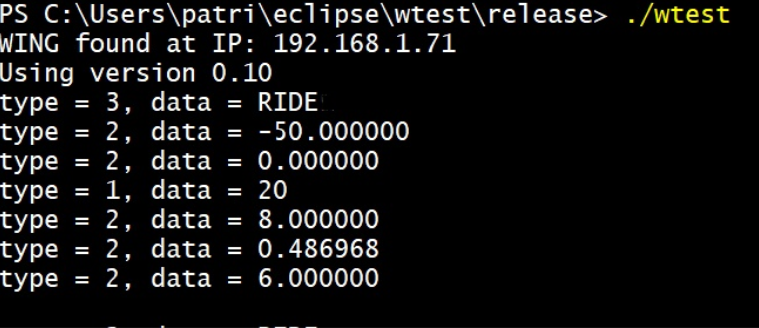

\#include &lt;stdio.h&gt;

\#include &lt;string.h&gt;

//

\#include “wapi.h”

\#include “wext.h”

//

int main() {

int i;

char wingip\[24\] = "";

wtype type;

wvalue value;

//

if ((i = wOpen(wingip)) != WSUCCESS) exit(1);

printf("WING found at IP: %s\n", wingip);

printf("Using version %i.%i\n", wVer()/256, wVer()&15);

//

wSetTokenString(CH\_1\_GATE\_MDL, "RIDE"); //Auto Rider Dynamics

wSetTokenFloat(CH\_1\_GATE\_1, ‑50.); // thr

wSetTokenFloat(CH\_1\_GATE\_2, 0.); // tgt

wSetTokenInt(CH\_1\_GATE\_3, 20); // spd

wSetTokenFloat(CH\_1\_GATE\_4, 8.); // ratio

wSetTokenFloat(CH\_1\_GATE\_5, 0.5); // hold

wSetTokenFloat(CH\_1\_GATE\_6, 6.0); // range

//

wGetToken(CH\_1\_GATE\_MDL, &type, &value);

if (value.sval) {

printf("type = %i, data = %s\n", type, value.sval);

free(value.sval);

} else {

printf("no data for ch 1 gate model!\n”);

}

wGetToken(CH\_1\_GATE\_1, &type, &value);

printf("type = %i, data = %f\n", type, value.fval);

wGetToken(CH\_1\_GATE\_2, &type, &value);

printf("type = %i, data = %f\n", type, value.fval);

wGetToken(CH\_1\_GATE\_3, &type, &value);

printf("type = %i, data = %i\n", type, value.ival);

wGetToken(CH\_1\_GATE\_4, &type, &value);

printf("type = %i, data = %f\n", type, value.fval);

wGetToken(CH\_1\_GATE\_5, &type, &value);

printf("type = %i, data = %f\n", type, value.fval);

wGetToken(CH\_1\_GATE\_6, &type, &value);

printf("type = %i, data = %f\n\n", type, value.fval);

fflush(stdout);

return(0);

}

#### int wGetTokenFloat(wtoken token, float\* fval)

The wGetTokenFloat() function interrogates WING token token to get its
currently associated value.

As it is the case for wGetToken(), wGetTokenFloat() will block until a
token token is encountered in the receiving queue. The received token
value has a given native type, and the function will do its best at
converting the received data to float format as expected by the fval
variable.

For example, inquiring WING token CH\_1\_PEQ\_1F will return the current
value of the token as a float value in fval. Inquiring WING token
CH\_1\_PEQ\_ON will result in a value of 0.0 or 1.0, depending on the
state of the token.

On the other hand, inquiring WING token CH\_1\_NAME will most likely
return a value of 0.0 and a status of WZERO; In some cases (i.e., you
set the name to be string “123.7” for example) you may get a valid
floating‑point value returned.

The function returns WSUCCESS if the requested operation was successful,
other values can be returned, such as WZERO if no suitable format was
found for adapting token value to fval, or WSEND\_TCP\_ERROR if an error
took place while communicating with WING. Attempting to get a value from
a token of type NODE will return WNODE.

#### int wGetTokenInt(wtoken token, int\* ival)

The wGetTokenInt() function interrogates WING token token to get its
currently associated value. As it is the case for wGetToken(),
wGetTokenInt() will block until a token token is encountered in the
receiving queue. The received token value has a given native type, and
the function will do its best at converting the received data to integer
format as expected by the ival variable.

For example, inquiring WING token CH\_1\_PEQ\_1F will return the current
value of the token as an int value in ival. Inquiring WING token
CH\_1\_PEQ\_ON will result in a value of 0 or 1, depending on the state
of the token.

On the other hand, inquiring WING token CH\_1\_NAME will return a value
of 0 and a status of WZERO; In some cases (i.e., you set the name to be
string “12” for example) you may get a valid int value returned.

The function returns WSUCCESS if the requested operation was successful,
other values can be returned, such as WZERO if no suitable format was
found for adapting token value to ival, or WSEND\_TCP\_ERROR if an error
took place while communicating with WING. Attempting to get a value from
a token of type NODE will return WNODE.

#### int wGetTokenString(wtoken token, char\* str)

The wGetTokenString() function interrogates WING token token to get its
currently associated value. As it is the case for wGetToken(),
wGetTokenString() will block until a token token is encountered in the
receiving queue. The received token value has a given native type, and
the function will do its best at converting the received data to
string/char\* format as expected by the str variable.

For example, inquiring WING token CH\_1\_PEQ\_1F will return the current
value of the token as a string in str. Inquiring WING token
CH\_1\_PEQ\_ON will result in a 1‑character string of “0” or “1”,
depending on the state of the token. Similarly, a token with a
floating‑point native format would result in a string containing the
string representation of the floating‑point value.

As a last example, inquiring WING token CH\_1\_NAME will return the
string currently used for naming channel 1. Please note that the str
variable should provide enough space to collect the data returned by
wGetTokenString().

The function returns WSUCCESS if the requested operation was successful,
other values can be returned, such as WZERO if no suitable format was
found for adapting token value to str, or WSEND\_TCP\_ERROR if an error
took place while communicating with WING. Attempting to get a value from
a token of type NODE will return WNODE.

#### int wGetTokenDef(wtoken token, int \*num, unsigned char\* str)

The wGetTokenDef() function interrogates WING token token to get its
currently associated definition in raw form. wGetTokenDef() will block
for 200 milliseconds or until a token token is encountered in the
receiving queue. The received token definition follows the description
presented earlier in this document[19].

The returned data consists of the number of bytes num contained in an
array of bytes str. Note that str is allocated by the wGetTokenDef()
function; it is therefore the responsibility of the calling application
to free the allocated memory when no longer needed. Parsing this data is
left to the application, and follows the description for node definition
response.  
The function returns WSUCCESS if the requested operation was successful;
wGetTokenDef() will return WMEMORY if it cannot allocate memory for the
data to be returned, or WRECV\_ERROR if the data cannot be recovered;
Would wGetTokenDef() return WRECV\_ERROR when you expect data being
available, it may be worth attempting a second call to the function as a
timeout may have occurred with the first/previous call.

The Get() functions presented above are all “one shot read” functions so
to speak; They request data from WING, and wait for the right token to
appear in the receiving queue. They will return the buffer content,
adapting it to the requested type of data when applicable. This is a
simple way to gather information from the console, but comes with a
caveat if someone is also manipulating (locally or remotely) the desk.
Indeed, as other changes take place and assuming your communication
channel is in an ‘open’ state (i.e., your last communication with WING
is less than 10s old), the console will natively send you changes that
are taking place, resulting of the local or remote changes operated onto
the desk.

So, when a “one shot read” request arrives and is served, it will sort
through the received data for the expected token, and in doing this will
discard the data received prior to finding the correct token.

**wapi** therefore provides another set of Get() functions for
applications requiring a finer time control over the data they exchange
with WING. In this new set of functions, the Get() instance will, as for
the non‑timed versions, gather information from WING and filter the
possibly multiple[20] received tokens for the first one matching the
specified token provided at call time, for a given amount of time only.
Only when the specified token is received or time has expired (whichever
comes first) will the function process the data it received, if
available.

#### int wGetTokenTimed(wtoken token, wtype \*type, wvalue \*value, int timeout)

wGetTokenTimed() is equivalent to its blocking sibling function call
wGetToken(), but will block only for up to timeout microseconds; If no
data corresponding to token token is received during that amount of
time, the function will return WZERO. If a token token is received
withing the time allocated by timeout, the function will parse data and
return it as in the case of wGetToken().

#### int wGetTokenFloatTimed(wtoken token, float \*fval, int timeout)

The wGetFloatTimed() function is similar to the wGetTokenFloat()
function in the sense it aims at retrieving from WING data and adapt it
to floating‑point format before returning it to fval;

But it will do so over a period timeout, expressed in µs (microseconds).

As long as timeout is not reached, the function is inquiring WING for
data; If after timeout has expired, no data appears available, a value
of WZERO is returned.

If on the contrary data is available from WING, the function will check
if the data token is the correct one; it will treat the data as done in
the wGetTokenFloat() function; i.e. the value retrieved from WING is
converted to float format as expected by the fval variable.

For example, inquiring WING token CH\_1\_PEQ\_1F will return the current
value of the token as a float value in fval. Inquiring WING token
CH\_1\_PEQ\_ON will result in a value of 0.0 or 1.0, depending on the
state of the token.

On the other hand, inquiring WING token CH\_1\_NAME will most likely
return a value of 0.0 and a status of WZERO; In some cases (i.e., you
set the name to be string “123.7” for example) you may get a valid
floating‑point value returned.

The function returns WSUCCESS if the requested operation was successful,
other values can be returned, such as WZERO if no suitable format was
found for adapting token value to fval, or WSEND\_TCP\_ERROR if an error
took place while communicating with WING. Attempting to get a value from
a token of type NODE will return WNODE.

If data is available from WING and the data token is not the expected
one, the function discards data and inquires WING for new data. The
above takes place as long as timeout is not reached.

#### int wGetTokenIntTimed(wtoken token, int \*ival, int timeout)

The wGetTokenIntTimed() function is similar to the wGetTokenInt()
function in the sense it aims at retrieving from WING data and adapt it
to floating‑point format before returning it to ival;

But it will do so over a period timeout, expressed in µs (microseconds).

As long as timeout is not reached, the function is inquiring WING for
data, if no data appears available, a value of WZERO is returned.

If on the contrary data is available from WING, the function will check
if the data token is the correct one; it will treat the data as done in
the wGetTokenInt() function; i.e. the value retrieved from WING is
adapted to float format as expected by the ival variable.

For example, inquiring WING token CH\_1\_PEQ\_1F will return the current
value of the token as an int value in ival. Inquiring WING token
CH\_1\_PEQ\_ON will result in a value of 0 or 1, depending on the state
of the token.

On the other hand, inquiring WING token CH\_1\_NAME will return a value
of 0 and a status of WZERO; In some cases (i.e., you set the name to be
string “12” for example) you may get a valid int value returned.

The function returns WSUCCESS if the requested operation was successful,
other values can be returned, such as WZERO if no suitable format was
found for converting the retrieved value to ival, or WSEND\_TCP\_ERROR
if an error took place while communicating with WING. Attempting to get
a value from a token of type NODE will return WNODE.

If data is available from WING and the data token is not the expected
one, the function discards data and inquires WING for new data. The
above takes place as long as timeout is not reached.

#### int wGetTokenStringTimed(wtoken token, char\* str, int timeout)

The wGetTokenStringTimed() function is similar to the wGetTokenString()
function in the sense it aims at retrieving from WING data and adapt it
to string format before returning it to str;

But it will do so over a period timeout, expressed in µs (microseconds).

The function is inquiring WING for data until a timeout timeout is
reached, if no data appears available, a value of WZERO is returned.

If on the contrary data is available from WING, the function will check
if the data token is the correct one;

wGetTokenStringTimed() will then treat the data as done in the
wGetTokenString() function; The value retrieved from WING is adapted to
string format as expected by the str variable. Similar restrictions and
conversion rules apply. For example, inquiring WING token CH\_1\_PEQ\_1F
will return the current value of the token as a string in str. Inquiring
WING token CH\_1\_PEQ\_ON will result in a 1‑character string of “0” or
“1”, depending on the state of the token. Similarly, a token with a
floating‑point native format would result in a string containing the
string representation of the floating‑point value. As a last example,
inquiring WING token CH\_1\_NAME will return the string currently used
for naming channel 1. Attempting to get a value from a token of type
NODE will return WNODE.

If data is available from WING and the data token is not the expected
one, the function discards data and inquires WING for new data. The
above takes place as long as timeout is not reached.

#### A Small Program Example

Let’s program! Assume you need to programmatically change the name of
channels and mute/unmute the respective channels from data contained in
a file. Let’s consider the file also contains initial channel faders,
and covers channels 1 to 4. The file can be a text file such as:

Steve 0 ‑144.0

Jimmy 1 ‑30.0

Carla 1 ‑22.0

Jannet 0 ‑100.0

This is C source code; easy to understand and translate if needed to
other programming languages.

We show on the right of the page the resulting channel strips 1‑4:

<table style="width:97%;">
<colgroup>
<col style="width: 74%" />
<col style="width: 23%" />
</colgroup>
<thead>
<tr>
<th>
#include &lt;stdio.h&gt;

#include &lt;string.h&gt;

//

#include “wapi.h”

#include “wext.h”

//

int main() {

wtoken ntoken[] = {CH_1_NAME, CH_2_NAME, CH_3_NAME, CH_4_NAME};

wtoken mtoken[] = {CH_1_MUTE, CH_2_MUTE, CH_3_MUTE, CH_4_MUTE};

wtoken ftoken[] = {CH_1_FDR, CH_2_FDR, CH_3_FDR, CH_4_FDR};

char wingip[24] = ““; int mute;

float fader;

char name[24];

FILE* fd;

//

// we don’t know the IP of our console…

if (wOpen(wingip)!= WSUCCESS) exit(1);

printf(“WING found at IP: %s\n”, wingip);

// open the file for reading

if ((fd = fopen(“file”, “r”)) != 0) {

for (int i = 0; i&lt; 4; i++) {

// get data from the file

fscanf(fd, “%23s %i %f”, name, &amp;mute, &amp;fader);

printf(“%s %i %f\n”, name, mute, fader);

// set/send values to WING;

// we don’t care about the returned status

wSetTokenString(ntoken[i], name);

wSetTokenInt(mtoken[i], mute);

wSetTokenFloat(ftoken[i], fader);

}

}

fclose(fd);

wClose();

exit(0);

}
</th>
<th>
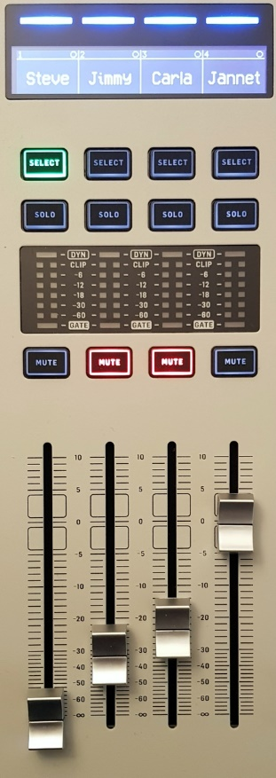
</th>
</tr>
</thead>
<tbody>
</tbody>
</table>

## Event‑driven updates

There are times and situations when WING will send data to your program.
This has been explained above: As soon as you are connected to WING and
have exchanged data with it, the connection will stay in an open state
for 10s, unless you specifically establish and close the TCP connection
around your work. While this will help, it will not prevent WING to send
you data while the TCP link is active, and is certainly not an effective
way to manage data as you will send more resources in opening/closing
the connection than in time sending or receiving data.

**wapi** provides additional API functions to manage event driven
applications. These are managed around the notion of ‘main loop’ as
often found in IOT devices running Arduino devices, in standard Linux or
Windows applications where a main loop ensures the management of all
events coming from devices connected to your computer (mouse, keyboard,
etc.). WING data can be treated just as any other event.

API calls are therefore available to keep a connection between your
application and WING alive, as well as to get data from WING,
effectively emptying the event queue of the communication with the
console. This will be assured with the wKeepAlive() and the
wGetVoidPTokenTimed() function calls presented below.

#### int wKeepAlive

wKeepAlive() maintains the connection between WING and the calling
program so data issued by the console with no request initiated by the
program can be received in a main loop, or over an extended period of
time beyond 10s[21].

In fact, this function can be called as often as you like and will
optionally performs a small exchange with the console, based on an
internal timer. The elapsed time between two effective exchanges of data
with the console depend on the value of wKeepAlive\_TIMEOUT which is
part of the wapi.h file.

The wKeepAlive() function returns WSUCCESS if a valid exchange took
place to renew a 10 seconds working communication, or WZERO if no
exchange was necessary. The function can also return the values of
WSEND\_ERROR or WRECV\_ERROR if communication was not successful.

#### int wGetParsedEvents(wTV \*tv, int maxevents)

The wGetParsedEvents() API call is a specific Get function. Unlike other
Get functions previously presented in this document, it does not expect
data from a specific token, nor a specified format in which the data
from the console should be converted to. The function will check the
WING receive event queue for data and will only return when data is
received by removing the events available from the oldest queue record.
If no valid data is found, the function eventually returns with a
network error.

When data is available in the event queue events are retrieved in a FIFO
order, and the token, type and data associated to events are returned to
the calling application using the tv structure array. The function
returns the number of events parsed if data has been returned to the
calling program, WZERO if no events were found. It can also return
WMEMORY on memory allocation errors or WRECV\_ERROR on TCP read errors.
The parameter maxevents represents the maximum number of entries tv can
accept; The function will allocate memory for its event read buffer to
match that size.

#### int wGetParsedEventsTimed(wTV \*tv, int maxevents, int timeout)

The wGetParsedEventsTimed() API call is similar to the
wGetParsedEvents() function, but will returned after a maximum time of
timeout in µs. Like in the case of the wGetParsedEvents() function,
wGetParsedEventsTimed() does not expect data from a specific token, nor
a specified format in which the data from the console should be
converted to. The function will check the WING receive event queue for
data and will only return when data is received by removing the events
available from the oldest queue record. If no data is found before a
timeout of timeout µs, the function returns with a value WZERO.

If data is available in the event queue, events are retrieved in a FIFO
order, and the token, type and data associated to events are returned to
the calling application using the tv structure array. The function
returns the number of events parsed if data has been returned to the
calling program, WZERO if no events were found. It can also return
WMEMORY on memory allocation errors or WRECV\_ERROR on TCP read errors.
The parameter maxevents represents the maximum number of entries tv can
accept; The function will allocate memory for its event read buffer to
match that size.

In a typical, simple example of use of the two API calls shown in the
following paragraph, the main loop is replaced with a while(1){}
statement.

\#include &lt;stdio.h&gt;

\#include &lt;string.h&gt;

//

\#include “wapi.h”

\#include “wext.h”

//

int main() {

int i, j;

char wingip\[24\] = "";

wTV TV\[100\];

if ((i = wOpen(wingip)) != WSUCCESS) return(‑1);

printf("WING found at IP: %s\n", wingip);

printf("Using version %i.%i\n", wVer()/256, wVer()&15);

while (1) {

wKeepAlive();

//

if ((i = wGetParsedEventsTimed(TV, 100, 1000)) &gt; 0) {

for (j = 0; j &lt; i; j++) {

printf("W‑&gt; %s type = %i, data = ", wGetName(TV\[j\].token),
TV\[j\].type);

if (TV\[j\].type == I32) printf("%i\n", TV\[j\].d.idata);

if (TV\[j\].type == F32) printf("%.2f\n", TV\[j\].d.fdata);

if (TV\[j\].type == S32) {

if (TV\[j\].d.sdata) {

printf("%s\n", TV\[j\].d.sdata);

free(TV\[j\].d.sdata);

}

}

fflush(stdout);

}

} else {

if (i != WZERO) {

printf("Error = %i\n", i); fflush(stdout);

}

}

}

return 0;

}

An example of (partial) output of the code snippet above, after
launching the program and manipulating ch.1, 2 and 3 mutes and ch. 1
fader:

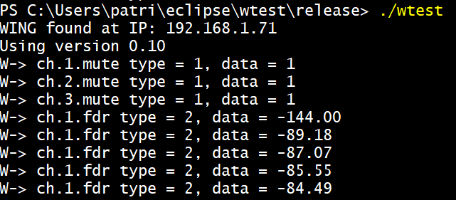

##  Nodes

In many applications as well as in browsing over the JSON data
structure, one can easily envision it would be interesting for
optimization purposes to get and set a group of attributes at once,
rather than establishing communication requests for each single
parameter.

Nodes were introduced in the X32 family to enable this functionality,
and have been widely used in several applications for controlling the
desk; In the case of WING this may be even more interesting due to the
very large number/volume of parameter data available as one unrolls each
branch in the JSON tree opening a new level of nodes and parameters.
Each branch of the JSON tree can be walked through by a program,
resulting in a (sometimes very large) set of {token, value} sets and a
way to represent the depth in the hierarchical tree the reported sets
are issues from.

We show below the node data extracted (using a wapi call) for a few
nodes:

wing\_root: {$stat{}, cfg{}, $syscfg{}, io{}, ch{}, aux{}, bus{},
main{}, mtx{}, dca{}, fx{}, cards{}, play{}, rec{}, $ctl{}, $globals{}}

node $stat, size: 212,

.A.stat=‑,dev=,.B.stat=‑,dev=,.C.stat=‑,dev=,.lock=1,ppm=0,solo=0,sip=0,rtcerr=0,time='15:41:28',date=2025‑02‑13,usbstate=IDLE,usbvolname=KINGSTON,sc\_stat=‑,sc\_devices=,sc\_upcnt=32,sc\_dncnt=32,sc\_uprout=,rmt\_a=,rmt\_b=,rmt\_c=,~~~~

node $syscfg, size: 208,

.consolename=HMS‑01,logflags=toto,ipmode=DHCP,ip0=169,ip1=254,ip2=24,ip3=25,msk0=255,msk1=255,msk2=0,msk3=0,gw0=192,gw1=168,gw2=0,gw3=254,tcplock=0,usbh\_spd=HS,eth\_cfg=SEPARATED,opt\_mod=DANTE,~

As mentioned above, some nodes such as ch, are very large (more than 80k
characters).

The set of values in a node list can be variable depending on the
options (effects for example) loaded in the console at the time of the
call, but all tokens are fixed and only contain known data types; A node
can be set and retrieved as a single line of text with pre‑formatted
data, making it easy to store and manage in applications. wapi offers
two methods of saving node data sets from the console, the first one is
returning data like what is obtained using OSC (text data); the other
one is more suitable to direct use from a compiled program, with binary
data saved in specific structures containing the token and its
respective data. The first method typically takes 2 or 3 seconds to get
all WING data as multiple strings of node data. The second method is
probably more suitable for use with wapi and is also faster (1 to 2
seconds) as no formatting is involved in saving the data returned by the
console.

The following functions list API entries to use WING nodes as defined
above.

#### int wSetNode(char \*str)

The wSetNode() function parses the string contained in str according to
the format used in OSC nodes; For example, a string such as
/ch.1.fdr=8.5,mute=1,/bus.1.fdr=5.0,.2.fdr=0.5 will set fader of channel
1 to the 8.5dB value and mute the channel. Bus 1 fader will be set to
5dB and bus 2 fader will be set to 0.5dB.

Each parameter=value group is separated by a ‘,’ character, the ‘/’
character represents the root of the JSON tree, and ‘.’ characters are
used to navigate up and down within the JSON tree. String type values
containing space characters should be encapsulated within ‘”’
characters, such as in /ch.1.name=”space name”

The function returns a status WSUCCESS if the string was processed with
no errors; It will return WNODE if a token or value provided with the
string str is not valid. The function can also report other errors if
communication issues were detected. str must be \0 ended. Please see a
code example using wSetNode() further in this document.

#### int wSetNodeFtomTVArray(wTV \*array, int nTV)

The wSetNodeFromTVArray() function sends updates to WING in a single
network exchange from the nTV elements in wTV (see below) array array;
This is a great way to improve network performance. Although the
function is the symmetrical to wGetNodeToTVArray(), it can accept
hierarchically organized elements or uncorrelated elements as long as
they are not nodes and contain valid tokens‑values sets. The function
returns WSUCCESS or an error if one takes place during allocating,
preparing, or sending the resulting network buffer to WING.

#### int wSetBinaryNode (unsigned char \*array, int len)

The wSetBinaryNode() function will load from array the len bytes of
binary data commands to be executed by the desk in a single call. The
function returns the number of bytes sent to the console on success or
an error if one takes place during sending the buffer to WING.  
The length value returned by the call can be greater than the value of
len. This results from the function call possibly adding escape
characters specific to Wing native/binary protocol.

A typical use for this call is external scene management[22] such as in
the code snippet below.

> void WRestoreS() {
>
> unsigned char node\[256000\];

int i, j;

> //
>
> if ((fd = fopen(“Scene.scn”, "rb")) != NULL) {
>
> fread(&i, sizeof(int), 1, fd);
>
> fread(node, i \* sizeof(unsigned char), 1, fd);
>
> if ((j = wSetBinaryNode(node, i)) &lt; i) {
>
> printf("Error: %d only bytes sent vs. %d\n", j, i);
>
> } else {
>
> printf("Restored Scene\n");
>
> }
>
> fclose(fd);
>
> } else {
>
> printf("Cannot open Scene.scn\n");
>
> }
>
> Return;
>
> }

#### int wGetNode(wtoken node, char \*str)

The wGetNode() function will return in str a string of values separated
formatted as in the OSC node convention and corresponding to the node
token node.

str must be large enough to accept the characters returned by the call.
The function returns a status WSUCCESS if the node was processed with no
errors; It will return WTOKEN if the token provided is not a valid node
and WNODE if an error occurs during parsing the data received from the
console. The function can also report other errors if communication
issues were detected. The line of text returned by the function end with
a line‑feed and a \0 byte.  
Note that it may not be possible to directly send node data as a string
received with a wGetNode() using wSetNode(); Indeed, some nodes have
variable/dynamically assigned parameters, such as in the case of
equalizer models, and the parameter names reported by wGetNode() must be
changed to a numerical list of parameters prior to being passed as a
parameter string to wSetNode(); See “*Dynamic parameters anonymization
in wapi*” further in this document.

#### int wGetNodeToTVArray (wtoken node, wTV \*array)

The wGetNodeToTVArray() function will return in TV, an array of
structures wTV (see below), all values respective of their corresponding
token and part of the node token node.

array must be large enough to accept the data returned by the call (see
below for the number of elements for each level‑1 node). The function
the number of tokens in the array array if the node was processed with
no errors; It will return WTOKEN if the token provided is not a valid
node and WNODE if an error occurs during parsing the data received from
the console. The function can also report other errors if communication
issues were detected.

Below is an *indicative* value of the number of wTV structures in the
returned arrays for each level‑1 node of the console at the time of this
writing; The sum of the values following ‘size:’ give an idea of the
number of parameters the console knows.

> node $stat, size: 23
>
> node cfg, size: 194
>
> node $syscfg, size: 25
>
> node io, size: 6054
>
> node ch, size: 12400
>
> node aux, size: 2008
>
> node bus, size: 2736
>
> node main, size: 440
>
> node mtx, size: 728
>
> node dca, size: 144
>
> node mgrp, size: 16
>
> node fx, size: 624
>
> node cards, size: 74
>
> node play, size: 18
>
> node rec, size: 7
>
> node $ctl, size: 5328
>
> node $globals, size: 11

Below is a C code source example of use of WSetNode(); The program will
set the faders of channels 1 to 4 to different positions, unmute
channels 1 and 3, channel 2 mute is unchanged and channel 4 will be
muted. DCA 1 is muted and its fader is set to 1dB.

> /\*
>
> \* wtest.c
>
> \*
>
> \* Created on: Oct. 18, 2020
>
> \* Author: Patrick‑Gilles Maillot
>
> \*/
>
> //
>
> \#include &lt;stdio.h&gt;
>
> \#include &lt;string.h&gt;
>
> //
>
> \#include "wapi.h"
>
> \#include "wext.h"
>
> //
>
> int main() {
>
> int i;
>
> char wingip\[24\] = "";
>
> char wtest1\[64\] =
> "/<u>ch</u>.1.<u>fdr</u>=8.5,mute=1,name=<u>toto</u>,.2.<u>fdr</u>=0,/<u>dca</u>.1.<u>fdr</u>=1.0,mute=0";
>
> char wtest2\[64\] =
> "/<u>ch</u>.3.<u>fdr</u>=-20,mute=0,name=,.4.<u>fdr</u>=-60,mute=1";
>
> //
>
> if ((i = wOpen(wingip)) != WSUCCESS) exit(1);
>
> printf("WING found at IP: %s\n", wingip);

unsigned int ui = wVer();

printf("Using <u>wapi</u> <u>ver</u>: %i.%i.%i-%i\n", ui &gt;&gt; 24,
(ui & 0xff0000) &gt;&gt; 16,

(ui & 0xff00) &gt;&gt; 8, ui & 0xff);

//

> i = wSetNode(wtest1);
>
> printf("result = %d, initial data: %s\n", i, wtest1);
>
> i = wSetNode(wtest2);
>
> printf("result = %d, initial data: %s\n", i, wtest2);
>
> return(0);
>
> }

A listing of the program when ran:

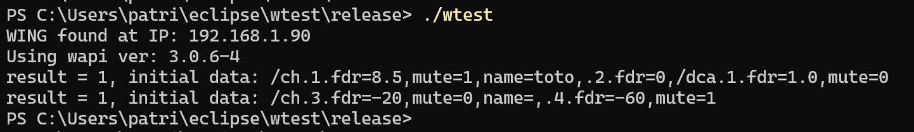

Below the resulting state of the console, starting from an init state:

Requesting the full set of nodes from a freshly initialized console[23]
results in a file of 200000+ characters, and is therefore a lot of data
to manage. Over WIFI, it takes about 2 seconds to execute a full dump as
OSC‑like node data and 1 to 2 seconds to retrieve a full dump as wTV
structures.

We show below a typical example of the OSC‑like node string for ch.1
returned by **wapi** when using wGetNode():

node ch:

.1.in.set.$mode=M,srcauto=0,altsrc=0,inv=0,trim=0.00,bal=0.00,$g=0.00,$vph=0,dly=0.00,.conn.grp=LCL,in=1,altgrp=OFF,altin=1,..flt.lc=0,lcf=100.24,hc=0,hcf=10018.26,tf=0,mdl=TILT,tilt=0.00,.clink=0,col=1,name="",icon=1,led=1,mute=0,fdr=144.00,pan=0.00,wid=100.00,$solo=0,$sololed=0,solosafe=0,mon=A,proc=GEDI,ptap=4,$presolo=0,peq.on=0,1g=0.00,1f=99.69,1q=2.00,2g=0.00,2f=999.25,2q=2.00,3g=0.00,3f=10016.53,3q=2.00,.gate.on=0,mdl=GATE,thr=40.00,range=40.00,att=10.00,hld=10.00,rel=199.40,acc=0.00,ratio=1:3,.gatesc.type=OFF,f=1002.37,q=2.00,src=SELF,tap=IN,$solo=0,.eq.on=0,mdl=STD,mix=100.00,$solo=0,$solobd=1,lg=0.00,lf=80.20,lq=2.00,leq=SHV,1g=0.00,1f=200.00,1q=2.00,2g=0.00,2f=601.39,2q=2.00,3g=0.00,3f=1499.79,3q=2.00,4g=0.00,4f=3990.52,4q=2.00,hg=0.00,hf=11994.42,hq=2.00,heq=SHV,.dyn.on=0,mdl=COMP,mix=100.00,gain=0.00,thr=10.00,ratio=3.00,knee=3,det=RMS,att=50.00,hld=20.00,rel=152.57,env=LOG,auto=1,.dynxo.depth=6.00,type=OFF,f=1002.37,$solo=0,.dynsc.type=OFF,f=1002.37,q=2.00,src=SELF,tap=IN,$solo=0,.preins.on=0,ins=NONE,$stat=,.main.1.on=1,lvl=0.00,.2.on=0,lvl=0.00,.3.on=0,lvl=0.00,.4.on=0,lvl=0.00,..send.1.on=0,lvl=144.00,pon=0,ind=0,mode=PRE,plink=0,pan=0.00,wid=100.00,.2.on=0,lvl=144.00,pon=0,ind=0,mode=PRE,plink=0,pan=0.00,wid=100.00,.3.on=0,lvl=144.00,pon=0,ind=0,mode=PRE,plink=0,pan=0.00,wid=100.00,.4.on=0,lvl=144.00,pon=0,ind=0,mode=PRE,plink=0,pan=0.00,wid=100.00,.5.on=0,lvl=144.00,pon=0,ind=0,mode=PRE,plink=0,pan=0.00,wid=100.00,.6.on=0,lvl=144.00,pon=0,ind=0,mode=PRE,plink=0,pan=0.00,wid=100.00,.7.on=0,lvl=144.00,pon=0,ind=0,mode=PRE,plink=0,pan=0.00,wid=100.00,.8.on=0,lvl=144.00,pon=0,ind=0,mode=PRE,plink=0,pan=0.00,wid=100.00,.9.on=0,lvl=144.00,pon=0,ind=0,mode=PRE,plink=0,pan=0.00,wid=100.00,.10.on=0,lvl=144.00,pon=0,ind=0,mode=PRE,plink=0,pan=0.00,wid=100.00,.11.on=0,lvl=144.00,pon=0,ind=0,mode=PRE,plink=0,pan=0.00,wid=100.00,.12.on=0,lvl=144.00,pon=0,ind=0,mode=PRE,plink=0,pan=0.00,wid=100.00,.13.on=0,lvl=144.00,pon=0,ind=0,mode=PRE,plink=0,pan=0.00,wid=100.00,.14.on=0,lvl=144.00,pon=0,ind=0,mode=PRE,plink=0,pan=0.00,wid=100.00,.15.on=0,lvl=144.00,pon=0,ind=0,mode=PRE,plink=0,pan=0.00,wid=100.00,.16.on=0,lvl=144.00,pon=0,ind=0,mode=PRE,plink=0,pan=0.00,wid=100.00,..postins.on=0,mode=FX,ins=NONE,w=0.00,$stat=,.tags="",$fdr=144.00,$mute=0,$muteovr=0,

#### int wGetBinaryNode (wtoken node, unsigned char \*array, int maxlen)

The wGetBinaryNode() function will return in array the raw, binary data
corresponding to the WING node selected with token node. The storage
buffer array must be large enough to accept the data returned by the
call, up to maxlen bytes. The function returns the number of bytes saved
in array, or an error status if less or equal to 0.

Note that token node can represent a node or a parameter.

A typical use for this call is external scene management[24] such as in
the code snippet below.

> void WSaveS() {
>
> unsigned char node\[2048\];
>
> int i;
>
> //
>
> if ((fd = fopen(Scene.scn, "wb")) != NULL) {
>
> // Get the node data for CH\_1, composed of many 0xd7&lt;Wing data&gt;
> parts
>
> if ((i = wGetBinaryNode(CH\_1, node, 2048)) &lt; WSUCCESS) {
>
> fclose(fd);
>
> printf("Error reading node %d\n", tarray\[ta\]);
>
> return;
>
> }
>
> fwrite(&i, sizeof(int), 1, fd);
>
> fwrite(node, i \* sizeof(unsigned char), 1, fd);
>
> printf("Saved scene\n");
>
> fclose(fd);
>
> } else {
>
> printf("Cannot create Scene.scn\n");
>
> }
>
> return;
>
> }

#### int wGetBinaryData (char \*str, unsigned char \*array, int maxlen)

The wGetBinaryData() function will return in array the raw, binary data
corresponding to the WING node or parameter represented by its text
description str. The storage buffer array must be large enough to accept
the data returned by the call, up to maxlen bytes.

str is a string of characters enabling to select a single WING node or
parameter, for example:

*“/ch”* (a node),

*“/ch.1.eq”* (a node), or

*“/ch.1.name”* (a parameter).

The function returns the number of bytes saved in array, or an error
status if less or equal to 0.

## Meters

WING offers many measurement points along the digital audio path; As a
result, there are numerous meters. As briefly presented in a table
earlier in this document, every Channels, Aux, Bus, Main and Matrix
strip offers no less than 8 meters: input left & right, output left &
right, gate key & gain, and dyn key & gain. This alone represents 608
meters that can be retrieved, and there are even more with V2 (version
2) meters, and many more meter data from other metering points.

The network data path for getting meter values is separated from the
main network communication to keep things simpler for the programmer and
sound engineer.

Meter data is transmitted to a UDP port chosen by the user. When
selecting which meters to receive, the user associates an ID to the
request, enabling simpler identification of the received data. As soon
as a valid meter request is received, WING will send back the respective
meter data for 5 seconds, every approximately every 50ms. To continue or
continuously receive a set of meter data, the user must renew the
request for data by issuing a simple renew command containing the ID of
the requested meter set.

### Meters API

wapi offers a small set of function calls to help programmers manage
meter data. it hides the networking complexity and proposes a simple way
of selecting what meter to get back from the digital console. Meter data
will be provided back to the application in the form of a buffer of
values, decoding data being left to the application.

#### *int wMeterUDPPort (int wport)*

The wMeterUDPPort() API call enable users to select the UDP port WING
will send meter data to. It also prepares the wapi internal network for
receiving meter data and being able to return data to the user
application. wport is a standard UDP port and must be available for
receiving data. The function returns WSUCCESS if everything is set
correctly or will return an error value if the request was not
successful.

#### *int wSetMetersRequest(int reqID, unsigned char \*wMid)*

wSetMetersRequest() must be called in order to start receiving meter
data. The API associates a request ID reqID to a selection of meters to
receive. The request ID helps renewing the request for data and sorting
through potentially multiple data sets sent by the console. The wMid
parameter holds the selection of meters that can be recovered from WING
in an array of 30 bytes. Each bit (from left to right) in the array of
29 bytes represents a meter family that can be received from the
console, and is shown in the table below:

<table style="width:52%;">
<colgroup>
<col style="width: 17%" />
<col style="width: 13%" />
<col style="width: 21%" />
</colgroup>
<thead>
<tr>
<th>byte index</th>
<th>bits</th>
<th>selection</th>
</tr>
</thead>
<tbody>
<tr>
<td>0‑4</td>
<td>1‑40</td>
<td>Channel 1‑40</td>
</tr>
<tr>
<td>5</td>
<td>1‑8</td>
<td>Aux 1‑8</td>
</tr>
<tr>
<td>6‑7</td>
<td>1‑16</td>
<td>Bus 1‑16</td>
</tr>
<tr>
<td>8</td>
<td>1‑4</td>
<td>Main 1‑4</td>
</tr>
<tr>
<td>9</td>
<td>1‑8</td>
<td>Matrix 1‑8</td>
</tr>
<tr>
<td>10-11</td>
<td>1‑16</td>
<td>DCA 1‑16</td>
</tr>
<tr>
<td>12-13</td>
<td>1-16</td>
<td>FX proc 1‑16</td>
</tr>
<tr>
<td>14‑15</td>
<td>1‑16</td>
<td>Source input 1‑16</td>
</tr>
<tr>
<td>16‑17</td>
<td>1‑11</td>
<td>Output 1‑11</td>
</tr>
<tr>
<td>18</td>
<td>1</td>
<td>Monitor</td>
</tr>
<tr>
<td>19</td>
<td>1</td>
<td>RTA</td>
</tr>
<tr>
<td>20‑24</td>
<td>1‑40</td>
<td>Channel V<em>2</em> 1‑40</td>
</tr>
<tr>
<td>25</td>
<td>1‑8</td>
<td>Aux V<em>2</em> 1‑8</td>
</tr>
<tr>
<td>26‑27</td>
<td>1‑16</td>
<td>Bus V2 1‑16</td>
</tr>
<tr>
<td>28</td>
<td>1‑4</td>
<td>Main V2 1‑4</td>
</tr>
<tr>
<td>29</td>
<td>1‑8</td>
<td>Matrix V2 1‑8</td>
</tr>
</tbody>
</table>

For example, a C source language array declaration as follows will
request meters for channels 1 and 40:

unsigned char mbits\[30\] = {0x80, 0, 0, 0, 0x01, 0}; // bytes indexes 5
to 29 are 0

#### *int wRenewMeters(int reqID)*

The wRenewMeters() API call is used to renew a previous request for
meter data; This function should be called every 5 seconds maximum to
avoid losing meter data if continuous receiving is expected. The reqID
parameter must be previously defined with a call to wSetMetersRequest().
The function returns WSUCCESS if the request is accepted, or will return
other error status values otherwise.

#### *int wGetMeters(unsigned char \*buf, int maxlen, int timeout)*

wGetMeters() will check if meter data has been received or is available.
The call can be blocking or un‑blocking depending on the value of
timeout. A timeout of 0 will block the application in reading mode until
data is available. A non‑zero value of timeout, expressed in
micro‑seconds will return after the provided value and return to the
caller with a value of WZERO (0) if no data is available or will return
sooner with the actual number of bytes read available in buf.

The maxlen parameter indicates the maximum number of bytes buf can hold.
It is the responsibility of the application to ensure buf is large
enough to accept maxlen bytes.

The data returned by the wGetMeters() function is coded as follows:

&lt;reqID&gt;&lt;\[meter data group\]\[meter data group\] … &gt;

Each meter data group is composed of several big‑endian 16bits integers
typically representing meter values expressed in 1/256th of a
dB, or otherwise returned data (for ex. Gate led returns 0 or 1).

The table below provides the number and origin of each meter data for
each of the possible meter groups:

<table style="width:87%;">
<colgroup>
<col style="width: 12%" />
<col style="width: 74%" />
</colgroup>
<thead>
<tr>
<th>
Group name
</th>
<th>
Contents
</th>
</tr>
</thead>
<tbody>
<tr>
<td>
channel 
aux 
bus 
main 
matrix
</td>
<td>
input left 
input right 
output left 
output right 
gate key 
gate gain 
dyn key 
dyn gain
</td>
</tr>
<tr>
<td>
dca
</td>
<td>
pre fader left 
pre fader right 
post fader left 
post fader right
</td>
</tr>
<tr>
<td>
fx
</td>
<td>
input left 
input right 
output left 
output right 
state meters (1…6)
</td>
</tr>
<tr>
<td>
source<a href="#fn1" class="footnote-ref" id="fnref1"
role="doc-noteref">1</a>
</td>
<td>
source group levels (<em>i.e. local ins: 24 meters, Aux: 8
meters, AES A, B or C: 48 meters, StageConnect: 32 meters, …,
Oscillator: 2 meters, Bus: 16x2 meters, etc.)</em>
</td>
</tr>
<tr>
<td>
output<a href="#fn2" class="footnote-ref" id="fnref2"
role="doc-noteref">2</a>
</td>
<td>
output group levels (<em>i.e. local outs: 8 meters</em>)
</td>
</tr>
<tr>
<td>
monitor
</td>
<td>
solo bus left 
solo bus right 
mon 1 left 
mon 1 right 
mon 2 left 
mon 2 right
</td>
</tr>
<tr>
<td>
rta
</td>
<td>
rta slot meters (<em>120 meters – Frequencies in
Apendix</em>)
</td>
</tr>
<tr>
<td>
channel V2 
aux V2 
bus V2 
main V2 
matrix V2
</td>
<td>
input left 
input right 
output left 
output right 
gate key 
gate gain

gate led 
dyn key 
dyn gain

dyn state

automix gain
</td>
</tr>
</tbody>
</table>
<section id="footnotes" class="footnotes footnotes-end-of-document"
role="doc-endnotes">

<ol>
<li id="fn1">
local, aux, aes50a, aes50b, aes50c, stageconnect, usb
audio, card, module, usb player, aes/ebu, user signals, oscillator,
buses, mains, matrices<a href="#fnref1" class="footnote-back"
role="doc-backlink">↩︎</a>
</li>
<li id="fn2">
local, aux, aes50a, aes50b, aes50c, stageconnect, usb
audio, card, module, usb recorder, aes/ebu<a href="#fnref2"
class="footnote-back" role="doc-backlink">↩︎</a>
</li>
</ol>
</section>

Below is an example of buffers received after requesting meter data for
channel 1 and using different sources, with Ch 1 fader set to +3dB.

As received data uses signed 16bits (\[‑32768…+32767\]) and is expressed
in 1/256th of dB, the actual meter value can be calculated as
&lt;int16&gt;/256.

Note that fx return a different format for their meters, with value in
dB = return value \* 6.0 / 2048.

gate gate dyn dyn

&lt;reqID&gt; inL inR outL outR key gain key gain

W→ 20 B: 00000002 9bb2 9bb2 8000 8000 9b7c 0000 8000 0000 (no input)

‑100 ‑100 ‑128 ‑128 ‑100 0 ‑128 0

W→ 20 B: 00000002 f9fb f9fb fcfb fcfb f9fb 0000 ee01 0000 (OSC 1kHz,
‑6dB)

‑6 ‑6 ‑3 ‑3 ‑6 0 ‑17 0

W→ 20 B: 00000002 d7fd d7fd dafd dafd d7fd 0000 aa02 0000 (OSC 1kHz,
‑40dB)

‑40 ‑40 ‑37 ‑37 ‑40 0 ‑85 0

In subscribing to and receiving meter data, make sure you get your
buffer size and index values right; Meters buffers can provide a lot of
data. The Source input section alone can represent 516 different meters
to display!!!

### RTA test program

We show here is a small C / Windows program example showing how to get
and display RTA. The scaling of meter data is tweaked in order to
provide better readability, but isn’t meant to be dB accurate.

/\*

\* wrta.c

\*

\* Created on: May 9, 2020

\* Author: Patrick‑Gilles <u>Maillot</u>

\*

\*

\* History

\* <u>ver</u> 0.0: initial release

\* <u>ver</u> 0.1: changed color scheme and used a <u>pow</u>() function
to better match WING

\* results out of raw meter data;

\* updated to meters V2

\*/

\#include &lt;windows.h&gt;

\#include &lt;stdio.h&gt;

\#include &lt;sys/time.h&gt;

\#include &lt;math.h&gt;

\#include "../wapi/wapi.h"

\#include "../wapi/wext.h"

//

// Windows Declarations

WINBASEAPI HWND WINAPI GetConsoleWindow(VOID);

LRESULT CALLBACK WndProc(HWND, UINT, WPARAM, LPARAM);

//

HINSTANCE hInstance = 0;

HWND hwndipaddr, hwndconx;

HDC hdc;

PAINTSTRUCT ps;

MSG wMsg;

HFONT hfont;

HPEN wnpen; // no line

HBRUSH gBrush, rBrush, yBrush, wBrush; // Green, red, yellow, white

int keep\_running = 1; // <u>mainloop</u> control

int ready = 0; // Ready flag after connect OK

char wingip\[24\] = ""; // Let <u>wapi</u> tell us our IP

int M\_id = 3; // Meters request ID

int M\_port = 10026; // Meters UDP port

//

\#define MAXLEN 254 // enough for RTA (244 bytes)

unsigned char buf\[MAXLEN\]; // data buffer

int len;

//

time\_t before = 0; // Timers

time\_t now;

//

unsigned char mbits\[30\] = {0, 0, 0, 0, 0, 0, 0, 0, 0, 0,

0, 0, 0, 0, 0, 0, 0, 0, 0, 0x80, // RTA

0, 0, 0, 0, 0, 0, 0, 0, 0, 0};

//

// void wRTAMeters()

// A basic RTA, positioned height is 128, width is 5 per <u>freq</u>.
(120 <u>Freqs</u>)

// we draw (systematically) rectangles from 0 to 128, varying the color
depending on value and

// pre‑defined thresholds for yellow and red. We always optionally draw
green, yellow, red,

// and finally white

void wRTAMeters(int basex, int basey, int value) {

int basexx = basex + 5;

int baseyy = basey + 128;

basex++;

// not trying to be accurate, but close to WING data behavior

//

if (value &lt; 48) {

SelectObject(hdc, gBrush);

SelectObject(hdc, wnpen);

Rectangle(hdc, basex, baseyy, basexx, baseyy ‑ value);

SelectObject(hdc, wBrush);

Rectangle(hdc, basex, baseyy ‑ value, basexx, basey);

} else if (value &lt; 96) {

SelectObject(hdc, gBrush);

SelectObject(hdc, wnpen);

Rectangle(hdc, basex, baseyy, basexx, baseyy ‑ 48);

SelectObject(hdc, yBrush);

Rectangle(hdc, basex, baseyy ‑ 48, basexx, baseyy ‑ value);

SelectObject(hdc, wBrush);

Rectangle(hdc, basex, baseyy ‑ value, basexx, basey);

} else {

SelectObject(hdc, gBrush);

SelectObject(hdc, wnpen);

Rectangle(hdc, basex, baseyy, basexx, baseyy ‑ 48);

SelectObject(hdc, yBrush);

Rectangle(hdc, basex, baseyy ‑ 48, basexx, baseyy ‑ 96);

SelectObject(hdc, rBrush);

Rectangle(hdc, basex, baseyy ‑ 96, basexx, baseyy ‑ value);

SelectObject(hdc, wBrush);

Rectangle(hdc, basex, baseyy ‑ value, basexx, basey);

}

}

//

// Windows main function and main loop

//

int WINAPI wWinMain(HINSTANCE hInstance, HINSTANCE hPrevInstance, PWSTR
lpCmdLine, int nCmdFile) {

//

union {

unsigned char cc\[2\];

short ii;

} endian;

int ival = 0;

float fval;

//

WNDCLASSW wc = {0};

wc.lpszClassName = L"WING RTA";

wc.hInstance = hInstance;

wc.hbrBackground = GetSysColorBrush(COLOR\_3DFACE);

wc.lpfnWndProc = WndProc;

wc.hCursor = LoadCursor(0, IDC\_ARROW);

//

RegisterClassW(&wc);

CreateWindowW(wc.lpszClassName,

L"<u>wrta</u> ‑ WING RTA <u>wapi</u> demo (c)2021 PG <u>Maillot</u> ‑
<u>ver</u> 0.1",

WS\_OVERLAPPED | WS\_VISIBLE | WS\_SYSMENU,

220, 220, 630, 220, 0, 0, hInstance, 0);

//

// Main loop

while (keep\_running) {

if (PeekMessage(&wMsg, NULL, 0, 0, PM\_REMOVE)) {

TranslateMessage(&wMsg);

DispatchMessage(&wMsg);

}

if (ready) {

now = time(NULL); // maintain meters

if (now &gt; before + 4) { // by sending

wRenewMeters(M\_id); // request every less than

before = now; // 5 seconds

}

// Read meters (if any data) with a timeout of 10ms

if ((len = wGetMeters(buf, MAXLEN, 10000)) &gt; 0) {

for (int i = 0; i &lt; 120; i++) {

endian.cc\[0\] = buf\[5 + i + i\]; // channel in 1

endian.cc\[1\] = buf\[4 + i + i\];

fval = ((float)(endian.ii + 32768)/32768.);

ival = pow(fval, 10) \* 128;

wRTAMeters(10 + i \* 5, 40, ival);

}

}

}

}

return (int) wMsg.wParam;

}

//

LRESULT CALLBACK WndProc(HWND hwnd, UINT msg, WPARAM wParam, LPARAM
lParam) {

//

char \*str1\[\] = {" 18", " 0", " ‑6", "‑12", "‑18", "‑26", "‑40",
"‑<u>oo</u>"};

switch (msg) {

case WM\_CREATE:

hwndconx = CreateWindow("button", "Connect", WS\_VISIBLE | WS\_CHILD,

5, 15, 85, 20, hwnd, (HMENU)1, NULL, NULL);

hwndipaddr = CreateWindow("Edit", NULL, WS\_CHILD | WS\_VISIBLE |
WS\_BORDER,

95, 15, 120, 20, hwnd, (HMENU)0, NULL, NULL);

break;

case WM\_PAINT:

hdc = BeginPaint(hwnd, &ps);

SelectObject(hdc, hfont);

SetBkMode(hdc, TRANSPARENT);

for (int i = 0; i &lt; 8; i++) {

TextOut(hdc, 0, 40 + i\*16+10, str1\[i\], strlen(str1\[i\]));

MoveToEx(hdc, 11, 40 + i\*16+15, NULL);

LineTo(hdc, 609, 40 + i\*16+15);

}

break;

case WM\_COMMAND:

if (HIWORD(wParam) == BN\_CLICKED) { // user action

switch (LOWORD(wParam)) {

case 1:

if (ready) {

keep\_running = 0;

PostQuitMessage(0);

} else {

// Connect clicked

if (wOpen(wingip) != *WSUCCESS*) exit(1);

SetWindowText(hwndipaddr, wingip);

// set <u>udp</u> port to receive UDP data and request meters for
channel 1

if (wMeterUDPPort(M\_port) != *WSUCCESS*) exit(1);

if (wSetMetersRequest(M\_id, mbits) != *WSUCCESS*) exit(1); // Meter
<u>req</u> ID 3

ready = 1;

}

break;

}

}

break;

case WM\_DESTROY:

keep\_running = 0;

PostQuitMessage(0);

break;

}

return DefWindowProcW(hwnd, msg, wParam, lParam);

}

//

// main program

int main(int argc, char \*\*argv) {

HINSTANCE hPrevInstance = 0;

PWSTR pCmdLine = 0;

int nCmdFile = 0;

// Hide console window

ShowWindow(GetConsoleWindow(), SW\_HIDE);

// Set colors

gBrush = CreateSolidBrush(RGB(0, 200, 20));

yBrush = CreateSolidBrush(RGB(255, 200, 20));

rBrush = CreateSolidBrush(RGB(255, 30, 0));

wBrush = CreateSolidBrush(RGB(255, 255, 255));

wnpen = CreatePen(PS\_NULL, 0, RGB(0, 0, 0));

hfont = CreateFont(8, 0, 0, 0, FW\_MEDIUM, 0, 0, 0,

DEFAULT\_CHARSET, OUT\_OUTLINE\_PRECIS, CLIP\_DEFAULT\_PRECIS,

ANTIALIASED\_QUALITY, VARIABLE\_PITCH, TEXT("<u>Arial</u>"));

// Launch program

wWinMain(hInstance, hPrevInstance, pCmdLine, nCmdFile);

wClose();

return 0;

}

The resulting displays: Sine wave signal 1kHz:

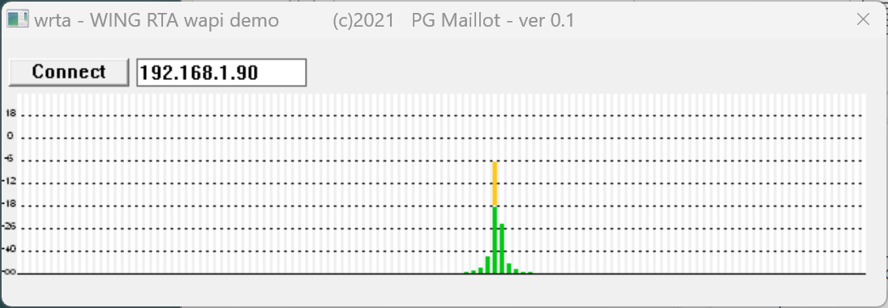

Pink noise mode:

> 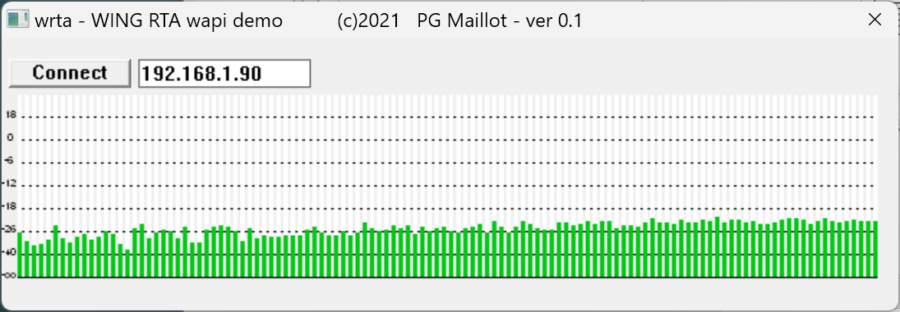

White noise mode:

> 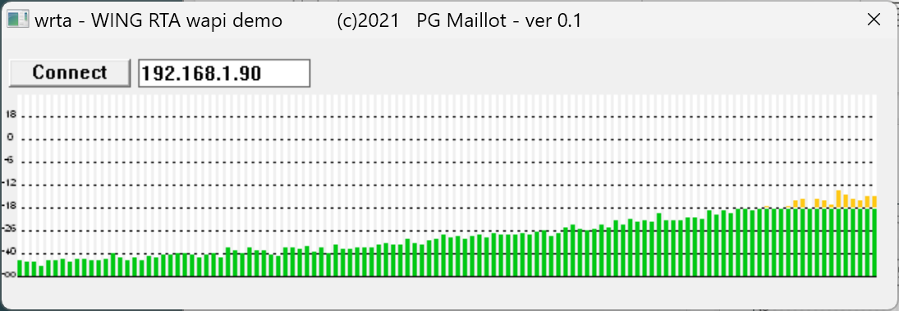

##  Channel strips layers

WING consoles offer a full customization of their control surface or
screen, enabling the standard/default settings of course but any strip
can be configured to become a different one.

The goal here is not to describe how to use the feature, but to warn the
programmer on a specific parameter when using channel strip layers with
wapi.

The typical set of parameters for Section Left, layer 1 node 1 is the
following:

<table style="width:26%;">
<colgroup>
<col style="width: 26%" />
</colgroup>
<thead>
<tr>
<th>/$ctl/layer/L/1</th>
</tr>
</thead>
<tbody>
<tr>
<td>/$ctl/layer/L/1/ofs</td>
</tr>
<tr>
<td>/$ctl/layer/L/1/name</td>
</tr>
<tr>
<td></td>
</tr>
<tr>
<td>/$ctl/layer/L/1/1</td>
</tr>
<tr>
<td>/$ctl/layer/L/1/1/type</td>
</tr>
<tr>
<td>/$ctl/layer/L/1/1/i</td>
</tr>
<tr>
<td>/$ctl/layer/L/1/1/dst</td>
</tr>
<tr>
<td><em>/$ctl/layer/L/1/1/val</em></td>
</tr>
</tbody>
</table>

The type can take different values of assigned channel strip type: CH,
BUS, DCA, SEN, FX, MIDI CC. For all but the type MIDI CC, the set of
attributes is receiving a fixed name. In the case of MIDI CC, the
attribute val is anonymized as 1. Therefore, all **wapi** tokens will
fit to their counterpart’s name, except for val, as shown below:

<table style="width:52%;">
<colgroup>
<col style="width: 26%" />
<col style="width: 26%" />
</colgroup>
<thead>
<tr>
<th>/$ctl/layer/L/1</th>
<th>$CTL_LAYER_L_1</th>
</tr>
</thead>
<tbody>
<tr>
<td>/$ctl/layer/L/1/ofs</td>
<td>$CTL_LAYER_L_1_OFS</td>
</tr>
<tr>
<td>/$ctl/layer/L/1/name</td>
<td>$CTL_LAYER_L_1_NAME</td>
</tr>
<tr>
<td></td>
<td></td>
</tr>
<tr>
<td>/$ctl/layer/L/1/1</td>
<td>$CTL_LAYER_L_1_1</td>
</tr>
<tr>
<td>/$ctl/layer/L/1/1/type</td>
<td>$CTL_LAYER_L_1_1_TYPE</td>
</tr>
<tr>
<td>/$ctl/layer/L/1/1/i</td>
<td>$CTL_LAYER_L_1_1_I</td>
</tr>
<tr>
<td>/$ctl/layer/L/1/1/dst</td>
<td>$CTL_LAYER_L_1_1_DST</td>
</tr>
<tr>
<td><em>/$ctl/layer/L/1/1/val</em></td>
<td>$CTL_LAYER_L_1_1_1</td>
</tr>
</tbody>
</table>

## Effects and Plugins

WING comes with an impressive number of effects, plugins and emulations
that can be used on any channel without costing any FX slots. In every
channel, Gate, EQ Compressor can take different processing models you
can organize and change on the fly. The following pages below present
the different effects and their parameters. For a detailed description
of effects and plugins, please refer to the “Processing and Effects
Plug‑in Guide”[25] on Behringer’s website.

### Plugins

Plugins entries are directly included with channels, busses, etc. and
can either default to WING standard algorithms or adapt to alternative
plugins to color your sound or fit your taste when it comes to mixing.
Plugins are showing under the main JSON structure, only when
instantiated. WING **Channel** audio engines enable 4 sorts of plugins:
Filter, Gate, EQ and Dynamics. **Bus**, **Main** and **Matrix** audio
engines support EQ and Dynamics plugins.

The choice of plugin is represented by the name (or model) of the
plugin, as set under the respective “mdl” token; After a console reset,
the default channel Filter, Gate, EQ and Dynamics plugins will be
“TILT”, “GATE”, “STD”, and “COMP”, respectively, and these can be
changed to one of the multiple plugins available within the console
(respecting the category they apply to of course).

The choice of plugin is represented by the name (or model) of the
plugin, as set under the respective “mdl” token; authorized values are:

Filters:

> TILT EQ, MAXER, AP 90, AP 180

Gates/Compressors:

> WING GATE, WING DUCKER, EVEN 88 GATE, SOUL 9000 GATE, DRAW MORE 241,
> BDX902 DEESSER, DYNAMIC EQ, DUAL DYNAMIC EQ, WAVE DESIGNER, SOURCE
> EXTRACTOR, PSE/LA COMBO, AUTO RIDER, SOUL WARMTH PRE, WING COMPRESSOR,
> WING EXPANDER, BDX 160 COMP, BDX 560 EASY, DRAW MORE COMP, EVEN
> COMP/LIM, SOUL 9000, SOUL G BUS COMP, RED3 COMPRESSOR, 76 LIMITER AMP,
> LA LEVELER, FAIR KID, ETERNAL BLISS, NO-STRESSOR, PIA2250 RACK, LTA100
> LEVELER, EVEN 88 COMP, LMT COMPRESSOR, ONE KNOB COMP

Equalizers:

> WING EQ, SOUL ANALOGUE, EVEN 88 FORMANT, EVEN 84, FORTISSIMO 110,
> PULSAR, MACH EQ4

For a **wapi** program to gain access to plugin parameters,
independently from the plugin being installed/loaded at a given slot,
the plugin parameter names are being ‘anonymized’ to names 1…n, rather
than the names that are listed with each single plugin. The actual
parameter names for each separate plugin are listed in the plugin
description tables later in this document and are preceded with their
apparition number in the plugin parameter list; For example, to access
the “range” value of plugin “GATE” used in channel 03, you would set the
token value to CH\_3\_GATE\_2.

In the small program shown below, we replace the default Gate and
Dynamics plugins for Channel 1 and set their respective parameters
values to arbitrary values. For this example, we use the settings of the
AUTO RIDER DYNAMICS gate and Dynamics plugins; Note that the settings
are different for Gate and Compression, despite the plugin carrying the
same name.

\#include &lt;stdio.h&gt;

\#include &lt;string.h&gt;

//

\#include “wapi.h”

\#include “wext.h”

//

int main () {

char wingip\[24\] = ““;

// we don’t know the IP of our console…

if (wOpen(wingip) != WSUCCESS) exit(1);

printf(“WING found at IP: %s\n”, wingip);

wSetTokenString(CH\_1\_GATE\_MDL, “RIDE”); //Auto Rider Dynamics

wSetTokenFloat(CH\_1\_GATE\_1, ‑30.); // thr

wSetTokenFloat(CH\_1\_GATE\_2, 0.); // tgt

wSetTokenInt(CH\_1\_GATE\_3, 20); // spd

wSetTokenFloat(CH\_1\_GATE\_4, 8.); // ratio

wSetTokenFloat(CH\_1\_GATE\_5, 0.5); // hold

wSetTokenFloat(CH\_1\_GATE\_6, 6.0); // range

wSetTokenString(CH\_1\_DYN\_MDL, “RIDE”); //Auto Rider Dynamics

wSetTokenFloat(CH\_1\_DYN\_1, 50.); // mix

wSetTokenFloat(CH\_1\_DYN\_2, 0.); // gain

wSetTokenFloat(CH\_1\_DYN\_3, ‑30.); // thr

wSetTokenFloat(CH\_1\_DYN\_4, 0.); // tgt

wSetTokenInt(CH\_1\_DYN\_5, 20); // spd

wSetTokenFloat(CH\_1\_DYN\_6, 4.); // ratio

wSetTokenFloat(CH\_1\_DYN\_7, 0.5); // hold

wSetTokenFloat(CH\_1\_DYN\_8, 3.0); // range

wClose();

return 0;

}

### Effects

Effects nodes are part of the main JSON structure, under the fx.n names,
with n: \[1…16\] representing the 16 effects slots available for
simultaneous use in the WIN audio processing. These 16 slots are divided
in two sets of slots: 1‑8 accepting premium, standard or channel
effects, and slots 9‑16 accepting standard and channel effects,
respectively.

As in the case of plugins, the choice of effect is represented by the
name (or model) of the effect, as set under the respective “mdl” token;
authorized values are:

Premium

> NONE, EXTERNAL, HALL REVERB, ROOM REVERB, CHAMBER REVERB, PLATE
> REVERB, CONCERT REVERB, AMBIENCE, VSS3 REVERB, VINTAGE ROOM, VINTAGE
> REVERB, VINTAGE PLATE, BLUE PLATE, GATED REVERB, REVERSE REVERB,
> DELAY/REVERB, SHIMMER REVERB, SPRING REVERB, DIMENSION CRS, STEREO
> CHORUS, STEREO FLANGER, STEREO DELAY, ULTRATAP DELAY, TAPE DELAY,
> OILCAN DELAYB, BBD DELAY, STEREO PITCH, DUAL PITCH

Standard

> NONE, EXTERNAL, GRAPHIC EQ, PIA 560 GEQ, SPEAKER MANAGER, TRIPLE
> DYNAMIC EQ, C5‑COMBINATOR, PRECISION LIMITER, 2‑BAND DEESSER, ULTRA
> ENHANCER, EXCITER, PSYCHO BASS, SUB OCTAVER, SUB MONSTER, VELVET
> IMAGER, DOUBLE VOCAL, PICH FIX, ROTARY SPEAKER, PHASER,
> TREMOLO/PANNER, TAPE MACHINE, MOOD FILTER, BODYREZ, RACK AMP, UK ROCK
> AMP, ANGEL AMP, JAZZ CLEAN AMP, DELUXE AMP

Channel

NONE, EXTERNAL, SOUL ANALOGUE, EVEN 88 FORMANT, EVEN 84, FORTISSIMO 110,
PULSAR,

MACH EQ4, EVEN CHANNEL, SOUL CHANNEL, VINTAGE CHANNEL, BUS CHANNEL,
MASTERING

Effects can be used as dedicated inserts at defined locations within the
audio path and as such, they will introduce processing time (latency as
seen from other channels) that WING channel processing will not
automatically compensate; You may want to apply delay in other channels
to compensate for the added processing time. Below is a table[26] of
latency introduced by each effect (34samples insert time included) when
inserted in the audio chain.

<table style="width:96%;">
<colgroup>
<col style="width: 18%" />
<col style="width: 23%" />
<col style="width: 10%" />
<col style="width: 20%" />
<col style="width: 23%" />
</colgroup>
<thead>
<tr>
<th style="text-align: center;">
Effect
</th>
<th style="text-align: center;">
Latency
</th>
<th></th>
<th style="text-align: center;">
Effect
</th>
<th style="text-align: center;">
Latency
</th>
</tr>
</thead>
<tbody>
<tr>
<td style="text-align: center;">
<strong>Graphic EQ</strong>

<strong>PIA560GEQ</strong>

<strong>Speaker Manager</strong>

<strong>Triple DEQ</strong>

<strong>Combinator</strong>

<strong>Precision Limiter</strong>

<strong>Two Band DSR</strong>

<strong>Ultra Enhancer</strong>

<strong>Exciter</strong>

<strong>Psycho Base</strong>

<strong>Sub-Octave</strong>

<strong>Sub Monster</strong>

<strong>Velvet Imager</strong>

<strong>Double Vocal</strong>

<strong>Pitch Effects</strong>

<strong>Rotary Speaker</strong>

<strong>Phaser</strong>
</td>
<td>
0.71 ms (34 samples) 

0.71 ms (34 samples) 

0.73 ms (35 samples) 

0.71 ms (34 samples) 

0.75 ms (36 samples) 

1.79 ms (86 samples) 

0.71 ms (34 samples) 

0.71 ms (34 samples) 

0.94 ms (45 samples) 

0.71 ms (34 samples) 

3.3 to 3.8 ms / ~158 to 182 samples) 

0.71 ms (34 samples) 

0.71 ms (34 samples) 

0.71 ms (34 samples) 

1.52 ms (73 samples) 

0.71 ms (34 samples) 

0.71 ms (34 samples) 
</td>
<td></td>
<td>
<strong>Tremolo/Panner</strong>

<strong>Tape Machine</strong>

<strong>Mood Multi-Mode Filter</strong>

<strong>Angel Amp</strong>

<strong>Jazz Clean</strong>

<strong>Deluxe Amp</strong>

<strong>Soul Analog</strong>

<strong>Even 88</strong>

<strong>Even 84</strong>

<strong>Fortissimo 110</strong>

<strong>Pulsar </strong>

<strong>Mach EQ</strong>

<strong>Even Channel</strong>

<strong>Sole Channel</strong>

<strong>Vintage Channel</strong>

<strong>Bus Channel</strong>

<strong>Mastering</strong>
</td>
<td>
0.71 ms (34 samples) 

0.71 ms (34 samples) 

0.77 ms (37 samples)

1.40 ms (67 samples) 

1.08 ms (52 samples) 

1.27 ms (61 samples) 

0.71 ms (34 samples) 

0.71 ms (34 samples) 

0.71 ms (34 samples) 

0.71 ms (34 samples) 

0.71 ms (34 samples) 

0.71 ms (34 samples) 

0.71 ms (34 samples) 

0.71 ms (34 samples) 

0.71 ms (34 samples) 

0.71 ms (34 samples) 

0.71 ms (34 samples)
</td>
</tr>
</tbody>
</table>

If an effect is part of a channel insert, assigning the effect to a
different channel will remove the effect from its previous channel
assignment. In order to create a more traditional effect bus, WING
requires to dedicate one of the channels to the operation; Channels that
want to use the effect bus can the send their audio (or a part of it) to
the channel that carries the effect, creating an effect mix bus that
will apply the same effect to several sources mixed into the effect
channel and provide the resulting effect as a traditional effect return
that can be routed to a bus.

As for the case of plugins, Effect types/engines are represented by
their respective model’s name under the “mdl” OSC tag, enabling the
selection (loading) of a specific in one of the 16 available effect
slots.

The JSON tree dedicated to effects has the following structure:

*“fx”: {*

*“1”: {*

*“mdl”: “NONE”,*

*“fxmix”: 100*

*}*

***“2”…”16”: {}***

*}*

In fact, there are a few more, read‑only[27] elements in the actual WING
structure of a non‑affected effect slot, resulting in the following JSON
structure:

*“fx”: {*

*“1”: {*

*“mdl”: “NONE”,*

*“fxmix”: 100,*

*“**$esrc**”: 0, external source: \[0…400\]*

*“**$emode**”: M, external mode: Mono, Stereo, Mid/Side*

*“**$a\_chn**”: 0, assign channel: \[0…76\]*

*“**$a\_pos**”: 0 assign position: 0, 1\]*

*}*

***“2”…”16”: {}***

*}*

Once an effect is assigned to a slot, the JSON structure for the
respective slot is extended to include the parameters for the assigned
effect. For example, installing reverb effect “ROOM” in effect slot 5
will result in the following update to the JSON of effect 5:

*“fx”: {*

*…*

*“5”: {*

*“mdl”: “**ROOM**”,*

*“fxmix”: 100,*

*“$esrc”: 0, \[0…400\]*

*“$emode”: M, \[M, ST, M/S\]*

*“$a\_chn”: 0, \[0, 1\]*

*“$a\_pos”: 0, \[0, 1\]*

*“**pdel**”: pre‑delay*

*“**size**”: room size*

*“**dcy**”: decay*

*“**mult**”: bass multiplier*

*“**damp**”: damping*

*“**lc**”: low cut*

*“**hc**”: high cut*

*“**shp**”: shape*

*“**sprd**”: spread*

*“**diff**”: diffusion*

*“**spin**”: spin*

*“**ecl**”: echo left*

*“**ecr**”: echo right*

*“**efl**”: feed left*

*“**efr**”: feed right*

*}*

***…***

*}*

Each available effect is a sort of program including a set of dedicated
parameters. When choosing a specific effect, the effect program is
instantiated in one of the available slots and its parameters are mapped
to the main Jason parameters lists for that effect slot, thus enabling
for example up to 16 different copies[28] of the same effect to be
active on every effect slot, with differentiated parameters for each
slot.

The tables in “Appendix: Effects and Plugins’ Parameters list, provide
all effects’ names and parameters, and the parameter types associated
with each known effect.

#### Dynamic parameters anonymization in wapi

For a **wapi** program to gain access to fx parameters (or other dynamic
parameters found in eq, flt, dyn, gate, midi, etc.), independently from
the effect being installed/loaded at a given slot, parameter names are
being ‘anonymized’ to names 1…40, rather than the names that are listed
with each single effect. These names listed in the tables below are
preceded with their apparition number in the effect parameter list; For
example, to access frequency band 125Hz of a Graphics EQ effect loaded
at effect slot 12, you would set the token value to FX\_12\_9.

To set/instantiate an effect in one of the 16 WING FX slots, just set
the effect model’s name; The effect engine will be loaded to the effect
slot, discarding a previous one if there was one already. The newly
installed effect parameters will become available for tweaking the
effect to your settings.

Model names can be found behind the tag: “mdl” in the tables in the
“Effects and Plugins’ Parameters list” appendix, further down in this
document.

In the code example below is shown the instantiation of a graphic
equalizer at effect slot 1, and the manipulation of its full set of
parameters; In no way an interesting EQ setting, but a simple program
example on how to install an effect and set parameters.

\#include &lt;stdio.h&gt;

\#include &lt;string.h&gt;

//

\#include “wapi.h”

\#include “wext.h”

//

int main() {

char wingip\[24\] = ““;

char \*ty\[\] = {“std”, “tru”};

//

// we don’t know the IP of our console…

if (wOpen(wingip)!= WSUCCESS) exit(1);

printf(“WING found at IP: %s\n”, wingip);

//

int j = 0;

float f = ‑15.;

wSetTokenString(FX\_1\_MDL, “GEQ”);

while(1) {

for (int I = FX\_1\_2; I &lt;= FX\_1\_32; i++)

wSetTokenFloat(I, f); // bands 30Hz to 20kHz

Sleep(1); // slow down!

F += 0.25;

if (f &gt; 15.) {

f = ‑15;

j ^= 1;

wSetTokenString(FX\_1\_1, ty\[j\]); // type

}

}

wClose();

return 0;

}

# WING MIDI

# WING MIDI (Remote‑Control)

In addition to OSC and native modes, WING offers MIDI options and
commands to remotely control the desk capabilities. Some obvious use
will be for DAW control (see next Appendix: MCU \[DAW BUTTONS\] commands
list), but more options for MIDI remote control are available:

- **MIDI REMOTE CONTROL** mode can be used over DIN or USB WING MIDI
  control port on the Standard WING, or WING MIDI DAW 2 on WING Rack or
  Compact.

- **DAW CONTROL** mode can be used over DIN (limited to Control+Single
  MCU) or USB (Full surface) using WING MIDI DAW 1…3 ports depending on
  the console type (Compact/Standard) and which DAW section MIDI data is
  coming from/going to.

MIDI port names  
Wing Standard comes with 4 separate MIDI ports: (WING) MIDI control, and
(WING) MIDI DAW 1…3

Wing Compact and Rack come with 2 separate MIDI ports: (WING) MIDI DAW
1…2

In the case of Rack and Compact models, MIDI REMOTE CONTROL is supported
using port (WING) MIDI DAW 2.

The names mentioned above are for when in a Windows environment. If
using MacOS, port names are (WING) Port 1..2 on Compact and Rack

When multiple devices are connected to a same computer, MIDI port names
will be differentiated using a prefix, such as WING or 2‑WING before
them, so for example “MIDI DAW 1” from a Compact <u>and</u> a Rack will
list as WING MIDI DAW 1 and 2‑WING MIDI DAW 1 when using Windows. MIDI
port names are prefixed with WING, WING‑Compact, or WING‑Rack when using
MacOS.

**Important note on USB & MIDI**: Changing the clock rate or number of
USB Audio channels on WING causes USB to disconnect for a few seconds
(including MIDI). On some operating systems, this may also reset already
active MIDI connections. This could happen when loading snapshots with
different clock rate or USB Audio configuration.

MIDI REMOTE
CONTROL[29]**.**

MIDI commands are divided by channels, most of them have been published
in a Music Group Document shown below. Additional commands via **MIDI
CH7**, **CH8** and **CH9** are available for Scene recall and Show
control.

CC to Channel Mapping (for FADER, MUTE, PAN). **FADER on MIDI Ch 1**,
**MUTE on MIDI Ch 2**, **PAN on MIDI Ch 3**:

<table style="width:30%;">
<colgroup>
<col style="width: 30%" />
</colgroup>
<thead>
<tr>
<th>
CC12..31 → Channel 1..20

CC44..6 → Channel 21..40

CC70..77 → Aux 1..8

CC78..93 → Bus 1..16

CC94/95 → Main 1..2

CC102/103 → Main 3..4

CC104..111 → Matrix 1..8

CC9: request all
</th>
</tr>
</thead>
<tbody>
</tbody>
</table>

DCA/Mute Groups. **DCA Fader on MIDI Ch 4**, **DCA Mute and Mute Group
MUTE on MIDI Ch 5**:

<table style="width:30%;">
<colgroup>
<col style="width: 30%" />
</colgroup>
<thead>
<tr>
<th><blockquote>

CC12..27 → DCA 1..16

CC28..31 → Mute Group 1..4

CC44..47 → Mute Group 5..8

CC9: request all

</blockquote></th>
</tr>
</thead>
<tbody>
</tbody>
</table>

FX Parameter Control (**FX1 on MIDI Ch 9** .. **FX8 on MIDI Ch 16**):

<table style="width:30%;">
<colgroup>
<col style="width: 30%" />
</colgroup>
<thead>
<tr>
<th><blockquote>

CC12 → Insert ON/OFF CC13 → FX Mix

CC14 → FX Model

CC15..31 → FX Parameter 1..17

CC44..58 → FX Parameter 18..32

</blockquote></th>
</tr>
</thead>
<tbody>
</tbody>
</table>

FX Parameter Control (**FX9 on MIDI Ch 9** .. **FX16 on MIDI Ch 16**):

<table style="width:30%;">
<colgroup>
<col style="width: 30%" />
</colgroup>
<thead>
<tr>
<th><blockquote>

CC70 → Insert ON/OFF CC71 → FX Mix

CC72 → FX Model

CC73..95 → FX Parameter 1..23

</blockquote>

CC102..111→ FX Parameter 24..33
</th>
</tr>
</thead>
<tbody>
</tbody>
</table>

FX Parameters Request (**MIDI Ch 9 CC9, value 0..16 for FX 1..FX16
data**):

**Custom Controls Remote (RX only, user layers 1..16) on MIDI Ch 6**:

<table style="width:65%;">
<colgroup>
<col style="width: 23%" />
<col style="width: 42%" />
</colgroup>
<thead>
<tr>
<th>
CC12..15 → Layer 1 Rotaries

CC16..19 → Layer 2 Rotaries

CC20..23 → Layer 3 Rotaries

CC24.27 → Layer 4 Rotaries

CC28..31 → Layer 5 Rotaries

CC44..47 → Layer 6 Rotaries

CC48..51 → Layer 7 Rotaries

CC52..55 → Layer 8 Rotaries

CC56..59 → Layer 9 Rotaries

CC60..63 → Layer 10 Rotaries

CC70..73 → Layer11 Rotaries

CC74..77 → Layer 12 Rotaries

CC78..81→ Layer13 Rotaries

CC82..85 → Layer14 Rotaries

CC86..89 → Layer15 Rotaries

CC90..93 → Layer16 Rotaries
</th>
<th>
Note0..7→ Layer 1 Buttons (upper row, lower row)

Note8..15→ Layer 2 Buttons (upper row, lower row)

Note16..25→ Layer 3 Buttons (upper row, lower row)

Note24..31→ Layer 4 Buttons (upper row, lower row)

Note32..39→ Layer 5 Buttons (upper row, lower row)

Note40..47→ Layer 6 Buttons (upper row, lower row)

Note48..55→ Layer 7 Buttons (upper row, lower row)

Note56..63→ Layer 8 Buttons (upper row, lower row)

Note64..71→ Layer 9 Buttons (upper row, lower row)

Note72..79→ Layer 10 Buttons (upper row, lower row)

Note80..87→ Layer 11 Buttons (upper row, lower row)

Note88..95→ Layer 12 Buttons (upper row, lower row)

Note96..103→ Layer 13 Buttons (upper row, lower row)

Note104..111→ Layer 14 Buttons (upper row, lower row)

Note112..119→ Layer 15 Buttons (upper row, lower row)

Note120..127→ Layer 16 Buttons (upper row, lower row)
</th>
</tr>
</thead>
<tbody>
</tbody>
</table>

**MIDI Scene Change (on MIDI Ch 7)**[30]:

<table style="width:61%;">
<colgroup>
<col style="width: 34%" />
<col style="width: 27%" />
</colgroup>
<thead>
<tr>
<th>CH7 CC0 (bank MSB), CH7 PC 1..128 → Scene number 1..128, number
129..256 on bank MSB 1, etc.</th>
<th>B60000..B60008, C600..C67F</th>
</tr>
</thead>
<tbody>
</tbody>
</table>

**MIDI Show Control (on MIDI Ch 8 & Ch 9)**:

<table style="width:61%;">
<colgroup>
<col style="width: 34%" />
<col style="width: 27%" />
</colgroup>
<thead>
<tr>
<th>
CH8 CC0 (bank MSB), CH8 PC 1..128 → Scene Tag #1..#128 on bank
MSB 0, #129..#256 on bank MSB 1, etc.

CH9 PC 1→ Scene GO

CH9 PC 2→ Scene PREV

CH9 PC 3→ Scene NEXT

CH9 PC 4→ Scene GO PREV

CH9 PC 5→ Scene GO NEXT
</th>
<th>
B70000..B7007F, C700..C77F

C800

C801

C802

C803

C804
</th>
</tr>
</thead>
<tbody>
</tbody>
</table>

What about WING faders or controls that are **not listed** in the above
tables? There may be a workaround for some of them if they are
controllable (i.e. listed by Behringer as such) under CC buttons or
knobs; Just assign their functions to a CC button and use the MIDI code
or command for that CC button! This will use a CC button or knob, but is
much easier in most cases than using SYSEX, and will also/even work if
your WING model doesn’t have physical buttons or knobs that correspond
to the used CC for your command (which is the case for rotary knobs on
WING compact for example).

## WING MIDI SYSEX

WING also supports MIDI SYSEX messages, part of the MIDI protocol
implementation in the console. SYSEX is a key component of MIDI
implementation for advanced, digital desks as many commands are
dedicated to controlling the desk as a surface control, rather than
sending MIDI instrument notes. Standard 3 bytes MIDI messages are
generally not long enough to support the full set of capabilities these
new desks offer. This is made possible through the use and support of
SYSEX functionality.

MIDI SYSEX messages are “system exclusive” data that can be passed using
the MIDI HW and standard protocol to the console, using a specific
formatting convention and system dedicated messages, sent over MIDI.

Your WING should be set to accept SYSEX data over USB or DIN. This
setting is part of the in the MIDI REMOTE CONTROL tab in the
SETUP→REMOTE screen.

### SYSEX Messages format

The formatting used in SYSEX data is similar to the one used for Node
Data: each parameter group is separated by a ‘,’ character, the ‘/’
character represents the root of the JSON parameter tree, and ‘.’
characters are used to navigate up and down within the JSON parameter
tree, as shown below:

> /ch.1.fdr=‐1,mute=0,.2.fdr=0,mute=1

will set channel 1 fader to ‑1dB, will unmute the channel, and set
channel 2 fader to 0dB and mute the channel.

SYSEX communications can report error messages (see below) that can be:

> NODE NOT FOUND
>
> VALUE ERROR
>
> BUFFER OVERFLOW
>
> NODE IS NOT PAR
>
> INCOMPLETE DATA

STACK EMPTY

### SYSEX Messages, Explained

WING MIDI SYSEX messages are built as follows:

> F0 00 20 32 57 &lt;cmd&gt; &lt;data\[\*\]&gt; F7

&lt;data\[\*\]&gt; is an arbitrary number of bytes representing the data
to be sent to the console, and can be an empty string of bytes; The way
data is interpreted by the console is controlled using &lt;cmd&gt;, a
single byte as listed below:

> 00: ident
>
> Will return the signature string of the console, such as returned with
> OSC command /?[31] sent to port 2223, or native identification
> datagram WING?[32] Sent to port 2222. Upon executing the command, the
> console will return a MIDI byte 01.
>
> 02: execute &lt;data\[\*\]&gt;
>
> Will execute the requested command contained in or represented by
> &lt;data\[\*\]&gt;. &lt;data\[\*\]&gt; should contain a WING command
> respecting the format rules described earlier in this chapter. Upon
> executing the command, the console may return status 07 (Error)
> followed with an error message if an error occurred.
>
> 03: dump &lt;data\[\*\]&gt;
>
> Will return the current values found for &lt;data\[\*\]&gt;.
> &lt;data\[\*\]&gt; should contain a WING node or command respecting
> the format rules described earlier in this chapter. Upon executing the
> command, the console will return MIDI byte 04 (OK) or 07 (Error)
> followed with an error message.
>
> 05: describe &lt;data\[\*\]&gt;
>
> Will return the description of the node found at or represented by
> &lt;data\[\*\]&gt;. &lt;data\[\*\]&gt; should contain a WING node
> respecting the format rules described earlier in this chapter. Upon
> executing the command, the console will return a MIDI byte 06 (OK) or
> 07 followed with an error message.

### Examples

We give below a few examples of MIDI SYSEX commands sent to WING, with
their interpretation, their resulting effect on WING, and the returned
data, if any.

#### cmd = 00 example:

> Sending F0 00 20 32 57 00 f7,
>
> or cmd 00 will generate a SYSEX being
> returned by WING:
>
> F0 00 20 32 57 01 57 49 4E 47 2C 31 39 32 2E 31 36 38
>
> 2E 31 2E 37 31 2C 50 47 4D 2C 6E 67 63 2D 66 75 6C 6C
>
> 2C 4E 4F 5F 53 45 52 49 41 4C 2C 31 2E 30 38 2E 31 2D
>
> 30 2D 67 33 33 65 36 39 66 38 38 3A 72 65 6C 65 61 73
>
> 65 F7
>
> Containing the WING signature *(your system will contain something
> slightly different)*:
> WING,192.168.1.71,PGM,ngc‑full,NO\_SERIAL,1.08.1‑0‑g33e69f88:release

#### cmd = 02 examples:

> Sending F0 00 20 32 57 02 2F 63 68 2E 31 2E
> 66 64 72 3D 2D 31 2C 6D 75 74 65 3D 30 2C 2E 32 2E 66 64 72 3D 30 2C
> 6D 75 74 65 3D 31 F7,
>
> or cmd 02 followed by
> /ch.1.fdr=‑1,mute=0,.2.fdr=0,mute=1 will set channel 1 fader to ‑1,
> channel 2 fader to 0 and will unmute channel 1 and mute channel 2.
>
> Sending F0 00 20 32 57 02 2F 63 68 2E 31 2E
> 66 64 3D 2D 31 2C 6D 75 74 65 3D 30 2C 2E 32 2E 66 64 72 3D 30 2C 6D
> 75 74 65 3D 31 F7,
>
> or cmd 02 followed by
> /ch.1.fd=‑1,mute=0,.2.fdr=0,mute=1 will
> return an error; note we omitted the “r” of
> “fdr” above for channel 1. WING will reply
> with the following SYSEX message: F0 00 20 32 57
> 07 4E 4F 44 45 20 4E 4F 54 20 46 4F 55 4E 44
> F7, or error status 07, followed by NODE NOT
> FOUND.

#### cmd = 03 examples:

> Sending F0 00 20 32 57 03 2f 61 75 78 F7,
>
> or cmd 03 followed by /aux, will be replied
> by WING with a near 28000 bytes SYSEX message corresponding to the
> following in ASCII (partial listing containing aux1 and aux8, aux2 to
> aux7 included but not listed):
>
> 1.in.set.srcauto=0,altsrc=0,inv=0,trim=0.0,bal=0.0,.conn.grp=USB,in=1,altgrp=OFF,altin=1,..clink=0,col=8,name=USB,icon=605,led=1,mute=0,fdr=oo,pan=0,wid=100,solosafe=0,mon=A,eq.on=0,mix=100,lg=0.0,lf=80.2,lq=2.00,leq=SHV,1g=0.0,1f=399.1,1q=2.00,2g=0.0,2f=2k50,2q=2.00,hg=0.0,hf=11k99,hq=2.00,heq=SHV,.preins.on=0,ins=NONE,.main.1.on=1,lvl=0.0,.2.on=0,lvl=0.0,.3.on=0,lvl=0.0,.4.on=0,lvl=0.0,..send.1.on=0,lvl=oo,pon=0,ind=0,mode=PRE,plink=0,pan=0,wid=100,.2.on=0,lvl=oo,pon=0,ind=0,mode=PRE,plink=0,pan=0,wid=100,.3.on=0,lvl=oo,pon=0,ind=0,mode=PRE,plink=0,pan0,wid=100,.4.on=0,lvl=oo,pon=0,ind=0,mode=PRE,plink=0,pan=0,wid=100,.5.on=0,lvl=oo,pon=0,ind=0,mode=PRE,plink=0,pan=0,wid=100,.6.on=0,lvl=oo,pon=0,ind=0,mode=PRE,plink=0,pan=0,wid=100,.7.on=0,lvl=oo,pon=0,ind=0,mode=PRE,plink=0,pan=0,wid=00,.8.on=0,lvl=oo,pon=0,ind=0,mode=PRE,plink=0,pan=0,wid=100,.9.on=0,lvl=oo,pon=0,ind=0,mode=PRE,plink=0,pan=0,wid=100,.10.on=0,lvl=oo,pon=0,ind=0,mode=PRE,plink=0,pan=0,wid=100,.11.on=0,lvl=oo,pon=0,ind=0,mode=PRE,plink=0,pan=0,wid=100,.12.on=0,lvl=oo,pon=0,ind=0,mode=PRE,plink=0,pan=0,wd=100,.13.on=0,lvl=oo,pon=0,ind=0,mode=PRE,plink=0,pan=0,wid=100,.14.on=0,lvl=oo,pon=0,ind=0,mode=PRE,plink=0,pan=0,wid=100,.15.on=0,lvl=oo,pon=0,ind=0,mode=PRE,plink=0,pan=0,wid=100,.16.on=0,lvl=oo,pon=0,ind=0,mode=PRE,plink=0,pan=0,wid100,..tags=,.2.in.set.srcauto=0,*<u>\[…Aux channels 2 to 7 listed…\]</u>*,..tags=,.8.in.set.srcauto=0,altsrc=0,inv=0,trim=0.0,bal=0.0,.conn.grp=OFF,in=1,altgrp=OFF,altin=1,..clink=0,col=1,name=,icon=0,led=1,mute=0,fdr=oo,pan=0,wid=100,solosafe=0,mon=A,eq.on=0,mix=100,lg=0.0,lf=80.2,lq=2.00,leq=SHV,1g=0.0,1f=399.1,1q=2.00,2g=0.0,2f=2k50,2q=2.00,hg=0.0,hf=11k99,hq=2.00,heq=SHV,.preins.on=0,ins=NONE,.main.1.on=1,lvl=0.0,.2.on=0,lvl=0.0,.3.on=0,lvl=0.0,.4.on=0,lvl=0.0,..send.1.on=0,lvl=oo,pon=0,ind=0,mode=PRE,plink=0,pan=0,wid=100,.2.on=0,lvl=oo,pon=0,ind=0,mode=PRE,plink=0,pan=0,wid=100,.3.on=0,lvl=oo,pon=0,ind=0,mode=PRE,plink=0,pan=0,wid=100,.4.on=0,lvl=oo,pon=0,ind=0,mode=PRE,plink=0,pan=0,wid=100,.5.on=0,lvl=oo,pon=0,ind=0,mode=PRE,plink=0,pan=0,wid=100,.6.on=0,lvl=oo,pon=0,ind=0,mode=PRE,plink=0,pan=0,wid=100,.7.on=0,lvl=oo,pon=0,ind0,mode=PRE,plink=0,pan=0,wid=100,.8.on=0,lvl=oo,pon=0,ind=0,mode=PRE,plink=0,pan=0,wid=100,.9.on=0,lvl=oo,pon=0,ind=0,mode=PRE,plink=0,pan=0,wid=100,.10.on=0,lvl=oo,pon=0,ind=0,mode=PRE,plink=0,pan=0,wid=100,.11.on=0,lvl=oo,pon=0,ind=0,mode=PRE,plink=0,pan=0,wid=100,.12.on=0,lvl=oo,pon=0,ind=0,mode=PRE,plink=0,pan=0,wid=100,.13.on=0,lvl=oo,pon=0,ind=0,mode=PRE,plink=0,pan=0,wid=100,.14.on=0,lvl=oo,pon=0,ind=0,mode=PRE,plink=0,pan=0,wid=100,.15.on=0,lvl=oo,pon=0,ind=0,mode=PRE,plink=0,pan=0,wid=100,.16.on=0,lvl=oo,pon=0,ind=0,mode=PRE,plink=0,pan=0,wid=100,..tags=,.
>
> Sending F0 00 20 32 57 03 2F 63 68 2E 31 2E
> 66 64 72 F7,
>
> or cmd 03 followed by /ch.1.fdr, will be
> replied by WING with a SYSEX message containing the current value of
> channel 1 fader: F0 00 20 32 57 04 2D 31 2E
> 30 F7, or status 04 (no error) and value
> ‑1.0.

#### cmd = 05 examples:

> Sending again SYSEX F0 00 20 32 57 05 2f 61
> 75 78 00 00 00 00 F7,
>
> Or cmd 05 followed by /aux~~~~ will be
> replied by WING with the following SYSEX message (note the status
> 06 (no error):
>
> F0 00 20 32 57 06 20 20 31 20 20 20 20 20 20
> 20 20 20
>
> 20 20 20 20 20 28 6E 6F 64 65 29 0A 20 20 32 20 20 20
>
> 20 20 20 20 20 20 20 20 20 20 20 28 6E 6F 64 65 29 0A
>
> 20 20 33 20 20 20 20 20 20 20 20 20 20 20 20 20 20 28
>
> 6E 6F 64 65 29 0A 20 20 34 20 20 20 20 20 20 20 20 20
>
> 20 20 20 20 20 28 6E 6F 64 65 29 0A 20 20 35 20 20 20
>
> 20 20 20 20 20 20 20 20 20 20 20 28 6E 6F 64 65 29 0A
>
> 20 20 36 20 20 20 20 20 20 20 20 20 20 20 20 20 20 28
>
> 6E 6F 64 65 29 0A 20 20 37 20 20 20 20 20 20 20 20 20
>
> 20 20 20 20 20 28 6E 6F 64 65 29 0A 20 20 38 20 20 20
>
> 20 20 20 20 20 20 20 20 20 20 20 28 6E 6F 64 65 29 0A
>
> F7
>
> Or in ASCII:
>
> 1 (node)
>
> 2 (node)
>
> 3 (node)
>
> 4 (node)
>
> 5 (node)
>
> 6 (node)
>
> 7 (node)
>
> 8 (node)
>
> Sending again F0 00 20 32 57 05 2F 63 68 2E
> 31 2E 66 64 72 F7,
>
> or cmd 05 followed by /ch.1.fdr, will be
> replied by WING with a SYSEX message containing the description of
> channel 1 fader: F0 00 20 32 57 06 66 61 64
> 65 72 20 5B 2D 6F 6F 20 2E 2E 20 31 30 2E 30 20 64 42 5D 2C 20 31 30
> 32 34 20 73 74 65 70 73 0A F7, or status 06
> (no error), followed by description fader \[‑oo .. 10.0 dB\], 1024
> steps.

# 

# 

# 

# 

# 

# 

# 

# Appendices 

# Appendix: Buttons (user/gpio, user/user, user/daw, user/)[33]

WING includes a rather large set of buttons separated in different
logical blocks: user/gpio, user/user, and user/daw and user. They are
all managed under the $ctl subtree of commands. As in the case of
effects where the effect model sets the type and number of OSC patterns
available for supporting the functionality currently in effect, the
associated JSON structure varies and adapts to the necessary sets of
parameters.

## 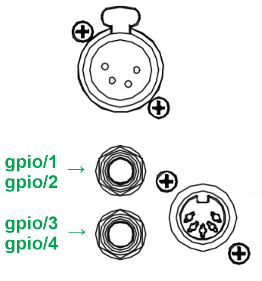user/gpio/1..4

This subsection covers the 4 possible GPIOs supported by WING; the
actual set of usable OSC patterns available at a given time depends on
the mode parameter value of the /$ctl/user/gpio/1..4/bu/ OSC pattern
represented below as &lt;OSC b\_pattern&gt;.

## 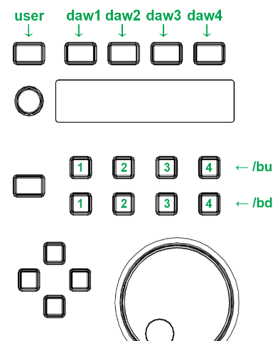user/user/1..4

This subsection covers the 8 user buttons supported by WING[34]; the
actual set of usable OSC patterns available at a given time depends on
the mode parameter value of the /$ctl/user/user/1..4/bu/ and the
/$ctl/user/user/1..4/bd/ OSC patterns for the 4 buttons of the upper and
lower row of the button section, and represented below as &lt;OSC
b\_pattern&gt;.

## user/daw1..4/1..4

This subsection covers the 4 possible sets of 8 DAW buttons supported by
WING; the actual set of usable OSC patterns available at a given time
depends on the mode parameter value of the
/$ctl/user/daw1..daw4/1..4/bu/ and the /$ctl/user/daw1..daw4/1..4/bd/
OSC patterns for the 4 buttons of the upper and lower row of the button
section, and represented below as &lt;OSC b\_pattern&gt;.

## 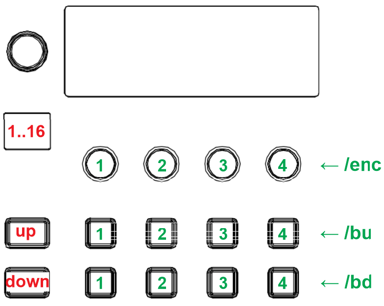user/1..16/1..4

This subsection covers the 16 possible sets of 8 user buttons and 4 user
encoders supported by WING[35]; the actual set of usable OSC patterns
available at a given time depends on the mode parameter value of the
/$ctl/user/1..16/1..4/bu/, /$ctl/user/1..16/1..4/bd/, and
/$ctl/user/1..16/1..4/enc/ OSC patterns for the 4 buttons of the upper
and lower row of the button section, and the 4 encoders represented
below as &lt;OSC b\_pattern&gt; and &lt;OSC e\_pattern&gt;,
respectively.

The tables below list the different options for OSC patterns &lt;OSC
b\_pattern&gt;:

<table style="width:93%;">
<colgroup>
<col style="width: 10%" />
<col style="width: 23%" />
<col style="width: 4%" />
<col style="width: 26%" />
<col style="width: 29%" />
</colgroup>
<thead>
<tr>
<th>
<strong>mode</strong>
</th>
<th>
<strong>Command</strong>
</th>
<th style="text-align: center;">
<strong>Type</strong>
</th>
<th>
<strong>Range / Text</strong>
</th>
<th>
<strong>Description</strong>
</th>
</tr>
</thead>
<tbody>
<tr>
<td>
OFF
</td>
<td>
none
</td>
<td style="text-align: center;"></td>
<td></td>
<td>
OFF
</td>
</tr>
<tr>
<td></td>
<td></td>
<td style="text-align: center;"></td>
<td></td>
<td></td>
</tr>
<tr>
<td>
MUTE
</td>
<td>
&lt;OSC b_pattern&gt;/ch
</td>
<td style="text-align: center;">
I
</td>
<td>
1..76
</td>
<td>
Channel number
</td>
</tr>
<tr>
<td></td>
<td></td>
<td style="text-align: center;"></td>
<td></td>
<td></td>
</tr>
<tr>
<td>
SOLO
</td>
<td>
&lt;OSC b_pattern&gt;/ch
</td>
<td style="text-align: center;">
I
</td>
<td>
1..76
</td>
<td>
Channel number
</td>
</tr>
<tr>
<td></td>
<td></td>
<td style="text-align: center;"></td>
<td></td>
<td></td>
</tr>
<tr>
<td>
INS1
</td>
<td>
&lt;OSC b_pattern&gt;/ch
</td>
<td style="text-align: center;">
I
</td>
<td>
1..76
</td>
<td>
Channel number
</td>
</tr>
<tr>
<td></td>
<td></td>
<td style="text-align: center;"></td>
<td></td>
<td></td>
</tr>
<tr>
<td>
INS2
</td>
<td>
&lt;OSC b_pattern&gt;/ch
</td>
<td style="text-align: center;">
I
</td>
<td>
1..76
</td>
<td>
Channel number
</td>
</tr>
<tr>
<td></td>
<td></td>
<td style="text-align: center;"></td>
<td></td>
<td></td>
</tr>
<tr>
<td>
MGRP
</td>
<td>
&lt;OSC b_pattern&gt;/mgrp
</td>
<td style="text-align: center;">
S
</td>
<td>
MGRP.1, MGRP.2,..,MGRP.8
</td>
<td>
Mute group name
</td>
</tr>
<tr>
<td></td>
<td></td>
<td style="text-align: center;"></td>
<td></td>
<td></td>
</tr>
<tr>
<td>
DCAMUTE
</td>
<td>
&lt;OSC b_pattern&gt;/dca
</td>
<td style="text-align: center;">
I
</td>
<td>
1..16
</td>
<td>
DCA fader number mute
</td>
</tr>
<tr>
<td></td>
<td></td>
<td style="text-align: center;"></td>
<td></td>
<td></td>
</tr>
<tr>
<td>
SOF
</td>
<td>
&lt;OSC b_pattern&gt;/ch
</td>
<td style="text-align: center;">
I
</td>
<td>
1..76
</td>
<td>
Channel number
</td>
</tr>
<tr>
<td></td>
<td></td>
<td style="text-align: center;"></td>
<td></td>
<td></td>
</tr>
<tr>
<td>
SPILL
</td>
<td>
&lt;OSC b_pattern&gt;/area
</td>
<td style="text-align: center;">
S
</td>
<td>
L, C, R
</td>
<td>
Console area (left, center, right)
</td>
</tr>
<tr>
<td></td>
<td>
&lt;OSC b_pattern&gt;/tgt
</td>
<td style="text-align: center;">
S
</td>
<td>
DCA1,.., DCA16, FX1,.., FX16, BUS1,.., BU16, MAIN1,.., MAIN4,
MTX1,..,MTX8, AUTOX, AUTOY, SELCH, ACTCH
</td>
<td>
Targeted group<a href="#fn1" class="footnote-ref" id="fnref1"
role="doc-noteref">1</a>
</td>
</tr>
<tr>
<td></td>
<td></td>
<td style="text-align: center;"></td>
<td></td>
<td></td>
</tr>
<tr>
<td rowspan="2">
FXPAR
</td>
<td>
&lt;OSC b_pattern&gt;/fx
</td>
<td style="text-align: center;">
S
</td>
<td>
FX1,..,FX16
</td>
<td>
FX processor number
</td>
</tr>
<tr>
<td>
&lt;OSC b_pattern&gt;/par
</td>
<td style="text-align: center;">
I
</td>
<td>
1..41
</td>
<td>
FX processor parameter number<a href="#fn2" class="footnote-ref"
id="fnref2" role="doc-noteref">2</a>
</td>
</tr>
<tr>
<td></td>
<td></td>
<td style="text-align: center;"></td>
<td></td>
<td></td>
</tr>
<tr>
<td>
DAWBTN
</td>
<td>
&lt;OSC b_pattern&gt;/btn
</td>
<td style="text-align: center;">
S
</td>
<td>
T1,..,T20, N1,..,N9, A1,..,A16, F1,..,F8, V1,..,V15, AU1,..,AU12,
SY1,..,SY10, OT1,..,OT12, E1,..,E10, SP1,.., SP6
</td>
<td>
MCU button<a href="#fn3" class="footnote-ref" id="fnref3"
role="doc-noteref">3</a>
</td>
</tr>
<tr>
<td></td>
<td></td>
<td style="text-align: center;"></td>
<td></td>
<td></td>
</tr>
<tr>
<td>
DAWENC
</td>
<td>
&lt;OSC b_pattern&gt;/enc
</td>
<td style="text-align: center;">
S
</td>
<td>
M1P,..,M8P, E1P,..,E16P, M1,..,M8, E1,..,E16, JOG
</td>
<td>
DAW Rotary<a href="#fn4" class="footnote-ref" id="fnref4"
role="doc-noteref">4</a>
</td>
</tr>
<tr>
<td></td>
<td></td>
<td style="text-align: center;"></td>
<td></td>
<td></td>
</tr>
<tr>
<td rowspan="2">
CHPAGE
</td>
<td>
&lt;OSC b_pattern&gt;/ch
</td>
<td style="text-align: center;">
I
</td>
<td>
1..76
</td>
<td>
Channel number
</td>
</tr>
<tr>
<td>
&lt;OSC b_pattern&gt;/pg
</td>
<td style="text-align: center;">
S
</td>
<td>
HOME, INPUT, FILT, GATE, DYN, EQ, INS1, INS2, MAIN, SEND,
SND.EQ
</td>
<td>
Page name
</td>
</tr>
<tr>
<td></td>
<td></td>
<td style="text-align: center;"></td>
<td></td>
<td></td>
</tr>
<tr>
<td>
PAGE
</td>
<td>
&lt;OSC b_pattern&gt;/pg
</td>
<td style="text-align: center;">
S
</td>
<td>
FX, MTRS, CHINS, SRC, OUTS, SETUP, LIB, CUSTCTL, MON, 2TRK,
WLIVE, MIXV, FDRV, SENDV, MGRP, LAYER
</td>
<td>
Page name
</td>
</tr>
<tr>
<td></td>
<td></td>
<td style="text-align: center;"></td>
<td></td>
<td></td>
</tr>
<tr>
<td rowspan="2">
FDRPAGE
</td>
<td>
&lt;OSC b_pattern&gt;/area
</td>
<td style="text-align: center;">
S
</td>
<td>
L, C, R, CMPCT, RCK, EXT, VRT
</td>
<td>
Area
</td>
</tr>
<tr>
<td>
&lt;OSC b_pattern&gt;/bank
</td>
<td style="text-align: center;">
I
</td>
<td>
1..21
</td>
<td>
Bank
</td>
</tr>
<tr>
<td></td>
<td></td>
<td style="text-align: center;"></td>
<td></td>
<td></td>
</tr>
<tr>
<td rowspan="2">
VIEWPAGE
</td>
<td>
&lt;OSC b_pattern&gt;/area
</td>
<td style="text-align: center;">
S
</td>
<td>
L, C, R, CMPCT, RCK, EXT, VRT
</td>
<td>
Area
</td>
</tr>
<tr>
<td>
&lt;OSC b_pattern&gt;/bank
</td>
<td style="text-align: center;">
I
</td>
<td>
1..21
</td>
<td>
Bank
</td>
</tr>
<tr>
<td></td>
<td></td>
<td style="text-align: center;"></td>
<td></td>
<td></td>
</tr>
<tr>
<td>
OTHER
</td>
<td>
&lt;OSC b_pattern&gt;/other

&lt;OSC b_pattern&gt;/CCBK
</td>
<td style="text-align: center;">
S

S
</td>
<td>
TBA, TBB, ALTSRC, DAWSW, MONA, MONB, MONAB, MONDIM, MONMONO,
MONSWAP, MONMUTE, FDROFF, FDR-10DB, FDR0DB, AUTOX, AUTOY, CHPREV,
CHNEXT, CHSOLO, BUSSOLO, MAINSOLO, MTXSOLO, CHMTR, BUSMTR, MAINMTR,
MTXMTR, DCAMTR, CCBANK

1..16, -1, +1
</td>
<td>
Other functions

When other == CCBANK
</td>
</tr>
<tr>
<td></td>
<td></td>
<td style="text-align: center;"></td>
<td></td>
<td></td>
</tr>
<tr>
<td>
GPIO
</td>
<td>
&lt;OSC b_pattern&gt;/GPIO
</td>
<td style="text-align: center;">
S
</td>
<td>
A, B, C, D, A‑P, B‑P, C‑P, D‑P, 2S, 5S, 10S, 15S, 20S, 25S,
30S
</td>
<td>
GPIO Toggle, Push, or Power‑on delay<a href="#fn5"
class="footnote-ref" id="fnref5"
role="doc-noteref">5</a>
</td>
</tr>
<tr>
<td></td>
<td></td>
<td style="text-align: center;"></td>
<td></td>
<td></td>
</tr>
<tr>
<td>
FSTART
</td>
<td>
&lt;OSC b_pattern&gt;/ch
</td>
<td style="text-align: center;">
I
</td>
<td>
1..76
</td>
<td>
Channel number
</td>
</tr>
<tr>
<td></td>
<td></td>
<td style="text-align: center;"></td>
<td></td>
<td></td>
</tr>
<tr>
<td>
SHOWCTL
</td>
<td>
&lt;OSC b_pattern&gt;/action
</td>
<td style="text-align: center;">
S
</td>
<td>
GO, PREV, NEXT, GOPREV, GONEXT
</td>
<td>
Show control functions
</td>
</tr>
<tr>
<td></td>
<td></td>
<td style="text-align: center;"></td>
<td></td>
<td></td>
</tr>
<tr>
<td>
SCENES
</td>
<td>
&lt;OSC b_pattern&gt;/tag
</td>
<td style="text-align: center;">
I
</td>
<td>
1..128
</td>
<td>
Scene number to recall
</td>
</tr>
<tr>
<td></td>
<td></td>
<td style="text-align: center;"></td>
<td></td>
<td></td>
</tr>
<tr>
<td>
MIDICCT
</td>
<td>
&lt;OSC b_pattern&gt;/ch
</td>
<td style="text-align: center;">
I
</td>
<td>
1..16
</td>
<td>
MIDI channel (toggle)
</td>
</tr>
<tr>
<td></td>
<td>
&lt;OSC b_pattern&gt;/cc
</td>
<td style="text-align: center;">
I
</td>
<td>
0..127
</td>
<td>
MIDI control change number
</td>
</tr>
<tr>
<td></td>
<td>
&lt;OSC b_pattern&gt;/val
</td>
<td style="text-align: center;">
I
</td>
<td>
0..127
</td>
<td>
MIDI control value
</td>
</tr>
<tr>
<td></td>
<td></td>
<td style="text-align: center;"></td>
<td></td>
<td></td>
</tr>
<tr>
<td>
MIDICCP
</td>
<td>
&lt;OSC b_pattern&gt;/ch
</td>
<td style="text-align: center;">
I
</td>
<td>
1..16
</td>
<td>
MIDI channel (push)
</td>
</tr>
<tr>
<td></td>
<td>
&lt;OSC b_pattern&gt;/cc
</td>
<td style="text-align: center;">
I
</td>
<td>
0..127
</td>
<td>
MIDI control change number
</td>
</tr>
<tr>
<td></td>
<td>
&lt;OSC b_pattern&gt;/val
</td>
<td style="text-align: center;">
I
</td>
<td>
0..127
</td>
<td>
MIDI control value
</td>
</tr>
<tr>
<td></td>
<td></td>
<td style="text-align: center;"></td>
<td></td>
<td></td>
</tr>
<tr>
<td>
MIDINT
</td>
<td>
&lt;OSC b_pattern&gt;/ch
</td>
<td style="text-align: center;">
I
</td>
<td>
1..16
</td>
<td>
MIDI channel (toggle)
</td>
</tr>
<tr>
<td></td>
<td>
&lt;OSC b_pattern&gt;/note
</td>
<td style="text-align: center;">
I
</td>
<td>
0..127
</td>
<td>
MIDI note
</td>
</tr>
<tr>
<td></td>
<td>
&lt;OSC b_pattern&gt;/val
</td>
<td style="text-align: center;">
I
</td>
<td>
0..127
</td>
<td>
MIDI note value
</td>
</tr>
<tr>
<td></td>
<td></td>
<td style="text-align: center;"></td>
<td></td>
<td></td>
</tr>
<tr>
<td>
MIDINP
</td>
<td>
&lt;OSC b_pattern&gt;/ch
</td>
<td style="text-align: center;">
I
</td>
<td>
1..16
</td>
<td>
MIDI channel (push)
</td>
</tr>
<tr>
<td></td>
<td>
&lt;OSC b_pattern&gt;/note
</td>
<td style="text-align: center;">
I
</td>
<td>
0..127
</td>
<td>
MIDI note
</td>
</tr>
<tr>
<td></td>
<td>
&lt;OSC b_pattern&gt;/val
</td>
<td style="text-align: center;">
I
</td>
<td>
0..127
</td>
<td>
MIDI note value
</td>
</tr>
<tr>
<td></td>
<td></td>
<td style="text-align: center;"></td>
<td></td>
<td></td>
</tr>
<tr>
<td>
MIDIPGM
</td>
<td>
&lt;OSC b_pattern&gt;/ch
</td>
<td style="text-align: center;">
I
</td>
<td>
1..16
</td>
<td>
MIDI channel
</td>
</tr>
<tr>
<td></td>
<td>
&lt;OSC b_pattern&gt;/note
</td>
<td style="text-align: center;">
I
</td>
<td>
1..128
</td>
<td>
MIDI program value
</td>
</tr>
<tr>
<td></td>
<td></td>
<td style="text-align: center;"></td>
<td></td>
<td></td>
</tr>
<tr>
<td>
USBPR
</td>
<td>
&lt;OSC b_pattern&gt;/usbpr
</td>
<td style="text-align: center;">
S
</td>
<td>
PSTOP, PLAY, PPAUSE, PNEXT, PPREV, RSTOP, RECORD, RPAUSE,
RNEW
</td>
<td>
USB Play Rec
</td>
</tr>
<tr>
<td></td>
<td></td>
<td style="text-align: center;"></td>
<td></td>
<td></td>
</tr>
<tr>
<td>
SDRECA
</td>
<td>
&lt;OSC b_pattern&gt;/sdrec
</td>
<td style="text-align: center;">
S
</td>
<td>
STOP, PLAY, REC, PAUSE, PLAYSTOP, PLAYPAUSE, ADD, PREV, NEXT,
PLAYMARKER, GOMARKER, SELSESSION, PREV_S, NEXT_S
</td>
<td>
SD A recorder
</td>
</tr>
<tr>
<td></td>
<td></td>
<td style="text-align: center;"></td>
<td></td>
<td></td>
</tr>
<tr>
<td>
SESSIONA
</td>
<td>
&lt;OSC b_pattern&gt;/session
</td>
<td style="text-align: center;">
S
</td>
<td>
S1..S20
</td>
<td>
SD A Session
</td>
</tr>
<tr>
<td></td>
<td></td>
<td style="text-align: center;"></td>
<td></td>
<td></td>
</tr>
<tr>
<td>
MARKERA
</td>
<td>
&lt;OSC b_pattern&gt;/marker
</td>
<td style="text-align: center;">
S
</td>
<td>
M1..M20
</td>
<td>
SD A Marker
</td>
</tr>
<tr>
<td></td>
<td></td>
<td style="text-align: center;"></td>
<td></td>
<td></td>
</tr>
<tr>
<td>
SDRECB
</td>
<td>
&lt;OSC b_pattern&gt;/sdrec
</td>
<td style="text-align: center;">
S
</td>
<td>
STOP, PLAY, REC, PAUSE, PLAYSTOP, PLAYPAUSE, ADD, PREV, NEXT,
PLAYMARKER, GOMARKER, SELSESSION, PREV_S, NEXT_S
</td>
<td>
SD B recorder
</td>
</tr>
<tr>
<td></td>
<td></td>
<td style="text-align: center;"></td>
<td></td>
<td></td>
</tr>
<tr>
<td>
SESSIONB
</td>
<td>
&lt;OSC b_pattern&gt;/session
</td>
<td style="text-align: center;">
S
</td>
<td>
S1..S20
</td>
<td>
SD B Session
</td>
</tr>
<tr>
<td></td>
<td></td>
<td style="text-align: center;"></td>
<td></td>
<td></td>
</tr>
<tr>
<td>
MARKERB
</td>
<td>
&lt;OSC b_pattern&gt;/marker
</td>
<td style="text-align: center;">
S
</td>
<td>
M1..M20
</td>
<td>
SD B Marker
</td>
</tr>
</tbody>
</table>
<section id="footnotes" class="footnotes footnotes-end-of-document"
role="doc-endnotes">

<ol>
<li id="fn1">
Maps to /$ctl/layer/xxx/spidx parameters values 1..62<a
href="#fnref1" class="footnote-back" role="doc-backlink">↩︎</a>
</li>
<li id="fn2">
1..40 are for FX parameters, 41 is for FX Mix<a
href="#fnref2" class="footnote-back" role="doc-backlink">↩︎</a>
</li>
<li id="fn3">
See MCU [DAW BUTTONS] commands list in Appendixes<a
href="#fnref3" class="footnote-back" role="doc-backlink">↩︎</a>
</li>
<li id="fn4">
See MCU [DAW V‑POTS] commands list in Appendixes<a
href="#fnref4" class="footnote-back" role="doc-backlink">↩︎</a>
</li>
<li id="fn5">
Toggle (A..D) and Push (A‑P..D‑P) apply to GPIO and USER
CC; Delays {2S…30S) apply only to GPIO state setup time after a console
power cycle.<a href="#fnref5" class="footnote-back"
role="doc-backlink">↩︎</a>
</li>
</ol>
</section>

The table below lists the different options for the OSC encoder pattern
&lt;OSC e\_pattern&gt;:

<table style="width:93%;">
<colgroup>
<col style="width: 10%" />
<col style="width: 24%" />
<col style="width: 4%" />
<col style="width: 23%" />
<col style="width: 30%" />
</colgroup>
<thead>
<tr>
<th>
mode
</th>
<th>
Command
</th>
<th style="text-align: center;">
Type
</th>
<th>
Range / Text
</th>
<th>
Description
</th>
</tr>
</thead>
<tbody>
<tr>
<td>
OFF
</td>
<td>
none
</td>
<td style="text-align: center;"></td>
<td></td>
<td>
OFF
</td>
</tr>
<tr>
<td></td>
<td></td>
<td style="text-align: center;"></td>
<td></td>
<td></td>
</tr>
<tr>
<td>
FDR
</td>
<td>
&lt;OSC e_pattern&gt;/ch
</td>
<td style="text-align: center;">
I
</td>
<td>
1..76
</td>
<td>
Channel number
</td>
</tr>
<tr>
<td></td>
<td></td>
<td style="text-align: center;"></td>
<td></td>
<td></td>
</tr>
<tr>
<td>
PAN
</td>
<td>
&lt;OSC e_pattern&gt;/ch
</td>
<td style="text-align: center;">
I
</td>
<td>
1..76
</td>
<td>
Channel number
</td>
</tr>
<tr>
<td></td>
<td></td>
<td style="text-align: center;"></td>
<td></td>
<td></td>
</tr>
<tr>
<td>
DCA
</td>
<td>
&lt;OSC e_pattern&gt;/dca
</td>
<td style="text-align: center;">
I
</td>
<td>
1..16
</td>
<td>
DCA fader number
</td>
</tr>
<tr>
<td></td>
<td></td>
<td style="text-align: center;"></td>
<td></td>
<td></td>
</tr>
<tr>
<td>
SSND
</td>
<td>
&lt;OSC e_pattern&gt;/send
</td>
<td style="text-align: center;">
S
</td>
<td>
BUS1,..,BUS16, MAIN1,..,MAIN4, MTX1,..,MTX8
</td>
<td>
Send to Bus, Main or Matrix number
</td>
</tr>
<tr>
<td></td>
<td></td>
<td style="text-align: center;"></td>
<td></td>
<td></td>
</tr>
<tr>
<td>
FSND
</td>
<td>
&lt;OSC e_pattern&gt;/ch

&lt;OSC e_pattern&gt;/send
</td>
<td style="text-align: center;">
I

S
</td>
<td>
1..48

BUS1,..,BUS16, MAIN1,..,MAIN4, MTX1,..,MTX8
</td>
<td>
Channel number

Send to Bus, Main or Matrix number
</td>
</tr>
<tr>
<td></td>
<td></td>
<td style="text-align: center;"></td>
<td></td>
<td></td>
</tr>
<tr>
<td rowspan="2">
FX
</td>
<td>
&lt;OSC e_pattern&gt;/fx
</td>
<td style="text-align: center;">
S
</td>
<td>
FX1,..,FX16
</td>
<td>
FX processor number
</td>
</tr>
<tr>
<td>
&lt;OSC e_pattern&gt;/par
</td>
<td style="text-align: center;">
I
</td>
<td>
1..41
</td>
<td>
FX processor parameter number<a href="#fn1" class="footnote-ref"
id="fnref1" role="doc-noteref">1</a>
</td>
</tr>
<tr>
<td></td>
<td></td>
<td style="text-align: center;"></td>
<td></td>
<td></td>
</tr>
<tr>
<td>
DAWMCU
</td>
<td>
&lt;OSC e_pattern&gt;/mcuenc
</td>
<td style="text-align: center;">
S
</td>
<td>
M1,..,M8, E1,..,E16, JOG
</td>
<td>
DAW Rotary<a href="#fn2" class="footnote-ref" id="fnref2"
role="doc-noteref">2</a>
</td>
</tr>
<tr>
<td></td>
<td></td>
<td style="text-align: center;"></td>
<td></td>
<td></td>
</tr>
<tr>
<td>
MON
</td>
<td>
&lt;OSC e_pattern&gt;/mon
</td>
<td style="text-align: center;">
S
</td>
<td>
A, B
</td>
<td>
Monitor selection<a href="#fn3" class="footnote-ref" id="fnref3"
role="doc-noteref">3</a>

A: PHONES level

B: SPEAKERS / MONITOR level
</td>
</tr>
<tr>
<td></td>
<td></td>
<td style="text-align: center;"></td>
<td></td>
<td></td>
</tr>
<tr>
<td>
OTHER
</td>
<td>
&lt;OSC e_pattern&gt;/other
</td>
<td style="text-align: center;">
S
</td>
<td>
BRILAMP, BRIGLOW, BRIPATCH
</td>
<td>
Lamp and other lighting controls
</td>
</tr>
<tr>
<td></td>
<td></td>
<td style="text-align: center;"></td>
<td></td>
<td></td>
</tr>
<tr>
<td>
MIDICC
</td>
<td>
&lt;OSC e_pattern&gt;/ch
</td>
<td style="text-align: center;">
I
</td>
<td>
1..16
</td>
<td>
MIDI channel
</td>
</tr>
<tr>
<td></td>
<td>
&lt;OSC e_pattern&gt;/cc
</td>
<td style="text-align: center;">
I
</td>
<td>
0..127
</td>
<td>
MIDI control change number
</td>
</tr>
<tr>
<td></td>
<td>
&lt;OSC e_pattern&gt;/val
</td>
<td style="text-align: center;">
I
</td>
<td>
0..127
</td>
<td>
MIDI control change value
</td>
</tr>
<tr>
<td></td>
<td></td>
<td style="text-align: center;"></td>
<td></td>
<td></td>
</tr>
<tr>
<td>
SD A
</td>
<td>
&lt;OSC e_pattern&gt;/sdarec
</td>
<td style="text-align: center;">
S
</td>
<td>
POS, MARKER, SESSION
</td>
<td>
SD‑A Recorder
</td>
</tr>
<tr>
<td></td>
<td></td>
<td style="text-align: center;"></td>
<td></td>
<td></td>
</tr>
<tr>
<td>
SD B
</td>
<td>
&lt;OSC e_pattern&gt;/sdbrec
</td>
<td style="text-align: center;">
S
</td>
<td>
POS, MARKER, SESSION
</td>
<td>
SD‑B Recorder
</td>
</tr>
</tbody>
</table>
<section id="footnotes" class="footnotes footnotes-end-of-document"
role="doc-endnotes">

<ol>
<li id="fn1">
1..40 are for FX parameters, 41 is for FX Mix<a
href="#fnref1" class="footnote-back" role="doc-backlink">↩︎</a>
</li>
<li id="fn2">
See MCU [DAW REMOTE MCU] commands list in Appendixes<a
href="#fnref2" class="footnote-back" role="doc-backlink">↩︎</a>
</li>
<li id="fn3">
Note these are only ‘readable’ when touching the
encoder, the actual setting is only possible with the potentiometer in
the Monitoring/Talkback section of the console<a href="#fnref3"
class="footnote-back" role="doc-backlink">↩︎</a>
</li>
</ol>
</section>

# Appendix: Effects and Plugins’ Parameters list

In the (long) tables below, we list all known/exposed effects and
plugins available with the WING digital console, along with their name,
type, and min/max/step/list values; We therefore present Standard
Effects, Premium effects, Filter Plugins, Gate Plugins, EQ Plugins, and
Compressor Plugins.

All active effects and plugins modify the JSON tree and their respective
OSC patterns.

On any channel, an insert will create a processing delay of 32 samples
(i.e. around 0.66ms). This is because audio is routed to a different DSP
for FX processing. It is important to take this into account when
mixing, as phasing effects may result from the imposed delay.

With FW 2.1, Behringer published a document on effect: the WING Effects
Guide, with a description of effects and plugins that can be found on
WING. This document can be found and downloaded at:

[https://mediadl.musictribe.com/media/PLM/data/docs/P0BV2/EFFECTS%20GUIDE\_M\_BE\_0603‑AEN\_WING.pdf](https://mediadl.musictribe.com/media/PLM/data/docs/P0BV2/EFFECTS%20GUIDE_M_BE_0603-AEN_WING.pdf)

In addition to the Behringer document above, the tables below show all
parameters associated to effects and plugins, including their name,
type, and value range following the OSC pattern /fx/1..16/

## Effects

### Standard effects

<table style="width:96%;">
<colgroup>
<col style="width: 46%" />
<col style="width: 49%" />
</colgroup>
<thead>
<tr>
<th></th>
<th>
<em>None</em>

<em>0 <strong>“mdl”</strong>: NONE</em>
</th>
</tr>
</thead>
<tbody>
<tr>
<td></td>
<td></td>
</tr>
<tr>
<td>
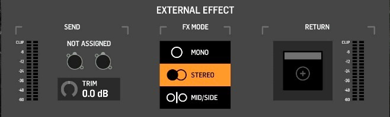
</td>
<td>
<em>External</em>

<em>0 <strong>“mdl”</strong>: EXT</em>

<em>1 <strong>“egrp”</strong>: str [OFF, LCL, AUX, A, B, C,
SC,</em>

<em>USB, CRD, MOD, PLAY, AES] ext grp</em>

<em>2 <strong>“ein”</strong>: int [1…64] ext in</em>

<em>3 <strong>“emode”</strong>: str [M, ST, M/S] ext mode</em>

<em>4 <strong>“lat”</strong>: int [0…200] latency</em>

<em>5 <strong>“trim”</strong>: linf [‑18, 18, 361] dB,
trim</em>
</td>
</tr>
<tr>
<td></td>
<td></td>
</tr>
<tr>
<td>
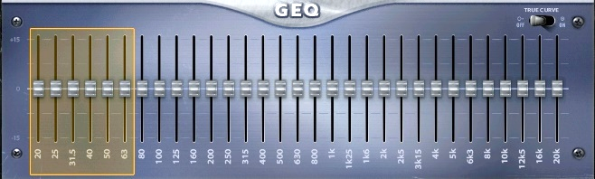
</td>
<td>
<em>Graphic EQ</em>

<em>0 <strong>“mdl”</strong>: GEQ</em>

<em>1 <strong>“type”</strong>: str [STD, TRU] geq type</em>

<em>2 <strong>“20”</strong>: linf [‑15, 15, 121] dB</em>

<em>3 <strong>“25”</strong>: linf [‑15, 15, 121] dB</em>

<em>4 <strong>“31”</strong>: linf [‑15, 15, 121] dB</em>

<em>5 <strong>“40”</strong>: linf [‑15, 15, 121] dB</em>

<em>6 <strong>“50”</strong>: linf [‑15, 15, 121] dB</em>

<em>7 <strong>“63”</strong>: linf [‑15, 15, 121] dB</em>

<em>8 <strong>“80”</strong>: linf [‑15, 15, 121] dB</em>

<em>9 <strong>“100”</strong>: linf [‑15, 15, 121] dB</em>

<em>10 <strong>“125”</strong>: linf [‑15, 15, 121] dB</em>

<em>11 <strong>“160”</strong>: linf [‑15, 15, 121] dB</em>

<em>12 <strong>“200”</strong>: linf [‑15, 15, 121] dB</em>

<em>13 <strong>“250”</strong>: linf [‑15, 15, 121] dB</em>

<em>14 <strong>“315”</strong>: linf [‑15, 15, 121] dB</em>

<em>15 <strong>“400”</strong>: linf [‑15, 15, 121] dB</em>

<em>16 <strong>“500”</strong>: linf [‑15, 15, 121] dB</em>

<em>17 <strong>“630”</strong>: linf [‑15, 15, 121] dB</em>

<em>18 <strong>“800”</strong>: linf [‑15, 15, 121] dB</em>

<em>19 <strong>“1k”</strong>: linf [‑15, 15, 121] dB</em>

<em>20 <strong>“1k25”</strong>: linf [‑15, 15, 121] dB</em>

<em>21 <strong>“1k6”</strong>: linf [‑15, 15, 121] dB</em>

<em>22 <strong>“2k”</strong>: linf [‑15, 15, 121] dB</em>

<em>23 <strong>“2k5”</strong>: linf [‑15, 15, 121] dB</em>

<em>24 <strong>“3k15”</strong>: linf [‑15, 15, 121] dB</em>

<em>25 <strong>“4k”</strong>: linf [‑15, 15, 121] dB</em>

<em>26 <strong>“5k”</strong>: linf [‑15, 15, 121] dB</em>

<em>27 <strong>“6k3”</strong>: linf [‑15, 15, 121] dB</em>

<em>28 <strong>“8k”</strong>: linf [‑15, 15, 121] dB</em>

<em>29 <strong>“10k”</strong>: linf [‑15, 15, 121] dB</em>

<em>30 <strong>“12k5”</strong>: linf [‑15, 15, 121] dB</em>

<em>31 <strong>“16k”</strong>: linf [‑15, 15, 121] dB</em>

<em>32 <strong>“20k”</strong>: linf [‑15, 15, 121] dB</em>

<em>33 <strong>“TRIM”</strong>: linf [‑15, 15, 121] dB</em>
</td>
</tr>
<tr>
<td></td>
<td></td>
</tr>
<tr>
<td>
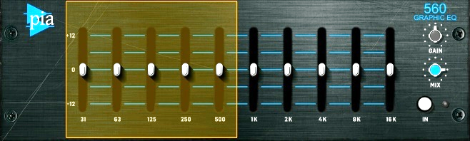
</td>
<td>
PIA 560 GEQ

<em>0 <strong>“mdl”</strong>: PIA</em>

<em>1 <strong>“mix”</strong>: linf [0, 125, 126] %, mix</em>

<em>2 <strong>“gain”</strong>: linf [‑12, 12, 241] dB</em>

<em>3 <strong>“31”</strong>: linf [‑12, 12, 241] dB</em>

<em>4 <strong>“63”</strong>: linf [‑12, 12, 241] dB</em>

<em>5 <strong>“125”</strong>: linf [‑12, 12, 241] dB</em>

<em>6 <strong>“250”</strong>: linf [‑12, 12, 241] dB</em>

<em>7 <strong>“500”</strong>: linf [‑12, 12, 241] dB</em>

<em>8 <strong>“1k”</strong>: linf [‑12, 12, 241] dB</em>

<em>9 <strong>“2k”</strong>: linf [‑12, 12, 241] dB</em>

<em>10 <strong>“4k”</strong>: linf [‑12, 12, 241] dB</em>

<em>11 <strong>“8k”</strong>: linf [‑12, 12, 241] dB</em>

<em>12 <strong>“16k”</strong>: linf [‑12, 12, 241] dB</em>
</td>
</tr>
<tr>
<td></td>
<td></td>
</tr>
<tr>
<td>
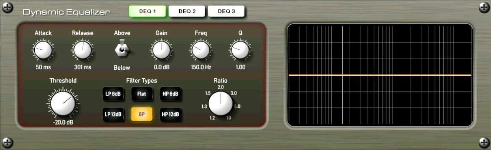
</td>
<td>
Triple Dynamic EQ

<em>0 <strong>“mdl”</strong>: DEQ3</em>

<em>1 <strong>“1‑thr”</strong>: linf [‑60, 0, 121] dB, threshold
1</em>

<em>2 <strong>“1‑ratio”</strong>: str [1.20, 1.30, 1.50, 2.00,
3.00, 
5.00, 10.00] ms, ratio 1 
3 “<strong>1‑att</strong>”: linf [0.00, 200.00, 201] ms, att 1 
4 “<strong>1‑rel</strong>”: logf [20.00, 4000.00, 130] ms, rel 1 
5 “<strong>1‑filt</strong>”: str [OFF, BP, LP6, LP12, HP6, HP12] 
6 “<strong>1‑g</strong>”: linf [‑15.00, 15.00, 301] dB, gain 1 
7 “<strong>1‑f</strong>”: logf [20, 20000, 961] Hz, freq 1 
8 “<strong>1‑q</strong>”: logf [0.44, 10.00, 181] qual 1 
9 “<strong>1‑mode</strong>”: str [low, high] mode 1 
10 <strong>“2‑thr”</strong>: linf [‑60, 0, 121] dB, threshold 2</em>

<em>11 <strong>“2‑ratio”</strong>: str [1.20, 1.30, 1.50, 2.00,
3.00, 
5.00, 10.00] ms, ratio 2 
12 “<strong>2‑att</strong>”: linf [0.00, 200.00, 201] ms, att 2 
13 “<strong>2‑rel</strong>”: logf [20.00, 4000.00, 130] ms, rel 2 
14 “<strong>2‑filt</strong>”: str [OFF, BP, LP6, LP12, HP6, HP12] 
15 “<strong>2‑g</strong>”: linf [‑15.00, 15.00, 301] dB, gain 2 
16 “<strong>2‑f</strong>”: logf [20, 20000, 961] Hz, freq 2 
17 “<strong>2‑q</strong>”: logf [0.44, 10.00, 181] qual 2 
18 “<strong>2‑mode</strong>”: str [low, high] mode 2 
19 <strong>“3‑thr”</strong>: linf [‑60, 0, 121] dB, threshold 3</em>

<em>20 <strong>“3‑ratio”</strong>: str [1.20, 1.30, 1.50, 2.00,
3.00, 
5.00, 10.00] ms, ratio 3 
21 “<strong>3‑att</strong>”: linf [0.00, 200.00, 201] ms, att 3 
22 “<strong>3‑rel</strong>”: logf [20.00, 4000.00, 130] ms, rel 3 
23 “<strong>3‑filt</strong>”: str [OFF, BP, LP6, LP12, HP6, HP12] 
24 “<strong>3‑g</strong>”: linf [‑15.00, 15.00, 301] dB, gain 3 
25 “<strong>3‑f</strong>”: logf [20, 20000, 961] Hz, freq 3 
26 “<strong>3‑q</strong>”: logf [0.44, 10.00, 181] qual 3 
27 “<strong>3‑mode</strong>”: str [low, high] mode 3</em>
</td>
</tr>
<tr>
<td></td>
<td></td>
</tr>
<tr>
<td>
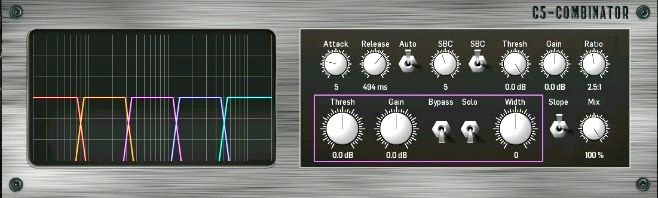
</td>
<td>
Combinator

<em>0 <strong>“mdl”</strong>: C5‑CMB</em>

<em>1 <strong>“thr”</strong>: linf [‑40, 0, 401] dB,
threshold</em>

<em>2 <strong>“gain”</strong>: linf [‑10, 10, 201] dB, gain 
3 “<strong>ratio</strong>”: str [1.1, 1.2, 1.3, 1.5, 1.7, 
2.0, 2.5, 3.0, 3.5, 4.0, 
5.0, 7.0, 10.0, 100.0] ms, ratio 
4 “<strong>slope</strong>”: str [24, 48] dB/Oct, slope 
5 “<strong>bandse l</strong>”: int [1..5] selected band 
6 “<strong>att</strong>”: linf [0, 20, 21] attack 
7 “<strong>rel</strong>”: logf [20, 3000, 201] ms, release 
8 “<strong>arel</strong>”: int [0, 1] auto release 
9 “<strong>sbc</strong>”: linf [1, 10, 10] sbc speed 
10 “<strong>sbcon</strong>”: int [0, 1] sbc on 
11 “<strong>thr_1</strong>”: linf [‑10, 10, 201] dB, 1‑THR 
12 “<strong>thr_2</strong>”: linf [‑10, 10, 201] dB, 2‑THR 
13 “<strong>thr_3</strong>”: linf [‑10, 10, 201] dB, 3‑THR 
14 “<strong>thr_4</strong>”: linf [‑10, 10, 201] dB, 4‑THR 
15 “<strong>thr_5</strong>”: linf [‑10, 10, 201] dB, 5‑THR 
16 “<strong>gain_1</strong>”: linf [‑10, 10, 201] dB, 1‑GAIN 
17 “<strong>gain_2</strong>”: linf [‑10, 10, 201] dB, 2‑GAIN 
18 “<strong>gain_3</strong>”: linf [‑10, 10, 201] dB, 3‑GAIN 
19 “<strong>gain_4</strong>”: linf [‑10, 10, 201] dB, 4‑GAIN 
20 “<strong>gain_5</strong>”: linf [‑10, 10, 201] dB, 5‑GAIN 
21 “<strong>byp_1</strong>”: int [0, 1], 1‑BYP 
22 “<strong>byp_2</strong>”: int [0, 1], 2‑BYP 
23 “<strong>byp_3</strong>”: int [0, 1], 3‑BYP 
24 “<strong>byp_4</strong>”: int [0, 1], 4‑BYP 
25 “<strong>byp_5</strong>”: int [0, 1], 5‑BYP 
26 “<strong>width_1</strong>”: linf [‑50, 50, 101], 1‑XOVER 
27 “<strong>width_2</strong>”: linf [‑50, 50, 101], 2‑XOVER 
28 “<strong>width_3</strong>”: linf [‑50, 50, 101], 3‑XOVER 
29 “<strong>width_4</strong>”: linf [‑50, 50, 101], 4‑XOVER 
30 “<strong>width_5</strong>”: linf [‑50, 50, 101], 5‑XOVER 
31 “<strong>mix</strong>”: linf [0, 100, 101], mix 
32 “<strong>$bdsolo</strong>”: int [0, 1] band solo</em>
</td>
</tr>
<tr>
<td></td>
<td></td>
</tr>
<tr>
<td>
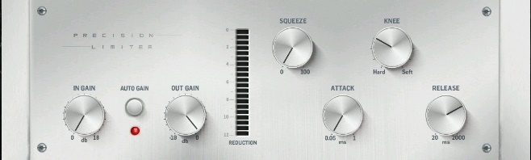
</td>
<td>
Precision Limiter

<em>0 <strong>“mdl”</strong>: LIMITER</em>

<em>1 <strong>“gin”</strong>: linf [0, 18, 73] dB, in gain</em>

<em>2 <strong>“gout”</strong>: linf [‑18, 0, 73] dB out gain</em>

<em>3 <strong>“sqz”</strong>: int [0…100] squeeze</em>

<em>4 <strong>“knee”</strong>: int [0…10] knee</em>

<em>5 <strong>“again”</strong>: int [0, 1] auto gain</em>

<em>6 <strong>“att”</strong>: linf [.05, 1, 95] ms, attack</em>

<em>7 <strong>“rel”</strong>: logf [20, 2000, 101] ms,
release</em>
</td>
</tr>
<tr>
<td></td>
<td></td>
</tr>
<tr>
<td>
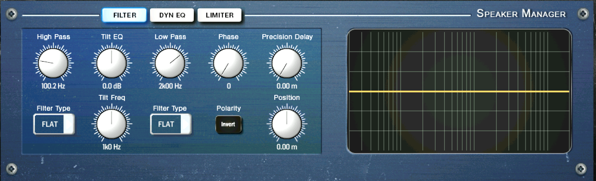
</td>
<td>
Speaker Manager

<em>0 <strong>“mdl”</strong>: SPKMAN</em>

<em>1 <strong>“hpf”</strong>: logf [20.00, 20000.00, 961] Hz,
high</em>

<em>2 <strong>“hptype”</strong>: str [FLAT, BW6, BW12, BS12,
LR12, 
BW18, BW24, BS24, LR24, BW48, 
LR48] type 
3 “<strong>lpf</strong>”: logf [20.00, 20000.00, 961] Hz, low 
4 “<strong>lptype</strong>”: str [FLAT, BW6, BW12, BS12, LR12, 
BW18, BW24, BS24, LR24, BW48, 
LR48] type 
5 “<strong>tiltf</strong>”: logf [100.00, 10000.00, 121] Hz, tilt 
6 “<strong>tiltg</strong>”: linf [‑6.00, 6.00, 121] dB, tilt gain 
7 “<strong>phase</strong>”: linf [0.00, 180.00, 37] phase 
8 “<strong>invert</strong> ”: int [0, 1] invert 
9 “<strong>dist</strong>”: linf [0.00, 5.00, 501] mtrs, distance 
10 <strong>“pos”</strong>: linf [‑5.00, 5.00, 1001] mtrs, pos.</em>

<em>11 <strong>“dyneq”</strong>: int [0, 1] deq 
12 “<strong>dynthr</strong>”: linf [‑60.00, 0.00, 121] dB,
threshold 
13 “<strong>deqratio</strong>”: str [1.20, 1.30, 1.50, 2.00, 3.00, 
5.00, 10.00] ratio 
14 “<strong>deqatt</strong>”: linf [0.00, 200.00, 201] ms, attack 
15 “<strong>deqrel</strong>”: logf [20.00, 4000.00, 130] ms,
release 
16 “<strong>deqfilt</strong>”: str [OFF, BP, LP6, LP12, HP6, HP12] 
17 “<strong>deqg</strong>”: linf [‑15.00, 15.00, 301] dB, gain 
18 “<strong>deqf</strong>”: logf [20.00, 20000.00, 961] Hz, freq 
19 <strong>“deqq”</strong>: logf [0.44, 10.00, 181] qual</em>

<em>20 <strong>“deqmode”</strong>: str [low, high] mode 
21 “<strong>lim</strong>”: int [0, 1] limiter 
22 “<strong>limthr</strong>”: linf [‑24.00, 0.00, 241] dB,
threshold 
23 “<strong>limrms</strong>”: int [0, 1] rms 
24 “<strong>limrel</strong>”: logf [50.00, 2000.00, 121] ms,
release</em>
</td>
</tr>
<tr>
<td></td>
<td></td>
</tr>
<tr>
<td>
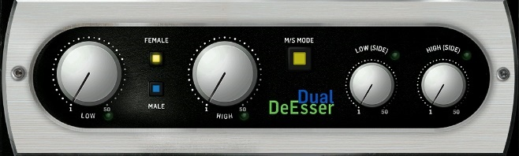
</td>
<td>
2‑Band DeEsser

<em>0 “<strong>mdl</strong>”: DE‑S2</em>

<em>1 “<strong>lo</strong>”: linf [0, 50, 51] low</em>

<em>2 “<strong>hi</strong>”: linf [0, 50, 51] high</em>

<em>3 “<strong>los</strong>”: linf [0, 50, 51] low (s)</em>

<em>4 “<strong>his</strong>”: linf [0, 50, 51] high (s)</em>

<em>5 “<strong>gdr</strong>”: str [FEMALE, MALE] gender</em>

<em>6 “<strong>mode</strong>”: str [STEREO, MID/SIDE]
mode</em>
</td>
</tr>
<tr>
<td></td>
<td></td>
</tr>
<tr>
<td>
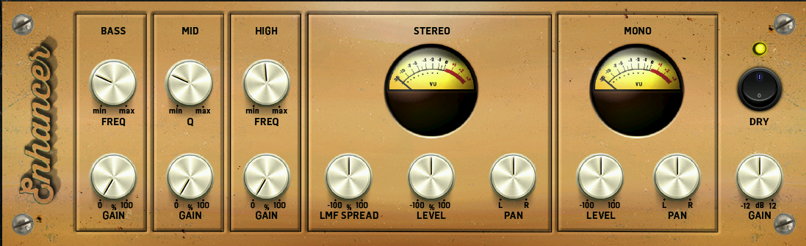
</td>
<td>
Ultra Enhancer

<em>0 <strong>“mdl”</strong>: ENHANCE</em>

<em>1 <strong>“stlv”</strong>: linf [‑100, 100, 201] %, st
lvl</em>

<em>2 <strong>“lmf”</strong>: linf [‑100, 100, 201] %, lmf
spread</em>

<em>3 <strong>“lmvl”</strong>: linf [‑100, 100, 201] %, mono
lvl</em>

<em>4 <strong>“st”</strong>: linf [‑100, 100, 201] %, st pan</em>

<em>5 <strong>“m”</strong>: linf [‑100, 100, 201] %, mono
pan</em>

<em>6 <strong>“bass”</strong>: linf [0, 100, 101] %, bass
gain</em>

<em>7 <strong>“mid”</strong>: linf [0, 100, 101] %, mid gain</em>

<em>8 <strong>“high”</strong>: linf [0, 100, 101] %, high
gain</em>

<em>9 <strong>“g”</strong>: linf [‑112, 12, 241] dB, gain</em>

<em>10 <strong>“solo”</strong>: int [0, 1] solo</em>

<em>11 <strong>“bassf”</strong>: linf [1, 50, 50] bass freq</em>

<em>12 <strong>“midq”</strong>: linf [1, 50, 50] mid Q</em>

<em>13 <strong>“highf”</strong>: linf [1, 50, 50] high
freq</em>
</td>
</tr>
<tr>
<td></td>
<td></td>
</tr>
<tr>
<td>
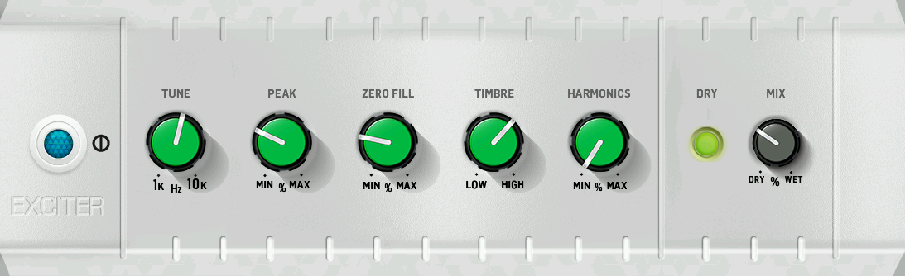
</td>
<td>
Exciter

<em>0 <strong>“mdl”</strong>: EXCITER</em>

<em>1 <strong>“tune”</strong>: logf [1000, 10000, 51] Hz,
tune</em>

<em>2 <strong>“peak”</strong>: linf [0, 100, 101] %, peak</em>

<em>3 <strong>“zfill”</strong>: linf [0, 100, 101] %, zfill</em>

<em>4 <strong>“timbre”</strong>:linf [‑50, 50, 101] timbre</em>

<em>5 <strong>“harm”</strong>: linf [0, 100, 101] %, harm</em>

<em>6 <strong>“mix”</strong>: linf [0, 100, 101] %, mix</em>

<em>7 <strong>“dry”</strong>: int [0, 1] dry</em>
</td>
</tr>
<tr>
<td></td>
<td></td>
</tr>
<tr>
<td>
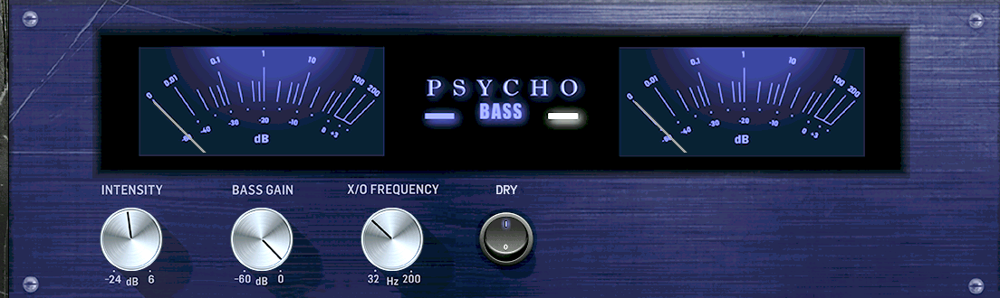
</td>
<td>
Psycho Bass

<em>0 <strong>“mdl”</strong>: P‑BASS</em>

<em>1 <strong>“int”</strong>: linf [‑24, 6, 61] dB,
intensity</em>

<em>2 <strong>“bass”</strong>: linf [‑60, 0, 121] dB, bass
gain</em>

<em>3 <strong>“xf”</strong>: logf [32, 200. 51] Hz, X/O freq</em>

<em>4 <strong>“solo”</strong>: int [0, 1] solo</em>
</td>
</tr>
<tr>
<td></td>
<td></td>
</tr>
<tr>
<td></td>
<td></td>
</tr>
<tr>
<td>

</td>
<td>
Sub Octaver

<em>0 <strong>“mdl”</strong>: SUB</em>

<em>1 <strong>“rng”</strong>: str [LOW, MID, HIGH] range</em>

<em>2 <strong>“oct1”</strong>: linf [0, 100, 101] %, octave
1</em>

<em>3 <strong>“oct2”</strong>: linf [0, 100, 101] %, octave
2</em>
</td>
</tr>
<tr>
<td></td>
<td></td>
</tr>
<tr>
<td>
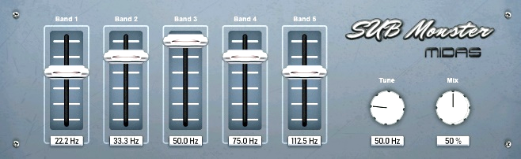
</td>
<td>
Sub Monster

<em>0 <strong>“mdl”</strong>: SUB‑M</em>

<em>1 <strong>“mix”</strong>: [0, 100, 101] %mix</em>

<em>2 <strong>“freq”</strong>: linf [45, 67.5, 226] Hz, freq</em>

<em>3 <strong>“bd1”</strong>: linf [0, 100, 101] %, band 1</em>

<em>4 <strong>“bd2”</strong>: linf [0, 100, 101] %, band 2</em>

<em>5 <strong>“bd3”</strong>: linf [0, 100, 101] %, band 3</em>

<em>6 <strong>“bd4”</strong>: linf [0, 100, 101] %, band 4</em>

<em>7 <strong>“bd5”</strong>: linf [0, 100, 101] %, band
5</em>
</td>
</tr>
<tr>
<td></td>
<td></td>
</tr>
<tr>
<td>
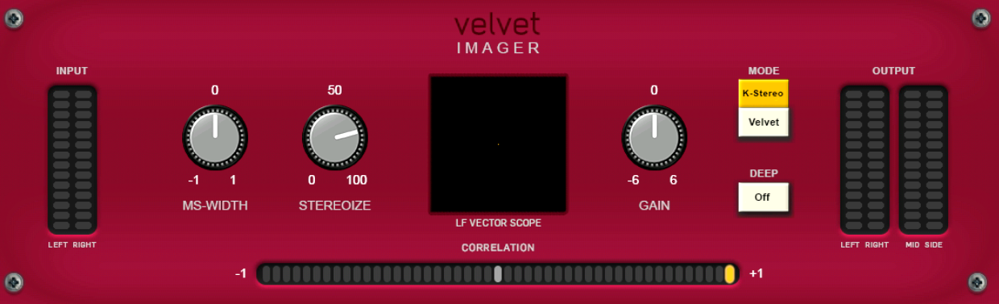
</td>
<td>
Velvet Imager

<em>0 <strong>“mdl”</strong>: V_IMG</em>

<em>1 <strong>“wid”</strong>: linf&gt; [‑1.00, 1.00, 201]
width</em>

<em>2 <strong>“st”</strong>: linf [0.00, 100.00, 101] %,
stereo</em>

<em>3 <strong>“gain”</strong>: linf [‑6.00, 6.00, 49] dB,
gain</em>

<em>4 <strong>“mode”</strong>: str [K, VELVET] mode</em>

<em>5 <strong>“deep”</strong>: int [0,1] deep</em>
</td>
</tr>
<tr>
<td></td>
<td></td>
</tr>
<tr>
<td>
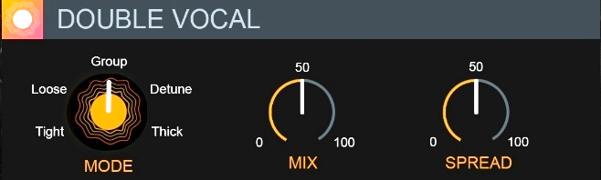
</td>
<td>
Double Vocal

<em>0 <strong>“mdl”</strong>: DOUBLE</em>

<em>1 <strong>“mode”</strong>: str [TIGHT, LOOSE, GROUP,</em>

<em>DETUNE, THICK] mode</em>

<em>2 <strong>“mix”</strong>: linf [0, 100, 101] %, mix</em>

<em>3 <strong>“sprd”</strong>: linf [0, 100, 101] %,
spread</em>
</td>
</tr>
<tr>
<td></td>
<td></td>
</tr>
<tr>
<td>
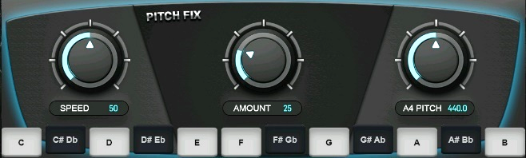
</td>
<td>
Pitch Fix

<em>0 <strong>“mdl”</strong>: PCORR</em>

<em>1 <strong>“spd”</strong>: linf [1, 100, 100] speed</em>

<em>2 <strong>“amnt”</strong>: linf [0, 50, 51] amount</em>

<em>3 <strong>“a4”</strong>: linf [410, 470, 601] A4 pitch 
4 “<strong>_c</strong>”: int [0, 1] 
5 “<strong>_db</strong>”: int [0, 1] 
6 “<strong>_d</strong>”: int [0, 1] 
7 “<strong>_eb</strong>”: int [0, 1] 
8 “<strong>_e</strong>”: int [0, 1] 
9 “<strong>_f</strong>”: int [0, 1] 
10 “<strong>_gb</strong>”: int [0, 1] 
11 “<strong>_g</strong>”: int [0, 1] 
12 “<strong>_ab</strong>”: int [0, 1] 
13 “<strong>_a</strong>”: int [0, 1] 
14 “<strong>_bb</strong>”: int [0, 1] 
15 “<strong>_b</strong>”: int [0, 1]</em>
</td>
</tr>
<tr>
<td></td>
<td></td>
</tr>
<tr>
<td>
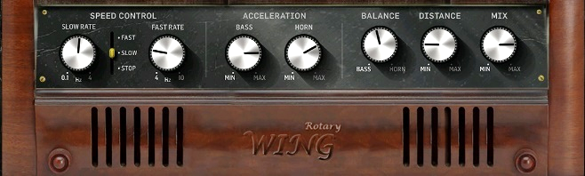
</td>
<td>
Rotary Speaker

<em>0 <strong>“mdl”</strong>: ROTARY</em>

<em>1 <strong>“sw”</strong>: str [STOP, SLOW, FAST]</em>

<em>2 <strong>“lo”</strong>: logf [.1, 3.999, 51] Hz, lo
speed</em>

<em>3 <strong>“hi”</strong>: logf [4, 10, 51] Hz, hi speed</em>

<em>4 <strong>“bal”</strong>: linf [‑100, 100, 201] balance</em>

<em>5 <strong>“mix”</strong>: linf [0, 100, 101] %, mix</em>

<em>6 <strong>“dist”</strong>: linf [0, 100, 101] distance</em>

<em>7 <strong>“dac”</strong>: linf [0, 100, 101] %, drum
accel</em>

<em>8 <strong>“hac”</strong>: linf [0, 100, 101] %, horn
accel</em>
</td>
</tr>
<tr>
<td></td>
<td></td>
</tr>
<tr>
<td>
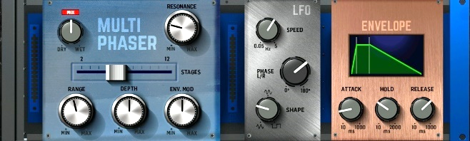
</td>
<td>
Phaser

<em>0 “<strong>mdl</strong>”: PHASER</em>

<em>1 “<strong>spd</strong>”: logf [.05, 5, 201] Hz, speed</em>

<em>2 “<strong>phase</strong>”: int [0…180] phase</em>

<em>3 “<strong>wave</strong>”: int [‑50…50] wave</em>

<em>4 “<strong>range</strong>”: int [2…98] %, range</em>

<em>5 “<strong>depth</strong>”: int [0…100] %, depth</em>

<em>6 “<strong>emod</strong>”: int [‑100, 100] % env mod</em>

<em>7 “<strong>att</strong>”: logf [10, 1000, 201] ms,
attack</em>

<em>8 “<strong>hld</strong>”: logf [10, 2000, 201] ms, hold</em>

<em>9 “<strong>rel</strong>”: logf [10, 1000, 201] ms,
release</em>

<em>10 “<strong>mix</strong>”: int [0…100] %, mix</em>

<em>11 “<strong>stg</strong>”: int [2…12] stages</em>

<em>12 “<strong>reso</strong>”: int [0…80] %, reso</em>
</td>
</tr>
<tr>
<td></td>
<td></td>
</tr>
<tr>
<td>
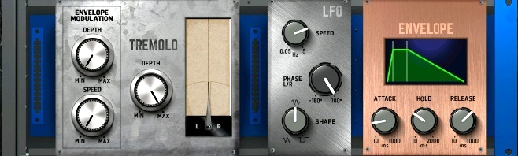
</td>
<td>
Tremolo Panner

<em>0 “<strong>mdl</strong>”: PANNER</em>

<em>1 “<strong>att</strong>”: logf [10, 1000, 201] ms,
attack</em>

<em>2 “<strong>hld</strong>”: logf [10, 2000, 201] ms, hold</em>

<em>3 “<strong>rel</strong>”: logf [10, 1000, 201] ms,
release</em>

<em>4 “<strong>espd</strong>”: int [0…100] %, env&gt;depth</em>

<em>5 “<strong>edep</strong>”: int [0…100] %, env&gt;depth</em>

<em>6 “<strong>spd</strong>”: logf [.05, 5, 201] Hz, speed</em>

<em>7 “<strong>phase</strong>”: int [0…180] phase</em>

<em>8 “<strong>wave</strong>”: int [‑50…50] wave</em>

<em>9 “<strong>depth</strong>”: int [0…100] %, depth</em>
</td>
</tr>
<tr>
<td></td>
<td></td>
</tr>
<tr>
<td>
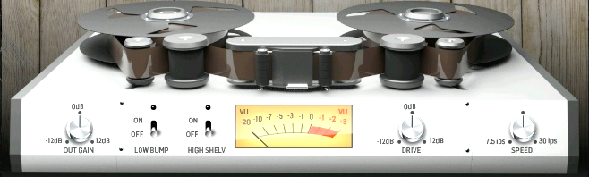
</td>
<td>
Tape Machine

<em>0 “<strong>mdl</strong>”: TAPE</em>

<em>1 “<strong>drv</strong>”: Linf [‑5.0, 25.0, 61] dB,
drive</em>

<em>2 “<strong>spd</strong>”: logf [7.5, 30, 65]</em>

<em>3 “<strong>low</strong>”: int [0, 1] low bump</em>

<em>4 “<strong>hi</strong>”: int [0, 1] high shelv</em>

<em>5 “<strong>out</strong>”: linf [‑12, 12, 97] dB, out gains
s</em>
</td>
</tr>
<tr>
<td></td>
<td></td>
</tr>
<tr>
<td>
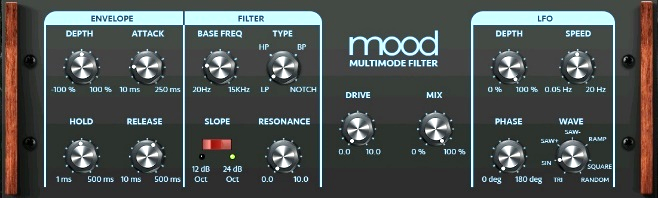
</td>
<td>
Mood Filter

<em>0 “<strong>mdl</strong>”: MOOD</em>

<em>1 “<strong>fbase</strong>”: logf [20, 15000, 101] Hz,
base</em>

<em>2 “<strong>filt</strong>”: str [LP, HP, BP, NOTCH] type</em>

<em>3 “<strong>slope</strong>”: str [12, 24] slope</em>

<em>4 “<strong>reso</strong>”: linf [0, 10, 101] reso</em>

<em>5 “<strong>drv</strong>”: linf [0, 10, 101] drive</em>

<em>6 “<strong>env</strong>”: linf [‑100, 100, 201] %, env</em>

<em>7 “<strong>att</strong>”: logf [10, 250, 101] ms, attack</em>

<em>8 “<strong>hld</strong>”: logf [1, 500, 101] ms, hold</em>

<em>0 “<strong>rel</strong>”: logf [1, 500, 101] ms, release</em>

<em>1 “<strong>mix</strong>”: linf [0, 10, 101] %, mix</em>

<em>2 “<strong>lfo</strong>”: linf [linf [0, 10, 101] %, lfo</em>

<em>6 “<strong>spd</strong>”: logf [.05, 20, 301] Hz, speed</em>

<em>7 “<strong>phase</strong>”: int [0…180] phase</em>

<em>8 “<strong>wave</strong>”: str [TRI, SIN, SAW+, SAW‑,</em>

<em>RMP, SQU, RND] lfo wave</em>
</td>
</tr>
<tr>
<td></td>
<td></td>
</tr>
<tr>
<td>
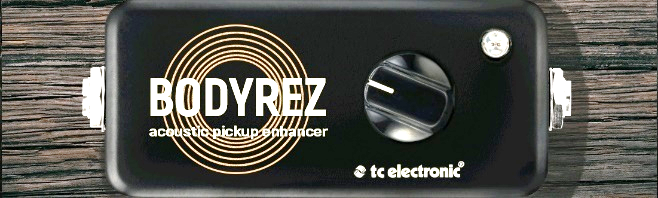
</td>
<td>
Bodyrez

<em>0 <strong>“mdl”</strong>: BODY</em>

<em>1 <strong>“body”</strong>: linf [0, 100, 101] body</em>
</td>
</tr>
<tr>
<td></td>
<td></td>
</tr>
<tr>
<td>
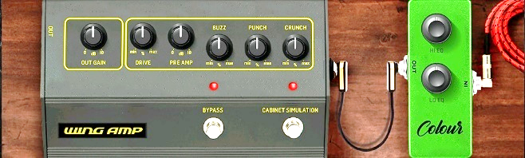
</td>
<td>
Rack Amp

<em>0 <strong>“mdl”</strong>: RACKAMP</em>

<em>1 <strong>“pre”</strong>: linf [0, 10, 101] preamp</em>

<em>2 <strong>“buzz”</strong>: linf [0, 10, 101] buzz</em>

<em>3 <strong>“punch”</strong>: linf [0, 10, 101] punch</em>

<em>4 <strong>“crunch”</strong>:linf [0, 10, 101] crunch</em>

<em>5 <strong>“drive</strong> linf [0, 10, 101] drive</em>

<em>6 <strong>“out”</strong>: linf [0, 10, 101] out gain</em>

<em>7 <strong>“leq”</strong>: linf [0, 10, 101] low eq</em>

<em>8 <strong>“heq”</strong> linf [0, 10, 101] high eq</em>

<em>9 <strong>“cab”</strong>: int [0, 1] cab sim</em>
</td>
</tr>
<tr>
<td></td>
<td></td>
</tr>
<tr>
<td>
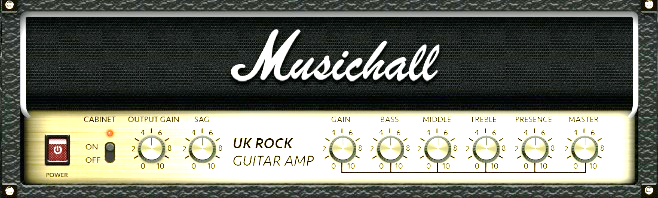
</td>
<td>
UK Rock Amp

<em>0 <strong>“mdl”</strong>: UKROCK</em>

<em>1 <strong>“gain”</strong>: linf [0, 10, 101] gains</em>

<em>2 <strong>“bass”</strong>: linf [0, 10, 101] bass</em>

<em>3 <strong>“mid”</strong>: linf [0, 10, 101] middle</em>

<em>4 <strong>“treb”</strong>: linf [0, 10, 101] treble</em>

<em>5 <strong>“pres</strong> linf [0, 10, 101] presence</em>

<em>6 <strong>“mstr”</strong>: linf [0, 10, 101] master</em>

<em>7 <strong>“out”</strong>: linf [0, 10, 101] out gain</em>

<em>8 <strong>“sag”</strong> linf [0, 10, 101] sag</em>

<em>9 <strong>“cab”</strong>: int [0, 1] cab sim</em>
</td>
</tr>
<tr>
<td></td>
<td></td>
</tr>
<tr>
<td>
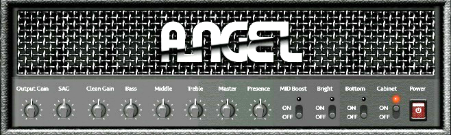
</td>
<td>
Angel Amp

<em>0 <strong>“mdl”</strong>: ANGEL</em>

<em>1 <strong>“gain”</strong>: linf [0, 10, 101] gains</em>

<em>2 <strong>“bass”</strong>: linf [0, 10, 101] bass</em>

<em>3 <strong>“mid”</strong>: linf [0, 10, 101] middle</em>

<em>4 <strong>“treb”</strong>: linf [0, 10, 101] treble</em>

<em>5 <strong>“pres</strong> linf [0, 10, 101] presence</em>

<em>6 <strong>“mstr”</strong>: linf [0, 10, 101] master</em>

<em>7 <strong>“out”</strong>: linf [0, 10, 101] out gain</em>

<em>8 <strong>“sag”</strong> linf [0, 10, 101] sag</em>

<em>9 <strong>“cab”</strong>: int [0, 1] cab sim</em>

<em>10 <strong>“midb”</strong>: int [0, 1] mid boost</em>

<em>11 <strong>“bri”</strong>: int [0, 1] bright</em>

<em>12 <strong>“bt”</strong>: int [0, 1] bottom</em>
</td>
</tr>
<tr>
<td></td>
<td></td>
</tr>
<tr>
<td>
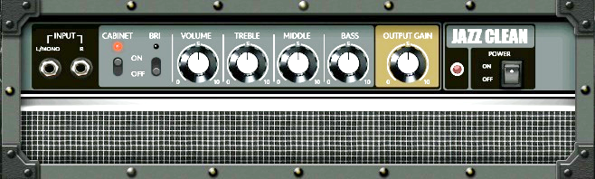
</td>
<td>
Jazz Clean Amp

<em>0 <strong>“mdl”</strong>: JAZZC</em>

<em>1 <strong>“vol”</strong>: linf [0, 10, 101] volume</em>

<em>2 <strong>“bass”</strong>: linf [0, 10, 101] bass</em>

<em>3 <strong>“mid”</strong>: linf [0, 10, 101] middle</em>

<em>4 <strong>“treb”</strong>: linf [0, 10, 101] treble</em>

<em>5 <strong>“out”</strong>: linf [0, 10, 101] out gain</em>

<em>6 <strong>“bri”</strong>: int [0, 1] bright</em>

<em>7 <strong>“cab”</strong>: int [0, 1] cab sim</em>
</td>
</tr>
<tr>
<td></td>
<td></td>
</tr>
<tr>
<td>
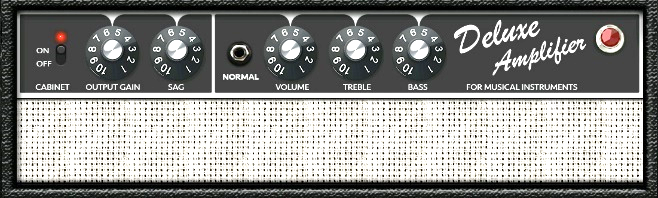
</td>
<td>
Deluxe Amp

<em>0 <strong>“mdl”</strong>: DELUXE</em>

<em>1 <strong>“vol”</strong>: linf [1, 10, 91] volume</em>

<em>2 <strong>“bass”</strong>: linf [1, 10, 91] bass</em>

<em>4 <strong>“treb”</strong>: linf [1, 10, 91] treble</em>

<em>5 <strong>“out”</strong>: linf [1, 10, 91] out gain</em>

<em>6 <strong>“sag”</strong>: linf [1, 10, 91] sag</em>

<em>7 <strong>“cab”</strong>: int [0, 1] cab sim</em>
</td>
</tr>
<tr>
<td></td>
<td></td>
</tr>
<tr>
<td>
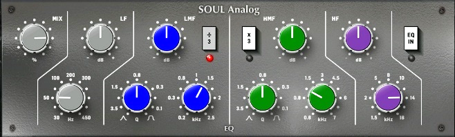
</td>
<td>
Soul Analogue

<em>0 <strong>“mdl”</strong>: SOUL</em>

<em>1 <strong>“mix”</strong>: linf [0, 125, 126] %, mix</em>

<em>2 <strong>“lf”</strong>: linf [0, 10, 101] lo freq</em>

<em>3 <strong>“lg”</strong>: linf [‑5, 5, 101] lo gain</em>

<em>4 <strong>“lmf”</strong>: linf [0, 10, 101] lm freq</em>

<em>5 <strong>“lmf3”</strong>: int [0, 1] lm /3</em>

<em>6 <strong>“lmq”</strong>: linf [0, 10, 101] lm q</em>

<em>7 <strong>“lmg”</strong>: linf [‑5, 5, 101] lm gain</em>

<em>8 <strong>“hmf”</strong>: linf [0, 10, 101] hm freq</em>

<em>9 <strong>“hmf3”</strong>: int [0, 1] hm x3</em>

<em>10 <strong>“hmq”</strong>: linf [0, 10, 101] hm q</em>

<em>11 <strong>“hmg”</strong>: linf [‑5, 5, 101] hm gain</em>

<em>12 <strong>“hf”</strong>: linf [0, 10, 101] hf freq</em>

<em>13 <strong>“hg”</strong>: linf [‑5, 5, 101] hf gain</em>
</td>
</tr>
<tr>
<td></td>
<td></td>
</tr>
<tr>
<td>
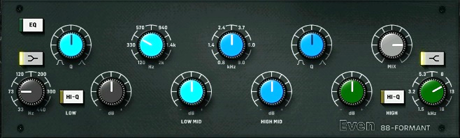
</td>
<td>
Even 88 Formant

<em>0 <strong>“mdl”</strong>: E88</em>

<em>1 <strong>“mix”</strong>: linf [0, 125, 126] %, mix</em>

<em>2 <strong>“lf”</strong>: linf [0, 10, 101] lf freq</em>

<em>3 <strong>“lg”</strong>: linf [‑5, 5, 101] lf gain</em>

<em>4 <strong>“lq”</strong>: str [LOW, HIGH] lf q</em>

<em>5 <strong>“lt”</strong>: str [BELL, SHELV] lf type</em>

<em>6 <strong>“lmf”</strong>: linf [0, 10, 101] lm freq</em>

<em>7 <strong>“lmg”</strong>: linf [‑5, 5, 101] lm gain</em>

<em>8 <strong>“lmq”</strong>: linf [0, 10, 101] lm q</em>

<em>9 <strong>“hmf”</strong>: linf [0, 10, 101] hm freq</em>

<em>10 <strong>“hmg”</strong>: linf [‑5, 5, 101] hm gain</em>

<em>11 <strong>“hmq”</strong>: linf [0, 10, 101] hm q</em>

<em>12 <strong>“hf”</strong>: linf [0, 10, 101] hm freq</em>

<em>13 <strong>“hg”</strong>: linf [‑5, 5, 101] hf gain</em>

<em>14 <strong>“hq”</strong>: str [LOW, HIG] hf q</em>

<em>15 <strong>“ht”</strong>: str [BELL, SHELV] hf type</em>
</td>
</tr>
<tr>
<td></td>
<td></td>
</tr>
<tr>
<td>
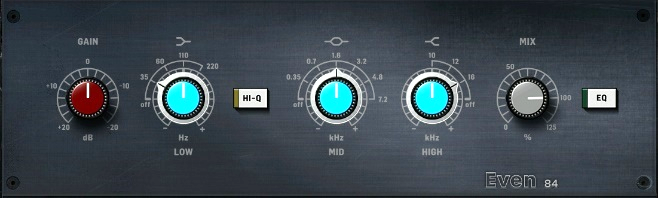
</td>
<td>
Even 84

<em>0 <strong>“mdl”</strong>: E84</em>

<em>1 <strong>“mix”</strong>: linf [0, 125, 126] %, mix</em>

<em>2 <strong>“g”</strong>: linf [‑20, 20, 81] dB, gain</em>

<em>3 <strong>“lf”</strong>: str [OFF, 35, 60, 110, 220] lf
freq</em>

<em>4 <strong>“lg”</strong>: linf [‑5, 5, 101] lf gain</em>

<em>5 <strong>“mf”</strong>: str [OFF, 350, 700, 1k6, 3k2,</em>

<em>4k8, 7k2] mid freq</em>

<em>6 <strong>“mg”</strong>: linf [‑5, 5, 101] mid gain</em>

<em>7 <strong>“mq”</strong>: str [LOW, HIGH] mid q</em>

<em>8 <strong>“hf”</strong>: str [10k, 12k, 16k, OFF] hf
freq</em>

<em>9 <strong>“hg”</strong>: linf [‑5, 5, 101] hf gain</em>
</td>
</tr>
<tr>
<td></td>
<td></td>
</tr>
<tr>
<td>
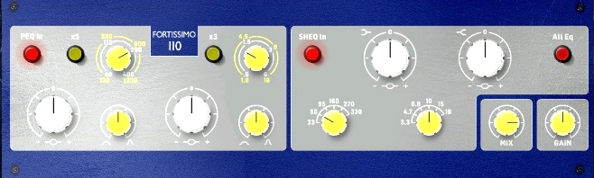
</td>
<td>
Fortissimo110

<em>0 <strong>“mdl”</strong>: F110</em>

<em>1 <strong>“mix”</strong>: linf [0, 125, 126] %, mix</em>

<em>2 <strong>“peq”</strong>: int [0, 1] peq on</em>

<em>3 <strong>“lmf”</strong>: linf [0, 10, 101] lm freq</em>

<em>4 <strong>“lmg”</strong>: linf [‑5, 5, 101] lm gain</em>

<em>5 <strong>“lmq”</strong>: linf [0, 10, 101] lm q</em>

<em>6 <strong>“lmf3”</strong>: int [0, 1] lm /3</em>

<em>7 <strong>“hmf”</strong>: linf [0, 10, 101] hm freq</em>

<em>8 <strong>“hmg”</strong>: linf [‑5, 5, 101] hm gain</em>

<em>9 <strong>“hmq”</strong>: linf [0, 10, 101] hm q</em>

<em>10 <strong>“hmf3”</strong>: int [0, 1] hm x3</em>

<em>11 <strong>“shv”</strong>: inf [0, 1] shv on</em>

<em>12 <strong>“lf”</strong>: str [33, 56, 95, 160,</em>

<em>270, 460] lf freq</em>

<em>13 <strong>“lg”</strong>: linf [‑5, 5, 101] lf gain</em>

<em>14 <strong>“hf”</strong>: str [3k3, 4k7, 6k8, 10k,</em>

<em>15k, 18k] hf freq</em>

<em>15 <strong>“hg”</strong>: linf [‑5, 5, 101] hf q</em>

<em>16 <strong>“g”</strong>: linf [‑18, 18, 73] gain</em>
</td>
</tr>
<tr>
<td></td>
<td></td>
</tr>
<tr>
<td>

</td>
<td>
Pulsar

<em>0 <strong>“mdl”</strong>: PULSAR</em>

<em>1 <strong>“mix”</strong>: linf [0, 125, 126] %, mix</em>

<em>2 <strong>“eq1”</strong>: int [0, 1] eq1 on</em>

<em>3 <strong>“1lb”</strong>: linf [0, 10, 101] lf boost</em>

<em>4 <strong>“1latt”</strong>: linf [0, 10, 101] lf att</em>

<em>5 <strong>“1lf”</strong>: str [20, 30, 60, 100] Hz, lf
freq</em>

<em>6 <strong>“1hw”</strong>: linf [0, 10, 101] hf wid</em>

<em>7 <strong>“1hb”</strong>: linf [0, 10, 101] hf boost</em>

<em>8 <strong>“1hf”</strong>: str [3k, 4k, 5k, 8k, 10k,</em>

<em>12k, 16k] Hz, hf freq</em>

<em>9 <strong>“1hatt”</strong>: linf [0, 10, 101] hf att</em>

<em>10 <strong>“1hattf”</strong>:str [5k, 10k, 20k] hf att</em>

<em>11 <strong>“eq5”</strong>: inf [0, 1] eq5 on</em>

<em>12 <strong>“5lb”</strong>: linf [0, 10, 101] lm boost</em>

<em>13 <strong>“5lf”</strong>: str [200, 300, 500, 700,</em>

<em>1k] Hz, lf freq</em>

<em>14 <strong>“5md”</strong>: linf [0, 10, 101] mid dip</em>

<em>15 <strong>“5mf”</strong>: str [200, 300, 500, 700, 1k,
1k5,</em>

<em>2k, 3k, 4k, 5k, 7k] Hz, mid freq</em>

<em>16 <strong>“5hb”</strong>: linf [0, 10, 101] HM boost</em>

<em>17 <strong>“5hf”</strong>: str [1k5, 2k, 3k, 4k,</em>

<em>5k] Hz, hf freq</em>
</td>
</tr>
<tr>
<td></td>
<td></td>
</tr>
<tr>
<td>

</td>
<td>
Mach EQ4

<em>0 <strong>“mdl”</strong>: MACH4</em>

<em>1 <strong>“mix”</strong>: linf [0, 125, 126] %, mix</em>

<em>2 <strong>“sub”</strong>: linf [‑5, 5, 101] sub</em>

<em>3 <strong>“40”</strong>: linf [‑5, 5, 101] 40</em>

<em>4 <strong>“160”</strong>: linf [‑5, 5, 101] 160</em>

<em>5 <strong>“650”</strong>: linf [‑5, 5, 101] 650</em>

<em>6 <strong>“2k5”</strong>: linf [‑5, 5, 101] 2k5</em>

<em>7 <strong>“air”</strong>: linf [0, 10, 101] air</em>

<em>8 <strong>“airm”</strong>: str [OFF, 2k5, 5k, 10k,</em>

<em>20k, 40k] air mode</em>

<em>9 <strong>“again”</strong>: int [0, 1] auto</em>
</td>
</tr>
<tr>
<td></td>
<td></td>
</tr>
<tr>
<td></td>
<td></td>
</tr>
</tbody>
</table>

### Premium effects

<table style="width:96%;">
<colgroup>
<col style="width: 46%" />
<col style="width: 49%" />
</colgroup>
<thead>
<tr>
<th></th>
<th>
<em>None</em>

<em>0 <strong>“mdl”</strong>: NONE</em>
</th>
</tr>
</thead>
<tbody>
<tr>
<td></td>
<td></td>
</tr>
<tr>
<td>

</td>
<td>
<em>External</em>

<em>0 <strong>“mdl”</strong>: EXT</em>

<em>1 <strong>“egrp”</strong>: str [OFF, LCL, AUX, A, B, C,
SC,</em>

<em>USB, CRD, MOD, PLAY, AES] ext grp</em>

<em>2 <strong>“ein”</strong>: int [1…64] ext in</em>

<em>3 <strong>“emode”</strong>: str [M, ST, M/S] ext mode</em>

<em>4 <strong>“lat”</strong>: int [0…200] latency</em>

<em>5 <strong>“trim”</strong>: linf [‑18, 18, 361] dB,
trim</em>
</td>
</tr>
<tr>
<td></td>
<td></td>
</tr>
<tr>
<td>

</td>
<td>
Hall Reverb

<em>0 “<strong>mdl</strong>”: HALL</em>

<em>1 “<strong>pdel</strong>”: int [0…200] ms, pre‑delay</em>

<em>2 “<strong>size</strong>”: int [0…100] hall size</em>

<em>3 “<strong>dcy</strong>”: logf [.2, 5, 101] s, decay</em>

<em>4 “<strong>mult</strong>”: logf [.5, , 101] bass
multiplier</em>

<em>5 “<strong>damp</strong>”: logf [1k, 20k, 51] Hz,
damping</em>

<em>6 “<strong>lc</strong>”: logf [20, 400, 51] Hz, low cut</em>

<em>7 “<strong>hc</strong>”: logf [200, 20k, 51] Hz, high
cut</em>

<em>8 “<strong>shp</strong>”: linf [0, 50, 51] shape</em>

<em>9 “<strong>sprd</strong>”: int [0…50] spread</em>

<em>10 “<strong>diff</strong>”: int [1…30] diffusion</em>

<em>11 “<strong>mspd</strong>”: int [0…100] mod speed</em>
</td>
</tr>
<tr>
<td></td>
<td></td>
</tr>
<tr>
<td>

</td>
<td>
Room Reverb

<em>0 “<strong>mdl</strong>”: R‑OOM</em>

<em>1 “<strong>pdel</strong>”: int [0…200] ms, pre‑delay</em>

<em>2 “<strong>size</strong>”: linf [4, 76, 145] m, room
size</em>

<em>3 “<strong>dcy</strong>”: logf [.3, 25, 101] s, decay</em>

<em>4 “<strong>mult</strong>”: logf [.25, 4, 101] bass
multiplier</em>

<em>5 “<strong>damp</strong>”: logf [1k, 20k, 51] Hz,
damping</em>

<em>6 “<strong>lc</strong>”: logf [20, 400, 51] Hz, low cut</em>

<em>7 “<strong>hc</strong>”: logf [200, 20k, 51] Hz, high
cut</em>

<em>8 “<strong>shp</strong>”: linf [0, 250, 51] shape</em>

<em>9 “<strong>sprd</strong>”: int [0…50] spread</em>

<em>10 “<strong>diff</strong>”: int [0…100] diffusion</em>

<em>11 “<strong>spin</strong>”: int [0…100] spin</em>

<em>12 “<strong>ecl</strong>”: linf [0, 1200, 1201] ms, echo
left</em>

<em>13 “<strong>ecr</strong>”: linf [0, 1200, 1201] ms, echo
right</em>

<em>14 “<strong>efl</strong>”: linf [‑100, 100, 201] %, feed
left</em>

<em>15 “<strong>efr</strong>”: linf [‑100, 100, 201] %, feed
right</em>
</td>
</tr>
<tr>
<td></td>
<td></td>
</tr>
<tr>
<td>

</td>
<td>
Chamber Reverb

<em>0 “<strong>mdl</strong>”: CHAMBER</em>

<em>1 “<strong>pdel</strong>”: int [0…200] ms, pre‑delay</em>

<em>2 “<strong>size</strong>”: linf [4, 76, 145] m, room
size</em>

<em>3 “<strong>dcy</strong>”: logf [.3, 25, 101] s, decay</em>

<em>4 “<strong>mult</strong>”: logf [.25, 4, 101] bass
multiplier</em>

<em>5 “<strong>damp</strong>”: logf [1k, 20k, 51] Hz,
damping</em>

<em>6 “<strong>lc</strong>”: logf [20, 400, 51] Hz, low cut</em>

<em>7 “<strong>hc</strong>”: logf [200, 20k, 51] Hz, high
cut</em>

<em>8 “<strong>shp</strong>”: linf [0, 250, 51] shape</em>

<em>9 “<strong>sprd</strong>”: int [0…50] spread</em>

<em>10 “<strong>diff</strong>”: int [0…100] diffusion</em>

<em>11 “<strong>spin</strong>”: int [0…100] spin</em>

<em>12 “<strong>ecl</strong>”: linf [0, 300, 301] ms, echo
left</em>

<em>13 “<strong>ecr</strong>”: linf [0, 300, 301] ms, echo
right</em>

<em>14 “<strong>ell</strong>”: fader lvl dB, echo left</em>

<em>15 “<strong>elr</strong>”: fader lvl dB, echo right</em>
</td>
</tr>
<tr>
<td></td>
<td></td>
</tr>
<tr>
<td>

</td>
<td>
Plate Reverb

<em>0 “<strong>mdl</strong>”: PLATE</em>

<em>1 “<strong>pdel</strong>”: int [0…200] ms, pre‑delay</em>

<em>2 “<strong>size</strong>”: linf [4, 76, 145] m, room
size</em>

<em>3 “<strong>dcy</strong>”: logf [.3, 25, 101] s, decay</em>

<em>4 “<strong>mult</strong>”: logf [.25, 4, 101] bass
multiplier</em>

<em>5 “<strong>damp</strong>”: logf [1k, 20k, 51] Hz,
damping</em>

<em>6 “<strong>lc</strong>”: logf [20, 400, 51] Hz, low cut</em>

<em>7 “<strong>hc</strong>”: logf [200, 20k, 51] Hz, high
cut</em>

<em>8 “<strong>att</strong>”: linf [0, 100, 101] attack</em>

<em>9 “<strong>sprd</strong>”: int [0…50] spread</em>

<em>10 “<strong>diff</strong>”: int [0…100] diffusion</em>

<em>11 “<strong>spin</strong>”: int [0…100] spin</em>

<em>12 “<strong>ecl</strong>”: linf [0, 1200, 1201] ms, echo
left</em>

<em>13 “<strong>ecr</strong>”: linf [0, 1200, 1201] ms, echo
right</em>

<em>14 “<strong>efl</strong>”: linf [‑100, 100, 201] %, feed
left</em>

<em>15 “<strong>efr</strong>”: linf [‑100, 100, 201] %, feed
right</em>
</td>
</tr>
<tr>
<td></td>
<td></td>
</tr>
<tr>
<td>

</td>
<td>
Concert Reverb

<em>0 “<strong>mdl</strong>”: CONCERT</em>

<em>1 “<strong>pdel</strong>”: int [0…200] ms, pre‑delay</em>

<em>2 “<strong>size</strong>”: linf [20, 76, 113] m, room
size</em>

<em>3 “<strong>dcy</strong>”: logf [.3, 29, 51] s, decay</em>

<em>4 “<strong>mult</strong>”: logf [.25, 4, 101] bass
multiplier</em>

<em>5 “<strong>damp</strong>”: logf [1k, 20k, 51] Hz,
damping</em>

<em>6 “<strong>lc</strong>”: logf [20, 400, 51] Hz, low cut</em>

<em>7 “<strong>hc</strong>”: logf [200, 20k, 51] Hz, high
cut</em>

<em>8 “<strong>shp</strong>”: linf [0, 50, 51] shape</em>

<em>9 “<strong>sprd</strong>”: int [0…50] spread</em>

<em>10 “<strong>diff</strong>”: int [1…16] diffusion</em>

<em>11 “<strong>depth</strong>”:int [0, 100] depth</em>

<em>12 “<strong>rfl</strong>”: linf [0, 1200, 1201] ms, refl.
left</em>

<em>13 “<strong>rfr</strong>”: linf [0, 1200, 1201] ms, refl.
right</em>

<em>14 “<strong>rfll</strong>”: fader lvl dB, reflection
left</em>

<em>15 “<strong>rflr</strong>”: fader lvl dB, reflection
right</em>

<em>16 “<strong>spin</strong>”: int [0…100] spin</em>

<em>17 “<strong>crs</strong>”: int [1…100] chorus</em>
</td>
</tr>
<tr>
<td></td>
<td></td>
</tr>
<tr>
<td>

</td>
<td>
Ambiance

<em>0 “<strong>mdl</strong>”: AMBI</em>

<em>1 “<strong>pdel</strong>”: int [0…200] ms, pre‑delay</em>

<em>2 “<strong>size</strong>”: linf [2, 100, 99] m, room
size</em>

<em>3 “<strong>dcy</strong>”: logf [.2, 7.3, 101] s, decay</em>

<em>4 “<strong>tail</strong>”: int [0…100] tail gain</em>

<em>5 “<strong>damp</strong>”: logf [1k, 20k, 51] Hz,
damping</em>

<em>6 “<strong>diff</strong>”: int [1…30] diffusion</em>

<em>7 “<strong>mod</strong>”: int [1…100] modulation speed</em>

<em>8 “<strong>lc</strong>”: logf [20, 400, 51] Hz, low cut</em>

<em>9 “<strong>hc</strong>”: logf [200, 20k, 51] Hz, high
cut</em>
</td>
</tr>
<tr>
<td></td>
<td></td>
</tr>
<tr>
<td>

</td>
<td>
VSS3 Reverb

<em>0 “<strong>mdl</strong>”: VSS3</em>

<em>1 “<strong>preset</strong>”: str [Build, Small Booth, Home
Room, 
Dialog Alley, Small Wood Room, 
A Small Room, Intimate Studio, 
Small Room, Tight &amp; Natural, Room 
Conversation, Furnished Room 2, 
Studio 20x20 ft, Drew Room, Piano 
Close, Clear Guitar Room, Wide 
Ambient Chamber, Small Dense Hall, 
Slap Hall, Acoustic Gtr Ambience, 
Clear Room, Livingroom, Band 
Rehearsal Room, The Studio, In The 
Room, Studio 40x40 ft, Hit Room, 
Ambient Hall, Stage and Hall, 
Acoustic Guitar Space, Medium 
Vocal Hall, Bright Theatre , Big 
Empty Club, Venue Warm 1, Concert 
1, Bright Guitar Hall, Concert 
Arena, Concert Piano, Piano Hall 
1st Row, Empty Arena, Ballad Vocal 
Hall, Grand Vocal Hall, Large Warm 
Hall, Back There, WoodHall, 
Church, Sound Col, 5000 Hall, 
Cathedral, Large Church, Medium 
Church, Warm Cathedral, Cologne 
Cathedral, Drum Plate Stuff, Drum 
Wood Plate, Piano Plate, Stairway 
Plate, Slapback Plate, Ambient 
Plate, Silky Gold Plate, Gold 
Plate, EMT 141, Leader Of The 
Band, VocalDry, Vocal Room, 
VocalWet, Slapback Vox 1, Vocal 
Hall 1, Vocal Chamber, Bright Male 
Vox, Vocal Bright, Vocal Deep, 
Vocal Female, Vocal Deep Male, 
Large Vocal Hall, Kick &amp; Bass 
Ambience, Drum Room, Small Perc 
Room, Drum Room Xpander, Bright 
Shoe Gaze Snare, Snare Room 
Bright, Tom‑Tom Reverb, Bossa Nova 
Perc Room, Hard Drum Space, Puk 
Drum Ambience, Overhead Mics, 
Dance Snare, Drum Perc Soft 1, 
Perc Straight Tail, Store Room, 
Studio Small, The Alley, Near The 
Wall, WoodFlr, Large Office, 
Conference Room, Dance Studio, 
Forest 2, StoneWall, Venue 1, 
Small Stairway, Forest 1, Airport 
PA, Small Tower Hall, On The 
Street, Dark Tunnel, Empty 
Nightclub, Parking Garage, Parking 
Distant, Long Swimmingpool] preset</em>

<em>2 “<strong>load</strong>”: int [0, 1] load</em>

<em>3 “<strong>erpdly</strong>”: linf [0, 100, 101] ms, er
pdly</em>

<em>4 “<strong>ertype</strong>”: str [ROYAL, THEATRE, CHURCH,
GAS, 
CONCERT, ROYAL2, V1‑NEAR, 
V2‑HARD, V3‑SPREAD, V4‑BUILD, 
V5‑RANDOM, SLAP, CAR, PHONEBTH, 
BATHROOM, CONFRM9, CONFRM30, 
GARAGE, SWIMSTDM, AIRPORT, 
STREET, ALLEY, PIAZA,</em>

<em>FOREST], er type</em>

<em>5 “<strong>ersize</strong>”: str [SML, MED, LRG] er size</em>

<em>6 “<strong>erpos</strong>”: str [NEAR, DIST] er position</em>

<em>7 “<strong>erbal</strong>”: linf [‑100, 100, 201], er
balance</em>

<em>8 “<strong>erlc</strong>”: logf [20, 400, 51] Hz, er low
cut</em>

<em>9 “<strong>ercol</strong>”: linf [‑40, 40, 81] er color</em>

<em>10 “<strong>erlvl</strong>”: fader lvl dB, er level</em>

<em>11 “<strong>rvtype</strong>”: str [SMOOTH, NATURAL, ALIVE,
FAST, 
X‑WIDE, ALIVE2] rev type</em>

<em>12 “<strong>rvwide</strong>”: str [NARROW, NORMAL, WIDE, X‑WIDE]
rev 
wide</em>

<em>13 “<strong>rvpdly</strong>”: linf [0, 200, 201] ms, rev
pdly</em>

<em>14 “<strong>dcy</strong>”: linf [.1, 20, 280] s, decay</em>

<em>15 “<strong>diff</strong>”: linf [‑50, 50, 101] diffuse</em>

<em>16 “<strong>rvbal</strong>”: linf [‑100, 100, 201]
balance</em>

<em>17 “<strong>rvlvl</strong>”: fader lvl dB, reverb level</em>

<em>18 “<strong>ldcy</strong>”: linf [.1, 2.5, 25] low decay</em>

<em>19 “<strong>lmdcy</strong>”: linf [.1, 2.5, 25] lowmid
decay</em>

<em>20 “<strong>hmdcy</strong>”: linf [.1, 2.5, 25] mid
decay</em>

<em>21 “<strong>hdcy</strong>”: linf [.1, 2.5, 25] high
decay</em>

<em>22 “<strong>hsoft</strong>”: linf [‑50, 50, 101] high
soft</em>

<em>23 “<strong>lxo</strong>”: logf [20, 500, 113] Hz, low
xover</em>

<em>24 “<strong>mxo</strong>”: logf [200, 2000, 81] Hz, mid
xover</em>

<em>25 “<strong>hxo</strong>”: logf [500, 20000, 105] Hz, high
xover</em>

<em>26 “<strong>lshv</strong>”: logf [20, 200, 81] Hz, low
shelf</em>

<em>27 “<strong>lsdmp</strong>”: linf [0, ‑18, 37] dB, low
damp</em>

<em>28 “<strong>hcut</strong>”: logf [20, 20000, 241] Hz, high
cut</em>

<em>29 “<strong>mtype</strong>”: str [A, B, C, D, E, F] modulation
type</em>

<em>30 “<strong>mrate</strong>”: linf [‑100, 100, 201] modulation
rate</em>

<em>31 “<strong>mwid</strong>”: linf [0, 200, 201] modulation
width</em>

<em>32 “<strong>view</strong>”: int [0, 1] view</em>
</td>
</tr>
<tr>
<td></td>
<td></td>
</tr>
<tr>
<td>

</td>
<td>
Vintage Room

<em>0 “<strong>mdl</strong>”: V‑ROOM</em>

<em>1 “<strong>pdel</strong>”: int [0…200] ms, pre‑delay</em>

<em>2 “<strong>size</strong>”: int [0…50] size</em>

<em>3 “<strong>dcy</strong>”: logf [.1, 20, 101] s, decay</em>

<em>4 “<strong>dens</strong>”: linf [1, 30, 30] density</em>

<em>5 “<strong>erlvl</strong>”: linf [0, 100, 101] %, Early
level</em>

<em>6 “<strong>lmult</strong>”: logf [.1, 10, 101] low
multiplier</em>

<em>7 “<strong>hmult</strong>”: logf [.1, 10, 101] high
multiplier</em>

<em>8 “<strong>lc</strong>”: logf [20, 400, 51] Hz, low cut</em>

<em>9 “<strong>hc</strong>”: logf [200, 20k, 51] Hz, high
cut</em>

<em>10 “<strong>frz</strong>”: int [0, 1] freeze</em>

<em>11 “<strong>erl</strong>”: linf [0, 200, 201] ms, er delay
left</em>

<em>12 “<strong>err</strong>”: linf [0, 200, 201] ms, er delay
right</em>

<em>13 “<strong>add</strong>”: int [0, 1] add</em>

<em>14 “<strong>lvl</strong>”: int [‑6, 6, 101] dB,
level</em>
</td>
</tr>
<tr>
<td></td>
<td></td>
</tr>
<tr>
<td>

</td>
<td>
Vintage Reverb,

<em>0 “<strong>mdl</strong>”: V‑REV</em>

<em>1 “<strong>pdel</strong>”: int [0…120] ms, pre‑delay</em>

<em>2 “<strong>dcy</strong>”: linf [.4, 4.5, 83] s, decay</em>

<em>3 “<strong>lmult</strong>”: logf [.5, 2, 51] low
multiplier</em>

<em>4 “<strong>hmult</strong>”: logf [.25, .67, 51] high
multiplier</em>

<em>5 “<strong>mod</strong>”: int [0…100] modulation speed</em>

<em>6 “<strong>lc</strong>”: logf [20, 400, 51] Hz, low cut</em>

<em>7 “<strong>hc</strong>”: logf [5000, 20k, 31] Hz, high
cut</em>

<em>8 “<strong>out</strong>”: str [FRONT, REAR] output</em>

<em>9 “<strong>trans</strong>”: int [0…1] transformer</em>
</td>
</tr>
<tr>
<td></td>
<td></td>
</tr>
<tr>
<td>

</td>
<td>
Vintage Plate

<em>0 “<strong>mdl</strong>”: V‑PLATE</em>

<em>1 “<strong>pdel</strong>”: int [0…250] ms, pre‑delay</em>

<em>2 “<strong>dcy</strong>”: linf [1, 6, 101] s, decay</em>

<em>3 “<strong>lc</strong>”: logf [20, 400, 51] Hz, low cut</em>

<em>4 “<strong>col</strong>”: linf [‑20, 20, 42] color</em>
</td>
</tr>
<tr>
<td></td>
<td></td>
</tr>
<tr>
<td>

</td>
<td>
Blue Plate

<em>0 “<strong>mdl</strong>”: BPLATE</em>

<em>1 “<strong>pdel</strong>”: int [0…200] ms, pre delay</em>

<em>2 “<strong>size</strong>”: int [0…100] ms, size</em>

<em>3 “<strong>dcy</strong>”: logf [0.2, 5, 101] s, decay</em>

<em>4 “<strong>mult</strong>”: logf [0.5, 2, 51] bass
multiplier</em>

<em>5 “<strong>damp</strong>”: logf [1000, 20000, 51] Hz,
damping</em>

<em>6 “<strong>lc</strong>”: logf [20, 400, 51] Hz, low cut</em>

<em>7 “<strong>hc</strong>”: logf [200, 20000, 51] Hz, high
cut</em>

<em>8 “<strong>xover</strong>”: logf [20, 500, 51] Hz, xover</em>

<em>9 “<strong>mdep</strong>”: linf [1, 50, 50] modulation
depth</em>

<em>10 “<strong>msdp</strong>”: int [0…100] modulation speed</em>

<em>11 “<strong>diff</strong>”: int [1…30] diffusion</em>
</td>
</tr>
<tr>
<td></td>
<td></td>
</tr>
<tr>
<td>

</td>
<td>
Gated Reverb

<em>0 “<strong>mdl</strong>”: GATED</em>

<em>1 “<strong>pdel</strong>”: int [0…200] ms, pre‑delay</em>

<em>2 “<strong>att</strong>”: int [4…30] attack</em>

<em>3 “<strong>dcy</strong>”: logf [.14, 1, 101] s, decay</em>

<em>4 “<strong>dens</strong>”: int [0…100] density</em>

<em>5 “<strong>diff</strong>”: int [0…100] diffusion</em>

<em>6 “<strong>sprd</strong>”: int [0…50] spread</em>

<em>7 “<strong>lc</strong>”: logf [20, 400, 51] Hz, low cut</em>

<em>8 “<strong>hfs</strong>”: logf [200, 20k, 51] Hz, high
freq</em>

<em>9 “<strong>hsg</strong>”: linf [‑30, 0, 61] dB, high
gain</em>
</td>
</tr>
<tr>
<td></td>
<td></td>
</tr>
<tr>
<td>

</td>
<td>
Reverse Reverb

<em>0 “<strong>mdl</strong>”: REVERSE</em>

<em>1 “<strong>pdel</strong>”: int [0…200] ms, pre‑delay</em>

<em>2 “<strong>rise</strong>”: int [4…50] rise</em>

<em>3 “<strong>dcy</strong>”: logf [.14, 1, 101] s, decay</em>

<em>4 “<strong>diff</strong>”: int [0…30] diffusion</em>

<em>5 “<strong>sprd</strong>”: int [0…100] spread</em>

<em>6 “<strong>lc</strong>”: logf [20, 400, 51] Hz, low cut</em>

<em>7 “<strong>hfs</strong>”: logf [200, 20k, 51] Hz, high
freq</em>

<em>8 “<strong>hsg</strong>”: linf [‑30, 0, 61] dB, high
gain</em>
</td>
</tr>
<tr>
<td></td>
<td></td>
</tr>
<tr>
<td>

</td>
<td>
Delay/Reverb

<em>0 “<strong>mdl</strong>”: DEL/REV</em>

<em>1 “<strong>time</strong>”: linf [0, 3000, 3000] ms, time</em>

<em>2 “<strong>feed</strong>”: linf [0, 100, 101] %, feed</em>

<em>3 “<strong>fhc</strong>”: logf [200, 2000, 51] Hz, feed
HC</em>

<em>4 “<strong>dly</strong>”: linf [0, 100, 101] %, delay</em>

<em>5 “<strong>d2r</strong>”: linf [0, 100, 101] %,
delay→rev</em>

<em>6 “<strong>pdel</strong>”: int [0…200] ms, pre delay</em>

<em>7 “<strong>size</strong>”: int [2…100] size</em>

<em>8 “<strong>dcy</strong>”: logf [.1, 5, 51] s, decay</em>

<em>9 “<strong>damp</strong>”: logf [1000, 20k, 51] Hz, damp</em>

<em>10 “<strong>rlc</strong>”: logf [20, 400, 51] Hz, rev LC</em>

<em>11 “<strong>i2r</strong>”: linf [0, 100, 101] %,
in→rev</em>
</td>
</tr>
<tr>
<td></td>
<td></td>
</tr>
<tr>
<td>

</td>
<td>
Shimmer Reverb

<em>0 “<strong>mdl</strong>”: SHIMMER</em>

<em>1 “<strong>pdel</strong>”: int [0…250] ms, pre delay</em>

<em>2 “<strong>size</strong>”: int [2…50] size</em>

<em>3 “<strong>dcy</strong>”: logf [1, 20, 101] s, decay</em>

<em>4 “<strong>lc</strong>”: logf [25, 250, 51] Hz, low cut</em>

<em>5 “<strong>hc</strong>”: logf [500, 7000, 51] Hz, high
cut</em>

<em>6 “<strong>damp</strong>”: linf [0, 100, 101] %, damp</em>

<em>7 “<strong>shim</strong>”: linf [0, 100, 101] %, shimmer</em>

<em>8 “<strong>shine</strong>”: linf [0, 100, 101] %,
shine</em>
</td>
</tr>
<tr>
<td></td>
<td></td>
</tr>
<tr>
<td>

</td>
<td>
Spring Reverb

<em>0 “<strong>mdl</strong>”: SPRING</em>

<em>1 “<strong>dcy</strong>”: logf [1.5, 6, 101] s, decay</em>

<em>2 “<strong>dens</strong>”: linf [1, 30, 30] density</em>

<em>3 “<strong>low</strong>”: linf [1, 50, 50] bass</em>

<em>4 “<strong>high</strong>”: linf [1, 50, 50] treble</em>
</td>
</tr>
<tr>
<td></td>
<td></td>
</tr>
<tr>
<td>

</td>
<td>
Dimension CRS

<em>0 “<strong>mdl</strong>”: DIMCRS</em>

<em>1 “<strong>sw1</strong>”: int [0, 1] sw1</em>

<em>2 “<strong>sw2</strong>”: int [0, 1] sw2</em>

<em>3 “<strong>sw3</strong>”: int [0, 1] sw3</em>

<em>4 “<strong>sw4</strong>”: int [0, 1] sw4</em>

<em>5 “<strong>in</strong>”: str [MONO, STEREO] input</em>

<em>6 “<strong>drysw</strong>”: int [0, 1] dry</em>
</td>
</tr>
<tr>
<td></td>
<td></td>
</tr>
<tr>
<td>

</td>
<td>
Stereo Chorus

<em>0 “<strong>mdl</strong>”: CHORUS</em>

<em>1 “<strong>lc</strong>”: logf [20, 400, 51] Hz, LC</em>

<em>2 “<strong>hc</strong>”: logf [200, 20000, 51] Hz, HC</em>

<em>3 “<strong>wave</strong>”: linf [0, 100, 101] waveform</em>

<em>4 “<strong>phase</strong>”: linf [0, 100, 101] phase</em>

<em>5 “<strong>mix</strong>”: linf [0, 100, 101] %, mix</em>

<em>6 “<strong>dlyl</strong>”: linf [5, 50, 226] ms, delay l</em>

<em>7 “<strong>dlyr</strong>”: linf [5, 50, 226] ms, delay r</em>

<em>8 “<strong>depl</strong>”: linf [0, 100, 101] %, depth l</em>

<em>9 “<strong>depr</strong>”: linf [0, 100, 101] %, depth r</em>

<em>10 “<strong>sprd</strong>”: linf [0, 100, 101] %, spread</em>

<em>11 “<strong>spd</strong>”: logf [.05, 5, 201] Hz,
speed</em>
</td>
</tr>
<tr>
<td></td>
<td></td>
</tr>
<tr>
<td>

</td>
<td>
Stereo Flanger

<em>0 “<strong>mdl</strong>”: CHORUS</em>

<em>1 “<strong>lc</strong>”: logf [20, 400, 51] Hz, LC</em>

<em>2 “<strong>hc</strong>”: logf [200, 20000, 51] Hz, HC</em>

<em>3 “<strong>flc</strong>”: logf [20, 400, 51] Hz, feed LC</em>

<em>4 “<strong>fhc</strong>”: logf [200, 20000, 51] Hz, feed
HC</em>

<em>5 “<strong>mix</strong>”: linf [0, 100, 101] %, mix</em>

<em>6 “<strong>dlyl</strong>”: linf [5, 20, 196] ms, delay l</em>

<em>7 “<strong>dlyr</strong>”: linf [5, 20, 196] ms, delay r</em>

<em>8 “<strong>depl</strong>”: linf [0, 100, 101] %, depth l</em>

<em>9 “<strong>depr</strong>”: linf [0, 100, 101] %, depth r</em>

<em>10 “<strong>phase</strong>”: linf [0, 180, 181] phase</em>

<em>11 “<strong>spd</strong>”: logf [.05, 5, 201] Hz, speed</em>

<em>12 “<strong>feed</strong>”: linf [‑90, 90, 181] %,
feed</em>
</td>
</tr>
<tr>
<td></td>
<td></td>
</tr>
<tr>
<td>

</td>
<td>
Stereo Delay

<em>0 “<strong>mdl</strong>”: ST‑DL</em>

<em>1 “<strong>time</strong>”: linf [1, 3000, 3000] ms, time</em>

<em>2 “<strong>mode</strong>”: str [ST, X, M] mode</em>

<em>3 “<strong>fact</strong>”: str [1/4, 1/3, 1/2, 2/3, 3/4, 1,
3/8, 
5/4, 4/3, 3/2, 2] factor</em>

<em>4 “<strong>pat</strong>”: str [1/2:1, 2/3:1, 3/4:1, 7/8:1, 
1:1, 1:9/8, 1:5/4, 1:4/3, 
1:3/2] pattern</em>

<em>5 “<strong>offset</strong>”:int [‑50…50] ms, offset</em>

<em>6 “<strong>feed</strong>”: linf [0, 100, 101] %, feed</em>

<em>7 “<strong>flc</strong>”: logf [20, 400, 51] Hz, feed L
cut</em>

<em>8 “<strong>fhc</strong>”: logf [200, 20000, 51] Hz, feed H
cut</em>

<em>9 “<strong>lc</strong>”: logf [20, 400, 51] Hz, low cut</em>

<em>10 “<strong>hc</strong>”: logf [200, 20000, 51] Hz, high
cut</em>
</td>
</tr>
<tr>
<td></td>
<td></td>
</tr>
<tr>
<td>

</td>
<td>
UltraTap Delay

<em>0 “<strong>mdl</strong>”: TAP‑DL</em>

<em>1 “<strong>time</strong>”: linf [1, 2000, 2000] ms, time</em>

<em>2 “<strong>rep</strong>”: int [1..16] repeat</em>

<em>3 “<strong>slp</strong>”: linf [‑6, 6, 121] dB, slope</em>

<em>4 “<strong>fact</strong>”: str [1/3, 1/2, 2/3, 3/4, 1, 5/4, 
4/3, 3/2, 2] factor</em>

<em>5 “<strong>pdel</strong>”: linf [0, 500, 501] ms, pre
delay</em>

<em>6 “<strong>mode</strong>”: str [MOVE, JUMP, FOCUS, SPREAD]
mode</em>

<em>7 “<strong>wid</strong>”: linf [‑100, 100, 201] %, width</em>

<em>8 “<strong>diff</strong>”: linf [0, 100, 101] diffusion</em>

<em>9 “<strong>lc</strong>”: logf [20, 400, 51] Hz, low cut</em>

<em>10 “<strong>hc</strong>”: logf [200, 20000, 51] Hz, high
cut</em>
</td>
</tr>
<tr>
<td></td>
<td></td>
</tr>
<tr>
<td>

</td>
<td>
Tape Delay

<em>0 “<strong>mdl</strong>”: TAPE‑DL</em>

<em>1 “<strong>time</strong>”: linf [60, 650, 591] ms, time</em>

<em>2 “<strong>sust</strong>”: linf [0, 100, 101] %, sustain</em>

<em>3 “<strong>drv</strong>”: linf [0, 100, 101] %, drive</em>

<em>4 “<strong>wf</strong>”: linf [0, 100, 101] %,
flutter</em>
</td>
</tr>
<tr>
<td></td>
<td></td>
</tr>
<tr>
<td>

</td>
<td>
OilCan Delay

<em>0 “<strong>mdl</strong>”: OILCAN</em>

<em>1 “<strong>time</strong>”: linf [0, 10, 1001] time</em>

<em>2 “<strong>sust</strong>”: linf [0, 10, 101] %, sustain</em>

<em>3 “<strong>wb</strong>”: linf [0, 10, 101] %, wobble</em>

<em>4 “<strong>tone</strong>”: linf [0, 10, 101] %,
tone</em>
</td>
</tr>
<tr>
<td></td>
<td></td>
</tr>
<tr>
<td>

</td>
<td>
BBD Delay

<em>0 “<strong>mdl</strong>”: BBD‑DL</em>

<em>1 “<strong>dly</strong>”: linf [0, 100, 1001] time</em>

<em>2 “<strong>feed</strong>”: linf [0, 100, 101] %,
feed</em>
</td>
</tr>
<tr>
<td></td>
<td></td>
</tr>
<tr>
<td>

</td>
<td>
Stereo Pitch

<em>0 “<strong>mdl</strong>”: PITCH</em>

<em>1 “<strong>semi</strong>”: int [‑12…12] semitones</em>

<em>2 “<strong>cent</strong>”: int [‑50…50] cent</em>

<em>3 “<strong>dly</strong>”: linf [0, 500, 501] ms, delay</em>

<em>4 “<strong>lc</strong>”: logf [20, 400, 51] Hz, low cut</em>

<em>5 “<strong>hc</strong>”: logf [200, 20000, 51] Hz, high
cut</em>

<em>6 “<strong>mix</strong>”: linf [0, 100, 101] %, mix</em>
</td>
</tr>
<tr>
<td></td>
<td></td>
</tr>
<tr>
<td>

</td>
<td>
Dual Pitch

<em>0 “<strong>mdl</strong>”: D‑PITCH</em>

<em>1 “<strong>semi1</strong>”: int [‑12…12] semitones 1</em>

<em>2 “<strong>cent1</strong>”: int [‑50…50] cent 1</em>

<em>3 “<strong>dly1</strong>”: linf [0, 500, 501] ms, delay
1</em>

<em>4 “<strong>pan1</strong>”: linf [‑100, 100, 201] %, pan
1</em>

<em>5 “<strong>lvl1</strong>”: fader lvl 1 dB</em>

<em>6 “<strong>semi2</strong>”: int [‑12…12] semitones 2</em>

<em>7 “<strong>cent2</strong>”: int [‑50…50] cent 2</em>

<em>8 “<strong>dly2</strong>”: linf [0, 500, 501] ms, delay
2</em>

<em>9 “<strong>pan2</strong>”: linf [‑100, 100, 201] %, pan
2</em>

<em>10 “<strong>lvl2</strong>”: fader lvl 2 dB</em>

<em>11 “<strong>lc</strong>”: logf [20, 400, 51] Hz, low cut</em>

<em>12 “<strong>hc</strong>”: logf [200, 20000, 51] Hz, high
cut</em>
</td>
</tr>
</tbody>
</table>

### Channel effects

<table style="width:96%;">
<colgroup>
<col style="width: 46%" />
<col style="width: 49%" />
</colgroup>
<thead>
<tr>
<th></th>
<th>
<em>None</em>

<em>0 <strong>“mdl”</strong>: NONE</em>
</th>
</tr>
</thead>
<tbody>
<tr>
<td></td>
<td></td>
</tr>
<tr>
<td>

</td>
<td>
<em>External</em>

<em>0 <strong>“mdl”</strong>: EXT</em>

<em>1 <strong>“egrp”</strong>: str [OFF, LCL, AUX, A, B, C,
SC,</em>

<em>USB, CRD, MOD, PLAY, AES] ext grp</em>

<em>2 <strong>“ein”</strong>: int [1…64] ext in</em>

<em>3 <strong>“emode”</strong>: str [M, ST, M/S] ext mode</em>

<em>4 <strong>“lat”</strong>: int [0…200] latency</em>

<em>5 <strong>“trim”</strong>: linf [‑18, 18, 361] dB,
trim</em>
</td>
</tr>
<tr>
<td></td>
<td></td>
</tr>
<tr>
<td>

</td>
<td>
Soul Analog EQ

<em>0 <strong>“mdl”</strong>: SOUL</em>

<em>1 <strong>“mix”</strong>: linf [0, 125, 126] %, mix</em>

<em>2 <strong>“lf”</strong>: linf [0, 10, 101] lo freq</em>

<em>3 <strong>“lg”</strong>: linf [‑5, 5, 101] lo gain</em>

<em>4 <strong>“lmf”</strong>: linf [0, 10, 101] lm freq</em>

<em>5 <strong>“lmf3”</strong>: int [0, 1] lm /3</em>

<em>6 <strong>“lmq”</strong>: linf [0, 10, 101] lm q</em>

<em>7 <strong>“lmg”</strong>: linf [‑5, 5, 101] lm gain</em>

<em>8 <strong>“hmf”</strong>: linf [0, 10, 101] hm freq</em>

<em>9 <strong>“hmf3”</strong>: int [0, 1] hm x3</em>

<em>10 <strong>“hmq”</strong>: linf [0, 10, 101] hm q</em>

<em>11 <strong>“hmg”</strong>: linf [‑5, 5, 101] hm gain</em>

<em>12 <strong>“hf”</strong>: linf [0, 10, 101] hf freq</em>

<em>13 <strong>“hg”</strong>: linf [‑5, 5, 101] hf gain</em>
</td>
</tr>
<tr>
<td></td>
<td></td>
</tr>
<tr>
<td>

</td>
<td>
Even 88‑Formant EQ

<em>0 <strong>“mdl”</strong>: E88</em>

<em>1 <strong>“mix”</strong>: linf [0, 125, 126] %, mix</em>

<em>2 <strong>“lf”</strong>: linf [0, 10, 101] lf freq</em>

<em>3 <strong>“lg”</strong>: linf [‑5, 5, 101] lf gain</em>

<em>4 <strong>“lq”</strong>: str [LOW, HIGH] lf q</em>

<em>5 <strong>“lt”</strong>: str [BELL, SHELV] lf type</em>

<em>6 <strong>“lmf”</strong>: linf [0, 10, 101] lm freq</em>

<em>7 <strong>“lmg”</strong>: linf [‑5, 5, 101] lm gain</em>

<em>8 <strong>“lmq”</strong>: linf [0, 10, 101] lm q</em>

<em>9 <strong>“hmf”</strong>: linf [0, 10, 101] hm freq</em>

<em>10 <strong>“hmg”</strong>: linf [‑5, 5, 101] hm gain</em>

<em>11 <strong>“hmq”</strong>: linf [0, 10, 101] hm q</em>

<em>12 <strong>“hf”</strong>: linf [0, 10, 101] hm freq</em>

<em>13 <strong>“hg”</strong>: linf [‑5, 5, 101] hf gain</em>

<em>14 <strong>“hq”</strong>: str [LOW, HIGH] hf q</em>

<em>15 <strong>“ht”</strong>: str [BELL, SHELV] hf type</em>
</td>
</tr>
<tr>
<td></td>
<td></td>
</tr>
<tr>
<td>

</td>
<td>
Even 84 EQ

<em>0 <strong>“mdl”</strong>: E84</em>

<em>1 <strong>“mix”</strong>: linf [0, 125, 126] %, mix</em>

<em>2 <strong>“g”</strong>: linf [‑20, 20, 81] dB, gain</em>

<em>3 <strong>“lf”</strong>: str [OFF, 35, 60, 110, 220] lf
freq</em>

<em>4 <strong>“lg”</strong>: linf [‑5, 5, 101] lf gain</em>

<em>5 <strong>“mf”</strong>: str [OFF, 350, 700, 1k6, 3k2,</em>

<em>4k8, 7k2] mid freq</em>

<em>6 <strong>“mg”</strong>: linf [‑5, 5, 101] mid gain</em>

<em>7 <strong>“mq”</strong>: str [LOW, HIGH] mid q</em>

<em>8 <strong>“hf”</strong>: str [10k, 12k, 16k, OFF] hf
freq</em>

<em>9 <strong>“hg”</strong>: linf [‑5, 5, 101] hf gain</em>
</td>
</tr>
<tr>
<td></td>
<td></td>
</tr>
<tr>
<td></td>
<td></td>
</tr>
<tr>
<td>

</td>
<td>
Focusrite ISA 110 EQ

<em>0 <strong>“mdl”</strong>: F110</em>

<em>1 <strong>“mix”</strong>: linf [0, 125, 126] %, mix</em>

<em>2 <strong>“peq”</strong>: int [0, 1] peq on</em>

<em>3 <strong>“lmf”</strong>: linf [0, 10, 101] lm freq</em>

<em>4 <strong>“lmg”</strong>: linf [‑5, 5, 101] lm gain</em>

<em>5 <strong>“lmq”</strong>: linf [0, 10, 101] lm q</em>

<em>6 <strong>“lmf3”</strong>: int [0, 1] lm /3</em>

<em>7 <strong>“hmf”</strong>: linf [0, 10, 101] hm freq</em>

<em>8 <strong>“hmg”</strong>: linf [‑5, 5, 101] hm gain</em>

<em>9 <strong>“hmq”</strong>: linf [0, 10, 101] hm q</em>

<em>10 <strong>“hmf3”</strong>: int [0, 1] hm x3</em>

<em>11 <strong>“shv”</strong>: inf [0, 1] shv on</em>

<em>12 <strong>“lf”</strong>: str [33, 56, 95, 160,</em>

<em>270, 460] lf freq</em>

<em>13 <strong>“lg”</strong>: linf [‑5, 5, 101] lf gain</em>

<em>14 <strong>“hf”</strong>: str [3k3, 4k7, 6k8, 10k,</em>

<em>15k, 18k] hf freq</em>

<em>15 <strong>“hg”</strong>: linf [‑5, 5, 101] hf q</em>

<em>16 <strong>“g”</strong>: linf [‑18, 18, 73] gain</em>
</td>
</tr>
<tr>
<td></td>
<td></td>
</tr>
<tr>
<td>

</td>
<td>
Pulsar P1a/M5 EQ

<em>0 <strong>“mdl”</strong>: PULSAR</em>

<em>1 <strong>“mix”</strong>: linf [0, 125, 126] %, mix</em>

<em>2 <strong>“eq1”</strong>: int [0, 1] eq1 on</em>

<em>3 <strong>“1lb”</strong>: linf [0, 10, 101] lf boost</em>

<em>4 <strong>“1latt”</strong>: linf [0, 10, 101] lf att</em>

<em>5 <strong>“1lf”</strong>: str [20, 30, 60, 100] Hz, lf
freq</em>

<em>6 <strong>“1hw”</strong>: linf [0, 10, 101] hf wid</em>

<em>7 <strong>“1hb”</strong>: linf [0, 10, 101] hf boost</em>

<em>8 <strong>“1hf”</strong>: str [3k, 4k, , 5k, 8k, 10k,</em>

<em>12k, 16k] Hz, hf freq</em>

<em>9 <strong>“1hatt”</strong>: linf [0, 10, 101] hf att</em>

<em>10 <strong>“1hattf”</strong>:str [5k, 10k, 20k] hf att</em>

<em>11 <strong>“eq5”</strong>: int [0, 1] eq5 on</em>

<em>12 <strong>“5lb”</strong>: linf [0, 10, 101] lm boost</em>

<em>13 <strong>“5lf”</strong>: str [200, 300, 500, 700,</em>

<em>1k] Hz, lf freq</em>

<em>14 <strong>“5md”</strong>: linf [0, 10, 101] mid dip</em>

<em>15 <strong>“5mf”</strong>: str [200, 300, 500, 700, 1k,
1k5,</em>

<em>2k, 3k, 4k, 5k, 7k] Hz, mid freq</em>

<em>16 <strong>“5hb”</strong>: linf [0, 10, 101] HM boost</em>

<em>17 <strong>“5hf”</strong>: str [1k5, 2k, 3k, 4k,</em>

<em>5k] Hz, hf freq</em>
</td>
</tr>
<tr>
<td></td>
<td></td>
</tr>
<tr>
<td>

</td>
<td>
Mach EQ4

<em>0 <strong>“mdl”</strong>: MACH4</em>

<em>1 <strong>“mix”</strong>: linf [0, 125, 126] %, mix</em>

<em>2 <strong>“sub”</strong>: linf [‑5, 5, 101] sub</em>

<em>3 <strong>“40”</strong>: linf [‑5, 5, 101] 40</em>

<em>4 <strong>“160”</strong>: linf [‑5, 5, 101] 160</em>

<em>5 <strong>“650”</strong>: linf [‑5, 5, 101] 650</em>

<em>6 <strong>“2k5”</strong>: linf [‑5, 5, 101] 2k5</em>

<em>7 <strong>“air”</strong>: linf [0, 10, 101] air</em>

<em>8 <strong>“airm”</strong>: str [OFF, 2k5, 5k, 10k,</em>

<em>20k, 40k] air mode</em>

<em>9 <strong>“again”</strong>: int [0, 1] auto</em>
</td>
</tr>
<tr>
<td></td>
<td></td>
</tr>
<tr>
<td>

</td>
<td>
Even Channel

Even 88 Gate, Even 88 Formant EQ, Even Compressor/Limiter

<em>0 “<strong>mdl</strong>”: *EVEN*</em>

<em>1 “<strong>g_thr</strong>”: Linf [‑40.0, 0.0, 81] dB 
2 “<strong>g_hyst</strong>”: Linf [0.0, 25.0, 51] dB 
3 “<strong>g_range</strong>”: Linf [0, 60, 61] dB 
4 “<strong>g_rel</strong>”: Logf [100, 3000, 130] ms 
5 “<strong>g_fast</strong>”: int [0, 1] 
6 “<strong>g_m40</strong>”: int [0, 1] 
7 “<strong>g_on</strong>”: int [0, 1] 
8 “<strong>eq_on</strong>”: int [0, 1] 
9 “<strong>lf</strong>”: Linf [0.0, 10.0, 101] 
10 “<strong>lg</strong>”: Linf [‑5.0, 5.0, 101] 
11 “<strong>lq</strong>”: Str [LOW, HIGH] 
12 “<strong>lt</strong>”: Str [BELL, SHELV] 
13 “<strong>lmf</strong>”: Linf [0.0, 10.0, 101] 
14 “<strong>lmg</strong>”: Linf [‑5.0, 5.0, 101] 
15 “<strong>lmq</strong>”: Linf [0.0, 10.0, 101] 
16 “<strong>hmf</strong>”: Linf [0.0, 10.0, 101] 
17 “<strong>hmg</strong>”: Linf [‑5.0, 5.0, 101] 
18 “<strong>hmq</strong>”: Linf [0.0, 10.0, 101] 
19 “<strong>hf</strong>”: Linf [0.0, 10.0, 101] 
20 “<strong>hg</strong>”: Linf [‑5.0, 5.0, 101] 
21 “<strong>hq</strong>”: Str [LOW, HIGH] 
22 “<strong>ht</strong>”: Str [BELL, SHELV] 
23 “<strong>mix</strong>”: Linf [0, 125 %, 126] 
24 “<strong>d_lon</strong>”: int [0, 1] 
25 “<strong>d_lthr</strong>”: Linf [‑12.0, 0.0, 25] dB 
26 “<strong>d_lrec</strong>”: Str [50, 100, 200, 800, A1, A2] 
27 “<strong>d_lfast</strong>”: int [0, 1] 
28 “<strong>d_con</strong>”: int [0, 1] 
29 “<strong>d_cthr</strong>”: Linf [‑35.0, ‑5.0 dB, 61] 
30 “<strong>d_ratio</strong>”: Str [1.5, 2.0, 3.0, 4.0, 6.0] 
31 “<strong>d_crec</strong>”: Str [100, 400, 800, 1500, A1, A2] 
32 “<strong>d_cfast</strong>”: int [0, 1] 
33 “<strong>d_gain</strong>”: Linf [‑6, 12 dB, 7]</em>
</td>
</tr>
<tr>
<td></td>
<td></td>
</tr>
<tr>
<td>

</td>
<td>
Soul Channel

Soul 9000 Gate/Expander, Soul AnaLogue EQ, Soul 9000 Channel
Compressor

<em>0 “<strong>mdl</strong>”: *SOUL*</em>

<em>1 “<strong>g_thr</strong>”: Linf [‑40.0, 0.0, 81] dB 
2 “<strong>g_range</strong>”: Linf [0, 40, 41] dB 
3 “<strong>g_hld</strong>”: Logf [10, 4000, 130] ms 
4 “<strong>g_rel</strong>”: Logf [100, 4000, 130] ms 
5 “<strong>g_fast</strong>”: int [0, 1] 
6 “<strong>g_mode</strong>”: Str [GATE, EXP] 
7 “<strong>g_on</strong>”: int [0, 1] 
8 “<strong>eq_on</strong>”: int [0, 1] 
9 “<strong>lf</strong>”: Linf [0.0, 10.0, 101] 
10 “<strong>lg</strong>”: Linf [‑5.0, 5.0, 101] 
11 “<strong>lmf</strong>”: Linf [0.0, 10.0, 101] 
12 “<strong>lmf3</strong>”: int [0, 1] 
13 “<strong>lmq</strong>”: Linf [0.0, 10.0, 101] 
14 “<strong>lmg</strong>”: Linf [‑5.0, 5.0, 101] 
15 “<strong>hmf</strong>”: Linf [0.0, 10.0, 101] 
16 “<strong>hmf3</strong>”: int [0, 1] 
17 “<strong>hmq</strong>”: Linf [0.0, 10.0, 101] 
18 “<strong>hmg</strong>”: Linf [‑5.0, 5.0, 101] 
19 “<strong>hf</strong>”: Linf [0.0, 10.0, 101] 
20 “<strong>hg</strong>”: Linf [‑5.0, 5.0, 101] 
21 “<strong>mix</strong>”: Linf [0, 125 %, 126] 
22 “<strong>d_on</strong>”: int [0, 1] 
23 “<strong>d_thr</strong>”: Linf [‑30.0, 18.0, 97] dB 
24 “<strong>d_ratio</strong>”: Str [1.3, 1.4, 1.6, 1.8, 2.0, 
2.5, 2.8, 3.3, 4.0, 5.0, 
6.0, 7.0, 9.0, 12, 20,</em>

<em>50, 100] 
25 “<strong>d_fast</strong>”: int [0, 1] 
26 “<strong>d_rel</strong>”: Logf [100, 4000, 65] ms 
27 “<strong>d_peak</strong>”: int [0, 1]</em>
</td>
</tr>
<tr>
<td></td>
<td></td>
</tr>
<tr>
<td>

</td>
<td>
Vintage Channel

76 Limiting Amplifier, Pulsar EQ P1A/m5, Model 2A Leveling
Amplifier

<em>0 “<strong>mdl</strong>”: *VINTAGE*</em>

<em>1 “<strong>d_in</strong>”: Linf [‑48.0, 0.0, 97] dB 
2 “<strong>d_out</strong>”: Linf [‑48.0, 0.0, 97] dB 
3 “<strong>d_att</strong>”: Linf [1.0, 7.0, 61] 
4 “<strong>d_rel</strong>”: Linf [1.0, 7.0, 61] 
5 “<strong>d_ratio</strong>”: Str [4, 8, 12, 20, ALL] 
6 “<strong>d_on</strong>”: int [0, 1] 
7 “<strong>eq1</strong>”: int [0, 1] 
8 “<strong>1lb</strong>”: Linf [0.0, 10.0, 101] 
9 “<strong>1latt</strong>”: Linf [0.0, 10.0, 101] 
10 “<strong>1lf</strong>”: Str [20, 30, 60, 100] 
11 “<strong>1hw</strong>”: Linf [0.0, 10.0, 101] 
12 “<strong>1hb</strong>”: Linf [0.0, 10.0, 101] 
13 “<strong>1hf</strong>”: Str [3k, 4k, 5k, 8k, 10k, 12k, 16k] 
14 “<strong>1hatt</strong>”: Linf [0.0, 10.0, 101] 
15 “<strong>1hattf</strong>”: Str [5k, 10k, 20k] 
16 “<strong>eq5</strong>”: int [0, 1] 
17 “<strong>5lb</strong>”: Linf [0.0, 10.0, 101] 
18 “<strong>5lf</strong>”: Str [200, 300, 500, 700, 1k] 
19 “<strong>5md</strong>”: Linf [0.0, 10.0, 101] 
20 “<strong>5mf</strong>”: Str [200, 300, 500, 700, 1k, 1k5, 
2k, 3k, 4k, 5k, 7k] 
21 “<strong>5hb</strong>”: Linf [0.0, 10.0, 101] 
22 “<strong>5hf</strong>”: Str [1k5, 2k, 3k, 4k, 5k] 
23 “<strong>l_ingain</strong>”: Linf [0, 100, 101] 
24 “<strong>l_peak</strong>”: Linf [0, 100, 101] 
25 “<strong>l_mode</strong>”: Str [COMP, LIM] 
26 “<strong>l_on</strong>”: int [0, 1]</em>
</td>
</tr>
<tr>
<td></td>
<td></td>
</tr>
<tr>
<td>

</td>
<td>
Bus Channel

Soul Warmth, Even 84 EQ, Soul G Bus Compressor

<em>0 “mdl”: *BUS*</em>

<em>1 “<strong>w_drv</strong>”: Linf [10, 125, 116] % 
2 “<strong>w_hrm</strong>”: Linf [‑100, 100, 201] 
3 “<strong>w_col</strong>”: Linf [‑1.00, +1.00, 41] 
4 “<strong>w_trim</strong>”: Linf [‑18.0, +6.0, 49] dB 
5 “<strong>w_mix</strong>”: Linf [0, 100, 101] % 
6 “<strong>w_on</strong>”: int [0, 1] 
7 “<strong>eq_on</strong>”: int [0, 1] 
9 “<strong>g</strong>”: Linf [‑20.0, 20.0, 81] dB 
10 “<strong>lf</strong>”: Str [OFF, 35, 60, 110, 220] 
11 “<strong>lg</strong>”: Linf [‑5.0, 5.0, 101] 
12 “<strong>mf</strong>”: Str [OFF, 350, 700, 1k6, 3k2,</em>

<em>4k8, 7k2] 
13 “<strong>mg</strong>”: Linf [‑5.0, 5.0, 101] 
14 “<strong>mq</strong>”: Str [LOW, HIGH] 
15 “<strong>hf</strong>”: Str [10k, 12k, 16k, OFF] 
16 “<strong>hg</strong>”: Linf [‑5.0, 5.0, 101] 
17 “<strong>mix</strong>”: Linf [0, 125 %, 126] 
18 “<strong>d_thr</strong>”: Linf [‑40.0, 0.0, 81] dB 
19 “<strong>d_ratio</strong>”: Str [1.5, 2.0, 3.0, 4.0, 5.0, 10] 
20 “<strong>d_att</strong>”: Str [0.1, 0.3, 1.0, 3.0, 10.0, 30.0] 
21 “<strong>d_rel</strong>”: Str [0.1, 0.2, 0.4, 0.8, 1.6, AUTO] 
22 “<strong>d_gain</strong>”: Linf [‑6.0, 12.0, 37] dB 
23 “<strong>d_on</strong>”: int [0, 1]</em>
</td>
</tr>
<tr>
<td></td>
<td></td>
</tr>
<tr>
<td>

</td>
<td>
<em>Mastering</em>

Tape, Mach EQ4 EQ, Stereo Enhancer, Precision Limiter

<em>0 “<strong>mdl</strong>”: *MASTER*</em>

<em>1 “<strong>t_drv</strong>”: Linf [‑5.0, 25.0, 61] dB</em>

<em>2 “<strong>t_spd</strong>”: Logf [7.5, 30.0, 65]</em>

<em>3 “<strong>t_low</strong>”: int [0, 1]</em>

<em>4 “<strong>t_hi</strong>“: int [0, 1]</em>

<em>5 “<strong>t_on</strong>”: int [0, 1]</em>

<em>6 “<strong>sub</strong>”: Linf [‑5.0, 5.0, 201]</em>

<em>7 “<strong>40</strong>”: Linf [‑5.0, 5.0, 201]</em>

<em>8 “<strong>160</strong>”: Linf [‑5.0, 5.0, 201]</em>

<em>9 “<strong>650</strong>”: Linf [‑5.0, 5.0, 201]</em>

<em>10 “<strong>2k5</strong>”: Linf [‑5.0, 5.0, 201]</em>

<em>11 “<strong>air</strong>”: Linf [0.0, 10.0, 201]</em>

<em>12 ”<strong>airm</strong>”: Str [OFF, 2k5, 5k, 10k, 20k,
40k]</em>

<em>13 “<strong>eq_on</strong>”: int [0, 1]</em>

<em>14 “<strong>e_stlvl</strong>”: Linf [‑100, +100, 201] %</em>

<em>15 “<strong>e_lmf</strong>”: Linf [‑100, +100, 201] %</em>

<em>16 “<strong>e_mlvl</strong>”: Linf [‑100, +100, 201] %</em>

<em>17 “<strong>e_st</strong>”: Linf [‑100, 100, 201] %</em>

<em>18 “<strong>e_m</strong>”: Linf [‑100, 100, 201] %</em>

<em>19 “<strong>e_bass</strong>”: Linf [0, 100, 101] %</em>

<em>20 “<strong>e_mid</strong>”: Linf [0, 100, 101] %</em>

<em>21 “<strong>e_high</strong>”: Linf [0, 100, 101] %</em>

<em>22 “<strong>e_bassf</strong>”: Linf [1, 50, 50]</em>

<em>23 “<strong>e_midq</strong>”: Linf [1, 50, 50]</em>

<em>24 “<strong>e_highf</strong>”: Linf [1, 50, 50]</em>

<em>25 “<strong>e_on</strong>”: int [0, 1]</em>

<em>26 “<strong>l_gin</strong>”: Linf [0.00, 18.00, 73] dB</em>

<em>27 “<strong>l_gout</strong>”: Linf [‑18.00, 0.00, 73] dB</em>

<em>28 “<strong>l_sqz</strong>”: int [0, 100]</em>

<em>29 “<strong>l_knee</strong>”: int [0, 10]</em>

<em>30 “<strong>l_again</strong>”: int [0, 1]</em>

<em>31 “<strong>l_att</strong>”: Linf [0.05, 1.00, 96] ms</em>

<em>32 “<strong>l_rel</strong>”: Logf [20, 2000, 101] ms</em>

<em>33 “<strong>l_on</strong>”: int [0, 1]</em>
</td>
</tr>
</tbody>
</table>

## Plugins

### Filter plugins

<table style="width:96%;">
<colgroup>
<col style="width: 46%" />
<col style="width: 49%" />
</colgroup>
<thead>
<tr>
<th>

</th>
<th>
Tilt Filter

<em>0 “<strong>mdl</strong>”: TILT</em>

<em>1 “<strong>tilt</strong>”: linf [‑6, 6, 49] tilt</em>
</th>
</tr>
</thead>
<tbody>
<tr>
<td></td>
<td></td>
</tr>
<tr>
<td>

</td>
<td>
Maxer Filter

<em>0 “<strong>mdl</strong>”: MAX</em>

<em>1 “<strong>low</strong>”: linf [0, 100, 101] %, low cont</em>

<em>2 “<strong>proc</strong>”: linf [0, 100, 101] %, high
proc</em>
</td>
</tr>
<tr>
<td></td>
<td></td>
</tr>
<tr>
<td>

</td>
<td>
AP90 Filter (all pass)

<em>0 “<strong>mdl</strong>”: AP1</em>

<em>1 “<strong>freq</strong>”: logf [100, 10000, 100] Hz,
freq</em>
</td>
</tr>
<tr>
<td></td>
<td></td>
</tr>
<tr>
<td>

</td>
<td>
AP180 Filter (all pass)

<em>0 “<strong>mdl</strong>”: AP2</em>

<em>1 “<strong>f</strong>”: logf [100, 10000, 100] Hz, freq</em>

<em>2 “<strong>q</strong>”: logf [.442, 10, 181] q</em>
</td>
</tr>
</tbody>
</table>

### Gate/Compressor plugins

<table style="width:93%;">
<colgroup>
<col style="width: 46%" />
<col style="width: 46%" />
</colgroup>
<thead>
<tr>
<th>

</th>
<th>
Standard Gate/Expander

<em>0 “<strong>mdl</strong>”: GATE</em>

<em>1 “<strong>thr</strong>”: linf [‑80, 0, 161] dB, thr</em>

<em>2 “<strong>range</strong>”: linf [3, 60, 115] dB, range</em>

<em>3 “<strong>att</strong>”: linf [0, 120, 121] ms, attack</em>

<em>4 “<strong>hld</strong>”: linf [1, 1000, 121] ms, hold</em>

<em>5 “<strong>rel</strong>”: logf [4, 4000, 121] ms,
release</em>

<em>6 “<strong>acc</strong>”: linf [0, 100, 21] %, accent</em>

<em>7 “<strong>ratio</strong>”: str [1:1.5, 1:2, 1:3, 1:4,</em>

<em>gate] ratio</em>
</th>
</tr>
</thead>
<tbody>
<tr>
<td></td>
<td></td>
</tr>
<tr>
<td>

</td>
<td>
Standard Ducker

<em>0 “<strong>mdl</strong>”: DUCK</em>

<em>1 “<strong>thr</strong>”: linf [‑80, 0, 161] dB, thr</em>

<em>2 “<strong>range</strong>”: linf [3, 60, 115] dB, range</em>

<em>3 “<strong>att</strong>”: linf [0, 120, 121] ms, attack</em>

<em>4 “<strong>hld</strong>”: linf [1, 30000, 241] ms, hold</em>

<em>5 “<strong>rel</strong>”: linf [20, 4000, 121] ms,
release</em>
</td>
</tr>
<tr>
<td></td>
<td></td>
</tr>
<tr>
<td>

</td>
<td>
Even 88‑Gate

<em>0 “<strong>mdl</strong>”: E88</em>

<em>1 “<strong>thr</strong>”: linf [‑40, 0, 81] dB, thr</em>

<em>2 “<strong>hyst</strong>”: linf [0, 25, 51] dB, hyst</em>

<em>3 “<strong>range</strong>”: linf [0, 60, 61] dB, range</em>

<em>4 “<strong>rel</strong>”: logf [100, 3000, 130] ms,
release</em>

<em>5 “<strong>fast</strong>”: int [0, 1] fast</em>

<em>6 “<strong>m40</strong>”: int [0, 1] thr</em>
</td>
</tr>
<tr>
<td></td>
<td></td>
</tr>
<tr>
<td>

</td>
<td>
SSL 9000 Gate/Expander

<em>0 “<strong>mdl</strong>”: 9000G</em>

<em>1 “<strong>thr</strong>”: linf [‑40, 0 81] dB, input</em>

<em>2 “<strong>range</strong>”: linf [‑0, 40, 41] dB</em>

<em>3 “<strong>hld</strong>”: logf [10, 4000, 130] ms, hold</em>

<em>4 “<strong>rel</strong>”: logf [100, 4000, 130] ms,
release</em>

<em>5 “<strong>fast</strong>”: int [0, 1] fast</em>

<em>6 “<strong>mode</strong>”: str [GATE, EXP] mode</em>
</td>
</tr>
<tr>
<td></td>
<td></td>
</tr>
<tr>
<td>

</td>
<td>
DrawMore Expander Gate 241

<em>0 “<strong>mdl</strong>”: D241G</em>

<em>1 “<strong>thr</strong>”: linf [‑80, 0, 161] dB, thr</em>

<em>2 “<strong>slow</strong>”: int [0, 1] slow</em>
</td>
</tr>
<tr>
<td></td>
<td></td>
</tr>
<tr>
<td>

</td>
<td>
DBX 902 De‑Esser

<em>0 “<strong>mdl</strong>”: DS902</em>

<em>1 “<strong>f</strong>”: logf [800, 8000, 130] Hz, freq</em>

<em>2 “<strong>range</strong>”: linf [3, 12, 25] dB, range</em>

<em>3 “<strong>mode</strong>”: str [FULL, HF] mode</em>
</td>
</tr>
<tr>
<td></td>
<td></td>
</tr>
<tr>
<td>

</td>
<td>
Dynamic EQ

<em>0 “<strong>mdl</strong>”: DEQ</em>

<em>1 “<strong>thr</strong>”: linf [‑60, 0, 121] dB, thr</em>

<em>2 “<strong>ratio</strong>”: flt [1.2, 1.3, 1.5, 2.0,</em>

<em>3.0, 5.0, 10.0] ratio</em>

<em>3 “<strong>att</strong>”: linf [0, 200, 201] ms, attack</em>

<em>4 “<strong>rel</strong>”: logf [20, 4000, 130] ms,
release</em>

<em>5 “<strong>filt</strong>”: str [OFF, BP, LP6, LP12,</em>

<em>HP6, HP12] filter</em>

<em>6 “<strong>g</strong>”: linf [‑15, 15, 301] dB, gain</em>

<em>7 “<strong>f</strong>”: logf [20, 20000, 961] Hz, freq</em>

<em>8 “q”: logf [.442, 10, 181] q</em>

<em>9 “<strong>mode</strong>”: str [low, high] mode</em>
</td>
</tr>
<tr>
<td></td>
<td></td>
</tr>
<tr>
<td>

</td>
<td>
Dual Dynamic EQ

<em>0 <strong>“mdl”</strong>: DEQ2</em>

<em>1 <strong>“1‑thr”</strong>: linf [‑60, 0, 121] dB, threshold
1</em>

<em>2 <strong>“1‑ratio”</strong>:str [1.20, 1.30, 1.50, 2.00,
3.00, 
5.00, 10.00] ms, ratio 1 
3 “<strong>1‑att</strong>”: linf [0.00, 200.00, 201] ms, att 1 
4 “<strong>1‑rel</strong>”: logf [20.00, 4000.00, 130] ms, rel1 
5 “<strong>1‑filt</strong>”: str [OFF, BP, LP6, LP12, HP6, HP12] 
6 “<strong>1‑g</strong>”: linf [‑15.00, 15.00, 301] dB, gain1 
7 “<strong>1‑f</strong>”: logf [20, 20000, 961] Hz, freq 1 
8 “<strong>1‑q</strong>”: logf [0.44, 10.00, 181] qual 1 
9 “<strong>1‑mode</strong>”: str [low, high] mode 1 
10 <strong>“2‑thr”</strong>: linf [‑60, 0, 121] dB, threshold 2</em>

<em>11 <strong>“2‑ratio”</strong>:str [1.20, 1.30, 1.50, 2.00,
3.00, 
5.00, 10.00] ms, ratio 2 
12 “<strong>2‑att</strong>”: linf [0.00, 200.00, 201] ms, att 2 
13 “<strong>2‑rel</strong>”: logf [20.00, 4000.00, 130] ms, rel2 
14 “<strong>2‑filt</strong>”: str [OFF, BP, LP6, LP12, HP6, HP12] 
15 “<strong>2‑g</strong>”: linf [‑15.00, 15.00, 301] dB, gain2 
16 “<strong>2‑f</strong>”: logf [20, 20000, 961] Hz, freq 2 
17 “<strong>2‑q</strong>”: logf [0.44, 10.00, 181] qual 2 
18 “<strong>2‑mode</strong>”: str [low, high] mode 2</em>

<em>19 “<strong>$page</strong>”: int [0..1] page</em>
</td>
</tr>
<tr>
<td></td>
<td></td>
</tr>
<tr>
<td>

</td>
<td>
Wave Designer

<em>0 “<strong>mdl</strong>”: WAVE</em>

<em>1 “<strong>att</strong>”: linf [‑15, 15, 61] dB, attack</em>

<em>2 “<strong>sust</strong>”: linf [‑24, 24, 97] dB,
sustain</em>

<em>3 “<strong>g</strong>”: linf [‑18, 9, 55] dB, gain</em>
</td>
</tr>
<tr>
<td></td>
<td></td>
</tr>
<tr>
<td>

</td>
<td>
Source Extractor

<em>0 “<strong>mdl</strong>”: PSE</em>

<em>1 “<strong>thr</strong>”: linf [‑36, 12, 97] dB,
threshold</em>

<em>2 “<strong>depth</strong>”: linf [0, 20, 41] dB, depth</em>

<em>3 “<strong>fast</strong>”: int [0, 1] fast 
4 “<strong>peak</strong>”: int [0, 1] peak</em>
</td>
</tr>
<tr>
<td></td>
<td></td>
</tr>
<tr>
<td>

</td>
<td>
PSE/LA Combo

<em>0 “<strong>mdl</strong>”: CMB</em>

<em>1 “<strong>thr</strong>”: linf [‑36, 12, 97] dB,
threshold</em>

<em>2 “<strong>depth</strong>”: linf [0, 20, 41] dB, depth</em>

<em>3 “<strong>fast</strong>”: int [0, 1] fast 
4 “<strong>peak</strong>”: int [0, 1] peak</em>

<em>5 “<strong>ingain</strong>”:linf [0, 100, 101] gain</em>

<em>6 “<strong>peak</strong>”: linf [0, 100, 101] peak</em>

<em>7 “<strong>mode</strong>”: str [comp, lim] mode</em>
</td>
</tr>
<tr>
<td></td>
<td></td>
</tr>
<tr>
<td>

</td>
<td>
Auto Rider Dynamics

<em>0 “<strong>mdl</strong>”: RIDE</em>

<em>1 “<strong>thr</strong>”: linf [‑54, 18, 73] dB, thr</em>

<em>2 “<strong>tgt</strong>”: linf [‑48, 0, 97] dB, target</em>

<em>3 “<strong>spd</strong>”: int [1…50] speed</em>

<em>4 “<strong>ratio</strong>”: flt [2.0, 4.0, 8.0,</em>

<em>20.0, 100.0] ratio</em>

<em>5 “<strong>hld</strong>”: logf [.1, 10, 65] s, hold</em>

<em>6 “<strong>range</strong>”: linf [1, 15, 29] dB,
range</em>
</td>
</tr>
<tr>
<td></td>
<td></td>
</tr>
<tr>
<td>

</td>
<td>
Soul Warmth Preamp

<em>0 “<strong>mdl</strong>”: WARM</em>

<em>1 “<strong>drv</strong>”: linf [10, 100, 91] %, drive</em>

<em>2 “<strong>hrm</strong>”: linf [‑100, 100, 201] harm</em>

<em>3 “<strong>col</strong>”: linf [‑1, 1, 41] color</em>

<em>3 “<strong>trim</strong>”: linf [‑18, 6, 49] dB, trim 
4 “<strong>mix</strong>”: linf [0, 100, 101] dB, mix</em>
</td>
</tr>
<tr>
<td></td>
<td></td>
</tr>
<tr>
<td>

</td>
<td>
WING compressor

<em>0 <strong>“mdl”</strong>: COMP</em>

<em>1 <strong>“mix”</strong>: linf [0, 100, 101] %, mix</em>

<em>2 <strong>“gain”</strong>: linf [‑6, 12, 37] dB, gain</em>

<em>3 <strong>“thr”</strong>: linf [‑60, 0, 121] dB, thr</em>

<em>4 <strong>“ratio”</strong>: flt [1.1, 1.2, 1.3, 1.5, 1.7,
2.0,</em>

<em>2.5, 3.0, 3.5, 4.0, 5.0, 6.0,</em>

<em>8.0, 10., 20., 50., 100.] ratio</em>

<em>5 <strong>“knee”</strong>: int [0…5] knee</em>

<em>6 <strong>“det”</strong>: str [PEAK, RMS] detector</em>

<em>7 <strong>“att”</strong>: linf [0, 120, 121] ms, attack</em>

<em>8 <strong>“hld”</strong>: linf [1, 200, 200] ms, hold</em>

<em>9 <strong>“rel”</strong>: logf [4, 4000, 121] ms release</em>

<em>10 <strong>“env”</strong>: str [LIN, LOG] envelope</em>

<em>11 <strong>“auto”</strong>: int [0, 1] auto</em>
</td>
</tr>
<tr>
<td></td>
<td></td>
</tr>
<tr>
<td>

</td>
<td>
Wing Expander

<em>0 <strong>“mdl”</strong>: EXP</em>

<em>1 <strong>“mix”</strong>: linf [0, 100, 101] %, mix</em>

<em>2 <strong>“gain”</strong>: linf [‑6, 12, 37] dB, gain</em>

<em>3 <strong>“thr”</strong>: linf [‑60, 0, 121] dB, thr</em>

<em>4 <strong>“ratio”</strong>: flt [1.1, 1.2, 1.3, 1.5, 1.7,
2.0,</em>

<em>2.5, 3.0, 3.5, 4.0, 5.0, 6.0,</em>

<em>8.0, 10., 20., 50., 100.] ratio</em>

<em>5 <strong>“knee”</strong>: int [0…5] knee</em>

<em>6 <strong>“det”</strong>: str [PEAK, RMS] detector</em>

<em>7 <strong>“att”</strong>: linf [0, 120, 121] ms, attack</em>

<em>8 <strong>“hld”</strong>: linf [1, 1000, 121] ms, hold</em>

<em>9 <strong>“rel”</strong>: logf [4, 4000, 121] ms release</em>

<em>10 <strong>“env”</strong>: str [LIN, LOG] envelope</em>

<em>11 <strong>“auto”</strong>: int [0, 1] auto</em>
</td>
</tr>
<tr>
<td></td>
<td></td>
</tr>
<tr>
<td>

</td>
<td>
BDX 160 Compressor/Limiter

<em>0 <strong>“mdl”</strong>: B160</em>

<em>1 <strong>“mix”</strong>: linf [0, 100, 101] %, mix</em>

<em>2 <strong>“gain”</strong>: linf [‑6, 12, 37] dB, gain</em>

<em>3 <strong>“thr”</strong>: logf [.01, 5, 65] thr</em>

<em>4 <strong>“ratio”</strong>: flt [1.1, 1.2, 1.3, 1.5, 1.7,
2.0,</em>

<em>2.5, 3.0, 3.5, 4.0, 5.0, 6.0,</em>

<em>8.0, 10., 20., 50.] ratio</em>
</td>
</tr>
<tr>
<td></td>
<td></td>
</tr>
<tr>
<td>

</td>
<td>
BDX 560 Easy Compressor

<em>0 <strong>“mdl”</strong>: B560</em>

<em>1 <strong>“mix”</strong>: linf [0, 100, 101] %, mix</em>

<em>2 <strong>“gain”</strong>: linf [‑6, 12, 37] dB, gain</em>

<em>3 <strong>“thr”</strong>: linf [‑40, 20, 121] dB, thr</em>

<em>4 <strong>“ratio”</strong>: flt [1.1, 1.2, 1.5, 2.0, 3.0,
4.0,</em>

<em>5.0, 7.0, 10., 50., 999.,</em>

<em>‑5.0, ‑3.0, ‑2.0, ‑1.0] ratio</em>

<em>5 <strong>“auto”</strong>: int [0, 1] auto</em>
</td>
</tr>
<tr>
<td></td>
<td></td>
</tr>
<tr>
<td>

</td>
<td>
Draw More Compressor

<em>0 <strong>“mdl”</strong>: D241C</em>

<em>1 <strong>“mix”</strong>: linf [0, 100, 101] %, mix</em>

<em>2 <strong>“gain”</strong>: linf [‑6, 12, 37] dB, gain</em>

<em>3 <strong>“thr”</strong>: linf [0, ‑60, 121] dB, thr</em>

<em>4 <strong>“ratio”</strong>: flt [1.1, 1.2, 1.3, 1.5,</em>

<em>1.7, 2.0, 3.0, 3.5,</em>

<em>4.0, 5.0, 6.0, 8.0,</em>

<em>10.0, 20.0, 50.0,</em>

<em>100.0] ratio</em>

<em>5 <strong>“att”</strong>: linf [.5, 100, 65] ms, attack</em>

<em>6 <strong>“rel”</strong>: logf [50, 5000, 130] ms
release</em>

<em>7 <strong>“lim”</strong>: linf [‑20, 0, 41] dB, lim thr</em>

<em>8 <strong>“lrel”</strong>: logf [50, 5000, 130] ms, lim
rel</em>

<em>9 <strong>“auto”</strong>: int [0, 1] auto</em>
</td>
</tr>
<tr>
<td></td>
<td></td>
</tr>
<tr>
<td>

</td>
<td>
Even Compressor/Limiter

<em>0 <strong>“mdl”</strong>: ECL33</em>

<em>1 <strong>“mix”</strong>: linf [0, 100, 101] %, mix</em>

<em>2 <strong>“gain”</strong>: linf [‑6, 12, 37] dB, gain</em>

<em>3 <strong>“lon”</strong>: int [0, 1] lim on</em>

<em>4 <strong>“lthr”</strong>: linf [‑12, 0, 25] dB, lim thr</em>

<em>5 <strong>“lrec”</strong>: str [50, 100, 200, 800,</em>

<em>A1, A2] lim rec</em>

<em>6 <strong>“lfast”</strong>: int [0, 1] lim fast</em>

<em>7 <strong>“con”</strong>: int [0, 1] comp on</em>

<em>8 <strong>“cthr”</strong>: linf [‑35, ‑5, 61] dB, comp
thr</em>

<em>9 <strong>“ratio”</strong>: str [1.5, 2.0. 3.0, 4.0, 6.0]
ratio</em>

<em>10 <strong>“crec”</strong>: str [100, 400, 800, 1500</em>

<em>A1, A2] comp rec</em>

<em>11 <strong>“cfast”</strong>: int [0, 1] comp fast</em>
</td>
</tr>
<tr>
<td></td>
<td></td>
</tr>
<tr>
<td>

</td>
<td>
Soul 9000 Channel Compressor

<em>0 <strong>“mdl”</strong>: 9000C</em>

<em>1 <strong>“mix”</strong>: linf [0, 100, 101] %, mix</em>

<em>2 <strong>“gain”</strong>: linf [‑6, 12, 37] dB, gain</em>

<em>3 <strong>“thr”</strong>: linf [‑48, 0, 97] dB, thr</em>

<em>4 <strong>“ratio”</strong>: flt [1.3, 1.43, 1.57, 1.8, 2.0, 
2.8, 3.3, 4.0, 5.0 , 6.0,</em>

<em>7.0, 9.0, 12.0, 20.0, 50.0, 
100.0] ratio</em>

<em>5 <strong>“fast”</strong>: int [0, 1] fast att</em>

<em>6 <strong>“rel”</strong>: logf [100, 4000, 65] ms
release</em>

<em>7 <strong>“peak”</strong>: int [0, 1] peak</em>
</td>
</tr>
<tr>
<td></td>
<td></td>
</tr>
<tr>
<td>

</td>
<td>
Soul G Buss Compressor

<em>0 <strong>“mdl”</strong>: SBUS</em>

<em>1 <strong>“mix”</strong>: linf [0, 100, 101] %, mix</em>

<em>2 <strong>“gain”</strong>: linf [‑6, 12, 37] dB, gain</em>

<em>3 <strong>“thr”</strong>: linf [‑48, 0, 81] dB, thr</em>

<em>4 <strong>“ratio”</strong>: flt [1.5, 2.0, 3.0, 4.0,
5.0,</em>

<em>10.0] ratio</em>

<em>5 <strong>“att”</strong>: flt [0.1, 0.3, 1.0, 3.0, 10.0,</em>

<em>30.0] ratio</em>

<em>6 <strong>“rel”</strong>: str [0.1, 0.2, 0.4, 0.8, 1.6,</em>

<em>AUTO] release</em>
</td>
</tr>
<tr>
<td></td>
<td></td>
</tr>
<tr>
<td>

</td>
<td>
Red Compressor

<em>0 <strong>“mdl”</strong>: RED3</em>

<em>1 <strong>“mix”</strong>: linf [0, 100, 101] %, mix</em>

<em>2 <strong>“gain”</strong>: linf [‑6, 12, 37] dB, gain</em>

<em>3 <strong>“thr”</strong>: linf [‑48, 0, 97] dB, thr</em>

<em>4 <strong>“ratio”</strong>: flt [1.1, 1.2, 1.3, 1.5,
2.0,</em>

<em>2.5, 3.0, 3.5, 4.0, 5.0, 
6.0, 8.0, 10.] ratio</em>

<em>5 <strong>“att”</strong>: linf [1, 50, 65] ms, attack</em>

<em>7 <strong>“rel”</strong>: logf [100, 4000, 65] ms
release</em>

<em>8 <strong>“auto”</strong>: int [0, 1] auto</em>
</td>
</tr>
<tr>
<td></td>
<td></td>
</tr>
<tr>
<td>

</td>
<td>
76 Limiting Amplifier

<em>0 “<strong>mdl</strong>”: 76LA 
1 <strong>“mix”</strong>: linf [0, 100, 101] %, mix</em>

<em>2 <strong>“gain”</strong>: linf [‑6, 12, 37] dB, gain</em>

<em>3 “<strong>in</strong>”: linf [‑48, 0, 97] dB, input</em>

<em>4 “<strong>out</strong>”: linf [‑48, 0, 97] dB</em>

<em>5 “<strong>att</strong>”: linf [1, 7, 61] attack</em>

<em>6 “<strong>rel</strong>”: linf [1, 7, 61] release</em>

<em>7 “<strong>ratio</strong>”: str [4, 8, 12, 20, ALL]
ratio</em>
</td>
</tr>
<tr>
<td></td>
<td></td>
</tr>
<tr>
<td>

</td>
<td>
Leveling Amplifier 2A

<em>0 “<strong>mdl</strong>”: LA</em>

<em>1 “<strong>ingain</strong>”:linf [0, 100, 101] gain</em>

<em>2 “<strong>peak</strong>”: linf [0, 100, 101] peak</em>

<em>3 “<strong>mode</strong>”: str [comp, lim] mode</em>
</td>
</tr>
<tr>
<td></td>
<td></td>
</tr>
<tr>
<td>

</td>
<td>
Fairkid Model 670

<em>0 <strong>“mdl”</strong>: F670</em>

<em>1 <strong>“mix”</strong>: linf [0, 100, 101] %, mix</em>

<em>2 <strong>“gain”</strong>: linf [‑6, 12, 37] dB, gain</em>

<em>3 <strong>“in”</strong>: linf [‑20, 0, 81] dB, input</em>

<em>4 <strong>“thr”</strong>: linf [0, 10, 41] thr</em>

<em>5 <strong>“time”</strong>: int [1…6] time</em>

<em>6 <strong>“bias”</strong>: linf [0, 1, 101] bias</em>
</td>
</tr>
<tr>
<td></td>
<td></td>
</tr>
<tr>
<td>

</td>
<td>
Eternal Bliss

<em>0 <strong>“mdl”</strong>: BLISS</em>

<em>1 <strong>“mix”</strong>: linf [0, 100, 101] %, mix</em>

<em>2 <strong>“gain”</strong>: linf [‑6, 12, 37] dB, gain</em>

<em>3 <strong>“thr”</strong>: linf [‑50, 0, 101] dB, thr</em>

<em>4 <strong>“ratio”</strong>: flt [1.2, 1.3, 1.6, 2.0,
3.0,</em>

<em>‑1.0, ‑2.0, ‑3.0, ‑4.0] ratio</em>

<em>5 <strong>“att”</strong>: linf [.4, 150, 65] ms, attack</em>

<em>6 <strong>“rel”</strong>: logf [5, 1200, 65] ms release</em>

<em>7 <strong>“afast”</strong>: int [0, 1] auto fast 
8 <strong>“alog”</strong>: int [0, 1] anti log 
9 <strong>“glon”</strong>: int [0, 1] gr limit on 
10 <strong>“glim”</strong>: linf [‑21, 0, 43] gr limit</em>
</td>
</tr>
<tr>
<td></td>
<td></td>
</tr>
<tr>
<td>

</td>
<td>
No Stressor

<em>0 “<strong>mdl</strong>”: NSTR</em>

<em>1 “<strong>mix</strong>”: linf [0, 100, 101] %, mix</em>

<em>2 “<strong>gain</strong>”: linf [‑6, 12, 37] dB, gain</em>

<em>3 “<strong>in</strong>”: linf [0, 10, 101] input</em>

<em>4 “<strong>ou</strong>”: linf [0, 10, 101] output</em>

<em>5 “<strong>att</strong>”: linf [0, 10, 101] attack</em>

<em>6 “<strong>rel</strong>”: linf [0, 10, 101] release</em>

<em>7 “<strong>ratio</strong>”: str [1.5:1, 2:1, 3:1, 4:1, 6:1, 
10:1, 20:1, NUKE] ratio</em>
</td>
</tr>
<tr>
<td></td>
<td></td>
</tr>
<tr>
<td>

</td>
<td>
PIA 2250

<em>0 “<strong>mdl</strong>”: 2250</em>

<em>1 “<strong>mix</strong>”: linf [0, 100, 101] %, mix</em>

<em>2 “<strong>gain</strong>”: linf [‑6, 12, 37] dB, gain</em>

<em>3 “<strong>thr</strong>”: linf [0, 10, 101] threshold</em>

<em>4 “<strong>ratio</strong>”: linf [0, 10, 101] output</em>

<em>5 “<strong>att</strong>”: str [FAST, MED, SLOW] attack</em>

<em>6 “<strong>rel</strong>”: logf [50, 3000, 130] ms,
release</em>

<em>7 “<strong>knee</strong>”: str [HARD, SOFT] knee 
8 “<strong>Type</strong>”: str [OLD, NEW] type</em>
</td>
</tr>
<tr>
<td></td>
<td></td>
</tr>
<tr>
<td>

</td>
<td>
LTA100 Leveler

<em>0 “<strong>mdl</strong>”: L100</em>

<em>1 “<strong>mix</strong>”: linf [0, 100, 101] %, mix</em>

<em>2 “<strong>gain</strong>”: linf [‑6, 12, 37] dB, gain</em>

<em>3 “<strong>ingain</strong>”:linf [0, 10, 101] gain</em>

<em>4 “<strong>gr</strong>”: linf [0, 10, 101] gain
reduction</em>

<em>5 “<strong>att</strong>”: str [FAST, MED, SLOW] attack</em>

<em>6 “<strong>rel</strong>”: str [FAST, MED, SLOW]
release</em>
</td>
</tr>
<tr>
<td></td>
<td></td>
</tr>
<tr>
<td>

</td>
<td>
Even 88 Compressor

<em>0 “<strong>mdl</strong>”: E88C</em>

<em>1 “<strong>mix</strong>”: linf [0, 100, 101] %, mix</em>

<em>2 “<strong>gain</strong>”: linf [‑6, 12, 37] dB, gain</em>

<em>3 “<strong>knee</strong>”: str [SOFT, HARD] knee</em>

<em>4 “<strong>thr</strong>”: linf [20, -10, 61] dB
threshold</em>

<em>5 “<strong>thrpull</strong>”: int [0..1], -20dB pull</em>

<em>6 “<strong>ratio</strong>”: logf [1, 10, 101] ratio</em>

<em>7 “<strong>att</strong>”: str [SLOW, FAST] attack</em>

<em>8 “<strong>rel</strong>”: logf [10,3000,201] ms,
release</em>
</td>
</tr>
<tr>
<td></td>
<td></td>
</tr>
<tr>
<td>

</td>
<td>
LMT Compressor

<em>0 “<strong>mdl</strong>”: LMT</em>

<em>1 “<strong>mix</strong>”: linf [0, 100, 101] %, mix</em>

<em>2 “<strong>gain</strong>”: linf [‑6, 12, 37] dB, gain</em>

<em>3 “<strong>tspd</strong>”: linf [0, 1, 101] speed</em>

<em>4 “<strong>trans</strong>”: linf [-10, 10, 101]
transients</em>

<em>5 “<strong>tgain</strong>”: linf [-12, 12, 241], dB trans
gain</em>

<em>6 “<strong>ton</strong>”: int [0..1] shaper on</em>

<em>7 “<strong>comp</strong>”: linf [0, 100, 101] comp</em>

<em>8 “<strong>cgain</strong>”: linf [-12, 12, 241] comp
gain</em>

<em>9 “<strong>con</strong>”: int [0..1] comp on</em>
</td>
</tr>
<tr>
<td></td>
<td></td>
</tr>
<tr>
<td>

</td>
<td>
One Knob Compressor

<em>0 “<strong>mdl</strong>”: ONEC</em>

<em>1 “<strong>mix</strong>”: linf [0, 100, 101] %, mix</em>

<em>2 “<strong>gain</strong>”: linf [‑6, 12, 37] dB, gain</em>

<em>3 “<strong>gr</strong>”: linf [0, 10, 101] gain
reduction</em>

<em>4 “<strong>dag</strong>”: int [0..1] auto gain</em>
</td>
</tr>
</tbody>
</table>

### EQ plugins

<table style="width:93%;">
<colgroup>
<col style="width: 46%" />
<col style="width: 46%" />
</colgroup>
<thead>
<tr>
<th>

</th>
<th>
Standard EQ

Channel:

<em>0 <strong>“mdl”</strong>: STD</em>

<em>1 <strong>“lg”</strong>: linf [‑15, 15, 301] dB, gain l</em>

<em>2 <strong>“lf”</strong>: logf [20, 2000, 641] Hz, freq l</em>

<em>3 <strong>“lq”</strong>: logf [0.442, 10, 181] q l</em>

<em>4 <strong>“leq”</strong>: str [SHV, PEQ] eq l</em>

<em>5 <strong>“1g”</strong>: linf [‑15, 15, 301] dB, gain 1</em>

<em>6 <strong>“1f”</strong>: logf [20, 20000, 961] Hz, freq
1</em>

<em>7 <strong>“1q”</strong>: logf [0.442, 10, 181] q 1</em>

<em>8 <strong>“2g”</strong>: linf [‑15, 15, 301] dB, gain 2</em>

<em>9 <strong>“2f”</strong>: logf [20, 20000, 961] Hz, freq
2</em>

<em>10 <strong>“2q”</strong>: logf [0.442, 10, 181] q 2</em>

<em>11 <strong>“3g”</strong>: linf [‑15, 15, 301] dB, gain 3</em>

<em>12 <strong>“3f”</strong>: logf [20, 20000, 961] Hz, freq
3</em>

<em>13 <strong>“3q”</strong>: logf [0.442, 10, 181] q 3</em>

<em>14 <strong>“4g”</strong>: linf [‑15, 15, 301] dB, gain 4</em>

<em>15 <strong>“4f”</strong>: logf [20, 20000, 961] Hz, freq
4</em>

<em>16 <strong>“4q”</strong>: logf [0.442, 10, 181] q 4</em>

<em>17 <strong>“hg”</strong>: linf [‑15, 15, 301] dB, gain h</em>

<em>18 <strong>“hf”</strong>: logf [50, 20000, 833] Hz, freq
h</em>

<em>19 <strong>“hq”</strong>: logf [0.442, 10, 181] q h</em>

<em>20 <strong>“heq”</strong>: str [SHV, PEQ] eq h</em>

Bus, mtx, main:

<em>0 <strong>“mdl”</strong>: STD</em>

<em>1 <strong>“lg”</strong>: linf [‑15, 15, 301] dB, gain l</em>

<em>2 <strong>“lf”</strong>: logf [20, 2000, 641] Hz, freq l</em>

<em>3 <strong>“lq”</strong>: logf [0.442, 10, 181] q l</em>

<em>4 <strong>“leq”</strong>: str [SHV, PEQ, CUT] eq l</em>

<em>5 <strong>“1g”</strong>: linf [‑15, 15, 301] dB, gain 1</em>

<em>6 <strong>“1f”</strong>: logf [20, 20000, 961] Hz, freq
1</em>

<em>7 <strong>“1q”</strong>: logf [0.442, 10, 181] q 1</em>

<em>8 <strong>“2g”</strong>: linf [‑15, 15, 301] dB, gain 2</em>

<em>9 <strong>“2f”</strong>: logf [20, 20000, 961] Hz, freq
2</em>

<em>10 <strong>“2q”</strong>: logf [0.442, 10, 181] q 2</em>

<em>11 <strong>“3g”</strong>: linf [‑15, 15, 301] dB, gain 3</em>

<em>12 <strong>“3f”</strong>: logf [20, 20000, 961] Hz, freq
3</em>

<em>13 <strong>“3q”</strong>: logf [0.442, 10, 181] q 3</em>

<em>14 <strong>“4g”</strong>: linf [‑15, 15, 301] dB, gain 4</em>

<em>15 <strong>“4f”</strong>: logf [20, 20000, 961] Hz, freq
4</em>

<em>16 <strong>“4q”</strong>: logf [0.442, 10, 181] q 4</em>

<em>17 <strong>“5g”</strong>: linf [‑15, 15, 301] dB, gain 5</em>

<em>18 <strong>“5f”</strong>: logf [20, 20000, 961] Hz, freq
5</em>

<em>19 <strong>“5q”</strong>: logf [0.442, 10, 181] q 5</em>

<em>20 <strong>“6g”</strong>: linf [‑15, 15, 301] dB, gain 6</em>

<em>21 <strong>“6f”</strong>: logf [20, 20000, 961] Hz, freq
6</em>

<em>22 <strong>“7q”</strong>: logf [0.442, 10, 181] q 6</em>

<em>23 <strong>“hg”</strong>: linf [‑15, 15, 301] dB, gain h</em>

<em>24 <strong>“hf”</strong>: logf [50, 20000, 833] Hz, freq
h</em>

<em>25 <strong>“hq”</strong>: logf [0.442, 10, 181] q h</em>

<em>26 <strong>“heq”</strong>: str [SHV, PEQ, CUT] eq h 
27 <strong>“tilt”</strong>: linf [‑6, 6, 49] dB, tilt</em>
</th>
</tr>
</thead>
<tbody>
<tr>
<td></td>
<td></td>
</tr>
<tr>
<td>

</td>
<td>
Soul Analog EQ

<em>0 <strong>“mdl”</strong>: SOUL</em>

<em>1 <strong>“mix”</strong>: linf [0, 125, 126] %, mix</em>

<em>2 <strong>“lf”</strong>: linf [0, 10, 101] lo freq</em>

<em>3 <strong>“lg”</strong>: linf [‑5, 5, 101] lo gain</em>

<em>4 <strong>“lmf”</strong>: linf [0, 10, 101] lm freq</em>

<em>5 <strong>“lmf3”</strong>: int [0, 1] lm /3</em>

<em>6 <strong>“lmq”</strong>: linf [0, 10, 101] lm q</em>

<em>7 <strong>“lmg”</strong>: linf [‑5, 5, 101] lm gain</em>

<em>8 <strong>“hmf”</strong>: linf [0, 10, 101] hm freq</em>

<em>9 <strong>“hmf3”</strong>: int [0, 1] hm x3</em>

<em>10 <strong>“hmq”</strong>: linf [0, 10, 101] hm q</em>

<em>11 <strong>“hmg”</strong>: linf [‑5, 5, 101] hm gain</em>

<em>12 <strong>“hf”</strong>: linf [0, 10, 101] hf freq</em>

<em>13 <strong>“hg”</strong>: linf [‑5, 5, 101] hf gain</em>
</td>
</tr>
<tr>
<td></td>
<td></td>
</tr>
<tr>
<td>

</td>
<td>
Even 88‑Formant EQ

<em>0 <strong>“mdl”</strong>: E88</em>

<em>1 <strong>“mix”</strong>: linf [0, 125, 126] %, mix</em>

<em>2 <strong>“lf”</strong>: linf [0, 10, 101] lf freq</em>

<em>3 <strong>“lg”</strong>: linf [‑5, 5, 101] lf gain</em>

<em>4 <strong>“lq”</strong>: str [LOW, HIGH] lf q</em>

<em>5 <strong>“lt”</strong>: str [BELL, SHELV] lf type</em>

<em>6 <strong>“lmf”</strong>: linf [0, 10, 101] lm freq</em>

<em>7 <strong>“lmg”</strong>: linf [‑5, 5, 101] lm gain</em>

<em>8 <strong>“lmq”</strong>: linf [0, 10, 101] lm q</em>

<em>9 <strong>“hmf”</strong>: linf [0, 10, 101] hm freq</em>

<em>10 <strong>“hmg”</strong>: linf [‑5, 5, 101] hm gain</em>

<em>11 <strong>“hmq”</strong>: linf [0, 10, 101] hm q</em>

<em>12 <strong>“hf”</strong>: linf [0, 10, 101] hm freq</em>

<em>13 <strong>“hg”</strong>: linf [‑5, 5, 101] hf gain</em>

<em>14 <strong>“hq”</strong>: str [LOW, HIG] hf q</em>

<em>15 <strong>“ht”</strong>: str [BELL, SHELV] hf type</em>
</td>
</tr>
<tr>
<td></td>
<td></td>
</tr>
<tr>
<td>

</td>
<td>
Even 84 EQ

<em>0 <strong>“mdl”</strong>: E84</em>

<em>1 <strong>“mix”</strong>: linf [0, 125, 126] %, mix</em>

<em>2 <strong>“g”</strong>: linf [‑20, 20, 81] dB, gain</em>

<em>3 <strong>“lf”</strong>: str [OFF, 35, 60, 110, 220] lf
freq</em>

<em>4 <strong>“lg”</strong>: linf [‑5, 5, 101] lf gain</em>

<em>5 <strong>“mf”</strong>: str [OFF, 350, 700, 1k6, 3k2,</em>

<em>4k8, 7k2] mid freq</em>

<em>6 <strong>“mg”</strong>: linf [‑5, 5, 101] mid gain</em>

<em>7 <strong>“mq”</strong>: str [LOW, HIGH] mid q</em>

<em>8 <strong>“hf”</strong>: str [10k, 12k, 16k, OFF] hf
freq</em>

<em>9 <strong>“hg”</strong>: linf [‑5, 5, 101] hf gain</em>
</td>
</tr>
<tr>
<td></td>
<td></td>
</tr>
<tr>
<td></td>
<td></td>
</tr>
<tr>
<td>

</td>
<td>
Focusrite ISA 110 EQ

<em>0 <strong>“mdl”</strong>: F110</em>

<em>1 <strong>“mix”</strong>: linf [0, 125, 126] %, mix</em>

<em>2 <strong>“peq”</strong>: int [0, 1] peq on</em>

<em>3 <strong>“lmf”</strong>: linf [0, 10, 101] lm freq</em>

<em>4 <strong>“lmg”</strong>: linf [‑5, 5, 101] lm gain</em>

<em>5 <strong>“lmq”</strong>: linf [0, 10, 101] lm q</em>

<em>6 <strong>“lmf3”</strong>: int [0, 1] lm /3</em>

<em>7 <strong>“hmf”</strong>: linf [0, 10, 101] hm freq</em>

<em>8 <strong>“hmg”</strong>: linf [‑5, 5, 101] hm gain</em>

<em>9 <strong>“hmq”</strong>: linf [0, 10, 101] hm q</em>

<em>10 <strong>“hmf3”</strong>: int [0, 1] hm x3</em>

<em>11 <strong>“shv”</strong>: inf [0, 1] shv on</em>

<em>12 <strong>“lf”</strong>: str [33, 56, 95, 160,</em>

<em>270, 460] lf freq</em>

<em>13 <strong>“lg”</strong>: linf [‑5, 5, 101] lf gain</em>

<em>14 <strong>“hf”</strong>: str [3k3, 4k7, 6k8, 10k,</em>

<em>15k, 18k] hf freq</em>

<em>15 <strong>“hg”</strong>: linf [‑5, 5, 101] hf q</em>

<em>16 <strong>“g”</strong>: linf [‑18, 18, 73] gain</em>
</td>
</tr>
<tr>
<td></td>
<td></td>
</tr>
<tr>
<td>

</td>
<td>
Pulsar P1a/M5 EQ

<em>0 <strong>“mdl”</strong>: PULSAR</em>

<em>1 <strong>“mix”</strong>: linf [0, 125, 126] %, mix</em>

<em>2 <strong>“eq1”</strong>: int [0, 1] eq1 on</em>

<em>3 <strong>“1lb”</strong>: linf [0, 10, 101] lf boost</em>

<em>4 <strong>“1latt”</strong>: linf [0, 10, 101] lf att</em>

<em>5 <strong>“1lf”</strong>: str [20, 30, 60, 100] Hz, lf
freq</em>

<em>6 <strong>“1hw”</strong>: linf [0, 10, 101] hf wid</em>

<em>7 <strong>“1hb”</strong>: linf [0, 10, 101] hf boost</em>

<em>8 <strong>“1hf”</strong>: str [3k, 4k, , 5k, 8k, 10k,</em>

<em>12k, 16k] Hz, hf freq</em>

<em>9 <strong>“1hatt”</strong>: linf [0, 10, 101] hf att</em>

<em>10 <strong>“1hattf”</strong>:str [5k, 10k, 20k] hf att</em>

<em>11 <strong>“eq5”</strong>: int [0, 1] eq5 on</em>

<em>12 <strong>“5lb”</strong>: linf [0, 10, 101] lm boost</em>

<em>13 <strong>“5lf”</strong>: str [200, 300, 500, 700,</em>

<em>1k] Hz, lf freq</em>

<em>14 <strong>“5md”</strong>: linf [0, 10, 101] mid dip</em>

<em>15 <strong>“5mf”</strong>: str [200, 300, 500, 700, 1k,
1k5,</em>

<em>2k, 3k, 4k, 5k, 7k] Hz, mid freq</em>

<em>16 <strong>“5hb”</strong>: linf [0, 10, 101] HM boost</em>

<em>17 <strong>“5hf”</strong>: str [1k5, 2k, 3k, 4k,</em>

<em>5k] Hz, hf freq</em>
</td>
</tr>
<tr>
<td></td>
<td></td>
</tr>
<tr>
<td>

</td>
<td>
Mach EQ4

<em>0 <strong>“mdl”</strong>: MACH4</em>

<em>1 <strong>“mix”</strong>: linf [0, 125, 126] %, mix</em>

<em>2 <strong>“sub”</strong>: linf [‑5, 5, 101] sub</em>

<em>3 <strong>“40”</strong>: linf [‑5, 5, 101] 40</em>

<em>4 <strong>“160”</strong>: linf [‑5, 5, 101] 160</em>

<em>5 <strong>“650”</strong>: linf [‑5, 5, 101] 650</em>

<em>6 <strong>“2k5”</strong>: linf [‑5, 5, 101] 2k5</em>

<em>7 <strong>“air”</strong>: linf [0, 10, 101] air</em>

<em>8 <strong>“airm”</strong>: str [OFF, 2k5, 5k, 10k,</em>

<em>20k, 40k] air mode</em>

<em>9 <strong>“again”</strong>: int [0, 1] auto</em>
</td>
</tr>
</tbody>
</table>

# Appendix: WING Effects Description[36]

In May 2025, Dana Tucker[37] used AI, contents from the
Behringer.world[38] forum and other sources to generate a description of
some of WING effects. The result is reproduced here with permission from
the author.

This appendix provides a detailed description of some of the WING
effects and effects parameters, and when possible, the application and
model used as the origin of the effect; Indeed, many of these Effects
(FX) are emulated after very high-end outboard models that have been
proven over time. We provide here as much information as possible to
help explain what each FX is used for, as well as who used them. The
goal is to help understand what they do.

This guide is nothing more than a starting point for anyone who may be
reading/using it. Like anything else in audio, you really need to spend
some time playing around with these effects so you can see just how much
they can enhance your style of music or the way you use your mixer.

In audio mixing, effects are used to shape, enhance, and transform audio
signals. There are numerous types of effects, and they can be broadly
categorized based on their function. Here are some of the most common
types of audio effects:

*Time-Based Effects:*

- Reverb: Adds spatial depth and ambiance by simulating reflections in a
  space.

- Delay: Creates echoes by repeating the sound after a set time.

- Chorus: Simulate the subtle pitch and timing differences that occur
  when multiple musicians or vocalists play the same note.

- Flanger: A swirling, "jet-like" sound by mixing two signals together,
  with one signal slightly delayed and modulated in phase.

- Phaser: Modulation effect that alters the phase of an audio signal.

- Echo: A specific type of delay with feedback.

*Modulation Effects:*

- Chorus

- Flanger

- Phaser

- Vibrato: Pitch modulation effect at constant speed.

- Tremolo: Amplitude (volume) modulation.

*Dynamic Effects:*

- Compression: Reduces the dynamic range by attenuating loud sounds.

- Limiter: Prevents signals from exceeding a certain threshold.

- Expansion: Opposite of compression, increases dynamic range.

- Gating: Cuts off sound below a certain threshold.

*Filter Effects:*

- Equalization (EQ): Adjusts the balance of frequency components.

<!-- -->

- High-pass filter: Removes low frequencies.

- Low-pass filter: Removes high frequencies.

- Band-pass filter: Allows only a specific frequency band.

- Notch filter: Removes a narrow frequency range.

*Distortion and Saturation Effects:*

- Overdrive: Adds harmonic distortion for a warm or aggressive sound.

- Distortion: Creates more intense tonal changes, often used in guitars.

- Fuzz: Extreme distortion for a fuzzy sound.

*Specialty Effects:*

- Auto-tune / Pitch correction: Corrects or alters pitch.

- BitCrusher: Reduces bit depth, creating a lo-fi sound.

- Ring Modulation: Combines two signals to produce metallic or bell-like
  sounds.

- Synthesizer effects: Creating sounds via synthesis.

*Creative and Experimental Effects:*

- Granular synthesis effects.

- Reverse effects: Playing sounds backward.

- Spectral effects: Manipulating the frequency spectrum directly.

## Gate Section

### Wing Gate/Expander

The Behringer Wing Gate/Expander is
known for its versatile and high-quality dynamics processing
capabilities integrated into the Behringer Wing digital mixing console.
Specifically, it is recognized for:

Comprehensive Dynamics Control: The gate/expander allows precise control
over audio signals by reducing or eliminating unwanted noise, feedback,
or background sounds when the input falls below a certain threshold.

Intuitive User Interface: The feature is accessible via the console’s
touchscreen and dedicated controls, making it user-friendly for both
novice and experienced engineers.

Flexibility and Precision: With adjustable parameters such as threshold,
ratio, attack, release, and hold, users can finely tune the gating or
expansion to suit various applications—from live sound reinforcement to
studio recording.

Integrated with the Digital Mixer: Because it’s built into the Wing’s
comprehensive digital ecosystem, it can be linked with other effects and
processing modules for streamlined workflow.

High-Quality Sound Performance: Behringer is known for providing
professional-grade audio processing at a more accessible price point,
and the Gate/Expander on the Wing maintains clarity and transparency in
dynamics control.

Overall, the Behringer Wing Gate/Expander is known for offering
powerful, flexible, and easy-to-use gating and expansion functions
within a professional digital mixing environment.

Attack is the time taken for the gate to open after an over threshold
signal. The shape of the attack is fixed and has been carefully tailored
to produce a transparent gating action.

Hold minimizes chattering in conjunction with the internal hysteresis.
Once the signal has been detected as having fallen below threshold, this
control defines a waiting period before the gate starts to close. This
is particularly useful for low frequency material and instruments with
oscillating or unpredictable decay envelopes.

Release is the time taken for the gate to close after the program
material falls back below threshold. As with attack, the shape is
crucial to the sound and has been tailored to produce the most
transparent gating action possible.

Range controls the amount of gain reduction that is applied to signals
below threshold. The gain reduction can be infinite, but things often
sound more natural when it is backed off to only 10dB or 15dB. With this
type of setting, the background noise and spill remain at a reduced
level, but become less noticeable because they do not noticeably switch
in and out with the gating action. The maximum range is given when the
control is fully anti-clockwise, that is, set to infinity.

Threshold is the gate operating point. Signals that go over threshold
will open the gate, while signals that go below threshold will close the
gate. In both cases, gate opening/closing occurs over a period of time,
which is dependent on the envelope (attack and release) control
settings.

Accent. The inspiration of the gate-expander accent control comes from
the Klark Teknik DN530 Quad Gate. It accents (boosts) the transient
signal as the gate opens for a brief 50 milliseconds, which is useful
for percussion type signals, such as snare, kick, etc. Normally, during
an opening transition the gain changes from -n dB (n is set up by the
range control) to 0dB. When the accent control is turned up the
transition goes from

-n dB to a positive +n dB gain (the amount of positive gain is set by
the accent control up to a maximum of +12dB). This accented level only
lasts for a short period of time (50ms), after which the gain returns to
0dB. The effect this produces is similar to the thickening action
compressors impart on drums when their attack time is set very slow.

### Soul 9000 Gate. Emulates the SSL 9000 Channel Gate

The SSL 9000 Channel Gate is a
renowned gate plugin that emulates the noise gate and expansion features
of the Solid State Logic (SSL) 9000 series console's channel strip. It
is known for its high-quality, musical gating capabilities, allowing
engineers to control unwanted noise, tighten up recordings, and add
punch to individual tracks.

The SSL 9000 Channel Gate is appreciated for its transparent sound,
intuitive interface, and its ability to preserve the natural character
of the audio while effectively gating unwanted signals, making it a
popular choice in mixing and mastering workflows.

The Gate can act as an infinite:1 Gate or as a 2:1 Expander when the 2:1
button is engaged. A yellow LED indicates that Expand mode has been
selected.

Range determines the depth of Gating or Expansion. When set to 0, this
section is inactive. When turned fully clockwise, a Range of 40dB can be
obtained.

Threshold – Variable hysteresis is incorporated in the Threshold
circuitry. For any given 'open' setting, the Expander/Gate will have a
lower 'close' threshold. The hysteresis value is increased as the
threshold is lowered. This is very useful in music recording as it
allows instruments to decay below the open threshold before Gating or
Expansion takes place.

Release – This determines the time constant (speed), variable from 0.1 -
4 seconds, at which the Gate/Expander reduces the signal level once it
has passed below the threshold.

The Fast attack button provides a fast attack time (100µs per 40db)
indicated with a yellow active LED. When off, a controlled linear attack
time of 1.5ms per 40dB is

selected. The attack time is the time taken for the Expander/Gate to
'recover' once the signal is above the threshold. When gating signals
with a steep rising edge, such as drums, a slow attack may effectively
mask the initial THWACK, so you should be aware of this when selecting
the appropriate attack time.

Hold determines the time after the signal decays below the threshold
before the gate closes. Variable from 0 to 4 seconds.

### Even 88 Gate. Emulates the Neve 88RS Gate.

The Neve 88RS Gate is renowned
for its high-quality, musical gating capabilities, integral to the
classic Neve 88RS console's reputation. It is known for:

Transparent and Musical Gating: The gate provides smooth, musical
attenuation that preserves the natural character of the sound, making it
ideal for controlling bleed and unwanted noise without sounding obvious
or choppy.

High-Quality Sound: Built with the renowned Neve transformer design and
high-grade components, it offers a warm, sonically pleasing attenuation
that complements the Neve console's overall sonic signature.

Versatility: The gate is versatile, suitable for a wide range of
applications, including drums, vocals, and instruments, allowing for
precise control over audio dynamics.

Integral to the 88RS Console: As part of the Neve 88RS console's channel
strip, it contributes to the console’s reputation for delivering
professional-grade, warm, and musical sound processing.

Overall, the Neve 88RS Gate is celebrated for its blend of transparency,
musicality, and classic Neve character, making it a sought-after piece
of equipment both in its original form and as a standalone component in
modern studio setups.

In the context of audio gates, hysteresis refers to the difference
between the threshold

level at which a gate opens and the threshold level at which it closes.
This helps prevent "chattering" or unwanted opening and closing of the
gate when the signal fluctuates around the threshold.

Hysteresis can help preserve the natural sound of vocals or instruments,
especially when they naturally fluctuate in volume. It's particularly
useful for signals that have subtle changes in volume, preventing the
gate from opening and closing repeatedly and can be fine-tuned for very
subtle differences.

### Draw More 241. Emulates the Drawmer DL241 Expander/Gate Section.

The Drawmer DL241 Expander/Gate
Section is renowned for its high-quality, versatile dynamics processing
capabilities. It is particularly recognized for:

Transparent Dynamic Control: The DL241 provides clean and transparent
gating and expansion, allowing engineers to control noise and leakage
without introducing unwanted artifacts.

Dual-Channel Operation: Designed for stereo or dual-mono applications,
it offers precise, independent control over each channel, making it
suitable for complex mixing and mastering tasks.

High-Quality Components and Design: Built with professional-grade
circuitry, the DL241 ensures reliable performance and minimal signal
coloration.

Flexible Threshold and Ratio Controls: It allows detailed adjustment of
gating and expansion parameters, enabling both subtle noise reduction
and aggressive gating when needed.

User-Friendly Interface: The layout and controls are designed for
intuitive operation, facilitating quick setup and adjustments during
critical recording or mixing sessions.

Overall, the Drawmer DL241 is valued for its clarity, flexibility, and
professional-grade performance in controlling dynamics within a studio
or live sound environment.

### BDX 902 De-Esser. Emulates the DBX 902.

The BDX 902 De-Esser is known
for being a high-quality audio processing device designed to reduce
sibilance (the harsh "s" and "sh" sounds) in vocal recordings. It is
particularly valued in professional audio production for its precise and
transparent

de-essing capabilities, helping to produce clearer, more
natural-sounding vocals without sacrificing detail.

The BDX 902 often features advanced filtering and control options,
making it a preferred choice for engineers seeking effective de-essing
in both studio and broadcast environments.

### 76 Limiter Amp. Emulates the UREI/Universal Audio 1176 FET Compressor.

The UREI/Universal Audio 1176 FET
Compressor is renowned for its distinctive sound and versatility in
audio processing. It is widely regarded as one of the most iconic and
sought-after compressors in professional recording and mixing. Key
features and qualities it is known for include:

Fast Attack and Release Times: The 1176 is famous for its incredibly
quick attack and release times, allowing it to catch transient peaks and
shape dynamic responses sharply.

Unique "All-Button" Mode: Engaging all ratio buttons simultaneously
creates a distinctive "British" style compression—characterized by a
heavily saturated, harmonically rich sound.

FET Technology: Its use of Field Effect Transistors (FETs) provides a
distinctive tonal character, often described as aggressive, punchy, and
musical.

Musical and Transparent Compression: Depending on settings, it can
deliver transparent leveling or a more colored, colored compression that
adds character and mojo to vocals, drums, bass, and other sources.

Versatility: The 1176 excels across a wide range of audio
sources—vocals, drums, bass, guitars, and mix bus compression—making it
a studio staple.

Historical Significance: Originally designed in the 1960s by Bill
Putnam’s UREI company, the 1176 became a standard piece of equipment in
studios worldwide and has influenced countless compressor designs.

Overall, the UREI/Universal Audio 1176 FET Compressor is celebrated for
its ability to add punch, presence, and musical character to recordings,
making it a legendary tool in both tracking and mixing contexts.

Great on drums, vocals, bass, parallel compression. The Threshold is
fixed, Input drives level up into the threshold, output gain compensates
for compression and possible input increase. It has a very fast attack
and release. Be very careful as the timing knobs are reversed from
normal with 1 being the slowest and 7 being the fastest.

### LA Leveler. Emulates the Teletronix LA-2A.

The Teletronix LA-2A is renowned for
its smooth, musical, and transparent optical compression
characteristics. It is widely regarded as a classic leveling amplifier,
prized for its ability to gently control dynamics without introducing
harsh artifacts.

The LA-2A is especially favored for vocals, bass, and other instruments
where natural, transparent compression is desired. Its unique design
uses an

electro-optical attenuator and a tube-based amplifier, resulting in a
warm, musical sound that has made it a staple in professional recording
and broadcast studios worldwide.

It is well known for its warm optical compressor and works great on
vocals, bass, horns and strings. It has fixed slow attack, slow release
& ratio. The compression is 3:1 and the limit is infinite:1. You turn up
Peak Reduction to increase the amount of compression, essentially a
reverse threshold. The gain is post-compression makeup gain and the VU
meter trails actual compression.

### Source Extractor. Emulates the Rupert Neve Primary Source Enhancer PSE-545.

The Rupert Neve Primary Source
Enhancer (PSE-545) is renowned for its ability to improve the clarity,
presence, and detail of vocal and instrumental recordings. It is a
specialized audio processor designed to enhance the primary source
signals—such as vocals or solo instruments—by emphasizing their
character and reducing background noise or masking elements. Key
features and qualities include:

Enhanced Clarity and Presence: The PSE-545 accentuates the fundamental
frequencies and harmonics of the primary source, making it sound more
prominent and lifelike in a mix.

Selective Enhancement: It intelligently emphasizes the desired source
without overly affecting the surrounding audio, preserving naturalness.

Analog Circuit Design: Built with Rupert Neve’s signature high-quality
analog circuitry, it offers a warm, musical character to the processed
signals.

Application Flexibility: Commonly used in recording and mixing
environments to improve vocal intelligibility, instrument definition,
and overall mix clarity.

Controls Include:

Active Light: Indicates when the 545 is actively affecting signal. This
is the key to using this processor.

Threshold Knob: Sets the dBu level at which the Primary Source Extractor
engages.

Depth Knob: Controls the maximum amount of effect from the 545 – or in
other words, how much attenuation is applied after the input signal
falls below the set THRESHOLD.

By rotating the DEPTH control clockwise from 0dB towards -20dB, the 545
will attenuate the input signal more dramatically, letting the user find
the perfect balance between audibility of the Primary Source Enhancement
effect and feedback reduction.

Fast Control: Is an illuminated push-button that selects between two
available time constants, tuning the 545’s response by determining how
quickly the attenuation occurs in the quiet sections between words or
phrases. Without this button pressed, the 545 achieves a slower attack
and release that is useful as a starting point for most sources.
Pressing the FAST button engages the faster attack and release time
constant, Fast is useful on more dynamic sources or passages where
faster transient detection is necessary.

Peak: Selects between RMS and Peak detection modes. When illuminated,
the 545 is in PEAK mode – useful for detecting faster transient peaks
and for creative dynamic envelope shaping. When not illuminated, the 545
is in RMS mode, which utilizes a slower, more averaged response
characteristic in the sidechain.

Overall, the PSE-545 is valued by engineers and producers for its
ability to subtly and effectively enhance the perceived quality of key
audio sources, resulting in clearer and more engaging recordings.

### Wave Designer. Emulates the SPL Transient Designer.

The SPL Transient Designer is renowned
for its ability to manipulate the transient and sustain characteristics
of audio signals. Specifically, it allows producers and engineers to
shape the attack (initial transient) and decay (sustain) of sounds
independently.

This makes it a powerful tool for enhancing punch and clarity in drums
and percussion, or for smoothing out or emphasizing transients in
various instruments. Its unique approach provides a more natural and
musical way to control dynamics compared to traditional compressors,
making it a popular choice in mixing and sound design.

A full manual is available at
<https://spl.audio/wp-content/uploads/transient_designer_2_9946_manual.pdf>

### Auto Rider. Emulates the Waves Vocal Rider

Waves Vocal Rider is known for its
ability to automatically and transparently adjust vocal levels within a
mix. It functions as an intelligent leveling plugin that dynamically
rides the fader in real-time, ensuring consistent vocal volume without
the need for manual automation.

This helps producers and engineers achieve a balanced,
professional-sounding vocal track more efficiently by saving time and
maintaining natural dynamics.

### Soul Warmth Pre. Emulates the SSL Console Emulated Preamp.

The SSL Console Emulated Preamp is
renowned for its ability to replicate the distinctive sound
characteristics of classic SSL analog consoles, particularly their
preamp and

channel strip qualities. It is known for:

Imitatively Reproducing SSL Sound: Capturing the punch, clarity, and
musicality associated with SSL consoles, often favored in professional
recording and mixing environments.

Adding Character and Warmth: Providing a sonic coloration that enhances
vocals, drums, and other instruments with a lively, punchy, and polished
tone.

Ease of Use: Typically offering intuitive controls that emulate the
familiar SSL console interface, making it accessible for both novice and
experienced engineers.

Versatility: Suitable for a variety of sources, from vocals to drums,
giving producers and engineers a quick way to add SSL-style presence and
depth to their tracks.

Overall, the SSL Console Emulated Preamp is valued for delivering the
signature SSL console sound in a flexible, plugin or hardware form,
making it a popular choice for mixing and mastering professionals
seeking that classic SSL flavor.

### Wing Gate Dynamic EQ

The Wing Gate Dynamic EQ is known for
its innovative approach to equalization by combining the traditional
functionalities of a parametric EQ with dynamic processing capabilities.
It is designed to provide precise, transparent, and musical dynamic EQ
adjustments, allowing users to target specific frequency ranges that
need dynamic control rather than static adjustments.

Dynamic Filtering: Unlike standard EQs, the Wing Gate Dynamic EQ can
respond dynamically to audio signals, reducing or enhancing frequencies
only when certain thresholds are exceeded.

Transparency and Musicality: It is praised for maintaining audio clarity
while shaping tone, making it suitable for mixing and mastering tasks.

Versatility: Its ability to act as a dynamic EQ, compressor, or de-esser
within a single plugin makes it popular among engineers for complex
sound shaping.

Ease of Use: Despite its advanced features, it is known for an intuitive
interface that allows precise control over dynamic and static EQ
settings.

Innovative Design: Wing Gate introduces a unique "gate" mechanism that
helps in controlling the dynamic range more effectively, especially
useful for controlling resonances, sibilance, or problematic
frequencies.

In summary, the Wing Gate Dynamic EQ is known for its flexibility,
transparency, and innovative dynamic processing capabilities, making it
a powerful tool in professional audio production.

## Equalizer Section

### Wing EQ

The Behringer Wing EQ is renowned for
its high-quality, flexible, and musical equalization capabilities
integrated into the Wing digital mixing console. Specifically, it is
known for:

Powerful Digital EQs: The Wing features high-resolution, 24-bit/96 kHz
digital EQs that provide precise control over sound shaping, allowing
for detailed adjustments to individual channels and buses.

Musical Sound Quality: The EQs are designed to be musical and
transparent, enabling engineers to enhance clarity, warmth, and presence
without introducing harshness or artifacts.

Flexible Filter Types: It offers a variety of filter types, including
parametric, shelving, and high/low-pass filters, giving users versatile
tools for shaping sound. It also has a fantastic “Tilt” feature.

Intuitive Control Interface: The EQ controls are accessible via the
touchscreen interface, physical knobs, and dedicated controls, making
real-time adjustments straightforward during live performances.

Integrated Processing: Being part of a digital console, the EQ works
seamlessly with other processing features like dynamics and effects,
facilitating comprehensive sound optimization.

Overall, the Behringer Wing EQ is known for providing
professional-grade, versatile, and user-friendly equalization tools
within a compact digital mixing environment, suitable for live sound,
touring, and studio applications.

### Soul Analog. Emulates the SSL Channel EQ.

The SSL Channel EQ is renowned for its
distinctive sound and musical character, primarily because it is modeled
after the equalizer found in Solid State Logic (SSL) consoles,
particularly the SSL 4000 Series. It is known for:

Musical Tone Shaping: The SSL Channel EQ offers a musical and punchy
sound, making it ideal for adding clarity, presence, and warmth to
individual tracks or entire mixes.

Flexible Filtering: It provides a combination of high-pass and low-pass
filters along with parametric EQ bands, allowing precise control over
tonal balance.

Characterful Sound: The EQ is celebrated for its slightly aggressive,
yet musical, midrange boost and cut capabilities, which help individual
sounds sit well in a mix.

Versatility: It can be used on a wide range of sources—vocals, drums,
guitars, and mix buses—thanks to its versatile frequency bands and
intuitive interface.

Iconic Status: As a staple in mixing and mastering, the SSL Channel EQ
is often emulated in software plugins, and its sound signature is highly
regarded in the audio production community.

In summary, the SSL Channel EQ is known for its musical, punchy sound
and its ability to enhance clarity and presence in a mix, making it a
favorite among engineers for both corrective and creative equalization
tasks and is often used on vocals, bass, and acoustic guitars.

### Even 88-Formant. Emulates the Neve 88 EQ.

The Neve 88 EQ is renowned for its
exceptional sound quality and musical character, making it a favored
choice among audio engineers and producers. Specifically, it is known
for:

High-Quality Equalization: The Neve 88 EQ offers smooth, musical EQ
curves that enhance the warmth and clarity of recordings. Its design
allows for precise tonal shaping without introducing harshness.

Classic Neve Sound: It embodies the legendary Neve console sound,
characterized by a rich, punchy, and harmonically pleasing tone that is
especially prized in recording and mixing.

Versatility: The EQ is versatile, suitable for a wide range of
applications—from vocals and guitars to drums and mix buses—adding depth
and presence while maintaining musicality.

Analog Warmth: As an analog EQ, it imparts a desirable warmth and
character that many digital EQs struggle to replicate authentically.

Overall, the Neve 88 EQ is celebrated for its ability to subtly or
dramatically shape sound with a musical, vintage-inspired quality that
enhances the emotional impact of recordings.

Product page for the Neve 88 EQ:
<https://www.ams-neve.com/outboard/88-series-range/8803-2>

### Even 84. Emulates the AMS Neve 1084 EQ.

The AMS Neve 1084 EQ is renowned for
its classic, musical character and high-quality sound, making it a
favorite among audio engineers and producers. It is a vintage-style EQ
that emulates the legendary Neve 1084 console equalizers, known for
their warm, musical tonality and smooth, musical curves. The 1084 EQ is
particularly prized for its:

Rich Midrange Shaping: It offers a distinctive, musical midrange boost
and cut, ideal for adding warmth and presence to vocals, guitars, and
other instruments.

Musical Sound Quality: Its design emphasizes musicality, making it
excellent for enhancing recordings without sounding harsh or clinical.

Versatility: Suitable for both tracking and mixing, it can be used on a
variety of sources to add character and clarity.

Authentic Vintage Tone: The AMS Neve 1084 EQ captures the essence of the
classic Neve console sound, sought after in professional recording and
mixing environments.

Overall, the AMS Neve 1084 EQ is celebrated for its ability to impart a
warm, musical, and vintage-inspired character to audio, making it a
staple in high-end studios.

Nerve Website. <https://www.ams-neve.com/outboard/classic-range/1084-2>

### Fortissimo 110. Emulates the Focusrite ISA 110 EQ.

The Focusrite ISA 110 EQ is renowned
for its classic, warm, and musical sound character, making it a popular
choice among audio engineers and producers. It is part of the ISA
series, inspired by the legendary Focusrite ISA 110 and 130 modules from
the

original British console designs. Some of the key features include:

Distinctive Tone: Its EQ section provides a musical and musical-sounding
equalization, often described as smooth and musical, helping to enhance
recordings without harshness.

Versatility: The ISA 110 offers both high- and low-frequency EQ bands,
allowing for precise tonal shaping of vocals, instruments, and mixes.

Vintage Character: The design and circuitry emulate classic British
console modules, giving recordings an authentic vintage flavor.

Transparency and Musicality: While it can add character, it also
maintains clarity, making it suitable for a variety of sources.

Build Quality: As part of Focusrite’s heritage, it is built with
high-quality components, ensuring durability and consistent performance.

Overall, the Focusrite ISA 110 EQ is appreciated for its ability to add
musicality and character to recordings, making it a sought-after tool
for mixing and mastering in both studio and live settings.

Sound on Sound Review.
<https://www.soundonsound.com/reviews/focusrite-isa-110>

### Pulsar. Emulates the Pultec EQP-1A combined with MEQ-5.

The Pultec EQP-1A combined with the
MEQ-5 is renowned for its unique and highly musical analog equalization
characteristics. Some key features are:

Rich, Musical Tone: They impart a warm, smooth, and natural sound that’s
difficult to replicate with digital EQs.

Smooth, Musical Curves: The Pultec EQP-1A's design allows for gentle,
resonant boosts and cuts, creating a “natural” enhancement of
frequencies.

Unique Interaction of Frequencies: The Pultec's tube circuitry and
passive design enable it to produce resonant peaks and dips that blend
seamlessly, often described as “musical” or “musical peak” shaping.

Vintage Character: Both units are iconic in the studio world, associated
with classic recordings, especially in mixing for vocals, bass, and
drums.

Parallel EQ Curves: The Pultec’s ability to boost and attenuate the same
frequency simultaneously creates a distinctive “pumping” effect that
adds depth and dimension.

Versatility: The combination is used for broad tonal shaping, enhancing
warmth, clarity, and presence.

In summary, this combo is celebrated for its ability to add a vintage,
musical quality to audio recordings, making it a favorite among mixing
engineers seeking that classic analog sound.

### Mach EQ4. Emulates the Mäag EQ4.

The Mäag EQ4 is renowned for its
unique approach to equalization, primarily its use of a dynamic, "air"
boost technique. It is a passive equalizer that employs a special
circuitry design to enhance the high-frequency content, often described
as adding "air" or "shine" to recordings.

The EQ4 is particularly valued in professional audio for its musical and
transparent sound, making it popular for mastering and mixing
applications where subtlety and musicality are desired. Its reputation
stems from its ability to subtly enhance

high-frequency details without introducing harshness, making it a
favorite among engineers seeking a natural and refined sound.

The Mäag EQ4 is a well-regarded analog equalizer also known for its
musical and musical-sounding tone, often favored in mixing and mastering
contexts. Here are some of its key features:

Four-Band Equalizer: The EQ4 offers four bands of equalization—typically
low, low-mid, high-mid, and high—allowing precise tonal shaping.

Class-A Circuit Design: It uses Class-A circuitry, which is renowned for
its warm, transparent, and musical sound quality.

Variable Frequency & Bandwidth: Each band has adjustable frequency
points and bandwidth (Q), giving users flexible control over the tonal
adjustments.

Analog Signal Path: The EQ maintains an entirely analog signal path,
preserving natural warmth and character.

High-Quality Components: Built with high-grade components to ensure
durability and optimal sound quality.

Wide Operating Range: The EQ can handle a broad spectrum of signals,
making it suitable for various applications from mixing to mastering.

User-Friendly Interface: Features intuitive controls for easy operation,
often with classic VU meters for visual feedback.

Versatility: Suitable for a wide range of audio sources, including
vocals, instruments, and full mixes.

Website: <https://www.plugin-alliance.com/en/products/maag_eq4.html>

### PIA 560 GEQ. Emulates: API 560 EQ.

**THIS EQ IS ONLY AVAILABLE ON THE BUS, MATRIX AND MAIN CHANNEL
STRIPS!**

The API 560 EQ, also known as
the API 560 Equalizer, is a well-known piece of audio processing
equipment recognized for its high-quality, analog equalization
capabilities. It is renowned for its:

Vintage Sound Quality: The API 560 EQ imparts a distinctive tonal
character often associated with classic analog recordings, characterized
by musicality and warmth.

Customizable Bands: It typically features multiple bands of
equalization, allowing precise shaping of audio signals across various
frequencies.

Robust Construction: Built with durable components, the API 560 is
valued for its reliability and longevity in professional studio
environments.

Versatility: It is widely used in mixing and mastering to enhance
clarity, control tone, and shape the sonic image of individual tracks or
entire mixes.

Overall, the API 560 EQ is known for its musical, transparent, and
versatile equalization, making it a favorite among audio engineers
seeking classic analog character.

## Compressor Section

### Wing Compressor.

The Behringer Wing Compressor is known
for being a versatile and affordable audio processing tool integrated
into the Behringer Wing digital mixing console. It is recognized for its
high-quality dynamic range control capabilities, allowing users to
effectively manage and shape audio signals with precise compression
parameters.

The compressor features transparent sound quality, user-friendly
controls, and seamless integration within the digital mixer, making it
popular among live sound engineers and audio professionals seeking
reliable compression without a high cost.

Additionally, its inclusion within the Wing console offers streamlined
workflow and advanced processing features suitable for complex live
sound and recording applications.

The Behringer Wing Audio Compressor offers a range of features designed
to enhance your sound quality and provide precise control over dynamics.
Key features include:

High-Quality Compression: Provides transparent and musical compression
to control dynamic range and ensure consistent audio levels.

Adjustable Parameters: Control over threshold, ratio, attack, release,
and makeup gain to tailor compression to your needs.

Sidechain Functionality: Allows external signal control for more complex
compression setups.

Built-In Limiters: Protect your audio signal from clipping and
distortion with integrated limiting.

Stereo and Mono Compatibility: Supports both stereo and mono processing
for versatile application.

Visual Metering: LED meters provide real-time feedback on gain reduction
and output levels.

User-Friendly Interface: Intuitive controls facilitate quick setup and
adjustments. XOver (Crossover) Mode Features:

Frequency Division: Splits audio signals into separate frequency bands
(e.g., low/mid/high) for targeted processing.

Adjustable Crossover Frequencies: Users can set the crossover points to
suit specific audio applications.

### BDX 160. Emulates the DBX 160.

The DBX 160 is renowned for its
distinctive sound as a classic analog compressor/limiter, widely used in
professional audio and music production. It is especially famous for its
"warm" and "musical" compression characteristics, which help to add
punch and sustain to audio signals.

The DBX 160 is particularly popular for processing drums, bass, and
vocals, providing a punchy, aggressive sound that has become a signature
in many recordings and live mixes. Its straightforward design and
reliable performance have made it a staple in both studio and live sound
environments.

Features:

Variable Compression Ratio: Allows precise control over the amount of
compression applied to the audio signal, from gentle to heavy
compression.

Threshold Control: Sets the level at which compression begins, enabling
users to target specific signal peaks.

Attack and Release Times: Adjustable parameters to shape how quickly the
compressor responds to signal changes, offering flexibility for
different audio sources.

Make-up Gain: Compensates for level reduction caused by compression,
ensuring consistent output volume.

Metering: Visual indicators for input level, output level, and gain
reduction, helping users monitor the compression process.

Side-Chain Input: For external key signals, enabling techniques like
ducking or frequency-specific compression.

Bypass Switch: Allows quick comparison between processed and unprocessed
signals.

### BDX 560 Easy. Emulates: DBX 560 VCA Overeasy Compressor.

The DBX 560 VCA Overeasy Compressor is
renowned for its transparent and musical compression, particularly its
unique "Overeasy" compression style. This design allows for smooth,
natural-sounding dynamics control that preserves the original character
of the audio signal.

It is especially favored in professional audio settings for vocals,
drums, and mix bus compression, thanks to its ability to subtly tame
peaks while maintaining clarity and punch. The DBX 560's VCA technology
combined with the Overeasy circuitry makes it a versatile and reliable
tool for achieving polished, dynamic mixes.

The DBX 560 VCA Overeasy Compressor is a professional-grade audio
compressor designed to provide transparent and musical dynamic control.
Here are some of its key features:

VCA Overeasy Compression: Utilizes VCA (Voltage Controlled Amplifier)
technology with Overeasy knee characteristics, allowing for smooth and
musical compression transitions.

High-Resolution Metering: Features precise metering for gain reduction
and output levels, facilitating accurate adjustments.

Comprehensive Controls Include: Threshold, Ratio, Attack, Release,
Make-up Gain & Sidechain Filter (for de-essing or controlling
low-frequency compression).

### Draw More D241. Emulates the Drawmer DL241.

The Drawmer DL241 is known for being a
high-quality, dual-channel, multiband dynamic equalizer and compressor.
It is particularly recognized for its precise control over
frequency-specific compression and limiting, making it a popular choice
in professional audio and mastering environments.

The DL241 offers independent operation of two channels, each with
multiple frequency bands, allowing engineers to target specific problem
areas in a mix or individual tracks with detailed dynamic processing.

Its reputation stems from its transparent sound quality, flexible
controls, and robust build, making it a versatile tool for shaping and
controlling audio signals with high precision. Here are some of its key
features:

Variable Ratio: Compression ratios adjustable from 1:1 up to 20:1,
allowing subtle to aggressive compression.

Threshold Control: Precise threshold adjustment for each channel to set
the level at which compression begins.

Attack and Release Times: Fully variable attack (1 ms to 100 ms) and
release (50 ms to 2 s) controls for tailoring response.

Limiter Mode: Switchable to act as a peak limiter for transient control.

Side-Chain Filtering: High-pass filter in the side-chain path to prevent
low-frequency signals from triggering compression unnecessarily.

Metering: Dual LED meters for each channel to visually monitor gain
reduction. Bypass Switch: For A & B comparison.

### Red3 Compressor. Emulates: Focusrite Red 3 Compressor.

The Focusrite Red 3 Compressor is
renowned for its high-quality, versatile compression capabilities,
making it a popular choice among professional audio engineers and
producers. It is part of the Focusrite Red series, which is known for
its premium analog hardware designed to deliver transparent, musical
compression with a rich, detailed sound. Some of its key features are:

High-Fidelity Sound: The Red 3 Compressor offers a transparent and
musical compression, preserving the tonal integrity of the source while
controlling dynamics effectively.

Versatility: It can be used across a wide range of applications—voice,
vocals, instruments, and stereo bus—thanks to its flexible controls and
high-quality circuitry.

Precision Control: Features include adjustable attack, release, ratio,
and threshold controls, allowing meticulous tailoring of compression to
suit various sources.

In summary, the Focusrite Red 3 Compressor is known for delivering
transparent, musical compression with a warm analog character, making it
a sought-after tool for achieving polished, professional mixes and it is
a clean VCA compressor used for mix buses & vocals and it adds a bit of
high-mids back into the signal path.

### Soul 9000. Emulates the SSL 9000 Channel Compressor.

The SSL 9000 Channel Compressor is
renowned for its role in the SSL 9000 Series console, particularly as a
high-quality, integrated dynamics processing module. Some of its key
features are:

Transparent Compression: The SSL 9000 Channel Compressor provides smooth
and transparent compression, making it suitable for a wide range of
sources without adding unwanted coloration.

Versatile Dynamics Control: It offers flexible control settings,
allowing engineers to precisely shape the dynamics of individual
channels, whether vocals, drums, or other instruments.

Integrated Design: As part of the SSL 9000 console's architecture, it is
highly integrated with the console's other features, enabling
streamlined workflow and consistent sound quality.

Characteristic SSL Sound: The compressor is known for imparting the
classic SSL

"glue" and punch, especially when used on drums, vocals, and mix buses,
contributing to the iconic SSL sound.

High-Quality Build and Components: Like other SSL modules, it is built
with professional-grade components, ensuring durability and reliability
in studio environments.

Overall, the SSL 9000 Channel Compressor is celebrated for its
combination of transparency, versatility, and the distinctive SSL sonic
character, making it a favored choice for professional mixing engineers.

### Soul G Buss. Emulates the SSL 9000 G Bus Compressor.

The SSL 9000 G Bus Compressor is
renowned for its distinctive sound and musical characteristics, making
it a highly sought-after hardware compressor in professional recording
and mixing. It is best known for:

Musical Compression: The SSL G Bus Compressor imparts a cohesive,
glue-like quality to mixes, helping elements sit together smoothly and
dynamically.

Punch and Clarity: It enhances punch and clarity without overly
squashing the dynamics, preserving transients while controlling peaks.

Signature SSL Sound: It contributes the classic SSL "glue" effect,
characterized by a musical and transparent compression that has become a
hallmark of many hit recordings.

Versatility: While primarily used on the stereo mix bus, it is also
effective on individual tracks such as drums, vocals, and bass.

Historical Significance: The SSL 9000 G Bus Compressor has been a staple
in

professional studios since the 1980s, appreciated for its reliability
and consistent sonic performance.

In summary, the SSL 9000 G Bus Compressor is celebrated for its ability
to enhance mixes with a musical, transparent compression that adds
cohesiveness, punch, and clarity—traits that have made it a classic and
enduring piece of studio gear.

### Even Compressor/Lim. Emulates: Neve 33609.

The Neve 33609 is renowned for its
high-quality mono channel strip, widely regarded as a flagship preamp
and dynamics module from Neve's classic 80-series consoles. It is
particularly celebrated for its rich, musical sound, characterized by
warm, punchy preamplification and smooth, musical compression.

The 33609 is highly sought after in professional recording studios for
its ability to add character and depth to vocals, drums, and other
instruments, making it a favorite among engineers and producers seeking
the legendary Neve sound.

Some of its key features are:

Compressor and Limiter Functions: Combines compression and limiting
capabilities to control dynamic range effectively.

Variable Attack and Release: Adjustable attack and release times for
precise dynamic shaping.

Threshold Control: Sets the level at which compression begins.

Ratio Control: Adjustable compression ratio to determine the degree of
compression. Make-Up Gain: Allows compensation for level reduction after
compression.

Sidechain Filter: Optional high-pass filter in the sidechain to prevent
low-frequency buildup from affecting compression.

High-Resolution Metering: VU or peak meters to monitor gain reduction
and output levels accurately.

Classic Neve Sound: Known for its musical, warm compression
characteristic favored in professional recording and mixing.

Applications:

Tracking (vocals, drums, instruments), Mix Buss Compression, Mastering,
Broadcast

### Eternal Bliss. Emulates the Elysia Mpressor.

Elysia Mpressor is known for its
innovative approach to music production, particularly in blending genres
such as electronic, experimental, and ambient sounds. It has gained
recognition for its unique sound design, creative use of synthesizers,
and compelling compositions that often explore themes of emotion and
atmosphere. The original is a top-end unit with pristine electronics and
several unique features.

The Elysia Mpressor is a high-end stereo compressor known for its
transparent and musical dynamics control. The Elysia Mpressor is often
praised for its transparency, musicality, and versatility in mastering
and mix bus applications. Some of its key features include:

Pure VCA Compression: Utilizes a proprietary VCA design for precise and
clean compression, allowing for transparent dynamics control.

High-Quality Audio Path: Designed with high-grade components to ensure
pristine audio fidelity and minimal coloration.

Flexible Control Parameters:

Threshold: Adjustable to set the level at which compression begins.
Ratio: Multiple ratio settings for gentle to aggressive compression.

Attack and Release Times: Precise control for shaping the compression
response. Knee Control: Allows for soft or hard knee compression
characteristics.

Make-up Gain: Compensates for level reduction caused by compression.

Stereo Linking: Ensures balanced processing of stereo signals for
coherent sound. Metering:

Gain Reduction Meter: Visual indicator of compression amount.
Input/Output Meters: Monitor signal levels throughout the process.

Side-Chain Filtering: Optional high-pass filter in the side-chain to
prevent bass frequencies from triggering compression excessively.

Bypass Function: Allows quick A/B comparison between compressed and
uncompressed signals.

Auto-Fast button: Allows for manual setting of the attack timing yet
kicks in with faster attack timing when it detects faster and louder
signals.

Anti-Log release button: Inverts typical release timing providing long
releases with high gain reduction and fast release times with low gain
reduction.

Negative Ratios: Negative ratios don't limit the volume to the threshold
but turn the volume down below the threshold. As the input goes up, the
volume reduction increases.

Gain Reduction Limiter: This prevents gain reduction from exceeding the
specified amount no matter how loud the input, low the threshold or how
high the ratio.

### 76 Limiter Amp. Emulates: UREI/Universal Audio 1176 FET Compressor.

The UREI/Universal Audio 1176 FET
Compressor is renowned for its distinctive sound and versatile
performance in professional audio production. Introduced in the late
1960s, it became one of the most popular and iconic hardware compressors
in recording studios worldwide. Some of its key features include:

Fast Attack and Release Times: The 1176 is celebrated for its extremely
rapid attack and release, enabling it to effectively tame transient
peaks and add punch to drums, vocals, and other instruments.

Distinctive "All-Button" Mode: Engaging all ratio buttons creates a
unique, aggressive compression characteristic often used for special
effects or more pronounced compression.

FET (Field Effect Transistor) Circuitry: Its design utilizes FETs to
emulate classic optical or variable-mu compressors, but with the added
benefit of faster response times and a distinctive sonic character.

Coloration and Harmonics: The 1176 imparts a recognizable sonic flavor,
adding warmth, presence, and a kind of "glue" to mixes, which many
engineers seek out.

Versatility: It can be used on a variety of sources—vocals, drums, bass,
and even stereo bus compression—making it a staple in mixing and
mastering.

Historical Significance: The 1176 is considered a classic piece of gear
that helped shape the sound of modern music from rock and pop to jazz
and beyond.

In summary the UREI/Universal Audio 1176 FET Compressor is known for its
fast, aggressive compression, distinctive tonal coloration, and
versatility, making it a favorite among engineers and producers for
adding punch, character, and consistency to recordings and is fantastic
on drums, vocals, bass, and parallel compression. Always remember that
the timing knobs are reversed from normal with 1 being the slowest and 7
being the fastest.

### LA Leveler. Emulates the Teletronix LA-2A.

The Teletronix LA-2A is renowned for
its smooth, musical compression characteristics. It is a classic optical
leveling amplifier that uses an electro-optical process to achieve its
compression, resulting in a natural and transparent sound.

The LA-2A is especially favored in recording and mixing for vocals,
bass, and other instruments where gentle, transparent compression is
desired. Its distinctive sound and ease of use have made it a legendary
piece of studio equipment in the world of professional audio. The LA-2A
remains a favorite among audio engineers and producers for its
musicality and classic tone, making it a staple piece of equipment in
many professional and home studios. Some of its key features include:

Optical Gain Reduction: Utilizes an electro-luminescent panel and a
photo-sensor to achieve natural,Program-dependent compression with
minimal distortion.

Vintage Tube Design: Incorporates a tube-based amplifier (typically a
12AX7 tube), contributing to its warm, musical sound.

Simple Control Interface:

Peak Reduction (Compression) knob: Adjusts the amount of gain reduction.

Gain (Make-up Gain) knob: Compensates for the gain reduction to preserve
output level.

Peak Reduction Meter: Displays the amount of compression applied. Input
Level Meter: Shows incoming signal level.

Automatic Leveling: Its design provides a natural, transparent
compression ideal for vocals, bass, and other instruments requiring
gentle leveling.

Slow Attack and Release: The LA-2A features inherently slow attack and
release times, making it excellent for smoothing out dynamic signals
without introducing artifacts.

Classic Sound: Its unique optical compression circuit imparts a warm,
rounded tone that’s highly sought-after in mixing and mastering.

Side-Chain Capabilities: While primarily an automatic leveler, it lacks
advanced side-chain filtering but excels at transparent compression.

### Fairkid Model 670. Emulates: Fairchild 670.

The Fairchild 670 is renowned for
being one of the most legendary and highly regarded vintage
compressor/limiter units in audio production. Manufactured by Fairchild
Recording Equipment Corporation in the 1950s and 1960s, it is
particularly famous for its exceptional sound quality, warm compression
characteristics, and its distinctive, smooth gain reduction.

The 670 is often considered a benchmark for audio compression,
especially in high-end recording studios, and is prized by engineers and
producers for its ability to add a rich, musical character to vocals,
drums, and other instruments.

Due to its rarity and exceptional performance, the Fairchild 670 has
become a highly sought-after piece of vintage audio gear, symbolizing
the golden age of analog recording equipment.

The Fairchild 670 is one of the most legendary and sought-after vintage
audio compressors, renowned for its warm, musical compression and its
use in top studios around the world. Here are some key features of the
Fairchild 670:

Stereo Compression: Designed for stereo operation, providing
dual-channel compression within a single unit, ensuring consistent
stereo imaging.

High Power and Large Size: Extremely heavy and large, often weighing
over 400 pounds, reflecting its robust construction and powerful
circuitry.

Opto-Triode Gain Reduction: Employs opto-electronic gain reduction
elements for smooth, musical compression.

Attack and Release Controls: Features adjustable attack and release
times, allowing precise tailoring of the compression response.

Threshold and Ratio Controls: Provides control over the level at which
compression begins and the degree of compression applied.

Output Gain Control: Allows for makeup gain to compensate for level
reduction caused by compression.

Variable Compression Ratios: Offers a range of ratios, typically up to
20:1, for subtle or aggressive compression.

High-Fidelity Audio Path: Designed to preserve audio quality with
minimal coloration, enhancing warmth and clarity.

Vintage and Rare: Due to its scarcity and legendary status, original
units are highly valued and often considered collector’s items.

Additional Notes: The Fairchild 670 is prized not only for its technical
capabilities but also for its unique sonic signature—often described as
warm, smooth, and musical. It’s widely used in mastering, tracking, and
mixing for vocals, drums, and other critical elements.

### No Stressor. Emulates the Emperical Labs EL8 Distressor.

The Empirical Labs EL8 Distressor is
renowned for its versatility and high-quality compression capabilities.
It is a widely used hardware compressor known for its ability to emulate
a variety of classic compression styles while offering unique features
that make it suitable for a broad range of audio applications. Some of
its key characteristics include:

Versatility: The EL8 Distressor can function as a gentle opto compressor
or as a more aggressive, “in-your-face” compressor, making it suitable
for vocals, drums, bass, guitars, and even mix bus compression.

Distinctive Sound: It is prized for its ability to add character and
“glue” to mixes, often described as bringing a sense of punch and
cohesion to recordings.

Unique Features: The unit includes controls for “Distortion,” “Nuke”
(extreme compression), and “Grain” modes, allowing users to creatively
shape their sound.

Emulation of Classic Compressors: It can emulate the behavior of classic
units like the 1176 and LA-2A, providing a range of compression styles
from transparent to heavily colored.

Musical and Transparent Options: It offers both transparent compression
and more aggressive, colored compression, giving engineers creative
flexibility.

Overall, the Empirical Labs EL8 Distressor is known for its flexibility,
distinctive tone, and its ability to serve as both a transparent and an
aggressively characterful compressor, making it a staple in professional
studios worldwide.

Controls & Special Settings:

Ratio Adjustment: Controls ratio, knee and threshold settings. 3:1 and
lower: Are soft knee.

4:1 and 6:1: Are soft knee below the threshold and move to hard knee
above the threshold.

10:1: Is a special optical type compression. Additional Notes/Features

20:1: Attack 10 Release 0 emulates an LA-2A. Nuke is a brickwall
limiter.

Input drives the signal into the threshold.

Setting 5-5-5-5 on all four knobs is the classic starting point.

The Distressor Manual is available at
<https://www.empiricallabs.com/distressor>

### PIA2250 Rack. Emulates: API 225L 200 series module.

The API 225L 200 Series module is
known for its high-quality, versatile analog signal processing
capabilities, particularly in professional audio and broadcast
applications. It is part of API's 200 Series channel modules, which are
renowned for their rugged construction, transparent sound, and classic
API tone.

Specifically, the 225L module is often used for microphone
preamplification,

line-level amplification, or as a versatile gain stage, providing clean,
warm, and detailed audio signals with precise control. Its reputation
stems from its consistent performance, durability, and the signature API
sound that is highly valued in recording studios, broadcast
environments, and sound reinforcement systems.

The API 225L Compressor is ideal for all studio, live sound and
broadcast applications. Regardless of the threshold or ratio settings,
the output level always remains at unity. This unique feature allows for
real-time adjustments without the need for changing the output level.

Release time is adjusted by rotating the REL knob. Release time
constants: 50m/sec to 3/sec. Attack time is switch selectable to Fast
(2mS), Medium (18mS) or Slow (75mS). The 225L is designed for individual
channel use or, through the use of the external LINK

function, two units can be combined for Stereo applications via a rear
access pin. The 225L also has a side-chain input for the detector
amplifier.

The 225L can be used in the Legacy, Legacy Plus or Vision Series
Consoles, or in the L200 Rack. The 225L Compressor makes use of the 2520
and 2510 op-amps and therefore exhibits the reliability, long life and
uniformity which are characteristic of all API products.

Website: <https://www.odysseyprosound.com/dynamics/api-225l>

### LTA100 Leveler. Emulates the Summit Audio TLA-100.

The Summit Audio TLA-100 is renowned
for its warm, transparent, and musical

tube-based compression. It is widely appreciated in both music
production and mixing for its ability to add glue and cohesion to tracks
while preserving the natural dynamics of the source.

The TLA-100 is particularly favored for vocals, bass, and acoustic
instruments, thanks to its smooth compression characteristics and the
characteristic harmonic richness imparted by its tube circuitry. Its
intuitive controls and high-quality build make it a popular choice among
engineers seeking a classic, analog-style compressor.

The Summit TLA-100 is appreciated for its musicality and ability to add
warmth and punch to recordings, making it a staple in many professional
studios. Some of the key features are:

Compression Characteristics:

Variable attack, release, and ratio controls for precise tailoring.

Soft knee compression for smooth control.

High-pass sidechain filter to prevent bass frequencies from triggering
compression excessively.

Controls and Parameters:

Threshold control for setting the compression onset. Ratio control for
adjusting the compression amount. Attack and release knobs for dynamic
response shaping. Makeup gain for compensating gain reduction.

Metering:

VU meter displaying gain reduction.

Optional peak indicator for transient handling. Audio Quality and
Features:

Warm, musical compression characteristic.

Suitable for vocals, drums, bass, and mix bus applications. Sidechain
filtering for more transparent compression.

Additional Features:

Bypass switch for A/B comparison.

The Summit Audio TLA-100 PDF Manual is available at
<https://www.summitaudio.com/manual.php?m=tla-100a>

### Wave Designer. Emulates the SPL Transient Designer.

The SPL Transient Designer is known
for its innovative ability to shape and manipulate the transients of
audio signals. Specifically, it allows users to independently adjust the
attack and sustain portions of a sound without affecting the overall
level or tone.

This makes it a powerful tool for enhancing punchiness in drums,
tightening up sounds, or softening transients to create a more
controlled and polished mix. Its intuitive interface and real-time
processing have made it a popular choice among audio engineers and
producers for dynamic sound shaping and transient management.

The SPL Transient Designer is a popular audio processing tool used to
shape the attack and sustain characteristics of audio signals,
particularly drums and percussion. Here are some of its key features:

Transient Enhancement and Reduction:

Allows users to either emphasize or reduce the attack (initial hit) and
sustain (tail) of the sound.

Simple, Intuitive Controls:

Attack: Adjusts the initial transient's strength. Sustain: Controls the
tail length and decay.

Output Gain: Controls the amount of output makeup gain.

Dynamic Processing: Unlike traditional compressors or EQs, it
specifically targets the transient portion of the audio, making it
highly effective for drums, percussion, and plucked instruments.

Real-Time Processing: Provides immediate results, useful for live mixing
or quick edits. Versatile Use Cases:

Tightening drums for a punchier sound. Loosening instruments for a more
natural feel. Creative effects by drastically altering transients.

Minimal Phase Distortion: Designed to process transients without
introducing significant phase issues, preserving the natural sound.

Additional Features: Bypass options for quick A/B comparisons.

### PSE LA Combo. Emulates the Vintage LA-style Compressors.

The PSE LA Combo Compressor emulates
the classic sound and characteristics of vintage LA-style compressors,
specifically those associated with large-format analog mixing consoles
like the Neve and SSL desks. It aims to recreate the warm, musical
compression and punchy dynamics that are typical of analog hardware used
in

professional recording and mixing environments.

The plugin often combines multiple compression stages or circuitry to
capture the richness, glue, and subtle coloration that analog LA-style
compressors are known for, making it a popular choice for adding warmth
and cohesion to vocals, drums, and full mixes.

The PSE LA Combo Compressor is known for its distinctive combination of
compression and limiting capabilities, often appreciated in audio
production for its versatility and unique tonal characteristics.
Specifically, it is renowned for:

Versatility: It can serve as both a compressor and a limiter, making it
suitable for a wide range of audio processing tasks.

Unique Sound Character: The PSE LA Combo is celebrated for its warm,
musical compression that adds character and punch to vocals, drums, and
other instruments.

Ease of Use: With intuitive controls, it allows engineers and producers
to quickly shape their sound without complex setup.

Overall, the PSE LA Combo Compressor is known for its ability to enhance
tracks with smooth, musical compression while adding a touch of harmonic
richness, making it a favorite among audio professionals seeking a
vintage vibe.

### Auto Rider. Emulates the Waves Vocal Rider.

The Waves Vocal Rider is known for its
ability to automatically and transparently ride vocal levels in a mix.
It dynamically adjusts the volume of vocal tracks in real-time,

ensuring consistent presence and clarity without the need for manual
fader riding. This tool is widely used in mixing to streamline the
process of achieving balanced vocals, saving time and maintaining a
natural sound.

## Pre FX Effects Section REVERBS

### Hall Reverb

A hall reverb is a type of audio
effect that simulates the reverberation characteristics of a large
concert hall or auditorium. It is used in music production, sound
design, and audio engineering to create a sense of space and depth in a
sound recording or live performance.

How It Works:

When a sound is produced in a large space like a hall, it reflects off
walls, ceilings, and other surfaces.

These reflections arrive at the listener’s ears at different times and
intensities, creating a complex, spacious sound.

Hall reverb mimics these reflections digitally or through hardware,
adding a natural echo and spaciousness to the original sound.

Characteristics of Hall Reverb:

Long Decay Time: The reverberation lasts longer, often several seconds,
giving a sense of grandeur and openness.

Smooth, Diffused Reflections: The reflections blend smoothly, avoiding
harsh echoes.

Lush and Spacious Sound: It enhances vocals, orchestral instruments, and
other sources that benefit from a grand, ambient feel.

Applications:

Making vocals sound more expansive and natural. Adding depth to
orchestral recordings.

Creating an atmospheric background in various music genres. Historical
significance:

One notable group that used a Hall Reverb in their music is The Beatles.
They employed a Hall Reverb to create spacious, ambient sounds in
several of their recordings. For example, their song "A Day in the Life"
features prominent use of a large hall reverb to give it an expansive,
atmospheric quality.

Other artists and groups across different genres have also utilized Hall
Reverb to add depth and space to their recordings, but The Beatles are
among the most historically significant and well-known for pioneering
the use of this effect in popular music.

In summary, a hall reverb is a reverb effect that emulates the acoustic
environment of a large hall, enriching the sound with a sense of space
and ambiance.

### Room Reverb

A room reverb, or room reverberation,
refers to the natural or artificial echo and spatial reflections that
occur when sound waves bounce off surfaces within a room or enclosed
space. It creates the sense of space and depth in audio recordings or
live sound by simulating how sound behaves in different environments.

In audio processing, room reverb is often added using reverb effects to
make a sound

feel like it’s happening in a particular type of room—such as a small
studio, a cathedral, or a concert hall—enhancing realism and emotional
impact. It can be customized with parameters like decay time, size,
damping, and early reflections to match the desired acoustic
environment.

Characteristics of Room Reverb:

Short to Moderate Decay Time. The reverberation in a room reverb tends
to decay relatively quickly, usually within a fraction of a second to a
couple of seconds. This short decay helps maintain clarity while adding
a sense of space.

Reflections with Less Diffusion:

In a typical room, reflections are more direct and less diffused
compared to larger spaces. The reflections often arrive sooner and are
more defined, creating a sense of intimacy.

Intimate and Natural Sound:

Room reverb provides a natural, close-mic’d ambiance, making it suitable
for capturing the original character of the sound source. It enhances
the sense of being in a small, enclosed space.

Frequency Response:

Often characterized by a relatively flat or slightly colored frequency
response, depending on the room’s surfaces. Some room reverbs emphasize
some frequencies based on the room’s acoustics.

Applications:

Emphasizing the natural sound of vocals or instruments in a small space.
Adding subtle ambiance without overwhelming the original sound.

Creating a realistic sense of intimacy or closeness in recordings.
Historical significance:

Several musical groups and artists have used room reverb or natural room
acoustics as a significant element in their recordings to create a sense
of space and atmosphere.

One notable example is:

The Beatles – In their song "A Day in the Life", especially during the
orchestral crescendos and final piano chord, natural room reverb and
ambient effects are used to enhance the spacious sound. Additionally,
the use of room reverb can be heard in various tracks throughout their
catalog, often achieved through techniques like recording in large rooms
or using artificial reverb to emulate natural spaces.

Other notable examples include:

Pink Floyd – Known for their expansive soundscapes, many of their tracks
(such as

"Echoes" or "Shine On You Crazy Diamond") incorporate room reverb,
either naturally or artificially, to create immersive atmospheres &
Radiohead – In songs like "Everything in Its Right Place," the
production employs room reverb to add depth and space to their
electronic and experimental sounds.

Brian Eno – As a pioneer of ambient music, Eno frequently used room
reverb and

natural space recordings to craft lush, immersive sound environments. In
general, many artists and producers have used room reverb either through
recording in large spaces, using reverb plates and chambers, or adding
artificial reverb effects during mixing to achieve desired spatial
qualities in their songs.

Summary: Room reverb mimics the acoustic environment of a small to
medium-sized space, characterized by shorter decay times, distinct and
less diffused reflections, and an intimate, natural quality. It’s often
used to add a realistic sense of space while maintaining clarity and
detail. Basically, room reverb is both a natural acoustic phenomenon and
an audio effect used to add spatial characteristics to sound.

### Chamber Reverb

A Chamber Reverb is a type of
artificial reverberation effect that simulates the sound characteristics
of a small, enclosed space—originally created using a dedicated sound
chamber or echo chamber. In the context of audio production, it
typically refers to a reverb effect that emulates the acoustics of a
vintage or small room environment, often characterized by a warm,
smooth, and natural decay.

Historically, chamber reverb was produced by sending audio signals into
a specially designed physical space—such as a tiled or echo chamber—and
capturing the reflected sound via microphones. In modern digital audio
production, chamber reverb effects are often emulated through software
plugins that model the acoustic properties of these spaces, offering a
distinct, lush reverb sound that adds depth and character to vocals,
instruments, and mixes.

Key characteristics of Chamber Reverb: Mimics small, enclosed spaces.

Offers a warm, natural ambiance.

Often used to add subtle depth without overwhelming the original sound.

Can be more musical and less artificial compared to algorithmic or hall
reverb settings. Historical significance:

Many artists and groups have used chamber reverb to achieve a lush,
spacious sound in their recordings. One notable example is The Beatles,
who frequently employed chamber reverb—most famously on songs like "A
Day in the Life" and "Tomorrow Never Knows." They used the "Leslie"
chamber (a specially designed reverberation chamber) at Abbey Road
Studios to create their distinctive sound.

Another example is Pink Floyd, who used various types of reverb,
including chamber reverb, to craft atmospheric textures in their music.
Additionally, artists like Simon & Garfunkel and The Beach Boys
incorporated chamber reverb techniques in their recordings for a
spacious, immersive effect.

Overall, chamber reverb is valued for its ability to create a vintage,
intimate, and organic reverb sound that enhances the spatial quality of
recorded audio.

### Plate Reverb

A Plate Reverb is a type of artificial
reverberation device that uses a large metal plate to produce
reverberation effects. It was widely used in recording studios before
digital reverb technologies became prevalent.

How it works:

A transducer (similar to a loudspeaker) is attached to the metal plate
to convert an audio signal into vibrations.

These vibrations travel across the metal surface, reflecting and
dispersing.

A pickup (like a microphone) mounted on or near the plate captures the
vibrations, converting them back into an audio signal that contains the
reverb effect.

Characteristics:

Produces a dense, smooth, and warm reverb sound. Has a distinctive
metallic, resonant quality.

Offers a relatively short decay time compared to natural reverberation,
but can be adjusted with damping and size.

Historical significance:

Plate reverbs were popular in the 1950s and 1960s for vocals, drums, and
other instruments. Famous examples include the EMT 140, one of the most
iconic plate reverberators. Today, digital and software reverb plugins
often emulate the sound of plate reverbs, allowing for easier use
without the need for physical equipment.

Several artists and groups have used plate reverbs to create distinctive
sounds in their recordings. One notable example is The Beatles, who
famously used a plate reverb on John Lennon's vocals and other
instruments during the production of songs like "A Day in the Life" and
"Tomorrow Never Knows."

Another prominent example is Pink Floyd, who employed plate reverbs
extensively in their recordings to achieve lush, spacious soundscapes,
especially in albums like The Dark Side of the Moon.

Led Zeppelin also used plate reverbs in their recordings, notably on
Robert Plant's vocals to add depth and resonance. Additionally, The
Beach Boys and The Rolling Stones are known to have utilized plate
reverbs in their studio work to enhance their recordings.

### Concert Reverb

A Concert Reverb refers to the natural
or artificially created reverberation experienced during live musical
performances in concert halls or large venues. Reverberation (or reverb)
is the persistence of sound after the original source has stopped,
caused by reflections of sound waves bouncing off walls, ceilings, and
other surfaces.

In the context of a concert, "concert reverb" often describes the
characteristic acoustic qualities of a specific venue—how it amplifies,
sustains, and diffuses sound—contributing to the overall ambiance and
perceived space of the performance. For example:

Natural concert reverb: The inherent echo and reverberation created by a
venue's architecture.

Artificial or added reverb: Signal processing effects used in sound
reinforcement systems to emulate or enhance the natural reverb
characteristics of a venue.

Understanding concert reverb is essential for sound engineers,
musicians, and producers to achieve the desired spatial and acoustic
effects, whether in live sound

reinforcement or in studio recordings aiming to replicate the feeling of
a live concert environment.

Historical significance:

The band Pink Floyd is notably associated with the use of "concert
reverb" effects in their music. One prominent example is their song
"Echoes" from the album Meddle (1971), where they employed extensive
reverb and echo effects to create spacious, atmospheric soundscapes.

Additionally, various progressive and psychedelic rock bands during the
late 1960s and early 1970s experimented with concert reverb and similar
effects to craft immersive auditory experiences, though Pink Floyd
remains one of the most recognized for their innovative use of such
effects.

### Ambience Reverb

An Ambience Reverb is a type of reverb
effect used in audio production to create a sense of space and
environment around a sound. It simulates the natural reflections and
echoes that occur in a physical space, such as a room, hall, or outdoor
environment, adding depth and dimension to the audio.

Unlike more prominent reverb effects that might produce noticeable
echoes or long decay times, ambience reverb typically features a subtle,
gentle reverberation with a relatively short decay. Its purpose is to
enhance the overall atmosphere without overpowering the original sound,
making it ideal for creating a natural, immersive soundscape.

Key characteristics of Ambience Reverb: Short to medium decay time.

Low to moderate reverb level. Designed to add spatial context subtly.

Often used on vocals, instruments, or entire mixes to create a sense of
space. Historical significance:

Several musical groups and artists have used ambient reverb effects to
create atmospheric sounds in their songs. One notable example is Pink
Floyd, who frequently employed expansive reverb and ambient effects to
craft their signature psychedelic and progressive rock sound.

For instance, their song "Echoes" features extensive use of reverb and
ambient textures to create a spacious, immersive atmosphere.

Another example is U2, particularly in their song "Where the Streets
Have No Name," where reverb and ambient effects are used to enhance the
song's expansive feel.

Additionally, artists like Brian Eno—known as a pioneer of ambient
music—used ambient reverb extensively in his compositions to generate
lush, atmospheric soundscapes.

In summary: An Ambience Reverb enriches a sound by mimicking the natural
acoustic environment, providing a lush, spacious background that helps
elements sit better within a mix.

### VSS3 Reverb

VSS3 Reverb is a digital reverberation
algorithm developed by Yamaha, originally introduced as part of their
professional digital mixing consoles and effects processors. It is
renowned for its high-quality, natural-sounding reverberation and is
widely used in music production, live sound, and post-production. It has
109 adjustable reverbs!

Key features of VSS3 Reverb include:

Algorithm Type: It is a form of algorithmic reverb, designed to simulate
the reflections and decay of sound in a space.

Sound Quality: Known for its smooth, natural reverberation with a rich
tail and spacious ambience.

Control Parameters: Typically offers controls for parameters such as
decay time, early reflections, diffusion, density, and damping, allowing
users to tailor the reverb to suit various acoustic environments.

Usage: Frequently integrated into Yamaha's digital consoles and effects
units, but also emulated or included in third-party plugins and
hardware.

In summary: The VSS3 Reverb is a highly regarded digital reverb
algorithm that provides realistic and musical reverberation effects,
making it a popular choice among audio engineers and producers for
enhancing the spatial quality of recordings and live sound.

### Vintage Room Reverb

A Vintage Room Reverb refers to a type
of reverb effect that emulates the acoustic characteristics of classic,
older recording spaces or analog reverb units from past decades. It aims
to recreate the warm, lush, and sometimes slightly colored reverberation
that was typical of vintage hardware or famous recording studios.

Key characteristics of Vintage Room Reverb include:

Analog Warmth: Often featuring subtle saturation and harmonic distortion
reminiscent of analog equipment.

Distinct Acoustic Spaces: Mimicking the unique reverberation qualities
of historic rooms, such as concert halls, studios, or chambers used in
classic recordings.

Emulation of Vintage Hardware: Many plugins or hardware units designed
as Vintage Room Reverbs emulate classic spring, plate, or chamber
reverbs from mid-20th century equipment.

These reverbs are popular in music production for adding a sense of
nostalgia, richness, and character to recordings, especially when aiming
for a vintage or retro sound aesthetic.

Historical significance:

Several musical groups and artists have used vintage room reverb to
create distinctive sounds in their recordings. One notable example is
The Beatles, who utilized vintage reverb effects, including spring and
plate reverbs, to craft their iconic sound. For instance, the song "A
Day in the Life" features the use of vintage reverb techniques to add
depth and atmosphere.

Another example is Pink Floyd, who extensively used vintage reverb units
like the EMT 140 plate reverb to produce spacious and immersive
soundscapes in tracks such as "Time" and "Echoes."

Additionally, artists like The Beach Boys and Led Zeppelin incorporated
vintage reverb effects to achieve their signature sounds, often
employing classic spring reverbs and early digital units that emulate
vintage characteristics.

### Vintage Reverb

A Vintage Reverb refers to a type of
audio reverb effect that emulates the sound characteristics of classic
reverb units and techniques from earlier eras, typically from the 1950s
to the 1980s. These reverb sounds are often prized for their warm, lush,
and sometimes distinctively colored or saturated quality, which can add
a nostalgic or timeless character to recordings.

Common examples of vintage reverb units include:

Plate Reverbs: Like the EMT 140, known for their smooth, dense
reverberation.

Spring Reverbs: Found in vintage guitar amplifiers, offering a
distinctive metallic and boingy sound.

Spring Reverb Units: External hardware units used in studios or on
instruments.

Hardware Spring Reverb Units: Classic outboard gear that uses actual
springs to create reverb effects.

In addition to hardware units, "vintage reverb" can also refer to
software plugins modeled after these classic units, capturing their
unique tonal qualities and saturation characteristics.

Characteristics of Vintage Reverb:

Warmth and musicality due to analog circuitry and saturation.
Distinctive coloration and character.

Often more subtle and less pristine than modern digital reverbs. Can
evoke a sense of nostalgia or classic vibe in recordings.

Historical significance:

Many bands and artists across various genres have used vintage reverb
units to achieve their distinctive sounds. One notable example is The
Beach Boys. They famously used an EMT 140 plate reverb on many of their
recordings, including the iconic "Good Vibrations," to create lush,
spacious sounds.

Other artists and groups that have utilized vintage reverb units
include:

The Beatles – Used various vintage reverb units, including the EMT 140,
for their experimental and atmospheric soundscapes.

Pink Floyd – Employed vintage reverbs like the EMT 140 and EMT 250 to
craft their atmospheric textures.

U2 – Used vintage plate reverbs during the 1980s for certain tracks,
such as "With or Without You."

The Rolling Stones – Utilized vintage reverbs for their recordings in
the 1960s and 70s.

Using vintage reverb can add a special personality to recordings, making
them sound more organic, spacious, and emotionally engaging.

### Vintage Plate

A Vintage Plate Reverb is an early
type of artificial reverb that uses a large, suspended metal plate to
produce reverberation effects. Invented in the mid-20th century,
especially popular from the 1950s through the 1970s, plate reverb units
consist of a thin, circular or rectangular metal plate that vibrates
when an audio signal is fed into it via transducers (pickups).

The vibrations are then captured by pickups placed on or near the plate,
converting them back into an audio signal with a lush, dense
reverberation characteristic.

Key features of Vintage Plate Reverb:

Distinct sound: Known for its warm, smooth, and dense reverb with a
slightly metallic quality.

Physical construction: Uses a large metal plate, a transducer (input),
pickups (output), and mechanical components.

Historical significance:

One notable group that used a vintage plate reverb is Pink Floyd. They
famously employed a classic EMT 140 plate reverb on several of their
recordings, including the iconic track "Shine On You Crazy Diamond." The
EMT 140 plate reverb contributed to the spacious, ethereal sound
characteristic of Pink Floyd's atmospheric style.

Other artists and producers from the 1960s and 1970s also used vintage
plate reverbs, such as The Beatles and The Beach Boys, to achieve lush,
immersive reverberation effects in their recordings. It is widely used
in recording studios before digital reverbs, favored for vocals, drums,
and instruments.

Examples: The EMT 140 as seen below is one of the most iconic vintage
plate reverb units ever developed.

Today, while digital emulations and plugins replicate the sound, vintage
plate reverbs are prized for their unique sonic qualities and nostalgic
appeal.

### Blue Plate

A Blue Plate Reverb is a classic,
plate-type reverberation unit that was originally manufactured by the
American company Ampex in the 1950s. It is renowned for its distinctive,
warm, and smooth reverb sound, which became popular in recording studios
for adding depth and ambiance to vocals, drums, and other instruments.

Key features of the Blue Plate Reverb include:

Design: It uses a large, thin steel or aluminum plate suspended within a
metal frame, which vibrates to produce reverb. An electromagnetic
transducer (speaker) sends audio signals to the plate, and pickups
(similar to those in electric guitars) capture the vibrations as
reverberated sound.

Sound Characteristics: The Blue Plate Reverb is known for its rich,
musical decay with a slightly darker and more natural quality compared
to digital reverbs. Its sound is often described as warm, smooth, and
slightly elongated.

Historical Significance:

It was widely used in the 1950s and 1960s recording industry, notably in
jazz, rock, and pop music. Its distinctive sound has made it a
sought-after piece of vintage studio gear. The Blue Plate Reverb, a
classic and sought-after piece of studio hardware, has been used by
numerous artists across various genres.

One notable example is U2, who employed the Blue Plate Reverb during the
recording of their album The Joshua Tree (1987). It contributed to the
distinctive spacious and atmospheric sound characteristic of some tracks
on that album.

Additionally, The Rolling Stones are known to have used the Blue Plate
Reverb in their recordings, notably during the sessions for Some Girls
(1978), to achieve a particular vintage reverb sound.

While these are some prominent examples, many producers and engineers
have favored the Blue Plate Reverb for its rich, warm, and musical
reverb qualities, making it a popular choice for various recording
projects.

Contemporary Usage:

Today, the Blue Plate Reverb is considered a vintage or boutique piece
of gear. Many modern reverb plugins emulate its characteristics, and
original units are prized by collectors and engineers seeking its
classic tonal qualities.

Summary: The Blue Plate Reverb is a vintage plate reverb unit known for
its warm, musical reverb sound, historically used in professional
recording studios to add depth and character to recordings.

### Gated Reverb

A Gated Reverb is a popular audio
effect used in music production, especially prominent in the 1980s. It
combines a reverberation (reverb) with a noise gate to create a
distinctive, punchy sound.

How it works:

Reverb Tail: First, a sound (often a drum hit or vocal) is processed
with a reverb to create a spacious, echoing tail.

Gating: A noise gate is then applied to the reverb tail, allowing only
the initial part of the reverberation to pass through before abruptly
cutting it off.

Result: The effect produces a sharp, sudden decay rather than a
lingering reverb, giving a " gated" or "cut-off" sound. This creates a
punchy, energetic effect that emphasizes percussive hits.

Historical Significance:

The gated reverb sound became iconic with songs like Phil Collins' "In
the Air Tonight" and other 80s productions. It was achieved by combining
traditional reverb with a noise gate, and often involved additional
processing to shape the sound.

In summary: A Gated Reverb is an audio effect where a reverb's decay is
abruptly cut off by a noise gate, resulting in a distinctive, punchy
reverberation characteristic of many 80s hits.

### Reverse Reverb

A Reverse Reverb is an audio effect
where the reverb tail of a sound is played backward, creating a swelling
or swelling-like sound that leads into the original audio. Instead of
the reverb trailing after the initial sound, the reversed reverb builds
up before the note or phrase, producing a unique, ethereal, and often
haunting effect.

How it works:

The original sound (e.g., a vocal or instrument) is recorded or
processed. The reverb (or the entire sound with reverb applied) is
reversed in time.

The reversed reverb is then blended back with the original sound, so the
swelling appears to lead into the sound.

Often, the reversed reverb is trimmed or manipulated to fit the desired
effect. Uses:

Creating tension or anticipation in music. Adding an otherworldly or
surreal atmosphere.

Emphasizing transitions or emphasizing certain sounds. Historical
Significance:

Pink Floyd employed reverse reverb effects in their music. One notable
example is in the song "Echoes" from their 1971 album Meddle. The band
used various studio techniques, including reverse reverb, to create
atmospheric textures and swirling sounds that contribute to the song’s
immersive, spacious feel.

The reverse reverb helped produce the shimmering, other worldly effects
that are characteristic of Pink Floyd's experimental approach during
that period. Additionally, Pink Floyd was known for their innovative
studio effects and ambient soundscapes, often utilizing reverse reverb
and other tape manipulation techniques to craft their distinctive sound.

In summary: Reverse Reverb is a creative audio effect that reverses the
reverb tail to produce a swelling sound that prefaces the original
audio, resulting in a distinctive, dreamy, or haunting sonic texture.

### Delay Reverb

A Delay Reverb is an audio effect that
combines delayed sound signals with reverberation to create a spacious
and immersive soundscape. Essentially, it involves adding echoes
(delays) to the reverberated sound, resulting in a sense of depth and
movement in the audio.

How it works:

Reverb simulates the natural reflections of sound in a space, creating a
sense of environment.

Delay involves repeating the sound after a set period, producing
echo-like effects.

When combined, a delay reverb can produce complex textures, such as
cascading echoes within a reverberant space, or a sense of grandeur and
width in the sound. This effect is popular in music production, sound
design, and live performance to add dimension and atmosphere.

Historical Significance:

One notable example of a group that used a delayed reverb effect in
their music was the British band “The Beatles”. Specifically, they
employed a technique called "double tracking" combined with reverb and
delay effects to create spacious, lush sounds on many of their
recordings.

A prominent track where you can hear a delayed reverb effect is
"Tomorrow Never Knows" from the album Revolver (1966). The song features
innovative studio techniques, including tape delay and echo effects that
contribute to its psychedelic soundscape.

Another example is Pink Floyd, who extensively used delay and reverb
effects in their atmospheric and spacey soundscapes, especially in
albums like The Dark Side of the Moon and Wish You Were Here.

In summary: A Delay Reverb is an audio effect that layers delayed echoes
onto reverberation, enhancing spatial and temporal qualities of the
sound.

### Shimmer Reverb

A Shimmer Reverb is a type of audio
effect that combines traditional reverb with

pitch-shifting elements to create a lush, ethereal, and spacious sound.
It is often used in music production, especially in genres like ambient,
post-rock, and shoegaze, to evoke a sense of vastness and dreaminess.

Key Characteristics of Shimmer Reverb:

Extended Decay: Longer reverb tails that create a sense of space.

Pitch Shifting: The reverb signal is pitch-shifted upward (or sometimes
downward) before being mixed back in, adding shimmering overtones.

Harmonic Richness: The pitch-shifting generates harmonics that give the
reverb a "shimmering" quality.

Atmospheric Sound: It produces a glowing, almost otherworldly
atmosphere.

How It Works:

Typically, a shimmer reverb effect involves splitting the reverb signal
into multiple paths & one path remains unchanged (dry signal). The other
path is pitch-shifted, often upward by a few semitones. The
pitch-shifted signals are then mixed back with the original, creating a
shimmering, luminous sound.

Usage:

Musicians and producers use shimmer reverb to add depth and texture to
guitars, vocals, and other instruments, especially when aiming for a
dreamy or spacious soundscape.

Historical Significance:

The Shimmer Reverb effect, known for its lush, expansive, and spacious
sound, has been widely used across various genres by numerous artists.
One notable example is the band U2, particularly in their song "Where
the Streets Have No Name", where a shimmer reverb effect is used to
create a soaring, atmospheric sound.

Another example is Sigur Rós, who frequently incorporate shimmering
reverb effects into their ambient and post-rock soundscapes, notably in
tracks like "Hoppípolla".

Additionally, the band Explosions in the Sky often utilize shimmer
reverb effects to craft their expansive, cinematic sound.

In Summary: A shimmer reverb is a specialized reverb effect that
combines long, lush reverberation with pitch-shifted harmonics to
produce a shimmering, ethereal sonic atmosphere.

### Spring Reverb

A Spring Reverb is an audio effect
that creates reverberation (echo-like sound) using a physical spring as
the reverb medium. It works by sending an electrical audio signal
through a transducer (called a driver) attached to one end of a coil of
coiled metal spring.

The mechanical vibrations travel through the spring, reflecting and
bouncing along its length, then are picked up by another transducer
(called a pickup) at the other end. The resulting signal is a delayed,
diffused version of the original sound, producing a characteristic
reverb effect.

Spring reverbs are known for their distinctive, metallic, and slightly
boomy sound, which has been popular in guitar amplifiers, vintage audio
equipment, and some studio settings. They are valued for their unique
tonal qualities and their ability to add depth and space to audio
recordings.

Key points:

Uses a physical metal spring to create reverberation. Produces a
distinctive, metallic reverb sound.

Commonly used in guitar amplifiers and vintage gear. Provides a
characteristic "springy" echo effect.

Historical Significance:

Several music groups and artists have utilized spring reverb effects in
their recordings to create distinctive sounds. One notable example is
The Shadows, a British

instrumental rock band, who famously used spring reverb to achieve their
signature echoing guitar tones, notably on their hit "Apache”.

Another prominent example is The Beach Boys, particularly in their early
surf rock recordings, where they used spring reverb to create the lush,
spacious sound characteristic of tracks like "Surfin' USA" and "Fun,
Fun, Fun".

The Ventures also employed spring reverb in their surf and instrumental
rock recordings, contributing to the "wet" guitar sound. In the realm of
electronic and

experimental music, artists such as Brian Eno and Tangerine Dream have
used spring reverb effects in their studio setups to craft atmospheric
textures.

Overall, spring reverb has been a popular effect among surf rock bands,
instrumental groups, and experimental musicians for its distinctive,
resonant echo.

# Appendix: Routing 

Routing is a key aspect in digital consoles and can be … intimidating,
especially with desks such as WING, with a multitude of physical sources
and destination, tap points, and total flexibility of signal path
arrangements for mixing and routing. “*In the world of digital consoles
with a multitude of inputs, outputs, and complex mixing capabilities,
routing is the fundamental process that determines how audio signals
flow throughout the system. It's akin to a sophisticated traffic control
center, ensuring each sound reaches its intended destination with the
desired processing applied. Routing in digital consoles is the
foundation for achieving a high‑quality, well‑controlled sound. By
mastering this skill, you can unlock the full potential of your console
and create professional‑sounding mixes with unparalleled
flexibility*”[39].

The following chapters along with existing videos on routing you can
find on the web will help you with your first steps in routing your
signals in the WING console.

WING routing is always done from a WING perspective:

- For input routing, input SOURCES are the physical connections to WING,
  while destinations are either WING CHANNELS or OUTPUTS (i.e. physical
  outputs);

- For output routing, signal SOURCES are any of the possible tap points
  in WING to send out a digital audio signal, including INPUT SOURCES,
  BUS, MAIN, MATRIX, USER SIGNAL, MONITOR, and FX SENDS, while
  destinations are the physical outputs available from the desk or
  additional devices that are connected to it.

Benefits of Effective Routing:

- **Clean Mixes**: Proper routing avoids unwanted signal bleed and
  ensures each element sits clearly within the mix.

- **Efficient Workflow**: By creating custom routing setups, you can
  save time during live performances or studio sessions.

- **Creative Possibilities**: Advanced routing unlocks creative options
  like sending specific instruments to dedicated effects mixes, or
  managing both FOH and Monitoring from the same desk.

Understanding Routing Interfaces:

Digital consoles such as WING offer visual interfaces for routing, with
screens depicting virtual "patches" connecting inputs, outputs, and
internal processing modules. For WING, the interfaces are the main
touchscreen using the ROUTING dedicated button, or software applications
such as WING‑Edit[40] or Mixing Station[41].

## Input Routing

**WING** has numerous possibilities when it comes to connecting sources
and channels (so called “routing”), effectively enabling audio to ‘flow’
from its source to the WING audio engine for processing and mixing
within the desk.

There is a very large choice of no less than 376 input sources that can
be found under the ROUTING→SOURCES screen, the SOURCE GROUP selection
includes:

- LOCAL IN (8 local XLR inputs on the full‑size desk)

- AUX IN (8 local 6.3mm inputs on the full‑size desk)

- AES/EBU IN (2 AES/EBU inputs)

- OSCILLATOR (2 internal oscillator sources with various signal options
  and settings)

- AES50‑A, B and C (each with 48 inputs)

- ST CONNECT (StageConnect™, configurable 32 IN or OUT at line level on
  a standard XLR/DMX cable)

- USB AUDIO (48 inputs from a USB‑2.0 port)

- WLIVE PLAY (2x 32 inputs from one or two SD cards)

- DANTE[42] (64 inputs from either a card or internal module, or 128
  inputs if both are installed)

- USB PLAYER (4 inputs from the USB stick input)

- USER SIGNAL (48 configurable user data path or patches
  overlapping/referencing sources above)

All Sources above come with their associated SETTINGS *(Mono/Stereo/MS,
Gain, Polarity, Mute, Phantom, …)*, ICON, COLOR, and TAGS.

The process of “source routing” or “input routing” is the action of
associating a SOURCE to one of the WING 48 (input/aux) Channels (or
Channel Strips) for mixing their audio within the desk. This is
accomplished by pressing the ROUTING button on the left of the WING
Screen, and selecting the CHANNELS tab on the screen, opening the
following screen:

There are two routing options: MAIN and ALT. Both serve the same purpose
and can be selected within Channel Strips; There are therefore two
routing tables available at the desk.  
WING routing tables are write‑protected (to avoid major issues during
live performances) unless the unlocked padlock
\[\] is selected. With the padlock
being green, a Channel Strip can be selected in the left side of the
screen and a SOURCE entry can be selected from the Sources available on
the right side of the screen.

Different groups of SOURCES blocks are available from the SOURCE GROUP
pull down menu (see below):

SOURCES include actual HW sources and logical audio paths such as BUS,
MAIN, MATRIX and USER SIGNAL, which are either the result of partially
mixed audio or a specific/customized selection of Source in the case of
USER SIGNAL.

After a console init as shown above, LOCAL IN 1…8 mono sources will
already be routed to Channels 1…8, USB AUDIO 1&2 will be combined as a
stereo source routed to Aux 1, and Aux 2 will receive USB PLAYER 1&2 as
a stereo source. This constitutes the default MAIN routing table. The
ALT routing table is empty.

For example, routing WLIVE PLAY sources 1..16 to Channels 9..24 can be
done by a click on the +1AUTO button,
selecting the first Channel to modify routing for (9), selecting WLIVE
PLAY in the SOURCE GROUP pull‑down menu and sequentially clicking on the
16 first entries of WLIVE PLAY, resulting in the following screen (and
MAIN routing table).  
  
Additional, similar, or different choices for routing could be done for
the ALT routing table, offering an alternate set of SOURCES to mix from
at the mixing desk. Note that the MAIN/ALT selection at the Channel
Strip level is accomplished by selecting either the MAIN or the ALT
source for that Channel, i.e. moving from one to the other will possibly
select a different source to mix, losing the previous one.

At that point, Channel Strips 9 to 24 can be used to mix the audio data
issuing from the first 16 tracks of SD card 1[43]. Channel Strip 1 to 8
can be used to mix the audio data coming from local inputs 1 to 8 at the
back of the console, and Aux strips 1 and 2 can be used to mix the audio
signals from USB 1 & 2 and the 2 tracks from the USB stick player.

What if the 16 WLIVE PLAY tracks above were representing 8 distinct
stereo channels?

WLIVE PLAY sources must be declared as stereo pairs; This is done by
returning to the SOURCES tab and selecting the WLIVE PLAY source group,
showing all 64 possible entries. Selecting entry 1 and clicking on
STEREO in the SETTINGS will automatically ‘join’ entries 1 and 2 as a
stereo pair named CRD1/L and CRD2/R, the same action can then be done
for entries 3, 5, 7, 9, 11, 13, and 15, resulting in 8 pairs of stereo
sources that can be routed to 8 different channels as described earlier.
The pictures below show the screens resulting from the actions we just
described.

As a result from the operations above, Channel Strips 9 to 16 can now be
used to mix the audio data issued from the first 16 tracks of SD card 1.
Channel Strip 1 to 8 can still be used to mix the audio data coming from
local inputs 1 to 8 at the back of the console, and Aux strips 1 and 2
can still be used to mix the audio signals from USB 1 & 2 and the 2
tracks from the USB stick player.

## Output Routing

Output routing works in a similar way to Input routing. This time
though, the OUTPUTS tab is selected in the ROUTING screen, revealing
OUTPUT GROUPS from a pull‑down menu, and representing the physical
outputs where audio signals from the console can be routed to, using
digital audio sources selected from the SOURCE GROUPS pull‑down menu and
entries.

The selection of output physical connections is as numerous as for
inputs and characterizes the console versatility and extended
capabilities with 374 physical outputs that can be found under the
ROUTING→OUTPUT screen; The OUTPUT GROUP selection includes:

- LOCAL OUT (8 local XLR outputs on the full‑size desk)

- AUX OUT (8 local 6.3mm outputs on the full‑size desk)

- AES/EBU OUT (2 AES/EBU outputs)

- AES50‑A, B and C (each with 48 outputs)

- ST CONNECT (StageConnect™, configurable 32 IN or OUT at line level on
  a standard XLR/DMX cable)

- USB AUDIO (48 outputs from a USB‑2.0 port)

- WLIVE REC (2x 32 outputs to one or two SD cards)

- DANTE[44] (64 outputs from either a card or internal module, or 128
  outputs if both are installed)

- RECORDER (4 outputs to the USB stick input)

As for source assignments, the console comes with a default output
routing right after being initialized. This is shown below with LOCAL
OUT 1..8 receiving BUS 1L to BUS 6L, MAIN 1L and MAIN 1R, respectively.
Note also that AUX OUT 7&8 are receiving MONITOR A&B by default.

Changing the output routing is made from the ROUTING→OUTPUTS screen,
with first clicking on the OUTPUT GROUP of interest to select the first
physical destination you want to assign a WING signal to.

Say we would like to record the first 8 (all stereo) channels of our
show as a new session onto SD card 2, along with the resulting show mix
on the USB stick of the front panel as a 2‑track mix coming from MAIN1;
The operations one would perform are as follows:

After selecting the WLIVE REC group of physical output on the left side
of the screen and clicking on any entry in that panel, we need to select
where routed signals will be coming from. That selection is possible
from the SOURCE GROUP pull‑down menu on the right side of the screen
that offers a list of all possible ‘tap points’ for getting digital
signals from the desk to physical outputs. In our example, we would
select the audio signal sources that feed our Channel Strips 1 to 8.
Let’s further assume our 8 Channel Strips are taking their inputs from
WLIVE PLAY as described above. SD card 2 maps its 32 entries from 33 to
64 in the WLIVE PLAY or REC panels. As we did for input routing, we
first select the unlocked padlock
\[\], click on the first entry for SD
card 2 (CRD 33) in the WLIVE REC panel on the left side of the screen,
click on the +1AUTO button for ease of
selection and choose our audio signals to route to our outputs by
clicking on the 16 entries in the WLIVE PLAY panel on the right side of
the screen, starting at entry CRD1, resulting in the following routing
table:

The audio data used for our mix will be recorded to SD card 2, from SD
card 1 (only when engaging record on SD card 2 and play on SD card 1, of
course).

We also need to set the output routing for recording our live mix; In
the ROUTING→OUTPUTS screen, with clicking on the OUTPUT GROUP on the
left side of the screen, we select RECORDER and click on the first
entry, 1. With the unlocked padlock
\[\] selected and the
+1AUTO button engaged, we select MAIN in the
SOURCE GROUP on the right side of the screen, and then click on the 1L
and 1R entries in the displayed table. This completes our output routing
with the following screen:

We can now select the USB recorder and start a 2‑channel recording on
USB stick, then select the SD card screen, start recording on card 2,
select our 8 stereo tracks session and hit play on card 1 and mix our
session, simultaneously getting a digital copy of our dry data from SD1
to SD2 and a live mix result as a stereo wav file in the USB stick.

## Advanced Routing Options

All routing scenarios presented above have a restriction when it comes
to stereo pairs. The HW limitations of the desk impose stereo pairs to
always be in the form \[odd‑even\] SOURCE numbers; i.e. you cannot route
a stereo signal to a single channel strip if your two mono sources are
connected to say LOCAL IN 2 and LOCAL IN 3, or if they are connected to
WLIVE PLAY 1 and WLIVE PLAY 33.

This is where USER SIGNALS come into play, leveraging the internal WING
FPGA routing chip flexibility to remove some of this restriction. A USER
SIGNAL is a virtual channel, and proposes two variants: USER SIGNAL and
USER PATCHES which we’ll detail below:

### USER SIGNAL

A USER SIGNAL can only accept INPUT, AUX or BUS, MAIN or MATRIX channels
as source. Setting or assigning sources to USER SIGNAL is done with
selecting the ROUTING‑&gt;SOURCES screen and choosing one of the 24 USER
SIGNAL entries in the SOURCE GROUP pull‑down menu on the left side of
the screen.

Clicking on an entry will display the SOURCE characteristics on the
right side of the screen, with SOURCE SETTINGS, ICON, COLOR, POLARITY,
and MUTE, and a +ASSIGN button that is used for selecting which channel,
tap point (TAP or POST) and whether using stereo, mono, or M/S data as
signal(s) for the selected USER SIGNAL entry. If the selected USER
SIGNAL entry is stereo, it is possible to choose two totally disjoint
sources for each of the L and R paths of the selected USER SIGNAL, such
as for example channel 1 and channel 5 that would be routed with WLIVE
PLAY 1 and WLIVE PLAY 33 to take our example above, creating a stereo
pair that can now be assigned/routed to a single Channel strip thanks to
USER SIGNALS. The screenshots below show routing displays for such a
case, with channels strips 1 and 5 routed to sources WLIVE PLAY 1 & 33,
and channel strip 9 routed to stereo USER SIGNAL 1 that routes channels
1 and 5 as a single stereo pair to itself.

**First track from**

**SD‑2 session**

**First track from**

<figure>

<figcaption>
<strong>SD‑1 session</strong>
</figcaption>
</figure>

That same USER SIGNAL 1 can also be used as a SOURCE for an OUTPUT, such
as for example to record into a DAW on a PC using a USB connection, as a
single stereo pair into USB 1&2.

To achieve this, we would click on the first entry of USB AUDIO in the
OUTPUT GROUP on the left side of the ROUTING→OUTPUTS screen. With the
unlocked padlock \[\] selected and the
+1AUTO button engaged, we select USER SIGNAL
as a SOURCE GROUP on the right side of the screen and click on the USER
1L and USER 2R entries in the displayed table. This completes our output
routing with the following screen:

We can then hit play on WLIVE sessions on both SD card 1 and 2, and will
get our signals available as a single stereo pair for recording a
2‑track session over USB cable to a connected PC.

### USER PATCH

A USER PATCH can be used the same way as a USER SIGNAL but unlike USER
SIGNAL, the audio physical SOURCE will directly connect to a USER PATCH,
thus bypassing the need for using an intermediate channel strip or set
of channel strips.

Setting or assigning sources to USER PATCH is done with selecting the
ROUTING‑&gt;SOURCES screen and choosing USER SIGNAL in the SOURCE GROUP
pull‑down menu on the left side of the screen and selecting one of the
32 USER PATCH entries in the list. As for USER SIGNAL, clicking on a
USER PATCH entry will display the SOURCE characteristics on the right
side of the screen, with SOURCE SETTINGS, ICON, COLOR, POLARITY, and
MUTE, and a +ASSIGN button that is used for selecting which physical
SOURCE will be used. A USER PATCH can accept any of LOCAL IN, AUX IN,
AES50 A/B/C, ST CONNECT, USB AUDIO, Add-on Card, Internal Module, USB
PLAYER or AES/EBU IN signal as its routed SOURCE.

If the selected USER PATCH entry is stereo, it is possible to choose two
totally disjoint sources for each of the L and R paths of the selected
USER PATCH, such as routing for example WLIVE PLAY 1 and WLIVE PLAY 33
to USER PATCH stereo entry 26L/26R to use once more our example above,
creating a stereo pair that can now be assigned/routed to a single
Channel strip.

The screenshots below show routing displays for such a case, with
sources WLIVE PLAY 1 & 33 (our installed Add-on Card) routed to USER
SIGNAL 25L/26R, itself routed as a single stereo pair into channel 9.

USER PATCH has the advantage of routing simplicity over USER SIGNAL. On
the other hand, USER SIGNAL offers more signal processing or mixing
capabilities over USER PATCH, to the expense of using intermediate
Channels.

# Appendix: Shows, Scenes (Snaps, Snippets, Presets & Audio Clips)

The WING desk has a high level of functionality to manage saving and
restoring Shows, Snaps, Snippets and Presets, or Scenes.

## Shows

A key feature in digital consoles is their ability to save and restore
state (in different forms) to easily change from one set to another, or
save work for later use. This helps maximize the use of the desk in
situations where several bands share the same console, or in recording
studios where saving console state is a must have for effectively
managing recordings and customer data.

For WING, a **Show** is typically a collection of **up to 1000 Scenes**.
Show files contain references to Scene entities, and not a copy of the
actual data.

Shows can be managed directly from the WING screen via the LIBRARY
button or using MIDI commands (see below). One can create a Show, open,
or delete it. There can be only a single active Show at any time.

Snaps, Snippets, FX or Channel Presets or Audio Clips can be added to
the current Show, they can also be re‑organized using the options
provided in the LIBRARY section. When added to a Show file, they are
referenced as Scenes.

Users can ‘navigate’ up and down \[i.e. loading Scenes\] in the current
Show using the Show Control buttons dedicated to that effect \[GO, NEXT,
PREV, GONEXT[45], GOPREV[46]\], OSC or MIDI commands, or wapi calls.
Some of the Show items can also be marked as ‘skip’ for a quick avoiding
loading them during navigation. Show items can also be marked with a
‘link’ tag to enable simultaneous loading of multiple items during
navigation.

Please refer to the Behringer documents on how to use Shows[47]. When
loading a Scene by mistake, the RESTORE button can be used to return to
previous console state.

## Scenes

A Scene can represent anything used in a Show. It can refer to a Snap, a
Snippet, a Channel or FX Preset or an Audio Clip, or a combination
thereof. Each single entry in a Show file is a separate Scene that can
be loaded using the LIBRARY navigation options.  
Scene names can be built in two parts, separated with a ‘~’ character
(like in “SnapName~Explanation” and be displayed on two lines, with the
part left of the ‘~’ char being in large font letters and the part right
of the ‘~’ char displayed as a second line in smaller characters. This
can be handy for adding explanation or use for the Scene element to name
(see below).

### Snaps (& Scopes)

A Snap file contains the full set of WING parameters, optionally
associated with Scopes that list the set of parameters of interest at
the time the Snap was created, thus limiting the effect of loading a
Snap file to a subset of parameters selected with the Scope.  
Scopes can be changed at load time if needed. They can also be modified
as needed and saved. Scopes will apply at the time the Snap file is
loaded.  
Snap files are very important in for WING users as they are the simplest
way to save their work (i.e. the full state of the console) under a
single file.

There may be differences though if saving a Snap file on a WING and then
loading it on a different type of WING (Standard vs. Compact vs. Rack);
Main differences are with the use of USER Layers and CC definitions
where there are obvious differences between the 3 WING console types.
One has to assume USER layers and CC definitions are save for a
particular type of WING and will not show up on a different one;  
Note that they will be ignored, not erased or overwritten; So for
example, a Snap file saved with Standard WING layers can be loaded onto
a WING Rack where new Layers definitions can be added and saved again as
a new Snap file which then will be valid on both types of consoles.

### Snippets

A Snippet file allows recording of any WING parameter changes as well as
manually adding/removing of parameters using the LIBRARY buttons ADD
ITEMS and REMOVE ITEMS.

- REC FOCUS defines which parameters are observed during REC active.

- LOAD FOCUS allows loading a parameter set from any existing snippet.

- When a snippet is saved or updated, the *current* values of all
  parameters (in FOCUS) are written to the file and cannot be changed
  once recorded to INT or USB file.

### Presets

A Preset file allows recording of WING parameters specifically targeting
FX or Channel attributes.

- FX and CHANNEL Presets

  - Presets contain target FX slot(s) and target channel/scope
    information; When used within a Show, the Preset data is
    instantiated within the Show as a Scene, and the same Preset can be
    used to load different FX engines / channels (with different scope).
    After adding a Preset to a Show, just change settings and click
    UPDATE SCENE (don't forget to save the show).

  - If you set the target FX slot of a Channel Preset (one of the
    inserts) to NONE, the insert is switched off when loading the
    Preset.

  - Premium effects can only be loaded into FX engines 1‑8.

- CHANNEL Presets

  - Gain and Phantom power status which are part of the source
    associated to the channel used to create the preset are saved with
    the Presets, but are not loaded by default when applying the preset
    to another channel; You will have to enable/select the “conn”
    setting box (see red arrow below) to ensure Gain and Phantom power
    are restored; This will also affect the source to the destination
    channel.

>  style="width:2.28074in;height:1.50149in" />

- If you set the target FX slot of a Channel Preset (one of the inserts)
  to NONE, the insert is switched off when loading the Preset.

- Presets can contain insert effect data; Care must be taken when
  loading them, as effect engines might be used in other Channels.

- Channel/Aux/Bus/Main/Matrix Presets can only be loaded into
  corresponding Channel of course.

- Bus Presets contain Channel feeds into the bus (FEED scope).

<!-- -->

- Old ROUTING Presets can be loaded as Snapshots (scope is set
  accordingly). For new routing Presets, just use Snapshots and use
  Scope to limit loading to routing parameters only.

### Audio Clips

WING Show control enables using Audio Clips as Scene entities. One can
therefore include a reference to a .wav file from a USB stick or stored
in WING’s internal file system as a Scene that can be part of a Show
file. Library navigation functions can be used to launch (load) Audio
Clips that are part of a Show as they do for any other Scene entity.

## Controlling Scenes and Shows via CC buttons

When part of a Show, Scenes can be loaded using CC buttons, rather than
using the console Show control commands \[GO, NEXT, PREV, GONEXT,
GOPREV\]. To achieve this, one must first assign a tag to Scene elements
that will be controlled using a CC button, using the EDIT TAG button
under the SHOW screen, and assign a tag beginning with “#” and followed
with a number. When going to the CC controls, navigating to function
SCENE RECALL, it is possible to select a SCENE TAG corresponding to the
tag assigned to the Scene to load.

Be aware loading a Scene can overwrite CC buttons, and therefore you
must protect them from being overwritten, either by unselecting CC in
the Scene Scope (if applicable) or with using Global Safes to ensure the
CC area is left untouched when loading Show items.

Also, jumping to a Scene using a CC will affect the order of your items
a Show currently points to as you will effectively ‘jump’ to that Scene
in the Show. I.e. if you for example have Scenes 1, 2, 3 and 4 in a Show
and are currently at Scene 1, using the GO button to move from Scene to
Scene. Using a CC to load Scene 3 will have the same effect as skipping
Scene 2 and directly go to Scene 3, and your current Show element will
be Scene 3 with a GO command moving to Scene 4.

## Controlling Scenes and Shows via MIDI

As mentioned in the MIDI chapter earlier in this document, Scenes and
Show control can be managed using MIDI commands sent to MIDI channels 7,
8 and 9 as below:

**MIDI Scene Change (on MIDI Ch 7**):

<table style="width:61%;">
<colgroup>
<col style="width: 34%" />
<col style="width: 27%" />
</colgroup>
<thead>
<tr>
<th>CH7 CC0 (bank MSB), CH7 PC 1..128 → Scene number 1..128 on bank MSB
0, number 129..256 on bank MSB 1, etc.</th>
<th>B60000..B60008, C600..C67F</th>
</tr>
</thead>
<tbody>
</tbody>
</table>

**MIDI Show Control (on MIDI Ch 8 & Ch 9)**:

<table style="width:61%;">
<colgroup>
<col style="width: 34%" />
<col style="width: 27%" />
</colgroup>
<thead>
<tr>
<th>
CH8 CC0 (bank MSB), CH8 PC 1..128 → Scene tag #1..#128 on bank
MSB 0, tag #129..#256 on bank MSB 1, etc.

CH9 PC 1→ Scene GO

CH9 PC 2→ Scene PREV

CH9 PC 3→ Scene NEXT

CH9 PC 4→ Scene GO PREV

CH9 PC 5→ Scene GO NEXT
</th>
<th>
B70000..B7007F, C700..C77F

C800

C801

C802

C803

C804
</th>
</tr>
</thead>
<tbody>
</tbody>
</table>

LIBRARY items/scenes can be recalled *by their number* with MIDI Patch
Change commands (including Bank MSB when &gt; 128) on MIDI Ch7 with
SETUP→MIDI REMOTE CONTROL→SCENE CHANGE enabled. As a result, one can
address 128 Scenes by their number using Patch Change on MIDI Ch7, and
all 1000 Scene numbers above 129 via Bank/Patch Change on MIDI Ch7.

> The use of Ch7 Bank MSB (to select scene numbers &gt; 128) is only
> valid when more than 128 scenes are present/included in an active
> show. When less than 128 scenes are present, any combination/value of
> ch7 Bank MSB will revert to selecting scene numbers 1..128.

Therefore, and unless using a pure sequential recall of scenes with
GONEXT/GOPREV in a Show, scene tags can provide a better option for
ensuring the right scene/item is selected/recalled.

### Item Tags

Scenes can be ‘tagged’, providing alternative MIDI or CC button recall
options. Tags work as follows:

- A tag can be added to any Library item (Scene, Snip, Clip, Presets or
  Audio Clip) from the LIBRARY→SWOW screen.

- LIBRARY items/scenes can be recalled *by their tag* \#1 .. \#128 \[to
  match with MIDI data 0…0x7f\] with MIDI patch change commands on MIDI
  Ch8 with SETUP→MIDI REMOTE CONTROL→SHOW CONTROL enabled, or with
  custom control buttons \[using the SCENE RECALL setting for said
  buttons\]. You can recall tags \#1..#16384 using the combination
  BankChange\[MSB only\],PatchChange; For example, B70000C702 is
  targeting scene tag \#3, B70001C700 is targeting scene tag \#129, etc.

- Scene tags are not necessarily in the same order scene numbers and
  offer an alternate and more secure method for recalling library items.

- A same tag can be assigned to several Library items; In that case,
  WING doesn’t check for exclusiveness of tags and the first one found
  in the list of Library items wins.

### Arbitrary MIDI data 

Additionally, you can add/send arbitrary MIDI data with each Scene
recall (use hexadecimal notation, separator is optional, i.e. C002 or
B0,01,7F). Furthermore, you can route the MIDI data to USB or DIN ports
with prepending U: or D: to the data. Multiple MIDI data ‘strings’ can
be sent, separated with a comma ‘,’;  
This arbitrary MIDI data can be saved with an empty Snippet, enabling a
very flexible control of external MIDI devices directly from the
console. This is achieved with using the SEND MIDI button under the
LIBRARY→SHOW screen, and enter arbitrary MIDI data in the EDIT MIDI TEXT
STRING window that opens on the console screen.

# Appendix: Scopes and Safes

**Scopes** are specific indicators that are used to focus (or restrict)
an operation on selected parameter sets of the console when dealing with
Scenes or at INITIALIZE CONSOLE time.

**Safes** are specific indicators that are used to prevent the
modification of selected parameter sets of the console when dealing with
Scenes

## Library Scopes[48]

When editing scopes during a Library action, a list of icons displays on
the screen as shown below:

Most of them are explicit, but some (listed below) regroup several items
or parameters under a single icon that can be selected or un‑selected
depending on the scope edit or recall operation the user wants to
perform. The paragraphs below list the different parameters that are
covered by these icons.

### CONTENTS Scopes (orange Icons) 

**CUST**: Icon / Name / Color
/ Light on-off

**TAGS**: Custom Tags / DCA, Mute, Talk Tags

**CONN**: Source A, B (No source Mute or Mono‑Stereo‑MS)

**IN**: Main-Alt Status / Trim / Balance / Phase flip / Input Select
Status

**FILTER**: LPF / HPF / TILT (Max, AP90, AP180) with all settings

**DELAY**: On, Off Status / Delay Time

**GATE**: All settings of the gate (Type / Settings / Side chain …)

**DYN**: All settings of the dynamic (Type / Settings / Sidechain …)

**PRE**: Assignment of the FX Plugin (without FX settings)

**POST**: Assignment of the FX Plugin (without settings), Automix
Settings (X-Y, Amount)

**EQ**: All settings of the EQ (including type of EQ bands), TAP EQ
Settings in Bus Sends

**PAN**: Pan and Width Settings

**MAIN\[1..4\]**: Levels / On-Off Settings / Pre-Post Settings

**SEND\[Bus 1..16, Mtx 1..8\]**: Levels / Pan Settings / All status
(On-Off / Mode Link / Send Pan / Send Mute / Mode)

**FDR**: Fader Levels

**MUTE**: Channel Mutes (no Source Mute)

**CONFIG**: Process Order / Tap Point / Solo Bus Status

### CONFIGURATION Scopes (blue icons) 

#### CONFIG

**Monitor Page ‑ Monitor Control**: Mute Status, Output Status

**Monitor Page ‑ Talkback**: – Talk Channel Assign, All Talkback
Preferences

**Monitor Page – Monitor A and B**: All settings and Align options
(Delay / EQ / Invert)

**Setup – Audio**: Main Link, DCA Mutegroups, Startup Main Mute, Automix
X-Y (enable status), Solo Mode, Talkback, Channel Solo, Bus Solo, Main
Solo, Matrix Solo

**Setup – Surface**: Complete Metering tab (i.e.: Main Meter
Dropdown…DCA Meters)

**SD Card**: All settings except “Link Status”

**RTA**: Range, Decay, Detector, Autogain on-off, Fixed gain value

#### SFC

**Setup – Audio**: Mutegroup/SIP Override, Exclusive Solo, Solo Follows
Select, Select Follows Solo, BUS/MAIN SoF Activates Solo, Send Page
Activates Solo

**Setup – Surface**: All The “Lights” settings, Sel DBL Click, SOF
Button, Show SOF Frame, Show Fader Value On Scribble, Use DCA Buttons
1..16 as CC, Full Fader Paging, Ch Autoselect, Main Fader, Keep Main
Fader, Bus Spill, Main Spill, Matrix Spill, DCA Select Spill,
Fader/Screen Layer Link,

#### PREFS

**Setup – General**: Confirm Library Load, Show Meter Page When Locked,
Always Show Active Scene, Use CRSR/WHEEL For Parameters, Touch Fader
Select, Touch Fader Res, Mouse Disables Touch, Mouse Speed value, USB
Host Speed, Show Source on Scribbles, Fader Speed

**Setup – Remote**: Complete Midi Remote Control (i.e. from CH Control…
Scene MIDI TX)

**Setup – DAW**: All DAW Settings (i.e. from DAW Enable… Configuration)

#### L, C, R, CC, CMPCT, RCK, EXT, VRT

**Refer to layers in the console.** Some are specific to the Compact and
Rack models.

**CC** refers to the Custom Controls that can be edited in your console.

### Saved in Snapshots but only recalled through RESTORE:

**Monitor Page – Monitor Control**: DIM and MONO Button, TALK A and TALK
B Button

**Setup – General**: Console Name, Time Date, USB Host Speed, Confirm
Library Load, Confirm Library Update

**Setup – Audio**: Audio Clock (Rate and Sync Source dropdowns), “INPUT
SELECT” switch status, Startup Main Mute, Global Input Select Override,
USB AUDIO (In/Out dropdown)

**Setup‑Remote**: HA Remote (All settings), Network Settings (dropdown
incl. addresses), Remote Lock (OSC / TCP)

**4 Track Recorder**: Settings (2/4 Ch – 16/24 Bit)

**SD‑Card**: Link Status

## Console Init Scopes[49]

In the INIT screen, a screen (like the Library Scopes one) will display
the following, along with a large INIT button.

the following settings/parameters will only be initialized/“recalled” if
you initialize the desk with **ALL** parameters/settings selected. If
anything is taken out of the initialization scope the settings below
won’t be initialized.

> Clock rate and (sync) source
>
> Global input select
>
> USB Audio channel configuration
>
> Startup main mute
>
> Global input select override
>
> HA Remote settings
>
> The OSC Setting in Setup ‑&gt; Remote ‑&gt; Remote Lock
>
> The DAW control preset.

The following settings will never be initialized/“recalled”.

> Console Name
>
> USB Host Speed
>
> Clock
>
> Everything in Setup ‑&gt; Remote ‑&gt; Network (IP Adress etc.)
>
> The TCP Setting in Setup ‑&gt; Remote ‑&gt; Remote Lock
>
> Talk, Headphone and Monitor level (physical knobs on the surface)
>
> Monitor Mono and Dim (physical buttons on the surface)
>
> Talk A and Talk B on/off (physical buttons on the surface)
>
> Everything in the Library

## Global Safes

At the top right of the “LIBRARY” screen, is a sign that can take one of
the two following icons/colors:

, or , depending on the contents of the referring page. This is used for
**Global Safes**.

**Global Safes** are a series of *parameter indicators* that are used to
prevent the modification of the values of the respective console
parameters. They are listed as a screen of icons as shown on the right:

They are grouped under classes such as “CHANNEL”, “AUX”, “BUS”, “MAIN”,
“MATRIX”, “SOURCE”, “OUTPUT”, “DCA”, “MUTEGROUP”, “FX”, and
“CONFIGURATION”

When clicking on a *parameter indicator*, it will turn red and change
the state/color of the Global Safes logo on top of the screen, reminding
you that *at least one* Global Safe is engaged.

Each parameter indicator represents all the parameters belonging to a
CHANNEL, an AUX, ..., or an FX. Some indicators will represent a set of
configuration parameters, such as CONFIG, SURFACE, …, CC \[Custom
Controls\].

When selected \[RED\], they will **prevent the update**/**modification**
of their respective section when executing a scene **LOAD** operation
(snap or snip), or one of the **GO** functions. As a result, Global
Safes are a great way to protect specific sections of your console while
running a show and using the Show functions of the console.

Note that the **RESTORE** (in LIBRARY) and **INITIALIZE CONSOLE** (in
SETUP) functions do not take Global Safes into account and will
modify/re‑initialize them.

# Appendix: WING Startup Control

During startup, the console will automatically load a Show, Snapshot or
Snippet with the following name when placed in a folder called STARTUP
in the root of the internal data partition. This can be bypassed when
holding the LIBRARY button during power up. Files have to start with the
letters “STARTUP”, such as

- STARTUP.show**,** or STARTUP\_myfile.show for ex.

- STARTUP.snap**,** or STARTUP\_myfile.snap for ex.

- STARTUP.snip**,** or STARTUP\_myfile.snip for ex.

When such files exist, you can bypass them at startup time by holding
the LIBRARY button while powering the console up.

# Appendix: MIDI DAW mode for REAPER Control Surface Use

This section is not directly related to programming, but can prove
useful when it comes to using WING in a studio, with REAPER™ as a
companion DAW software.

The simplest and most complete way to connect all elements together is
to use MIDI over USB, MCU mode. This will not only provide a link for
REAPER’s audio to be sent to WING for audio processing, but will also
enable several MIDI channels that can be called for using WING as a
control surface and transport controls for REAPER.

To achieve this, you will first make sure you have a USB connection
between your WING and PC.

You can at any time flip between WING controls and MIDI DAW control
using the DAW Remote Control button circled in red below and situated
left of the group of 8 buttons above the Jog Wheel:

Shown above: the DAW Remote Control button, the Jog wheel, and the 4
directional keys mentioned in the coming pages.

## REAPER Audio Setup

You then adjust REAPER ASIO interface (and WING setup) to get ASIO
channels for audio. The routing on your WING must map USB Inputs to your
channel strips. Faders for channel strips should be ideally set to 0dB.
Main strip fader should for the time being be set to ‑oo.

The figure below shows an example for a 16 in/16 out ASIO setup
(Options→Preferences→Audio→Device).

## MIDI

MIDI includes two parts (besides the USB connection mentioned above).
The first one is relative to setting WING as a DAW control surface, the
second one relates to transport controls.

REAPER DAW control surface is obtained through the SETUP→Remote screen.
In the left part of the screen, you will choose USB MIDI and
MCU+2xExtenders for a full 24 strips DAW control.

### WING MIDI setup

See below the corresponding WING setup screen which can be set from the
SETUP‑&gt;REMOTE WING screen. We show here the setup for using a full 24
WING channel strips for MIDI remote control of REAPER, using the MCU + 2
distinct extenders over USB MIDI. You can limit the surface to the
controller or controller + 1 extender.

Transport controls proposed here include REW, Fast Forward,
Stop/Play/Pause, Scrub, Jog Wheel and more, directly from the lower
section of the WING controls. A simple/classic example of implementation
is shown below and the setup of these functions is performed after
pressing the WING controls’ View button and assigning keys one by one
using the WING main LCD screen.

Once modified, the custom transport button layouts can be saved as WING
presets. A simple REAPER Control Surface preset is available for
download at
[https://drive.google.com/file/d/1WpAKkxgASSe‑X6bIlRm5‑7QDyxriDRuR/view?usp=drive\_link](https://drive.google.com/file/d/1WpAKkxgASSe-X6bIlRm5-7QDyxriDRuR/view?usp=drive_link),
resulting in the following “DAW LAYER 2” Control Section
assignments[50]:

### REAPER MIDI setup

REAPER needs a few simple MIDI settings to correctly enable WING acting
as DAW control surface.

When USB is connected, 4 WING MIDI devices appear in the REAPER MIDI
devices panel, accessible under Options→Preferences→Audio→MIDI Devices.
The MIDI ID values are managed by REAPER, but can be set as needed,
making sure active/enabled device numbers don’t duplicate from one
active MIDI device to another. This is shown below:

In the case of DAW control use, all WING MIDI devices above must remain
&lt;disabled&gt; in the REAPER MIDI Devices panel to be used as a
control surface communication MIDI device; REAPER will report errors
otherwise.

Remember we have setup WING as USB/MIDI, MCU+2xExtenders to cover three
times 8 faders, so the full set of channel strips of WING can be used as
surface control strips for REAPER.

In the REAPER control Surface panel
(Options→Preferences→Conrol/OSC/Web), you will need to add three
separate MCU controllers, the first one is a Mackie Control Universal
device. Controllers 2 and 3 are Mackie Control Extender devices. Each
device will connect to a WING MIDI remote device \[1, 2, 3\]
respectively, ensuring the surface offset parameter is set accordingly
to its respective WING group of 8 channel strips.

The 4 figures below show an example of REAPER MIDI setup[51].

Note the “Surface offset” changes as we set MCU, MCE \#1 and MCE \#2

: If the “ignore global bank offsets” flags are **not** checked in the
REAPER MIDI surface control setup panels above, using the
 and
 WING buttons will enable you
to navigate left and right in the REAPER tracks if more than 24 REAPER
tracks are available.

The current global start index is shown at the top left of the DAW
transport scribbles (‘01” circled in red below)

One last setting in REAPER consists in setting the fader scale to values
matching WING ‑144dB→10dB faders. This can be done in the
Options→Preferences→Track Control Settings panel by setting the min
Volume fader to ‑144dB, the max to +10dB and selecting a shape type of
Default, as presented below:

With the settings above, and WING DAW mode setup to USB MIDI,
MUC+2xExtenders, you now have a 24 channel strips DAW surface control to
manage REAPER tracks (Volume, Solo, Select, Mute) from your WING, and
vice‑versa (i.e. changes made on a surface (WING or REAPER) will reflect
on the other);

REAPER tracks’ Pan control can be achieved using the 4 rotary knobs in
the WING control zone, situated just below the “Custom Controls”
silkscreened text.

The UP and DOWN buttons on the left of the control zone can be used to
navigate within REAPER strips as they are mapped to the WING surface
strips.

REAPER tracks Rec/arm is possible using the buttons from the lower row
of buttons in the WING control zone. The picture below shows Bass and
A\_Guit being armed for recording:

Pan indication

Pan control

Rec/arm

<figure>

</figure>

The 4 directional keys located on the left of the Jog wheel will
navigate into the REAPER audio window (i.e. identical to moving the
audio window elevators).

The WING Jog wheel will move the REAPER audio cursor left and right
(sometimes with a slight lag), and if the Play and Scrub buttons are
simultaneously active, moving the wheel will scrub through audio after a
small timeout not moving the wheel.

Flip to the WING audio standard controls and move the WING Main fader(s)
to get some audio out, remember all other active USB inputs should be
set at 0dB.

Flipping back to DAW Remote mode and press the Play button. REAPER will
start playing audio; the audio signal will flow to WING using USB/ASIO
drivers, and will be managed by the WING audio engines. The faders on
WING (in control surface mode) act as remote controls to REAPER track
faders (and vice‑versa) using USB MIDI.

All set!

**Important note on USB & MIDI**: Changing the clock rate or number of
USB Audio channels on WING causes USB to disconnect for a few seconds
(including MIDI). On some operating systems, this may also reset already
active MIDI connections. This could happen when loading snapshots with
different clock rate or USB Audio configuration.

# Appendix: WING Icons

The table below gives the list of icons available with WING. Icon number
ranges are listed to the right of the icons.

<table style="width:96%;">
<colgroup>
<col style="width: 48%" />
<col style="width: 48%" />
</colgroup>
<thead>
<tr>
<th>

</th>
<th>
General:

[0…14]
</th>
</tr>
</thead>
<tbody>
<tr>
<td></td>
<td></td>
</tr>
<tr>
<td>

</td>
<td>
Vocals and Mics:

[100…114]
</td>
</tr>
<tr>
<td></td>
<td></td>
</tr>
<tr>
<td>

</td>
<td>
Drums and Percussions:

[200…224]
</td>
</tr>
<tr>
<td></td>
<td></td>
</tr>
<tr>
<td>

</td>
<td>
Strings and Winds:

[300…319]
</td>
</tr>
<tr>
<td></td>
<td></td>
</tr>
<tr>
<td>

</td>
<td>
Keys:

[400…409]
</td>
</tr>
<tr>
<td></td>
<td></td>
</tr>
<tr>
<td>

</td>
<td>
Speakers:

[500…524]
</td>
</tr>
<tr>
<td></td>
<td></td>
</tr>
<tr>
<td>

</td>
<td>
Specials:

[600…614]
</td>
</tr>
</tbody>
</table>

# Appendix: WING Colors

WING colors are used in several areas such as channel strip color,
scribble color, etc. The known colors are shown below and indexed as
values 1 to 18:

# Appendix: WING GPIOs:

## Description

The WING digital mixing console is offering 4 GPIOs (General Purpose
Input/Output)[52] which can be very useful in the studio or live
situations. This paragraph shows how to use them in different modes.
Let’s look at what GPIOs can offer.

At the rear of the console, two TRS jack sockets provide connections to
4 GPIOS. Each of the TRS sockets is depicted below. Lug L3 is common to
the 2 GPIOs supported by each socket. Lugs L1 and L2 are respectively
used for GPIO 1 or A, 2 or B or 3 or C, 4 or D, depending on the socket
used.

WING GPIO ‘mode’ settings can be any of the following: TGLNO, TGLNC,
INNO, INNC, OUTNO, OUTNC. These are represented by OSC patterns
/$ctl/gpio/1..4/mode, and correspond to:

<table style="width:37%;">
<colgroup>
<col style="width: 11%" />
<col style="width: 26%" />
</colgroup>
<thead>
<tr>
<th>TGLNO</th>
<th>Toggle, Normally Opened</th>
</tr>
</thead>
<tbody>
<tr>
<td>TGLNC</td>
<td>Toggle, Normally Closed</td>
</tr>
<tr>
<td>INNO</td>
<td>Input, Normally Opened</td>
</tr>
<tr>
<td>INNC</td>
<td>Input, Normally Closed</td>
</tr>
<tr>
<td>OUTNO</td>
<td>Output, Normally Opened</td>
</tr>
<tr>
<td>OUTNC</td>
<td>Output, Normally Closed</td>
</tr>
</tbody>
</table>

WING GPIO ‘state’ values can be 0 for open/OFF (light off), or 1 for
close/ON (light on). These correspond to OSC patterns
/$ctl/gpio/1..4/gpstate.

Electrical connections

- INNO / INNC: The console provides approx. 5V between A/B/C/D and
  Common. The application of a short, dropping voltage to 0V will change
  the state of the respective GPIO between open and close, depending on
  the NO/NC mode.

- OUTNO / OUTNC: The console provides approx. 5V between A/B/C/D and
  Common; The voltage presented by the console goes from near 5V to 0V
  depending on the state (open or close) and the NO/NC mode of the
  respective GPIO.

- TGLNO / TGLNC: This is to toggle the internal state of the GPIO. The
  console provides approx.. 5V between A/B/C/D and Common; changing the
  state of the respective GPIO does not change the voltage provided by
  the console.

As a general statement, care should be taken when connecting external
devices to console. A partial circuit of GPIO implementation is shown
here for reference:

From the schematic above, we can see a 470 Ohm resistor in series with a
diode and a 500mA poly‑fuse going to the GPIO port. A max current of
approx. 100mA is therefore available for connecting a small relay or an
LED. TVS diode D70 protects against electrostatic discharge (ESD).

## Power‑on delay

Wing GPIOs can be set to provide a **one‑time Power‑on delay** of up to
30s that can be used with OUTNO / OUTNC modes. This can be quite useful
when one needs to power sync external gear with the console.

Note nevertheless GPIOs will always turn ON for a short period of time
while powering on and booting up, before getting to their respective
programmed state and a possible delay applies.

## GPIO precedence on USER/LAYER CC GPIO function

The programming of GPIO takes precedence on a possible USER CC GPIO
setup; If for example you have set GPIO 1/A to MODE OUT‑NC and with a
FLAG set to DELAY 10S for example, a further USER/LAYER CC button
programming with FUNCTION set to GPIO will have no effect. If GPIO 1/A
is programmed to MODE OUT‑NC and has a FLAG set to A‑TOGGLE or A‑PUSH
for example, then a further USER/LAYER CC button programming with
FUNCTION set to GPIO will work when pressing the respective button as
toggle or push, as programmed for the USER/LAYER CC button (i.e. GPIO
1/A can be FLAG A‑TOGGLE and work as A‑PUSH if the USER/LAYER CC button
is set so GPIO 1/A can be FLAG A‑PUSH and work as A‑TOGGLE if the
USER/LAYER CC button is set so).

## Multiple, simultaneous actions, using GPIOs

Thanks to a clever use of GPIOs, it is possible to manage simultaneous
or temporary/fugitive actions on WING and without the help from external
applications[53], by assigning different actions to separate GPIOs, and
then electrically attach said GPIOs to a single switch. When actioning
the switch, the multiple GPIOs will become active or unactive (depending
on their individual setting) and will carry on with their attached
action on WING. Using this, it is possible from a single footswitch to
load up to 4 separate snippets, or to mute a set of channels while
unmuting others, or any combination that will help you in your mixing
routines.

There are drawbacks though, such as the limit to the number of
simultaneous actions that can be achieved and the impossibility to set
two actions (one for ON state and a different one for OFF state) per
GPIO.

# Appendix: W-Live/SD card Sessions

## Recording data format

The SD-card recording format is optimized for write speed ensuring long
32 channel recordings of 48 kHz / 32-bit PCM data, with minimal risk for
audio drop-outs on a large variety of SD or SDHC cards. Class-10 cards
(guaranteed 10MB/s write speed) are recommended.

To achieve optimum write performance, all tracks (8, 16 or 32) are
written into a single file. The file format is 32-bit PCM multi-channel
WAV. The supported card file system is FAT32 (royalty free) thus
limiting file sizes to 4GB.

Recording 32 tracks of 48 kHz uncompressed 32-bit audio requires 360MB
of memory/storage per minute. Hence, a 4GB file will hold less than 11.9
minutes at maximum audio bitrate, taking into account the necessary file
header. To allow for longer consistent recording time, WING creates a
so-called Session (i.e. a folder) containing one or more files (or
*takes*), each file being up to 4GB in size.

Separating recorded sessions into individual wave files, or creating
individual audio stems for playback require the use of external
utilities[54] or can be managed directly from most DAW software (for
separating sessions info individual files).

## Session name coding

Recording a session on an SD card with WING will automatically create a
subfolder underneath "X-LIVE", named by the 32-bit timestamp of the
recording start as an 8-character hex-string, e.g. "4ACE72B1". The
Console will read the folder name and display the corresponding
timestamp as the session name, unless it was given another name (see
below).

Session name (a timestamp) coding is done on 32 bits, and is represented
by a string of 8 hexadecimal characters. The format
“Year-Month-Day-Hour-Minute-Second” is detailed below:

<table style="width:80%;">
<colgroup>
<col style="width: 2%" />
<col style="width: 2%" />
<col style="width: 2%" />
<col style="width: 2%" />
<col style="width: 2%" />
<col style="width: 2%" />
<col style="width: 2%" />
<col style="width: 2%" />
<col style="width: 2%" />
<col style="width: 2%" />
<col style="width: 2%" />
<col style="width: 2%" />
<col style="width: 2%" />
<col style="width: 2%" />
<col style="width: 2%" />
<col style="width: 2%" />
<col style="width: 2%" />
<col style="width: 2%" />
<col style="width: 2%" />
<col style="width: 2%" />
<col style="width: 2%" />
<col style="width: 2%" />
<col style="width: 2%" />
<col style="width: 2%" />
<col style="width: 2%" />
<col style="width: 2%" />
<col style="width: 2%" />
<col style="width: 2%" />
<col style="width: 2%" />
<col style="width: 2%" />
<col style="width: 2%" />
<col style="width: 2%" />
</colgroup>
<thead>
<tr>
<th style="text-align: center;"><strong>Y</strong></th>
<th style="text-align: center;"><strong>Y</strong></th>
<th style="text-align: center;"><strong>Y</strong></th>
<th style="text-align: center;"><strong>Y</strong></th>
<th style="text-align: center;"><strong>Y</strong></th>
<th style="text-align: center;"><strong>Y</strong></th>
<th style="text-align: center;"><strong>Y</strong></th>
<th style="text-align: center;"><strong>M</strong></th>
<th style="text-align: center;"><strong>M</strong></th>
<th style="text-align: center;"><strong>M</strong></th>
<th style="text-align: center;"><strong>M</strong></th>
<th style="text-align: center;"><strong>D</strong></th>
<th style="text-align: center;"><strong>D</strong></th>
<th style="text-align: center;"><strong>D</strong></th>
<th style="text-align: center;"><strong>D</strong></th>
<th style="text-align: center;"><strong>D</strong></th>
<th style="text-align: center;"><strong>h</strong></th>
<th style="text-align: center;"><strong>h</strong></th>
<th style="text-align: center;"><strong>h</strong></th>
<th style="text-align: center;"><strong>h</strong></th>
<th style="text-align: center;"><strong>h</strong></th>
<th style="text-align: center;"><strong>m</strong></th>
<th style="text-align: center;"><strong>m</strong></th>
<th style="text-align: center;"><strong>m</strong></th>
<th style="text-align: center;"><strong>m</strong></th>
<th style="text-align: center;"><strong>m</strong></th>
<th style="text-align: center;"><strong>m</strong></th>
<th style="text-align: center;"><strong>s</strong></th>
<th style="text-align: center;"><strong>s</strong></th>
<th style="text-align: center;"><strong>s</strong></th>
<th style="text-align: center;"><strong>s</strong></th>
<th style="text-align: center;"><strong>s</strong></th>
</tr>
</thead>
<tbody>
</tbody>
</table>

31 30 29 28 27 26 25 24 23 22 21 20 19 18 17 16 15 14 13 12 11 10 09 08
07 06 05 04 03 02 01 00

Years are counted starting at 1980

Seconds are divided by 2

## Naming & sorting your existing sessions

Unless you rename them or give them a user-friendly name, your recorded
sessions will only display their creation date and the number of
channels the recording is made of.

You can rename or provide a user-friendly name to your recorded sessions
with using the  option on the WING SD card
screen. This information is saved in the SE\_LOG.BIN file in the session
directory and will not change the session name per-se; It is used by
WING to correctly display your recording name.

WING sessions are displayed and sorted by their creation date; You can
change/set the order in which your recorded sessions will display by
renaming your sessions using a PC for example, abut you must respect the
hexadecimal format used for session naming.

The pictures below show the effect of changing the name of WING sessions
on the displaying order of these.

By renaming Session 503B9F61 into 54214F4C, we change the timestamp
change for “CC Mr Jones”, resulting in a change in the songs displaying
order:

While effective, the above implies recoding timestamps and results in
the loss of the original timestamp for your SD recordings. It may or may
not fit with your needs, and using an external application[55] for
listing, playing or selecting SD sessions may be a better approach.

# Working with Dante or WSG

**Wing** offers the capability to use **Dante** or **WSG** for
connecting to, routing, and transporting audio.

- **Dante** is the product name for a combination of software, hardware,
  and network protocols that delivers uncompressed,
  multi-channel, low-latency digital audio over a
  standard Ethernet network using Layer 3 IP packets. Developed in 2006
  by **Audinate**, **Dante** builds on previous audio over
  Ethernet and audio over IP technologies.[56]

- **WSG** (**Wave SoundGrid**) is a networking and processing platform
  audio application made by **Waves Audio** and developed in cooperation
  with **DiGiCo**. It consists of a Linux-based server that runs the
  **SoundGrid** environment, compatible plug-ins,
  a Mac or Windows control computer, and an audio interface for
  input/output (I/O). It provides a low-latency environment for audio
  processing on hardware audio mixing consoles.[57]

**Wing** add-on options can be an extension card (**W-DANTE**) that
replaces the standard SD card, or an internal module (**Dante or WSG**)
that can be directly installed in a dedicated module slot on the main
motherboard of the console; While it is recommended to have this
operation performed by a trained technician, end-users can perform the
installation of an internal module if carefully following simple rules
and steps shown in a **Music Tribe** video[58].  
There is a clear advantage in using internal modules as these offer
additional sources and routing options to the console without scarifying
the SD recording/playing capabilities **Wing** offers out of the box.

**Dante** or **WSG** offer a typical additional 64 INs and 64 OUTs to
the console and opens routing and audio treatment capabilities to a very
large set of devices proposed by many audio devices manufacturers.
Please refer to the respective manufacturers’ websites for a complete
list and audio management capabilities.

**Dante** modules (card supported or internal) must have a FW that
matches with the **Wing**’s internal FW, so it is important to keep your
gear up to date. The unofficial Behringer.world[59] forum has a wiki
section on how to perform updates of the **Dante** modules.

With the module or extension card installed, **Wing** offers more
routing options to digital audio sources or destinations on an existing
1Gb/s network as part of its routing options under the DANTE or WSG
icon. Please note it will likely be necessary to set the
SETUP→AUDIO→AUDIO CLOCK Sync Source to the installed module so you
ensure proper synchronization with other devices on the network. If not
doing so, you will likely encounter issues in sending or receiving
digital audio from and to the network.

# Appendix: MCU \[DAW BUTTONS\] commands list

<table style="width:87%;">
<colgroup>
<col style="width: 7%" />
<col style="width: 18%" />
<col style="width: 11%" />
<col style="width: 13%" />
<col style="width: 5%" />
<col style="width: 18%" />
<col style="width: 12%" />
</colgroup>
<thead>
<tr>
<th style="text-align: center;">
OSC
</th>
<th style="text-align: center;">
MCU action
</th>
<th style="text-align: center;">
MIDI

(port 4)
</th>
<th style="text-align: center;"></th>
<th style="text-align: center;">
OSC
</th>
<th style="text-align: center;">
MCU action
</th>
<th style="text-align: center;">
MIDI

(port 4)
</th>
</tr>
</thead>
<tbody>
<tr>
<td style="text-align: center;">
T1

T2

T3

T4

T5

T6

T7

T8

T9

T10

T11

T12

T13

T14

T15

T16

T17

T18

T19

T20

N1

N2

N3

N4

N5

N6

N7

N8

N9

A1

A2

A3

A4

A5

A6

A7

A8

A9

A10

A11

A12

A13

A14

A15

A16

F1

F2

F3

F4

F5

F6

F7

F8

V1

V2

V3

V4

V5

V6
</td>
<td>
STOP

PLAY

RECORD

REWIND

FAST FWD

MARKER

NUDGE

CYCLE

DROP

REPLACE

SCRUB

SHUTTLE

RETURN TO ZERO

GO TO END

IN

OUT

PRE

POST

ONLINE

QUICK PUNCH

UP (NAV)

DOWN (NAV)

LEFT (NAV)

RIGHT (NAV)

ZOOM

BK &lt;

BK &gt;

CH &lt;

CH &gt;

TRACK (ASSIGN)

SEND (ASSIGN)

PAN (ASSIGN)

PLUG‑IN (ASSIGN)

EQ (ASSIGN)

INST (ASSIGN)

SEND A (ASSIGN)

SEND B (ASSIGN)

SEND C (ASSIGN)

SEND D (ASSIGN)

SEND E (ASSIGN)

INPUT (ASSIGN)

OUTPUT (ASSIGN)

ASSIGN (ASSIGN)

SHIFT (ASSIGN)

MUTE (ASSIGN)

F1

F2

F3

F4

F5

F6

F7

F8

GLOBAL (VIEW)

MIDI (VIEW)

INPUTS (VIEW)

AUDIO TRACKS (VIEW)

INSTRUMENT (VIEW)

AUX (VIEW)
</td>
<td>
90, 5D, 7F/00

90, 5E, 7F/00

90, 5F, 7F/00

90, 5B, 7F/00

90, 5C, 7F/00

90, 54, 7F/00

90, 55, 7F/00

90, 56, 7F/00

90, 57, 7F/00

90, 58, 7F/00

90, 65, 7F/00

90, 60, 7F/00

90, 61, 7F/00

90, 62, 7F/00

90, 63, 7F/00

90, 64, 7F/00

90, 2E, 7F/00

90, 2F, 7F/00

90, 30, 7F/00

90, 31, 7F/00

90, 28, 7F/00

90, 29, 7F/00

90, 2A, 7F/00

90, 2B, 7F/00

90, 2C, 7F/00

90, 2D, 7F/00

90, 36, 7F/00

90, 37, 7F/00

90, 38, 7F/00

90, 39, 7F/00

90, 3A, 7F/00

90, 3B, 7F/00

90, 3C, 7F/00

90, 3D, 7F/00

90, 33, 7F/00

90, 3E, 7F/00

90, 3F, 7F/00

90, 40, 7F/00

90, 41, 7F/00

90, 42, 7F/00
</td>
<td></td>
<td>
V7

V8

V9

V10

V11

V12

V13

V14

V15

AU1

AU2

AU3

AU4

AU5

AU6

AU7

AU8

AU9

AU10

AU11

AU12

SY1

SY2

SY3

SY4

SY5

SY6

SY7

SY8

SY9

SY10

OT1

OT2

OT3

OT4

OT5

OT6

OT7

OT8

OT9

OT10

OT11

OT12

E1

E2

E3

E4

E5

E6

E7

E8

E9

E10

SP1

SP2

SP3

SP4

SP5

SP6
</td>
<td>
BUSES (VIEW)

OUTPUTS (VIEW)

USER (VIEW)

MIX (VIEW)

EDIT (VIEW)

TRANSPORT (VIEW)

MEM/LOC (VIEW)

STATUS (VIEW)

ALT (VIEW)

READ/OFF (AUTOM)

WRITE (AUTOM)

TRIM (AUTOM)

TOUCH (AUTOM)

LATCH (AUTOM)

OFF (AUTOM)

FADER (AUTOM)

PAN (AUTOM)

MUTE (AUTOM)

SEND (AUTOM)

SEND MUTE (AUTOM)

PLUG‑IN (AUTOM)

SHIFT

OPTION

CTRL

ALT

SAVE

UNDO

CANCEL

ENTER

EDIT MODE

EDIT TOOL

FLIP

GROUP

NAME/VALUE

TIME/BEATS

CLICK

SOLO

FOOTSW A

FOOTSW B

DEFAULT

SUSPEND

BYPASS

RECRDY ALL

CUT (EDIT)

COPY (EDIT)

PASTE (EDIT)

SEPARATE (EDIT)

CAPTURE (EDIT)

DELETE (EDIT)

ASSIGN (EDIT)

COMPARE (EDIT)

BYPASS (EDIT)

INS/PARAM (EDIT)

FADER TOUCH [MUTE]

V‑POT CTRL [SEL/SOLO]

RECRDY CTRL [SEL]

AUTO [SEL]

V‑SEL [SEL]

INSERT [SEL]
</td>
<td>
90, 43, 7F/00

90, 44, 7F/00

90, 45, 7F/00

90, 4A, 7F/00

90, 4B, 7F/00

90, 4C, 7F/00

90, 4D, 7F/00

90, 4E, 7F/00

90, 46, 7F/00

90, 47, 7F/00

90, 48, 7F/00

90, 49, 7F/00

90, 50, 7F/00

90, 51, 7F/00

90, 52, 7F/00

90, 53, 7F/00

90, 32, 7F/00

90, 4F, 7F/00

90, 34, 7F/00

90, 35, 7F/00

90, 59, 7F/00

90, 5A, 7F/00

90, 66, 7F/00

90, 67, 7F/00
</td>
</tr>
</tbody>
</table>

# Appendix: MCU \[DAW V‑POTS\] commands list

<table style="width:83%;">
<colgroup>
<col style="width: 7%" />
<col style="width: 16%" />
<col style="width: 14%" />
<col style="width: 8%" />
<col style="width: 7%" />
<col style="width: 14%" />
<col style="width: 14%" />
</colgroup>
<thead>
<tr>
<th style="text-align: center;">
OSC
</th>
<th style="text-align: center;">
MCU action
</th>
<th style="text-align: center;">
MIDI

(port 4)
</th>
<th style="text-align: center;"></th>
<th style="text-align: center;">
OSC
</th>
<th style="text-align: center;">
MCU action
</th>
<th style="text-align: center;">
MIDI

(port 4)
</th>
</tr>
</thead>
<tbody>
<tr>
<td style="text-align: center;">
M1P

M2P

M3P

M4P

M5P

M6P

M7P

M8P

E1P

E2P

E3P

E4P

E5P

E6P

E7P

E8P

E9P

E10P

E11P

E12P

E13P

E14P

E15P

E16P
</td>
<td>
V‑POT M1 Push

V‑POT M2 Push

V‑POT M3 Push

V‑POT M4 Push

V‑POT M5 Push

V‑POT M6 Push

V‑POT M7 Push

V‑POT M8 Push

V‑POT EXT1 Push

V‑POT EXT2 Push

V‑POT EXT3 Push

V‑POT EXT4 Push

V‑POT EXT5 Push

V‑POT EXT6 Push

V‑POT EXT7 Push

V‑POT EXT8 Push

V‑POT EXT9 Push

V‑POT EXT10 Push

V‑POT EXT11 Push

V‑POT EXT12 Push

V‑POT EXT13 Push

V‑POT EXT14 Push

V‑POT EXT15 Push

V‑POT EXT16 Push
</td>
<td>
90, 20, 7F/00

90, 21, 7F/00

90, 22, 7F/00

90, 23, 7F/00

90, 24, 7F/00

90, 25, 7F/00

90, 26, 7F/00

90, 27, 7F/00
</td>
<td></td>
<td>
M1

M2

M3

M4

M5

M6

M7

M8

E1

E2

E3

E4

E5

E6

E7

E8

E9

E10

E11

E12

E13

E14

E15

E16

JOG
</td>
<td>
V‑POT M1

V‑POT M2

V‑POT M3

V‑POT M4

V‑POT M5

V‑POT M6

V‑POT M7

V‑POT M8

V‑POT EXT1

V‑POT EXT2

V‑POT EXT3

V‑POT EXT4

V‑POT EXT5

V‑POT EXT6

V‑POT EXT7

V‑POT EXT8

V‑POT EXT9

V‑POT EXT10

V‑POT EXT11

V‑POT EXT12

V‑POT EXT13

V‑POT EXT14

V‑POT EXT15

V‑POT EXT16

JOG WHEEL
</td>
<td>
B0, 10, 01/41

B0, 11, 01/41

B0, 12, 01/41

B0, 13, 01/41

B0, 14, 01/41

B0, 15, 01/41

B0, 16, 01/41

B0, 17, 01/41

B0, 3C, 01/41
</td>
</tr>
</tbody>
</table>

# Appendix: MCU \[DAW REMOTE MCU\] commands list

<table style="width:42%;">
<colgroup>
<col style="width: 8%" />
<col style="width: 17%" />
<col style="width: 16%" />
</colgroup>
<thead>
<tr>
<th>
OSC
</th>
<th>
MCU action
</th>
<th>
MIDI (port 4)
</th>
</tr>
</thead>
<tbody>
<tr>
<td>
M1

M2

M3

M4

M5

M6

M7

M8

E1

E2

E3

E4

E5

E6

E7

E8

E9

E10

E11

E12

E13

E14

E15

E16

JOG
</td>
<td>
V‑POT M1

V‑POT M2

V‑POT M3

V‑POT M4

V‑POT M5

V‑POT M6

V‑POT M7

V‑POT M8

V‑POT EXT1

V‑POT EXT2

V‑POT EXT3

V‑POT EXT4

V‑POT EXT5

V‑POT EXT6

V‑POT EXT7

V‑POT EXT8

V‑POT EXT9

V‑POT EXT10

V‑POT EXT11

V‑POT EXT12

V‑POT EXT13

V‑POT EXT14

V‑POT EXT15

V‑POT EXT16

JOG WHEEL
</td>
<td>
B0, 10, 01/41

B0, 11, 01/41

B0, 12, 01/41

B0, 13, 01/41

B0, 14, 01/41

B0, 15, 01/41

B0, 16, 01/41

B0, 17, 01/41

B0, 3C, 01/41
</td>
</tr>
</tbody>
</table>

#  Appendix: WING RTA frequencies / semi-tones

<table style="width:85%;">
<colgroup>
<col style="width: 11%" />
<col style="width: 3%" />
<col style="width: 11%" />
<col style="width: 2%" />
<col style="width: 11%" />
<col style="width: 3%" />
<col style="width: 11%" />
<col style="width: 2%" />
<col style="width: 11%" />
<col style="width: 3%" />
<col style="width: 11%" />
</colgroup>
<thead>
<tr>
<th colspan="11" style="text-align: center;">RTA Frequencies</th>
</tr>
</thead>
<tbody>
<tr>
<td style="text-align: right;">Frequency</td>
<td style="text-align: center;"> </td>
<td style="text-align: center;">Semi-Tone</td>
<td style="text-align: center;"></td>
<td style="text-align: right;">Frequency</td>
<td style="text-align: center;"> </td>
<td style="text-align: center;">Semi-Tone</td>
<td style="text-align: center;"></td>
<td style="text-align: right;">Frequency</td>
<td style="text-align: center;"> </td>
<td style="text-align: center;">Semi-Tone</td>
</tr>
<tr>
<td style="text-align: right;">20.602</td>
<td style="text-align: center;"> </td>
<td style="text-align: center;">E 0</td>
<td style="text-align: center;"></td>
<td style="text-align: right;">207.652</td>
<td style="text-align: center;"> </td>
<td style="text-align: center;">G#/Ab 3</td>
<td style="text-align: center;"></td>
<td style="text-align: right;">2093.005</td>
<td style="text-align: center;"> </td>
<td style="text-align: center;">C 7</td>
</tr>
<tr>
<td style="text-align: right;">21.827</td>
<td style="text-align: right;"></td>
<td style="text-align: center;">F 0</td>
<td style="text-align: center;"></td>
<td style="text-align: right;">220.000</td>
<td style="text-align: right;"></td>
<td style="text-align: center;">A 3</td>
<td style="text-align: center;"></td>
<td style="text-align: right;">2217.461</td>
<td style="text-align: right;"></td>
<td style="text-align: center;">C#/Db 7</td>
</tr>
<tr>
<td style="text-align: right;">23.125</td>
<td style="text-align: right;"></td>
<td style="text-align: center;">F#/Gb 0</td>
<td style="text-align: center;"></td>
<td style="text-align: right;">233.082</td>
<td style="text-align: right;"></td>
<td style="text-align: center;">A#/Bb 3</td>
<td style="text-align: center;"></td>
<td style="text-align: right;">2349.318</td>
<td style="text-align: right;"></td>
<td style="text-align: center;">D 7</td>
</tr>
<tr>
<td style="text-align: right;">24.500</td>
<td style="text-align: right;"></td>
<td style="text-align: center;">G 0</td>
<td style="text-align: center;"></td>
<td style="text-align: right;">246.942</td>
<td style="text-align: right;"></td>
<td style="text-align: center;">B 3</td>
<td style="text-align: center;"></td>
<td style="text-align: right;">2489.016</td>
<td style="text-align: right;"></td>
<td style="text-align: center;">D#/Eb 7</td>
</tr>
<tr>
<td style="text-align: right;">25.957</td>
<td style="text-align: right;"></td>
<td style="text-align: center;">G#/Ab 0</td>
<td style="text-align: center;"></td>
<td style="text-align: right;">261.626</td>
<td style="text-align: right;"></td>
<td style="text-align: center;">C 4</td>
<td style="text-align: center;"></td>
<td style="text-align: right;">2637.020</td>
<td style="text-align: right;"></td>
<td style="text-align: center;">E 7</td>
</tr>
<tr>
<td style="text-align: right;">27.500</td>
<td style="text-align: right;"></td>
<td style="text-align: center;">A 0</td>
<td style="text-align: center;"></td>
<td style="text-align: right;">277.183</td>
<td style="text-align: right;"></td>
<td style="text-align: center;">C#/Db 4</td>
<td style="text-align: center;"></td>
<td style="text-align: right;">2793.826</td>
<td style="text-align: right;"></td>
<td style="text-align: center;">F 7</td>
</tr>
<tr>
<td style="text-align: right;">29.135</td>
<td style="text-align: right;"></td>
<td style="text-align: center;">A#/Bb 0</td>
<td style="text-align: center;"></td>
<td style="text-align: right;">293.665</td>
<td style="text-align: right;"></td>
<td style="text-align: center;">D 4</td>
<td style="text-align: center;"></td>
<td style="text-align: right;">2959.955</td>
<td style="text-align: right;"></td>
<td style="text-align: center;">F#/Gb 7</td>
</tr>
<tr>
<td style="text-align: right;">30.868</td>
<td style="text-align: right;"></td>
<td style="text-align: center;">B 0</td>
<td style="text-align: center;"></td>
<td style="text-align: right;">311.127</td>
<td style="text-align: right;"></td>
<td style="text-align: center;">D#/Eb 4</td>
<td style="text-align: center;"></td>
<td style="text-align: right;">3135.963</td>
<td style="text-align: right;"></td>
<td style="text-align: center;">G 7</td>
</tr>
<tr>
<td style="text-align: right;">32.703</td>
<td style="text-align: right;"></td>
<td style="text-align: center;">C 1</td>
<td style="text-align: center;"></td>
<td style="text-align: right;">329.628</td>
<td style="text-align: right;"></td>
<td style="text-align: center;">E 4</td>
<td style="text-align: center;"></td>
<td style="text-align: right;">3322.438</td>
<td style="text-align: right;"></td>
<td style="text-align: center;">G#/Ab 7</td>
</tr>
<tr>
<td style="text-align: right;">34.648</td>
<td style="text-align: right;"></td>
<td style="text-align: center;">C#/Db 1</td>
<td style="text-align: center;"></td>
<td style="text-align: right;">349.228</td>
<td style="text-align: right;"></td>
<td style="text-align: center;">F 4</td>
<td style="text-align: center;"></td>
<td style="text-align: right;">3520.000</td>
<td style="text-align: right;"></td>
<td style="text-align: center;">A 7</td>
</tr>
<tr>
<td style="text-align: right;">36.708</td>
<td style="text-align: right;"></td>
<td style="text-align: center;">D 1</td>
<td style="text-align: center;"></td>
<td style="text-align: right;">369.994</td>
<td style="text-align: right;"></td>
<td style="text-align: center;">F#/Gb 4</td>
<td style="text-align: center;"></td>
<td style="text-align: right;">3729.310</td>
<td style="text-align: right;"></td>
<td style="text-align: center;">A#/Bb 7</td>
</tr>
<tr>
<td style="text-align: right;">38.891</td>
<td style="text-align: right;"></td>
<td style="text-align: center;">D#/Eb 1</td>
<td style="text-align: center;"></td>
<td style="text-align: right;">391.995</td>
<td style="text-align: right;"></td>
<td style="text-align: center;">G 4</td>
<td style="text-align: center;"></td>
<td style="text-align: right;">3951.066</td>
<td style="text-align: right;"></td>
<td style="text-align: center;">B 7</td>
</tr>
<tr>
<td style="text-align: right;">41.203</td>
<td style="text-align: right;"></td>
<td style="text-align: center;">E 1</td>
<td style="text-align: center;"></td>
<td style="text-align: right;">415.305</td>
<td style="text-align: right;"></td>
<td style="text-align: center;">G#/Ab 4</td>
<td style="text-align: center;"></td>
<td style="text-align: right;">4186.009</td>
<td style="text-align: right;"></td>
<td style="text-align: center;">C 8</td>
</tr>
<tr>
<td style="text-align: right;">43.654</td>
<td style="text-align: right;"></td>
<td style="text-align: center;">F 1</td>
<td style="text-align: center;"></td>
<td style="text-align: right;">440.000</td>
<td style="text-align: right;"></td>
<td style="text-align: center;">A 4</td>
<td style="text-align: center;"></td>
<td style="text-align: right;">4434.922</td>
<td style="text-align: right;"></td>
<td style="text-align: center;">C#/Db 8</td>
</tr>
<tr>
<td style="text-align: right;">46.249</td>
<td style="text-align: right;"></td>
<td style="text-align: center;">F#/Gb 1</td>
<td style="text-align: center;"></td>
<td style="text-align: right;">466.164</td>
<td style="text-align: right;"></td>
<td style="text-align: center;">A#/Bb 4</td>
<td style="text-align: center;"></td>
<td style="text-align: right;">4698.636</td>
<td style="text-align: right;"></td>
<td style="text-align: center;">D 8</td>
</tr>
<tr>
<td style="text-align: right;">48.999</td>
<td style="text-align: right;"></td>
<td style="text-align: center;">G 1</td>
<td style="text-align: center;"></td>
<td style="text-align: right;">493.883</td>
<td style="text-align: right;"></td>
<td style="text-align: center;">B 4</td>
<td style="text-align: center;"></td>
<td style="text-align: right;">4978.032</td>
<td style="text-align: right;"></td>
<td style="text-align: center;">D#/Eb 8</td>
</tr>
<tr>
<td style="text-align: right;">51.913</td>
<td style="text-align: right;"></td>
<td style="text-align: center;">G#/Ab 1</td>
<td style="text-align: center;"></td>
<td style="text-align: right;">523.251</td>
<td style="text-align: right;"></td>
<td style="text-align: center;">C 5</td>
<td style="text-align: center;"></td>
<td style="text-align: right;">5274.041</td>
<td style="text-align: right;"></td>
<td style="text-align: center;">E 8</td>
</tr>
<tr>
<td style="text-align: right;">55.000</td>
<td style="text-align: right;"></td>
<td style="text-align: center;">A 1</td>
<td style="text-align: center;"></td>
<td style="text-align: right;">554.365</td>
<td style="text-align: right;"></td>
<td style="text-align: center;">C#/Db 5</td>
<td style="text-align: center;"></td>
<td style="text-align: right;">5587.652</td>
<td style="text-align: right;"></td>
<td style="text-align: center;">F 8</td>
</tr>
<tr>
<td style="text-align: right;">58.270</td>
<td style="text-align: right;"></td>
<td style="text-align: center;">A#/Bb 1</td>
<td style="text-align: center;"></td>
<td style="text-align: right;">587.330</td>
<td style="text-align: right;"></td>
<td style="text-align: center;">D 5</td>
<td style="text-align: center;"></td>
<td style="text-align: right;">5919.911</td>
<td style="text-align: right;"></td>
<td style="text-align: center;">F#/Gb 8</td>
</tr>
<tr>
<td style="text-align: right;">61.735</td>
<td style="text-align: right;"></td>
<td style="text-align: center;">B 1</td>
<td style="text-align: center;"></td>
<td style="text-align: right;">622.254</td>
<td style="text-align: right;"></td>
<td style="text-align: center;">D#/Eb 5</td>
<td style="text-align: center;"></td>
<td style="text-align: right;">6271.927</td>
<td style="text-align: right;"></td>
<td style="text-align: center;">G 8</td>
</tr>
<tr>
<td style="text-align: right;">65.406</td>
<td style="text-align: right;"></td>
<td style="text-align: center;">C 2</td>
<td style="text-align: center;"></td>
<td style="text-align: right;">659.255</td>
<td style="text-align: right;"></td>
<td style="text-align: center;">E 5</td>
<td style="text-align: center;"></td>
<td style="text-align: right;">6644.875</td>
<td style="text-align: right;"></td>
<td style="text-align: center;">G#/Ab 8</td>
</tr>
<tr>
<td style="text-align: right;">69.296</td>
<td style="text-align: right;"></td>
<td style="text-align: center;">C#/Db 2</td>
<td style="text-align: center;"></td>
<td style="text-align: right;">698.456</td>
<td style="text-align: right;"></td>
<td style="text-align: center;">F 5</td>
<td style="text-align: center;"></td>
<td style="text-align: right;">7040.000</td>
<td style="text-align: right;"></td>
<td style="text-align: center;">A 8</td>
</tr>
<tr>
<td style="text-align: right;">73.416</td>
<td style="text-align: right;"></td>
<td style="text-align: center;">D 2</td>
<td style="text-align: center;"></td>
<td style="text-align: right;">739.989</td>
<td style="text-align: right;"></td>
<td style="text-align: center;">F#/Gb 5</td>
<td style="text-align: center;"></td>
<td style="text-align: right;">7458.620</td>
<td style="text-align: right;"></td>
<td style="text-align: center;">A#/Bb 8</td>
</tr>
<tr>
<td style="text-align: right;">77.782</td>
<td style="text-align: right;"></td>
<td style="text-align: center;">D#/Eb 2</td>
<td style="text-align: center;"></td>
<td style="text-align: right;">783.991</td>
<td style="text-align: right;"></td>
<td style="text-align: center;">G 5</td>
<td style="text-align: center;"></td>
<td style="text-align: right;">7902.133</td>
<td style="text-align: right;"></td>
<td style="text-align: center;">B 8</td>
</tr>
<tr>
<td style="text-align: right;">82.407</td>
<td style="text-align: right;"></td>
<td style="text-align: center;">E 2</td>
<td style="text-align: center;"></td>
<td style="text-align: right;">830.609</td>
<td style="text-align: right;"></td>
<td style="text-align: center;">G#/Ab 5</td>
<td style="text-align: center;"></td>
<td style="text-align: right;">8372.018</td>
<td style="text-align: right;"></td>
<td style="text-align: center;">C 9</td>
</tr>
<tr>
<td style="text-align: right;">87.307</td>
<td style="text-align: right;"></td>
<td style="text-align: center;">F 2</td>
<td style="text-align: center;"></td>
<td style="text-align: right;">880.000</td>
<td style="text-align: right;"></td>
<td style="text-align: center;">A 5</td>
<td style="text-align: center;"></td>
<td style="text-align: right;">8869.844</td>
<td style="text-align: right;"></td>
<td style="text-align: center;">C#/Db 9</td>
</tr>
<tr>
<td style="text-align: right;">92.499</td>
<td style="text-align: right;"></td>
<td style="text-align: center;">F#/Gb 2</td>
<td style="text-align: center;"></td>
<td style="text-align: right;">932.328</td>
<td style="text-align: right;"></td>
<td style="text-align: center;">A#/Bb 5</td>
<td style="text-align: center;"></td>
<td style="text-align: right;">9397.273</td>
<td style="text-align: right;"></td>
<td style="text-align: center;">D 9</td>
</tr>
<tr>
<td style="text-align: right;">97.999</td>
<td style="text-align: right;"></td>
<td style="text-align: center;">G 2</td>
<td style="text-align: center;"></td>
<td style="text-align: right;">987.767</td>
<td style="text-align: right;"></td>
<td style="text-align: center;">B 5</td>
<td style="text-align: center;"></td>
<td style="text-align: right;">9956.063</td>
<td style="text-align: right;"></td>
<td style="text-align: center;">D#/Eb 9</td>
</tr>
<tr>
<td style="text-align: right;">103.826</td>
<td style="text-align: right;"></td>
<td style="text-align: center;">G#/Ab 2</td>
<td style="text-align: center;"></td>
<td style="text-align: right;">1046.502</td>
<td style="text-align: right;"></td>
<td style="text-align: center;">C 6</td>
<td style="text-align: center;"></td>
<td style="text-align: right;">10548.082</td>
<td style="text-align: right;"></td>
<td style="text-align: center;">E 9</td>
</tr>
<tr>
<td style="text-align: right;">110.000</td>
<td style="text-align: right;"></td>
<td style="text-align: center;">A 2</td>
<td style="text-align: center;"></td>
<td style="text-align: right;">1108.731</td>
<td style="text-align: right;"></td>
<td style="text-align: center;">C#/Db 6</td>
<td style="text-align: center;"></td>
<td style="text-align: right;">11175.303</td>
<td style="text-align: right;"></td>
<td style="text-align: center;">F 9</td>
</tr>
<tr>
<td style="text-align: right;">116.541</td>
<td style="text-align: right;"></td>
<td style="text-align: center;">A#/Bb 2</td>
<td style="text-align: center;"></td>
<td style="text-align: right;">1174.659</td>
<td style="text-align: right;"></td>
<td style="text-align: center;">D 6</td>
<td style="text-align: center;"></td>
<td style="text-align: right;">11839.822</td>
<td style="text-align: right;"></td>
<td style="text-align: center;">F#/Gb 9</td>
</tr>
<tr>
<td style="text-align: right;">123.471</td>
<td style="text-align: right;"></td>
<td style="text-align: center;">B 2</td>
<td style="text-align: center;"></td>
<td style="text-align: right;">1244.508</td>
<td style="text-align: right;"></td>
<td style="text-align: center;">D#/Eb 6</td>
<td style="text-align: center;"></td>
<td style="text-align: right;">12543.854</td>
<td style="text-align: right;"></td>
<td style="text-align: center;">G 9</td>
</tr>
<tr>
<td style="text-align: right;">130.813</td>
<td style="text-align: right;"></td>
<td style="text-align: center;">C 3</td>
<td style="text-align: center;"></td>
<td style="text-align: right;">1318.510</td>
<td style="text-align: right;"></td>
<td style="text-align: center;">E 6</td>
<td style="text-align: center;"></td>
<td style="text-align: right;">13289.750</td>
<td style="text-align: right;"></td>
<td style="text-align: center;">G#/Ab 9</td>
</tr>
<tr>
<td style="text-align: right;">138.591</td>
<td style="text-align: right;"></td>
<td style="text-align: center;">C#/Db 3</td>
<td style="text-align: center;"></td>
<td style="text-align: right;">1396.913</td>
<td style="text-align: right;"></td>
<td style="text-align: center;">F 6</td>
<td style="text-align: center;"></td>
<td style="text-align: right;">14080.000</td>
<td style="text-align: right;"></td>
<td style="text-align: center;">A 9</td>
</tr>
<tr>
<td style="text-align: right;">146.832</td>
<td style="text-align: right;"></td>
<td style="text-align: center;">D 3</td>
<td style="text-align: center;"></td>
<td style="text-align: right;">1479.978</td>
<td style="text-align: right;"></td>
<td style="text-align: center;">F#/Gb 6</td>
<td style="text-align: center;"></td>
<td style="text-align: right;">14917.240</td>
<td style="text-align: right;"></td>
<td style="text-align: center;">A#/Bb 9</td>
</tr>
<tr>
<td style="text-align: right;">155.563</td>
<td style="text-align: right;"></td>
<td style="text-align: center;">D#/Eb 3</td>
<td style="text-align: center;"></td>
<td style="text-align: right;">1567.982</td>
<td style="text-align: right;"></td>
<td style="text-align: center;">G 6</td>
<td style="text-align: center;"></td>
<td style="text-align: right;">15804.266</td>
<td style="text-align: right;"></td>
<td style="text-align: center;">B 9</td>
</tr>
<tr>
<td style="text-align: right;">164.814</td>
<td style="text-align: right;"></td>
<td style="text-align: center;">E 3</td>
<td style="text-align: center;"></td>
<td style="text-align: right;">1661.219</td>
<td style="text-align: right;"></td>
<td style="text-align: center;">G#/Ab 6</td>
<td style="text-align: center;"></td>
<td style="text-align: right;">16744.036</td>
<td style="text-align: right;"></td>
<td style="text-align: center;">C 10</td>
</tr>
<tr>
<td style="text-align: right;">174.614</td>
<td style="text-align: right;"></td>
<td style="text-align: center;">F 3</td>
<td style="text-align: center;"></td>
<td style="text-align: right;">1760.000</td>
<td style="text-align: right;"></td>
<td style="text-align: center;">A 6</td>
<td style="text-align: center;"></td>
<td style="text-align: right;">17739.688</td>
<td style="text-align: right;"></td>
<td style="text-align: center;">C#/Db 10</td>
</tr>
<tr>
<td style="text-align: right;">184.997</td>
<td style="text-align: right;"></td>
<td style="text-align: center;">F#/Gb 3</td>
<td style="text-align: center;"></td>
<td style="text-align: right;">1864.655</td>
<td style="text-align: right;"></td>
<td style="text-align: center;">A#/Bb 6</td>
<td style="text-align: center;"></td>
<td style="text-align: right;">18794.545</td>
<td style="text-align: right;"></td>
<td style="text-align: center;">D 10</td>
</tr>
<tr>
<td style="text-align: right;">195.998</td>
<td style="text-align: center;"> </td>
<td style="text-align: center;">G 3</td>
<td style="text-align: center;"></td>
<td style="text-align: right;">1975.533</td>
<td style="text-align: center;"> </td>
<td style="text-align: center;">B 6</td>
<td style="text-align: center;"></td>
<td style="text-align: right;">19912.127</td>
<td style="text-align: center;"> </td>
<td style="text-align: center;">D#/Eb 10</td>
</tr>
</tbody>
</table>

# Appendix: WING Snapshot and JSON Data Structure:

A WING snapshot file (also called Snapfile when saved to a file) is
organized as a collection of classes, sub‑classes and objects regrouping
attributes and values in logical groups. These can be represented as a
hierarchical tree. A JSON[60] notation is used to describe and store the
hierarchical tree.

A complete WING default snapfile is close to 800000 bytes and 33895
lines, containing a rather complex hierarchical list of more than 30000
object identifiers \[WING parameters\] and their associated values.

A WING snapfile does not contain read‑only objects; i.e. there are more
parameters available than the ones listed/saved in a snapfile!

## Wing Snapfile

A snapfile is divided in sections as shown below:

>  style="width:4.24739in;height:2.29235in" />
>
> ae\_data and ce‑data are representing WING Audio engine and Console
> Engine data
>
> ae\_globals and ce‑globals consist of global data affecting WING Audio
> and Console Engines

### Description

**description:** This small section contains (as its name suggest) a
description for the snapshot, including name, and elements corresponding
to the WING that generated the snapshot. “created” lists the date and
time of the creation of the snapfile, while “updated” will retain the
date and time of the most recent update made to the file.

*“type”: string, snapshot signature/version*

*“creator\_fw”: string, FW used when creating the snapshot*

*“creator\_sn”: string, Serial number of the WING the snapshot was
created with*

*“creator\_model”: string, Model of console*

*“creator\_name”: string, Name given to the console*

*“created”: string, date time,*

*“active\_show”: string, name of the currently opened show file*

*“active\_scene”: string, name of the current, active scene*

*“updated”: string, date time,*

### scopes

**scopes**: A large set of *Boolean* {*‘+’,’ ’*} values to list what has
been ‘marked’ at snapshot time. This can be used as a reminder of the
initial purpose of the snapshot.

The scopes class contains the following objects:

> ***ch, aux, bus, main, mtx, dca, mute, fx, source, output, area,
> custom, setup, contents, mainsend, bussend***;

For example:

*"scopes": {*

*"ch": "++++++++++++++++++++++++++++++++++++++++",*

*"aux": "++++++++",*

*"bus": "++++++++++++++++",*

*"main": "++++",*

*"mtx": "++++++++",*

*"dca": "++++++++++++++++",*

*"mute": "++++++++",*

*"fx": "++++++++++++++++",*

*"source": {*

*"LCL": "++++++++++++++++++++++++",*

*"AUX": "++++++++",*

*"A": "++++++++++++++++++++++++++++++++++++++++++++++++",*

*"B": "++++++++++++++++++++++++++++++++++++++++++++++++",*

*"C": "++++++++++++++++++++++++++++++++++++++++++++++++",*

*"SC": "++++++++++++++++++++++++++++++++",*

*"USB": "++++++++++++++++++++++++++++++++++++++++++++++++",*

*"CRD":
"++++++++++++++++++++++++++++++++++++++++++++++++++++++++++++++++",*

*"MOD":
"++++++++++++++++++++++++++++++++++++++++++++++++++++++++++++++++",*

*"PLAY": "++++",*

*"AES": "++",*

*"USR": "++++++++++++++++++++++++++++++++++++++++++++++++",*

*"OSC": "++"*

*},*

*"output": {*

*"LCL": "++++++++",*

*"AUX": "++++++++",*

*"A": "++++++++++++++++++++++++++++++++++++++++++++++++",*

*"B": "++++++++++++++++++++++++++++++++++++++++++++++++",*

*"C": "++++++++++++++++++++++++++++++++++++++++++++++++",*

*"SC": "++++++++++++++++++++++++++++++++",*

*"USB": "++++++++++++++++++++++++++++++++++++++++++++++++",*

*"CRD":
"++++++++++++++++++++++++++++++++++++++++++++++++++++++++++++++++",*

*"MOD":
"++++++++++++++++++++++++++++++++++++++++++++++++++++++++++++++++",*

*"REC": "++++",*

*"AES": "++"*

*},*

*"area": {*

*"LEFT": "+++++++++",*

*"CENTER": "+++++++++",*

*"RIGHT": "+++++++++"*

*},*

*"custom": "++++++++++++++++++++++",*

*"setup": "+++",*

*"contents": "+++++++++++++++",*

*"mainsend": "++++",*

*"bussend": "++++++++++++++++++++++++"*

*}*

Scopes are not elements that can be programmed/changed. They are only
set at snapshot time using the console main LCD. As mentioned above,
they are optionally saved at save time to notify what was targeted for
save/update.

### ae\_data

**ae\_data** stands for “Audio Engine”, and regroups a rather large set
of attributes and values aimed at registering all main settings of the
WING audio engine, such as Routing, Channel EQ settings, FX parameter
values, etc., as shown in the figure below:

Expanding one (or any) of the blocks of parameters listed above will
provide the respective WING parameters of that block, along with their
value(s). Understanding what parameters are present in each block is a
good way to better grasp and understand the vast range of capabilities
WING offers. It is also a good way to envision the parameter list one
can get and set using **wapi** (described earlier in this document) as
the JSON structure parameters matches the tokens used by the API for
**wapi** get() and set() functions.

Indeed, all tokens related to the audio engine can be directly coded
from the JSON description, for example, the C‑like token notation for
the JSON *cfg.mon.1.pan* element is named CFG\_MON\_1\_PAN.

[1] Not on all WING family devices, the provided description matches the
full‑size console, unless mentioned otherwise

[2] https://www.klarkteknik.com/series.html?category=R‑KLARKTEKNIK‑STAGECONNECTSERIES

[3] https://www.klarkteknik.com/en/products

[4] https://docs.behringer.com/mixers/sc-i-o

[5] https://docs.behringer.com/mixers

[6] Not considering User Signal/Patch, FX send, or Bus send entries
which overlap with actual sources and would bring this to a virtual
value of 478 on the WING

[7] Typical value for Out‑to‑In trip without effect or insert.

[8] Refer also to https://github.com/pmaillot/wapi

[9] JavaScript Object Notation: an efficient way to represent structured
objects. Also used as a data‑interchange format.

[10] See /$ctl/$globals/$savenow further in this document

[11] See http://opensoundcontrol.org/spec‑1\_0

[12] wosc can be found as a free tool at https://x32ram.com/downloads

[13] Please refer to the “Effects” paragraph

[14] Detail information on native commands is provided in a separate
chapter

[15] Refer to “Writing (Set) Parameter and Node data”, paragraph “Single
Parameters”

[16] It includes the set of commands for the first element of a series.
For example, /ch/1 set of OSC commands are listed, but not /ch/2 to
/ch/40.

[17] Except for /$ctl/$stat, and parameters /$ctl/cfg/$noautosave and
/$ctl/cfg/savenow

[18] For example, 198.51.100.0/24 is the prefix of the Internet Protocol
version 4 network starting at the given address, having 24 bits
allocated for the network prefix, and the remaining 8 bits reserved for
host addressing. Addresses in the range 198.51.100.0 to 198.51.100.255
belong to this network.

[19] See “Node Definition Response” in the “WING native / binary data
interface” chapter

[20] Can literally be hundreds

[21] The actual value in the wapi library may vary (but less than 10s)
to ensure stability in event driven communications

[22] As opposed to WING internal Show files and Scene entities (see
dedicated chapter)

[23] FW 1.10

[24] As opposed to WING internal Show files and Scene entities (see
dedicated chapter)

[25] See:
[https://mediadl.musictribe.com/media/PLM/data/docs/P0BV2/EFFECTS%20GUIDE\_M\_BE\_0603‑AEN\_WING.pdf](https://mediadl.musictribe.com/media/PLM/data/docs/P0BV2/EFFECTS%20GUIDE_M_BE_0603-AEN_WING.pdf)

[26] Data from Cole Gavitt on Facebook.

[27] Read‑only JSON elements start with a ‘$’ character

[28] For standard effects, 8 for premium effects

[29] MIDI DAW mode is something different and is presented in a separate
appendix

[30] See appendix on Shows and Scenes further in this document for
details on why it can be better to use scene tags rather than scene
numbers when recalling show items using MIDI

[31] Refer to chapter on OSC protocol

[32] Refer to chapter “Remote communications with WING”

[33] Describing here the buttons and CC section for the standard WING,
Compact and Rack version differ in the amount of CC buttons/knobs
available.

[34] Standard model only

[35] Standard and Rack models only

[36] This chapter is likely to disappear in the future, as Behringer is
creating a proper User Manual for WING that contains an FX description
section. See: <https://behringer.com/en/products/0603-AEN>, under
Downloads

[37] [www.danatucker.com](http://www.danatucker.com) – Thanks for the
authorization to copy this material

[38] <https://behringer.world>

[39] Source: Gemini AI

[40] See:
[https://www.behringer.com/series.html?category=R‑BEHRINGER‑WINGSERIES](https://www.behringer.com/series.html?category=R-BEHRINGER-WINGSERIES),
under the Software section

[41] See: <https://mixingstation.app/>

[42] This could be another option

[43] Note that SD card 1 maps to entries 1..32, and SD card 2 maps to
entries 33..64 in the WLIVE PLAY or REC screens

[44] Could be another option

[45] GONEXT means Go to Next item, i.e. the next item is first pointed
to and a GO command is then executed.

[46] GOPREV means Go to Previous item, i.e. the previous item is first
pointed to and a GO command is then executed

[47] Available at:
[https://mediadl.musictribe.com/download/software/behringer/WING/WING\_Firmware\_1.13\_GUI‑Description.pdf](https://mediadl.musictribe.com/download/software/behringer/WING/WING_Firmware_1.13_GUI-Description.pdf)

[48] Many thanks to *Andy Lauer* for providing the initial list.

[49] From @sinste on the <https://behringer.world> forum

[50] The 3 other layers, and the rest of the console settings, are left
untouched

[51] Note that you may have more than one set of WING MIDI remote
control, 1, 2, and 3 showing depending on your configuration, or
depending on the system state at last reboot or MIDI drivers enable
state.

[52] 2 GPIOs for the Compact model.

[53] wcc or wxfade (<https://x32ram.com/products>) are example of
applications that enable multiple simultaneous or temporary/fugitive
actions, from a CC button/encoder, MIDI command, or GPIO.

[54] **Live Sessions**
(<https://www.behringer.com/product.html?modelCode=0603-AEN>) in the
software downloads,

**Live2Wav** and **Wav2Live**
(<https://sites.google.com/site/patrickmaillot/x-m-w-live>),

or **Wave Agent**
(<https://www.sounddevices.com/product/wave-agent-software/>) are
applications that provide both ways conversions.

**Live SD Splitter**
(<https://sites.google.com/view/x32-stuff-here/home>) provides splitting
capability.

[55] Such as **wplayer**
(<https://sites.google.com/site/patrickmaillot/wing#h.asfjltealgzl>) for
example

[56] Source: Wikipedia

[57] Source: Wikipedia

[58] https://www.youtube.com/watch?v=B9z42\_4HOp8

[59] https://behringer.world/wiki/doku.php?id=flash\_wing\_dante

[60] JavaScript Object Notation: an efficient way to represent
structured objects. Also used as a data‑interchange format.
